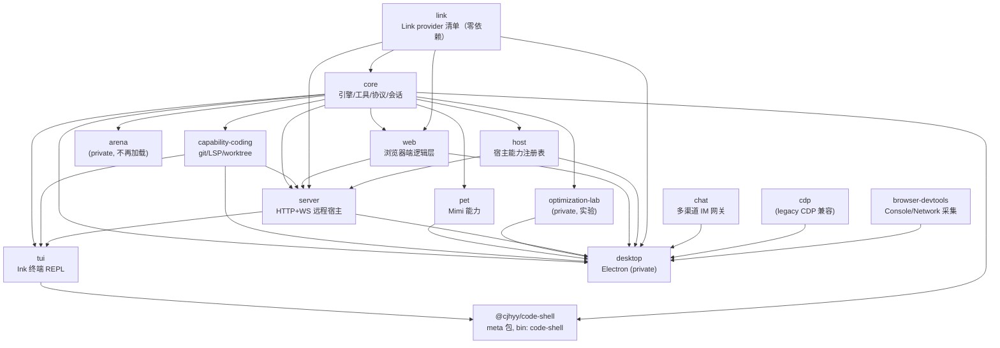
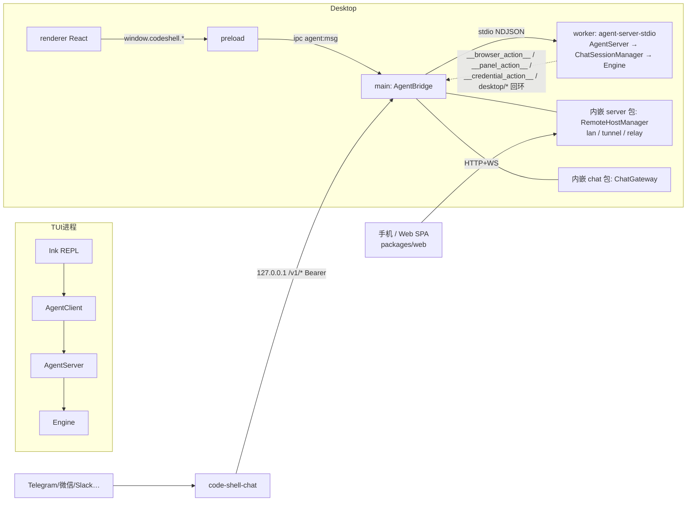

# CodeShell 整体架构梳理（函数层级）

> 基线：`main` @ `df2ca0bda`（2026-10-19），版本 0.9.45。所有 `file:line` 引用都对应这个提交；源码变动后行号会漂移，以符号名为准。
> 本组章节（00–10）于 2026-10-20 按函数层级重写，替换了 2026-07 版的同号章节（已归档到 [`docs/archive/architecture-2026-07/`](../archive/architecture-2026-07/README.md)）。11–16 章未改动。
> 规模：14 个 workspace 包，非测试 TS/TSX 约 54 万行（desktop 24 万、core 15 万、tui 4.3 万、server 4.3 万）。

## 0.1 一句话定位

CodeShell 是一个**领域无关的 AI Agent 编排框架**：`core` 提供引擎（turn loop）、工具系统、权限、Hook、协议、会话存储；“写代码”只是一个可选能力包（`capability-coding`）+ 预设（preset）。上层有三个宿主：终端 TUI（Ink）、Electron Desktop、纯 Node 远程服务（server，供手机/Web 访问），外加独立的 IM 聊天网关（chat）。

设计原则（来自 CODESHELL.md）：Core First、Presets over Hardcoding、Secure by Default（工具都要过权限）、Long-running Ready（Task/Cron/Sleep/Sub-Agent 一等公民）。

## 0.2 包依赖图



构建顺序（根 `package.json` 的 `build` 脚本）：`link → core → host → pet → optimization-lab → coding → cdp → browser-devtools → web → server → tui → chat → build-meta.ts`，desktop 单独构建。

## 0.3 core 的三个入口契约

| 入口                               | 谁能用                                            | 内容                                                |
| ---------------------------------- | ------------------------------------------------- | --------------------------------------------------- |
| `@cjhyy/code-shell-core`（`.`）    | 任何外部 SDK 使用者                               | 稳定公开 API                                        |
| `@cjhyy/code-shell-core/extension` | 能力包（coding / pet / arena / optimization-lab） | 能力包契约：注册工具、prompt section、hook、profile |
| `@cjhyy/code-shell-core/internal`  | 仓库内宿主（tui / desktop / server）              | 宿主专用 helper                                     |
| `/browser/panel-app-runtime`       | desktop renderer                                  | 浏览器安全的 Panel App 运行时                       |
| `/bin/agent-server-stdio`          | desktop/server 拉起的子进程                       | 引擎以 stdio 协议服务的进程入口                     |

desktop 里实际的 import 次数（`grep` 统计）：core `.` 209 处、`/internal` 113 处、pet 46、web 30、link 28、server 各子入口共约 95、coding 各子入口约 36。

两条硬性 ESLint 护栏：

1. `packages/core/**` 不得 import tui（core 与 UI 无关），只允许依赖零依赖的 `link` 公共契约。
2. `packages/desktop/src/renderer/**` 运行时只能 import `core/browser/panel-app-runtime` 和 `web`，其余都要走 `window.codeshell.*`（preload 暴露的 API）。

## 0.4 分层视图

```
┌──────────────────────────── 宿主层 Hosts ────────────────────────────┐
│  tui (Ink REPL)     desktop (Electron main/preload/renderer/mobile)  │
│  server (HTTP+WS, 配对/中继/面板)     chat (Telegram/微信/Slack/…)    │
├──────────────────────────── 客户端逻辑 ──────────────────────────────┤
│  web：stream reducer / approval state / reconnect（renderer & 手机共用）│
├──────────────────────────── 能力包 Capabilities ─────────────────────┤
│  coding (git/LSP/worktree/patch)  pet (Mimi/DelegateWork)  optimization-lab │
│  host (能力注册表/worker 派发)   link (provider 清单)   cdp / browser-devtools │
├──────────────────────────── core ────────────────────────────────────┤
│  engine(turn loop) · tool-system(工具/权限/MCP) · hooks · protocol    │
│  llm/model-catalog · context(压缩/归档) · session(存储) · prompt/preset│
│  plugins/skills · settings/credentials · run/goal/automation · links  │
└──────────────────────────────────────────────────────────────────────┘
```

## 0.5 文档目录

| 章节                                                                         | 范围                                                                           |
| ---------------------------------------------------------------------------- | ------------------------------------------------------------------------------ |
| [01 core：引擎与 turn loop](01-core-engine.md)                               | `engine/` `run/` `goal/` `automation/` `agent/` `operations/`                  |
| [02 core：工具系统与 Hook](02-core-tool-system.md)                           | `tool-system/` `hooks/`                                                        |
| [03 core：LLM、上下文、会话](03-core-llm-session-context.md)                 | `llm/` `model-*` `context/` `session/` `prompt/` `cost-*`                      |
| [04 core：协议、插件、技能、Link](04-core-protocol-plugins-links.md)         | `protocol/` `plugins/` `skills/` `links/` `sources/`                           |
| [05 core：入口、设置、组合、运行时](05-core-runtime-settings-composition.md) | 入口 / `settings/` `credentials/` `composition/` `preset/` `panel-apps/` …     |
| [06 能力包](06-capability-packages.md)                                       | coding / pet / host / link / optimization-lab / cdp / browser-devtools / arena |
| [07 TUI](07-tui.md)                                                          | `packages/tui` + meta 包                                                       |
| [08 Desktop 主进程](08-desktop-main.md)                                      | main / preload / shared / browser-library / chrome-extension                   |
| [09 Desktop 渲染层、手机端、web](09-desktop-renderer-mobile-web.md)          | renderer / mobile / `packages/web`                                             |
| [10 server 与 chat](10-server-chat.md)                                       | `packages/server` `packages/chat`                                              |

11–16 章（功能清单、包边界、插件兼容、数字人、Codex 对比、平台收敛）是专题文档，本次未重写，见 [README](README.md)。

## 0.6 三种宿主的运行拓扑（Engine 到底跑在哪）

| 宿主                            | Engine 所在进程                                                                                                | 传输                                                                                       | 能力包装配                                                                                                                               |
| ------------------------------- | -------------------------------------------------------------------------------------------------------------- | ------------------------------------------------------------------------------------------ | ---------------------------------------------------------------------------------------------------------------------------------------- |
| TUI                             | **同进程**                                                                                                     | 进程内 EventEmitter transport（`AgentServer` ↔ `AgentClient`）                             | `repl.ts:160` `compileComposition({modules:[createCodingModule()]})`                                                                     |
| Desktop                         | **共享 worker 子进程**（`ELECTRON_RUN_AS_NODE=1` 跑 `core/bin/agent-server-stdio`，首次 `agent/run` 才懒启动） | stdio NDJSON（JSON-RPC 2.0 风格），主进程侧 `AgentBridge` + server 包的 `WorkerBridgeCore` | `agent-bridge.ts:415` 通过环境变量 `CODE_SHELL_CAPABILITY_MODULES="spec#export,…"` 注入 coding / pet / links（optimization-lab 需 flag） |
| server（`code-shell-serve`）    | worker 子进程，同上                                                                                            | stdio NDJSON；对外 HTTP + WS                                                               | `headless-server.ts:546` 注入 coding + links                                                                                             |
| TCP worker / SDK `createServer` | 同进程或 TCP                                                                                                   | TCP NDJSON（**无认证**）                                                                   | 默认只有 core                                                                                                                            |

例外：Desktop 主进程里**直接** `new Engine` 的只有两处——定时自动化（`automation-host.ts:298`）和 Dream（`dream-service.ts:98`）。所有 `new Engine(` 都必须在 `scripts/check-no-engine-bypass.sh` 白名单里（“构造守卫”是 lint，不是运行时）。



## 0.7 一条用户消息的端到端旅程（以 Desktop 为例，函数级）

1. **renderer**：Composer 提交 → `window.codeshell.run(task, opts)`（`preload/index.ts:535`）→ `rpc("agent/run")`（`:405`）→ `ipcRenderer.send("agent:msg")`。
2. **main**：`ipcMain.on("agent:msg")`（`agent-bridge.ts:927`）→ `prepareAgentRunMetadata`（`agent-run-metadata.ts:77`，删除 renderer 不可信字段、重新计算 trust / workspace）→ `handleAgentRunMetadata`（`agent-bridge.ts:624`：`ensureWorker` → `WorkerBridgeCore.spawn`（`worker-bridge-core.ts:181`）、推凭证快照）→ `core.sendLine` 写 worker stdin。
3. **worker / protocol**：`AgentServer` 收到 `agent/run` → 多会话路径 `session.enqueueTurn(...)`（`protocol/server.ts:1809`）→ `ChatSession` 串行队列 → `engine.run(...)`（`protocol/chat-session.ts:515`）。
4. **Engine.run**（`engine/engine.ts:1449`）→ `runExclusive`（`:1583`）：解析 workspace/权限模式 → 组装 ToolContext/沙箱 → `openRunSession`（resume 或 create，CAS 抢 run）→ `runSessionStartHooks` → `wireRunContextAndPermission` → `wireRunTooling`（工具定义 + MCP）→ `assembleRunPrompts`（稳定 system prompt + 尾部 volatile `<system-reminder>`）→ `wireRunLoop` → `TurnLoop.run`。
5. **TurnLoop**（`engine/turn-loop.ts:908 runUnredacted`）每轮：消费 steer → `on_turn_start` hook → `ContextManager.manageAsync`（三级压缩）→ `callModelWithFallback`（`:2107`）→ `ModelFacade.call` → `withModelRequestBoundary` → `LLMClientBase.createMessage`（Anthropic / OpenAI 两个实现，fetch 外包三层：计费收据 / 请求边界签名 / trace）。
6. **工具**：`StreamingToolQueue.enqueue/drain` → `ToolExecutor.executeSingle`：可见性闸 → `pre_tool_use` hook（可拦截/改写）→ `PermissionClassifier`（规则 → 审批后端）→ 工具函数 → `post_tool_use` hook → `toolResultToBlock` 回填为一条 user 消息 → 下一轮。
7. **审批往返**：Engine 需要审批 → `AgentServer.notify("agent/approvalRequest")` → worker stdout → main `handleWorkerLine`（`agent-bridge.ts:528`，普通工具不拦截）→ preload `approvalListeners` → 弹窗 → `codeshell.approve`（`preload/index.ts:691`）→ `agent/approve` → worker 继续。手机端通过 `PendingMobileApprovals` 也能审批。
8. **事件回流**：每个 `StreamEvent` → `agent/streamEvent` 通知 → main `snapshots.append` + `safeSend("agent:streamEvent")` + `outboundTaps`（推手机）→ renderer `onStreamEvent` → 按 `project::session` 分桶 → 50ms 合批 → `applyStreamEvent`（`renderer/.../types.ts:932`）→ `MessageStream` 渲染。
9. **收尾**：模型不再调工具 → `on_stop` hook（Goal 裁判可要求继续）→ `finalizeRunSuccess`（`run-finalize.ts:144`，`sealForFinalization` 阻止未复核的外部写被标为完成）→ `appendClientRunReceipt`（重复提交可回放）→ transcript JSONL 已逐条追加落盘。

## 0.8 已知问题与疑点（基线 `df2ca0bda`）

> 说明：下面这些都是**读代码**发现的，没有跑测试复现，改之前请复核。细节见各章“设计要点/坑”一节。

**逐行核对过调用链**

- **多会话路径丢字段**：`packages/core/src/protocol/server.ts:1822/1835` 把 `operationBatchToken`、`sessionBrief` 传给 `session.enqueueTurn`，但 `TurnOpts`（`protocol/chat-session.ts:26`）没有这两个字段，`ChatSession` 转发给 `engine.run`（`chat-session.ts:515`）时也没带。单 Engine（legacy）路径（`server.ts:1987`）会直接传。结果是：Desktop/server 的多会话模式下，`Engine` 里依赖它们的逻辑（`engine/engine.ts:1622`、`:1755`、`:1807`）收不到值。
- **中继能看到明文**：`packages/server/src/remote-relay/protocol.ts:1` 说明云端中继会解开 TLS，本地是纯 HTTP，没有端到端加密（目前是已知且接受的取舍）。

**对照源码确认过行为**

- Edit 工具的替换串含 `$` 时，会被当作 `String.replace` 的特殊替换模式处理（第 02 章）。
- Bash 的 deny 规则遇到 `&&` 等链式命令会被降级为 ask（第 02 章）。

**推断、未验证**

- 安全相关：coding 包的 DriveAgent 默认 `bypassPermissions`；server 的 LAN 模式没有口令门且是明文 HTTP；设备 `secretHash` 原样存储（等同 bearer）；口令锁定是全局的（任何人连错 5 次可让主人锁定 60 秒）；chat 媒体下载的 SSRF 防护只看 URL 字面量，不校验 DNS 解析结果。
- 可靠性：`WorkerBridgeCore.outbox` 是死代码，没有 worker 时消息直接丢弃；chat inbox 无限重试；钉钉处理失败也回 SUCCESS；外部会话存储用的不是 CronStore 那把锁；LSP 不应答服务器请求，`starting` 状态固定等 2 秒。
- 行为：激活数字人时 `profile.preset` 硬编码为 `general`；themes 目录在设置了 `CODE_SHELL_HOME` 时多一层 `.code-shell`（`HOME` / `CODE_SHELL_HOME` / `homedir()` 混用）；TUI 的 `/commit`、`/review`、`/init` 最后一条回复可能一直显示为流式中；`code-shell run` 的 `maxTurns`/`output` 回退值被 commander 默认值遮住，`--effort` 无效。
- 架构：TUI 直接读 core 的进程单例（`asyncAgentRegistry`、`notificationQueue`、`cronScheduler`、`costTracker`），换成远程客户端时这些功能会失效；自动压缩不写盘（`appendSummary` 无调用方），只有 `range_archive` / `context_checkpoint` / `context_transfer` 落盘。

**旧文档已过时的地方**

- `docs/archive/architecture-2026-07/09-tui.md` 写的 `arena` 子命令已不存在。
- `docs/archive/architecture-2026-07/10-desktop-and-mobile.md` 写的浏览器 CDP 路径已过时，现在是 Puppeteer + 伪造的 `chrome.debugger` 接 Electron `webContents.debugger`。
- 手机端 `mobile/App.tsx` 已无引用，入口挂载的是 `web/app/DesktopApp`。
