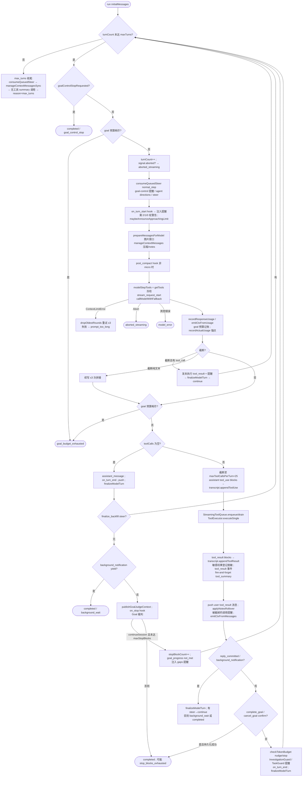

# 01 · Core Engine 切片架构（engine / run / goal / automation / agent / operations）

> 基线：`main@df2ca0bda`（2026-10-20）。所有 `file:line` 都对照当前源码核过（`grep -n`）。
> 路径默认相对 `packages/core/src/`。旧版章节（`docs/archive/architecture-2026-07/`）与 `docs/core-deep-dive` 只作线索，凡与源码冲突的以本文为准。
> 不确定之处会显式标注“（未核实）”。

---

## 1. 模块职责概述

这一切片是 `@cjhyy/code-shell-core` 的“执行内核”：

| 子目录        | 一句话职责                                                                                                                                                                                                                                                                                                      | 在 core 中的位置                                                                                                                       |
| ------------- | --------------------------------------------------------------------------------------------------------------------------------------------------------------------------------------------------------------------------------------------------------------------------------------------------------------- | -------------------------------------------------------------------------------------------------------------------------------------- |
| `engine/`     | **Engine 门面 + TurnLoop 状态机**。把 composition（模块贡献）、ToolRegistry、HookRegistry、SessionManager、ModelPool、ContextManager、PermissionClassifier、MCP、sandbox 粘在一起，对外暴露 `Engine.run(task, options)`；内部每次 run 构造一个 `TurnLoop` 驱动 “模型调用 → 工具执行 → 结果回填 → 下一轮/结束”。 | 被 `protocol/`（AgentServer / ChatSession）、`run/EngineRunner`、CLI worker、TUI、Desktop automation 调用                              |
| `run/`        | **可恢复的长任务 Run 层**（RunManager / RunStore / RunLock / Heartbeat / Checkpoint / Evaluator）。把一次 Engine 调用包装成有持久化状态、锁、心跳、审批、产物追踪的 “Run”。                                                                                                                                     | 在 Engine 之上；`EngineRunner` 是 `new Engine(` 白名单站点之一                                                                         |
| `goal/`       | **Goal（持久目标）生命周期纯函数**：`normalizeGoal`、版本/修订比较、预算 tracker、`extend` 计算、终态原因、`goalLifecycle` ⇄ `GoalConfig` 互转。                                                                                                                                                                | 被 `engine/run-goal.ts`、`engine/turn-loop.ts`、`engine/engine.ts`、`hooks/goal-stop-hook.ts`、`session/session-manager.ts` 使用       |
| `automation/` | **Cron/自动化**：cron 表达式、自动化定义存储（带跨进程锁）、调度 tick、runner（无人值守跑 Engine）、写策略。                                                                                                                                                                                                    | 被 Desktop main / TUI / protocol 使用（通过 `index.internal.ts` 导出）                                                                 |
| `agent/`      | **子代理角色定义**（`.code-shell/agents/*.md` 解析 + 多来源合并注册表）。                                                                                                                                                                                                                                       | `Engine.getAgentDefinitions()` → `ToolContext.agentDefinitions` → `Agent` 工具                                                         |
| `operations/` | **外部写操作账本（operation ledger）**：每个会产生外部副作用的工具调用都登记、回读验证、恢复、归档；批量操作授权。                                                                                                                                                                                              | `Engine.runExclusive` 为每次 run 创建 `toolCtx.operations`；`finalizeRunSuccess` 用 `sealForFinalization` 阻止“未验证写入”被标记为完成 |

核心设计主线（从代码注释提炼）：

1. **Engine 是单 run 串行的**：同一实例同一时刻只允许一个 `run()`（`runInProgress` 守卫，`engine/engine.ts:1451`），排队策略由宿主（ChatSession FIFO）负责。
2. **run 内一切状态都挂在 LifetimeScope 上**：`engine → session → run` 三级作用域（`engine.ts:649/870/1800`），run 结束时 `activeRunScope.dispose()` 摘除 goal hook、file-history hook、permission detach、MCP release。
3. **TurnLoop.run() 永不 reject**：所有异常都转成 `TerminalReason`（`turn-loop.ts:930-937, 1969-1995`），保证 Engine 后续持久化/钩子一定执行。
4. **持久化以 transcript 为真相、state.json 走 CAS**：每个模型回合先写 `turn_boundary` 再 flush state（`finalizeModelTurn`，`turn-loop.ts:560`）；state 写入走 `SessionManager.updateSessionRunState` 的 revision CAS，按 runId fence。

---

## 2. 目录 / 文件清单（非测试源码）

### 2.1 `engine/`（53 个文件，约 16.3k 行）

| 文件                                         | 行数  | 职责                                                                                                                                                                                                                  |
| -------------------------------------------- | ----- | --------------------------------------------------------------------------------------------------------------------------------------------------------------------------------------------------------------------- |
| `engine.ts`                                  | 5082  | `Engine` 类：构造期组装 composition/registry/hooks/session/model pool；`run()`→`runExclusive()` 编排一次 run 的全部阶段；goal 控制、steer、compaction/archive、模型切换、配置热更、dispose                            |
| `turn-loop.ts`                               | 2412  | `TurnLoop` 状态机：pre_check → context_mgmt → model_call → post_check → tool_exec → hook_notify；goal 停止阻塞、预算、steer 注入、截断续写、孤儿 tool_use 修补                                                        |
| `types.ts`                                   | 271   | `EngineConfig` / `EngineHookConfig` / `EngineResult` / `ChildHostBindings`（从 engine.ts 抽出以免类型消费者拖入实现）                                                                                                 |
| `run-types.ts`                               | 262   | `EngineRunOptions`、`RunBehaviorProfile`、内置 profile（`QUICK_CHAT_RESTRICTED_PROFILE`、`ISOLATED_TASK_PROFILE`）、`ChildEngineRunner`/`ChildEngineRuntime`                                                          |
| `run-workspace.ts`                           | 246   | run 前阶段：session kind、workspace profile、behavior profile、permission/plan mode、workspace resume、有效 cwd 与 `WorkspaceContext` 校验                                                                            |
| `run-session-open.ts`                        | 292   | 创建或恢复 session；`clientMessageId` 幂等认领（重复提交直接回放结果）；追加用户消息；`startSessionRun` 获取 `previousRunId`                                                                                          |
| `run-image-input.ts`                         | 243   | 解析 `<codeshell-image>`、附件上下文、图片策略/压缩；`buildRunUserMessageContent` 生成用户消息 content                                                                                                                |
| `input-attachments.ts`                       | 522   | 把 `InputAttachmentMeta` 解析为模型可见上下文（文件/图片字节），带 workspace root 与权限校验                                                                                                                          |
| `parse-task.ts`                              | 190   | `parseTaskWithImages`：从单字符串 task 恢复内联图片                                                                                                                                                                   |
| `image-policy.ts`                            | 294   | 图片大小/数量上限、`enforceImagePolicy`、`dropOversizedImages`                                                                                                                                                        |
| `image-compression.ts`                       | 238   | 宿主未预压缩时的图片压缩回退（可注入 `ImageCompressor`）                                                                                                                                                              |
| `run-tooling.ts`                             | 586   | 每 run 工具面：`buildRunToolContext`、`buildRunPermissionPipeline`（分类器+ToolExecutor+guards）、`connectRunMcp`、`assembleRunToolDefs`/`buildToolVisibility`、`initializeRunToolSurface`（ToolSearch 初始工具路由） |
| `run-context.ts`                             | 133   | `createRunContextManager`（含 ctx-bar 种子）、`composeRunSystemPrompt`（profile runtime context 尾巴）、`assembleRunMessages`                                                                                         |
| `run-setup.ts`                               | 156   | `resolveRunProfileState`（workspace profile → 覆盖/记忆目录）、`buildPromptComposerConfig`                                                                                                                            |
| `run-goal.ts`                                | 286   | `resolveRunGoal`（显式>已存>配置默认）、`armRunGoalHook`（注册 GoalStopHook）、`createGoalTerminationApplier`                                                                                                         |
| `goal-judge-context.ts`                      | 275   | `buildGoalJudgeRuntimeContext`：为 Goal 裁判截取最近 ≤6 轮、≤3k token/12k 字符、脱敏的证据                                                                                                                            |
| `run-accounting.ts`                          | 174   | `createRunUsageAccounting`（累计用量/外部计费/goal 预算短路）、`wireRunModelFacade`（包装 `ModelFacade.call`、`summarize`、`getOutputTokens`）                                                                        |
| `model-facade.ts`                            | 310   | `ModelFacade`：LLM client + transcript；流式/非流式调用、请求边界签名、日志/录制、把 assistant 响应写入 transcript                                                                                                    |
| `streaming-tool-queue.ts`                    | 140   | `StreamingToolQueue`：完整响应后的工具批执行策略（并发安全工具立即并行，非安全串行，结果按原序）                                                                                                                      |
| `run-finalize.ts`                            | 480   | 无头后台子代理排水 `drainHeadlessBackgroundAgents`、成功收尾 `finalizeRunSuccess`、失败收尾 `buildRunFailureResult`/`createRunFailureHandler`、`appendClientRunReceipt`                                               |
| `run-stream.ts`                              | 255   | `buildWrappedOnStream`：把每个 stream 事件写入 `SessionOutputJournal`（批量 text_delta），追踪 TodoWrite 快照，`goal_progress` 落 transcript                                                                          |
| `run-state-persistence.ts`                   | 110   | `persistRunState`（按 runId CAS + usage delta 合并）、`sessionCumulativeUsageUpdate`、`RunningSessionState`                                                                                                           |
| `run-output-user-message.ts`                 | 74    | `outputUserMessage`：用户消息的规范展示形态（不重复图片字节）                                                                                                                                                         |
| `run-environment.ts`                         | 150   | `RunEnvironmentResolver`：sandbox 配置（config > project > user > 默认）、backend 缓存、shell env 合并                                                                                                                |
| `sandbox-config.ts` / `sandbox-cache-key.ts` | 53/19 | sandbox 配置优先级；backend 缓存 key（含 network/roots/reads）                                                                                                                                                        |
| `runtime.ts`                                 | 159   | `EngineRuntime`：多 Engine 共享的 modelPool/toolRegistry/mcpPool/usageLedger/sandbox 缓存，统一 close                                                                                                                 |
| `permission-controller.ts`                   | 207   | `PermissionController` + `composePermissionRules`：权限模式/plan 模式，run 中修改延迟到 run 结束生效                                                                                                                  |
| `subagent-spawner.ts`                        | 441   | `createSubAgentSpawner`、`ChildRunSupervisor`（live child 定向消息/中断重驱）、`resolveChildLlm/ToolScope/Sandbox/McpServers`、`wrapChildStream`                                                                      |
| `auxiliary-pipeline.ts`                      | 273   | `AuxiliaryPipeline`：aux 模型解析与缓存、摘要函数、记忆抽取 + AutoDream 管线                                                                                                                                          |
| `engine-instruction-context.ts`              | 232   | 冻结指令（skill 等 instruction binding）快照的解析与撤销时的上下文清理                                                                                                                                                |
| `engine-workspace-authority.ts`              | 217   | `SessionWorkspaceAuthorityTracker`、`resolveSyntheticRunWorkspace`、`createAuthorizedSessionMessageService`、session workspace set/migrate/release                                                                    |
| `file-history-hook.ts`                       | 112   | 注册 `on_tool_start/on_tool_end` 钩子：文件快照（/undo）+ `turn_diff`                                                                                                                                                 |
| `steer-queue.ts`                             | 60    | steer 队列纯函数：enqueue/consume/remove                                                                                                                                                                              |
| `token-budget.ts`                            | 60    | `checkTokenBudget`（continue/nudge/stop）                                                                                                                                                                             |
| `prompt-cache-diagnostics.ts`                | 269   | prompt 前缀指纹 + cache read 骤降归因                                                                                                                                                                                 |
| `model-trace-scope.ts`                       | 70    | `withEngineRunTrace` / `withEngineAuxiliaryModelTrace`：模型追踪作用域                                                                                                                                                |
| `tool-summary.ts`                            | 51    | 工具批次一行摘要（fire-and-forget）                                                                                                                                                                                   |
| `session-title.ts`                           | 54    | 首轮后生成会话标题                                                                                                                                                                                                    |
| `friendly-error.ts`                          | 96    | 错误 → 用户可操作提示                                                                                                                                                                                                 |
| `patch-orphaned-tools.ts`                    | 114   | 恢复会话时修补悬空 `tool_use`（resume 路径使用；TurnLoop 内另有私有同名方法）                                                                                                                                         |
| `query.ts`                                   | 171   | `query()` 异步生成器：TurnLoop 的轻量公开包装（无 Engine）                                                                                                                                                            |
| `dynamic-tool-defs.ts`                       | 47    | 每轮重写 tool def（如给 `Agent` 工具注入可用 agent 类型列表）                                                                                                                                                         |
| `disk-defaults.ts`                           | 78    | `diskDefaultsFrom`：配置热更 “layer 2” 的 patch                                                                                                                                                                       |
| `resolve-llm-config.ts`                      | 74    | `resolveLLMConfigForTag`：非 Engine 场景按 tag 解析 LLMConfig                                                                                                                                                         |
| `model-connections-pool.ts`                  | 80    | `settings.modelConnections[]` → `ModelEntry[]`                                                                                                                                                                        |
| `persist-active-model.ts`                    | 64    | 写 `settings.defaults.text`                                                                                                                                                                                           |
| `aux-key.ts`                                 | 12    | `resolveAuxKey`：`settings.defaults.auxText`                                                                                                                                                                          |
| `cost-store.ts`                              | 24    | `CostStateStore` 接口（旧计费快照）                                                                                                                                                                                   |
| `reactive-threshold.ts`                      | 22    | 流式中每 2000 token 桶触发一次 reactive compaction 探针                                                                                                                                                               |
| `injected-context-cache.ts`                  | 19    | 缓存前剥离 run 注入的上下文消息                                                                                                                                                                                       |
| `turn-state.ts`                              | 31    | `newTurnId` 等                                                                                                                                                                                                        |
| `initial-tools-preset.fixture.ts`            | 20    | 测试 fixture 模块（非生产）                                                                                                                                                                                           |

### 2.2 其余子目录

> 详见第 3.9–3.13 节。

| 目录          | 文件                                                                                                                                                                                                                                                                                                                                       |
| ------------- | ------------------------------------------------------------------------------------------------------------------------------------------------------------------------------------------------------------------------------------------------------------------------------------------------------------------------------------------ |
| `run/`        | `RunManager.ts`(999) `FileRunStore.ts`(398) `EngineRunner.ts`(268) `Heartbeat.ts`(214) `types.ts`(213) `RunApprovalBackend.ts`(197) `ArtifactTracker.ts`(176) `CheckpointWriter.ts`(169) `RunLock.ts`(166) `factory.ts`(125) `Evaluator.ts`(107) `RunQueue.ts`(101) `index.ts`(78) `RunStore.ts`(43) `ids.ts`(25) `redirect-target.ts`(12) |
| `goal/`       | `lifecycle.ts`(766)                                                                                                                                                                                                                                                                                                                        |
| `automation/` | `scheduler.ts`(1299) `store.ts`(490) `cron-expr.ts`(207) `runner.ts`(153) `write-policy.ts`(129) `index.ts`(99) `desktop-authority-client.ts`(64) `write-run.ts`(64)                                                                                                                                                                       |
| `agent/`      | `agent-definition.ts`(147) `agent-definition-registry.ts`(124)                                                                                                                                                                                                                                                                             |
| `operations/` | `ledger.ts`(1084) `archive.ts`(452) `desktop-batch-authority-client.ts`(324) `recovery.ts`(227) `controller.ts`(182) `resolver.ts`(119) `review-store.ts`(115) `schema.ts`(108) `files.ts`(78) `run-batch-authority.ts`(73) `session-owner.ts`(65) `session-services.ts`(21)                                                               |

---

## 3. 关键类型与类

### 3.1 `Engine`（`engine/engine.ts:319`）

#### 3.1.1 重要字段

| 字段                                                                                                                    | 行          | 含义                                                                                                  |
| ----------------------------------------------------------------------------------------------------------------------- | ----------- | ----------------------------------------------------------------------------------------------------- |
| `preset: AgentPreset`                                                                                                   | 326         | 当前 preset；`refreshRuntimeConfig` 可热替换（但 builtin 工具集合 ctor 冻结）                         |
| `runtimeToolRegistry` / `toolRegistry`                                                                                  | 328/330     | 前者是 runtime 共享、无 capability 的种子；后者是 `fork()` 出的本 Engine 视图（含模块工具、MCP 工具） |
| `composition: ResolvedComposition`                                                                                      | 332         | 模块贡献的唯一事实源（工具/钩子/profile/prompt section/instruction binding/fileHistory/services）     |
| `toolGuards` / `toolRewriters`                                                                                          | 334/336     | 来自 `tool.exposure.availability` / `rewriteDefinition`，每轮过滤/改写工具定义                        |
| `behaviorProfiles: Map`                                                                                                 | 341         | core 默认 → `config.behaviorProfiles` → 非 core 模块，后者按 id 覆盖前者（`engine.ts:683-690`）       |
| `hooks: HookRegistry`                                                                                                   | 344         | 全部钩子；优先级：plugin 80 → shell 50 → capability 20 → SDK 0（注释 `engine.ts:786-787`）            |
| `sessionManager`                                                                                                        | 345         | 会话持久化（state.json + transcript）                                                                 |
| `modelPool`                                                                                                             | 349         | 优先 runtime 共享池                                                                                   |
| `lifetime` / `settingsHookScope` / `pluginHookScope` / `sessionLifetimes` / `activeRunScope`                            | 354-362     | 生命周期作用域树                                                                                      |
| `steerQueueBySid`                                                                                                       | 422         | 步间 steer 队列（纯内存）                                                                             |
| `activeTurnLoop` / `activeProfileMaxTurns`                                                                              | 427/429     | 正在运行的 TurnLoop（供 extendGoalRun / updateGoal）                                                  |
| `activeGoalHook` / `activeGoalHookAttached` / `activeRuntimeGoal` / `activePersistedRunGoal` / `activeGoalRegistration` | 364,435-441 | Goal 运行槽位                                                                                         |
| `activeRunSession: SessionBundle`                                                                                       | 453         | 正在运行的 session bundle；clearGoal/updateGoal 必须改同一个实例，否则下一次 saveState 会“复活”目标   |
| `runningSession: RunningSessionState`                                                                                   | 457         | 已认领 run 的持久化簿记（committed usage/anchor、finalized）                                          |
| `runInProgress`                                                                                                         | 466         | 同实例 run 守卫                                                                                       |
| `pendingLlm` / `boundModelKey`                                                                                          | 467/469     | run 中切换模型延迟生效；仅绑定本池的 key                                                              |
| `runAbort`                                                                                                              | 470         | 内部 AbortController（与调用方 signal `AbortSignal.any` 合并）                                        |
| `compactedMessagesBySession`                                                                                            | 395         | 每会话压缩后消息缓存（下一次 run 优先使用）                                                           |
| `lastContextManager` / `lastMessages` / `lastSessionId`                                                                 | 392-394     | 供 `/compact`、archive 复用                                                                           |
| `ctxSeedSent` / `ctxOverheadBySid`                                                                                      | 404/412     | ctx 进度条种子与 “system+tools 开销” 缓存，防止每次提交进度条骤降                                     |
| `instructionWatches` / `revokedInstructionContext`                                                                      | 471-473     | instruction binding 撤销监听：run 中撤销 → abort 当前 run                                             |

#### 3.1.2 公共方法（按功能分组）

**生命周期**

| 方法                  | 行   | 做什么 / 调用链                                                                                                                                                    |
| --------------------- | ---- | ------------------------------------------------------------------------------------------------------------------------------------------------------------------ |
| `constructor(config)` | 636  | 见 §4.1                                                                                                                                                            |
| `ready()`             | 844  | 返回 `moduleReady`（模块私有服务 + `activateEngineModules`）                                                                                                       |
| `dispose()`           | 4004 | 置 `disposed`、`runAbort.abort`；若模块激活中先 dispose lifetime；等待 `runSettled` 与 `moduleReady`，再 `lifetime.dispose()`，清空 steer/compacted/agentDefs 缓存 |
| `run(task, options)`  | 1449 | 见 §4.2                                                                                                                                                            |

**运行时注入（宿主后置注入，解决“server 构造需要 engine”的鸡生蛋）**：`setAskUser`(1084)、`setAskUserAsync`(1089)、`setAgentControlStateListener`(1094)、`setAgentDirectionsDeliveredListener`(1098)、`setBrowserBridge`(1110)、`setChildHostBindings`(1116)、`setWorkspaceBridge`(1121)、`setPanelBridge`(1128)、`setSessionMessageRouter`(1135)、`setInjectCredential`(1233)、`registerCustomTool`(1062 → `toolRegistry.registerTool`)。

**Steer（不打断注入）**

| 方法                                                        | 行   | 说明                                                                                                                                                      |
| ----------------------------------------------------------- | ---- | --------------------------------------------------------------------------------------------------------------------------------------------------------- |
| `enqueueSteer(sid, text, id, clientMessageId, attachments)` | 1152 | 仅当 `activeTurnLoop` 存在且 `activeRunSession.sessionId===sid` 才接受；否则 `{accepted:false}` 让宿主降级为普通 run；调用 `steer-queue.enqueueSteerItem` |
| `unsteer(sid, id)`                                          | 1194 | `removeSteerItem`；已被消费则返回 false                                                                                                                   |
| `consumeSteer`（私有）                                      | 1203 | 由 TurnLoop 通过 `deps.consumeSteer` 调用；`consumeSteerItems`                                                                                            |
| `restoreSteer`（私有）                                      | 1225 | 准备失败的 steer 放回队首                                                                                                                                 |

**会话/上下文**

| 方法                                                                                 | 行        | 说明                                                                                                                                                                                            |
| ------------------------------------------------------------------------------------ | --------- | ----------------------------------------------------------------------------------------------------------------------------------------------------------------------------------------------- |
| `sessionExistsOnDisk` / `forkSession` / `selectContextPackage` / `createSummaryFork` | 1277-1294 | 薄转发到 `SessionManager`                                                                                                                                                                       |
| `summarizeContextPackage(messages, signal, sourceSid)`                               | 1297      | 用 aux 模型做“滚动九段合并”摘要：按 API round 分组序列化，超窗时对单轮做二分切片（1360-1381），每片 `client.createMessage`（`usagePurpose:"context_package"`），用量记入 `recordAuxiliaryUsage` |
| `restoreSessionModel(sid)`                                                           | 1427      | 冷 Engine 按持久化的 model/provider 选回池中条目                                                                                                                                                |
| `injectContext(sid, content)`                                                        | 4343      | 以 assistant 消息追加到 transcript，并同步 compacted 缓存                                                                                                                                       |
| `forceCompact(sid?)`                                                                 | 4367      | 见 §4.6                                                                                                                                                                                         |
| `archiveTurnRange(sid, range, anchors?)`                                             | 4523      | 见 §4.6                                                                                                                                                                                         |
| `appendArchiveMarker(sid, marker)`                                                   | 4641      | 见 §4.6                                                                                                                                                                                         |
| `resolveSessionRunWorkspace(sid)`                                                    | 3773      | 后台唤醒等“核心发起的续跑”重建可信 cwd/WorkspaceContext（`resolveSyntheticRunWorkspace`）                                                                                                       |
| `setSessionWorkspace` / `migrateSessionMainRoot` / `releaseSessionWorkspace`         | 4311-4341 | 委托 `engine-workspace-authority`，同时更新 live state                                                                                                                                          |
| `prepareSessionCloseFinalization(sid, epoch)`                                        | 3864      | 关闭会话时宿主先撤销，返回 commit 闭包，在 run 结束后用 `createClosingRunFinalizer` 写最终字段与未提交 usage delta                                                                              |

**Goal 控制**

| 方法                        | 行   | 说明                                                                                    |
| --------------------------- | ---- | --------------------------------------------------------------------------------------- |
| `getGoal(sid)`              | 4126 | `sessionManager.readActiveGoal`                                                         |
| `canResumeGoalInPlace(sid)` | 4131 | 当前 run 已带 goal prompt/tools 可就地恢复                                              |
| `updateGoal(sid, patch)`    | 4146 | 见 §4.9                                                                                 |
| `clearGoal(sid, expected?)` | 4250 | 见 §4.9                                                                                 |
| `extendGoalRun(opts)`       | 4757 | `activeTurnLoop.extend(opts)`；behavior profile 的 maxTurns 天花板不可突破（4764-4777） |

**模型 / 配置 / 权限**

| 方法                                                                             | 行        | 说明                                                                                                                                                                                                                                                                                                                               |
| -------------------------------------------------------------------------------- | --------- | ---------------------------------------------------------------------------------------------------------------------------------------------------------------------------------------------------------------------------------------------------------------------------------------------------------------------------------- |
| `switchModel(key, {persist})`                                                    | 3642      | `persist:false` 用 `modelPool.get` 不改共享池 active key（防止跨会话泄漏）；run 中写 `pendingLlm`；否则立即换 `config.llm`；`persist!==false` 时 `persistActiveModel`                                                                                                                                                              |
| `reloadModelPool()`                                                              | 1001      | 无 runtime 时清池重读 settings；已绑定 key 或 run 中则保留当前 llm                                                                                                                                                                                                                                                                 |
| `refreshRuntimeConfig(patch, version)`                                           | 4063      | 配置热更 layer 2：版本单调丢弃旧 patch；preset 变化时重解析 preset（工具集合变化只记 warn）；`reloadHooks()`                                                                                                                                                                                                                       |
| `reloadHooks()`                                                                  | 604       | 释放 settings/plugin hook scope 并重载                                                                                                                                                                                                                                                                                             |
| `updateConfig(key, value)` / `readSetting(key)`                                  | 4719/4727 | SettingsManager 读写                                                                                                                                                                                                                                                                                                               |
| `setPermissionMode` / `getPermissionMode` / `setPlanMode` / `getPermissionRules` | 4744-4799 | 委托 `PermissionController`                                                                                                                                                                                                                                                                                                        |
| `resetSessionUsage(sid)`                                                         | 3673      | 清零 model-scoped token 窗口（不动 cumulative）                                                                                                                                                                                                                                                                                    |
| `getUsageSummary` / `recordExternalUsage`                                        | 3715/3720 | `UsageLedger`                                                                                                                                                                                                                                                                                                                      |
| `queryCapability(type, params)`                                                  | 1070      | 分发 `composition.protocol.queries` 中宿主安装的查询                                                                                                                                                                                                                                                                               |
| `getFeatureFlags` / `getEffectiveDisabledLists`                                  | 5039/5030 | 只读视图                                                                                                                                                                                                                                                                                                                           |
| `buildToolContext(cwd, overrides, memDir)`                                       | 4942      | 基础 `ToolContext`（run 中再叠加 sandbox/spawner 等）；也供测试使用                                                                                                                                                                                                                                                                |
| 只读 getter                                                                      | —         | `maxContextTokens`(486)、`permissionMode`(1262)、`planMode`(1266)、`getToolRegistry`(3617)、`getRuntimeToolRegistry`(3622)、`getModelPool`(3698)、`getCurrentModel`(3703)、`getHookRegistry`(3707)、`getSessionManager`(3711)、`getConfig`(3994)、`getComposition`(3999)、`getLoadedInstructionSnapshots`(476)、`isHeadless`(1243) |

#### 3.1.3 重要私有方法（run 的“阶段函数”）

`runExclusive` 被拆成一串阶段方法（注释反复声明“verbatim 抽取，行为不变”）：

| 私有方法                                                                                                                               | 行                  | 职责                                                                                                                                                                                                               | 主要调用                                                                                                                            |
| -------------------------------------------------------------------------------------------------------------------------------------- | ------------------- | ------------------------------------------------------------------------------------------------------------------------------------------------------------------------------------------------------------------ | ----------------------------------------------------------------------------------------------------------------------------------- |
| `runExclusive`                                                                                                                         | 1583                | run 编排骨架                                                                                                                                                                                                       | 见 §4.2                                                                                                                             |
| `wireRunSandboxToolContext`                                                                                                            | 2578                | 解析 sandbox 配置/backend，构造子代理 spawner（**唯一的 `new Engine(` 子代理路径**），组装 run 的 ToolContext                                                                                                      | `RunEnvironmentResolver.resolveSandboxConfig/resolveSandbox`、`createSubAgentSpawner`、`buildRunToolContext`、`getAgentDefinitions` |
| `stampRunToolContext`                                                                                                                  | 2294                | session 打开后把 sessionId、originClientMessageId、`recordExternalFileChanges`、`setSessionWorkspace`、`sessionMessages` 盖到 toolCtx                                                                              | `attachSessionMessageService`                                                                                                       |
| `runSessionStartHooks`                                                                                                                 | 3014                | `recordSessionStart`；`on_session_start`；`user_prompt_submit` / `agent_direction_submit`（可 `updatedPrompt` 改写最后一条用户消息）                                                                               | `emitHook`                                                                                                                          |
| `wireRunContextAndPermission`                                                                                                          | 2469                | `createRunContextManager`；提前发 `session_started`；resume 时回放 TodoWrite 快照；**提前启动** `createLLMClient`；`buildRunPermissionPipeline`                                                                    | `run-context`、`run-tooling`                                                                                                        |
| `wireRunTooling`                                                                                                                       | 3108                | 计算 `hasRunnableGoal`；`readDisabledLists`；构造 `PromptComposer`；`snapshotRunMcpServers`+`connectRunMcp`；`initializeRunToolSurface(assembleRunToolDefs)`                                                       | `run-setup.buildPromptComposerConfig`、`run-tooling.*`                                                                              |
| `assembleRunPrompts`                                                                                                                   | 2352                | 并行等 LLM client / `buildSystemPrompt` / `buildDynamicContextMessage`；把 MCP 失败摘要塞进动态上下文；冻结 skill 正文拼入 system prompt；`assembleRunMessages`；`contextManager.initReplacementStateFromMessages` | `PromptComposer`、`composeRunSystemPrompt`                                                                                          |
| `wireRunLoop`                                                                                                                          | 2714                | 用量记账、summarizeFn、请求签名主体、`wireRunModelFacade`、file-history hook、`on_agent_start`、goal 解析与 hook 武装、`buildTurnLoop`、`createGoalTerminationApplier`                                             | `run-accounting`、`file-history-hook`、`run-goal`                                                                                   |
| `buildTurnLoop`                                                                                                                        | 3333                | 组装 `TurnLoopDeps`（~30 个回调）+ `TurnLoopConfig`（maxTurns/maxStopBlocks/maxToolCallsPerTurn=25/onTurnBoundary 心跳）                                                                                           | `new TurnLoop`                                                                                                                      |
| `runTurnLoopWithHeadlessDrain`                                                                                                         | 2235                | `turnLoop.run(messages)` → `applyGoalTermination`；顶层 headless 时 `drainHeadlessBackgroundAgents`                                                                                                                | `run-finalize`                                                                                                                      |
| `finalizeRun`                                                                                                                          | 2153                | 绑定闭包后调用 `finalizeRunSuccess`                                                                                                                                                                                | `run-finalize`                                                                                                                      |
| `resolveBehaviorProfile`                                                                                                               | 1555                | session kind 绑定的 profile 优先；未知 behaviorMode 或非 work kind 无 profile → **fail closed 抛错**                                                                                                               |
| `resolveContextStrategy`                                                                                                               | 1574                | `config.contextStrategy` > `settings.context.strategy` > profile > `"summary"`                                                                                                                                     |
| `resolveRunMaxTurns`                                                                                                                   | 3575                | `resolveMaxTurns(config.maxTurns, goal)` 与 profile.maxTurns 取 min                                                                                                                                                |
| `prepareContextManagerForSession`                                                                                                      | 4441                | `/compact` 与 archive 共用：复用/新建 ContextManager，挂 **主模型** summarizeFn（`manual_compact`）                                                                                                                |
| `usageOwnerForSession`                                                                                                                 | 3741                | 沿 `parentSessionId` 链（≤64）`adoptSession`，生成 UsageLedger owner（含祖先）                                                                                                                                     |
| `persistFinalRunState` / `persistOwnedRunState` / `persistRunProgress` / `finalRunStateFields`                                         | 3945/3955/3974/3921 | 委托 `persistRunState`（CAS + usage delta）                                                                                                                                                                        |
| `updatePersistedSessionState`                                                                                                          | 3786                | 字段级更新并 rebase live bundle 的 revision；**旧 run 的迟到回调（标题/记忆）不污染新 run**                                                                                                                        |
| `rebaseActiveRunAfterGoalUpdate`                                                                                                       | 3809                | goal CAS 胜出后采纳持久化快照，但保留 run 自有计数器                                                                                                                                                               |
| `persistGoalTerminal(Outcome)`                                                                                                         | 3839/3847           | `sessionManager.saveGoalTerminalOutcome`                                                                                                                                                                           |
| `waitForBackgroundAgentChange(OrTimeout)`                                                                                              | 4818/4847           | 同时订阅 `asyncAgentRegistry` 和 `notificationQueue`（注释解释为什么两个都必须）                                                                                                                                   |
| `getAgentDefinitions` / `readDisabledAgents` / `readBuiltinOverride` / `readDisabledLists` / `readFeatureFlags` / `readMemoriesConfig` | 4872-5070           | 设置读取（子代理跳过 skills/plugins/hooks/builtin overlay，但**不**跳过 disabledAgents）                                                                                                                           |
| `registerSettingsHooks`                                                                                                                | 565                 | `settings.hooks[]` → `runShellHook` 包装（优先级 50；子代理跳过）                                                                                                                                                  |
| `populateModelPoolFromSettings` / `autoPopulatePool` / `refreshCurrentModelConfig`                                                     | 898/1039/1021       | 模型池加载；`refreshCurrentModelConfig` 在每次 run 开始把 `pendingLlm` 落地并按 boundModelKey 重解析（连接被删 → `ConfigError` fail closed）                                                                       |
| `openSessionLifetime`                                                                                                                  | 863                 | 每 session 一个 LifetimeScope + `createPrivateServices(...,"session")`                                                                                                                                             |
| `registerGoalHook`                                                                                                                     | 886                 | `hooks.register("on_stop", handler, 0, "goal-stop")`，归属 `activeRunScope`                                                                                                                                        |
| `suppressesRunYield`                                                                                                                   | 1254                | headless/子代理时屏蔽 `background_notification` yield                                                                                                                                                              |

#### 3.1.4 模块级导出

- `compatFileNamesFrom(instructions)`（`engine.ts:214`）：`CLAUDE.md` / `AGENTS.md` 兼容开关。
- `loadAgentDefinitionsForCwd(cwd, disabledAgents, disabledPlugins)`（`engine.ts:268`）：顺序 **user → plugins → project**，后者覆盖前者（project 最高优先级，反转了旧的 user>project，见注释 277-281）。
- `applyBuiltinOverrideVisibility(tools, override)`（`engine.ts:304`）：`off` 的 builtin 从本轮工具列表隐藏（只能隐藏，不能加）。
- 再导出：`EngineConfig/EngineHookConfig/EngineResult`、`diskDefaultsFrom`、`resolveChildLlm/resolveChildToolScope`、`resolveRunCwd`。
- `TOOL_FEATURE_FLAGS`（`engine.ts:5079`）：`WebSearch→web_search`、`Bash→shell_tool`。

### 3.2 `TurnLoop`（`engine/turn-loop.ts:261`）

#### 3.2.1 `TurnLoopConfig`（80）与 `TurnLoopDeps`（129）

- **Config**：`maxTurns`、`maxToolCallsPerTurn`、`tokenBudget?`、`onStream?`（构造时包一层 try/catch，`turn-loop.ts:513-531`）、`signal?`、`freshImageMessages`、`volatileContextMessages`（动态上下文：模型可见但不进摘要）、`retainedContextMessages`、`onTurnBoundary`、`goal?`、`maxStopBlocks?`。
- **Deps**（全部由 `Engine.buildTurnLoop` 注入）：`model: ModelFacade`、`toolExecutor`、`contextManager`、`contextNotes?`、`hooks`、`transcript`、`systemPrompt`、`tools`、`getTools?`（每步冻结一次工具快照）、`getEligibleTools?`、`ctxOverheadStore`、`sessionId`、`cwd`、`isSubAgent`、`consumePendingCompactInfo`、`recordCumulativeUsage`、`onAgentUsage`、`recordCacheReadDiagnostics`、`recordContextUsageAnchor`、`consumeSteer`、`consumeAgentDirections`（仅子代理）、`onAgentControlState`、`onAgentDirectionsDelivered`、`restoreSteer`、`buildSteerUserMessageContent`、`claimClientMessageId`/`releaseClientMessageId`、`setOriginClientMessageId`、`clearPersistedGoal`、`publishGoalJudgeContext`、`peekToolRunYield`/`consumeToolRunYield`。
- **Result**（232）：`text`、`reason: TerminalReason`、`messages`、`goalTermination?`、`goalTerminationRound?`、`completionKind?`（`background_wait` / `goal_control_stop` / `limit_stop`）。

#### 3.2.2 字段

`turnCount`(262)、`modelStepTools`(263)、`streamedToolIds`(269)、`currentTurnLog`(276)、`lastCtxEmit`(279)、`currentRunUsage`(285)、`sensitiveToolResultRedactions`(293)、`imageHistory: ImageHistoryWindow`(294)、`volatileContextMessages`(295)、`lastCompletedModelTurn/lastFinalizedTurn`(297/299)、`stopBlockCount`(306)、`goalTracker`(312)、`approachAnnounced`(320)、`pendingGoalControlMessage`(322)、`goalControlStopRequested`(327)、`activeToolSummaryControllers`(329)、`noteReminderIssued/retainedHookMessages/pendingContextReminders`(640-642)。

#### 3.2.3 方法

| 方法                                                                     | 行          | 说明                                                                                                                                                                                                                                                                                 |
| ------------------------------------------------------------------------ | ----------- | ------------------------------------------------------------------------------------------------------------------------------------------------------------------------------------------------------------------------------------------------------------------------------------ |
| `run(initialMessages)`                                                   | 897         | `runUnredacted` + 若 goal 控制停止则 `completionKind:"goal_control_stop"` + 最终脱敏                                                                                                                                                                                                 |
| `runUnredacted`（私有）                                                  | 908         | 主循环，见 §4.3                                                                                                                                                                                                                                                                      |
| `updateGoal(goal, controlMessage, limits)`                               | 337         | `undefined` → 置 `goalControlStopRequested`、清 tracker、abort 进行中的工具摘要；有值 → 更新 goal、可抬高 maxTurns/maxStopBlocks、排队 goal-control 提醒，暂停后恢复则新建预算窗口                                                                                                   |
| `extend(opts)`                                                           | 383         | `applyGoalExtension` 计算新上限；`extendGoalLimit` 抬 stop-block 上限；任何扩展都重置 `stopBlockCount` 和 `approachAnnounced`                                                                                                                                                        |
| `recordGoalJudgeUsage(usage)`                                            | 442         | 裁判调用绕过 ModelFacade，用量经此计入 goal 预算，返回是否越过 token/time 预算                                                                                                                                                                                                       |
| `currentTurn`（getter）                                                  | 2232        |                                                                                                                                                                                                                                                                                      |
| `callModelWithFallback`（私有）                                          | 2107        | 流式调用；失败时（非 ContextLimit/边界/abort/goal 停止/敏感结果）发 `tombstone` 撤销已流式内容，改用 `callWithoutStreaming` 并补发 `stream_request_start`/`thinking_delta`/`text_delta`                                                                                              |
| `consumeQueuedSteer(messages, source)`（私有）                           | 2236        | 先注入 goal-control 提醒（版本匹配才注入），再 `consumeQueuedAgentDirections`，再逐条 steer：`claimClientMessageId` 幂等、`buildSteerUserMessageContent`（失败 → release + `restoreSteer` 剩余后缀）、写 transcript（带 `steerId`）、`setOriginClientMessageId`、发 `steer_injected` |
| `consumeQueuedAgentDirections`（私有）                                   | 2316        | 子代理专用：`onAgentControlState("safe-point")`，按 sequence 排序拼成一条 user 消息，`agent_direction_submit` 钩子，transcript 标 `authority:"agent"`，回调 `onAgentDirectionsDelivered`                                                                                             |
| `patchOrphanedToolUses`（私有）                                          | 2358        | 全数组扫描，每个缺结果的 assistant tool_use 后就地插入 `is_error` 的合成结果                                                                                                                                                                                                         |
| `finalizeModelTurn`（私有）                                              | 560         | 每个完成的模型回合恰好一次：`transcript.appendTurnBoundary()` → `onTurnBoundary(turnCount)`（Engine 心跳写 state）                                                                                                                                                                   |
| `markStopped`（私有）                                                    | 549         | 非子代理时 `transcript.appendTurnStopped()`（供恢复“你在 Ns 后停止了”）                                                                                                                                                                                                              |
| `manageContextMessages`（私有）                                          | 684         | notes 策略：`applyNotesRollover` → 超限 `requestRollover` → 近预算时提示 `SaveContextNote`；最后 `contextManager.manageAsync(stable, signal, {preferNotes})`                                                                                                                         |
| `manageContextMessagesSync`                                              | 722         | max-turns 收尾用同步 `manage()`                                                                                                                                                                                                                                                      |
| `applyNotesRollover`                                                     | 652         | 有新图片/待脱敏敏感结果/abort 时跳过；`notes.applyRollover(stable, retained)` + `recordNotesCompaction`                                                                                                                                                                              |
| `stripVolatileContextMessages` / `restoreVolatileAfterContextManagement` | 584/602     | 让动态上下文不参与压缩，同时尽量保持其位置以免破坏 prompt cache 前缀                                                                                                                                                                                                                 |
| `prepareMessagesForModel` / `markPendingImagesConsumed`                  | 572/731     | `ImageHistoryWindow`：保留近期图片像素，旧图换成可重载占位符                                                                                                                                                                                                                         |
| `redactConsumedSensitiveToolResults`                                     | 735         | 敏感工具结果只对模型可见一次，下一轮起替换为占位                                                                                                                                                                                                                                     |
| `modelCallRecordingOptions`                                              | 745         | `requestBoundary{step,assistantMessageId}`、敏感脱敏表、`promptCache.stablePrefixMessageCount`（volatile 消息之前的条数）                                                                                                                                                            |
| `emitCtxFromMessages` / `emitCtxFromUsage` / `recordResponseUsage`       | 789/836/816 | ctx 进度条：估算 + 用 provider promptTokens 反推 overhead；记录 cumulative usage 和 cache 诊断                                                                                                                                                                                       |
| `emitHook`                                                               | 767         | 自动合并 `isSubAgent`、`sessionId`、`signal`                                                                                                                                                                                                                                         |
| `maybeAnnounceApproachingLimit`                                          | 461         | goal 模式接近 maxTurns 或 maxStopBlocks 时发一次 `goal_progress{status:"approaching_limit"}`                                                                                                                                                                                         |

导出纯函数 `toolResultToBlock(result)`（249）。

### 3.3 `ModelFacade`（`engine/model-facade.ts:51`）

- `call(systemPrompt, messages, tools, onStream, signal, recordingOptions)`：`recordLLMRequest` → `withModelRequestBoundary(requestBinding, {...requestBoundary, logicalCallId}, signal, fn)` → `client.createMessage({stream:true, onChunk, promptCache:{scopeId:sid,...}})`；`onChunk` 把 provider chunk 映射为 `text_delta`/`thinking_delta`/`tool_use_start`/`tool_use_args_delta`；成功后 `logger.info("llm.request", {cacheHitRate, promptPrefix})`、`recordLLMResponse`、`recordResponse`（**assistant 消息在这里写入 transcript**：reasoning + text + tool_use blocks）。
- `callWithoutStreaming(...)`：同上但 `stream:false`。
- `getPromptPrefixFingerprint(systemPrompt, tools)`：供 cache 诊断。
- `getUsage()`：`client.getUsage()`。
- 可选属性 `summarize`、`getOutputTokens`：由 `wireRunModelFacade` 注入。
- `wireRunModelFacade`（`run-accounting.ts:91`）还**替换**了 `modelFacade.call`：先 `assertInstructionsCurrent()`（指令已过期 → abort run 并抛错），若 `hasGoalBudgetTermination()`（aux/judge 用量已击穿 goal 预算）直接返回空 `stop` 响应。

### 3.4 `StreamingToolQueue`（`engine/streaming-tool-queue.ts:20`）

- 名字是历史遗留：**工具在完整 LLMResponse 返回后才入队**（不是边流边执行）。
- `enqueue(call)`：`executor.isConcurrencySafe(toolName)` → 立即 `executeSingle` 并行；否则进 `unsafeQueue`。
- `drain()`：顺序执行 unsafe（执行前检查 `pendingUnsafeSkipReason`——`reply_committed` 后跳过后续非安全调用），再 await 全部；rejection 统一转错误 `ToolResult`；按 `callOrder` 返回，缺失项补错误结果。

### 3.5 `PermissionController`（`engine/permission-controller.ts:73`）

- `composePermissionRules`（39）：preset 规则 + dream scope 的 MemorySave/Delete allow + `acceptEdits/bypass` 允许 Write/Edit + `bypass` 允许 Bash；`settings.permissions.rules` **unshift 到最前**（优先）。
- `build(mode, cwd, router)`：`config.approvalBackend` 优先（auto 模式包 `AutoApprovalBackend`）；否则 auto → `AutoApprovalBackend`；否则按 router 取（WeakMap 缓存）`InteractiveApprovalBackend`；无 prompt 函数则 `HeadlessApprovalBackend(bypass? approve-all : deny-all)`。
- `setPermissionMode`：run 中只写 `pendingMode`，`applyPending()` 在 `Engine.run` finally 中调用（`engine.ts:1508`）——**run 内权限上下文不可变**。
- `apply` 会对 `activePermission.reconfigure(...)`。

### 3.6 `EngineRuntime`（`engine/runtime.ts:32`）与 `RunEnvironmentResolver`（`run-environment.ts:55`）

- `EngineRuntime`：多 Engine 共享 `modelPool/toolRegistry/settings/mcpPool/costTracker/usageLedger` 与 sandbox backend 缓存；`ownEngine(close)` 登记每个 Engine 的 dispose；`close()` 逆序关闭所有 Engine 再 dispose 自身；`reloadModelsFromSettings()`；`resolveSandbox(config,cwd)`（失败的 promise 自动从缓存删除）。
- `RunEnvironmentResolver`：`resolveSandboxConfig(run)`（`config.sandbox` > project settings（子代理跳过）> user settings > 默认 headless=auto/交互=off；`run.sandboxMode` 覆盖；**把所有 workspace roots 追加为 writableRoots**）；`resolveSandbox(run)`（有 runtime 用 runtime 缓存，否则本地缓存）；`readShellEnv(cwd)`（`localEnvironment.env` < 凭据 env 暴露 < `settings.env`）。

### 3.7 `AuxiliaryPipeline`（`engine/auxiliary-pipeline.ts:69`）

- `resolveAuxClientWithMetadata(fallback, maxCtx)`：每次 `settings.invalidate()` 重读 `defaults.auxText`；无/未配置 → 回退主 client；与主模型同一身份（`sameLlmIdentity`）→ 复用主 client；否则按 `sha256({llm,defaults})` 指纹缓存新 client。
- `buildSummarizeFn(client, record, purpose)`：系统提示 “conversation summarizer”，`maxTokens:1024`，`reasoning off`。
- `runMemoryPipeline(transcript, sid, cwd, primary, record)`：消息数 <8 跳过；`resolveExtractionClient`（`memories.extractionModel` > aux > 主）；`MemoryOrchestrator.run`（抽记忆、写摘要，必要时 `runDreamLoop` → `runDreamConsolidation`）。整个管线 fire-and-forget，异常只 warn。

### 3.8 子代理：`createSubAgentSpawner` / `ChildRunSupervisor`（`engine/subagent-spawner.ts`）

- `NESTED_AGENT_TOOLS = ["Agent","AgentStatus","AgentCancel","AgentSendInput"]`（28）：子代理永远禁用 → **没有孙代理**。
- `resolveChildLlm(modelKey, pool, parentLlm)`（30）：key 命中池用其配置，否则软回退父 llm。
- `resolveChildToolScope(allowlist, parentDisabled, parentEnabled)`（42）：allowlist 时 enabled=allowlist−嵌套−父禁用。
- `resolveChildSandbox(mode, parent)`（62）：父是 seatbelt/bwrap 不能被降级；父 auto 时子 off/auto 维持父配置。
- `resolveChildMcpServers`（76）、`wrapChildStream`（85：过滤 `usage_update/session_started/context_compact`，给事件贴 `agentId`）。
- `createSubAgentSpawner(deps).spawn(request)`（308）：
  1. 非 resume 时 `appendParentSubagent`（父 transcript 记一条 subagent 事件）；
  2. 构造 `childConfig`（`isSubAgent:true`、`retryMaxAttempts:2`、继承 composition/modules/sandbox/ledger/signer/approval 等，`appendSystemPrompt` 叠加角色提示）；
  3. `createChildHostBindings` 给子代理挂浏览器/askUser/审批；
  4. 若 `request.runtimeGeneration !== undefined` 且有 `createChild`：建 `ChildRunSupervisor`，`bindLiveControl` 获取唯一 transcript 写者租约，`supervisor.run(prompt, ...)`；否则 `childRunner.runChild`（`new Engine(config).run` 后 dispose，`engine.ts:2639-2646`）。
- `ChildRunSupervisor.routeDirection(draft)`（201 起）：父向运行中的子代理投递“方向”消息。状态为 `safe-point` 时等交付确认；`interrupt-and-redrive` 时 abort 当前子 run，`run()` 循环会把排队的方向拼成新 task 以 `injected+agentDirection` 重驱（`run` 的 for(;;)）。
- 调用方：`tool-system/builtin/agent.ts:412-423` 从 `ctx.subAgentSpawner` 取用。

### 3.9 `run/`：托管 Run 层

#### 类型与状态机（`run/types.ts`）

- `RunStatus`（12）：`queued | running | waiting_input | waiting_approval | blocked | completed | failed | cancelled`。
- `RunSnapshot`（24）：`runId, objective, preset, cwd, status, createdAt/updatedAt/startedAt/finishedAt, parentRunId, sessionId, childSessionIds, attemptCount, latestCheckpointId, latestApprovalId, summary, error, tags, metadata`。
- `RunCheckpoint`（73）：`phase`、`waitingFor`（`null | {kind:"input",prompt} | {kind:"approval",approvalId}`）、`evaluator`（`null | {status: pending|passed|failed, findings}`）、touched tools/artifacts。
- `RunApproval`（107）、`RunArtifactRef`（131）、`SubmitRunInput`（144）、`ResumeRunInput`（153，`userInput` 或 `approvalDecision{approvalId,approved,reason}`）、`RunExecutionContext`（167：`onStream`、`signal`、`engineConfigOverrides`）、`RunStreamEvent`（182：`run_status_changed | run_event | engine_stream`）。
- **`VALID_TRANSITIONS`**（197-213）：
  ```
  queued  → running | blocked | cancelled
  running → waiting_input | waiting_approval | blocked | completed | failed | cancelled
  waiting_input | waiting_approval | blocked → queued | cancelled
  completed / failed / cancelled：终态
  ```
  等待态不能直接回到 running，必须经过 queued（所以 resume 会连做两次 transition）。

#### `RunManager`（`run/RunManager.ts`）

| 方法                                                 | 行          | 说明 / 调用链                                                                                                                                                                                                                                                                                                                                               |
| ---------------------------------------------------- | ----------- | ----------------------------------------------------------------------------------------------------------------------------------------------------------------------------------------------------------------------------------------------------------------------------------------------------------------------------------------------------------- | --- | ------------------------------------------------------------------------------------------------------------------------------------------------------------------ |
| `constructor`                                        | 124-150     | `new RunQueue({concurrency??1})`；modules → `compileComposition`；executor 若已是 `RunExecutor` 就直接用，否则 `new EngineRunner({...executor, modules})`；`new RunLock`、`new Heartbeat`；`queue.setExecutor(id => this.executeRun(id))`（149）                                                                                                            |
| `submit(input)`                                      | 154         | `nanoid(16)` → `store.create` → `run_created`/`run_queued` 事件 → `queue.enqueue`                                                                                                                                                                                                                                                                           |
| `start(runId)`                                       | 197         | 仅 queued 且不在队列中时重新 enqueue（进程重启后用）                                                                                                                                                                                                                                                                                                        |
| `resume(runId, input)`                               | 209-304     | `resolvingRuns` 互斥 → `mutateRun(resumeInner)`；**Case 1**（内存里有 execution handle：Engine 挂在审批/输入上）→ 写审批结论 → `queued`→`running` → `handle.resolveApproval/resolveInput`；**Case 2**（无 handle：重启后或 blocked）→ 写审批 → `queued` → 重新 enqueue（会**全新执行一次 Engine.run**，复用 sessionId；审批结论/userInput 不传给新 Engine） |
| `cancel(runId)`                                      | 308-353     | 先立刻 `abort()`，再 `mutateRun(cancelInner)`：释放挂起的审批/输入、`queue.cancel`、`→cancelled`                                                                                                                                                                                                                                                            |
| `attach(runId, cb)`                                  | 373         | 订阅；订阅者抛错自动摘除                                                                                                                                                                                                                                                                                                                                    |
| `recover()`                                          | 400-476     | 分页（200）列出 running：**进程存活一票否决**（`processAlive                                                                                                                                                                                                                                                                                                |     | !stale`跳过）；心跳过期且进程已死 →`forceUnlock`，`attemptCount>=3`→ blocked，否则 queued + enqueue（注意：这里**直接赋值 status 绕过了`transition()`\*\*，见 §6） |
| `shutdown()`                                         | 519         | `heartbeat.stopAll` + `lock.releaseAll`                                                                                                                                                                                                                                                                                                                     |
| `executeRun(runId)`（私有）                          | 527-781     | 见 §4.11                                                                                                                                                                                                                                                                                                                                                    |
| `handleApprovalNeeded` / `handleInputNeeded`（私有） | 785/846     | 写审批记录/等待检查点，`→waiting_approval/waiting_input`                                                                                                                                                                                                                                                                                                    |
| `transition(run,to)`                                 | 881         | 校验 `VALID_TRANSITIONS` → `store.update` → `run_status_changed`                                                                                                                                                                                                                                                                                            |
| `emitRunEvent` / `notifySubscribers` / `mutateRun`   | 898/917/944 | `mutateRun` 是按 runId 的 Promise 链锁（不包住执行本身）                                                                                                                                                                                                                                                                                                    |

#### 其他 run/ 组件

| 类/函数                                                | 位置                        | 说明                                                                                                                                                                                                                                                                                                                                                                                                                      |
| ------------------------------------------------------ | --------------------------- | ------------------------------------------------------------------------------------------------------------------------------------------------------------------------------------------------------------------------------------------------------------------------------------------------------------------------------------------------------------------------------------------------------------------------- |
| `EngineRunner.execute(run, ctx, hooks, onHandleReady)` | `EngineRunner.ts:140-267`   | `new RunApprovalBackend()`（或配置覆盖）→ `createRunAskUserFn` → `onHandleReady(handle)` → 组装 `EngineConfig`（`...ctx.engineConfigOverrides` 最后展开，会覆盖前面字段）→ **`new Engine(engineConfig)`（208，白名单站点）** → `registerCustomTool` → **`createInProcessClient(engine, {onStream})`（227）** 让 Run 也走 AgentServer 协议 → signal abort 时 `client.cancel()` → `client.run(objective, {cwd, sessionId})` |
| `RunApprovalBackend`                                   | `RunApprovalBackend.ts:42`  | 把引擎审批转成 Run 生命周期：无 hooks 时 **fail closed**；新请求会 supersede 旧请求（拒绝）；默认超时 24h                                                                                                                                                                                                                                                                                                                 |
| `createRunAskUserFn(hooks)`                            | `RunApprovalBackend.ts:149` | AskUser 适配器（先登记 pending 再通知宿主）                                                                                                                                                                                                                                                                                                                                                                               |
| `RunQueue`                                             | `RunQueue.ts`               | 进程内 FIFO，并发可配，`queueMicrotask` 合并 drain                                                                                                                                                                                                                                                                                                                                                                        |
| `FileRunStore`                                         | `FileRunStore.ts`           | `<runsDir>/<runId>/{run.json, events.jsonl, checkpoints/, approvals/, artifacts/refs.jsonl}`；tmp+`wx`+rename 原子写；JSONL 追加按文件串行、修复半行；全链路拒绝符号链接                                                                                                                                                                                                                                                  |
| `RunLock`                                              | `RunLock.ts:58`             | proper-lockfile 锁 `run.json`；区分 `missing_target`（→ blocked）与 `locked`（让给别的 worker）                                                                                                                                                                                                                                                                                                                           |
| `Heartbeat`                                            | `Heartbeat.ts:57`           | 每 5s 写 `{pid,timestamp,runId}`；`isStale` 默认 3×interval；`isProcessAlive` = `kill(pid,0)`                                                                                                                                                                                                                                                                                                                             |
| `CheckpointWriter`                                     | `CheckpointWriter.ts:66`    | 从 stream 事件抽阶段检查点（8 条英文正则）与每 10 轮周期检查点                                                                                                                                                                                                                                                                                                                                                            |
| `ArtifactTracker`                                      | `ArtifactTracker.ts:48`     | Write/Edit/Bash 重定向/cp/mv 的产物登记 + capability detectors                                                                                                                                                                                                                                                                                                                                                            |
| `CompositeEvaluator` / `NoopEvaluator`                 | `Evaluator.ts:72/58`        | 取最差结论                                                                                                                                                                                                                                                                                                                                                                                                                |
| `createRunManager(options)`                            | `factory.ts:96`             | SDK 工厂：`FileRunStore(~/.code-shell/runs)` + `RunManager`                                                                                                                                                                                                                                                                                                                                                               |

### 3.10 `goal/lifecycle.ts`：Goal 纯函数库（只依赖 `node:crypto`）

- **`GoalConfig`**（16）：`goalId?, revision?, objective, paused?, tokenBudget?, timeBudgetMs?, maxTurns?, maxStopBlocks?, setAtMs?`（`setAtMs` 用于锚定“做到 3 点”这类相对截止）。
- **`GoalLifecycleV1`**（115-126）：判别联合 `phase: active | paused | waiting(waitingFor:"finite_background_work") | terminal(reason, atMs)`；身份字段（goalId/revision）只在外层存一份。
- 迁移函数：`createGoalLifecycle`(157)、`waitGoalLifecycle`(313，仅 active→waiting)、`armGoalLifecycle`(327，waiting→active)、`terminateGoalLifecycle`(337，幂等)；paused⇄active 由 `SessionManager.updateActiveGoal` 以 `revision+1` 重建（不在本文件）。
- 解码/身份：`decodeGoalLifecycle`(193，严格、fail closed)、`goalConfigFromLifecycle`(175)、`isGoalLifecycleCurrent`(188)、`isSameGoalInstance`(388)、`isSameGoalVersion`(400)、`assertGoalContinuation`(70)、`deriveLegacyGoalId`(417)、`mergeGoalTerminals`(437)。
- 限额/预算：`normalizeGoal`(564)、`resolveGoalSetAt`(598)、`resolveMaxTurns`(622：config > goal.maxTurns > goal 默认 300 / 交互默认 100)、`resolveMaxStopBlocks`(538：config > goal > goal 默认 25 / 交互默认 8)、`limitProximity`(660：剩 5 轮或 3 次 stop-block 视为接近)、`applyGoalExtension`(701：未设置的上限以**当前用量**为起点再加)、`extendGoalLimit`(141：饱和加法)、`createGoalBudgetTracker`(734)、`recordGoalUsage`(739)、`goalBudgetTerminationReason`(754：先 token 后时间)。
- 终态原因：`GoalTerminationReason`(355：`token_budget_exhausted | time_budget_exhausted | stop_blocks_exhausted | max_turns_exhausted | judge_prompt_too_large`)；`PersistedGoalTerminationReason`(363：去掉 judge_prompt_too_large，加 `completed|cancelled|user_cleared`)。
- 持久化在 `session/session-manager.ts`：`saveActiveGoal`(1819)、`markGoalWaiting`(1862)、`saveGoalTerminalOutcome`(1775，返回 `persisted|obsolete|failed`)、`updateActiveGoal`(1441)、`clearActiveGoal`(1400)、`readActiveGoal`(1339)，全部 CAS + revision 重试。

### 3.11 `agent/`：子代理角色定义

- `AgentDefinition`（`agent-definition.ts:5`）：`name, description, model?`（ModelPool key）`, maxTurns?, tools?`（undefined=继承）`, skills?`（`[]`=禁用）`, sandbox?, mcp?, systemPrompt`（Markdown 正文 → 子 Engine `appendSystemPrompt`）；运行时字段 `source: project|user|plugin, pluginName, filePath, override, shadowedSources`。
- `parseAgentDefinition(raw, sourceName)`（89）：frontmatter + `yaml.parse`；`serializeAgentDefinition`（134）为逆操作。
- `AgentDefinitionRegistry.loadFromDirs(dirs, disabled)`（`agent-definition-registry.ts:36`）：按目录顺序“后者覆盖前者”，记录 `override/shadowedSources`；plugin 来源 realpath 防逃逸；解析失败只记 warnings；最后统一剔除 disabled。
- 加载顺序由 `loadAgentDefinitionsForCwd`（`engine.ts:268`）决定：**user < plugins < project**（注意 `engine.ts:261-266` 的 JSDoc 写的 “user wins on name” 已过期，与 277-281 的注释及实际行为相反）。
- 生效：`Engine.getAgentDefinitions`（4872，按 cwd+disabledKey 缓存）→ `toolCtx.agentDefinitions` → `applyDynamicToolDef`（`dynamic-tool-defs.ts:28`，给 `Agent` 工具注入 `agent_type` 枚举与描述）→ `tool-system/builtin/agent.ts:79 resolveAgentTypeOverrides` → `subAgentSpawner.spawn`。

### 3.12 `automation/`：Cron 调度

| 组件                                     | 位置                             | 要点                                                                                                                                                                                                                                                                                                                                                                                                                                                                                                                |
| ---------------------------------------- | -------------------------------- | ------------------------------------------------------------------------------------------------------------------------------------------------------------------------------------------------------------------------------------------------------------------------------------------------------------------------------------------------------------------------------------------------------------------------------------------------------------------------------------------------------------------- |
| `parseCronExpression` / `nextCronTime`   | `cron-expr.ts:94/193`            | 零依赖 5 字段解析；按时区逐分钟搜索（≤约 2 年），DOM/DOW 采用 Vixie OR 规则                                                                                                                                                                                                                                                                                                                                                                                                                                         |
| `CronStore`                              | `store.ts:286`                   | `~/.code-shell/cron.json`；`mutate(fn)`（306）= 加锁 → 锁内重读 → fn → 原子写；写入永远 strict 校验；**锁的是 `dirname(file)` 目录（即 `~/.code-shell.lock`，与 settings 等走 `mutateJsonFile` 的写者是同一把锁）**，等待预算仅 1s、`Atomics.wait` 同步阻塞（457-480）                                                                                                                                                                                                                                              |
| `CronScheduler`                          | `scheduler.ts`                   | `create`(555)/`update`(803)/`delete`(683)/`pause`(711)/`resume`(767)/`runNow`(916)/`abort`(353)/`loadJobs`(383)/`setExecutionEnabled`(306)；`reconcileJobs`(388) 把磁盘快照合入内存（原地 merge 保持 timer 闭包一致）；`arm`(934) → `armCron`(1067)/`armInterval`(1032)/`armAbsoluteOnce`(957) → `armAt`(1018，分块 setTimeout 规避 2^31 溢出)；`fire`(1120) 防重入、`persistRunStats`(533，只合并运行统计字段)、发 `job_start/end/stopped/cancelled/error/missed`；misfire 宽限 90s（`CRON_MISFIRE_GRACE_MS`，19） |
| `bindCronToEngine(scheduler, runner)`    | `runner.ts:88`                   | executor = `resolveWritePolicy(job.permissionLevel)` → 宿主 `runner(req)`（宿主内部 `new Engine(...).run`）；`result.stop` → `disableWithReason`                                                                                                                                                                                                                                                                                                                                                                    |
| `bindCronToRunManager(scheduler, rm)`    | `runner.ts:138`                  | `rm.submit({objective, cwd, metadata:{source:"automation", cronJobId}})`；只入队不等待，**忽略 abort signal**                                                                                                                                                                                                                                                                                                                                                                                                       |
| `resolveWritePolicy(level)`              | `write-policy.ts:89`             | `permissionMode` 固定 `"default"`，审批 backend 作为唯一权威：read-only → `HeadlessApprovalBackend("approve-read-only")`；workspace-write → 放行写工具拒绝 shell；full → 全放行；`sandboxMode:"auto"`；`UpdateAutomationMemory` 总是放行                                                                                                                                                                                                                                                                            |
| `wrapUntrustedInput`                     | `write-policy.ts:117`            | 防提示注入包裹（`sources` 工具使用）                                                                                                                                                                                                                                                                                                                                                                                                                                                                                |
| `runWriteJobInWorktree`                  | `write-run.ts:47`                | worktree 中执行写任务并开 PR（当前无生产调用方）                                                                                                                                                                                                                                                                                                                                                                                                                                                                    |
| `createDesktopAutomationAuthorityClient` | `desktop-authority-client.ts:12` | worker → Main 的 `desktop/automationCreate` RPC：worker 的 CronCreate 不直接写共享 store                                                                                                                                                                                                                                                                                                                                                                                                                            |
| `startAutomation(deps)`                  | `index.ts:45`                    | `new CronScheduler(store)` → bind RunManager 或 Engine → 先挂事件监听 → `loadJobs()`                                                                                                                                                                                                                                                                                                                                                                                                                                |

### 3.13 `operations/`：外部写操作账本

**概念**：operation = 一次有外部副作用、不幂等的写（Link 动作：GitHub 建 issue / star / 改状态、Figma MCP 等）。账本在 `<sessionsRoot>/.operations/ledger.json`，只存 HMAC（意图身份、计划指纹、冲突域），原始输入 AES-GCM 加密存 `recovery/`。目标：**每个意图最多发送一次；任何不确定状态在被人工裁决前阻断同 Session / 冲突资源上的后续写**。

状态（`schema.ts:3-11`）与迁移：

```
planned --claim--> running --execute ok--> succeeded --verify ok--> verified
planned --前置失败/会话屏障/sealed--> blocked
running --execute 抛错 / sealPending / sealForFinalization--> unknown（封存态，迟到回调不可改写）
succeeded --seal*--> unknown
unknown --resolveReview(accept_uncertainty)--> 状态不变 + operatorResolution
（"failed" 在 schema 中声明但无代码设置）
```

| 组件                                                                                                                                     | 位置                                                         | 要点                                                                                                                                                                                                                                                                                                                                                                                                                                                                                                                         |
| ---------------------------------------------------------------------------------------------------------------------------------------- | ------------------------------------------------------------ | ---------------------------------------------------------------------------------------------------------------------------------------------------------------------------------------------------------------------------------------------------------------------------------------------------------------------------------------------------------------------------------------------------------------------------------------------------------------------------------------------------------------------------- |
| `OperationLedger`                                                                                                                        | `ledger.ts`                                                  | `transact`(153：`mutateJsonFile` 目录锁 `.operations.lock`，30s 退避；固定存储根 dev/ino；事务内不做 IO 等待)；`prepare`(703，幂等，计划不可变)；`claim`(914，**会话屏障**：同 owner 有未裁决已发送写 / 冲突资源未解决 → `blocked/stale_reference`)；`settle`(970)；`sealPending`(1035)；`hasUnverifiedWrites`(1018)；**`sealForFinalization(sid)`(1048：先设内存栅栏再落盘)**；`reserveBatch/batchReceipts/sealBatch`(767/857/883)；`reviewSession/resolveReview/observeReview`(591/659/526)；`canonicalOperationValue`(77) |
| `OperationController.run(plan, adapter)`                                                                                                 | `controller.ts:71`                                           | preflight → validate → authorize → `captureRecovery(prepared)` → `claim` → **`execute()` 只调一次** → `settle(succeeded)` → 独立 `verify` → `settle(verified)`；遇到 running 只 `sealPending` 不重放                                                                                                                                                                                                                                                                                                                         |
| `createSessionOperationController(root, sid, usageLedger?)`                                                                              | `controller.ts:13`                                           | Engine 每次 run 调用（`engine.ts:1818`）；ephemeral session 不传 usageLedger → 无 ownerBinding                                                                                                                                                                                                                                                                                                                                                                                                                               |
| `CapabilityResolver`                                                                                                                     | `resolver.ts:34`                                             | run 内通道选择 `link > mcp > cli > browser`，粘性（重新 discover 不一致 → `stale_reference`）                                                                                                                                                                                                                                                                                                                                                                                                                                |
| `createRunBatchAuthority`                                                                                                                | `run-batch-authority.ts:7`                                   | 每 run 一个批量授权闩锁，任何失败永久关闭；`hasIncompleteBatch()` 发 `finish`，只有 `allVerified` 才算完成                                                                                                                                                                                                                                                                                                                                                                                                                   |
| `createDesktopOperationBatchAuthorityClient`                                                                                             | `desktop-batch-authority-client.ts:224`                      | worker → Main `desktop/operationBatch` RPC，严格数据化拷贝                                                                                                                                                                                                                                                                                                                                                                                                                                                                   |
| `OperationRecoveryFiles` / `OperationArchives` / `OperationReviewStore` / `readOperationSessionOwner` / `createSessionOperationServices` | recovery/archive/review-store/session-owner/session-services | 加密恢复输入（每 id ≤2 槽）；冷归档分桶 + 认证 manifest；宿主复核（锁顺序 ledger → session state，竞争即失败）；session incarnation/binding 推导；外部运行时组装 `ToolContext.operations`                                                                                                                                                                                                                                                                                                                                    |

---

## 4. 核心调用链

### 4.1 Engine 构造（`engine.ts:636-842`）

```
new Engine(config)
├─ runtime = config.runtime ?? null；usageLedger = config.usageLedger ?? runtime.usageLedger ?? new UsageLedger(...)   :638-646
├─ lifetime = (config.lifetimeScope ?? runtime.lifetime ?? new LifetimeScope("host")).child("engine", rand)          :647-649
├─ try {
│   ├─ runEnvironmentResolver = new RunEnvironmentResolver({config, settings, credentialAccess, runtime})          :651
│   ├─ composition 与 modules 互斥 → ConfigError                                                                     :660
│   ├─ composition = config.composition ?? compileComposition({modules})                                             :664
│   ├─ toolCatalog = compositionToolCatalog(composition)；toolGuards / toolRewriters                               :666-680
│   ├─ behaviorProfiles = core → config → 其他模块（按 id 覆盖）                                                       :683-690
│   ├─ capabilityPromptSections / dynamicContextProviders                                                          :691-694
│   ├─ preset = resolvePresetFromComposition(composition, config.preset)；注入无 preset 模块的 catalog 工具         :695-713
│   ├─ permissionController = new PermissionController({config, updateConfig, presetRules, runInProgress})         :714
│   ├─ builtinLists = effectiveBuiltinLists(enabled, disabled, readBuiltinOverride(cwd))                           :736
│   ├─ runtimeToolRegistry = runtime.toolRegistry ?? new ToolRegistry({builtinTools: resolveToolNamesForPreset(...)}):741
│   ├─ toolRegistry = runtimeToolRegistry.fork()；registerAlwaysTools；setModuleOwner                              :758-763
│   ├─ hooks = new HookRegistry()                                                                                  :764
│   │   ├─ 非子代理：loadPluginHooks(..., pluginHookScope)   （优先级 80）                                          :775-785
│   │   ├─ registerSettingsHooks()                           （优先级 50，子代理跳过）                              :788
│   │   ├─ composition.engine.hooks                          （capability，通常 20）                               :789
│   │   └─ config.hooks                                      （SDK，默认 0）                                        :792
│   ├─ sessionManager = new SessionManager(sessionStorageDir, composition.sessionWorkspaces[0])                   :795
│   ├─ modelPool = runtime.modelPool ?? new ModelPool()；auxiliaryPipeline = new AuxiliaryPipeline(...)             :800-807
│   ├─ 无 runtime：populateModelPoolFromSettings()（modelConnections → pool；defaults.text → config.llm）         :808-810
│   ├─ boundModelKey（仅本池拥有的 key）                                                                           :811-817
│   ├─ moduleReady = createPrivateServices(toolServices,"engine") → activateEngineModules(...)                     :820-830
│   └─ runtime.ownEngine(() => this.dispose())                                                                     :831
│ } catch → lifetime.dispose() 回滚后重抛                                                                          :834-841
```

构造保持同步；模块激活失败会在 `run()/ready()/dispose()` 处被观察到（`engine.ts:832-833`）。

### 4.2 一次用户提交：`Engine.run` → `runExclusive`

```
Engine.run(task, options)                                                     engine.ts:1449
├─ disposed? / runInProgress? → 抛错                                          :1450-1453
├─ runInProgress=true；runAbort=new AbortController；signal=AbortSignal.any([caller, abort])   :1455-1465
├─ await ready()；refreshCurrentModelConfig()   （pendingLlm 落地；连接被删 → ConfigError） :1467-1469
├─ return runExclusive(task, options, runTiming)                              :1470
├─ catch：已认领 run 但未 finalized → failClaimedRun(error) 或写 model_error/aborted_streaming  :1471-1488
└─ finally：activeRunScope.dispose() → releaseMcpRun() → 处理被撤销的 instruction 上下文
            → permissionController.applyPending() → runInProgress=false ... settle()  :1489-1518

runExclusive(task, options, runTiming)                                        engine.ts:1583
 ① resolveRunWorkspace({...})                                    run-workspace.ts:54
    session kind（持久化优先，冲突抛错）→ workspace profile → resolveBehaviorProfile
    → runPermissionMode（profile.forcePermissionMode > options > config > "acceptEdits"；planMode 切换）
    → resolveSessionWorkspaceForResume → 有效 cwd → validateWorkspaceContext / 与 project binding 一致性校验
    失败 → 返回 {reason:"model_error", text:"ERROR: ..."}（不抛）
 ② operationBatchToken 但模式不支持逐项审批 → 返回 batch_incomplete       :1621-1634
 ③ workspaceAuthorities.remember(sid, workspaceContext)                     :1636
 ④ wrappedOnStream = buildWrappedOnStream({outputJournal, userOnStream, prepareEvent, setLatestTodos})  :1652 → run-stream.ts:68
 ⑤ prepareRunImageInput(...)（解析内联图片/附件/图片策略+压缩）              :1672 → run-image-input.ts:27
 ⑥ detectPastedNoise(taskText) → 是终端噪声则直接返回提示                    :1684-1698
 ⑦ toolCtx = wireRunSandboxToolContext(...)                                  :1700 → :2578
     resolveSandboxConfig → createSubAgentSpawner → resolveSandbox(backend) → buildRunToolContext
 ⑧ buildRunUserMessageContent(parsedTask, cwd, taskText)                     :1725
 ⑨ openRunSession(...)                                                       :1740 → run-session-open.ts:61
     resume：resumeForRun → messages=cached ?? transcript.toMessages() → patchOrphanedToolUses
             → claimClientMessageId（重复提交：回放已存结果或 replay_incomplete）→ 追加 user 消息
     cold：sessionManager.create(...) → 追加 user 消息 → 写 summary
     runId = 该 user 消息的 transcript 事件 id；previousRunId = startSessionRun(state, runId, cmid)（CAS）
 ⑩ runningSession = {...committedUsage=0, finalized:false}；failClaimedRun = createRunFailureHandler(...)   :1778-1795
 ⑪ openSessionLifetime(sid) → activeRunScope = sessionScope.child("run", runId)；own(wrappedOnStream.finish) :1796-1801
 ⑫ toolCtx.capabilityServices；toolCtx.operations = {controller: createSessionOperationController(...), resolver, batchAuthority?}  :1802-1832
 ⑬ prepareInstructionContext(...)（冻结 skill/instruction 快照；过期则清上下文）+ 订阅撤销 → run 中撤销则 abort   :1835-1889
 ⑭ contextStrategy；notes 策略时 toolCtx.contextNotes = new SessionContextNotes(transcript)   :1890-1893
 ⑮ options.archiveBeforeCurrentTurn → appendArchiveMarker / notes rollover / archiveTurnRange（失败 fail open）  :1901-1955
 ⑯ stampRunToolContext(...)；billingOwner = usageOwnerForSession(...)；持久化 costState   :1956-1965
 ⑰ withEngineRunTrace → withUsageOwner → runWithSid(sid, async () => {     :1966-1968
     a. hookMessages = runSessionStartHooks(...)        on_session_start + user_prompt_submit/agent_direction_submit   :1969 → :3014
     b. {contextManager, llmClientPromise, toolExecutor} = wireRunContextAndPermission(...)   :1983 → :2469
     c. {promptComposer, toolDefs, mcpFailureSummary} = await wireRunTooling(...)            :1998 → :3108
     d. {llmClient, fullSystemPrompt, dynamicContextMsg, userContextMsg, retainedContextMessages}
          = await assembleRunPrompts(...)                                                     :2013 → :2352
     e. auxSummaryClient = await resolveAuxClient(llmClient)                                  :2044
     f. {turnLoop, applyGoalTermination, goalHookHandler, getRunUsage, ...} = await wireRunLoop(...)  :2050 → :2714
     g. try { {result, firstGoalTermination} = await runTurnLoopWithHeadlessDrain(...) }      :2092 → :2235
        finally { activeRunScope.dispose()；清 goal 槽位、activeTurnLoop、activeRunSession }  :2099-2115
     h. finalized = await finalizeRun(...) → finalizeRunSuccess                               :2116 → run-finalize.ts:144
     i. appendClientRunReceipt(session, cmid, finalized)（transcript 记录结果，供重复提交回放） :2138-2140
   }).catch(failClaimedRun)                                                                   :2144
```

`assembleRunMessages`（`run-context.ts`）最终消息顺序：`[userContextMsg, ...history, <lifecycle hook reminder>, 当前 user 消息, dynamicContextMsg]`——hook 提醒插在最后一条 user 之前，动态上下文（skills 列表、git 状态、MCP 失败摘要等）放在尾部，作为 **volatile** 消息：模型可见，但不进入压缩/摘要、不缓存，也不破坏稳定前缀的 prompt cache（`modelCallRecordingOptions.promptCache.stablePrefixMessageCount`）。

### 4.3 TurnLoop 主循环（`turn-loop.ts:908 runUnredacted`）



逐步要点（带行号）：

1. **入口**（908-937）：创建 `budgetTracker`、goal 时建 `goalTracker`；整个循环包在 try 中，`catch`（1969-1995）把脚手架异常转为 `model_error`/`aborted_streaming`，并 `patchOrphanedToolUses`+`finalizeModelTurn`。
2. **每轮开头**（938-1056）：goal 控制停止检查 → 预算预检（`goalBudgetTerminationReason`，943-962）→ `turnCount++` → abort 快速路径（975-978，防止已中止的子代理再跑一轮压缩+模型调用）→ `requestedGoalVersion` 快照（990，绑定本轮可见的 goal 版本）→ `consumeQueuedSteer(messages,"normal_step")`（991）→ `onAgentControlState("model")` → 生成 `turnId` 与 turn 级 logger → `toolExecutor.setLogger` → `on_turn_start` 钩子（1014）→ 剩余轮数提醒（1030-1052）→ `maybeAnnounceApproachingLimit`（1056）。
3. **上下文管理**（1060-1115）：`prepareMessagesForModel`（图片窗口）→ 若有待脱敏敏感结果则**跳过**压缩（防止敏感明文进入摘要）→ 否则 `manageContextMessages`（1070，内部 `ContextManager.manageAsync`：Tier1 microcompact / Tier2 LLM summary / Tier3 window，见 `context/manager.ts:1-6, 520`）→ 再查 abort → `consumePendingCompactInfo` 非 micro 时发 `post_compact` 钩子（1098-1111）。
4. **模型调用**（1116-1197）：`modelStepTools = deps.getTools()`（每步冻结工具快照，`toolCtx.refreshRunTools`）→ `stream_request_start` → `new StreamingToolQueue(executor, {pendingUnsafeSkipReason})` → `contextNotes.markModelBoundary()` → `callModelWithFallback`（2107）。异常分支：`ContextLimitError` → 动态 import `dropOldestRounds` 逐步丢最老 1/2/3 轮重试（1148-1178）；abort → `aborted_streaming`；其他 → `model_error`。
5. **响应后记账**（1199-1233）：`lastCompletedModelTurn`；`recordResponseUsage`+`emitCtxFromUsage`；goal 预算 `recordGoalUsage`；`contextManager.recordActualUsage` → `recordContextUsageAnchor`（持久化估算锚点）；清 `pendingContextReminders`；`markPendingImagesConsumed`；有 tool_use 则 `stopBlockCount=0`（1241-1243）。
6. **截断处理**（1251-1373）：带 tool_call 的截断 → 不执行、给已打开的工具卡发错误 `tool_result`、注入提醒、`continue`；纯文本截断 → 最多 3 次续写（`model.call` 带 “please continue”），拼接文本。
7. **goal 预算闸**（1391-1417）：在“是否有工具调用”分支之前，确保无论模型想停还是想继续都被拦下。
8. **无工具 = 想结束**（1420-1626）：`assistant_message` → `on_turn_end` → push assistant → `finalizeModelTurn` → `consumeQueuedSteer("finalize_backfill")`（期间有新 steer 则继续）→ `background_notification` yield → `completionKind:"background_wait"` → 最后一轮强制总结则 `max_turns` → **`on_stop` 钩子**（1483，GoalStopHook 在此裁判）：预算再检查（1491-1523）、`judge_prompt_too_large`（1524）、`continueSession && stopBlockCount<maxStopBlocks` → 注入 gaps 继续（1547-1583）、达到上限 → `stop_blocks_exhausted`（1585-1601）、`met` → `goal_progress met`（1602-1612）→ 再次 backfill steer → `completed`。
9. **有工具**（1628-1967）：`onAgentControlState("tool-batch")` → 截取前 `maxToolCallsPerTurn` 个（1634）→ 组装 assistant 消息（未流式发过的补发 `tool_use_start`，`transcript.appendToolUse`）→ `streamingQueue.enqueue` × N → `drain()`（1668）→ 每个结果：`toolResultToBlock`、`toolResultForDisplay`、敏感结果登记 `sensitiveToolResultRedactions`、`transcript.appendToolResult`、`tool_result` 事件（1672-1693）→ fire-and-forget `generateToolUseSummary`（1699-1729，aux 模型）→ push 结果消息、`trackFreshImageMessage`、`applyNotesRollover`、被截掉的调用提醒（1740-1759）、`emitCtxFromMessages` → **run yield**（1772-1805：`reply_committed` 或 `background_notification`）→ **`complete_goal`**（1816-1845：版本匹配且 `clearPersistedGoal("completed")` 持久化成功才结束，否则注入“未能持久化”提醒继续）→ **`cancel_goal{confirm:true}`**（1852-1887）→ `checkTokenBudget`（1890-1926）→ `InvestigationGuard`/`TaskGuard` 提醒（1931-1952）→ `on_turn_end` → `finalizeModelTurn` → 下一轮。
10. **max_turns 收尾**（1999-2100）：再 backfill steer → 同步压缩 → 注入 “Turn limit reached... Do NOT call any tools” → `model.call(..., tools=[])` → `reason:"max_turns"`（goal 模式附 `max_turns_exhausted`）。
11. **`run()` 包装**（897-906）：`goalControlStopRequested` 时标 `completionKind:"goal_control_stop"`；最终对返回的 messages 做敏感结果脱敏。

### 4.4 LLM 调用细节：`callModelWithFallback` → `ModelFacade.call`

```
TurnLoop.callModelWithFallback(messages, assistantMessageId)        turn-loop.ts:2107
├─ wrappedStream：记录 tool_use_start id；text_delta 累计 token，每 2000 token 桶 → contextManager.shouldReactiveCompact（只 warn）
├─ deps.model.call(systemPrompt, messages, currentTools, wrappedStream, signal, modelCallRecordingOptions)
│   └─ (wireRunModelFacade 替换的 call)  run-accounting.ts:113
│       ├─ assertInstructionsCurrent()   指令快照过期 → revokedInstructionContext + runAbort.abort + throw
│       ├─ hasGoalBudgetTermination()    aux/judge 用量已越预算 → 返回空 {stop}
│       └─ ModelFacade.call               model-facade.ts（recordLLMRequest → withModelRequestBoundary
│                                         → client.createMessage({stream:true,onChunk,promptCache})
│                                         → logger "llm.request" → recordLLMResponse → recordResponse → transcript.appendMessage("assistant", blocks)）
└─ catch：ContextLimitError / ModelRequestBoundaryError / abort → 直接抛
          goalControlStopRequested → tombstone 撤销 + 返回空 stop 响应
          有待脱敏敏感结果 → tombstone + 抛（避免把敏感明文二次发送）
          其他 → tombstone(assistant + 已流式工具卡) → model.callWithoutStreaming → 补发 stream_request_start/thinking_delta/text_delta
```

**请求边界签名**：`wireRunLoop` 构造 `requestSubject = {sessionId, storageScopeId: sha256(storageDir), sessionInstanceId: owner.accountingSessionId, ephemeral?}`，与 `signer`、`compositionDigest`、`configVersion`、provider/model 一起作为 `requestBinding` 交给 ModelFacade（`engine.ts:2779-2825`）；持久 transcript 时还要 `assertDurableRequestOwner`。主请求若没有匹配的 usage owner 直接抛 “Main request has no matching Session owner”（2780-2781）。

### 4.5 工具执行与结果回填

```
StreamingToolQueue.enqueue(tc)
 ├─ executor.isConcurrencySafe(name) → executor.executeSingle(tc) 立即并行
 └─ 否则进入 unsafeQueue
StreamingToolQueue.drain()
 ├─ 依序：pendingUnsafeSkipReason()（reply_committed）? 合成跳过结果 : await executeSingle
 └─ 汇总所有 pending；reject → 错误 ToolResult；按原调用顺序返回
ToolExecutor.executeSingle（tool-system/executor.ts，非本切片）
 ├─ 可见性闸（toolCtx.toolVisibility / modelToolNames）
 ├─ pre_tool_use 钩子（可 block / 改写 args 后重新校验）                     executor.ts:446-472
 ├─ PermissionClassifier（规则 → ApprovalBackend：Interactive/Headless/Auto/RunApproval）
 ├─ on_tool_start 钩子（file-history 快照 + turn diff begin）
 ├─ 工具函数（ToolContext：sandbox、shellEnv、operations、subAgentSpawner、runYield...）
 └─ on_tool_end / post_tool_use 钩子（file-history commit + turn_diff 发布）
```

回填：`toolResultToBlock` 生成 `tool_result` block（`is_error` 必须显式设置，否则 Anthropic 会把错误读成成功输出）；一批结果合成**一条** `role:"user"` 消息；被 `maxToolCallsPerTurn` 截掉的调用用**单独的** user 提醒消息告知（以便 OpenAI 转换器把 tool_result 提成 `role:tool` 后提醒仍是普通 user 轮，1748-1750）。

### 4.6 压缩 / 归档

| 触发                | 链路                                                                                                                                                                                                                                                                                                                                                                                                                      |
| ------------------- | ------------------------------------------------------------------------------------------------------------------------------------------------------------------------------------------------------------------------------------------------------------------------------------------------------------------------------------------------------------------------------------------------------------------------- |
| **自动（每轮）**    | `TurnLoop.manageContextMessages`（684）→ `ContextManager.manageAsync`（`context/manager.ts:520`）：microcompact（≥ `microcompactFloorRatio`）/ LLM summary（≥ `summarizeAtRatio`，summarizeFn = **主模型**，`engine.ts:2778` `buildSummarizeFn(llmClient, ...)`）/ window。`setOnCompact`（`engine.ts:3393`）缓冲 `pendingCompactInfo` 并发 `context_compact` 事件；notes 策略时清 `contextUsageAnchor` 与 compacted 缓存 |
| **notes 策略**      | `SaveContextNote`/`NewContext` 工具 + `applyNotesRollover`（652）；超限时 `notes.requestRollover()`；近预算注入提醒（703-713）                                                                                                                                                                                                                                                                                            |
| **溢出恢复**        | `ContextLimitError` → `dropOldestRounds(messages, 1..3)`（1148-1178）                                                                                                                                                                                                                                                                                                                                                     |
| **手动 `/compact`** | `Engine.forceCompact(sid)`（4367）→ notes 策略先试 `tryNotesRollover` → 否则 `prepareContextManagerForSession(..., "force_compact")`（4441，挂主模型 summarize，用量 `recordAuxiliaryUsage`，purpose `manual_compact`）→ `contextManager.forceSummarize` → `compactedMessagesBySession.set`；调用方 `protocol/server.ts:3255`                                                                                             |
| **区间归档**        | `Engine.archiveTurnRange(sid, range, anchors?)`（4523）：有 anchors 时**忽略 range**，用 `transcript.toMessagesWithIndex()` 按 clientMessageId 解析窗口（解析不了 → fail open 不写）→ `contextManager.summarizeRange` → `hasLiveArchiveAnchors` 校验后 `transcript.appendRangeArchive({summary, ...anchors})`（持久化，重启 replay 生效）；调用方 `protocol/server.ts:3317`（pet segment closure）                        |
| **已有摘要的归档**  | `Engine.appendArchiveMarker(sid, marker)`（4641）：不调模型，`buildAnchoredSummaryMessage` 包装后 `appendRangeArchive`（segmentId 幂等），清 compacted 缓存；调用方 `protocol/server.ts:3375`                                                                                                                                                                                                                             |
| **run 前归档**      | `options.archiveBeforeCurrentTurn`（`engine.ts:1901-1955`）：必须在当前 user 消息写入 transcript 之后（它是排他结束锚点）、prompt 组装之前执行；成功后从持久化 marker 重建 messages，使本轮首个模型请求就看到归档后视图                                                                                                                                                                                                   |
| **上下文包摘要**    | `Engine.summarizeContextPackage`（1297）：aux 模型滚动合并；调用方 `protocol/server.ts:1585`                                                                                                                                                                                                                                                                                                                              |

### 4.7 Steer / Abort

**Steer（不打断）**：

```
宿主 → protocol/server-run-controls.ts:184 → Engine.enqueueSteer(sid, text, id, cmid, attachments)   engine.ts:1152
   (仅当 activeTurnLoop 存在且是同一 session，否则 accepted:false → 宿主降级为新 run)
TurnLoop 每轮开头 consumeQueuedSteer("normal_step")                         turn-loop.ts:991
  以及“想结束”/run yield/complete_goal/cancel_goal/budget stop/max_turns 处 consumeQueuedSteer("finalize_backfill")
   → deps.consumeSteer → Engine.consumeSteer → consumeSteerItems           engine.ts:1203
   → claimClientMessageId（幂等）→ buildSteerUserMessageContent（prepareRunImageInput）
   → messages.push + transcript.appendMessage("user", ..., {steerId, clientMessageId})
   → setOriginClientMessageId（后续工具副作用归属该 steer；profile.onUserInputChanged）
   → onStream steer_injected
   失败 → releaseClientMessageId + restoreSteer(剩余后缀) 放回队首
撤回：protocol/server.ts:3855 → Engine.unsteer(sid, id)（已消费则 false）
```

**Abort**：

- 用户 Stop：宿主 abort 传给 `run` 的 signal → 与 `runAbort` 合并 → `TurnLoop.config.signal` / `ToolExecutor.setSignal` / `ModelFacade` 请求 signal。TurnLoop 在 975、1076、1179、1376、1982、2063 等处检查，统一返回 `aborted_streaming` 并 `markStopped()`（transcript 记 `turn_stopped`，子代理不记）。`callModelWithFallback` 看到 abort **不会**退化为非流式重发（2174）。
- 内部 abort：`dispose()`（4007）、instruction binding 被撤销（1866、2806）。
- 子代理 interrupt-and-redrive：`ChildRunSupervisor.routeDirection` abort 子 run 的 controller，`supervisor.run` 循环用排队的 direction 重驱。
- 初始化阶段失败：`createRunFailureHandler` → `sealForFinalization` → `buildRunFailureResult`（写 `model_error`/`aborted_streaming`、`transcript.appendError`、发 `error` + `turn_complete`）。

### 4.8 子代理与后台任务

```
模型调用 Agent 工具 → tool-system/builtin/agent.ts:412
  → resolveAgentTypeOverrides(agent_type, ctx.agentDefinitions)         agent.ts:79
  → ctx.subAgentSpawner.spawn(request)                                   subagent-spawner.ts:316
      → appendParentSubagent（父 transcript）
      → childConfig（isSubAgent:true，禁用 NESTED_AGENT_TOOLS，继承 composition/sandbox/ledger...）
      → createChildHostBindings（浏览器/askUser/审批绑定）
      → live child：childRunner.createChild(config)=new Engine → ChildRunSupervisor.run → runtime.run(...)
        或：childRunner.runChild → new Engine(config).run(task, opts) → dispose       engine.ts:2637-2647
  子 Engine 内：
      - 不加载 settings/plugin hooks、skills/plugins 禁用列表、builtin overlay、feature flags（最小面）
      - 不 resync defaults.text（保持角色路由的模型）              engine.ts:935
      - consumeAgentDirections：notificationQueue.drain(sid, kind=direction && runtimeGeneration 匹配)  engine.ts:3425-3434
      - onAgentControlState → supervisor（model / tool-batch / safe-point）
      - 事件经 wrapChildStream 贴 agentId 回到父 stream（run-stream 写入单独的 child output journal）
后台（async）子代理：
      完成 → asyncAgentRegistry.markCompleted → notificationQueue.enqueue
      交互宿主：工具 runYield.request("background_notification") → TurnLoop 以 background_wait 结束
               → 稍后由 protocol 的 notification wakeup（background-result-wakeup.ts）以 resolveSessionRunWorkspace 重建上下文再起一轮
      Headless 顶层：runTurnLoopWithHeadlessDrain → drainHeadlessBackgroundAgents     run-finalize.ts:77
               while hasRunningForSession → waitForBackgroundAgentChange（同时订阅 registry 与 queue）
               drainAll → 注入 <system-reminder> 通知 → turnLoop.run(再来一轮)；abort 时 20×25ms 有界等待收尾
               （只等子代理，不等后台 shell / 视频，避免永远挂住）
```

`suppressesRunYield`（`engine.ts:1254`）：headless 或子代理时屏蔽 `background_notification` 停车（没有人会来唤醒），`reply_committed` 永不屏蔽。

### 4.9 Goal 与 Judge

```
wireRunLoop → resolveRunGoal(...)                                   run-goal.ts:45
   explicit(options.goal) > stored(goalLifecycle, 非 terminal, 非子代理) > config.goal
   explicit：删 paused、resolveGoalSetAt、新 goalId(randomUUID)+revision=1、saveActiveGoal(replaceCurrent)、发 goal_set
   stored 处于 waiting 且本次普通发送 → saveActiveGoal（waiting→active）
   persistedRunGoal = 本 run 拥有的持久化 goal 身份快照
→ armRunGoalHook(...)                                               run-goal.ts:124
   createGoalStopHook({goal, getGoal, llm=主模型, getJudgeContext, onJudgeUsage, onMet, onWaiting, isGoalActive})
   有 goal → hooks.register("on_stop", ..., 0, "goal-stop")；无 goal 也保留“休眠 hook”供中途 Resume
→ buildTurnLoop(...goal: normalizedGoal, maxTurns: resolveRunMaxTurns, maxStopBlocks: resolveMaxStopBlocks)
→ createGoalTerminationApplier(...)                                  run-goal.ts:218

TurnLoop 想结束时：
   publishGoalJudgeContext(buildGoalJudgeRuntimeContext(stripVolatile(messages)))   turn-loop.ts:1475-1482
   emitHook("on_stop", {goal, finalText, turnCount})                               turn-loop.ts:1483
     → GoalStopHook（hooks/goal-stop-hook.ts:363）：isGoalActive 读盘确认仍是同一版本
       → 主模型裁判 JSON {met, waiting, gaps}
         met      → onMet → persistGoalTerminal("completed")（失败则继续）→ data.goalVerdict.met
         waiting  → 仅当确有后台任务在跑 → onWaiting → markGoalWaiting（允许停下，不推进）
         not_met / 解析失败 → continueSession:true + gaps
       → onJudgeUsage → TurnLoop.recordGoalJudgeUsage（计入 goal 预算，越预算则抑制裁决副作用）
   continueSession && stopBlockCount < maxStopBlocks → 继续；否则 stop_blocks_exhausted
模型自报：complete_goal（版本匹配）→ clearPersistedGoal("completed")；cancel_goal{confirm:true} → clearPersistedGoal("cancelled")
   → Engine.buildTurnLoop.clearPersistedGoal → persistGoalTerminal + 注销 goal hook       engine.ts:3496-3512
run 结束：applyGoalTermination(result.goalTermination, round)
   judge_prompt_too_large → 不写终态（目标保留）
   其他 → saveGoalTerminalOutcome：persisted → goal_progress exhausted；failed → 重读权威 goal 发 goal_updated
```

**中途控制**（`protocol/server.ts` / `chat-session.ts` → Engine）：

- `updateGoal(sid, {objective?, paused?, expectedGoalId?, expectedRevision?})`（`engine.ts:4146`）：版本 fence → `sessionManager.updateActiveGoal`（revision+1）→ `rebaseActiveRunAfterGoalUpdate`（live state 采纳持久化快照但保留 run 自有计数器）→ 若本 run 是在 goal 暂停时构建的（goal-less prompt/tools），恢复时 `activeTurnLoop.updateGoal(undefined)` 让它在下个步边界停下，由协议层的条件 resume 重建完整 goal run（4181-4195）→ 若本 run 控制该 goal：同步 `activeRuntimeGoal/activePersistedRunGoal`；暂停 → 注销 hook + `updateGoal(undefined)`；编辑/恢复 → `turnLoop.updateGoal(next, "目标已编辑…/目标已恢复…", limits)` 并在需要时重新注册 hook。
- `clearGoal(sid, expected?)`（4250）：优先用 live bundle（防止下一次 saveState 复活目标）→ `persistGoalTerminal("user_cleared")` → 若并发写者赢得更新修订则返回 false 且不停止 run → `turnLoop.updateGoal(undefined)` → 注销 hook。
- `extendGoalRun(opts)`（4757）→ `TurnLoop.extend`（383）：抬 maxTurns/预算/stop-block 上限，重置 streak。

### 4.10 Automation / Cron

```
宿主启动：
  Desktop main  index.ts → startAutomation({store:new CronStore(defaultCronStorePath()), runner, onJobEvent})
  TCP worker    agent-server-tcp.ts:179 → startAutomation({store, runManager:createRunManager({approvalBackend:Headless("approve-read-only")})})
  TUI REPL      repl.ts:287-307 → cronScheduler.setStore(new CronStore()) + bindCronToEngine
  stdio worker  agent-server-stdio.ts:385-387 → cronScheduler.setStore(...) ; setExecutionEnabled(false)（只持久化不执行）
startAutomation(deps)                                                 automation/index.ts:45
  → new CronScheduler(store) → bindCronToRunManager | bindCronToEngine → setJobEventListener → loadJobs()
loadJobs → store.load()（不加锁）→ reconcileJobs(persisted, {arm:true})     scheduler.ts:383/388
  （新 job 若 nextRun 已 misfire → job_missed）→ arm(job) → armCron/armInterval/armAbsoluteOnce → armAt(分块 setTimeout)
到期：onDue → misfire(>90s)? 跳过+job_missed+rearm : fire(job, rearm)        scheduler.ts:1120
  fire：防重入 → AbortController → runCount++ → persistRunStats(store.mutate 只合并统计) → job_start
       → await onExecute(job, signal)
          bindCronToEngine 的 executor（runner.ts:88）
            → resolveWritePolicy(job.permissionLevel) → 宿主 runner(req)
              （Desktop：automation-host.ts:298 `new Engine({... headless})` → engine.run(prompt, {signal, permissionMode:"default", sandboxMode:"auto"...})）
            → result.stop → disableWithReason
          或 bindCronToRunManager：runManager.submit(...) → 写回 lastRunId
       → job_end / job_stopped / job_cancelled / job_error → finally persistRunStats；once → delete
worker 中的 CronCreate → desktop-authority-client → Main `desktop/automationCreate` 裁决后写库（tool-system/builtin/cron.ts:187-198）
```

不变量：**只有一个进程 arm 定时器**（worker `executionEnabled=false` + `loadJobs({arm:false})`）；所有修改都在 `store.mutate` 锁内重读磁盘再 `reconcileJobs`。

### 4.11 RunManager 托管 Run（`run/RunManager.ts:527 executeRun`）

```
submit → queue.enqueue → RunQueue.processNext → executeRun(runId)
 ├─ lock.acquire(runId)：missing_target → blocked；locked → 让出
 ├─ AbortController；mutateRun：仍 queued 才继续 → heartbeat.start → attemptCount++ → transition running → run_started
 ├─ new CheckpointWriter / ArtifactTracker；lifecycleHooks{onApprovalNeeded, onInputNeeded}
 ├─ ctx.onStream：喂 checkpoint/artifact；主 session 的 session_started（无 agentId）→ 链接 run.sessionId；转发 engine_stream
 ├─ runner.execute(run, ctx, hooks, h => executionHandles.set)      EngineRunner.ts:140
 │    new RunApprovalBackend → new Engine(config) → createInProcessClient(engine) → client.run(objective, {cwd, sessionId})
 │    Engine 需要审批 → RunApprovalBackend.requestApproval → hooks.onApprovalNeeded → handleApprovalNeeded → waiting_approval（Engine Promise 挂起）
 │    resume Case 1 → handle.resolveApproval → Engine 继续
 ├─ 返回后：waiting_*/cancelled 不终结；写 final checkpoint → evaluator（只认 passed）→ completed / failed
 ├─ catch：→ blocked（不是 failed）
 └─ finally：清 handle/controller，heartbeat.stop，lock.release
```

### 4.12 Operation 写操作（以 Link 写为例）

```
Engine.runExclusive：toolCtx.operations = {controller: createSessionOperationController(storageDir, sid, usageLedger), resolver, sessionId, runId, batchAuthority?}  engine.ts:1817
Link 工具（core/links/verified-write.ts 等）
  → resolver.resolve(intent, adapters)（link > mcp > cli > browser，粘性）
  → controller.run(plan, adapter)                                     operations/controller.ts:71
      ledger.prepare(事务) → preflight/validate/authorize → captureRecovery(prepared) → ledger.claim(事务+会话屏障)
      → adapter.execute()（不持锁，只一次）→ settle(succeeded) → adapter.verify(独立读) → captureRecovery(identity) → settle(verified)
Run 结束：finalizeRunSuccess 调 hasUnverifiedWrites = ledger.sealForFinalization(sid)     engine.ts:2133-2134
  → 若有未验证写：reason 改为 unverified_write，追加系统 assistant 消息（中文提示），不跑记忆管线/标题
  batch：hasIncompleteBatch() → finish；未全部 verified → batch_incomplete
失败路径：createRunFailureHandler 先 sealForFinalization 再发布失败结果                       engine.ts:1791
```

### 4.13 Run 收尾：`finalizeRunSuccess`（`run-finalize.ts:144`）

1. `hasUnverifiedWrites()`（= `sealForFinalization`）与 `hasIncompleteBatch()`；任一为真且原本 completed → `reason = unverified_write | batch_incomplete`，追加 `authority:"system"` 的 assistant 纠正消息并发 `error`。
2. `setLastMessages`；`stripInjectedContextMessages`（去掉 userContext/dynamicContext）后写 `compactedMessagesBySession`（下一次 run 直接复用）。
3. `recordSessionEnd`；`on_session_end` 钩子（profile.disableHooks 时跳过）。
4. 非 ephemeral 且无未验证写 → fire-and-forget `runMemoryPipeline`。
5. 首条 user 消息的 run → fire-and-forget `buildSessionTitle`（aux）→ `updatePersistedSessionState({title})` + `session_title` 事件。
6. 检查 transcript flush 失败；`status = result.reason`、`lastCompletionKind`、`completedSnapshotVersion/completedThroughEventId`；`tokenUsage = foldRunUsage(baseline, usage)`；`persistFinalRunState`；`markRunAccountingFinalized`（之后到达的 aux 用量直接持久化）；`sessionCumulativeUsageUpdate`。
7. `on_agent_end` 钩子；最终 `usage_update`（单轮 cache 指标）；`turn_complete`。
8. 返回 `EngineResult`（含 `extensions[profile.id]`、兼容字段 `petWorkDelegation`）。随后 `appendClientRunReceipt` 写入结果回执。

### 4.14 配置热更 / 模型切换 / 权限模式

- **配置热更**：`protocol/server.ts:2861/2951/2969` → `Engine.refreshRuntimeConfig(diskDefaultsFrom(settings), version)`（4063）→ 丢弃旧版本 → merge patch → preset 变化重解析（工具集变化仅 warn，需要重启会话）→ `reloadHooks()`。prompt 变化在下一轮生效（PromptComposer 每次 run 重建）。MCP 保持本 run 的冻结快照，下一 run 的 `connectAll` 应用新基线。
- **模型切换**：`chat-session.ts:442` / `server.ts:1948,2907` → `switchModel(key, {persist})`；run 中只写 `pendingLlm`，下一次 `run()` 开头 `refreshCurrentModelConfig` 生效。
- **权限模式**：`setPermissionMode` 在 run 中只暂存，`run()` finally 的 `permissionController.applyPending()` 生效；run 内的分类器和 ToolContext 保持开始时的快照。

---

## 5. 与其他模块的接缝

### 5.1 本切片依赖的 core 模块（engine 为主）

| 模块                                                                                                                                                      | 用途（代表性导入点）                                                                                                                                     |
| --------------------------------------------------------------------------------------------------------------------------------------------------------- | -------------------------------------------------------------------------------------------------------------------------------------------------------- |
| `composition/`（compiler、activation、resolve-preset、lifetime）                                                                                          | 模块贡献唯一事实源；`LifetimeScope`；preset 解析；`activateEngineModules/createPrivateServices`（`engine.ts:141-153`）                                   |
| `tool-system/`（registry、executor、permission、builtin/\*、mcp-manager、sandbox、context、tool-result-redaction）                                        | 工具注册/执行/权限/MCP/sandbox；`ToolContext` 是 Engine→工具的唯一通道；`asyncAgentRegistry`、`notificationQueue`、`backgroundShellManager` 是进程级单例 |
| `hooks/`（registry、events、goal-stop-hook、shell-runner、inject）                                                                                        | 生命周期钩子；Goal 裁判就是一个 `on_stop` 钩子                                                                                                           |
| `session/`（session-manager、transcript、usage、output-journal、stream-timing、session-message）                                                          | 持久化（state.json CAS + transcript）、用量折叠、输出日志                                                                                                |
| `context/`（manager、compaction、notes、image-history-window）                                                                                            | 三级压缩、notes 策略、图片窗口                                                                                                                           |
| `prompt/`（composer、section-loader）                                                                                                                     | System prompt / 动态上下文 / user context                                                                                                                |
| `llm/`（client-factory、model-pool、stop-reason、client-base、model-cache）                                                                               | LLM client 与模型池                                                                                                                                      |
| `model-request-boundary/`                                                                                                                                 | 请求签名/持久 owner 断言                                                                                                                                 |
| `cost-ledger/`                                                                                                                                            | `UsageLedger`、`withUsageOwner`                                                                                                                          |
| `settings/`、`capability-control/`、`credentials/`、`profile/`、`plugins/`、`skills/instruction-bindings`、`workspace/`、`memory`（经 AuxiliaryPipeline） | 设置与覆盖层、凭据 env、workspace profile、插件 hooks/agents、指令快照、工作区上下文                                                                     |
| `logging/`                                                                                                                                                | `logger`、`runWithSid`、`recordSessionStart/End`、LLM 录制                                                                                               |
| `goal/`、`operations/`、`agent/`                                                                                                                          | 本切片内部互相调用（engine → 三者；run → engine；automation → run/EngineRunner 常量）                                                                    |

### 5.2 谁调用本切片

| 调用方                                                                                                | 调用了什么                                                                                                                                                                                                                                                                                                                                                  |
| ----------------------------------------------------------------------------------------------------- | ----------------------------------------------------------------------------------------------------------------------------------------------------------------------------------------------------------------------------------------------------------------------------------------------------------------------------------------------------------- |
| `protocol/chat-session.ts`                                                                            | `engine.run(...)`（273/316/515）、`extendGoalRun`(338)、`clearGoal`(355)、`updateGoal`(365)、`canResumeGoalInPlace`(370)、`switchModel`(442)                                                                                                                                                                                                                |
| `protocol/server.ts`                                                                                  | `summarizeContextPackage`(1585)、`switchModel`(1948/2907)、`extendGoalRun`(2271)、`updateGoal`(2359/2498)、`clearGoal`(2622)、`refreshRuntimeConfig`(2861/2951/2969)、`forceCompact`(3255)、`archiveTurnRange`(3317)、`appendArchiveMarker`(3375)、`queryCapability`(3738)、`injectContext`(3789)、`unsteer`(3855)、`resolveSessionRunWorkspace`(1090/4026) |
| `protocol/server-run-controls.ts:184`、`protocol/async-user-answer.ts:70`                             | `enqueueSteer`                                                                                                                                                                                                                                                                                                                                              |
| `protocol/chat-session-manager.ts:547`                                                                | `prepareSessionCloseFinalization`                                                                                                                                                                                                                                                                                                                           |
| `protocol/background-result-wakeup.ts:112`                                                            | `resolveSessionRunWorkspace`（后台唤醒续跑）                                                                                                                                                                                                                                                                                                                |
| `protocol/factories.ts:93`                                                                            | `new Engine(config)`（嵌入方 `createServer`）                                                                                                                                                                                                                                                                                                               |
| `cli/agent-server-stdio.ts:194/300`、`cli/agent-server-tcp.ts:105/139`                                | seed Engine + 每会话 Engine；stdio 还接 `cronScheduler`、`createDesktopAutomationAuthorityClient`、`createDesktopOperationBatchAuthorityClient`                                                                                                                                                                                                             |
| `run/EngineRunner.ts:208`                                                                             | `new Engine` + `createInProcessClient`                                                                                                                                                                                                                                                                                                                      |
| `tool-system/builtin/agent.ts:412-433`                                                                | `ctx.subAgentSpawner.spawn`、`resolveAgentTypeOverrides(ctx.agentDefinitions)`                                                                                                                                                                                                                                                                              |
| `tool-system/builtin/cron.ts`                                                                         | `cronScheduler`、CronCreate authority                                                                                                                                                                                                                                                                                                                       |
| `links/*`（verified-write/star/issue-state、link-action-tool、github-issue-batch、operation-review…） | `OperationController/Ledger`、`batchAuthority`、`onToolFailure`                                                                                                                                                                                                                                                                                             |
| `tui/src/cli/commands/{repl,run}.ts`                                                                  | `new Engine`（REPL/headless）、cron 绑定；`runs.ts` 用 RunManager                                                                                                                                                                                                                                                                                           |
| `desktop/src/main/automation-host.ts:298`、`dream-service.ts:98`                                      | 无头 automation Engine、dream seed Engine                                                                                                                                                                                                                                                                                                                   |
| `desktop/src/main/agents-service.ts`                                                                  | `loadAgentDefinitionsForCwd` / `serializeAgentDefinition`                                                                                                                                                                                                                                                                                                   |
| `server/src/panels/hub-automations.ts`                                                                | `CronStore({strictRead:true})` + `CronScheduler` + `resolveWritePolicy`                                                                                                                                                                                                                                                                                     |

### 5.3 对外入口导出

- `.`（`index.ts`）：`Engine`、`loadAgentDefinitionsForCwd`（104）；`EngineConfig/EngineHookConfig/EngineResult`（105）；`RunBehaviorMode/RunBehaviorProfile`（106）；`resolveLLMConfigForTag`（107）；`resolveAuxKey`（108）；`AgentDefinition*`（109-114）；`CostStateStore`（115）；`EngineRuntime`（116）；`modelEntriesFromConnections`（136）；goal 类型（46-52）；`run/index.js` 全量（591-633）。
- `/extension`（`index.extension.ts`）：`ToolVisibilityInputs`（73）、`resolveLLMConfigForTag`（139）、`RunBehaviorProfile`（162）。
- `/internal`（`index.internal.ts`）：`outputUserMessage`（46）、automation 全量（215-246）、`readOperationSessionOwner`/`createSessionOperationServices`（521-522）、desktop batch authority client（536）。
- `new Engine(` 白名单由 `scripts/check-no-engine-bypass.sh` 守护：`engine.ts`、`protocol/factories.ts`、`tui repl.ts/run.ts`、`run/EngineRunner.ts`、`cli/agent-server-stdio.ts/tcp.ts`、`desktop dream-service.ts/automation-host.ts`。

---

## 6. 设计要点 / 坑

**并发与生命周期**

1. **单 run 串行**：`runInProgress` 在 `run()` 第一行检查（1451）；Engine 的 live 槽位（activeTurnLoop、activeGoalHook、activeRunSession、HookRegistry）都是单值，因此不能并发。跨实例/进程的整状态写入另由 SessionManager 的 revision CAS 防护（注释 459-465）。
2. **run 作用域清理是“双保险”**：`runExclusive` 内的 finally（2099-2115）和 `run()` 的 finally（1489-1498）都会 `activeRunScope.dispose()`；`dispose` 幂等。
3. **构造同步、激活异步**：`moduleReady` 失败在 `run()/ready()` 处重抛；`dispose()` 在模块激活中先 unwind lifetime 再等待（4010）。
4. **`dispose()` 先 abort 再等 `runSettled`**，保证 run 的持久化和 end hooks 完成后才释放资源。

**持久化不变量**

5. **transcript 先于 state**：`finalizeModelTurn` 先 `appendTurnBoundary` 再 `onTurnBoundary`（心跳写 state），崩溃恢复不会看到 state 超前于 transcript（`turn-loop.ts:554-570`）。
6. **runId = 本次 user 消息事件 id**，state 写入以 runId fence（`persistRunState` 中 `runId !== running.runId → false`）；usage 以 delta 方式合并（`subtractUsage`），失败的心跳不会丢用量也不会重复计。
7. **迟到回调不污染新 run**：`updatePersistedSessionState` 检查 `sourceRunId`（3794）；`recordExternalBilledUsage` 在 `runAccountingFinalized` 后直接落盘。
8. **clientMessageId 幂等**：重复提交回放已存 `run_result`；无回执则返回 `replay_incomplete`（工具可能已执行过，不能当作新尝试，`run-session-open.ts:142-174`）。
9. **TurnLoop.run 永不 reject**（930-937）；`buildRunFailureResult` 覆盖初始化阶段失败，保证 session 不会卡在 `active`。

**安全边界**

10. **behavior profile fail closed**：未知 `behaviorMode` 或非 work session kind 无 profile → 抛错（1555-1572），避免“扩展缺失 = 权限绕过”。
11. **权限上下文在 run 开始时冻结**：模式变更延迟到 run 结束（`PermissionController.pendingMode`）。
12. **显式 sandbox 模式 fail closed**：seatbelt/bwrap 不可用时抛错，不静默降级（2650-2657）；子代理不能把父 seatbelt/bwrap 降级（`resolveChildSandbox`）。
13. **operation batch 需要逐项审批**：plan / dontAsk / bypass 模式下直接 `batch_incomplete`（1621-1634）。
14. **未验证外部写阻止 “completed”**：`sealForFinalization` 先设内存栅栏再落盘；完成态被改写为 `unverified_write`，且不跑记忆/标题（`run-finalize.ts:205-247`；记忆管线 `:281`、标题 `:294` 都以 `!unverified` 为前提）。
15. **敏感工具结果只对模型可见一次**：之后脱敏；存在待脱敏结果时跳过压缩，也不做流式失败的非流式重发（2185-2195）。
16. **子代理最小面**：跳过 settings/plugin hooks、skills/plugins 禁用列表、builtin overlay、feature flags、project sandbox settings；但 **disabledAgents 不跳过**（4889-4897）；永远禁用嵌套 Agent 工具。
17. **hook 不泄露附件字节**：`user_prompt_submit` 只传 text 部分（3063-3068）；`recordSessionStart` 对 task 做 `sanitizeTaskString`。

**Goal**

18. **goal 版本 fence 无处不在**：`requestedGoalVersion` 绑定本轮（990），迟到的 `complete_goal/cancel_goal` 不能终结更新的修订；`isGoalActive` 每次读盘确认；`saveGoalTerminalOutcome` 返回 `obsolete` 防止旧 run 动新 goal。
19. **“持久化是发布屏障”**：goal 终态只有写盘成功才发 `goal_progress exhausted`；`complete_goal` 持久化失败则注入提醒继续跑。
20. **activeRunSession 必须是同一实例**：否则 mid-run `clearGoal` 会被下一次 saveState 复活（注释 443-452）。
21. **judge 用量计入 goal 预算**，即使裁决因修订变化被作废（防止反复编辑绕过预算，`run-goal.ts:169-178`）；`wireRunModelFacade` 在 aux/judge 已击穿预算时短路主模型调用。
22. **goal 默认上限**：maxTurns 300（交互 100）、maxStopBlocks 25（交互 8）；profile.maxTurns 是硬天花板，`extendGoalRun` 不能突破。

**上下文与缓存**

23. **volatile 动态上下文**位置尽量保持不动以免破坏 prompt cache 前缀（`restoreVolatileAfterContextManagement`，602-638）；`stablePrefixMessageCount` 告诉 provider 缓存边界。
24. **自动压缩用主模型，工具摘要/标题用 aux 模型**（注释 2033-2043）：摘要会替代真实历史，丢一个决定就“失忆”，质量优先。
25. **archive 只信 clientMessageId 锚点**，原始下标会随 marker replay 漂移；死锚点在写入前拒绝，避免一次性 segmentId 被永久“烧掉”（4604-4629）。
26. **ctx 进度条**：`ctxOverheadBySid` 记 system+tools 开销，避免每次提交时进度条从 ~20k 掉到 ~3k（405-412）；`ctxSeedSent` 每进程只种一次。

**已知的过期点 / 债务（核对后）**

27. `engine.ts:261-266` 的 JSDoc 写 “user wins on name”，与实际 user<plugin<project 相反。
28. `StreamingToolQueue` 名字是历史遗留，工具并不是边流边执行（文件头注释已说明）。
29. `TurnLoop` 内有私有 `patchOrphanedToolUses`（2358），`engine/patch-orphaned-tools.ts` 另有导出版本（resume 路径用），两份实现并存。
30. `refreshRuntimeConfig` 的 patch 会覆盖“按请求的同名 slice 覆盖”（注释 4053-4061）：未来宿主若按请求设置 preset/prompt 字段，必须把它们排除在 reload patch 之外。
31. `run/RunManager.recover()` 直接赋值 `status` 并 `store.update`，绕过 `transition()`/`VALID_TRANSITIONS`（running→queued 本不合法）且不通知订阅者（`RunManager.ts:438-452`）；Evaluator 的 `warning` 被当作 failed（714）；`attemptCount` 包含正常 resume 次数，多次 resume 的 run 崩溃后可能直接 blocked。
32. `run/` 的 resume Case 2 会全新执行 Engine.run，已保存的审批结论/userInput 不传给新 Engine（新 Engine 会重新请求审批）。
33. `automation/scheduler.ts` 的 `persist()`（523）只在无 store 分支调用而函数首行 `if (!this.store) return`，实际是死代码；`bindCronToRunManager` 忽略 abort signal；`runWriteJobInWorktree`、`OperationErrorBudget` 无生产调用方；operation 状态 `"failed"` 从未被设置。
34. `CronStore` 锁与 `~/.code-shell` 下所有 `mutateJsonFile` 写者共用同一把目录锁，但等待预算只有 1s 且为同步阻塞（`Atomics.wait`）——在 Electron main 上有冻结主线程的风险（与“跨进程写共享文件走 CronStore 锁”的约定相关）。
35. cron 解析器语义差异：`a/n` 只得到单值 a（非 a..max 步进），DOW 不接受 7，不支持月份/星期名字。
36. `CheckpointWriter` 用英文正则匹配助手散文识别阶段（仅决定是否写检查点，不驱动状态分支）。
