# 02 · Core Tool System 与 Hooks 架构（函数级）

> 范围：`packages/core/src/tool-system/`（95 个非测试源文件，27,657 行）与 `packages/core/src/hooks/`（7 个文件，1,812 行）。
> 基线：`main @ df2ca0bda`（2026-10-19）。行号均已在该基线上用 `grep -n` / `cat -n` 核对；引用格式 `file:line`，未写目录前缀的路径相对 `packages/core/src/tool-system/`，`engine/…`、`hooks/…`、`types.ts` 等相对 `packages/core/src/`。
> 旧版章节（`docs/archive/architecture-2026-07/`）与 `docs/core-deep-dive` 中的旧文档只作提示，本文一律以当前源码为准。

---

## 1. 模块职责概述

tool-system 是 CodeShell 引擎里"模型能做什么、在什么条件下做"的唯一执行面。它负责：

1. **工具目录与注册**：`ToolRegistry` 持有工具定义（`RegisteredTool`）、执行函数、可用性 guard 和模块归属。内置工具由 `builtin/index.ts` 的 `BUILTIN_CONTRIBUTIONS` 统一声明（schema + handler + 暴露元数据），capability 包（coding/pet…）通过 composition 贡献，MCP server 的工具在连接后动态注册。
2. **对模型的暴露**：每个 run 由 engine 侧 `assembleRunToolDefs()` 按 preset、项目 override、feature flag、availability guard、MCP 策略、plan mode 过滤和重写定义，再由 `RunToolSurface` 维护"本模型 step 实际加载了哪些 schema"（延迟加载 + `ToolSearch select:`）。
3. **执行管线**：`ToolExecutor.executeSingle()` 是唯一的授权入口：可见性/资格闸 → 参数策略 → schema 校验 → `pre_tool_use` hook（可拒绝/改写）→ 改写后再校验 → 路径策略（可弹路径审批）→ InvestigationGuard → `PermissionClassifier.classify()` + `on_permission_check` hook（只能收紧）→ 审批后端 → `on_tool_start` → `ToolRegistry.executeTool()`（超时/中止/结果归一）→ `on_tool_end` / `post_tool_use`（可追加上下文）/ `file_changed`。
4. **安全策略**：`permission.ts`（规则 + 6 种权限模式 + Bash 四级安全分类器 + 审批后端/路由 + 拒绝频控）、`path-policy.ts`（工作区多根、敏感目录/文件、凭据容器、Skill/Panel 例外、路径授权记忆、写入时 TOCTOU 复核）、`sandbox/`（macOS Seatbelt / Linux bwrap 包裹 shell 命令）。
5. **MCP 客户端**：`MCPManager` 是 worker 级共享连接池（stdio / streamable-http），按 workspace roots + 配置 identity 隔离 transport，按 Run 租约绑定，负责握手、分页发现工具、注册、调用、结果包装（不可信标记、图片内联/落盘、8 MiB 上限）、OAuth endpoint 绑定。
6. **长任务原语**：子 Agent（同步/自动转后台/显式后台、续接、方向注入）、后台 shell、后台作业（视频/DriveAgent）、通知队列与唤醒、Cron、Sleep、Goal 工具。
7. **外部 Runtime 宿主**：`SessionToolHost` + `external-tool-exposure` 把一部分 CodeShell 工具以白名单形式暴露给 Claude Code / Codex 等外部 agent loop，仍走同一个 `ToolExecutor`。

hooks/ 提供 `HookRegistry`（优先级链、决策取最严、改写最后者胜）、18 个事件名、用户 settings shell hook 运行器（stdin JSON / exit 2 = deny / stdout = HookResult JSON）、hook 输出校验、`<system-reminder>` 注入封装，以及 Goal 模式的 `on_stop` 裁判 hook。

设计原则（来自 `CODESHELL.md` 与源码注释）：**Secure by Default**——registry 不是安全边界，所有授权集中在 executor；模型"看到的工具集合"与 executor"允许执行的集合"共用同一份判定（`PLAN_MODE_ALLOWED_TOOLS`、availability guard、`allowedMcpServers`），防止二者漂移；hook 只能收紧权限、不能放宽。

---

## 2. 目录 / 文件清单（非测试源文件）

### 2.1 `tool-system/` 根目录

| 文件                               | 行数 | 职责                                                                                                                                                |
| ---------------------------------- | ---- | --------------------------------------------------------------------------------------------------------------------------------------------------- |
| `registry.ts`                      | 296  | `ToolRegistry`：工具定义/执行器/可用性 guard/模块归属四张表；`executeTool()` 负责超时、abort 级联、结果归一，永不抛出                               |
| `executor.ts`                      | 937  | `ToolExecutor`：唯一授权入口，串起资格闸、参数策略、校验、hooks、路径策略、guard、权限分类与审批、执行、后置 hooks、bound 嵌套调用                  |
| `context.ts`                       | 624  | `ToolContext`（每个 run 注入给工具的运行时服务）、`ToolVisibilityContext`、子 Agent spawner 接口、AskUser 类型、`ServiceContainer`                  |
| `validation.ts`                    | 873  | `validateToolArgs`（宽松兼容校验）与 `validateToolArgsStrict` / `validateToolInputSchemaStrict`（Panel App 用的 fail-closed 递归 JSON Schema 校验） |
| `permission.ts`                    | 1968 | `PermissionClassifier`、审批后端（Headless/Auto/Interactive）、`ApprovalRouter`、规则匹配与持久化、Bash 解析与四级安全分类、`DenialTracker`         |
| `path-policy.ts`                   | 1120 | 路径分类（allow/ask/deny）、路径授权记忆（session/project）、Write/Edit 最终路径快照与复核、`O_NOFOLLOW` 写                                         |
| `plan-mode-allowlist.ts`           | 72   | `READ_ONLY_TOOLS`、`PLAN_MODE_ALLOWED_TOOLS`（模型可见性与执行闸共用）                                                                              |
| `investigation-guard.ts`           | 200  | 重复只读调用拦截/提醒、连续"无产出" turn 提醒                                                                                                       |
| `task-guard.ts`                    | 92   | TodoWrite 中 `in_progress` 项长时间未更新时提醒                                                                                                     |
| `tool-result-redaction.ts`         | 51   | 敏感结果的展示/转录文本选择与历史消息中的脱敏替换                                                                                                   |
| `validate-tool-metadata.ts`        | 79   | 注册时校验 `pathPolicy[].arg` 必须是 schema 中存在的属性（fail loud）                                                                               |
| `tool-name.ts`                     | 10   | `assertPublicToolName`：`__` 前缀保留给可信宿主                                                                                                     |
| `bound-tool-result.ts`             | 13   | WeakMap 记录 bound 嵌套调用的真实执行产物快照                                                                                                       |
| `run-tool-surface.ts`              | 125  | `RunToolSurface`：本 run 的 eligible 目录与已加载 schema 集合（延迟加载/ToolSearch 底层）                                                           |
| `capability-module.ts`             | 67   | `ExtensionTool`、`ProtocolObserver` 等 capability/protocol 扩展契约（纯类型）                                                                       |
| `session-tool-host.ts`             | 435  | `createSessionToolHost`：给外部 Agent Runtime 的会话级工具宿主（白名单 + 参数模式 + 同一 executor）                                                 |
| `external-tool-exposure.ts`        | 457  | 外部 Runtime 第一阶段工具暴露白名单与逐条审计理由（冻结视图）                                                                                       |
| `mcp-manager.ts`                   | 1923 | `MCPManager` 连接池：配置/凭据/transport、握手、分页 listTools、注册、调用、资源、结果格式化、Run 绑定与租约                                        |
| `mcp-compat.ts`                    | 64   | Chrome DevTools MCP 的 schema/参数兼容修正                                                                                                          |
| `mcp-connection-config.ts`         | 53   | 连接配置快照与 identity hash（决定 transport 是否共享）                                                                                             |
| `mcp-connection-policy.ts`         | 21   | 连接超时/重试默认值与上限校验                                                                                                                       |
| `mcp-health.ts`                    | 11   | 本 run MCP 连接失败摘要文案（注入 system prompt / ToolSearch / Skill）                                                                              |
| `mcp-results.ts`                   | 97   | MCP 响应大小上限、cursor 校验、HTTP 响应流式限长                                                                                                    |
| `mcp-stdio-diagnostics.ts`         | 109  | stdio 命令 ENOENT 时探测常见安装目录、给出 PATH/安装建议                                                                                            |
| `mcp-stdio-transport.ts`           | 119  | `ManagedMcpStdioTransport`：自管进程组生命周期的 stdio transport                                                                                    |
| `mcp-tool-policy.ts`               | 47   | per-server `allowedTools/disabledTools` 策略与判定                                                                                                  |
| `mcp-workspace.ts`                 | 73   | 由 ToolContext 推导连接 scope（cwd + roots）、带 roots 能力的 MCP Client                                                                            |
| `host-mcp-servers.ts`              | 98   | Desktop 托管的 `host:*` stdio MCP server 经环境变量注入 worker                                                                                      |
| `browser-bridge.ts`                | 466  | `BrowserBridge` 接口契约 + AX 树扁平化/提取脚本/文本清洗纯函数                                                                                      |
| `browser-discovery.ts`             | 35   | ToolSearch 中内置浏览器工具 vs 浏览器类 MCP 的加权                                                                                                  |
| `panel-bridge.ts`                  | 62   | `PanelHostBridge` 接口（Desktop 面板 list/open/tools/invoke）                                                                                       |
| `workspace-bridge.ts`              | 12   | `WorkspaceBridge` 接口（切换会话工作区）                                                                                                            |
| `testing/tool-registry-harness.ts` | 83   | 测试用假 ToolContext 与 registry harness                                                                                                            |

### 2.2 `tool-system/sandbox/`

| 文件                         | 行数 | 职责                                                                                                   |
| ---------------------------- | ---- | ------------------------------------------------------------------------------------------------------ |
| `sandbox/index.ts`           | 293  | 沙箱模式/配置/后端接口、能力探测、路径展开与 realpath、`defaultSandboxConfig`、`resolveSandboxBackend` |
| `sandbox/seatbelt.ts`        | 201  | macOS `sandbox-exec` SBPL profile 生成（含 Skill 读例外、MDS keychain 例外、网络策略）                 |
| `sandbox/bwrap.ts`           | 82   | Linux bubblewrap 参数生成（只读根、可写根 bind、敏感目录 /dev/null 遮蔽、namespace 隔离）              |
| `sandbox/off.ts`             | 16   | 不隔离后端（`resolveShellInvocation`）                                                                 |
| `sandbox/skill-resources.ts` | 83   | 在 `~/.code-shell` 被拒读时收集需放行的已注册 Skill 文件/目录                                          |

### 2.3 `tool-system/builtin/`

| 文件                                  | 行数      | 职责                                                                                                                         |
| ------------------------------------- | --------- | ---------------------------------------------------------------------------------------------------------------------------- |
| `index.ts`                            | 1233      | 内置工具权威目录 `BUILTIN_CONTRIBUTIONS`（59 项）、结果协议与 `toToolExecutionResult`、exposure 校验、`derivePresetExposure` |
| `read.ts`                             | 216       | Read：带行号读文本、二进制/图片只回元数据、5 MB 上限、文件缓存                                                               |
| `write.ts`                            | 61        | Write：写入前两次复核最终路径、`writeFileNoFollow`                                                                           |
| `edit.ts`                             | 139       | Edit：精确字符串替换、保留 EOL、写前复核、紧凑 diff                                                                          |
| `eol.ts`                              | 41        | 换行检测与转换                                                                                                               |
| `file-cache.ts`                       | 62        | 进程级文件内容缓存（mtime 自愈），供 Read 使用                                                                               |
| `glob.ts`                             | 121       | Glob：模式校验（禁绝对/`..`）、realpath 包含过滤、前 200 条按 mtime 排序                                                     |
| `grep.ts`                             | 395       | Grep：rg → grep → 纯 Node 三级回退                                                                                           |
| `bash.ts`                             | 239       | Bash：沙箱包裹、环境白名单、前台截断/后台运行、诊断管道                                                                      |
| `bash-output-style.ts`                | 50        | Bash 输出逐行分类（UI 着色共享逻辑）                                                                                         |
| `powershell.ts`                       | 91        | PowerShell 执行（不隔离）                                                                                                    |
| `repl.ts`                             | 108       | REPL：node/bun/python3/ruby 一次性执行（沙箱环境白名单）                                                                     |
| `web-fetch.ts`                        | 422       | WebFetch：SSRF 加固（逐跳 DNS/IP 校验、手动重定向）、流式限长、HTML 抽取                                                     |
| `web-search.ts`                       | 275       | WebSearch：Serper / Tavily / SearXNG                                                                                         |
| `browser-tools.ts`                    | 577       | browser_observe / browser_act / browser_navigate                                                                             |
| `browser-inspect.ts`                  | 50        | browser_inspect（dom/console/network/performance）                                                                           |
| `view-image.ts`                       | 226       | view_image：本地图片或历史图片作为 image ContentBlock 回传（视觉闸）                                                         |
| `generate-image.ts`                   | 500       | GenerateImage：provider 解析、参考图、写入工作区                                                                             |
| `image-providers.ts`                  | 232       | OpenAI / Gemini 图像生成适配器                                                                                               |
| `image-uploader.ts`                   | 106       | 本地图片上传 fal storage 换公网 URL                                                                                          |
| `generate-video.ts`                   | 640       | GenerateVideo：提交后后台轮询、下载、通知                                                                                    |
| `video-providers.ts`                  | 307       | fal 视频 submit/poll/download 适配器（+ Fake）                                                                               |
| `install-capability.ts`               | 1217      | InstallCapability：插件/Skill/MCP 的 list/inspect/install/update/enable/disable/uninstall                                    |
| `add-marketplace.ts`                  | 102       | AddMarketplace：注册插件市场源                                                                                               |
| `config.ts`                           | 153       | Config：读写项目 `.code-shell/settings.json`                                                                                 |
| `configure-model-connection.ts`       | 514       | ConfigureModelConnection：落盘 `modelConnections` 并可选探测                                                                 |
| `edit-model-catalog.ts`               | 337       | EditModelCatalog：编辑用户模型目录                                                                                           |
| `panel.ts`                            | 336       | Panel：Desktop 面板 list/open/tools/invoke，严格校验面板工具 schema 与图片结果                                               |
| `sources.ts`                          | 690       | ListSources / ReadSource：数据源只读读取面、集合跨文件查询（逐文件 bound 调用）                                              |
| `mcp-tools.ts`                        | 147       | MCPTool / ListMcpResources / ReadMcpResource 通用 MCP 工具                                                                   |
| `agent.ts`                            | 1571      | Agent / AgentStatus / AgentCancel / AgentSendInput                                                                           |
| `agent-registry.ts`                   | 445       | `asyncAgentRegistry`：子 Agent 状态、writer lease、方向路由                                                                  |
| `agent-notifications.ts`              | 1094      | 通知信封（direction/progress/result）、`notificationQueue`（持久化）、`agentNotificationBus`、提醒文本                       |
| `agent-heartbeat.ts`                  | 119       | 30s 心跳，把 running agent 进度写成 progress 信封                                                                            |
| `agent-output-file.ts`                | 86        | 后台 agent 结果写 `~/.code-shell/agents/<id>.txt`                                                                            |
| `agent-progress.ts`                   | 104       | 子 Agent 进度 reducer                                                                                                        |
| `agent-transcript-translator.ts`      | 195       | 子 Engine 流事件 → dock transcript 条目                                                                                      |
| `background-jobs.ts`                  | 458       | `backgroundJobRegistry`：视频/DriveAgent 等非 agent 后台作业                                                                 |
| `background-shell-tools.ts`           | 130       | BashOutput / KillShell / ListShells                                                                                          |
| `background-work.ts`                  | 310       | shell/subagent/job 三类后台工作的统一视图与 UI 取消                                                                          |
| `task.ts`                             | 171       | TodoWrite（发 `task_update` 流事件，transcript 即存储）                                                                      |
| `sleep.ts` / `sleep.definition.ts`    | 28 / 32   | Sleep（≤300s）                                                                                                               |
| `cron.ts` / `cron-list.definition.ts` | 245 / 9   | CronCreate / CronDelete / CronList                                                                                           |
| `ask-user.ts`                         | 158       | AskUserQuestion / AskUserQuestionAsync                                                                                       |
| `plan.ts`                             | 75        | EnterPlanMode / ExitPlanMode                                                                                                 |
| `complete-goal.ts` / `cancel-goal.ts` | 52 / 74   | complete_goal / cancel_goal                                                                                                  |
| `skill.ts` / `skill-prompt.ts`        | 154 / 174 | Skill 工具；系统提示词 Skill 列表预算与元数据搜索                                                                            |
| `tool-search.ts`                      | 238       | ToolSearch：`select:` 加载 schema 与关键词检索                                                                               |
| `send-message-to-session.ts`          | 95        | SendMessageToSession（跨会话消息，目标 enum 动态重写）                                                                       |
| `memory.ts`                           | 367       | MemoryList / MemoryRead / MemorySave / MemoryDelete                                                                          |
| `context-notes.ts`                    | 229       | SaveContextNote / NewContext / SearchHistory（notes 上下文策略）                                                             |
| `update-automation-memory.ts`         | 68        | UpdateAutomationMemory 工具工厂（仅 automation 宿主注入）                                                                    |
| `settings-changed.ts`                 | 22        | 进程级 settings 变更通知 sink                                                                                                |

### 2.4 `hooks/`

| 文件                       | 行数 | 职责                                                                             |
| -------------------------- | ---- | -------------------------------------------------------------------------------- |
| `events.ts`                | 174  | `HookEventName`（18 个事件）、`HookContext`、`HookResult` 及各事件的发射位置说明 |
| `registry.ts`              | 173  | `HookRegistry`：优先级链、聚合规则（决策取最严）、按名前缀删除                   |
| `shell-runner.ts`          | 401  | settings.hooks 的 shell 进程运行器与 matcher                                     |
| `hook-output.ts`           | 73   | hook 输出 1 MiB 上限、`validateHookResult`                                       |
| `inject.ts`                | 30   | `wrapHookMessages`：messages → 单条 `<system-reminder>` user 消息                |
| `configured-tool-hooks.ts` | 150  | 为非 Engine 路径（Link 操作）选择工具类 hook 并计算配置 revision                 |
| `goal-stop-hook.ts`        | 811  | Goal 模式 `on_stop` 裁判 hook                                                    |

---

## 3. 关键类型与类

### 3.1 工具定义类型（`packages/core/src/types.ts`）

| 类型                      | 位置           | 关键字段                                                                                                                                                                                                                                                                                                                                                  |
| ------------------------- | -------------- | --------------------------------------------------------------------------------------------------------------------------------------------------------------------------------------------------------------------------------------------------------------------------------------------------------------------------------------------------------- |
| `ToolDefinition`          | `types.ts:56`  | `name` / `description` / `inputSchema`（JSON Schema）/ `sensitiveResult?`——**发给 LLM 的最小形态**，provider 在 `llm/providers/anthropic.ts:555`（`input_schema`）与 `llm/providers/openai.ts:1342-1345`（`function.parameters`）转换                                                                                                                     |
| `ToolCall`                | `types.ts:64`  | `id` / `toolName` / `serverName?` / `args` / `invalidArguments?: true`（provider 解码失败，executor 永不执行）/ `uiVisibility?`                                                                                                                                                                                                                           |
| `ToolResult`              | `types.ts:75`  | `id` / `toolName` / `result?` / `error?` / `isError?` / `contentBlocks?`（图片块，优先于 result 作为 tool_result content）/ `sensitive?` + `displayResult?` + `transcriptResult?`（敏感结果：`result` 只给本轮模型，持久化/展示用后两者）/ `sandbox?: {backend: "off"\|"seatbelt"\|"bwrap", network?}`                                                    |
| `ToolPathPolicyOperation` | `types.ts:115` | `"read"` \| `"write"` \| `{fromArg, readValues?, writeValues?, default}`（按某个参数值判定读/写）                                                                                                                                                                                                                                                         |
| `ToolPathPolicy`          | `types.ts:129` | `kind:"arg"`, `arg`（路径参数名）, `operation`, `defaultToCwd?`（Glob/Grep 不传路径时取 cwd）                                                                                                                                                                                                                                                             |
| `ToolPathResolver`        | `types.ts:139` | `operation` + `resolve(args, cwd): string[]`——复合输入（如 ApplyPatch 多文件）用                                                                                                                                                                                                                                                                          |
| `RegisteredTool`          | `types.ts:144` | 在 `ToolDefinition` 基础上加：`source: "builtin"\|"mcp"`、`serverName?`、`mcpToolName?`（MCP 原始名，供 per-server 策略）、`permissionDefault`（**只是 UI/文档提示，PermissionClassifier 不读它**，见 `types.ts:152-158` 注释）、`isConcurrencySafe?`、`isReadOnly?`、`pathResolver?`、`pathPolicy?: ToolPathPolicy[]`、`pathPolicyExempt?`、`timeoutMs?` |
| `PermissionDecision`      | `types.ts:526` | `"allow"\|"deny"\|"ask"`                                                                                                                                                                                                                                                                                                                                  |
| `PermissionMode`          | `types.ts:528` | `default` / `acceptEdits` / `dontAsk` / `bypassPermissions` / `auto` / `plan`                                                                                                                                                                                                                                                                             |
| `PermissionRule`          | `types.ts:536` | `tool`, `argsPattern?: Record<string, string\|RegExp>`, `decision`, `reason?`                                                                                                                                                                                                                                                                             |
| `ApprovalRequest`         | `types.ts:543` | `sessionId?`, `toolName`, `args`, `description`, `riskLevel: low\|medium\|high`                                                                                                                                                                                                                                                                           |
| `ApprovalScope`           | `types.ts:559` | `once` / `session` / `project`（project 持久化到 `<cwd>/.code-shell/settings.local.json`）                                                                                                                                                                                                                                                                |

### 3.2 内置工具贡献协议（`builtin/index.ts`）

| 符号                                                  | 位置                       | 说明                                                                                                                                                                                                                                                                                                                               |
| ----------------------------------------------------- | -------------------------- | ---------------------------------------------------------------------------------------------------------------------------------------------------------------------------------------------------------------------------------------------------------------------------------------------------------------------------------- |
| `ToolSuccess` / `ToolFailure` / `ToolExecutionResult` | `builtin/index.ts:151-170` | 处理器规范返回协议：`{ok:true, result?, contentBlocks?, sandbox?, sensitive?, displayResult?, transcriptResult?}` / `{ok:false, error, sandbox?, exitCode?, signal?, stderr?}`                                                                                                                                                     |
| `BuiltinToolReturn`                                   | `builtin/index.ts:174`     | 历史上允许的直接返回形态（string / 对象），进入 registry 前统一归一                                                                                                                                                                                                                                                                |
| `BuiltinToolFn`                                       | `builtin/index.ts:191`     | `(args, ctx?) => Promise<string \| BuiltinToolResult>`                                                                                                                                                                                                                                                                             |
| `toToolExecutionResult(value)`                        | `builtin/index.ts:206`     | **把任意返回值归一为闭合的判别联合**：string 若匹配 `FAILURE_TEXT` 正则（`/^(?:error\b\|failed\b\|...)/i`，`builtin/index.ts:196`）视为失败；对象有 `ok:false`/`isError:true`/`error` 键视为失败；`ok:true` 原样；否则 `result` 文本再过一次 FAILURE_TEXT。注意：这是历史兼容层——字符串以 "Error"/"Failed" 开头的输出会被当成失败  |
| `BuiltinToolGuard`                                    | `builtin/index.ts:235`     | `(ctx: ToolVisibilityContext) => boolean`                                                                                                                                                                                                                                                                                          |
| `BuiltinTool`                                         | `builtin/index.ts:237`     | `{definition: RegisteredTool, execute: BuiltinToolFn, exposure: BuiltinToolExposure}`                                                                                                                                                                                                                                              |
| `BuiltinToolExposure`                                 | `builtin/index.ts:243`     | `presetTags`（空 = 只能 `enableBuiltinTools` 显式开启）、`defaultPermissionRules?`（**执行策略显式声明，不从 permissionDefault 推断**）、`promptSections?`、`requires?`（伴生工具必须共享所有 preset tag）、`availability?`（模型可见性 **和** executor 第二道闸共用）、`rewriteDefinition?(def, ctx)`（每轮动态重写定义，纯函数） |
| `expose()` / `allow()`                                | `builtin/index.ts:268-277` | 构造 exposure / 单条 allow 规则的小工具                                                                                                                                                                                                                                                                                            |
| `BUILTIN_CONTRIBUTIONS`                               | `builtin/index.ts:280` 起  | 每个内置工具的唯一权威贡献记录（schema + handler + exposure）                                                                                                                                                                                                                                                                      |
| `BUILTIN_TOOLS`                                       | `builtin/index.ts:1138`    | `BUILTIN_CONTRIBUTIONS.map(...)` 得到的 `BuiltinTool[]`，`ToolRegistry` 默认 catalog                                                                                                                                                                                                                                               |

### 3.3 `ToolRegistry`（`registry.ts`）

内部状态（`registry.ts:39-44`）：

- `tools: Map<string, RegisteredTool>` —— 定义
- `builtinExecutors: Map<string, BuiltinToolFn>` —— 执行函数（名字沿用，MCP/扩展工具的执行器也放这里）
- `availabilityGuards: Map<string, BuiltinToolGuard>`
- `registrationIds: Map<string, object>` —— 每次 `registerTool` 的身份令牌，防止旧的 dispose 误删新注册的同名工具
- `moduleOwners: Map<string, string>` —— 工具 → 贡献它的 capability module id

| 方法                                                           | 位置                  | 行为 / 调用                                                                                                                                                                                                                                                                                                                                                                                                                                                                                                                                                                                                                                                     |
| -------------------------------------------------------------- | --------------------- | --------------------------------------------------------------------------------------------------------------------------------------------------------------------------------------------------------------------------------------------------------------------------------------------------------------------------------------------------------------------------------------------------------------------------------------------------------------------------------------------------------------------------------------------------------------------------------------------------------------------------------------------------------------- |
| `DEFAULT_TOOL_TIMEOUT_MS = 120_000`                            | `registry.ts:29`      | 默认超时；Agent/Bash 等自己声明 `timeoutMs`                                                                                                                                                                                                                                                                                                                                                                                                                                                                                                                                                                                                                     |
| `constructor({builtinTools?, toolCatalog?})`                   | `registry.ts:46`      | 调 `registerBuiltins(builtinTools, toolCatalog ?? BUILTIN_TOOLS)`                                                                                                                                                                                                                                                                                                                                                                                                                                                                                                                                                                                               |
| `registerBuiltins()`（private）                                | `registry.ts:50`      | 对每个 catalog 项 `assertPublicToolName()`（`tool-name.ts`）；catalog 重名 → `ConfigError`；`builtinTools` 白名单里有未知名 → `ConfigError(unknownBuiltinTools)`；对选中的每个工具 `validateToolMetadata(def)`（pathPolicy.arg 漂移 fail-loud），写入三张 map                                                                                                                                                                                                                                                                                                                                                                                                   |
| `registerTool(tool, executor?)`                                | `registry.ts:85`      | 动态注册（MCP 工具、capability `always` 工具、`Engine.registerCustomTool`）。校验名字和元数据，执行器经 `toToolExecutionResult` 包装；返回 `onceDispose`，只有 registration 令牌仍相同时才 `unregisterTool`                                                                                                                                                                                                                                                                                                                                                                                                                                                     |
| `setModuleOwner(name, moduleId)`                               | `registry.ts:103`     | 由 `engine.ts:761-763` 对 composition 贡献的每个工具调用；执行时据此**只把该模块自己的 capabilityService 暴露给它**                                                                                                                                                                                                                                                                                                                                                                                                                                                                                                                                             |
| `clear()`                                                      | `registry.ts:107`     | 逐个 unregister                                                                                                                                                                                                                                                                                                                                                                                                                                                                                                                                                                                                                                                 |
| `fork()`                                                       | `registry.ts:112`     | 生成 engine-local 视图：复制 tools/executors/**availabilityGuards**/moduleOwners 四张 map（注释强调 guard 必须一起复制，否则 fork 上的模型能调用本应隐藏的工具，如 desktop Mimi 里的 GatewayReply）。`engine.ts:758` `this.toolRegistry = this.runtimeToolRegistry.fork()`                                                                                                                                                                                                                                                                                                                                                                                      |
| `unregisterTool(name)`                                         | `registry.ts:125`     | 删 5 张 map 的条目                                                                                                                                                                                                                                                                                                                                                                                                                                                                                                                                                                                                                                              |
| `getToolDefinitions()`                                         | `registry.ts:133`     | 投影为 `ToolDefinition[]`（name/description/inputSchema/sensitiveResult）                                                                                                                                                                                                                                                                                                                                                                                                                                                                                                                                                                                       |
| `getTool` / `hasTool` / `hasExecutor` / `getAvailabilityGuard` | `registry.ts:142-159` | 查询                                                                                                                                                                                                                                                                                                                                                                                                                                                                                                                                                                                                                                                            |
| `executeTool(name, args, {timeoutMs?, signal?, ctx?})`         | `registry.ts:161`     | **真正调用 handler 的地方**：① 找不到 → `ToolNotFoundError`；无执行器 → `ToolExecutionError`；② 超时优先级 `options.timeoutMs > tool.timeoutMs > 120s`；③ 父 signal 已 abort → 直接返回错误结果；④ 建子 `AbortController`，超时 `abort(new ToolTimeoutError)`，父 abort 级联；⑤ 把 signal 注入 `args.__signal`（Agent 等工具用）并生成 per-call ctx `{...ctx, signal}`；⑥ 若该工具有 moduleOwner，把 `ctx.capabilityServices` 冻结裁剪为 `{[moduleId]: ...}`；⑦ `Promise.race([executor(args, ctx), aborted])` → `toToolExecutionResult`；⑧ **永不抛出**：错误统一转成 `ToolResult{isError:true}`，超时文案 `Tool timed out after Nms`、中止文案 `Tool aborted` |
| `listTools()` / `listToolsDetailed()`                          | `registry.ts:289-295` | 名字 / 完整定义列表                                                                                                                                                                                                                                                                                                                                                                                                                                                                                                                                                                                                                                             |

> 注意：`registry` 不是安全边界（`session-tool-host.ts:10` 注释原话），所有授权都在 `ToolExecutor.executeSingle()`。

### 3.4 `ToolContext`（`context.ts`）

每个 `Engine.run()` 构造一个 `ToolContext`（`engine/run-tooling.ts:124 buildRunToolContext`），经 `ToolExecutor.setContext()` → `registry.executeTool(ctx)` → handler 第二个参数。设计目的：取代旧的模块级单例 setter，让并发 Engine 互不可见对方的 askUser/凭据（`context.ts:1-14`）。

辅助接口：

- `ToolRuntimeHost`（`context.ts:44`）——Engine 的窄视图：`planMode` / `setPlanMode()` / `getSessionManager?()`；用于打破 tool-system ↔ engine 的循环依赖。
- `AskUserChoice` / `AskUserOptions`（`context.ts:54/71`，`tone` 只有可信一方调用方可设，`optionsOnly` 用于封闭集合决策）、`AskUserFn` / `AskUserAsyncFn`（`context.ts:101/108`）。
- `SubAgentSpawnRequest`（`context.ts:111`）：`agentId/description/prompt/maxTurns/signal/streamOverride/model/toolAllowlist/skillAllowlist/sandboxMode/mcpAllowlist/appendSystemPrompt/readOnlySession/resumeSessionId/continuation/runtimeGeneration/bindLiveControl/closeLiveControl/onProgressEvent/onAgentProgress`。
- `SubAgentSpawner`（`context.ts:180`）：`spawn(req)`、`sessionExists?`、`getSessionParentId?`、`getSessionContinuation?`、`parentStream?`、`describe()`。
- `ToolVisibilityContext`（`context.ts:223`）：可用性 guard 唯一允许分支的运行态：`cwd/contextStrategy/workspace/hasGoal/sessionId/settingsScope/host/hasBrowserAutomation/isSubAgent/behaviorProfile/sessionMessageTargets/profileMeta`。由 `engine/run-tooling.ts:404 buildToolVisibility()` 唯一实现构造（注释：executor 在 `toolVisibility` 缺失时**跳过**可见性闸，所以漏填会让 host-gated 工具可调用）。
- `ToolRunYieldController`（`context.ts:264`）：`request/peek/consume(reason)`，reason ∈ `background_notification | reply_committed`，工具借此让 turn loop 在本批后让出。

`ToolContext` 字段分组（`context.ts:272-600`）：

| 分组        | 字段                                                                                                                                                                                                                                                                                                                            |
| ----------- | ------------------------------------------------------------------------------------------------------------------------------------------------------------------------------------------------------------------------------------------------------------------------------------------------------------------------------- |
| 身份/运行   | `cwd`、`sessionId?`、`toolCallId?`（executor 打上）、`originClientMessageId?`、`engine: ToolRuntimeHost`、`planMode`、`permissionMode?`、`pathAccess?: "default"\|"full"`、`isSubAgent?`、`externalRuntime?`、`externalRuntimeBackgroundDelivery?`、`settingsScope?`、`workspace?`、`workspaceProfileName?`、`contextStrategy?` |
| LLM         | `llmConfig`、`modelPool?`、`recordBilledUsage?`、`recordExternalBilledUsage?`                                                                                                                                                                                                                                                   |
| 工具面      | `toolRegistry`、`searchableToolDefinitions?`、`runToolSurface?`、`refreshRunTools?()`、`refreshRunToolEligibility?()`、`modelToolNames?`、`allowedToolNames?`、`disabledBuiltins?`、`toolVisibility?`、`allowedMcpServers?`、`mcpServerFailures?`、`mcpToolPolicies?`                                                           |
| 嵌套调用    | `executeBoundTool?(call, {signal, assertAuthorized, privateServices})`、`boundToolServices?`、`previewToolPermission?(name,args)`（只是预测）                                                                                                                                                                                   |
| 交互        | `askUser?`、`askUserAsync?`、`approvalRouter?`、`streamCallback?`、`hooks?`、`runYield?`                                                                                                                                                                                                                                        |
| 子 Agent    | `subAgentSpawner?`、`agentDefinitions?`、`skillAllowlist?`、`disabledSkills?`、`disabledPlugins?`                                                                                                                                                                                                                               |
| 执行环境    | `sandbox?: SandboxBackend`、`signal?`、`shellEnv?`、`backgroundShells?`、`allowBackgroundShells?`、`documentParserExecutable?`                                                                                                                                                                                                  |
| 宿主桥      | `browser?: BrowserBridge`、`workspaceBridge?`、`panels?: PanelHostBridge`、`injectCredentialToBrowser?`、`setCwd?`、`setSessionWorkspace?`                                                                                                                                                                                      |
| 记忆/上下文 | `contextNotes?`、`memoryBaseDir?`、`profileMemoryDir?`、`instructionSnapshots?`、`isSourceProfileCurrent?()`                                                                                                                                                                                                                    |
| 能力扩展    | `capabilityServices?`（按 capability id）、`runScopedServices?`（behavior profile 的 createRunServices）                                                                                                                                                                                                                        |
| 持久写控制  | `operations?: {controller, resolver, sessionId, runId, assertAuthorized?, onToolFailure?, batchAuthority?}`、`recordExternalFileChanges?`                                                                                                                                                                                       |

`ServiceContainer`（`context.ts:612`）：`get()` / `withSignal(signal)`，薄包装。

### 3.5 `ToolExecutor`（`executor.ts`）

字段（`executor.ts:75-96`）：`signal?`（run 级）、`toolCtx?`、`log`（turn 级 logger）、`guard?: InvestigationGuard`、`taskGuard?: TaskGuard`、`parentTraceEventId?`、`completionObservers: Set`；构造参数 `registry / permission: PermissionClassifier / hooks: HookRegistry`。

| 方法                                                            | 位置                  | 说明                                                                                                                                                                                                                                                                                                                                                                                                                                                                                 |
| --------------------------------------------------------------- | --------------------- | ------------------------------------------------------------------------------------------------------------------------------------------------------------------------------------------------------------------------------------------------------------------------------------------------------------------------------------------------------------------------------------------------------------------------------------------------------------------------------------ |
| `clampHookDecision(classifier, hook)`（模块函数）               | `executor.ts:50`      | hook 决策只能**收紧**：rank `allow0 < ask1 < deny2`，hook 比当前宽松 → 保持原决策并 `rejectedUpgrade:true`                                                                                                                                                                                                                                                                                                                                                                           |
| `permissionAskReason(pre, perm)`                                | `executor.ts:61`      | 把 pre_tool_use / on_permission_check 的 messages 拼成审批理由                                                                                                                                                                                                                                                                                                                                                                                                                       |
| `observeCompletion(observer)`                                   | `executor.ts:99`      | 注册可信完成观察者（所有 hook 之后，失败也触发），返回取消函数                                                                                                                                                                                                                                                                                                                                                                                                                       |
| `set/getInvestigationGuard`、`set/getTaskGuard`                 | `executor.ts:108-122` |                                                                                                                                                                                                                                                                                                                                                                                                                                                                                      |
| `setSignal(signal)`                                             | `executor.ts:125`     | 设 run signal，`setMaxListeners(50)` 防并发工具监听告警                                                                                                                                                                                                                                                                                                                                                                                                                              |
| `setContext(ctx)` / `setLogger(log)`                            | `executor.ts:137/142` | setLogger 同时 `permission.setLogger`                                                                                                                                                                                                                                                                                                                                                                                                                                                |
| `isConcurrencySafe(name)`                                       | `executor.ts:148`     | 读 `RegisteredTool.isConcurrencySafe`，`StreamingToolQueue` 据此并发                                                                                                                                                                                                                                                                                                                                                                                                                 |
| `executeSingle(call, constraint?)`                              | `executor.ts:153`     | **公共入口**。生成 trace id，`recordModelTraceEvent(running)` → `executeSingleAuthorized()` → 记录 completed/failed/cancelled（输出用 `toolResultDisplayText` 脱敏，敏感结果 `outputState:"redacted"`）；出错调 `toolCtx.operations.onToolFailure()`；finally 依次跑 completionObservers（异常只记日志）                                                                                                                                                                             |
| `enforceArgumentPolicy(call)`（private）                        | `executor.ts:212`     | 参数级策略闸，**在 hook 前和 hook 后各跑一次**：① `allowedMcpServers` 存在时：`source==="mcp"` 工具的 server 不在本 session 允许集 → 拒；`isRegisteredMcpToolAllowed` 不过 → 拒；`MCPTool`/`ReadMcpResource` 的 `server` 参数不在允许集 → 拒，`MCPTool` 还查 `isMcpToolNameAllowed(server, tool)`；`ListMcpResources` 指定的 server 不允许 → 拒；② `planMode`：不在 `PLAN_MODE_ALLOWED_TOOLS` → 拒；`Bash` 且 `classifyBashCommand(cmd) !== "safe-read"` → 拒（提示先 ExitPlanMode） |
| `executeSingleAuthorized(call, constraint?, trace?)`（private） | `executor.ts:323`     | 完整管线，见 §5.3                                                                                                                                                                                                                                                                                                                                                                                                                                                                    |
| `resolvePolicyOperation(op, args)`                              | `executor.ts:856`     | 把 `ToolPathPolicyOperation` 解析成 `read`/`write`                                                                                                                                                                                                                                                                                                                                                                                                                                   |
| `enforceDeclaredPathPolicy(tool, args)`                         | `executor.ts:868`     | 先 `pathResolver.resolve()` 的每个目标，再 `pathPolicy[]` 的每个目标，逐个 `enforcePathPolicyWithApproval(target, op, toolCtx)`（`path-policy.ts:983`），任一返回阻断文案即停                                                                                                                                                                                                                                                                                                        |
| `resolvePathPolicyTargets(policy, args)`                        | `executor.ts:904`     | 字符串参数相对路径按 `ctx.cwd` resolve；数组参数逐元素（跳过 http(s) URL）；都无且 `defaultToCwd` → `[ctx.cwd]`                                                                                                                                                                                                                                                                                                                                                                      |

### 3.6 参数校验（`validation.ts`）

| 函数                                         | 位置                | 说明                                                                                                                                                                                                                                                                                                                                                                                                                                                   |
| -------------------------------------------- | ------------------- | ------------------------------------------------------------------------------------------------------------------------------------------------------------------------------------------------------------------------------------------------------------------------------------------------------------------------------------------------------------------------------------------------------------------------------------------------------ |
| `validateToolArgs(name, args, schema)`       | `validation.ts:14`  | **宽松兼容校验器**（内置工具 + 第三方 MCP schema 用）：只查 `required` 存在性（即使无 `properties`）和顶层 `string/number/boolean` 原始类型；多余字段放行；自身异常时返回 null（不阻断）                                                                                                                                                                                                                                                               |
| `validateToolInputSchemaStrict(schema)`      | `validation.ts:843` | fail-closed：先 `validateStrictJsonValue` 检查 schema 是合法 JSON 值（节点上限 `MAX_STRICT_VALUE_NODES=20000`），再 `validateStrictSchemaDefinition` 只允许 `STRICT_SCHEMA_KEYWORDS`（`validation.ts:197`）中的关键字，`pattern` 长度 ≤512 且须通过 `supportedStrictSchemaPattern`（防 ReDoS），本地 `$ref` 由 `resolveLocalSchemaReference` 解析                                                                                                      |
| `validateToolArgsStrict(name, args, schema)` | `validation.ts:855` | 先校验 schema，再递归 `validateStrictSchemaValue`（评估次数上限 `MAX_STRICT_SCHEMA_EVALUATIONS=100000`，pattern 输入 ≤10000），支持 allOf/anyOf/oneOf/not/if-then-else/enum/const/数值/长度/items/properties/additionalProperties 等；`branchRelevance`/`relevantBranchError` 用于给出最相关分支的错误。调用方：`builtin/panel.ts`、`panel-apps/manifest.ts`、`desktop/src/main/panel-app-bridge.ts`、`server/src/panels/runtime.ts`（Panel App 工具） |

### 3.7 `RunToolSurface`（`run-tool-surface.ts`）——延迟加载工具 schema

| 成员                                    | 位置                          | 说明                                                                                                                                                                                                                                     |
| --------------------------------------- | ----------------------------- | ---------------------------------------------------------------------------------------------------------------------------------------------------------------------------------------------------------------------------------------- |
| `normalizeSessionToolSelection(value)`  | `run-tool-surface.ts:4`       | 持久化的 `{version:1, names}` 只是加载提示（≤4096 个、每个 ≤512 字符、无控制字符），**不是授权证明**                                                                                                                                     |
| `class RunToolSurface`                  | `run-tool-surface.ts:25`      | 字段：`initialToolNames`、`selectedNames: Set`、`catalog`、`catalogByName`、`onSelectionChanged`                                                                                                                                         |
| `updateCatalog(defs)`                   | `run-tool-surface.ts:47`      | 用本 run 最新授权且重写后的定义替换 eligibility（deep-clone + freeze）；把 initialToolNames（缺省=全部）中存在的加入 selected；`ToolSearch` 存在时总是选中；**没有 ToolSearch 时全部 eligible 工具都选中**（保证无发现能力的宿主仍可达） |
| `select(names)`                         | `run-tool-surface.ts:74`      | ToolSearch `select:` 调用它；不 eligible 的进 `unavailable`                                                                                                                                                                              |
| `getSelection()` / `snapshot()`         | `run-tool-surface.ts:91/96`   | snapshot 返回冻结副本，**按 selectedNames 顺序**，即本模型 step 发给 provider 的 tools                                                                                                                                                   |
| `isSelected(name)` / `isEligible(name)` | `run-tool-surface.ts:105/109` | executor 的两道闸                                                                                                                                                                                                                        |

Engine 侧装配：`engine/run-tooling.ts:56 initializeRunToolSurface()` —— 先 `assembleCatalog()`，由 `routeInitialTools()`（`preset/task-tool-routing.ts`）按任务文本选初始工具；`toolCtx.refreshRunToolEligibility = () => surface.updateCatalog(assembleCatalog())`；`toolCtx.refreshRunTools()` 刷新后取 `snapshot()` 并设 `toolCtx.modelToolNames`。`TurnLoop` 每次模型调用前 `this.modelStepTools = this.deps.getTools?.()`（`engine/turn-loop.ts:1117`，`getTools: toolCtx.refreshRunTools` 在 `engine.ts:3414`）。

### 3.8 权限引擎（`permission.ts`，1968 行）

> 三个容易误解的点：
>
> - **规则不是 `Bash(git:*)` 字符串语法**。`PermissionRule = {tool, argsPattern?: Record<string, string|RegExp>, decision, reason?}`（`types.ts:536`），仓内没有 `Bash(` 语法解析器。
> - **classifier 内部是"首条命中即返回"**（`permission.ts:1762-1766`），不是 deny>ask>allow。优先级靠数组顺序：settings 规则 unshift 到最前（`engine/permission-controller.ts:66`），会话中"本项目总是允许"的规则在运行时前置（`engine/run-tooling.ts:286`）。deny>ask>allow 只在 executor 合并 hook 决策时成立（`executor.ts:41-59`）。
> - **没有 read/write/execute/network 权限类别枚举**。"类别"由几块拼成：`READ_ONLY_TOOLS`（`plan-mode-allowlist.ts:32`）、`ACCEPT_EDITS_ALLOWLIST`（`permission.ts:1687`）、Bash 四级 `BashSafetyLevel`（`:803`）、`assessRisk` 的 low/medium/high（`:1937`）、路径层 `PathOperation = read|write`（`path-policy.ts:54`）。`RegisteredTool.permissionDefault` 只是 UI 提示，classifier 不读。

#### 3.8.1 导出总览

| 符号                                                                                                 | 位置                  | 说明                                                                                      |
| ---------------------------------------------------------------------------------------------------- | --------------------- | ----------------------------------------------------------------------------------------- |
| `interface ApprovalBackend`                                                                          | `:19`                 | `requestApproval(ApprovalRequest): Promise<ApprovalResult>`                               |
| `ApprovalLifecycleEvent`                                                                             | `:29`                 | `observationId/phase(requested\|resolved)/toolName/riskLevel/approved?/error?/sessionId?` |
| `ApprovalRouteTarget` / `ApprovalConnectionHandler` / `ApprovalRegistrationResult`                   | `:40/:46/:51`         | 连接路由类型                                                                              |
| `class ApprovalRouter`                                                                               | `:59`                 | 进程内"连接 ↔ 会话归属"路由                                                               |
| `class HeadlessApprovalBackend`                                                                      | `:149`                | `approve-all` / `deny-all`(`policy_denied`) / `approve-read-only`（仅 `READ_ONLY_TOOLS`） |
| `class AutoApprovalBackend`                                                                          | `:176`                | auto 模式启发式审批，可带 delegate                                                        |
| `CLOSED_SESSION_TOMBSTONE_LIMIT = 4096`                                                              | `:275`                | 已关闭会话墓碑上限                                                                        |
| `class InteractiveApprovalBackend`                                                                   | `:289`                | UI / router 提问；session、project 两级"总是允许/拒绝"                                    |
| `pathRuleArgsPattern(absPath, scope)`                                                                | `:608`                | file → `^<abs>$`；dir → `^<dir>/`                                                         |
| `ruleMatches(rule, toolName, args)`                                                                  | `:682`                | classifier 与会话缓存共用的匹配器                                                         |
| `getApprovalRouter()` / `getInteractiveApprovalBackend()` / `open/clearInteractiveApprovalSession()` | `:782/:786/:793/:797` | 单例访问                                                                                  |
| `segmentIsSensitiveRead(segment)`                                                                    | `:1273`               | safe-read 降级判定                                                                        |
| `classifyBashCommand(command)`                                                                       | `:1601`               | → `safe-read \| safe-write \| unsafe \| dangerous`                                        |
| `class DenialTracker`                                                                                | `:1631`               | 拒绝频控（按 toolName，1h 窗口阈值 5）                                                    |
| `ACCEPT_EDITS_ALLOWLIST`                                                                             | `:1687`               | `Write, Edit, ApplyPatch, NotebookEdit, TodoWrite`                                        |
| `class PermissionClassifier`                                                                         | `:1695`               | 主入口                                                                                    |

#### 3.8.2 `PermissionClassifier`（`:1695`）

构造：`(rules, defaultMode="default", approvalBackend=new HeadlessApprovalBackend("deny-all"))`。

| 方法                                                                  | 位置                | 说明                                                                                                                                                                                                                                                                                                                                                                                                                                                                   |
| --------------------------------------------------------------------- | ------------------- | ---------------------------------------------------------------------------------------------------------------------------------------------------------------------------------------------------------------------------------------------------------------------------------------------------------------------------------------------------------------------------------------------------------------------------------------------------------------------- |
| `setLogger` / `setApprovalStateListener` / `setApprovalEventListener` | `:1713/:1717/:1730` | 监听器异常被吞                                                                                                                                                                                                                                                                                                                                                                                                                                                         |
| `reconfigure(mode, backend, rules?)`                                  | `:1743`             | 原地替换，在途工具立即看到；`run-tooling.ts:286` 用它把新批准的项目规则前置                                                                                                                                                                                                                                                                                                                                                                                            |
| `getMode()`                                                           | `:1753`             |                                                                                                                                                                                                                                                                                                                                                                                                                                                                        |
| **`classify(toolName, args)`**                                        | `:1757`             | ① `bypassPermissions` → allow；② 顺序遍历 rules，**首条命中返回**；③ Bash：`classifyBashCommand` 后——`acceptEdits` 模式**一律 ask**（连 `git status` 也是）、dangerous→ask、safe-read→allow、`auto` 下 safe-write→allow、unsafe→ask；④ 模式兜底：`dontAsk`→deny、`acceptEdits`→`ACCEPT_EDITS_ALLOWLIST` 内 allow 否则 ask、其余（default/auto/plan）→ask                                                                                                               |
| `handleAsk(...)`                                                      | `:1798`             | `handleAskResult` 的布尔包装                                                                                                                                                                                                                                                                                                                                                                                                                                           |
| **`handleAskResult(toolName, args, reason?, {sessionId})`**           | `:1807`             | `dontAsk` → `policy_denied`（log `permission.auto_deny`）；bypass → 批准（`permission.auto_allow`）；DenialTracker 超阈值 → 自动拒绝（`:1835`）；`assessRisk()`；开 `permission.ask` span、`activeApprovalCount++`、发 `requested` 事件；`approvalBackend.requestApproval({sessionId, toolName, args, description: describeToolCall()+reason, riskLevel})`；批准 → `recordSuccess`，`failure` 为空或 `denied` 时才计入拒绝（超时/owner_lost 不计）；发 `resolved` 事件 |
| `getDenialWarning` / `matchesRule` / `isDangerousCommand`             | `:1914/:1921/:1932` |                                                                                                                                                                                                                                                                                                                                                                                                                                                                        |
| `assessRisk(...)`（私有）                                             | `:1937`             | Bash 命中 DANGEROUS → high；Write/Edit 与其余 Bash → medium；Panel `invoke` → medium，其他 action → low；`READ_ONLY_TOOLS` → low；其余（含所有 MCP）→ medium                                                                                                                                                                                                                                                                                                           |
| `describeToolCall(...)`（私有）                                       | `:1956`             | 审批卡描述                                                                                                                                                                                                                                                                                                                                                                                                                                                             |

#### 3.8.3 审批后端与路由

- **`ApprovalRouter`**（`:59-147`）：字段 `handlers`、`owners`、`fallbackConnections`、`nextGeneration`。`addConnection(id, handler, {claimUnownedSessions?})`（`:65`）；`register(sessionId, connectionId)`（`:79`，被他人占有返回 conflict、**不抢占**，分配单调 `generation`）；`resolve(request)`（`:93`，无 owner 且 fallback 恰 1 个时自动绑定）；`matches(target)`（`:112`）；`release`（`:123`，仅 owner 本人）；`deregister(connectionId, reason)`（`:130`，批量回调 `ownershipLost`）。protocol 侧：`protocol/server.ts:698` `addConnection(…requestApprovalFromClient, failClosedApprovalTargets…)`。
- **`AutoApprovalBackend.requestApproval`**（`:179`）：low → 批准；**high 检查在 safe-prefix 快路径之前**（注释 `:185-188` 防 `mkdir /tmp && rm -rf /`），有 delegate 交给它否则 `unavailable`；`isSafeOperation`（`:220`：Write/Edit 按扩展名放行、**不看路径**——路径由 path-policy 负责；Bash 复用 `classifyBashCommand` ∈ safe-read/safe-write）；其余 medium 无 delegate → fail closed。
- **`InteractiveApprovalBackend`**（`:289-591`）：
  - 会话状态 `InteractiveApprovalSessionState`（`:251`）：`allowRules/denyRules/promptTurn(串行 promise 链)/cwd/savedProjectRules/onProjectRules`；`sessionStateById`、`closedSessionIds` 墓碑。
  - `setRequestGuard(fn)`（`:311`，缓存命中前/轮到自己时/拿到结果后各执行一次）、`setPromptFn/clearPromptFn`（`:315/:319`）、`hasPromptFn()`（`:331`，有 promptFn **或** router 有连接）、`setSessionContext(sessionId, {cwd, onProjectRules})`（`:350`）、`openSession/clearSession`（`:360/:365`）。
  - `requestApproval(req)`（`:417`）：guard → `getSessionState`（已关闭返回 null）→ `checkSessionRules` 快路径（`:461`，deny 优先）→ 无提示通道返回 `unavailable` → 串到 `promptTurn` 链上，轮到时再查 guard 与会话规则（并发重复调用只弹一张卡）→ `promptAndRecord`。
  - `promptAndRecord(req, state)`（`:475`）：通道顺序 router owner → promptFn → router fallback（失败 `owner_lost`）；`scope = result.scope ?? (always ? "session" : "once")`；session+always：`buildProjectRule` 收窄后放进 allow/deny；project+approved：`persistProjectRule(cwd, rule)` 并 `onProjectRules(全量)`——**只持久化 allow**。
- **规则构造与持久化**：`buildProjectRule`（`:630`：Bash 收窄到首 token `^<head>(\s|$)`；Write/Edit + pathScope → `pathRuleArgsPattern`；其他 → 工具级）；`persistProjectRule`（`:738`：写 `<cwd>/.code-shell/settings.local.json` 的 `permissions.rules`，cwd 不存在不写，tmp+rename 原子写）。
- **`ruleMatches`**（`:682`）：`rule.tool` 等于 toolName 或 `*`；**Bash 链式防护**（`:698-709`）：规则带 `argsPattern.command` 时，`scanShellCommand` 判定 dangerous / 多段 / 段内含 `|` → 不命中；逐 key 比较：RegExp 直接 test，字符串像正则则编译（失败退回子串），否则**子串包含**。

#### 3.8.4 Bash 解析与分级（`:801-1621`）

- 常量：`DANGEROUS_PATTERNS`（`:805-827`：`rm -rf`、`mkfs.`、`dd if=`、fork bomb、`curl|sh`、`git push --force`、`git reset --hard`、`git clean -f`、`> /etc/`、`sudo rm`、`kill -9`、`shutdown`、`systemctl stop`、`DROP TABLE`…）、`SAFE_READ_PATTERNS`（`:829-847`：cat/head/ls/find(负向前瞻排除 -delete/-exec/-ok/-fprint/-fls)/grep/`--version`/包管理器 list|info…/pwd/echo/env$…）、`SAFE_WRITE_PATTERNS`（`:1318-1327`：git add/commit、mkdir、touch、包管理器 install/run/test/build、tsc/eslint/jest…、make、cp/mv）、`PIPE_SHELL_COMMAND_RE`（`:1350`，管道到 sh/bash/python/node… → dangerous）。
- 词法：`splitShellWords(input, rejectOptionExpansion)`（`:850`，单引号外出现 `$`/反引号返回 null；`rejectOptionExpansion` 时 `--` 之前出现未加引号的 glob/brace 返回 null，防止展开成 `--pre=…`）；`normalizeShellLineContinuations`（`:1359`）；`scanShellCommand`（`:1404`，顶层 `; \n && || &` 切段，引号外 `` ` `` / `$(` / `<(` / `>(` / `<` / `>` 记 dangerous，未闭合引号 dangerous）；`splitUnquotedPipes`（`:1524`）。
- **可执行搜索选项门控**（df2ca0bda 新增）：`RG_READ_FLAGS/VALUES/SHORT_*`（`:905-1007`）、`hasReadOnlyOptions()`（`:1010`，白名单，未知选项 false）、`isSafeReadRgCommand`（`:1048`，`--pre`、`--hostname-bin` 不在白名单）、`AUDIT_READ_FLAGS/VALUES`（`:1063/:1080`）、`isSafeReadAuditCommand`（`:1091`，不允许位置参数 → `audit fix` 走 ask）。
- git/sed：`isSafeGitListArgs`（`:1132`）、`isSafeReadGitCommand`（`:1173`：status/log/diff/show/blame/rev-parse/describe，禁 `--ext-diff/--textconv/--output`，stash 只 list，`git -c` 失败）、`isSafeReadSedCommand`（`:1209`，只认 `sed -n '<n>[,<m>]p' files`）。
- 敏感读降级：`ENV_DUMP_RE`（`:1249`）、`SENSITIVE_PATH_PATTERNS`（`:1251`：`.ssh/`、`id_*`、`.env*`、`.aws/credentials`、`.code-shell/credentials`、`.npmrc`、`.netrc`、`.kube/config`、`.gnupg/`、`.git-credentials`…）、`segmentIsSensitiveRead`（`:1273`，另对 cat/head/tail/sed 操作数调用 `path-policy.isSensitiveResourcePath`）。
- 组合：`matchesSafeReadPattern`（`:1224`）→ `classifySegment`（`:1555`）→ `classifyBashCommand`（`:1601`：空命令 unsafe；整串 DANGEROUS；scan dangerous；各段取最小 `SAFETY_RANK`）。

#### 3.8.5 模式与规则来源（`engine/permission-controller.ts`，tool-system 外但决定输入）

- `PermissionMode`：`default | acceptEdits | dontAsk | bypassPermissions | auto | plan`（`types.ts:528`）；PermissionController 默认 `acceptEdits`（`permission-controller.ts:90`），`setPlanMode(false)` 回到 acceptEdits（`:190`），运行中切模式延迟到 `applyPending`（`:155-171`）。
- `composePermissionRules()`（`:39`）最终顺序：`settings.permissions.rules`（unshift，`:66`）→ preset `defaultPermissionRules`（如 Read/Glob/Grep allow）→ `MemorySave/MemoryDelete` 在 `scope=^dream$` 时 allow（`:42-53`）→ acceptEdits/bypass 追加 Write、Edit allow（`:54-57`）→ bypass 追加 Bash allow（`:58`）。
- 后端选择 `build()`（`:115`）：宿主传入 backend（auto 模式外包 `AutoApprovalBackend(delegate)`）；auto 且无宿主 backend → 无 delegate 的 Auto（medium/high fail closed）；否则 interactive（按 router 存 WeakMap），`hasPromptFn()` 为假则 Headless（bypass→approve-all，其余 deny-all）。
- 宿主协议：`requestApprovalFromClient`（`protocol/server.ts:3869`）发 `agent/approvalRequest`，`APPROVAL_TIMEOUT_MS = 5min`（`server.ts:520`）超时 `timed_out`；客户端回 `agent/approve`（`ApproveParams.decision: ApprovalResult`）；广播 `agent/approvalResolved`。

### 3.9 路径策略（`path-policy.ts`，1120 行）

| 符号                                                                                                                          | 位置                  | 说明                                                                                                                                                                                                                                                                                                                                                                                                                                                    |
| ----------------------------------------------------------------------------------------------------------------------------- | --------------------- | ------------------------------------------------------------------------------------------------------------------------------------------------------------------------------------------------------------------------------------------------------------------------------------------------------------------------------------------------------------------------------------------------------------------------------------------------------- |
| `PathDecision` / `PathOperation` / `PathClassification` / `ClassifyOptions`                                                   | `:52/:54/:56/:70`     | `{decision, reason, resolvedPath, matchedRoot?}`；`{workspaceRoot, workspaceRoots?, operation}`                                                                                                                                                                                                                                                                                                                                                         |
| `FinalWritePathSnapshot` + Symbol `FINAL_WRITE_PATH_SNAPSHOT`                                                                 | `:79/:87`             | `{resolvedPath, workspacePath, insideWorkspace, matchedRoot?, rootsDigest?}`，Symbol 键挂 args，模型无法伪造、不进日志                                                                                                                                                                                                                                                                                                                                  |
| `SENSITIVE_DIR_PATTERNS`                                                                                                      | `:97`                 | HOME 下 `.ssh .aws .config/gcloud .code-shell .claude .gnupg .kube .docker`                                                                                                                                                                                                                                                                                                                                                                             |
| `SENSITIVE_FILE_PATTERNS`                                                                                                     | `:117-150`            | `.env*`、`id_*`、`.pem/.key/.p12/.pfx`、secret/credential/token/apikey 词干 + 数据扩展名（源码扩展名不算）、`.git-credentials/.npmrc/.netrc/.pgpass`                                                                                                                                                                                                                                                                                                    |
| `ENV_DISABLE="CODESHELL_PATH_POLICY"`                                                                                         | `:152`                | off/0/false 整体关闭                                                                                                                                                                                                                                                                                                                                                                                                                                    |
| 授权记忆                                                                                                                      | `:168-406`            | `PathApprovalScope once\|session\|project`（`:179`）；`grantCoversOp`（`:204`，write 授权覆盖 read）；`projectPathGrants(cwd)`（`:253`，**每次读盘** `settings.local.json` 的 `pathApprovals`）；`isPathPreApproved`（`:281`）；`recordPathApproval(scope, resolved, op, cwd, sid)`（`:309`，授权对象是 **`dirname(resolved)` 目录前缀**）；`openSessionPathApprovals/clearSessionPathApprovals/clearSessionPathApprovalsUnderRoot`（`:386/:390/:397`） |
| `safeRealpath`                                                                                                                | `:419`                | 委托 `workspace/canonical-key.ts canonicalPath`（找最近存在祖先 realpath 再拼回）                                                                                                                                                                                                                                                                                                                                                                       |
| `attachFinalWritePathSnapshot(args, filePath, root, roots?, digest?)`                                                         | `:428`                | executor 在路径检查前给 Write/Edit 打快照                                                                                                                                                                                                                                                                                                                                                                                                               |
| `getFinalWritePathSnapshot` / `revalidateFinalWritePath`                                                                      | `:449/:478`           | 目标 realpath、工作区、是否越界、匹配 root、rootsDigest 任一变化即拒写                                                                                                                                                                                                                                                                                                                                                                                  |
| `writeFileNoFollow(path, content)`                                                                                            | `:521`                | `O_WRONLY\|O_CREAT\|O_TRUNC\|O_NOFOLLOW`                                                                                                                                                                                                                                                                                                                                                                                                                |
| Skill / Panel 例外                                                                                                            | `:549-708`            | `isSkillTreeResource`、`isRegisteredSkillResourceRead`（`:580`）、`registeredSkillResourceRoots()`（`:623`，给沙箱用）、`isInstalledPanelAppResourceRead`（`:662`），全程 realpath 包含检查                                                                                                                                                                                                                                                             |
| `isSensitiveResourcePath(path)`                                                                                               | `:740`                | 仅 basename 规则，permission.ts / sandbox / links 共享                                                                                                                                                                                                                                                                                                                                                                                                  |
| `isSafeCodeShellDiagnosticRead` / `isCodeShellCredentialContainer` / `isOrdinaryCodeShellFileRead` / `isNoRepoAttachmentRead` | `:744/:775/:792/:804` | `~/.code-shell` 下诊断读放行、凭据容器（settings\*.json、`.mcp.json`、browser profiles、access.json…）、普通单文件读                                                                                                                                                                                                                                                                                                                                    |
| **`classifyPath(rawPath, opts)`**                                                                                             | `:824`                | 空 → deny；策略关闭 → allow；expandTilde + realpath；ordinaryRead 且 Skill/Panel/普通 CodeShell 文件 → allow；有敏感标签：附件/诊断读 allow，**写 deny**，读 ask；在任一 root 内 → allow(+matchedRoot)；其余 → ask("outside workspace")                                                                                                                                                                                                                 |
| `enforcePathPolicy(...)`                                                                                                      | `:964`                | 同步单根旧接口，**无非测试调用方**                                                                                                                                                                                                                                                                                                                                                                                                                      |
| **`enforcePathPolicyWithApproval(filePath, op, ctx)`**                                                                        | `:983`                | abort → 取消；`ctx.cwd` 缺失 → 放行；**`bypassPermissions` 或 `pathAccess==="full"` → 在 classify 之前直接放行**（`:992`）；deny → 错误串；plan mode 写的 ask 直接拒（`:1003`）；已授权覆盖 → 放行；无 `ctx.askUser` → 错误；按 `sessionId ?? "__global__"` 串行化后复查授权 → `promptForPathApproval`                                                                                                                                                  |
| `promptForPathApproval`                                                                                                       | `:1051`               | 选项 `允许本次 / 本目录本会话允许 / 本目录本项目允许 / 拒绝`，`optionsOnly:true`，精确匹配；答案返回时已 abort 则不授权                                                                                                                                                                                                                                                                                                                                 |

工具声明（executor 通过 `pathPolicy/pathResolver` 自动执行）：core 内 Read(`file_path` r)、Write/Edit(`file_path` w)、GenerateImage(`referenceImages` r)、GenerateVideo(`images`/`image` r)、view_image(`path` r)、Glob(`path` r defaultToCwd + `pattern` r)、Grep(`path` r defaultToCwd)；coding 包 DriveAgent/DriveClaudeCode(`attachmentPaths`/`additionalReadDirs` r)、ApplyPatch(`pathResolver` w)、NotebookEdit(按 `action` 读/写)、LSP(`file_path` r)（`coding/src/index.capability.ts:67-197`）。直接调用者：`builtin/config.ts:77/87`、`builtin/glob.ts:69-71`（只借 `classifyPath().resolvedPath`）、`engine/input-attachments.ts:167`。

### 3.10 沙箱（`sandbox/`）

只包裹 **shell 命令**（Bash 前台 `builtin/bash.ts:102`、后台 `runtime/background-shell.ts:223`、`runtime/safe-spawn.ts:168`），Engine 本身不进沙箱；Write/Edit 等走应用层门控。

| 符号                                                                                                                             | 位置                     | 说明                                                                                                                                                                                                                                                                                                                                                                                                                      |
| -------------------------------------------------------------------------------------------------------------------------------- | ------------------------ | ------------------------------------------------------------------------------------------------------------------------------------------------------------------------------------------------------------------------------------------------------------------------------------------------------------------------------------------------------------------------------------------------------------------------- |
| `SandboxMode = off\|auto\|seatbelt\|bwrap` / `SandboxNetworkPolicy` / `SandboxConfig{mode, writableRoots, deniedReads, network}` | `sandbox/index.ts:25-28` |                                                                                                                                                                                                                                                                                                                                                                                                                           |
| `SandboxBackend{name, network?, wrap(command,{cwd,shell}) → {file,args,cleanup?}, hintForBlockedOutput?(stderr)}`                | `sandbox/index.ts:35`    |                                                                                                                                                                                                                                                                                                                                                                                                                           |
| `detectSandboxCapabilities()`                                                                                                    | `:76`                    | darwin 查 `/usr/bin/sandbox-exec`；linux 查 bwrap                                                                                                                                                                                                                                                                                                                                                                         |
| `expandPath` / `canonicalize` / `expandConfig`                                                                                   | `:100/:119/:127`         | `${workspace}`、`~` 展开并 realpath（Seatbelt subpath 按规范路径匹配）                                                                                                                                                                                                                                                                                                                                                    |
| `defaultSandboxConfig(mode="auto")`                                                                                              | `:173`                   | 可写 `${workspace}` + 临时目录；deniedReads `~/.ssh ~/.aws ~/.config/gcloud ~/.code-shell ~/.claude`；`network:"allow"`                                                                                                                                                                                                                                                                                                   |
| `resolveSandboxBackend(config, cwd)`                                                                                             | `:196`                   | 显式 seatbelt/bwrap 不可用 → `SandboxUnavailableError`（fail closed）；auto：seatbelt > bwrap > off（警告一次）                                                                                                                                                                                                                                                                                                           |
| `createSeatbeltBackend(config)` / `buildProfile`                                                                                 | `seatbelt.ts:57/:114`    | 每次 wrap 写临时 `profile.sb`，`/usr/bin/sandbox-exec -f profile <shell> -c <cmd>`；SBPL：`(deny default)`、`(allow file-read*)` 后 `(deny file-read* (subpath deniedReads…))`、Skill 文件 literal 放行、`(allow file-write* (subpath writableRoots…))` 并拒写 skill 根、MDS cache 写例外（keychain，`:144-147`）、网络 deny 时 `(deny network-outbound)`；`hintForBlockedOutput`（`:82`）识别 MDS 错误提示"不要重新登录" |
| `createBwrapBackend(config)`                                                                                                     | `bwrap.ts:15`            | `--ro-bind / /`、`--dev`、`--proc`、`--tmpfs /tmp`、可写根 `--bind-try`、deniedReads 用 `--ro-bind-try /dev/null` 遮蔽、`--unshare-pid/ipc/uts/cgroup`、网络 deny 加 `--unshare-net`、`--die-with-parent`；**不处理 Skill 读例外**                                                                                                                                                                                        |
| `createOffBackend()`                                                                                                             | `off.ts`                 | `resolveShellInvocation`（Windows cmd `/c`）                                                                                                                                                                                                                                                                                                                                                                              |
| `collectSkillReadAccess(config)`                                                                                                 | `skill-resources.ts:26`  | 仅当 deniedReads 含 `~/.code-shell` 时生效；遍历 ≤10000 节点；跳过软链、敏感 basename、`nlink>1`                                                                                                                                                                                                                                                                                                                          |

配置来源（`engine/sandbox-config.ts:33`）：显式 `config.sandbox` > 项目 settings.sandbox > 全局 > 默认（**headless 为 auto，REPL/desktop 为 off**，`:52`）；`appendWorkspaceRoots`（`engine/run-environment.ts:35`）追加多根；后端按 `sandboxCacheKey` 缓存；子 Agent `resolveChildSandbox`（`engine/subagent-spawner.ts:62`）不能削弱父沙箱。环境变量：非 off 后端用 `buildSandboxEnv()`（`runtime/spawn-common.ts:96`：`ENV_ALLOWLIST` 减 `ENV_DENY_REGEX=/(KEY|TOKEN|SECRET|PASSWORD|…|PRIVATE)/i`），off 后端透传全部。

### 3.11 Guards 与辅助

| 模块                        | 符号 / 位置                                                                                                                                                                                                                                                                                                                                                                                           | 行为与接线                                                                                                                                                                                |
| --------------------------- | ----------------------------------------------------------------------------------------------------------------------------------------------------------------------------------------------------------------------------------------------------------------------------------------------------------------------------------------------------------------------------------------------------- | ----------------------------------------------------------------------------------------------------------------------------------------------------------------------------------------- |
| `plan-mode-allowlist.ts`    | `READ_ONLY_TOOLS`（`:32`）、`PLAN_MODE_ALLOWED_TOOLS`（`:41`：EnterPlanMode/ExitPlanMode/Read/Glob/Grep/WebSearch/WebFetch/AskUserQuestion(Async)/Agent/ToolSearch/Skill/TodoWrite/Task\*/SaveContextNote/NewContext/SearchHistory/Bash）                                                                                                                                                             | 执行闸 `executor.ts:290-318`（Bash 仅 safe-read）；可见性 `engine/run-tooling.ts:578`、`session-tool-host.ts:315`、`builtin/tool-search.ts:139`；路径层 plan 写拒绝 `path-policy.ts:1003` |
| `investigation-guard.ts`    | `READ_BUDGET=3`、`SILENT_TURN_BUDGET=3`、`DEDUPE_OFFSET_BUCKET=50`（`:23-29`）；`class InvestigationGuard`（`:43`）：`setSoftMode`（`:60`）、`setPolicy(normal\|soft\|read-only-review)`（`:64`）、`preToolCheck(call)`（`:68`：同签名第 3 次 normal 模式 **block**、其他模式 prepend；连续读超预算提醒；mutating 工具清零）、`noteText`（`:133`）、`turnEnded(turn)`（`:139`）、`buildKey`（`:175`） | `run-tooling.ts:294-300` 构造；`executor.ts:544/785`；`turn-loop.ts:1931-1937`                                                                                                            |
| `task-guard.ts`             | `STALE_TURN_THRESHOLD=3`、`RENAG_INTERVAL=3`；`class TaskGuard(snapshotSource)`（`:28`）：`turnEnded(turn)`（`:39`）、`reset()`（`:87`）                                                                                                                                                                                                                                                              | `run-tooling.ts:301`；`turn-loop.ts:1945-1951`                                                                                                                                            |
| `tool-result-redaction.ts`  | `SENSITIVE_TOOL_RESULT_PLACEHOLDER="[credential value withheld]"`（`:3`）、`toolResultDisplayText`（`:5`）、`toolResultTranscriptText`（`:10`）、`toolResultForDisplay(s)`（`:15/:25`）、`redactSensitiveToolResultsInMessages(messages, map)`（`:29`）                                                                                                                                               | `executor.ts:184/779/788`（trace/观察者/hook 只看脱敏文本）；`turn-loop.ts:737`、`:1674-1680`                                                                                             |
| `validate-tool-metadata.ts` | `findToolMetadataIssues`（`:44`）、`validateToolMetadata`（`:66`，抛首个问题）、`collectToolMetadataIssues`（`:75`）                                                                                                                                                                                                                                                                                  | `registry.ts:76/87`；**不校验 `pathResolver`**                                                                                                                                            |

### 3.12 内置工具组装（`builtin/index.ts`，1233 行）

| 符号                                                                                             | 位置        | 说明                                                                                                                                     |
| ------------------------------------------------------------------------------------------------ | ----------- | ---------------------------------------------------------------------------------------------------------------------------------------- |
| `GENERAL_TAGS = ["general"]` / `HARNESS_TAGS = ["harness-min","general"]` / `EXPLICIT_ONLY = []` | `:264-266`  | 仅 3 种 preset tag                                                                                                                       |
| `BUILTIN_CONTRIBUTIONS`                                                                          | `:280-1136` | 59 条贡献记录（见 §4）                                                                                                                   |
| `BUILTIN_TOOLS`                                                                                  | `:1138`     | execute 包一层 `toToolExecutionResult`                                                                                                   |
| `validateBuiltinToolExposures(tools)`                                                            | `:1148`     | 无重名、presetTags 为数组、promptSections 只能是 `"browser"`、`requires` 伴生工具存在且覆盖本工具每个 tag；**模块加载时 `:1175` 即执行** |
| `derivePresetExposure(tag, tools)`                                                               | `:1178`     | → `{builtinTools: 名字[], defaultPermissionRules}`；`preset/index.ts:189-190` 与 coding 包 `index.capability.ts:208-210` 使用            |
| `deriveBuiltinPresetExposure(tag)`                                                               | `:1195`     | 固定 `BUILTIN_TOOLS`                                                                                                                     |
| `deriveToolGatedPromptSections(tools)`                                                           | `:1202`     | 目前只有 `browser` → 4 个 browser 工具                                                                                                   |
| `BUILTIN_TOOL_GUARDS`                                                                            | `:1215`     | 兼容视图，**已无消费者**（实际 guard 走 `ToolRegistry.availabilityGuards`）                                                              |
| `isUseCredentialAvailable(cwd, scope)`                                                           | `:1224`     |                                                                                                                                          |

Preset 侧（`preset/index.ts`）：`harness-min`/`general` 的工具集与默认规则均由 `deriveBuiltinPresetExposure` 派生；`INITIAL_GENERAL_TOOLS`（`:42-60`：Read、Write、Edit、Glob、Grep、Bash、AskUserQuestion(Async)、Agent、ToolSearch、TodoWrite、Skill、SaveContextNote、NewContext、SearchHistory、complete_goal、cancel_goal）是延迟加载模式下第一步就加载 schema 的集合；`GENERAL_ROUTING_RULES`（`:62-160`）按任务文本关键词预加载 research/sources/files/automation/history 工具组。`composition/core-module.ts` 把 `BUILTIN_TOOLS` 作为 `{kind:"preset-tags"}` 贡献给 composition。

### 3.13 子 Agent 子系统（`agent*.ts`）

#### `agent.ts`（1571 行）

| 符号                                                          | 位置                | 说明                                                                                                         |
| ------------------------------------------------------------- | ------------------- | ------------------------------------------------------------------------------------------------------------ |
| `safeEmit(sink, event)`                                       | `:39`               | 吞掉外部 stream 回调异常                                                                                     |
| `AgentTypeOverrides` / `DEFAULT_AGENT_TYPE="general-purpose"` | `:51/:63`           |                                                                                                              |
| `resolveAgentTypeOverrides(type, registry)`                   | `:79`               | 省略 type → general-purpose 或首个；未知显式 type → throw 列出可用角色                                       |
| `namespacePluginSkills`                                       | `:121`              | 插件角色的裸 skill 名补 `<plugin>:`                                                                          |
| `buildAgentTypesBlock` / `agentToolDefWithTypes(registry)`    | `:140/:167`         | 描述追加角色块、`agent_type` 加 enum；`engine/dynamic-tool-defs.ts:33-36` 每轮调用                           |
| `emitSubAgentHook(hooks, kind, payload)`                      | `:204`              | 经 `notification` hook 发 `subagent_start/finish/error`（不等待）                                            |
| `agentToolDef`                                                | `:212`              | `name/agent_type/description*/prompt*/max_turns(默认 15)/run_in_background`                                  |
| `resolveAutoBgMs()`                                           | `:292`              | `CODE_SHELL_AGENT_BG_MS`，默认 120000                                                                        |
| `runSubAgent(spawner, opts, uiStream?, streamOverride?)`      | `:302`              | `agent_start` → hook → `spawner.spawn()` → `recordBilledUsage` → `agent_end`                                 |
| `createAgentProgressTracker(agentId)`                         | `:381`              | `reduceAgentProgress` + runtime 回调写 `asyncAgentRegistry.updateProgress`                                   |
| **`agentTool(args, ctx)`**                                    | `:403`              | 主入口（见 §5.8）                                                                                            |
| `recordCompletedSyncAgent`                                    | `:756`              | 同步完成静默登记，供 AgentSendInput 找回角色                                                                 |
| `runSyncSubAgent(args)`                                       | `:801`              | 同步路径，与 auto-bg 计时器赛跑；首次与续接共用                                                              |
| `handoffToBackground(runPromise, controller, meta)`           | `:1056`             | 超时转后台：摘父 abort、register running、`bindLiveControl`、发 `agent_backgrounded`、`ensureAgentHeartbeat` |
| `agentStatusTool` / `agentCancelTool` / `agentSendInputTool`  | `:1270/:1352/:1412` | 定义在 `:1246/:1335/:1368`                                                                                   |

#### `agent-registry.ts`（445 行）

`AsyncAgentStatus = running|cancelling|completed|failed|cancelled`（`:15`）；`LiveChildControl{childSessionId, runtimeGeneration, getState, routeDirection}`（`:39`）；`MAX_BACKGROUND_AGENTS = 6`（`:61`）；`AsyncAgentEntry`（`:75`：agentId/name/agentType/continuation/description/sessionId(父)/childSessionId(=agentId)/runtimeGeneration/liveControl/writerLease/progress/status/…/abort/transcript）。`class AsyncAgentRegistry`（`:110`）方法：`subscribe/getSnapshot`（`:120/:127`，供 React `useSyncExternalStore`）、`hasRunning/hasRunningForSession/runningCount`、`register`（`:161`）、`allocateRuntimeGeneration`（`:180`）、`acquire/get/releaseWriterLease`（`:186-203`，每个 child session 单 writer）、`bindLiveControl`（`:215`）、`closeDirectionIntake`（`:235`）、`updateProgress`（`:252`）、**`routeDirection`**（`:260`：拒绝子代理来源、跨父、非 running、intake 关闭、未就绪、generation 不匹配，通过才调 `liveControl.routeDirection`）、`appendToTranscript`（`:306`）、`completeTerminal(id, status, lease)`（`:342`，带 lease 栅栏的终态迁移）、`markCompleted/Failed/Cancelled`（`:392-402`，持有 lease 时不生效）、`cancel`（`:404`）。单例 `asyncAgentRegistry`（`:445`）。

#### `agent-notifications.ts`（1094 行）

- 信封 `NotificationEnvelopeBase{schemaVersion:1, id, kind, from, to, teamId?, correlationId?, runtimeGeneration?, sequence, delivery, createdAt, payload}`（`:81`），三种 kind：`direction`（`next-safe-point|interrupt-and-redrive`，payload `{prompt, origin:"agent_send_input"}`）、`progress`（`observe-only`，`ProgressPayload` `:55`）、`result`（`idle-drain`，`ResultPayload` `:63`：workId/status/workKind(agent|shell|video|cc)/finalText/error/exitCode/changedFiles…）。
- `class NotificationQueue`（`:440`，按 `to.sessionId` 分桶）：`attachPersistence`（`:449`）、`restorePersistedSessions`（`:455`，O_NOFOLLOW、≤16 MB、坏条目隔离 `.corrupt`）、**`enqueue`**（`:560-644`：校验路由、分配 sequence、progress 覆盖同 agent 旧 progress、result 清掉同 agent progress 并持久化、`agentNotificationBus.publish`）、`drain(sid, pred)`（`:657`）、`drainAll(sid)`（`:684`，仅 result）、`restoreResults`（`:695`，投递失败回滚）、`clearProgress/clearDirections`、`mutatePersistedResults`（`:832`，`utils/file-mutex.mutateJsonFile` 跨进程锁，0600）。
- `class AgentNotificationBus`（`:925`）、单例 `agentNotificationBus`（`:951`）、`notificationQueue`（`:952`）。
- 文本：`buildAgentDirectionMessage`（`:954`，`<agent-control authority="agent">` + "不授予权限"）、`notificationEnvelopeToLegacyStreamEvent`（`:1019`）、`buildNotificationMessage`（`:1048`，`<background-agents-completed>…`）、`buildNotificationSummary`（`:1076`）。

#### 其他

- `agent-heartbeat.ts`：`DEFAULT_HEARTBEAT_INTERVAL_MS=30000`（`:25`）；`AgentHeartbeatPinger.tick()`（`:65`）对每个 running agent 入队 progress 信封（单例未配 publish，`:113`）；`ensureAgentHeartbeat()`（`:117`）。转发：`protocol/server.ts:727` → `agent_heartbeat` StreamEvent。
- `agent-output-file.ts`：`agentOutputPath(id)`（`:23`）、`writeAgentOutputFile`（`:45`，仅后台完成/失败写）、`clearAgentOutputFiles`（`:76`，`protocol/chat-session-manager.ts:629` 调用）。
- `agent-progress.ts`：`initialAgentProgress`（`:12`）、`reduceAgentProgress(prev, event)`（`:21`）、`applyAgentProgressUsage`（`:66`）、`applyAgentProgressPhase`（`:80`）。
- `agent-transcript-translator.ts`：`createTranscriptTranslator(agentId)`（`:35`），只在显式 `run_in_background` 路径使用（`agent.ts:517`）。

### 3.14 后台工作

| 文件                                            | 关键符号                                                                                                                                                                                                                                                                                                                                 |
| ----------------------------------------------- | ---------------------------------------------------------------------------------------------------------------------------------------------------------------------------------------------------------------------------------------------------------------------------------------------------------------------------------------- |
| `background-shell-tools.ts`                     | `managerFor(ctx)`（`:19`，`ctx.backgroundShells ?? backgroundShellManager`）；BashOutput（`:25/:51`，`readOutput(id, incremental\|all, sessionId)`）、KillShell（`:66/:81`）、ListShells（`:97/:111`）                                                                                                                                   |
| `background-jobs.ts`                            | `class BackgroundJobRegistry`（`:198`）：`start`（`:203`）、`finish`（`:258`，仅 running→终态，超 `MAX_TERMINAL_JOBS_PER_SESSION=50` 淘汰）、`cancel`（`:304`，cancelling → 等 abort ≤5s → 终态）、`list*`、`dropForSession`（`:386`）；单例 `backgroundJobRegistry`（`:458`）；本文件不负责通知，生产者自行 `notificationQueue.enqueue` |
| `background-work.ts`                            | `listRunningBackgroundWork(sid)`（`:42`，给 Goal 裁判）、`BackgroundWorkEntry`（`:89`）、`listBackgroundWorkForUI`（`:186`）、`cancelBackgroundWorkForUI({sessionId, kind, workId, expectedStartedAt, expectedRuntimeGeneration})`（`:270`，复核归属后分派）                                                                             |
| `runtime/background-shell.ts`（tool-system 外） | `spawnBackground`（`:191`，每会话 ≤16 shell、进程组、8 MB ring log `codeShellHome()/bg-shells/<sid>/<id>.log`、端口探测）、`readOutput`（`:474`，绝对字节游标、单次 16 KB、UTF-8 安全）、`enqueueExitNotification`（`:405`，workKind shell）、`kill`（`:565`，**主动 kill 不发通知**）、`reapOrphansFromPidfiles`（`:608`）              |

### 3.15 ToolSearch 与 Skill

- **`tool-search.ts`**：`toolSearchToolDef`（`:21`，`query*`≤2048、`max_results` 1-20 默认 5）；`toolSearchTool(args, ctx)`（`:49`）：目录优先 `ctx.runToolSurface.getCatalog()` → `ctx.searchableToolDefinitions` → `registry.listToolsDetailed()`+`isVisible`（`:136`，复刻 disabledBuiltins/allowedToolNames/planMode/browser/availability/MCP 策略过滤）；查询含 "mcp" 或 server 名片段时前置 `formatMcpConnectionFailures`（`:83`）；`select:A,B`（`:93`，≤20 个，有 surface 时 `surface.select()` 返回 `Selected tools … schemaRef: select:…` 与 unavailable 列表）；关键词 `searchByKeyword`（`:172`：`browserDiscoveryScore` + 名字命中 +10、描述 +3、全名相等 +50）；`formatToolMetadata`（`:203`）、`formatBoundedMetadata`（`:218`，总输出 ≤8192）；`definitionToSearchableTool`（`:152`）。
- **`skill.ts` / `skill-prompt.ts`**：`skillTool(args, ctx)`（`skill.ts:52`）顺序：子 Agent `skillAllowlist` → `disabledSkills` → `disabledPlugins` 前缀 → `ctx.instructionSnapshots` 冻结版本 → `scanSkills(cwd, {...})` 精确匹配（找不到提示 InstallCapability）→ 替换 `$ARGUMENTS`/`{args}`/`${CODESHELL_SKILL_DIR}`/`${CLAUDE_SKILL_DIR}` → 插件 skill 前置同插件 MCP 失败信息（`:152`）与 "Base directory for this skill"。Skill 只读并发安全、不起子代理，内容直接作为 tool_result。`skill-prompt.ts`：`rankSkillsForDiscovery`（`:42`）、`skillListingBudget`（`:79`，上下文 1%，≤2048 token）、`buildSkillListing`（`:89`，`prompt/composer.ts:237` 生成 "# Available Skills"）、`searchSkillMetadata`（`:140`）。

### 3.16 文件 / Shell / Web 工具要点

| 工具                                              | 关键实现（行号见文件）                                                                                                                                                                                                                                                                                                                                                                                                                                                                                                                                                                                                              |
| ------------------------------------------------- | ----------------------------------------------------------------------------------------------------------------------------------------------------------------------------------------------------------------------------------------------------------------------------------------------------------------------------------------------------------------------------------------------------------------------------------------------------------------------------------------------------------------------------------------------------------------------------------------------------------------------------------- |
| Read（`read.ts:50`）                              | `MAX_CONTENT_CHARS=200000`、`LARGE_TEXT_BYTES=5MB`（>5 MB 直接报错，在 offset/limit 之前）、`detectBinary`（`:132`：图片 magic → NUL → `TextDecoder(fatal, stream:true)` → 控制字符比例）、二进制只回 sha256 元数据、`fileCache.get/set`、`toLf` 仅影响显示、`行号\t` 前缀                                                                                                                                                                                                                                                                                                                                                          |
| Write（`write.ts:32`）                            | `getFinalWritePathSnapshot` → `revalidateFinalWritePath`（mkdir 前）→ `mkdir -p` → 再复核（`:53`）→ `writeFileNoFollow` → `fileCache.invalidate`                                                                                                                                                                                                                                                                                                                                                                                                                                                                                    |
| Edit（`edit.ts:48`）                              | 复核 → 读 → `detectEol/toLf` 在 LF 空间匹配 → 唯一性检查 → 写前复核（`:96`）→ `applyEol` 写回 → `generateCompactDiff`（`:114`）                                                                                                                                                                                                                                                                                                                                                                                                                                                                                                     |
| Glob（`glob.ts:29`）                              | `glob` 包、`follow:false`、拒绝绝对/`..` 模式、`classifyPath().resolvedPath` 做 realpath 包含过滤、前 200 条按 mtime 排序                                                                                                                                                                                                                                                                                                                                                                                                                                                                                                           |
| Grep（`grep.ts:122`）                             | `runRipgrep`（`:195`，`--` 前置 pattern，30s、10 MB、200 行）→ `runGrep`（`:244`）→ ENOENT 时 `runNodeGrep`（`:293`）                                                                                                                                                                                                                                                                                                                                                                                                                                                                                                               |
| Bash（`bash.ts:87`）                              | `MAX_OUTPUT=100000`、`MAX_BUFFER=10MB`、`timeout` 默认 120s（外层 registry 1h 上限）；`backend = ctx.sandbox ?? createOffBackend()`；env：off 后端全量 `process.env`，否则 `buildSandboxEnv()`，再叠 `ctx.shellEnv` 与 `CODESHELL_WORKSPACE_WRITE_PROTOCOL=1`；`run_in_background` → `runInBackground`（`:206`，`allowBackgroundShells===false` 拒绝）+ `runYield.request("background_notification")`；前台 `safeSpawnShell`（进程组、超时杀树、诊断管道 fd 3 `CODESHELL_MODEL_TRACE_FD`）；超长 `truncateHeadTail` 保留首尾，状态行（`Exit code` / `Killed by signal`）截断后再置顶；`sandboxMark`（`:31`）写 `ToolResult.sandbox` |
| PowerShell（`powershell.ts:43`）                  | `safeSpawn(pwsh/powershell.exe, [-NoProfile,-NonInteractive,-Command])`，**不用 ctx.sandbox，env 全量透传**，结果固定标 `{backend:"off"}`                                                                                                                                                                                                                                                                                                                                                                                                                                                                                           |
| REPL（`repl.ts:42`）                              | node/bun(`--no-env-file`)/python3/ruby，env = `buildSandboxEnv()` + 项目 env（a90f915be；仍非沙箱）                                                                                                                                                                                                                                                                                                                                                                                                                                                                                                                                 |
| WebFetch（`web-fetch.ts:189`）                    | `validateHopHost`（`:155`，每跳 http/https + 主机名黑名单 + DNS 全量解析后 IP 黑名单 `isBlockedIpv4/6`）、`redirect:"manual"` 最多 5 跳、跨 origin 剥 auth/cookie 头（`:337`）、`BLOCKED_REQUEST_HEADERS`（`:36`）、按 `maxLength*4` 字节流式读取、HTML 正则抽正文；超时 `AbortSignal.any([__signal, timeout(30s)])`                                                                                                                                                                                                                                                                                                                |
| WebSearch（`web-search.ts:140`）                  | `resolveSearchConfig(cwd)`（`:28`，settings > env）、`isWebSearchAvailable`（`:100`，1s TTL 缓存，作为 availability guard）                                                                                                                                                                                                                                                                                                                                                                                                                                                                                                         |
| browser\_\*（`browser-tools.ts`）                 | 全部经 `ctx.browser: BrowserBridge`；observe（`:215`，snapshot/read/extract/image/vision，后两者有视觉闸）、act（`:403`）、navigate（`:562`）；`browserFailure`（`:144`）对 mutating 超时提示"结果未知，先观察"；inspect（`browser-inspect.ts:28`）不执行任意 JS、network 不带 header/body                                                                                                                                                                                                                                                                                                                                          |
| view_image（`view-image.ts:64`）                  | 视觉闸（缺 llmConfig fail closed）、格式闸、5 MB 闸；`imageNumber` 走 `viewHistoricalImage`（`:149`）                                                                                                                                                                                                                                                                                                                                                                                                                                                                                                                               |
| Config（`config.ts:67`）                          | handler 内部 `enforcePathPolicyWithApproval`；write 经 `SettingsManager.saveProjectSetting`（锁 + tmp/rename）                                                                                                                                                                                                                                                                                                                                                                                                                                                                                                                      |
| ReadSource（`sources.ts:542`）                    | 第二道授权（绑定/状态/readPolicy/scope/adapter）+ `authorityIsCurrent`；集合查询 `querySourceCollection`（`:259`）**对每个文件单独 `ctx.executeBoundTool({toolName:"ReadSource"})`**，私有 Symbol `documentQueryService` 传收据；输出 `scrubSecrets` + `wrapUntrustedInput`                                                                                                                                                                                                                                                                                                                                                         |
| Panel（`panel.ts:267`）                           | `safePanelToolDescriptors`（`:72`，面板工具 schema 须过 `validateToolInputSchemaStrict`）、图片头尺寸与声明一致、JSON ≤512 KB；list/tools 失败不伪装成空                                                                                                                                                                                                                                                                                                                                                                                                                                                                            |
| InstallCapability（`install-capability.ts:1176`） | 插件（仅 full scope + user）、Skill（`npx --yes skills add …`，仅 project scope）、MCP（`buildMcpConfig` `:827` 拒绝内联凭据，包括 `command` 字段）；`setCapabilityChangedSink`（`:55`）                                                                                                                                                                                                                                                                                                                                                                                                                                            |

### 3.17 Hook 子系统（`packages/core/src/hooks/`）

#### `events.ts`

- `HookEventName`（`events.ts:106`）共 18 个：`on_agent_start` `on_agent_end` `on_turn_start` `on_turn_end` `on_stop` `on_tool_start` `on_tool_end` `on_permission_check` `on_session_start` `on_session_end` `pre_tool_use` `post_tool_use` `user_prompt_submit` `agent_direction_submit` `pre_compact`（保留，未发射）`post_compact` `file_changed` `notification`。
- `HookContext`（`events.ts:126`）：`eventName` / `data` / `sessionId?` / `turnNumber?`。
- `HookResult`（`events.ts:133`）：`stop?`（中断 **hook 链**）、`continueSession?`（仅 on_stop：阻止 agent 终止）、`goalTermination?`、`data?`（合并进后续 handler 的 ctx.data）、`messages?`（注入 `<system-reminder>`）、`decision?: allow|deny|ask`、`updatedInput?`（pre_tool_use 改写参数）、`additionalContext?`（post_tool_use 追加到结果）、`updatedPrompt?`（user_prompt_submit 改写提示词）。

#### `registry.ts` —— `HookRegistry`

内部：`hooks: Map<HookEventName, RegisteredHook[]>`，`RegisteredHook = {handler, priority, name?}`。

| 方法                                                                | 位置                  | 说明                                                                                                                                                                                                                                                                                                         |
| ------------------------------------------------------------------- | --------------------- | ------------------------------------------------------------------------------------------------------------------------------------------------------------------------------------------------------------------------------------------------------------------------------------------------------------ |
| `stricterDecision(prev, next)`                                      | `registry.ts:21`      | 链内决策合并取最严（deny>ask>allow），不是 last-write-wins                                                                                                                                                                                                                                                   |
| `register(event, handler, priority=0, name?)`                       | `registry.ts:38`      | push 后按 priority **降序**排序；返回 `onceDispose` 精确删除本次注册                                                                                                                                                                                                                                         |
| `unregister(event, handler)`                                        | `registry.ts:63`      | 按 handler 身份删除（GoalStopHook 等 run 级 handler 用）                                                                                                                                                                                                                                                     |
| `removeByNamePrefix(prefix)`                                        | `registry.ts:74`      | 按名字前缀批量删（如 `plugin:`）                                                                                                                                                                                                                                                                             |
| `emit(event, data)`                                                 | `registry.ts:85`      | 顺序 await 每个 handler；`ctx.data` 是浅拷贝且会被 `result.data` 逐步合并；聚合规则：messages 拼接、decision 取最严、updatedInput/updatedPrompt 最后者胜、additionalContext 以空行拼接、continueSession 任一为真即真、goalTermination 最后者胜、`stop` → break；**handler 抛异常只 `console.error`，链继续** |
| `hasHooks` / `clear` / `listHooks` / `listEvents` / `countHandlers` | `registry.ts:143-172` | 查询/清理                                                                                                                                                                                                                                                                                                    |

优先级约定（`engine/engine.ts:786-787` 注释：plugin (80) → shell (50) → capability (20) → SDK code (default 0)）：plugin hook = 80（`plugins/loadPluginHooks.ts:69 PLUGIN_HOOK_PRIORITY`，`engine.ts:784` 注册），settings shell hook = 50（`engine/engine.ts:565-591 registerSettingsHooks()`，sub-agent 跳过），composition hooks（`engine.ts:789-791`），`config.hooks`（`engine.ts:792-794`），Goal 裁判 `on_stop` 以 priority 0、name `"goal-stop"` 注册（`engine.ts:887`）。高优先级先跑。

#### `shell-runner.ts` —— 用户 settings.hooks 的进程运行器

| 符号                                      | 位置                      | 说明                                                                                                                                                                                                                                                                                                                                                                                                                                                                                                      |
| ----------------------------------------- | ------------------------- | --------------------------------------------------------------------------------------------------------------------------------------------------------------------------------------------------------------------------------------------------------------------------------------------------------------------------------------------------------------------------------------------------------------------------------------------------------------------------------------------------------- |
| `MAX_HOOK_STDIN_BYTES = 256 KiB`          | `shell-runner.ts:44`      | stdin 信封上限，超出则**不写信封直接关闭 stdin**仍运行 hook                                                                                                                                                                                                                                                                                                                                                                                                                                               |
| `writeHookStdin(stdin, envelope)`         | `shell-runner.ts:67`      | 先挂 `error` 监听再 write，等待 write 回调与 drain 后 `end()`；避免 EPIPE 成为未处理事件                                                                                                                                                                                                                                                                                                                                                                                                                  |
| `closeHookStdin(stdin)`                   | `shell-runner.ts:128`     | 吸收错误地关闭 stdin                                                                                                                                                                                                                                                                                                                                                                                                                                                                                      |
| `runShellHook(config, ctx, abortSignal?)` | `shell-runner.ts:143`     | `spawn(config.command, [], {shell:true, cwd, env:{...process.env, CODESHELL_HOOK_EVENT, CODESHELL_HOOK_CWD}})`；超时默认 60s（`timeout_ms` 覆盖），超时/abort → `killChildTree(child,1000)`（SIGTERM→SIGKILL，win32 taskkill /T）返回 `{}`；stdout 超 `MAX_HOOK_OUTPUT_BYTES`(1 MiB) 杀进程并视为失败；stderr 超限仅截断；`setImmediate` 后写 stdin 信封 `JSON.stringify({eventName, data})`；close 与 stdin 完成竞速时等 stdin 结果（防 EPIPE 被"干净退出"覆盖）；写 stdin 失败 → `{data:{hookFailure}}` |
| 退出码协议                                | `shell-runner.ts:255-312` | **exit 0**：stdout 为空 → `{}`；否则 `JSON.parse` + `validateHookResult`，不合法/坏 JSON → 警告并 `{}`。**exit 2**：`{decision:"deny", messages:[stderr \|\| "denied (exit 2)"]}`。**其他**：记错误，`{}`（不阻断）                                                                                                                                                                                                                                                                                       |
| `shellHookMatches(config, ctx)`           | `shell-runner.ts:384`     | `matcher` 为正则，对 `ctx.data.toolName` 测试；非工具事件设了 matcher → 不匹配；坏正则 → 警告并不匹配                                                                                                                                                                                                                                                                                                                                                                                                     |

#### `hook-output.ts`

- `MAX_HOOK_OUTPUT_BYTES = 1 MiB`（`hook-output.ts:25`），shell-runner 与 `plugins/pluginCommandHook.ts` 共用。
- `validateHookResult(parsed)`（`hook-output.ts:36`）：拒绝未知顶层键（只允许 stop/continueSession/data/messages/decision/updatedInput/additionalContext/updatedPrompt）、类型不符、非法 decision；注意**不接受 `goalTermination`**（外部进程不能伪造 Goal 终止）。

#### `inject.ts`

- `wrapHookMessages(messages)`（`inject.ts:21`）：trim、去空、以空行拼接，包成单条 `{role:"user", content:"<system-reminder>\n…\n</system-reminder>"}`；全空返回 null。调用点：`engine/turn-loop.ts:1017`（on_turn_start）、`:1107`（post_compact）、`:1563`（on_stop 阻断续跑）、`:2348`（agent_direction_submit）、`engine/run-context.ts:119`（session_start/user_prompt_submit 的生命周期 reminder）。

#### `configured-tool-hooks.ts` —— 给"非 Engine 执行路径"（Link 操作）选 hook

- `TOOL_HOOK_EVENTS`（`:13`）：pre_tool_use / on_permission_check / on_tool_start / on_tool_end / post_tool_use。
- `ConfiguredToolHook`（`:21`）：`id`（`settings:<i>:<sha256>` / `plugin:<i>:<sha256>`）、`event`、`protocol: settings|plugin`、`priority: 50|80`、`command`、`timeoutMs`（上限 60s）、`cwd?`、`pluginInstallPath?`、`source?`。
- `fileIdentity(path)`（`:33`）：`lstat` 取 dev/ino/mode/size/mtimeNs/ctimeNs（目录只取 dev/ino/mode），**拒绝符号链接**。
- `prepareConfiguredToolHooks({settings, cwd, settingsScope, disabledPlugins, disabledPluginHooks, toolName})`（`:52`）：**只选择不执行**。从 settings.hooks 选未禁用、事件属于 TOOL_HOOK_EVENTS、matcher 匹配 toolName 的；从 `listPluginHooksForHost()` 选 approval ∈ {approved, legacy} 的 plugin hook；再对 settings 文件（`~/.code-shell` 仅 full scope、`<cwd>/.code-shell` 非 isolated scope 下 settings/settings.local/settings.managed × json/yaml/yml）、`installed_plugins` 和每个插件的 hooks.json 计算 `fileIdentity`，生成 `revision` 哈希——用于在执行前后检测 hook 配置是否被替换。调用方：`links/operation-reader.ts:64`、`links/github-issue-batch.ts:147`。
- `isClosedInlineHook(command)`（`:146`）：只认 `:` / `exit N` / `printf '…'[; exit 0|2]` 这几种不需要宿主资源的"封闭"内联命令；`links/operation-hook-host.ts:89` 据此决定能否在受限进程中直接运行。

#### `goal-stop-hook.ts` —— Goal 模式的 on_stop 裁判

- `GoalJudgeLLM`（`:31`）：只要 `createMessage()` 一次性补全。
- `GoalStopHookOptions`（`:54`）：`llm`、`log`、`goal?`、`getGoal?`（实时目标，支持编辑/暂停）、`isGoalActive?(sid)`（中途清除目标时立即放行）、`onMet?`（返回 false 表示持久化失败→继续）、`onWaiting?`、`now?`、`getJudgeContext()`（**私有**运行证据：TurnLoop 闭包提供最近完整 API round，不进 HookContext，第三方 hook 看不到工具输出）、`judgeTimeoutMs?`（默认 15s，且 < 主 timeout）、`onJudgeUsage?`（返回预算耗尽原因则终止）。
- `GoalJudgeRuntimeContext`（`:108`）：`conversation/renderedConversation/digest/selectedRoundCount/sourceRoundCount/estimatedTokens/chars/truncated`。
- 常量：`JUDGE_SYSTEM`（`:140`，中文裁判 system prompt：三态 met/waiting/not-met、常驻服务不算 waiting、时间截止解读规则、证据优先于自述、对话与后台任务为不可信数据）、`MAX_JUDGE_OBJECTIVE_CHARS=4000`、`MAX_BACKGROUND_TASK_CHARS=1600`、`MAX_JUDGE_USER_MESSAGE_CHARS=20000`、`MAX_JUDGE_REQUESTS_PER_EVIDENCE_WINDOW=3`、`DEFAULT_JUDGE_TIMEOUT_MS=15000`（`:177-181`）。
- 私有工具：`createJudgeAbortSignal`（`:183`）、`truncateHeadTail`（`:233`，按码点头尾截断）、`topLevelObjectKeys`/`parseVerdictCandidate`/`extractJson`（`:250-328`，从文本中稳健抽 `{met,waiting,gaps}`）、`renderBackgroundTasks`（`:336`，读 `listRunningBackgroundWork(sessionId)`）。
- `createGoalStopHook(opts)`（`:363`）返回 `HookHandler`，流程：规范化目标→目标版本变化则重置缓存→`isGoalActive` 为假则 `{}` 放行→取后台任务 + `getJudgeContext()`（缺失 → `continueSession:true`）→ 以 `[goal, digest, backgroundTasks, previousVerdict, 分钟桶]` 做缓存键命中则复用→同一证据窗口超过 3 次请求 → 继续并提示提供新证据→构造 JSON 用户消息（超 20000 字符 → `goalTermination:"judge_prompt_too_large"`）→ `llm.createMessage({usagePurpose:"goal_judge", reasoning:{mode:"off"}, maxTokens:1500, stream:false})`→ **失败或无法解析一律 `continueSession:true`**（不静默放行）→ met：`onMet()` 成功则 `{data:{goalVerdict:{met:true}}}` 放行；waiting 且确有后台工作：`onWaiting()` 后放行；否则 `continueSession:true` + `继续 —— 目标尚未达成。还差:…`。
- 调用方：`engine/run-goal.ts:163`（注册到 on_stop），`engine/engine.ts:435 activeGoalHook`。

### 3.18 MCP 子系统

> 先给结论：
>
> - transport 只有 **stdio** 与 **HTTP**（`"sse"` 也走 `StreamableHTTPClientTransport`，不用 SDK 的 `SSEClientTransport`；`"inprocess"` 在类型里存在但被拒绝 `mcp-manager.ts:1250`；无 ws）。
> - MCP 工具命名为**单下划线** `mcp_<server>_<tool>`，非法字符清洗为 `_`（`mcp-manager.ts:613-615, 624`），因此不同组合可能撞名。
> - **未处理 `tools/list_changed`**：工具目录只在 initialize 后分页抓取一次。
> - **不捕获 stderr**：`ManagedMcpStdioTransport` 的 stderr 默认 `"inherit"`（`mcp-stdio-transport.ts:35`）；"stdio 诊断"仅在 ENOENT 时探测常见目录。
> - callTool 无自定义请求超时（SDK 默认 + run/lease abort signal）；connect 有超时（默认 30s，重试 1 次，上限 120s / 2 次）。
> - 结果不截断，整体 JSON 序列化 > 8 MiB 抛 `McpResponseTooLargeError`。

#### `mcp-manager.ts`（1923 行）—— worker 级共享 MCP 连接池

模块级类型/helper：

- `MCP_RUN_SCOPE` Symbol（`:68`）：可枚举 symbol，挂在 workspace(ToolContext) 对象上承载 Run binding，registry 按调用复制 ctx 时得以保留，模型 JSON 参数无法伪造。
- `McpRunBinding`（`:69-83`）：`manager/scope/context/active/generation/servers(Map<name, McpConnectionConfig>)/connectionKeys/retainedKeys/owner/retained/abort/operations/release`。
- `MCPConnection`（`:86-96`）：`client, serverName, transport, scope, tools(Map), config, identity, closed`（`closed=true` 时保留已发现 schema，等下次显式调用重连）。
- `McpConnectTimeoutError`（`:105`）、`connectionCancelled()`（`:107`，name=AbortError）、`connectionFailureReason(error)`（`:114`，只输出宿主侧事实：timeout/cancelled/ENOENT/EACCES/init error，不把 server 原始输出放进模型可见的 health）、`McpInitializationError`（`:124`）、`PendingMcpConnection`（`:126`，`{server, promise, abort, waiters}` 合并并发握手）。

导出函数：
| 函数 | 位置 | 说明 |
|---|---|---|
| `readRequiredEnv(server, field, envName)` | `:140` | 读 env，undefined/空串抛错 |
| `inheritAllowlistedEnv`（私有） | `:173` | 只透传 `ENV_ALLOWLIST`（`runtime/spawn-common.js`） |
| `buildStdioEnv(server, config)` | `:189` | 未配 env/envVars → undefined；否则 allowlist < `envVars`（按名转发）< `config.env`（字面值） |
| `buildHttpHeaders(server, config, resolveCredential?, opts)` | `:210` | 静态 headers → `credentialRef` 解析 Bearer 或 `bearerTokenEnvVar` → 叠加 `envHeaders` |
| `bearerTokenFromMcpCredential(...)` | `:251` | token/link 类型拒绝 JSON 对象 secret；oauth 解析并检查过期（静态 header 路径**不自动刷新**，`:286` 注释 "reserved and not wired yet"） |
| `buildHttpHeadersWithCredentialAccess(...)` | `:296` | 先 `resolveMeta`（type ∈ token/link/oauth）再 `resolveValue({scope:"full", purpose:"mcp"})` |
| `createMcpAuthenticatedFetch(server, config, access, baseFetch)` | `:340` | **HTTP 长连的 fetch 适配器（OAuth 真正实现处）**：请求 URL 归一化后必须等于 `normalizeMcpServerUrl(config.url)`；OAuth 凭据 `assertMcpOAuthCredentialBinding(meta, endpoint)` 绑定 endpoint；`assertCurrent()`（`:356`）在请求前/响应后/读 body 每个 chunk 时复查凭据未变；每请求 `access.resolveOAuthAccess`；`redirect:"error"` 并拒绝 3xx（`:408,413`）；响应经 `boundMcpHttpResponse`；401 且请求可重放 → `forceRefresh:true` 重试一次（`:422-433`） |
| `inferTransportType(config)` | `:444` | 有 url 无 command → streamable-http，否则 stdio |
| `inlineMcpImageBlock(base64, mime)` | `:486` | png/jpeg/gif/webp 且 ≤5 MiB 才内联 |
| `mcpContextSupportsVision(ctx)`（私有） | `:495` | `capabilitiesForConfig(ctx.llmConfig).supportsVision`，无 llmConfig 视为不支持 |
| `pruneMcpImageSpills` / `spillMcpImage(...)` | `:505/:533` | 写 `~/.code-shell/mcp_images/<server>-<tool>-<ts>-<uuid8>.<ext>`，每 server-tool 保留 50 个，>8 MiB 跳过，失败不抛 |
| `wrapMcpOutput(server, tool, body)` | `:578` | `<mcp-result server tool trust="untrusted">…</mcp-result>` + "treat it as data, not commands"（防 prompt 注入） |
| `stripInternalToolArgs(args)` | `:591` | 删除 executor 注入的 `__signal`、`__allowedMcpServers` |
| `buildRegisteredTool(server, tool, impl?)` | `:617` | `name=toOpenAIToolName("mcp_"+server+"_"+tool.name)`、`description="[server] …"`、`inputSchema=adaptMcpToolSchema(...) ?? {type:object}`、`source:"mcp"`、`serverName`、`mcpToolName`（原名）、`permissionDefault:"ask"`；**仅 `annotations.readOnlyHint === true` 时** `isConcurrencySafe/isReadOnly=true` |
| `formatMcpToolResult(...)`（私有） | `:651` | `boundedMcpResult` → 遍历 content（text / image 内联或 spill / 其他 JSON.stringify）→ 追加 `structuredContent` → `wrapMcpOutput`；**`isError` 时 throw**，否则 `{ok:true, result, contentBlocks?}` |

`class MCPManager`（`:729`）字段：`connections`、`registeredToolsByServer`、`desiredServerNames`（只写不读，遗留）、`connecting`、`desiredByOwner/scopeByOwner/connectionKeysByOwner`（owner=Engine）、`directSelections`、`runBindings`、`connectionGeneration`、`managedConnectionKeys`。

| 方法                                                                                                        | 位置                | 说明                                                                                                                                                                                                                                                                                                                                                                                                                                                                                                                                                                                                                                                        |
| ----------------------------------------------------------------------------------------------------------- | ------------------- | ----------------------------------------------------------------------------------------------------------------------------------------------------------------------------------------------------------------------------------------------------------------------------------------------------------------------------------------------------------------------------------------------------------------------------------------------------------------------------------------------------------------------------------------------------------------------------------------------------------------------------------------------------------- |
| `constructor(toolRegistry, {defaultInstance?, credentialAccess?})`                                          | `:745`              | 默认设为静态单例                                                                                                                                                                                                                                                                                                                                                                                                                                                                                                                                                                                                                                            |
| `static getInstance()` / `static forContext(workspace?)`                                                    | `:752/:760`         | forContext：有 workspace 时必须带 `MCP_RUN_SCOPE` binding，否则抛 "MCP is not connected for the current run."，保证通用 builtin 只走本 Run 的连接                                                                                                                                                                                                                                                                                                                                                                                                                                                                                                           |
| `connectAll(servers, owner?, onServerEvent?, workspace?, retainRun)`                                        | `:771`              | 计算 scope 与每个启用 server 的 `snapshotMcpConnectionConfig` → 新建 `McpRunBinding` 挂到 workspace（retained 且 active 的重复 binding 抛错）→ 登记 owner → `Promise.allSettled` 并行 `connect`，失败记 `mcp.connect_failed` 并回调 `onServerEvent`；**单个失败不抛** → `pruneUnusedScopedConnections`                                                                                                                                                                                                                                                                                                                                                      |
| `reconcile(servers, owner?)`                                                                                | `:870`              | 热重载：只断开**所有 owner 都不再需要**的 server，再 connectAll                                                                                                                                                                                                                                                                                                                                                                                                                                                                                                                                                                                             |
| `unregisterOwner(owner)`                                                                                    | `:901`              | Engine 关闭（`engine.ts:818` lifetime.own）                                                                                                                                                                                                                                                                                                                                                                                                                                                                                                                                                                                                                 |
| `releaseRun(workspace)` / `releaseBinding`（私有）                                                          | `:918/:923`         | Run finally（`engine.ts:1494` 经 retainRun）；先 active=false+abort，再等在途 operations                                                                                                                                                                                                                                                                                                                                                                                                                                                                                                                                                                    |
| `runOperation(workspace, signal, work)`（私有）                                                             | `:937`              | 所有对外操作外壳：合并 signal/workspace.signal/binding.abort，登记 operations，generation 变化则 cancelled                                                                                                                                                                                                                                                                                                                                                                                                                                                                                                                                                  |
| `pruneUnusedScopedConnections()`                                                                            | `:969`              | wanted = 各 owner keys ∪ directSelections ∪ retainedKeys                                                                                                                                                                                                                                                                                                                                                                                                                                                                                                                                                                                                    |
| `connect(name, config, workspace?, managed, signal)`                                                        | `:1031`             | config identity 必须与 Run 快照一致（`:1044`）；已有连接复用；同 key 握手合并（`waitForConnection` `:1089`：最后一个等待者离开才 abort 底层握手）                                                                                                                                                                                                                                                                                                                                                                                                                                                                                                           |
| `performConnect(...)`（protected）                                                                          | `:1130`             | 校验 `connectTimeoutMs`(1..120000)/`connectRetries`(0..2)，**仅超时重试**                                                                                                                                                                                                                                                                                                                                                                                                                                                                                                                                                                                   |
| `connectAttempt(...)`（私有）                                                                               | `:1175`             | `createWorkspaceMcpClient(scope)`；stdio → `ManagedMcpStdioTransport({command,args,env:buildStdioEnv(),cwd:scope.cwd})`；http/sse → `StreamableHTTPClientTransport(url, {requestInit, fetch: createMcpAuthenticatedFetch})`；`client.onerror=reject`（坏帧立即失败）；`client.connect(transport,{signal,timeout})`；server 声明 tools capability 时分页 `listTools`（≤100 页，每页与累计 8 MiB，cursor 去重）；失败 `transport.close()`，**关闭失败则禁止重试**；ENOENT → `diagnoseMcpStdioMissingCommand`；**全部初始化成功才写入 connections** 并 `registerDiscoveredTools`。stage 日志：spawn→spawned→first_response→initialized→discovering_tools→ready |
| `registerDiscoveredTools(server, client, key, tools)`                                                       | `:1394`             | 逐个 `buildRegisteredTool` → `toolRegistry.registerTool(registered, → executeRegisteredTool)`（`:1406`）→ `pruneServerToolCatalog`。**不检查同名非 MCP 工具，会静默覆盖池 registry**                                                                                                                                                                                                                                                                                                                                                                                                                                                                        |
| `pruneServerToolCatalog(server)`                                                                            | `:1418`             | 只保留该 server 所有连接工具名并集                                                                                                                                                                                                                                                                                                                                                                                                                                                                                                                                                                                                                          |
| `scopeForContext(workspace?)`                                                                               | `:1442`             | binding 必须 active 且 generation 一致；Run 中 roots 变化抛错；cwd 只能在原 roots 内移动（`mcpScopeAtCwd`）                                                                                                                                                                                                                                                                                                                                                                                                                                                                                                                                                 |
| `connectionKey(...)` / `findConnection(...)` / `connectionForScope(...)`                                    | `:1466/:1474/:1508` | 精确定位连接；已关闭连接**只为这次新的显式调用重连，不重放中断的调用**                                                                                                                                                                                                                                                                                                                                                                                                                                                                                                                                                                                      |
| `syncToolsToRegistry(registry, workspace?, allowedServers?)`                                                | `:1568`             | 把池中工具同步到 **Engine fork registry**（`:1588`）：只同步 allowed server，**跳过同名 `source!=="mcp"` 工具**（`:1585`），注销失效 MCP 工具                                                                                                                                                                                                                                                                                                                                                                                                                                                                                                               |
| `executeRegisteredTool(server, tool, args, ctx)`（私有）                                                    | `:1599`             | `connectionRequest` → `client.callTool({name, arguments: normalizeMcpToolArgs(impl, tool, stripInternalToolArgs(args))}, undefined, {signal})` → `formatMcpToolResult(inlineImages = config.inlineImages && 模型支持视觉)`                                                                                                                                                                                                                                                                                                                                                                                                                                  |
| `disconnectAll()` / `disconnect(name)` / `disconnectConnection(key)`                                        | `:1633/:1649/:1665` | generation++ 等；`EngineRuntime` lifetime 拥有 disconnectAll（`engine/runtime.ts:64`）                                                                                                                                                                                                                                                                                                                                                                                                                                                                                                                                                                      |
| `listServers()`                                                                                             | `:1685`             |                                                                                                                                                                                                                                                                                                                                                                                                                                                                                                                                                                                                                                                             |
| `callTool(...)`                                                                                             | `:1690`             | 旧式纯文本 SDK 接口（强制 llmConfig undefined → 图片 spill）                                                                                                                                                                                                                                                                                                                                                                                                                                                                                                                                                                                                |
| `callToolResult(...)`                                                                                       | `:1708`             | MCPTool builtin 用；**不要求 toolName 在已发现列表中**                                                                                                                                                                                                                                                                                                                                                                                                                                                                                                                                                                                                      |
| `callToolEnvelope(...)`                                                                                     | `:1741`             | 宿主取原始 `CallToolResult`                                                                                                                                                                                                                                                                                                                                                                                                                                                                                                                                                                                                                                 |
| `connectionRequest(...)`（私有）                                                                            | `:1766`             | runOperation → connectionForScope → `boundedMcpResult`；连接被替换则 cancelled                                                                                                                                                                                                                                                                                                                                                                                                                                                                                                                                                                              |
| `listResourcesPage` / `listResourceTemplatesPage` / `readResourceResult` / `listResources` / `readResource` | `:1783-1900`        | cursor 校验、capability 不支持抛 `McpCapabilityUnavailableError`、uri ≤16384、listResources 跳过不支持/-32601 的 server、readResource 遇 blob 抛错                                                                                                                                                                                                                                                                                                                                                                                                                                                                                                          |

#### 其他 MCP 辅助文件

| 文件                       | 关键符号                                                                                                                                                                                                                                                                                                                                                                                                                                                                                                              |
| -------------------------- | --------------------------------------------------------------------------------------------------------------------------------------------------------------------------------------------------------------------------------------------------------------------------------------------------------------------------------------------------------------------------------------------------------------------------------------------------------------------------------------------------------------------- |
| `mcp-compat.ts`            | 只适配 Chrome DevTools MCP：`optionalChromeSelectors(impl, tool)`（`:7`）、`adaptMcpToolSchema()`（`:35`，可选选择器字段加 `minLength≥1`）、`normalizeMcpToolArgs()`（`:53`，删除空串）                                                                                                                                                                                                                                                                                                                               |
| `mcp-connection-config.ts` | `McpConnectionConfig{identity, config}`（`:9`）；`snapshotMcpConnectionConfig(config)`（`:28`）：`structuredClone` + 对 transport/command/args/env/envVars/url/headers/envHeaders/bearerTokenEnvVar/credentialRef/超时重试/`inlineImages`(true 时) 做 sha256；**`enabled/allowedTools/disabledTools` 不计入**（属于 Run 而非 transport）；凭据只计引用名                                                                                                                                                              |
| `mcp-connection-policy.ts` | `DEFAULT_MCP_CONNECT_TIMEOUT_MS=30000`、MAX 120000、`DEFAULT_MCP_CONNECT_RETRIES=1`、MAX 2；`validMcpConnectTimeout/Retries`（settings/schema、loadPluginMcp、manager 共用）                                                                                                                                                                                                                                                                                                                                          |
| `mcp-health.ts`            | `formatMcpConnectionFailures(failures)`（`:2`）："MCP connection status for this run:" + 固定指令（读 skill 不会重连、勿编造、勿反复 ToolSearch 修复）；引用：`engine.ts:3321`（system prompt）、`tool-search.ts:83`、`skill.ts:152`                                                                                                                                                                                                                                                                                  |
| `mcp-results.ts`           | `MAX_MCP_RESULT_BYTES=8MiB`、`MAX_MCP_LIST_PAGES=100`、`McpResponseTooLargeError`（`:4`）、`McpCapabilityUnavailableError`（`:14`）、`boundedMcpResult()`（`:22`）、`validateMcpCursor()`（`:30`，1..4096）、`boundMcpHttpResponse(response, assertCurrent?)`（`:36`：JSON 按 body 累计；SSE **按单事件计数遇空行清零**）                                                                                                                                                                                             |
| `mcp-stdio-diagnostics.ts` | `probeCommonExecutableLocations()`（`:55`，探测 /opt/homebrew/bin、/usr/local/bin、~/.bun/bin…，win32 不探测）、`classifyMcpStdioMissingCommand()`（`:76`：找到 → GUI 应用 PATH 注入失败；否则提示安装 Node/Bun）、`diagnoseMcpStdioMissingCommand()`（`:94`，manager `:1331` 调用）                                                                                                                                                                                                                                  |
| `mcp-stdio-transport.ts`   | `ManagedMcpStdioTransport implements Transport`（`:14`）：复用 SDK 分帧但自管进程生命周期；`start()`（`:30`）`cross-spawn`，env=`{...getDefaultEnvironment(), ...params.env}`（**SDK 默认环境总被合并**），非 Windows `detached:true` 独立进程组；`close()/closeOnce()`（`:86/:90`）POSIX 先 `stdin.end()` 等 100ms 再 `killProcessGroup(pid,{graceMs:300})`，组仍存活则抛 "cleanup did not complete"（manager 据此禁止重试）                                                                                         |
| `mcp-tool-policy.ts`       | `McpToolPolicy{allowedTools?, disabledTools}`（`:3`）、`buildMcpToolPolicies(servers)`（`:9`）、`isMcpToolNameAllowed(policies, server, tool)`（`:25`，先 allow 后 deny）、`isRegisteredMcpToolAllowed(tool, policies)`（`:36`，受限 server 上缺 `mcpToolName` 则 fail closed）                                                                                                                                                                                                                                       |
| `mcp-workspace.ts`         | `McpConnectionScope{key, cwd?, roots}`；`mcpConnectionScope(scope?)`（`:17`：roots = workspace.roots 或 [cwd]，canonical/去重/排序成 `file://`，"Scope comes only from the host's ToolContext, never from tool arguments"）；`createWorkspaceMcpClient(scope)`（`:34`：`new Client({name:"code-shell"},{capabilities:{roots:{}}})` 并响应 `roots/list`，**roots 在连接生命周期内不变**，不同 roots = 不同 transport）；`mcpConnectionKey()`（`:46`）；`mcpScopeAtCwd(scope, cwd)`（`:51`，新 cwd 必须在某个 root 内） |
| `host-mcp-servers.ts`      | Desktop main 托管 server（如内嵌 Cua Driver）经 env `CODE_SHELL_HOST_MCP_SERVERS`（`:15`）注入 worker；`HostMcpServerDeclaration`（`:17`，**仅 stdio**）；名字须匹配 `/^host:[A-Za-z0-9_.-]+$/`；`encodeHostMcpServers()`（`:41`，`desktop/src/main/computer-use/service.ts:100` 调用）；`readHostMcpServers(env)`（`:54`，任一项非法则整体 `{}`）；`withHostMcpServers(merged, env)`（`:90`，用户同名配置优先；`plugins/installer/loadPluginMcp.ts:369` 调用）                                                       |
| `builtin/mcp-tools.ts`     | 三个通用 builtin：`MCPTool`（`mcpToolExecute` `:35`：`MCPManager.forContext(ctx).callToolResult(server, tool, arguments, args.__signal, ctx)`，server 授权由 executor 负责）、`ListMcpResources`（`:71`，用 executor 注入的 `__allowedMcpServers` 过滤）、`ReadMcpResource`（`:131`，`permissionDefault:"ask"`）                                                                                                                                                                                                      |

### 3.19 外部 Runtime 工具宿主与宿主桥

#### `external-tool-exposure.ts`（457 行）

**与 ToolSearch/deferred tools 无关**：它是给外部 Agent Runtime（Claude Code / Codex 通过 MCP 回连 CodeShell）的 Host Tool **白名单**。

- `ExposureRationale`（`:46`）：`tool, kind(self-contained|host-loopback), status(exposed|deferred|excluded), reason`；`FIRST_PHASE_EXPOSURE_RATIONALE`（`:60-334`）逐条审计记录。
- 暴露：Panel、browser_navigate/observe/act/inspect、InjectCredential（依赖工具自身强制审批）、LinkAction、ToolSearch、ListSources、ReadSource、DriveAgent、DriveAgentJobs、Read、Bash、Skill、MemoryRead/List/Save/Delete、TodoWrite、Glob、Grep、Write、Edit、WebSearch、WebFetch；排除：Agent（无 owner/预算的递归）、EnterPlanMode、ExitPlanMode。
- 参数收窄：`PANEL_ARGUMENT_PATTERNS`（`:360`）/ `FIRST_PHASE_ARGS_PATTERNS`（`:369`）——Panel 只允许 `action ∈ list|open|tools`，或 `invoke` 且 `panel_id=panel-app:job-hunt-hq`、`tool_name` ∈ `JOB_HUNT_TOOL_NAMES`（`:348`）。
- `frozenSet`/`frozenMap`（`:393/:419`）：返回无 internal slot 的普通对象视图，`Set.prototype.add.call` 无效，mutator 一律 `reject()`（`:380`）。
- `FIRST_PHASE_EXPOSURE`（`:442`）：`Object.freeze({mode:"allowlist", toolNames, argsPatterns})`。

#### `session-tool-host.ts`（435 行）

- `ExternalSessionPermissionMode`（`:40`）在类型层排除 `bypassPermissions`/`dontAsk`，运行时 `FORBIDDEN_MODES`（`:45`）再拦。
- `ExternalToolExposurePolicy`（`:54`）、`SessionToolHost`（`:80`：`businessSessionId/toolContext/listTools()/execute(call, signal)/dispose()`）、`SessionToolHostRunContext`（`:100`）、`CreateSessionToolHostOptions`（`:110`：**`projectTrusted` 必填无默认**、**`visibility: ToolVisibilityInputs` 必填**、`pathAccess?`、`presetRules`、`exposure`、`approvalBackend?`、`hooks?`、`contextOverrides?`、`captureRunContext?`…）。
- `matchesWholeValue`（`:184`，自动加锚 `^(?:src)$`）、`argsMatch`（`:195`）、`argsPatternMatches`（`:207`：只读自身属性，值仅 string/number/boolean，拒数组/对象以防 `String(["list"])` 绕过）。
- `createSessionToolHost(options)`（`:226`）：拒 FORBIDDEN 模式 → `new PermissionClassifier(composePermissionRules({mode, cwd, presetRules, projectTrusted, settingsScope}), mode, approvalBackend)`（`:241`，与 Native Engine 同一规则组合，用户 deny 规则同样生效）→ 组装 toolCtx（**`contextOverrides` 先展开，安全字段后写覆盖**：`externalRuntime:true`、`planMode`、`permissionMode`、`pathAccess ?? "default"`、`toolVisibility=buildToolVisibility(...)`、`allowedToolNames=new Set(exposure.toolNames)`）→ `new ToolExecutor(registry, permission, hooks)`（`:293`）。
  - `listTools()`（`:310`）：exposure ∩ （planMode 时 PLAN_MODE_ALLOWED_TOOLS）∩ availability guard。
  - `execute(call, signal)`（`:322`）：disposed / 无当前 run / `assertCurrent` 抛错 / 不在 exposure / argsPatterns 不匹配 / 已 abort → failClosed；发 `tool_use_start`/`tool_result` 流事件；无独立 signal 时用共享 executor（`:402`），否则**每次新建 ToolExecutor**（`:410-413`，传 `assertAuthorized: run.assertCurrent`）。
  - `dispose()`（`:425`）：先 `disposed=true`，再 abort，再 `executor.setContext(undefined)`。
- 唯一生产调用方：`coding/src/external-runtimes/session-factory.ts:157`。

#### 宿主桥接口

| 文件                               | 内容                                                                                                                                                                                                                                                                                                                                                                                                                                                                                                                                                                                                                                                                                                                                                                                                                                                                                                  |
| ---------------------------------- | ----------------------------------------------------------------------------------------------------------------------------------------------------------------------------------------------------------------------------------------------------------------------------------------------------------------------------------------------------------------------------------------------------------------------------------------------------------------------------------------------------------------------------------------------------------------------------------------------------------------------------------------------------------------------------------------------------------------------------------------------------------------------------------------------------------------------------------------------------------------------------------------------------- |
| `browser-bridge.ts`                | 与驱动无关的浏览器契约：`BrowserElement`（`:16`）、`BrowserSnapshot`（`:47`）、`BrowserResultCode`（`:67`，OK/STALE_SNAPSHOT/STALE_CURSOR/TARGET_CLOSED/NO_PROGRESS/NAVIGATION/BLOCKED/NEEDS_HUMAN/TIMEOUT/FAILED）、`BrowserResult`（`:94`）、`BrowserContent`（`:129`）、`BrowserInspectOptions`（`:210`）…；`interface BrowserBridge`（`:227`：`snapshot/click/type/navigate/scroll/readContent/extractLinks/waitForLoad/hover/selectOption/pressKey/fetchImages/screenshot/listTabs/switchTab/inspect?/requestHumanTakeover?/resumeControl?`）；纯函数 `flattenAxTree(nodes)`（`:341`：只保留交互/可聚焦且有 `backendDOMNodeId` 的节点，password/`protected` 输入标 `sensitive` 且**永不采集其值**，ref = e1…）、`buildExtractLinksScript(cap)`（`:408`）、`cleanPageText(raw, cap)`（`:438`，`CONTENT_CHAR_CAP=12000`）、`renderElementList()`（`:453`）。实现方在 desktop `browser-driver/*` 等 |
| `browser-discovery.ts`             | `BROWSER_TOOLS`（`:3`）、`isBuiltinBrowserTool()`（`:10`）、`browserDiscoveryScore(tool, query)`（`:17`，ToolSearch 加权：泛指浏览器时内置工具优先；提到 mcp/chrome/playwright/devtools 时让位给 MCP provider）；唯一调用 `tool-search.ts:182`                                                                                                                                                                                                                                                                                                                                                                                                                                                                                                                                                                                                                                                        |
| `panel-bridge.ts`                  | `AgentPanelDescriptor`（`:2`）、`PanelOpenResult`、`AgentPanelToolDescriptor`、`PanelInvokeResult`、`PanelDiscoveryResult<T>{items, failed?}`（`:40`，区分"确无面板"与"请求失败"）、`PanelHostBridge{list, open, tools?, invoke?}`（`:53`）；desktop `main/agent-bridge.ts` 实现                                                                                                                                                                                                                                                                                                                                                                                                                                                                                                                                                                                                                      |
| `workspace-bridge.ts`              | `WorkspaceBridge{switch(target): Promise<SessionWorkspace>}`（`:10`）                                                                                                                                                                                                                                                                                                                                                                                                                                                                                                                                                                                                                                                                                                                                                                                                                                 |
| `capability-module.ts`             | `ExtensionTool{definition, execute}`（`:6`）、`ExtensionQueryHandler`（`:11`）、`ProtocolLiveSession`（`:16`）、`ProtocolObserver`（`:31`）、`ProtocolObserverHost`（`:54`）——composition/protocol 层扩展契约                                                                                                                                                                                                                                                                                                                                                                                                                                                                                                                                                                                                                                                                                         |
| `bound-tool-result.ts`             | 私有 `WeakMap<ToolResult, Readonly<ToolResult>>`；`rememberBoundToolResult(result, snapshot)`（`:6`，executor 记录真实执行产物）、`boundToolResult(result)`（`:11`，可信适配器 links/verified-\*、sources 读取未被 hook 修饰的输出）                                                                                                                                                                                                                                                                                                                                                                                                                                                                                                                                                                                                                                                                  |
| `tool-name.ts`                     | `assertPublicToolName(name)`（`:4`）：`__` 前缀保留给可信 host loopback，命中抛 `ConfigError`（registry `:54/:86`、`composition/compiler.ts` 调用）                                                                                                                                                                                                                                                                                                                                                                                                                                                                                                                                                                                                                                                                                                                                                   |
| `testing/tool-registry-harness.ts` | `createFakeToolContext(registry, opts)`（`:33`，最小 ctx：`toolVisibility:{hasGoal:true}` 等）、`createToolRegistryHarness(opts)`（`:64`，`registry.executeTool(..., {timeoutMs:5000})`）；仅测试用                                                                                                                                                                                                                                                                                                                                                                                                                                                                                                                                                                                                                                                                                                   |

---

## 4. 内置工具清单

说明：

- **"权限类别"** 列格式：`permissionDefault`（仅 UI 提示）/ **默认执行规则**（`exposure.defaultPermissionRules`，真正生效）/ RO=isReadOnly、CS=isConcurrencySafe。无默认规则的工具由 `PermissionClassifier.classify()` 的模式兜底决定（default 模式下即 ask；acceptEdits 下 Write/Edit/TodoWrite allow）。
- **tag**：H = `harness-min`+`general`；G = 仅 `general`；E = `EXPLICIT_ONLY`（只能经 `enabledBuiltinTools` 显式开启）。
- 未声明 timeout 的工具用 `DEFAULT_TOOL_TIMEOUT_MS = 120s`（`registry.ts:29`）。注册位置为 `builtin/index.ts` 行号。

| #   | 工具名                     | 定义文件                                    | 注册行 | 功能                                                       | 权限类别                                                                                   | tag / 其他                                                              |
| --- | -------------------------- | ------------------------------------------- | ------ | ---------------------------------------------------------- | ------------------------------------------------------------------------------------------ | ----------------------------------------------------------------------- |
| 1   | `Read`                     | read.ts:15                                  | 285    | 带行号读文本文件；二进制/图片只回元数据                    | allow / **allow** / RO, CS                                                                 | H；pathPolicy `file_path` read                                          |
| 2   | `Write`                    | write.ts:18                                 | 297    | 整文件写入/新建                                            | ask / — / 写                                                                               | H；pathPolicy `file_path` write；最终路径复核                           |
| 3   | `EditModelCatalog`         | edit-model-catalog.ts:84                    | 309    | 编辑用户模型目录                                           | ask / —                                                                                    | G                                                                       |
| 4   | `ConfigureModelConnection` | configure-model-connection.ts:114           | 320    | 写 `modelConnections` 并可探测                             | ask / —                                                                                    | G                                                                       |
| 5   | `GenerateImage`            | generate-image.ts:114                       | 333    | 文生图/图生图，写入 `.code-shell/generated_images`         | ask / — / CS                                                                               | G；600s；avail `isGenerateImageAvailable`；pathPolicy `referenceImages` |
| 6   | `GenerateVideo`            | generate-video.ts:104                       | 356    | 提交视频生成后后台轮询、完成后通知                         | ask / — / CS                                                                               | G；avail；pathPolicy `images`/`image`                                   |
| 7   | `view_image`               | view-image.ts:34                            | 377    | 本地/历史图片作为 image block 回传                         | allow / — / RO, CS                                                                         | G；pathPolicy `path`                                                    |
| 8   | `Edit`                     | edit.ts:20                                  | 389    | 精确字符串替换（保 EOL）                                   | ask / — / 写                                                                               | H；pathPolicy `file_path` write                                         |
| 9   | `Glob`                     | glob.ts:14                                  | 401    | 文件名模式匹配                                             | allow / **allow** / RO, CS                                                                 | H；pathPolicy `path`(defaultToCwd)+`pattern`                            |
| 10  | `Grep`                     | grep.ts:95                                  | 416    | 内容搜索（rg→grep→Node）                                   | allow / **allow** / RO, CS                                                                 | H；pathPolicy `path`(defaultToCwd)                                      |
| 11  | `Bash`                     | bash.ts:38                                  | 428    | shell 命令（沙箱、后台）                                   | ask / — （由 Bash 四级分类器决定）                                                         | H；**1h**；`requires: BashOutput, KillShell, ListShells`                |
| 12  | `BashOutput`               | background-shell-tools.ts:25                | 441    | 读后台 shell 输出                                          | allow / — / RO, CS                                                                         | H                                                                       |
| 13  | `KillShell`                | background-shell-tools.ts:66                | 452    | 杀后台 shell                                               | allow / —                                                                                  | H                                                                       |
| 14  | `ListShells`               | background-shell-tools.ts:97                | 463    | 列本会话后台 shell                                         | allow / — / RO, CS                                                                         | H                                                                       |
| 15  | `WebSearch`                | web-search.ts:117                           | 474    | Serper/Tavily/SearXNG 搜索                                 | allow / **allow** / RO, CS                                                                 | G；avail `isWebSearchAvailable`                                         |
| 16  | `WebFetch`                 | web-fetch.ts:10                             | 488    | 抓取 URL 并抽正文（SSRF 加固）                             | allow / **allow** / RO, CS                                                                 | G                                                                       |
| 17  | `AskUserQuestion`          | ask-user.ts:29                              | 499    | 阻塞式向用户提问（可多选）                                 | allow / **allow** / RO                                                                     | H；timeout 0（无超时）                                                  |
| 18  | `AskUserQuestionAsync`     | ask-user.ts:78                              | 511    | 非阻塞提问，回执而非答案                                   | allow / **allow** / RO, CS                                                                 | H                                                                       |
| 19  | `Agent`                    | agent.ts:212                                | 522    | 派生子 Agent（同步/自动后台/后台）                         | allow / **allow** / RO, CS（元数据，非子代理只读）                                         | H；**30min**；avail `behaviorProfile!=="quickChatRestricted"`           |
| 20  | `AgentStatus`              | agent.ts:1246                               | 537    | 查询子 Agent 状态与进度                                    | allow / — / RO, CS                                                                         | **E**                                                                   |
| 21  | `AgentCancel`              | agent.ts:1335                               | 548    | 取消后台子 Agent                                           | allow / **allow**                                                                          | H                                                                       |
| 22  | `AgentSendInput`           | agent.ts:1368                               | 559    | 向子 Agent 注入方向 / 续接                                 | allow / — / RO, CS                                                                         | **E**；30min                                                            |
| 23  | `EnterPlanMode`            | plan.ts:14                                  | 571    | 进入 plan 模式                                             | allow / **allow** / RO                                                                     | G                                                                       |
| 24  | `ExitPlanMode`             | plan.ts:29                                  | 584    | 退出 plan 模式                                             | allow / **allow** / RO                                                                     | G                                                                       |
| 25  | `ToolSearch`               | tool-search.ts:21                           | 597    | 加载延迟 schema / 关键词检索工具                           | allow / **allow** / RO, CS                                                                 | H                                                                       |
| 26  | `TodoWrite`                | task.ts:49                                  | 608    | 写任务列表（`task_update` 流事件）                         | allow / **allow**                                                                          | H                                                                       |
| 27  | `SaveContextNote`          | context-notes.ts:16                         | 619    | 保存上下文笔记                                             | allow / **allow**                                                                          | H；avail `contextStrategy==="notes"`                                    |
| 28  | `NewContext`               | context-notes.ts:40                         | 633    | 请求本批次后切换新上下文                                   | allow / **allow**                                                                          | H；同上；`requires: SaveContextNote, SearchHistory`                     |
| 29  | `SearchHistory`            | context-notes.ts:56                         | 648    | 搜索/读取会话历史                                          | allow / **allow** / RO, CS                                                                 | H；同上                                                                 |
| 30  | `Sleep`                    | sleep.definition.ts:10                      | 664    | 睡眠 ≤300s（禁止用于轮询）                                 | allow / **allow** / RO, CS                                                                 | H                                                                       |
| 31  | `Config`                   | config.ts:13                                | 675    | 读写项目 settings.json                                     | ask / —                                                                                    | H；handler 内路径审批                                                   |
| 32  | `CronCreate`               | cron.ts:48                                  | 687    | 创建定时任务（cwd 必须等于 ctx.cwd）                       | ask / —                                                                                    | G                                                                       |
| 33  | `CronDelete`               | cron.ts:213                                 | 698    | 删除定时任务                                               | ask / —                                                                                    | G                                                                       |
| 34  | `CronList`                 | cron-list.definition.ts:5                   | 709    | 列定时任务                                                 | allow / **allow** / RO, CS                                                                 | G                                                                       |
| 35  | `Skill`                    | skill.ts:14                                 | 721    | 加载 Skill 正文 / 搜索 Skill 元数据                        | allow / **allow** / RO, CS                                                                 | H                                                                       |
| 36  | `MCPTool`                  | mcp-tools.ts:12                             | 732    | 通用 MCP 工具调用（server/tool 为参数）                    | ask / — / CS                                                                               | H；executor 按 server 参数授权                                          |
| 37  | `ListMcpResources`         | mcp-tools.ts:58                             | 743    | 列 MCP 资源                                                | allow / **allow** / RO, CS                                                                 | H；注入 `__allowedMcpServers` 过滤                                      |
| 38  | `ReadMcpResource`          | mcp-tools.ts:113                            | 756    | 读 MCP 资源                                                | ask / — / RO, CS                                                                           | H                                                                       |
| 39  | `ListSources`              | sources.ts:118                              | 772    | 列已授权数据源元数据                                       | allow / **allow** / RO, CS                                                                 | H                                                                       |
| 40  | `ReadSource`               | sources.ts:190                              | 785    | 读数据源内容 / 集合查询                                    | ask / — / RO, CS                                                                           | H；handler 二次授权                                                     |
| 41  | `REPL`                     | repl.ts:15                                  | 799    | 一次性执行 js/ts/python/ruby                               | ask / —                                                                                    | G                                                                       |
| 42  | `PowerShell`               | powershell.ts:14                            | 810    | PowerShell 命令（不隔离）                                  | ask / —                                                                                    | G                                                                       |
| 43  | `MemoryList`               | memory.ts:84                                | 826    | 列记忆                                                     | allow / **allow** / RO, CS                                                                 | H                                                                       |
| 44  | `MemoryRead`               | memory.ts:136                               | 837    | 读记忆（记录 recall）                                      | allow / **allow** / RO, CS                                                                 | H                                                                       |
| 45  | `MemorySave`               | memory.ts:223                               | 848    | 保存记忆（origin 由宿主决定）                              | ask / — （dream scope 由 `composePermissionRules` allow）                                  | H                                                                       |
| 46  | `MemoryDelete`             | memory.ts:322                               | 859    | 软删除记忆                                                 | ask / — （同上）                                                                           | H                                                                       |
| 47  | `complete_goal`            | complete-goal.ts:27                         | 874    | 声明 Goal 完成（turn-loop 短路）                           | allow / — / RO, CS                                                                         | H；avail `hasGoal`；executor 二次闸 `:404`                              |
| 48  | `cancel_goal`              | cancel-goal.ts:28                           | 890    | 取消 Goal（需 `confirm:true`）                             | allow / — / RO, CS                                                                         | H；同上                                                                 |
| 49  | `AddMarketplace`           | add-marketplace.ts:17                       | 902    | 注册插件市场源                                             | ask / —                                                                                    | G；120s                                                                 |
| 50  | `InstallCapability`        | install-capability.ts:68                    | 918    | 插件/Skill/MCP 生命周期管理                                | ask / argsPattern：`list` allow；`inspect`+plugin/mcp allow；`inspect`+skill ask；其余 ask | G；190s                                                                 |
| 51  | `browser_observe`          | browser-tools.ts:71                         | 965    | 观察页面（snapshot/read/extract/image/vision）             | allow / **allow** / RO                                                                     | G；30s；avail `hasBrowserAutomation`；promptSections browser            |
| 52  | `browser_act`              | browser-tools.ts:323                        | 981    | 页面交互（click/type/select/press/hover/scroll/wait/tab…） | allow / `action ^(click\|type\|select)$` → **ask**                                         | G；90s；同上                                                            |
| 53  | `browser_navigate`         | browser-tools.ts:546                        | 1004   | 导航 URL                                                   | allow / **allow**                                                                          | G；同上                                                                 |
| 54  | `browser_inspect`          | browser-inspect.ts:6                        | 1019   | DevTools 检查（dom/console/network/performance）           | ask / **ask** / RO                                                                         | G；15s；同上                                                            |
| 55  | `Panel`                    | panel.ts:6                                  | 1037   | Desktop 面板 list/open/tools/invoke                        | allow / `list\|open\|tools` allow，`invoke` ask                                            | G；avail `host==="desktop" && !isSubAgent`                              |
| 56  | `SendMessageToSession`     | send-message-to-session.ts:7                | 1066   | 向宿主授权的其他会话发消息                                 | allow / **allow**                                                                          | H；avail 非子代理且有 targets；`rewriteDefinition` 生成 target enum     |
| 57  | `UseCredential`            | ../credentials/use-credential-tool.ts:34    | 1088   | 使用凭据（工具内 CredentialUseGate 审批）                  | allow / — / RO, CS                                                                         | G；avail `isUseCredentialAvailable`                                     |
| 58  | `LinkAction`               | ../links/link-action-tool.ts:41             | 1105   | 已连接账号的 Link 操作                                     | allow / **allow**                                                                          | G                                                                       |
| 59  | `InjectCredential`         | ../credentials/inject-credential-tool.ts:24 | 1123   | 把 cookie 凭据注入内置浏览器                               | allow / —                                                                                  | G；avail `isInjectCredentialAvailable`                                  |

清单外：`UpdateAutomationMemory`（`update-automation-memory.ts:45`，`makeUpdateAutomationMemoryTool(sink)` 工厂，`presetTags: []`，仅 `desktop/src/main/automation-host.ts:333` 注入）。

coding capability 包贡献的工具（不在 core 目录，经 composition 注册，见 `coding/src/index.capability.ts`）：`ApplyPatch`、`NotebookEdit`、`LSP`、`EnterWorktree`/`ExitWorktree`、`SwitchSessionWorkspace`、`DriveAgent`/`DriveAgentJobs`/`DriveClaudeCode`、`Brief`、`CheckQuota` 等；它们同样声明 `pathPolicy`/`pathResolver`，走同一个 executor。

---

## 5. 核心调用链

### 5.1 工具注册（Engine 构造期）

1. **catalog 组装**：`engine/engine.ts:666` `this.toolCatalog = compositionToolCatalog(this.composition)`——core 的 `BUILTIN_TOOLS` + capability 包（coding/pet…）按 preset tag 贡献的工具。
2. **选择 builtin 子集**：`engine/engine.ts:736-757` `effectiveBuiltinLists()`（enabled/disabled + 项目 `capabilityOverrides`）→ `resolveToolNamesForPreset({preset, host, enabledBuiltinTools, disabledBuiltinTools, adjusters})` → `new ToolRegistry({builtinTools, toolCatalog})`（若有共享 `config.runtime.toolRegistry` 则复用，worker 级共享）。
3. **engine-local fork**：`engine/engine.ts:758` `this.toolRegistry = this.runtimeToolRegistry.fork()`；`:760` `registerAlwaysTools(composition, toolRegistry)`（`composition/resolve-preset.ts:57`，`kind:"always"` 的 capability 工具，与已注册工具重名 → `ConfigError`）；`:761-763` 对每个 composition 工具 `setModuleOwner()`。
4. **动态注册**：`Engine.registerCustomTool()`（`engine/engine.ts:1062-1067`）、`MCPManager` 在连接后 `registry.registerTool()`（`mcp-manager.ts:1406`、`:1588`，见 §5.6）。
5. **Hook 注册**：`engine/engine.ts:784` `loadPluginHooks`（80，sub-agent 跳过 `:775`）→ `:788` `registerSettingsHooks()`（50，sub-agent 跳过）→ `:789-791` composition hooks（capability，常见 20）→ `:792-794` `config.hooks`（SDK，默认 0）。运行期 Goal：`engine/engine.ts:887` `hooks.register("on_stop", handler, 0, "goal-stop")`。

### 5.2 暴露给 LLM（每个 run / 每个模型 step）

```
Engine.run()
 ├─ buildRunToolContext()                 engine/run-tooling.ts:124   (engine.ts:2674)
 ├─ buildRunPermissionPipeline()          engine/run-tooling.ts:208   (engine.ts:2542)
 │    ├─ permissionController.build(mode, cwd, approvalRouter) → {rules, backend}
 │    ├─ new PermissionClassifier(rules, mode, backend)        run-tooling.ts:231
 │    ├─ setApprovalStateListener / setApprovalEventListener → notification hook(approval_requested/resolved) + trace
 │    ├─ InteractiveApprovalBackend.setSessionContext(sid,{cwd,onProjectRules→permission.reconfigure})
 │    ├─ new ToolExecutor(registry, permission, hooks)          run-tooling.ts:293
 │    ├─ InvestigationGuard（readOnlySession→"read-only-review"，headless→softMode）、TaskGuard(getLatestTodos)
 │    └─ setSignal / setContext(toolCtx)
 ├─ connectRunMcp()                       engine/run-tooling.ts:311   (engine.ts:3239)
 │    └─ MCPManager.connectAll(...) → syncToolsToRegistry(registry, toolCtx, enabledNames)
 └─ initializeRunToolSurface(toolCtx, preset.initialToolNames, () => assembleRunToolDefs(...))
                                          engine/run-tooling.ts:56    (engine.ts:3276)
      assembleRunToolDefs()               engine/run-tooling.ts:430
        ├─ buildToolVisibility() → toolCtx.toolVisibility        run-tooling.ts:404
        ├─ builtinOverride "off" → toolCtx.disabledBuiltins (执行闸)
        ├─ allowedMcpServers / mcpToolPolicies → mcpVisible() 过滤（registry 是 worker 共享的）
        ├─ availability guard 过滤 (toolGuards)
        ├─ feature flag 过滤 (TOOL_FEATURE_FLAGS)
        ├─ exposure.rewriteDefinition → applyDynamicToolDef()  engine/dynamic-tool-defs.ts:28
        │     (Agent 的 agent_type enum、GenerateImage/GenerateVideo/UseCredential 描述按 cwd 重建)
        ├─ profileAllowedToolNames 过滤
        ├─ planMode → 只留 PLAN_MODE_ALLOWED_TOOLS
        └─ toolCtx.searchableToolDefinitions = toolDefs   (ToolSearch 只能搜这份)
TurnLoop 每个模型 step：
   this.modelStepTools = deps.getTools()  = toolCtx.refreshRunTools()   turn-loop.ts:1117 / engine.ts:3414
     → surface.updateCatalog(assembleCatalog()) → surface.snapshot() → toolCtx.modelToolNames
   ModelFacade → provider：anthropic.ts:555 input_schema / openai.ts:1342 function.parameters
```

关键点：

- 模型看到的 = `RunToolSurface.snapshot()`（已选中 ∩ eligible）。未选中的 eligible 工具通过 `ToolSearch`（`select:Name` 或关键词）在**下一个模型 step** 加载（executor 报错文案见 `executor.ts:386`）。
- eligibility 每步重算，所以配置 key / 切换 flag / override 在下一条消息即生效，无需重启。

### 5.3 tool_use 到达 → 执行（`ToolExecutor.executeSingleAuthorized`，`executor.ts:323-854`）

`TurnLoop`（`engine/turn-loop.ts:1626-1700`）：模型返回完整 `LLMResponse` 后，截断到 `maxToolCallsPerTurn`（超出的记录为 dropped，稍后注入提醒），先把 assistant 的 `tool_use` 块写入 messages 与 transcript（`appendToolUse`），然后 `StreamingToolQueue.enqueue()`（`engine/streaming-tool-queue.ts:42`）：`isConcurrencySafe` 的工具立即 `executeSingle` 并发起跑，其余进 `unsafeQueue`；`drain()`（`:71`）顺序执行 unsafe 工具（若 `reply_committed` 已被可信回复工具请求则后续 unsafe 调用合成 "skipped" 结果），等待全部，**按原始顺序**返回；任何 reject 被 `toResult()` 转成错误 ToolResult。

`executeSingle()`（`executor.ts:153`）包一层 trace，然后 `executeSingleAuthorized()` 按顺序：

| #     | 步骤                                                                                                                                                                                          | 位置                | 失败时返回                                                            |
| ----- | --------------------------------------------------------------------------------------------------------------------------------------------------------------------------------------------- | ------------------- | --------------------------------------------------------------------- |
| 0a    | run signal 已 abort → 不跑 hook/权限/handler                                                                                                                                                  | `:339`              | `Tool aborted before execution`                                       |
| 0b    | `call.invalidArguments`（provider 解 JSON 失败）                                                                                                                                              | `:347`              | `Invalid tool arguments ... not executed`                             |
| 0c    | `allowedToolNames`（run profile 白名单）                                                                                                                                                      | `:356`              | `not allowed by this run profile`                                     |
| 0d    | `refreshRunToolEligibility()` + `surface.isEligible()`                                                                                                                                        | `:364-373`          | `not available in the current session context`                        |
| 0e    | 本 step 是否已加载：`modelToolNames.has()`（或 `surface.isSelected()`）；bound 调用（`constraint`）豁免                                                                                       | `:378-389`          | `available but not loaded ... Use ToolSearch "select:X"`              |
| 0f    | `disabledBuiltins`（项目 override off）                                                                                                                                                       | `:396`              | `disabled by this project's capability override`                      |
| 0g    | complete_goal/cancel_goal 仅在 `toolVisibility.hasGoal` 时                                                                                                                                    | `:404`              | `only available while an active goal is present`                      |
| 0h    | registry availability guard(`toolVisibility`)                                                                                                                                                 | `:415-427`          | `not available in the current session context`                        |
| 0i    | `enforceArgumentPolicy()`（MCP server/tool 策略、plan mode、plan 下 Bash 非 safe-read）                                                                                                       | `:428` → `:212`     | 见 §3.5                                                               |
| 0.5   | `validateToolArgs(name, args, inputSchema)`                                                                                                                                                   | `:432-443`          | `Invalid input: ...`                                                  |
| 0.6   | **`pre_tool_use` hook**（data: toolName/args/toolCallId/signal）；`decision:"deny"` 立即拒                                                                                                    | `:446-459`          | `Blocked by pre_tool_use hook: ...`                                   |
| 0.6b  | `updatedInput` → 替换 args 并**重新 schema 校验**                                                                                                                                             | `:464-482`          | `Invalid input (after pre_tool_use rewrite)`                          |
| 0.6c  | bound 调用 `pinnedInput` 与改写后 JSON 不一致                                                                                                                                                 | `:483-493`          | `Bound tool input cannot be changed by hooks.`                        |
| 0.6d  | `structuredClone(args)` 与 hook 持有的引用断开；**再次 `enforceArgumentPolicy()`**（hook 可能原地篡改 args 而不返回 updatedInput）                                                            | `:497-501`          | 同 0i                                                                 |
| 0.6e  | `ListMcpResources` 注入可信 `__allowedMcpServers`                                                                                                                                             | `:502-507`          |                                                                       |
| 0.65  | Write/Edit：`attachFinalWritePathSnapshot(args, target, cwd, roots, rootsDigest)`（`path-policy.ts:428`，TOCTOU 快照，写入前 `revalidateFinalWritePath` 复核）                                | `:513-530`          |                                                                       |
| 0.65b | `enforceDeclaredPathPolicy(toolDef, args)` → `enforcePathPolicyWithApproval()`（可能弹路径审批）                                                                                              | `:531-539` → `:868` | 路径阻断文案                                                          |
| 0.7   | `InvestigationGuard.preToolCheck(call)`：block → 拒；prepend → 成功结果前置提醒                                                                                                               | `:544-557`          | guard 文案                                                            |
| 1     | `permission.classify(name, args)`（规则+模式）                                                                                                                                                | `:563`              |                                                                       |
| 1b    | **`on_permission_check` hook**（data 含 `classifierDecision`，args 为 clone）                                                                                                                 | `:574-580`          |                                                                       |
| 1c    | `clampHookDecision(classifier, preHook.decision)` 再 `clampHookDecision(decision, permHook.decision)`：hook 只能收紧；放宽被拒并记 `permission.hook_upgrade_rejected`                         | `:582-612`          |                                                                       |
| 1d    | `deny`                                                                                                                                                                                        | `:614`              | `Permission denied for tool: X`                                       |
| 1e    | `ask` → `permission.handleAskResult(name, args, reason, {sessionId})`（`permission.ts:1807`）→ 审批后端（交互/headless/auto）                                                                 | `:623-642`          | `Permission denied by user ...` / `Permission approval <failure> ...` |
| 2     | **`on_tool_start` hook**（args clone）                                                                                                                                                        | `:645`              |                                                                       |
| 2b    | bound 调用：再次核 pinnedInput、`assertAuthorized()`，并用 `JSON.parse(pinnedInput)` 的全新副本执行                                                                                           | `:652-673`          | `Bound tool authority or input changed before execution.`             |
| 2c    | hook/审批期间宿主可能撤销能力 → 再 `refreshRunToolEligibility()`                                                                                                                              | `:677-685`          | `no longer available`                                                 |
| 3     | `log.span("tool.exec")`、`recordToolCall(sid)`、`registry.executeTool(name, args, {signal, ctx:{...toolCtx, toolCallId, previewToolPermission, executeBoundTool}})`（超时/abort/归一见 §3.3） | `:692-749`          | `ToolNotFoundError` → `Tool not found: X ...`；其他异常继续抛         |
| 3b    | `result.id = call.id`；guard prepend；`span.end`；`recordToolResult`                                                                                                                          | `:773-805`          |                                                                       |
| 4     | **`on_tool_end` hook**（result 用 `toolResultDisplayText` 脱敏后的文本）                                                                                                                      | `:808`              |                                                                       |
| 5     | **`post_tool_use` hook**；`additionalContext` 以 `--- additional context from post_tool_use hook ---` 分隔追加到成功结果                                                                      | `:818-841`          |                                                                       |
| 6     | Write/Edit 成功 → **`file_changed` hook**                                                                                                                                                     | `:844-850`          |                                                                       |
| 7     | bound 调用 `rememberBoundToolResult(result, executedOutput)`（`bound-tool-result.ts`）                                                                                                        | `:852`              |                                                                       |

`executeBoundTool`（`executor.ts:715-746`）：工具内部调用另一个工具（如 ReadSource → LinkAction）时，**新建一个 ToolExecutor**（共享 registry/permission/hooks/completionObservers/guards/logger），ctx 去掉父的 `boundToolServices` 只放本次 `privateServices`（symbol key，JSON/hook 无法伪造），signal 用 `AbortSignal.any([run, options.signal])`，参数 `JSON.stringify` 钉住为 `pinnedInput`，走同一条完整管线。

### 5.4 结果回到 Engine

- `TurnLoop`：`toolResultToBlock(result)`（`engine/turn-loop.ts:249`）→ `{type:"tool_result", tool_use_id, content: error ? "Error: …" : (contentBlocks ?? result ?? "(no output)"), is_error}`；`transcript.appendToolResult(...)`（敏感结果写 `SENSITIVE_TOOL_RESULT_PLACEHOLDER` / `transcriptResult`）；`onStream({type:"tool_result", result: toolResultForDisplay(result)})`（`turn-loop.ts:1670-1700`）。
- **截断/外置**分三层：① 工具自身（Bash/Grep/Read/WebFetch 等的输出上限，见 §3.16）；② 上下文层 `context/tool-result-storage.ts:345 applyToolResultPersistence()`（由 `context/manager.ts:785` 调用）：单条 > `DEFAULT_PERSIST_THRESHOLD=30000` 或单条 user 消息合计 > `PER_MESSAGE_AGGREGATE_CAP=100000` 时写盘，替换为 `<persisted-output>` + 2000 字符预览，决策按 tool_use_id 冻结（保证 prompt 前缀字节稳定）；③ `context/tool-output-budget.ts` 的 token 限额。

### 5.5 权限检查细节（规则 → 模式 → 审批 → 宿主）

```
ToolExecutor.executeSingleAuthorized            executor.ts:563
 └─ PermissionClassifier.classify(name, args)  permission.ts:1757
      bypassPermissions → allow
      rules[] 首条命中（ruleMatches permission.ts:682，Bash 规则带链式防护 :698）
      Bash → classifyBashCommand(cmd)          permission.ts:1601
              scanShellCommand :1404 → classifySegment :1555
              (acceptEdits 一律 ask；dangerous→ask；safe-read→allow；auto+safe-write→allow；unsafe→ask)
      模式兜底：dontAsk→deny / acceptEdits→ACCEPT_EDITS_ALLOWLIST / 其余 ask
 ├─ hooks.emit("on_permission_check", {classifierDecision})   executor.ts:574
 ├─ clampHookDecision ×2（pre_tool_use、on_permission_check 只能收紧） executor.ts:582-604
 └─ decision === "ask"
     PermissionClassifier.handleAskResult(name, args, reason, {sessionId})   permission.ts:1807
       dontAsk→policy_denied；bypass→approve；DenialTracker 超阈值→deny
       assessRisk() :1937 → approvalStateListener / approvalEventListener("requested")
          ↳ engine/run-tooling.ts:231-276：UI 阶段 + trace + notification hook(approval_requested)
       approvalBackend.requestApproval(ApprovalRequest)
         ├─ HeadlessApprovalBackend :149（headless / automation：approve-read-only 等）
         ├─ AutoApprovalBackend :176（auto 模式；high/medium 交给 delegate 或 fail closed）
         └─ InteractiveApprovalBackend :417
              checkSessionRules（session 级 allow/deny 缓存）
              promptTurn 串行 → promptAndRecord :475
                 ApprovalRouter.resolve → ApprovalConnectionHandler.requestApproval
                    → protocol/server.ts:3869 requestApprovalFromClient
                    → 通知 agent/approvalRequest {connectionId, sessionId, generation, requestId, request}
                    ← 客户端 agent/approve {decision: ApprovalResult{approved, always?, scope?, pathScope?, reason?}}
                    （5 min 超时 → timed_out；owner 丢失 → owner_lost）
                 scope=session → allowRules/denyRules（buildProjectRule 收窄）
                 scope=project → persistProjectRule → settings.local.json
                                 → onProjectRules → permission.reconfigure([...saved, ...default])  run-tooling.ts:282-290
       approvalEventListener("resolved") → notification hook(approval_resolved)
```

路径审批是**另一条独立通道**：`enforcePathPolicyWithApproval`（`path-policy.ts:983`）在权限分类之前执行，通过 `ctx.askUser`（AskUserQuestion 同一 UI 通道）提问，授权写入 session 内存或 `settings.local.json` 的 `pathApprovals`。

### 5.6 MCP server 生命周期（调用链）

1. **配置**：`MCPServerConfig`（`types.ts:1119`：`command/args/env/url/transport/headers/envVars/bearerTokenEnvVar/envHeaders/credentialRef/enabled/allowedTools/disabledTools/connectTimeoutMs/connectRetries/inlineImages`）。合并链：settings + 插件 `mcp-servers.json`（`mergePluginMcpServers`）+ host 托管 server（`withHostMcpServers`）。每个 Run 快照：`snapshotRunMcpServers(baseline, overrides)`（`engine/run-tooling.ts:41`），叠加项目/profile 的 mcp override；`profile.disableMcp` → `{}`。
2. **连接**：`connectRunMcp()`（`run-tooling.ts:311`）→ 用 `runtime.mcpPool`（worker 共享；`cli/agent-server-stdio.ts`、`agent-server-tcp.ts`、TUI `repl.ts`/`run.ts:179` 构造）或 `new MCPManager(toolRegistry)` → `manager.connectAll(enabledServers, engine, onEvent, toolCtx, retainRun)`（`mcp-manager.ts:771`）→ 并行 `connect`（`:1031`）→ `performConnect`（`:1130`）→ `connectAttempt`（`:1175`）。
3. **握手**：`client.connect(transport, {signal, timeout})`；超时覆盖 initialize + 全部 listTools 分页；仅超时重试；失败 → `onServerEvent({type:"mcp_server_failed"})` → `toolCtx.mcpServerFailures`（仅 allowed server）+ `notification` hook（`kind: mcp_server_connected/failed`）+ `formatMcpConnectionFailures` 注入 system prompt（`engine.ts:3321`）。
4. **listTools → 注册**：`registerDiscoveredTools`（`:1394`）写池 registry → `syncToolsToRegistry(engineRegistry, toolCtx, enabledNames)`（`:1568`）写 Engine fork（不覆盖 builtin 同名）。
5. **可见性**：`assembleRunToolDefs` 的 `mcpVisible()` 只保留 `allowedMcpServers` 内且 `isRegisteredMcpToolAllowed` 的工具；ToolSearch 同样过滤（`tool-search.ts:136-150`）；executor `enforceArgumentPolicy` 拒直接调用（`executor.ts:212-287`），hook 后再查一次（`:500`）。
6. **调用**：模型调 `mcp_x_y` → executor 全管线 → registry 中闭包 → `executeRegisteredTool`（`:1599`）→ `connectionRequest`（`:1766`）→ `runOperation`（`:937`）→ `connectionForScope`（`:1508`）→ `client.callTool` → `formatMcpToolResult`（`:651`）→ `wrapMcpOutput`；isError → throw → registry 转成错误 ToolResult。
7. **健康/重连**：无心跳、无自动重连；`client.onclose` 标 `closed`、保留目录；下一次**显式调用**时 `connectionForScope` 重连。desktop "测试连接"（`desktop/src/main/mcp-probe-service.ts`、`server/src/hub/mcp-probe.ts`）不经过连接池。
8. **断开**：Run 结束 `releaseRun`（`engine.ts:1494`）；Engine 关闭 `unregisterOwner`（`engine.ts:818`）；Runtime 关闭 `disconnectAll`（`engine/runtime.ts:64`）；热重载 `reconcile`；每次 `client.close()` → stdio 整进程组 kill → `pruneServerToolCatalog`。
9. **隔离**：连接 key = `[server, scopeKey(cwd+roots)]` + config identity hash；`MCP_RUN_SCOPE` binding 把 Run 钉在其配置快照与 roots 上；独立实例 `new MCPManager(registry, {defaultInstance:false})`（`links/figma-mcp.ts:216`）。

### 5.7 Hook 生命周期

**事件发射位置**

| 事件                                            | 发射点                                                                           | 可产生的效果                                                                                                                                          |
| ----------------------------------------------- | -------------------------------------------------------------------------------- | ----------------------------------------------------------------------------------------------------------------------------------------------------- |
| `on_session_start`                              | `engine/engine.ts:3045`                                                          | `messages` → 生命周期 `<system-reminder>`（`engine/run-context.ts:119`）                                                                              |
| `user_prompt_submit` / `agent_direction_submit` | `engine/engine.ts:3060`（agentDirection 时改发后者；turn-loop 内 `:2330`）       | `messages` 合并进同一 reminder；`updatedPrompt` 替换用户提示词                                                                                        |
| `on_agent_start` / `on_agent_end`               | `engine/engine.ts:2861` / `engine/run-finalize.ts:374`                           | 仅通知                                                                                                                                                |
| `on_turn_start`                                 | `engine/turn-loop.ts:1014`                                                       | `messages` → 本轮模型调用前注入（`:1017`）                                                                                                            |
| `post_compact`                                  | `engine/turn-loop.ts:1102`                                                       | `messages` → 注入（`:1107`）；data 含 strategy/beforeTokens/afterTokens                                                                               |
| `on_stop`                                       | `engine/turn-loop.ts:1483`                                                       | `continueSession:true` + messages → 阻止结束并注入（`:1563`），受 `maxStopBlocks`/`maxTurns` 约束；`goalTermination`                                  |
| `on_turn_end`                                   | `engine/turn-loop.ts:1427`、`:1955`                                              | 通知                                                                                                                                                  |
| `pre_tool_use`                                  | `executor.ts:446`                                                                | `decision:"deny"` 拒绝；`decision:"ask"` 强制审批（理由进审批卡）；`updatedInput` 改写参数（重校验 + 重跑参数策略）；**`allow` 不能放宽**（被 clamp） |
| `on_permission_check`                           | `executor.ts:574`                                                                | `decision` 只能收紧                                                                                                                                   |
| `on_tool_start` / `on_tool_end`                 | `executor.ts:645` / `:808`                                                       | 通知（args 为 clone、result 为脱敏文本）                                                                                                              |
| `post_tool_use`                                 | `executor.ts:818`                                                                | `additionalContext` 追加到成功结果                                                                                                                    |
| `file_changed`                                  | `executor.ts:845`（仅 Write/Edit 成功）                                          | 通知                                                                                                                                                  |
| `on_session_end`                                | `engine/run-finalize.ts:264`                                                     | 通知                                                                                                                                                  |
| `notification`                                  | `engine/engine.ts:2563`（审批）、`:3254`（MCP 连接）、`agent.ts:204`（子 Agent） | fire-and-forget（`void`），给 shell/plugin hook 做桌面提醒                                                                                            |
| `pre_compact`                                   | 未发射（保留）                                                                   | —                                                                                                                                                     |

所有 Engine 侧 emit 走 `Engine.emitHook`（`engine/engine.ts:546`）/ `TurnLoop.emitHook`（`turn-loop.ts:767`），自动合并 `isSubAgent`、`signal`（turn-loop 还合并 sessionId）。

**注册与优先级**：见 §3.17 HookRegistry；顺序 plugin(80) → settings shell(50) → capability(20 常见) → SDK(0)；`reloadHooks()`（`engine/engine.ts:604`）热重载时只销毁 settings/plugin 两个 lifetime scope 再重建。

**shell hook 进程契约**（`hooks/shell-runner.ts:143 runShellHook`）：

1. `spawn(command, [], {shell:true, cwd: config.cwd, env:{...process.env, CODESHELL_HOOK_EVENT, CODESHELL_HOOK_CWD}})`。
2. stdin：`JSON.stringify({eventName, data})`（data 含 toolName/args/toolCallId/classifierDecision/isSubAgent/sessionId…；signal 不可序列化部分丢失），> 256 KiB 不写。
3. 超时默认 60s（`timeout_ms`），超时/abort `killChildTree`。
4. exit 0：stdout 为空 → 无效果；否则 JSON → `validateHookResult`（未知键/类型错误 → 丢弃）。exit 2：`{decision:"deny", messages:[stderr]}`。其他退出码：记错误、无效果。stdout > 1 MiB 杀进程视为失败。
5. `matcher`：正则匹配 `ctx.data.toolName`；非工具事件设了 matcher 不触发。

**plugin hook**：`plugins/loadPluginHooks.ts:192 loadPluginHooks()` 只加载 approval 为 approved/legacy 的插件 hooks.json（pending/changed fail closed），handler 调 `plugins/pluginCommandHook.ts runPluginCommandHook`（CC 插件协议：stdout `hookSpecificOutput.additionalContext` / `additional_context` / `additionalContext` 归一为 `messages`；env `CODESHELL_PLUGIN_ROOT/PLUGIN_ROOT/CODESHELL_PLUGIN_DATA/CODESHELL_HOOK_EVENT`），注册名 `plugin:<name>:<rawEvent>`。

**非 Engine 路径的 hook**：Link 操作（`links/operation-reader.ts:64`、`links/github-issue-batch.ts:147`）用 `prepareConfiguredToolHooks()` 只选择 descriptor + 计算 revision，再由 `links/operation-hook-host.ts` 在受约束的进程里运行（`isClosedInlineHook` 判定是否可直接运行），`links/operation-hooks.ts:170` 用 `validateHookResult` 解析 settings 协议结果。

### 5.8 子 Agent 与后台执行链

```
Agent 工具 agentTool(args, ctx)                                  builtin/agent.ts:403
  ├─ 前置：prompt 必填、ctx.subAgentSpawner 必须存在、ctx.isSubAgent → 拒绝嵌套(:420)
  ├─ resolveAgentTypeOverrides(agent_type, ctx.agentDefinitions)   :79
  ├─ agentId = nanoid(8)（= 子 session id）；冻结 SubAgentContinuation（:450）
  ├─ run_in_background=true（:476-724）
  │    runningCount()>=6 拒绝；独立 AbortController（父 abort 不级联）
  │    asyncAgentRegistry.register(running) + ensureAgentHeartbeat()
  │    streamOverride = createTranscriptTranslator(agentId) + parentStream
  │    void runSubAgent(...).then(
  │        completeTerminal → writeAgentOutputFile → notificationQueue.enqueue(result, ctx.sessionId) → hook agent_completed)
  │    ctx.runYield.request("background_notification") → 立即返回 agent_id
  └─ 同步：runSyncSubAgent(:801) —— Promise.race(run, autoBgMs=120s)
       ├─ 先完成 → recordCompletedSyncAgent → 返回正文
       └─ 超时 → handoffToBackground(:1056)（不杀子代理，转后台，同上通知链）

spawner.spawn(request)                                             engine/subagent-spawner.ts:319
  ├─ resolveChildToolScope(allowlist, parentDisabled, parentEnabled) :42
  │     disabled ∪= NESTED_AGENT_TOOLS ["Agent","AgentStatus","AgentCancel","AgentSendInput"] :28
  ├─ childConfig：继承 preset/permissionMode/cwd/workspace/approval/sandbox…；
  │     resolveChildLlm(:30)、resolveChildSandbox(:62，不得削弱)、resolveChildMcpServers(:76)、isSubAgent:true
  ├─ 有 runtimeGeneration → ChildRunSupervisor(:135)：writer lease、directions 串行重驱
  └─ 否则 runChild（new Engine → run → dispose）

通知回流：
  notificationQueue.enqueue → agentNotificationBus.publish
   ├─ headless：engine/run-finalize.ts:76 drainHeadlessBackgroundAgents → drainAll → buildNotificationMessage → 再跑一轮
   ├─ protocol：protocol/server.ts:727 订阅 → StreamEvent；result → maybeWakeIdleSession
   │            → protocol/background-result-wakeup.ts:147 drainAll + enqueueTurn(injected:true)（失败 restoreResults）
   └─ TUI：tui/src/ui/App.tsx、cli/commands/run.ts、drain-notifications.ts

AgentSendInput（agent.ts:1412）：running → asyncAgentRegistry.routeDirection（direction 信封，next-safe-point 或 interrupt-and-redrive）；
  已结束 → 校验父子关系与冻结 continuation → runSyncSubAgent(resumeSessionId)（transcript 回放续接）
```

后台 shell：`Bash(run_in_background)` → `BackgroundShellManager.spawnBackground`（`runtime/background-shell.ts:191`）→ 自然退出 `enqueueExitNotification`（`:405`，workKind shell）→ 同一通知回流；`BashOutput` 增量读、`KillShell` 主动杀（不通知）。后台作业（GenerateVideo、coding 的 DriveAgent）：`backgroundJobRegistry.start/finish` + 生产者自行 `notificationQueue.enqueue`。`ctx.runYield` 让 turn loop 在本批次后让出，避免模型轮询。

### 5.9 工具执行管线总图

```mermaid
flowchart TD
    subgraph Engine["Engine.run / TurnLoop（engine/）"]
        A1["assembleRunToolDefs()<br/>run-tooling.ts:430<br/>override / MCP 策略 / guard / flag / rewrite / plan"] --> A2["RunToolSurface.updateCatalog()<br/>run-tool-surface.ts:47"]
        A2 --> A3["refreshRunTools() → snapshot()<br/>modelToolNames"]
        A3 --> LLM["Provider<br/>anthropic.ts:555 / openai.ts:1342"]
        LLM -->|"LLMResponse.toolCalls"| Q["StreamingToolQueue<br/>enqueue: CS 并发 / unsafe 顺序<br/>streaming-tool-queue.ts:42"]
    end

    Q --> X0["ToolExecutor.executeSingle()<br/>executor.ts:153 (trace)"]

    subgraph Gate["executeSingleAuthorized() executor.ts:323"]
        X0 --> G1{"资格闸<br/>abort / invalidArguments / allowedToolNames<br/>surface.isEligible / modelToolNames<br/>disabledBuiltins / goal / availability guard"}
        G1 -->|"拒"| ERR["ToolResult{isError}"]
        G1 --> G2{"enforceArgumentPolicy()<br/>MCP server/tool 策略<br/>plan mode + Bash safe-read"}
        G2 -->|"拒"| ERR
        G2 --> G3{"validateToolArgs()<br/>validation.ts:14"}
        G3 -->|"Invalid input"| ERR
        G3 --> H1["hook: pre_tool_use<br/>deny / ask / updatedInput"]
        H1 -->|"deny"| ERR
        H1 --> G4{"改写后：重校验 + structuredClone<br/>+ 再跑 enforceArgumentPolicy"}
        G4 -->|"拒"| ERR
        G4 --> P1["attachFinalWritePathSnapshot (Write/Edit)<br/>enforceDeclaredPathPolicy()<br/>→ enforcePathPolicyWithApproval() path-policy.ts:983"]
        P1 -->|"deny / 用户拒绝"| ERR
        P1 --> IG{"InvestigationGuard.preToolCheck()"}
        IG -->|"block"| ERR
        IG --> C1["PermissionClassifier.classify()<br/>permission.ts:1757"]
        C1 --> H2["hook: on_permission_check"]
        H2 --> CL["clampHookDecision ×2<br/>(只能收紧)"]
        CL -->|"deny"| ERR
        CL -->|"ask"| AP["handleAskResult() → ApprovalBackend<br/>Interactive → ApprovalRouter → 宿主 UI<br/>(agent/approvalRequest)"]
        AP -->|"拒绝 / 超时"| ERR
        CL -->|"allow"| H3
        AP -->|"批准"| H3["hook: on_tool_start"]
        H3 --> RE["refreshRunToolEligibility()<br/>bound: pinnedInput / assertAuthorized"]
    end

    RE --> R1["ToolRegistry.executeTool()<br/>registry.ts:161<br/>timeout + abort + capabilityServices 裁剪"]
    R1 --> SB["handler(args, ctx)<br/>Bash → SandboxBackend.wrap()<br/>seatbelt / bwrap / off<br/>MCP → MCPManager.executeRegisteredTool()"]
    SB --> N1["toToolExecutionResult()<br/>builtin/index.ts:206"]
    N1 --> P2["guard prepend · recordToolResult"]
    P2 --> H4["hook: on_tool_end"]
    H4 --> H5["hook: post_tool_use<br/>additionalContext 追加"]
    H5 --> H6["hook: file_changed (Write/Edit)"]
    H6 --> OUT["ToolResult"]
    ERR --> OUT
    OUT --> T1["TurnLoop: toolResultToBlock()<br/>turn-loop.ts:249<br/>transcript.appendToolResult · onStream"]
    T1 --> T2["ContextManager: applyToolResultPersistence()<br/>>30k 字符落盘 + 预览"]
    T2 --> LLM
```



---

## 6. 与其他模块的接缝

### 6.1 谁调用 tool-system / hooks

| 调用方                                                                                            | 入口                                                                                                                                                                                                                                                                                                                                                                                                              | 用途                                               |
| ------------------------------------------------------------------------------------------------- | ----------------------------------------------------------------------------------------------------------------------------------------------------------------------------------------------------------------------------------------------------------------------------------------------------------------------------------------------------------------------------------------------------------------- | -------------------------------------------------- |
| `engine/engine.ts`                                                                                | `new ToolRegistry({builtinTools, toolCatalog})`（`:743`）、`.fork()`（`:758`）、`registerAlwaysTools`、`setModuleOwner`（`:761-763`）、`registerCustomTool`（`:1062`）、`new HookRegistry()` + 各类 hook 注册（`:764-794`）、`createGoalStopHook`、`createSubAgentSpawner`（`:2616`）、`initializeRunToolSurface`（`:3276`）、`connectRunMcp`（`:3239`）、`MCPManager.unregisterOwner/releaseRun`（`:818/:1494`） | Engine 构造与每次 run 的工具面、权限管线、MCP 连接 |
| `engine/run-tooling.ts`                                                                           | `buildRunToolContext`（`:124`）、`buildRunPermissionPipeline`（`:208`：`new PermissionClassifier`、`new ToolExecutor`、Investigation/TaskGuard）、`connectRunMcp`（`:311`）、`buildToolVisibility`（`:404`）、`assembleRunToolDefs`（`:430`）                                                                                                                                                                     | run 级装配（从 engine.ts 拆出）                    |
| `engine/turn-loop.ts`                                                                             | `StreamingToolQueue`（`:1128`）→ `ToolExecutor.executeSingle`；`toolResultToBlock`（`:249`）；`wrapHookMessages`；`InvestigationGuard/TaskGuard.turnEnded`；`redactSensitiveToolResultsInMessages`；complete_goal/cancel_goal 短路（`:1819/:1853`）                                                                                                                                                               | 模型 step ↔ 工具批次                               |
| `engine/permission-controller.ts`                                                                 | `composePermissionRules`、`build()` 选择审批后端                                                                                                                                                                                                                                                                                                                                                                  | 规则来源与模式切换                                 |
| `engine/subagent-spawner.ts`                                                                      | `SubAgentSpawner` 实现、`NESTED_AGENT_TOOLS`、`ChildRunSupervisor`                                                                                                                                                                                                                                                                                                                                                | Agent 工具的子 Engine                              |
| `engine/dynamic-tool-defs.ts:28`                                                                  | `agentToolDefWithTypes`、`generateImageToolDefFor`、`generateVideoToolDefFor`、`useCredentialToolDefFor`                                                                                                                                                                                                                                                                                                          | 每轮动态定义                                       |
| `engine/runtime.ts:64`                                                                            | `MCPManager.disconnectAll` 生命周期                                                                                                                                                                                                                                                                                                                                                                               | worker 级 MCP 池                                   |
| `context/manager.ts:785`                                                                          | `applyToolResultPersistence`                                                                                                                                                                                                                                                                                                                                                                                      | 大结果落盘                                         |
| `protocol/server.ts`                                                                              | `ApprovalRouter.addConnection/register/release/deregister`、`InteractiveApprovalBackend.setPromptFn/setRequestGuard`、`requestApprovalFromClient`（`:3869`）、`agentNotificationBus.subscribe`（`:727`）、`open/clearSessionPathApprovals`                                                                                                                                                                        | 宿主审批协议、后台通知推送                         |
| `protocol/background-result-wakeup.ts:147` / `background-work-rpc.ts` / `chat-session-manager.ts` | `notificationQueue.drainAll/restoreResults`、`listBackgroundWorkForUI/cancelBackgroundWorkForUI`、`clearAgentOutputFiles`、`backgroundJobRegistry`                                                                                                                                                                                                                                                                | 空闲会话唤醒、后台任务 UI                          |
| `cli/agent-server-stdio.ts` / `agent-server-tcp.ts`                                               | `new MCPManager`（worker 池）、`setCronChangedSink/setCronCreateAuthority`、`setCapabilityChangedSink`、`setModelCatalogChangedSink`、`notificationQueue.attachPersistence`、`HeadlessApprovalBackend`                                                                                                                                                                                                            | worker 进程装配                                    |
| `links/*`                                                                                         | `new ToolRegistry({builtinTools:["LinkAction"]})` + `new PermissionClassifier` + `new ToolExecutor`（`links/operation-reader.ts:125-193`）、`prepareConfiguredToolHooks`、`boundToolResult`、`new MCPManager(..., {defaultInstance:false})`（`links/figma-mcp.ts:216`）                                                                                                                                           | Link 操作复用同一授权管线                          |
| `automation/write-policy.ts`、`automation/runner.ts`                                              | `HeadlessApprovalBackend("approve-read-only")`、`ApprovalBackend` 类型                                                                                                                                                                                                                                                                                                                                            | 无人值守运行                                       |
| `composition/*`                                                                                   | `ExtensionTool`、`registerAlwaysTools`、`assertPublicToolName`                                                                                                                                                                                                                                                                                                                                                    | capability 包贡献工具                              |
| `plugins/*`                                                                                       | `MAX_HOOK_OUTPUT_BYTES`（`pluginCommandHook.ts`）、`withHostMcpServers`（`loadPluginMcp.ts:369`）、`validMcpConnect*`                                                                                                                                                                                                                                                                                             | 插件 hook / MCP                                    |

跨包（经 `@cjhyy/code-shell-core` 的三个入口：`.` 公共 SDK、`/extension` capability 契约、`/internal` 宿主内部面）：

| 包          | 使用                                                                                                                                                                                                                                                                                                                                                                                                                                                                                                                                                                                                                                       |
| ----------- | ------------------------------------------------------------------------------------------------------------------------------------------------------------------------------------------------------------------------------------------------------------------------------------------------------------------------------------------------------------------------------------------------------------------------------------------------------------------------------------------------------------------------------------------------------------------------------------------------------------------------------------------ |
| **coding**  | `/extension`：`BUILTIN_TOOLS`、`derivePresetExposure` 组装 `CODING_TOOLS` 与 coding presets（`coding/src/index.capability.ts:5-9,46-55,208-210`）；`createSessionToolHost` + `FIRST_PHASE_EXPOSURE` 给外部 Runtime（`coding/src/external-runtimes/session-factory.ts:128,157`）；`notificationQueue`、`backgroundJobRegistry`（`coding/src/tools/drive-agent.ts`）；`invalidateFileCache`（`coding/src/tools/apply-patch/index.ts:100`）；工具定义 `pathPolicy/pathResolver`                                                                                                                                                               |
| **desktop** | `BrowserBridge` 实现（`desktop/src/main/browser-driver/*` 等 13 个文件）、`PanelHostBridge` 实现（`main/agent-bridge.ts`）、`encodeHostMcpServers`（`main/computer-use/service.ts:100`）、`new ToolRegistry({toolCatalog:[...BUILTIN_TOOLS, ...CODING_TOOLS]})`（`main/external-runtime-service.ts:651`）、`HeadlessApprovalBackend` + `makeUpdateAutomationMemoryTool` + `defaultSandboxConfig`（`main/automation-host.ts`）、`createMcpAuthenticatedFetch`（`main/mcp-probe-service.ts`）、`validateToolArgsStrict`（`main/panel-app-bridge.ts`）、`notificationQueue`/`backgroundJobRegistry`；renderer 复制了 `bash-output-style` 规则 |
| **tui**     | `MCPManager`（`cli/commands/run.ts:179`、`repl.ts`）、`getInteractiveApprovalBackend`（`repl.ts:29`，`/internal`）、`defaultSandboxConfig`、`asyncAgentRegistry`（AgentDock 等）、`notificationQueue`/`buildNotification*`、`classifyBashLines`                                                                                                                                                                                                                                                                                                                                                                                            |
| **server**  | `validateToolArgsStrict`（`server/src/panels/runtime.ts`）、`createMcpAuthenticatedFetch`/`buildHttpHeadersWithCredentialAccess`（`server/src/hub/mcp-probe.ts`）                                                                                                                                                                                                                                                                                                                                                                                                                                                                          |
| **pet**     | `ToolRegistry`（类型/构造）、`readLastTodoSnapshot` 思路复用、DelegateWork 读 `ctx.runScopedServices`                                                                                                                                                                                                                                                                                                                                                                                                                                                                                                                                      |

### 6.2 tool-system 依赖的外部模块

- `../types.js`（工具/权限/MCP 类型）、`../exceptions.js`（`ToolNotFoundError/ToolExecutionError/ToolTimeoutError/ConfigError`）、`../composition/lifetime.js`（`onceDispose`、`LifetimeScope`）。
- `../logging/logger.js`（`logger`、`getCurrentSid`）、`../logging/session-recorder.js`（`recordToolCall/Result`）、`../model-traces/context.js`（trace 事件、`modelTraceFetch`、诊断管道）。
- `../runtime/*`：`safe-spawn`、`spawn-common`（`ENV_ALLOWLIST`、`buildSandboxEnv`、`killChildTree`、`killProcessGroup`）、`background-shell`、`truncate-output`。
- `../settings/manager.js`（SettingsManager、userHome、SettingsScope）、`../workspace/canonical-key.js`（`canonicalPath`）、`../workspace/workspace-context.js`。
- `../credentials/*`（凭据访问、OAuth、MCP 绑定、UseCredential/InjectCredential 工具）、`../links/link-action-tool.js`。
- `../llm/capabilities`（视觉能力）、`../llm/model-pool`、`../llm/client-factory`；**反向依赖** `../engine/model-connections-pool`（configure-model-connection.ts）、`../engine/run-tooling.js` 与 `../engine/permission-controller.js`（session-tool-host.ts）。
- `../plugins/*`、`../skills/scanner`、`../model-catalog/*`、`../sources/*`、`../automation/scheduler|write-policy`、`../context/*`（notes、compaction、token-counter）、`../session/*`（memory、session-manager、session-message）、`../utils/*`（file-mutex、secret-scrubber、exec）。
- 第三方：`@modelcontextprotocol/sdk`（Client、StreamableHTTPClientTransport、stdio 分帧）、`cross-spawn`、`glob`、`nanoid`。
- hooks/ 依赖：`../goal/lifecycle.js`、`../tool-system/builtin/background-work.js`（Goal 裁判）、`../plugins/loadPluginHooks.js`、`../settings/*`、`../runtime/spawn-common.js`、`../runtime/constrained-process/resources.js`（sha256）。

`context.ts` 定义 `ToolRuntimeHost` 窄接口（`:44`）专门避免 tool-system → engine 的类型循环；但上面列出的几处运行时反向依赖仍然存在。

---

## 7. 设计要点 / 坑

### 7.1 安全不变量（源码注释明确）

1. **registry 不是安全边界**，授权只在 `ToolExecutor.executeSingle()`；`index.extension.ts` 故意不导出 ToolExecutor/ToolRegistry/PermissionClassifier 给外部 Runtime，强制走 `SessionToolHost`。
2. **"模型看到的"与"可执行的"共用判定**：`PLAN_MODE_ALLOWED_TOOLS`、availability guard（`registry.fork()` 必须复制 guard，`registry.ts:116-120`）、`disabledBuiltins`、`allowedMcpServers` + `mcpToolPolicies` 在 visibility 与 executor 两处同时生效；`toolVisibility` 缺失时 executor 会跳过 availability 闸，所以只能由 `buildToolVisibility()` 唯一构造。
3. **hook 只能收紧**：`clampHookDecision`（`executor.ts:50`）+ `HookRegistry.stricterDecision`（`hooks/registry.ts:21`）；`validateHookResult` 不接受 `goalTermination`；Goal 裁判的对话证据走私有闭包而非 `HookContext.data`。
4. **hook 改写后的输入必须重新过闸**（7583eff12）：`updatedInput` 重新 schema 校验；`structuredClone` 断开 hook 持有的引用；**无论是否返回 updatedInput 都再跑一次 `enforceArgumentPolicy`**（防止 hook 原地改 `args.server`）；bound 调用用 `pinnedInput` 钉住并在执行前用全新 JSON 副本。
5. **bound 嵌套调用不降级**：`executeBoundTool` 新建 executor 但共享 permission/hooks/guards/observers，`privateServices` 用 symbol key（JSON/hook 无法伪造），不继承父的 `boundToolServices`。
6. **路径**：敏感写永远 deny（bypass/full 除外）；Write/Edit 审批时打 realpath 快照，写前复核 + `O_NOFOLLOW`；读授权不覆盖写；Skill/Panel 例外只读且全程 realpath 包含检查；`validateToolMetadata` 防止 `pathPolicy.arg` 拼错导致路径保护静默失效。
7. **Bash**：head 收窄的规则不能覆盖链式/管道/替换/重定向命令；`acceptEdits` 不自动放行 shell；auto 模式 high 风险检查先于 safe-prefix；MCP 工具一律 medium 风险。
8. **沙箱**：显式 seatbelt/bwrap 不可用时 fail closed；子 Agent 不得削弱父沙箱；沙箱路径必须先 realpath。
9. **MCP**：输出包 `<mcp-result trust="untrusted">`；`__signal/__allowedMcpServers` 不发给 server；stdio env 白名单；HTTP endpoint 绑定 + 禁止重定向 + 请求中复查凭据；连接 scope 只来自 ToolContext；全部初始化成功才发布连接；进程清理未确认时禁止重试；中断的调用不重放。
10. **外部 Runtime**：`SessionToolHost` 禁止 `bypassPermissions/dontAsk`、`projectTrusted` 必填、argsPatterns 自动加锚且只比较原始类型、白名单变更必须改 `external-tool-exposure.ts` 留 diff。

### 7.2 近期修复（`git log --oneline -40 -- packages/core/src/tool-system packages/core/src/hooks`）

| 提交                                                                             | 内容                                                                                                                                                                                                                                                                                                                                   |
| -------------------------------------------------------------------------------- | -------------------------------------------------------------------------------------------------------------------------------------------------------------------------------------------------------------------------------------------------------------------------------------------------------------------------------------- |
| `df2ca0bda` fix(permissions): gate executable search options and audit mutations | `rg` 移出通用 safe-read，改为 `isSafeReadRgCommand` + `hasReadOnlyOptions` 白名单（`--pre`、`--hostname-bin` 不再自动放行）；`npm/pnpm… audit` 移出 SAFE_READ，`isSafeReadAuditCommand` 拒绝 `fix` 等位置参数；`splitShellWords(rejectOptionExpansion)` 拒绝 `--` 前的 glob/brace。"audit mutations" 指 `audit fix` 门控，不是审计日志 |
| `7583eff12` fix(tools): enforce policy on rewritten and isolated hook input      | 抽出 `enforceArgumentPolicy()` 并在 hook 之后再跑一次；改写输入 `structuredClone`；新增 `executor-hook-argument-policy.test.ts`                                                                                                                                                                                                        |
| `eb3561a7e` fix(core): preserve loaded tools across background continuations     | `SessionToolSelection` 持久化，后台续接时保留已 `select:` 的工具（`normalizeSessionToolSelection`、`initializeRunToolSurface` 的 `injected` 分支）                                                                                                                                                                                     |
| `bd11b232a` / `8a13ba817`                                                        | MCP 工具/资源响应限长（`boundedMcpResult`、`boundMcpHttpResponse`）；MCP OAuth 访问绑定到受保护 endpoint（`createMcpAuthenticatedFetch`）                                                                                                                                                                                              |
| `304781e52`                                                                      | view_image / browser_observe / MCP 图片内联按当前模型视觉能力判定                                                                                                                                                                                                                                                                      |
| `bfe72a459` / `941a85d50` / `f2f602ef0`                                          | 本地模型执行可观测性：tool trace 事件、Bash 诊断管道 fd 3、GenerateImage `withModelTrace`                                                                                                                                                                                                                                              |
| `8fbbc624e` feat(core): make sub-agent conversations reusable                    | AgentSendInput / continuation / writer lease / direction 路由                                                                                                                                                                                                                                                                          |
| `4afd746fe` / `a90f915be`                                                        | host capability gating；REPL 不再继承宿主全量环境                                                                                                                                                                                                                                                                                      |
| `1c360751f`                                                                      | Link 与 Source 工具暴露给外部 Runtime                                                                                                                                                                                                                                                                                                  |
| `6691960a5` fix: honor full access across host tools and attachments             | `pathAccess==="full"` 与 bypass 同样跳过路径审批                                                                                                                                                                                                                                                                                       |
| `1dd8be805` / `f599fa57e`                                                        | MCP transport 配置按 run 快照保留；profile MCP 开关应用到 run 快照                                                                                                                                                                                                                                                                     |
| `428e1a4d1`                                                                      | Bash/后台 shell 注入 `CODESHELL_WORKSPACE_WRITE_PROTOCOL=1` 串行化工作区写                                                                                                                                                                                                                                                             |
| `4ac8bceda` / `ce2045a8f` / `662dfab6e`                                          | computer-use：host MCP server、MCP 图片上下文与关闭状态                                                                                                                                                                                                                                                                                |
| `8a59af80a` / `fe2f8343c`                                                        | hooks：`prepareConfiguredToolHooks`、`isClosedInlineHook`，为 Link 操作约束 hook 进程                                                                                                                                                                                                                                                  |
| `37f96a18c` 合入 deferred-tools                                                  | `RunToolSurface` + ToolSearch `select:` 延迟加载                                                                                                                                                                                                                                                                                       |

### 7.3 从代码推出的坑（未运行测试，改动前请复核）

**权限 / 路径**

1. **用户 deny 规则可被链式命令降级为 ask**（`permission.ts:698`）：链式防护对所有带 `argsPattern.command` 的 Bash 规则生效，不区分 allow/deny。`{tool:"Bash", argsPattern:{command:"rm"}, decision:"deny"}` 对 `ls; rm x` 不命中，随后 YOLO 判 unsafe → ask，用户点同意即执行。注释（`:695-697`）称"explicit user argsPattern is untouched"，与代码不符。
2. **head 授权会顺带放行危险子命令**：规则先于 YOLO 判定（`:1762` 先于 `:1769`）。对 `git status` 选"总是允许"后得到 `^git(\s|$)`，单段的 `git reset --hard`、`git push --force` 也命中；`bash x.sh` 的授权覆盖 `bash -c "…"`。
3. **目录授权吸收敏感读的 ask**：`enforcePathPolicyWithApproval` 对 ask 先查 `isPathPreApproved`（`path-policy.ts:1013`），授权粒度是 `dirname`。对 `~/a.txt` 选"本目录本会话允许"后，Read `~/.ssh/id_rsa` 静默通过（敏感写仍 deny）。
4. **bypass / `pathAccess:"full"` 在 classify 之前返回**（`:992`），连敏感写的 deny 也跳过。
5. **Bash 敏感读漏网**：`/\.ssh\//` 要求斜杠，`grep -r BEGIN ~/.ssh` 仍 safe-read；basename 检查只覆盖 cat/head/tail/sed；Bash 路径不用 `isCodeShellCredentialContainer`，`cat ~/.code-shell/settings.json` 判 safe-read；REPL/desktop 默认沙箱 off。
6. `find -fprint0` 未被 SAFE_READ 负向前瞻排除（会写文件）；`tree -o`、`ag --pager` 等需对照文档确认。
7. **`settings.local.json` 读改写无跨进程锁**（`persistProjectRule :738`、`recordPathApproval :336`），且 JSON 解析失败时从空对象开始，可能覆盖其他键——与仓库"跨进程写共享文件必须走 CronStore 那把锁""读不懂时禁止提交覆盖"的原则冲突。
8. 沙箱默认 deniedReads 缺 `.gnupg/.kube/.docker`，与 `path-policy.ts:94-95` 要求的同步不一致。
9. `DenialTracker` 按工具名计数而非会话：Bash 被拒 5 次后该 classifier 一小时内所有 Bash ask 自动拒绝。
10. 字符串 argsPattern 不像正则时按**子串包含**匹配（`:725`）。

**内置工具**

11. **Edit 解释 `$` 替换模式**（`edit.ts:94`：`content.replace(oldLf, newLf)` 在非 replace_all 分支）：new_string 中的 `$$`/`$&`/`` $` ``/`$'` 会被改写（如 bash 的 `$$`）。应改为 `content.replace(oldLf, () => newLf)`；现有测试未覆盖。
12. PowerShell 不使用沙箱且全量透传 env（`powershell.ts:65-71`）；InstallCapability 的 npx 子进程也拿全量 env。
13. WebFetch：DNS 校验与实际连接之间存在 rebinding TOCTOU；跨 origin 只剥 auth/cookie，用户自定义的 `X-API-Key` 会被带到跳转目标；工具 allow、无域名白名单。
14. Config read 原样返回 settings.json（可能含明文 key），未标 `sensitiveResult`。
15. InstallCapability `inspect`+plugin 被预设 allow，但对未安装插件会 `gitSparseCheckoutAdd`（有磁盘副作用）。
16. GenerateVideo 文件名无随机后缀（`generate-video.ts:544`），同毫秒可能覆盖；GenerateImage/Video 的动态描述不读 `modelConnections`，可能列不出 provider；生产代码调用 `__*ForTests` 命名函数。
17. 语义偏差：Glob 先截 200 再排序；Grep `max_results` 是每文件上限；Read 对 >5 MB 文件即使给了 offset/limit 也报错；Edit 把混合 EOL 统一成 CRLF；`toToolExecutionResult` 用 `FAILURE_TEXT` 正则判断字符串结果成败（以 "Error"/"Failed" 开头的正常输出会被判失败，REPL 的 "Unsupported language" 反而判成功）。
18. **不存在"先 Read 才能 Edit/Write"的约束**（fileCache 进程全局、只服务 Read）。
19. grep 回退路径 `-E pattern` 前无 `--`（`grep.ts:271`）。

**Agent / 后台**

20. `AgentStatus`、`AgentSendInput` 是 `EXPLICIT_ONLY`（`builtin/index.ts:546/569`），默认 preset 不含、仓内也没有宿主显式启用，但 Agent 的描述和返回文本引导模型调用 AgentSendInput。
21. `Agent` 声明 `isReadOnly/isConcurrencySafe: true` 只是并发元数据；子代理只读只由 `readOnlySession`（researcher/explorer 角色）控制。
22. 只有显式后台 agent 建 transcript translator，auto-bg 转后台的 agent 没有逐事件 dock transcript。
23. 主动 `KillShell` / `AgentCancel` 不发 result 通知，不会唤醒父会话；自然退出的 shell 无论成败都会唤醒。
24. `BUILTIN_TOOL_GUARDS`（`builtin/index.ts:1215`）、`enforcePathPolicy`（`path-policy.ts:964`）、`isBrowserAutomationAvailable`、`MCPManager.desiredServerNames` 为无消费者的遗留代码。

**MCP**

25. 工具名 `mcp_<server>_<tool>` 经 `[^a-zA-Z0-9_-]→_` 清洗可撞名；池级 `registerDiscoveredTools` 不检查同名，可静默覆盖池 registry 中的同名工具（只有 `syncToolsToRegistry` 对 Engine fork 做了 `source!=="mcp"` 保护）。
26. 未处理 `tools/list_changed`；无心跳/自动重连；stderr 不捕获（inherit）；`"sse"` 实为 streamable-http（旧 SSE-only server 连不上），`"inprocess"` 直接报 unsupported。
27. `callToolResult`（MCPTool 用）不要求 toolName 已被发现，只受 `isMcpToolNameAllowed` 约束（仅在 server 配了 allowedTools/disabledTools 时生效）。
28. `ManagedMcpStdioTransport.start` 总是合并 SDK 的 `getDefaultEnvironment()`。

**Hooks**

29. `HookRegistry.emit` 中 handler 抛异常只 `console.error`，链继续；shell hook 非 0/2 退出码等同"无意见"——hook 不是可靠的强制拦截手段，除非用 exit 2 / `decision:"deny"`。
30. `pre_tool_use` 收到的 `args` 是 `call.args` 原引用（`executor.ts:448`），hook 可原地修改；7583eff12 通过事后 clone + 重跑参数策略兜底，但 schema 校验只在返回 `updatedInput` 时重跑。
31. 子 Agent 既不注册 settings shell hook（`engine.ts:566`）也不加载 plugin hook（`engine.ts:775`），子 Agent 内的工具调用不会触发用户/插件的进程 hook——若把 `pre_tool_use` shell hook 当作安全策略，它对子 Agent 无效（composition / SDK `config.hooks` 仍会注册）。
