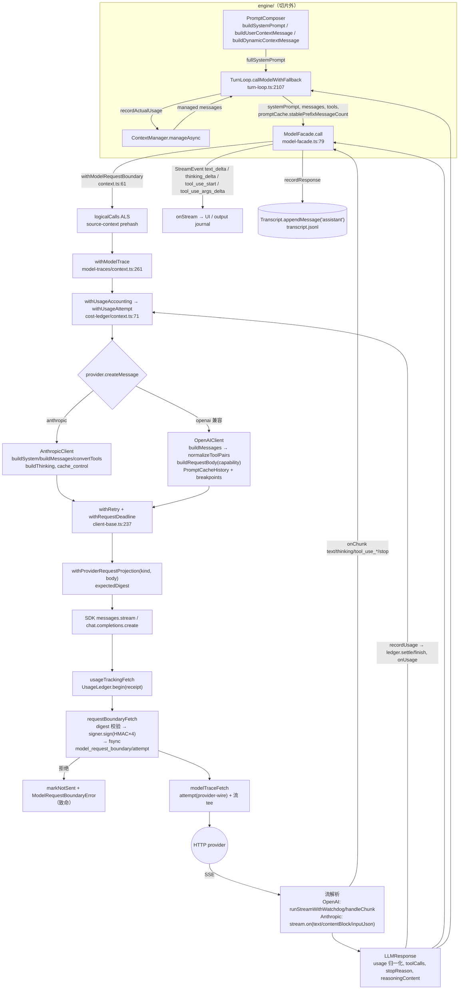

# 03 · Core：LLM / 模型目录 / 请求边界 / Trace / 上下文 / Session / Prompt / 计费

> 基线 commit：`df2ca0bda`（main，2026-10-20）。所有 `file:line` 均以 `packages/core/src/` 为根，已用 `grep -n` 对当前源码核对。
> 范围：`llm/`、`model-catalog/`、`model-request-boundary/`、`model-traces/`、`context/`、`session/`、`prompt/`（含 `sections/*.md`）、`cost-ledger/`、`cost-tracker.ts`、`migrate-models.ts`、`stt/`、`speech/`。
> 为说明调用链，会引用 `engine/` 中的少量接缝代码（`model-facade.ts`、`turn-loop.ts`、`engine.ts`、`run-*.ts`），但 engine 本身不在本切片内。
> 旧版章节（`docs/archive/architecture-2026-07/`）与 `docs/core-deep-dive` 中的旧文档只作线索使用，本文以源码为准。

---

## 0. 一页速览

```
settings.modelConnections + credentials + catalog
        │  model-catalog/resolve.ts  → engine/model-connections-pool.ts → llm/model-pool.ts
        ▼
   LLMConfig ──createLLMClient()──► LLMClientBase（AnthropicClient | OpenAIClient）
                                        │ createMessage() 被包装三层：
                                        │   withModelTrace → withUsageAccounting → 原 createMessage
                                        │ fetch 被包装三层：
                                        │   usageTrackingFetch(requestBoundaryFetch(modelTraceFetch(fetch)))
                                        ▼
PromptComposer ──system prompt──► ModelFacade.call() ──withModelRequestBoundary──► provider SDK ──► HTTP
ContextManager ──managed messages──┘          │
Transcript(JSONL) ◄── recordResponse ─────────┘
SessionManager(state.json + transcript.jsonl + 锁 + fork) ── UsageLedger(.usage-ledger/) ── ModelTraceStore(.model-traces/)
```

核心设计取向：

1. **Provider 只有两个实现**：`AnthropicClient`（`@anthropic-ai/sdk`）和 `OpenAIClient`（`openai` SDK，服务所有 OpenAI 兼容端点：OpenAI/DeepSeek/OpenRouter/Z.AI/xAI/Mistral/Groq/Gemini-compat/Ollama/custom）。厂商差异不靠子类，靠 `llm/capabilities/rules.ts` 的**能力表**。
2. **横切关注点用 `AsyncLocalStorage` + fetch 包装注入**：计费（cost-ledger）、请求边界签名（model-request-boundary）、Trace（model-traces）全部是"包装 fetch / 包装 createMessage"，provider 代码只需调用 `withProviderRequestProjection` 和 `recordModelTrace*`。
3. **Transcript 是 append-only 的 JSONL 事件流**，模型上下文（`Message[]`）总是从事件流**重放**得到；压缩（compaction）大部分只发生在内存中，持久化的只有 `range_archive` / `context_checkpoint` / `context_transfer` 等显式事件。
4. **System prompt 只放稳定前缀**，易变内容（skills 列表、memory、capability 上下文、Goal 状态）放到消息尾部的 `<system-reminder>`，以保护 prompt cache。

---

## 1. 模块职责概述

### 1.1 `llm/` — LLM 客户端抽象与 provider 适配（≈5.1k 行）

- `LLMClientBase`：抽象基类。持有模型身份（provider/model/maxTokens）、运行时旋钮（temperature/timeout/retryMaxAttempts/imageDetail/fetch），提供**重试**（`withRetry`）、**每请求硬截止**（`withRequestDeadline`）、**用量累计**（`recordUsage`）、**prompt-cache 身份**（`getPromptCacheConfigIdentity/ScopeIdentity`），并在构造时把 fetch 包成三层、把 `createMessage` 包成 trace+计费两层。
- `providers/anthropic.ts`、`providers/openai.ts`：两个具体实现，负责把内部 `Message[]`/`ToolDefinition[]` 翻译成 wire 格式、流式解析、推理（thinking/reasoning）参数翻译、cache breakpoint 标注、错误分类。
- `capabilities/`：按 `(providerKind, model 正则)` 查表得到 `Capability`（是否视觉、token 上限字段名、拒绝的采样参数、推理形状、reasoning 回显策略、输出上限）。
- `prompt-cache.ts`：按真实路由 + 模型族决定缓存策略（`anthropic-explicit`/`openai-hybrid`/`openai-implicit`/`provider-managed`）和 breakpoint 布局；`PromptCacheHistory` 为 OpenAI hybrid 模式记住"上一次成功的前缀边界"。
- `stream-watchdog.ts`、`retry.ts`、`stop-reason.ts`、`clamp-max-tokens.ts`、`strip-vision.ts`、`token-counter.ts`：流空闲看门狗、可重试判定、截断判定、输出上限钳制、非视觉模型的历史图片剥离、流式 token 实时估算。
- `model-pool.ts`、`provider-catalog.ts`、`provider-kinds.ts`、`model-fetcher.ts`、`model-cache.ts`、`provider-auth.ts`、`api-key-sanitize.ts`、`reasoning-setting.ts`：模型池（key → ModelEntry → LLMConfig）、provider 目录、内建 provider 元数据、远端 `/models` 拉取与 7 天缓存、`authCommand`/header 解析、API key 粘贴清洗、推理设置 schema。

### 1.2 `model-catalog/` — 连接模板目录（≈1.3k 行）

内建 + 用户覆盖的 `CatalogEntry`（文本/图像/视频/音频/语音五类 tag），每项描述 adapterKind、协议、默认 baseUrl、模型预设（上下文窗口、输出上限、vision、参数规格 ParamSpec）。`resolveInstance()` 把"连接实例 + 凭证 + 目录"解析为可用的 `ResolvedInstance`；`applyParams()` 按 ParamSpec 的 `wire.field` 把参数写进请求体。

### 1.3 `model-request-boundary/` — 模型请求"发送前证明"（≈0.7k 行）

在真正 `fetch` 前校验：发送的 wire body 与 provider 代码声明的投影一致（canonical digest）、请求属于当前 Session 化身（identity）、由 Host 持有的 HMAC 密钥对四个域（system/messages/wire/source-context）签名，并把 `model_request_boundary` / `model_request_attempt` 两类审计事件 **fsync** 进 transcript 后才放行。任何一步失败都抛 `ModelRequestBoundaryError`，并阻止 SDK 重试与非流式回退再次发送。

### 1.4 `model-traces/` — 模型调用 Trace（≈2.3k 行）

可配置（默认开启、保留 7 天、捕获内容）的调用记录：每次逻辑调用一个 `ModelTraceRecord`（输入/输出/用量/状态/多次 attempt），每次物理 HTTP 一个 attempt（可捕获 provider-wire 级别请求体与流式输出）。存储在 `<sessionsRoot>/.model-traces/`，按 sha256(id) 命名，带脱敏（`sanitize.ts`）与自动裁剪。也接受外部（native 子进程 / 外部 agent）上报。

### 1.5 `context/` — 上下文窗口管理（≈3.3k 行）

`ContextManager` 在每次模型调用前对 `Message[]` 做多层治理：大 tool_result 落盘替换 → 截断 → 每消息预算 → 重复 Read 去重 → 旧浏览器快照遮罩 → microcompact（清空旧工具结果）→ LLM 摘要压缩 → snip → window → emergency。token 估算是"实测锚点 + 增量启发式"的混合法。`SessionContextNotes` 实现 notes 策略（SaveContextNote/NewContext/SearchHistory）。`compaction.ts` 是纯函数工具箱。

### 1.6 `session/` — 会话存储（≈16k 行，含原型）

- `session-manager.ts`：Session 生命周期（create/resume/fork/summary-fork/list/archive）、`state.json` 的 CAS 写（revision + 文件锁 + generation epoch）、qchat/ephemeral 进程内 Session。
- `transcript.ts`：JSONL 事件日志的追加、崩溃尾修复、fsync、重放成 `Message[]`（含 range_archive 跨度替换、context_checkpoint 快照、tool_result 配对修复）。
- `output-journal*.ts`、`output-publisher.ts`、`output-coverage-state.ts`：UI 可见 StreamEvent 的**持久化输出日志**（先落盘后发布、哈希链、分段、修复/备份），用于断线/重启后的流恢复。
- `memory.ts`：跨会话 Memory（user/dream/pending 三 scope，Markdown 文件 + MEMORY.md 索引，软删除）。
- `file-history.ts`、`turn-diff.ts`、`undo-target.ts`、`simple-diff.ts`：文件修改前快照、逐轮 undo/redo、轮内累计 diff。
- `usage.ts`：TokenUsage/累计缓存计数的纯函数。
- `output-storage-prototype/`：**研究原型，生产未引用**（见 README）。

### 1.7 `prompt/` — System prompt 组装（≈0.9k 行）

`PromptComposer` 产出三样东西：稳定 system prompt（section 列表拼接，带 SectionCache）、首条 user 上下文消息（CODESHELL.md/CLAUDE.md/AGENTS.md 指令文件 + 日期）、尾部动态上下文消息（skills、memory 索引、capability context、sources、Goal 状态）。`sections/*.md` 是内建通用行为段落，由 preset 选择。

### 1.8 `cost-ledger/`、`cost-tracker.ts` — 计费

- `cost-ledger/`：**权威**计费账本。每个物理请求一张 `UsageReceipt`（pending → settle → completed/failed/not-sent），按 namespace 落盘到 `.usage-ledger/<sha256(namespace)>/<requestId>.json`，可按 runtime/session/store 汇总并按 model/session/purpose 分组。
- `cost-tracker.ts`：TUI 遗留的进程内单例 `costTracker`，只在**没有 UsageOwner** 时通过 `LLMClientBase.onUsage` 记录（避免与账本重复）。

### 1.9 `migrate-models.ts`、`stt/`、`speech/`

- `migrate-models.ts`：把旧版扁平 `models[]` 设置一次性迁移为 `providers[] + models[]`（纯函数，由 `settings/manager.ts:365` 调用）。
- `stt/`：OpenAI 兼容 `/audio/transcriptions` 调用 + 从设置解析转写 provider（Desktop 语音输入用）。
- `speech/`：从设置解析 TTS 模型/音色/语速（仅 main 进程，禁止跨 panel bridge 返回）。

---

## 2. 文件清单（非测试源文件）

### 2.1 `llm/`

| 文件                                    | 行数 | 职责                                                                                                                                                                   |
| --------------------------------------- | ---- | ---------------------------------------------------------------------------------------------------------------------------------------------------------------------- |
| `llm/types.ts`                          | 59   | `CreateMessageOptions`（请求参数：system/messages/tools/stream/onChunk/signal/billing/visibility/purpose/reasoning/promptCache/requestBoundaryId）与 `LLMUsageTracker` |
| `llm/client-base.ts`                    | 468  | 抽象基类：重试、硬截止、用量累计、cache 身份、fetch/createMessage 包装                                                                                                 |
| `llm/client-factory.ts`                 | 47   | provider 注册表 + `createLLMClient()`（按需动态 import 内建 provider）                                                                                                 |
| `llm/providers/anthropic.ts`            | 593  | Anthropic Messages API 适配：thinking 预算、cache_control、流事件                                                                                                      |
| `llm/providers/openai.ts`               | 1531 | OpenAI Chat Completions 适配（所有兼容端点）：能力驱动请求体、看门狗流解析、自愈 400、tool 配对规范化                                                                  |
| `llm/capabilities/types.ts`             | 161  | `Capability`/`ReasoningShape`/`EchoReasoning` 等类型与 `DEFAULT_CAPABILITY`                                                                                            |
| `llm/capabilities/rules.ts`             | 262  | 能力规则表 `RULES`（按 kind + 正则，首个匹配胜出）                                                                                                                     |
| `llm/capabilities/index.ts`             | 75   | `capabilitiesFor()`/`capabilitiesForConfig()`（目录显式 vision 覆盖规则）                                                                                              |
| `llm/capabilities/param-specs.ts`       | 77   | 由能力推导 reasoning 参数的 ParamSpec（UI/工具注入用）                                                                                                                 |
| `llm/capabilities/reasoning-control.ts` | 58   | 由能力推导 UI 推理控件（none/toggle/effort/budget/adaptive）                                                                                                           |
| `llm/prompt-cache.ts`                   | 239  | cache 策略解析、cache key、breakpoint 去重、`PromptCacheHistory`                                                                                                       |
| `llm/stream-watchdog.ts`                | 101  | `StreamIdleTimeoutError`、通用看门狗、环境变量配置                                                                                                                     |
| `llm/retry.ts`                          | 18   | `isRetryable()`：只有流空闲超时可重试                                                                                                                                  |
| `llm/stop-reason.ts`                    | 22   | `isTruncatedStop()`：`length`/`max_tokens`                                                                                                                             |
| `llm/clamp-max-tokens.ts`               | 18   | `clampMaxTokens()`                                                                                                                                                     |
| `llm/reasoning-setting.ts`              | 46   | `ReasoningSettingSchema`（off/on/effort/budget）、`normalizeReasoning()` 兼容旧字符串                                                                                  |
| `llm/token-counter.ts`                  | 48   | `countTokens()`：懒加载 gpt-tokenizer，冷启动 chars/4                                                                                                                  |
| `llm/strip-vision.ts`                   | 107  | 非视觉模型请求前把历史图片替换为占位文本                                                                                                                               |
| `llm/model-pool.ts`                     | 325  | `ModelEntry`/`ModelPool`：key 注册、切换、上下文窗口解析、`toLLMConfig()`                                                                                              |
| `llm/provider-catalog.ts`               | 75   | `ProviderCatalog`：provider 配置 CRUD + key 派生                                                                                                                       |
| `llm/provider-kinds.ts`                 | 167  | `PROVIDER_KINDS`：11 种 kind 的默认 baseUrl、models 路径、协议、认证头、chat 过滤                                                                                      |
| `llm/model-fetcher.ts`                  | 348  | `fetchModelList()`：拉 `/models` → 归一化 → 过滤 → 排序 → 静态目录/OpenRouter 快照补全 → 写缓存                                                                        |
| `llm/model-cache.ts`                    | 65   | `~/.code-shell/cache/models/<providerKey>.json`，TTL 7 天                                                                                                              |
| `llm/provider-auth.ts`                  | 97   | `resolveHeaders()`（`$ENV` 展开）、`resolveAuthCommand()`（60s 缓存）、`resolveApiKey()`                                                                               |
| `llm/api-key-sanitize.ts`               | 101  | `sanitizeApiKey()`：去 bracketed-paste、零宽字符、全角空格、智能引号、控制字符                                                                                         |

### 2.2 `model-catalog/`

| 文件                               | 行数 | 职责                                                                                                                                                                                                 |
| ---------------------------------- | ---- | ---------------------------------------------------------------------------------------------------------------------------------------------------------------------------------------------------- |
| `model-catalog/types.ts`           | 121  | zod schema：`ParamSpec`/`ModelPreset`/`CatalogEntry`/用户目录文件                                                                                                                                    |
| `model-catalog/builtin.ts`         | 585  | `BUILTIN_CATALOG`（15 项：openai/anthropic/openrouter/deepseek/zhipu/google/ollama/custom/openai-images/google-images/fal-video/openai-speech/siliconflow-speech/openai-transcribe/groq-transcribe） |
| `model-catalog/index.ts`           | 127  | `userCatalogPath()`、`loadUserCatalog()`（有界、O_NOFOLLOW）、`getMergedCatalog()`（replace/merge 两种覆盖）、`findCatalogEntry()`、`catalogEntryOrigins()`                                          |
| `model-catalog/resolve.ts`         | 113  | `Credential`/`ModelInstance`/`ResolvedInstance`、`isCredentialCompatible()`（同 adapterKind 且同 origin）、`resolveInstance()`                                                                       |
| `model-catalog/params.ts`          | 55   | `applyParams()`（点分路径写 body）、`buildParamsDoc()`                                                                                                                                               |
| `model-catalog/save-entry.ts`      | 189  | `saveCatalogEntry()`/`deleteUserCatalogEntry()`：原子写 + 备份                                                                                                                                       |
| `model-catalog/upsert.ts`          | 25   | 纯函数 upsert entry/preset                                                                                                                                                                           |
| `model-catalog/gen-connections.ts` | 43   | `genInstancesFromConnections()`：image/video/audio 连接 → 运行时实例                                                                                                                                 |

### 2.3 `model-request-boundary/`

| 文件                                      | 行数 | 职责                                                                                                                   |
| ----------------------------------------- | ---- | ---------------------------------------------------------------------------------------------------------------------- |
| `model-request-boundary/types.ts`         | 30   | `ModelRequestSubject`/`ModelRequestCustody`/`ModelRequestSigner`/签名输入输出                                          |
| `model-request-boundary/context.ts`       | 291  | `withModelRequestBoundary()`、`withProviderRequestProjection()`、`requestBoundaryFetch()`、`ModelRequestBoundaryError` |
| `model-request-boundary/custody.ts`       | 237  | `ModelRequestKeyStore`：每 owner 一个 32B HMAC key（持久化或内存），文件私有性校验                                     |
| `model-request-boundary/access.ts`        | 96   | 默认 signer 选择（Host 注入 / owner-only-plaintext 本地 / ephemeral / IPC signer）                                     |
| `model-request-boundary/session-owner.ts` | 50   | `assertDurableRequestOwner()`：校验 state.json 私有、incarnation 与 costState 匹配，并 fsync                           |
| `model-request-boundary/canonical.ts`     | 22   | `canonicalJson()`/`canonicalDigest()`（键排序 JSON 的 sha256）                                                         |
| `model-request-boundary/durability.ts`    | 19   | `syncDirectoryAncestors()`：逐级 fsync 父目录                                                                          |

### 2.4 `model-traces/`

| 文件                             | 行数 | 职责                                                                                                  |
| -------------------------------- | ---- | ----------------------------------------------------------------------------------------------------- |
| `model-traces/types.ts`          | 214  | Record/Attempt/Event/Config/Query/Page 类型                                                           |
| `model-traces/context.ts`        | 944  | ALS 上下文、`withModelTrace()`、`modelTraceFetch()`（wire 捕获 + 流 tee）、外部上报、native collector |
| `model-traces/store.ts`          | 624  | `ModelTraceStore`：config.json、records/summaries/events 目录、列表/会话聚合、保留期裁剪              |
| `model-traces/sanitize.ts`       | 147  | `sanitizeTraceValue()`：密钥/headers 脱敏、字符串与节点数上限                                         |
| `model-traces/classification.ts` | 65   | `MODEL_TRACE_CALL_TYPES`、`deriveModelTraceCallType()`（读时由 purpose/source 推导）                  |
| `model-traces/native-frames.ts`  | 90   | native 子进程 trace 帧解码（有界分片重组）                                                            |
| `model-traces/native-process.ts` | 192  | `createNativeModelTraceChannel()`                                                                     |
| `model-traces/index.ts`          | 30   | barrel                                                                                                |

### 2.5 `context/`

| 文件                              | 行数 | 职责                                                                                                                                  |
| --------------------------------- | ---- | ------------------------------------------------------------------------------------------------------------------------------------- |
| `context/manager.ts`              | 867  | `ContextManager`：多层压缩管线、混合 token 估算、摘要器注入、reactive 判定                                                            |
| `context/compaction.ts`           | 1184 | 纯函数：估算、图片降级、API 不变式保护、snip/window/micro、去重、遮罩、预算、摘要 prompt、anchored summary、按轮丢弃、context package |
| `context/tool-result-storage.ts`  | 493  | 大 tool_result 落盘到 `<sessionDir>/tool-results/<sha256>.txt` 并替换为 `<persisted-output>` 预览；决策冻结状态                       |
| `context/tool-output-budget.ts`   | 173  | 单结果 10k token / 单消息 20k token 预算，头尾保留截断                                                                                |
| `context/token-counter.ts`        | 133  | 按内容类型（英文/代码/JSON/CJK）字符比估算 token；图片固定 170                                                                        |
| `context/notes.ts`                | 355  | `SessionContextNotes`：note 保存、rollover 生成 checkpoint、历史检索                                                                  |
| `context/image-history-window.ts` | 86   | 运行内图片保留窗口（6 次响应 / 4 张 / 8MiB）                                                                                          |

### 2.6 `session/`

| 文件                                      | 行数  | 职责                                                                                   |
| ----------------------------------------- | ----- | -------------------------------------------------------------------------------------- |
| `session/session-manager.ts`              | 2841  | Session 生命周期、state CAS、锁、fork、list、Goal 状态持久化、workspace 恢复           |
| `session/transcript.ts`                   | 1377  | JSONL 事件日志：追加/fsync/重放/加载/尾部加载/配对修复/checkpoint                      |
| `session/output-journal.ts`               | 1288  | `SessionOutputJournal`：UI 输出事件的持久日志（header + 哈希链 + 分片 + durable head） |
| `session/output-journal-storage.ts`       | 458   | 分段存储（`output-journal-segments.json` + `output-segment-<uuid>.jsonl`）             |
| `session/output-journal-head.ts`          | 177   | 发布水位 `output-journal-head.json`（校验和，由 state 固定）                           |
| `session/output-journal-repair.ts`        | 141   | 锁定状态下修复未提交尾部                                                               |
| `session/output-journal-manual-repair.ts` | 1128  | 离线备份/恢复/检查（证据优先，不重置已发布游标）                                       |
| `session/output-journal-backup-format.ts` | 439   | 备份/修复文件格式常量与校验                                                            |
| `session/output-coverage-state.ts`        | 326   | Host 显示覆盖度（不是日志、不是权限）                                                  |
| `session/output-publisher.ts`             | 176   | `SessionOutputPublisher`：Engine run 外部的可信发布接缝                                |
| `session/memory.ts`                       | 1046  | `MemoryManager`：持久 Memory 三 scope、索引、召回统计、审批门、三层注入索引            |
| `session/file-history.ts`                 | 991   | `FileHistory`：修改前快照、创建标记、turn undo/redo                                    |
| `session/turn-diff.ts`                    | 613   | `TurnDiffTracker`：一个逻辑用户轮内文件 原始→最新 状态                                 |
| `session/undo-target.ts`                  | 160   | undo/redo 目标选择（纯函数）                                                           |
| `session/simple-diff.ts`                  | 89    | LCS 行 diff 预览                                                                       |
| `session/usage.ts`                        | 149   | TokenUsage 加法、累计缓存计数、命中率、`foldRunUsage()`                                |
| `session/stream-timing.ts`                | 41    | StreamEvent 时间戳、run timing                                                         |
| `session/subagent-continuation.ts`        | 63    | 子 agent 续跑元数据严格解析                                                            |
| `session/profile-references.ts`           | 82    | 按 workspace profile 扫描 Session 引用（异步生成器）                                   |
| `session/session-message.ts`              | 38    | 跨 Session 消息路由接口类型                                                            |
| `session/output-storage-prototype/*`      | ~4.4k | 研究原型（WAL、租约、异步 IO），**生产未引用**                                         |

### 2.7 `prompt/`

| 文件                               | 行数 | 职责                                                                                          |
| ---------------------------------- | ---- | --------------------------------------------------------------------------------------------- |
| `prompt/composer.ts`               | 436  | `PromptComposer`                                                                              |
| `prompt/section-cache.ts`          | 43   | `SectionCache`（按 section 名缓存，`cacheBreak` 跳过）                                        |
| `prompt/section-loader.ts`         | 54   | 内建 md 段落加载（`loadSection`/`loadSections`/`availableSections`），capability 可覆盖同名段 |
| `prompt/instruction-scanner.ts`    | 228  | 扫描 CODESHELL.md / CLAUDE.md / AGENTS.md（用户级 + 项目边界到 cwd + .local.md + rules/）     |
| `prompt/sections/base.md`          | 37   | general preset 基础行为（安全、URL、prompt 注入提醒等）                                       |
| `prompt/sections/harness-base.md`  | 9    | harness-min preset 基础段                                                                     |
| `prompt/sections/orchestration.md` | 31   | 工作方式（先理解、端到端、诊断后换策略）                                                      |
| `prompt/sections/browser.md`       | 17   | 内置浏览器工具用法（工具门控：无浏览器工具则剔除）                                            |
| `prompt/sections/tone.md`          | 9    | 语气与输出                                                                                    |
| `prompt/sections/context-notes.md` | 9    | notes 策略说明（有 SaveContextNote 工具时由 engine 追加）                                     |
| `prompt/sections/md.d.ts`          | 4    | md 模块声明                                                                                   |

### 2.8 其他

| 文件                        | 行数 | 职责                                                                                                                                 |
| --------------------------- | ---- | ------------------------------------------------------------------------------------------------------------------------------------ |
| `cost-ledger/types.ts`      | 92   | `UsagePurpose`、`UsageReceipt`、`UsageTotals`、`UsageSummary`、`UsageQuery`、`ExternalBilledUsage`                                   |
| `cost-ledger/context.ts`    | 167  | ALS：`withUsageOwner`/`withUsagePurpose`/`withUsageAttempt`/`recordOwnedUsage`/`usageTrackingFetch`/`markCurrentUsageAttemptNotSent` |
| `cost-ledger/store.ts`      | 498  | `UsageLedger`                                                                                                                        |
| `cost-ledger/pricing.ts`    | 48   | `estimateReceipt()`：OpenRouter 快照或 model-metadata 定价                                                                           |
| `cost-ledger/summary.ts`    | 81   | `summarizeReceipts()`、`formatUsageCost()`                                                                                           |
| `cost-ledger/index.ts`      | 19   | barrel                                                                                                                               |
| `cost-tracker.ts`           | 391  | `CostTracker` 单例 + `installCostTracking()`                                                                                         |
| `migrate-models.ts`         | 228  | `migrateModels()`                                                                                                                    |
| `stt/transcribe.ts`         | 95   | `transcribe()`：multipart POST `/audio/transcriptions`                                                                               |
| `stt/resolve-transcribe.ts` | 166  | `resolveTranscribeProvider()`/`isTranscribeAvailable()`/`describeTranscribe()`                                                       |
| `speech/resolve-speech.ts`  | 150  | `isSpeechEndpointAllowed()`/`speechModelsFromSettings()`/`resolveSpeechConfiguration()`                                              |

---

## 3. 关键类型与类（函数级）

### 3.1 LLM 抽象层

#### 3.1.1 `CreateMessageOptions`（`llm/types.ts`）

| 字段                                | 含义                                                                                             |
| ----------------------------------- | ------------------------------------------------------------------------------------------------ |
| `systemPrompt`、`messages`、`tools` | 内部中立格式（`Message`/`ToolDefinition`，见 `types.ts`）                                        |
| `temperature`、`maxTokens`          | 每调用覆盖                                                                                       |
| `stream` + `onChunk`                | 两者同时存在才走流式；chunk 类型 `text/thinking/tool_use_start/tool_use_delta/tool_use_end/stop` |
| `signal`                            | 调用方取消                                                                                       |
| `requestBoundaryId`                 | 主路径 ModelFacade 的逻辑调用 id；辅助调用不带。必须与 boundary ALS 中的 logicalCallId 一致      |
| `diagnosticRedactions`              | 仅用于 trace/log 的敏感 tool_result 替换，**不进 wire**                                          |
| `billingEnabled`（默认 true）       | 是否进入计费 hook                                                                                |
| `requestVisible`（默认 true）       | 是否计入客户端前台 `LLMUsageTracker`；辅助调用设 false，由 owner 自己记账                        |
| `usagePurpose`                      | 计费归因（main/aux_summary/...）                                                                 |
| `reasoning`                         | 覆盖 `LLMConfig.reasoning`                                                                       |
| `promptCache`                       | `{ scopeId?, stablePrefixMessageCount? }`                                                        |

`LLMResponse`（`types.ts`）：`text`、`toolCalls[]`（`{id, toolName, args, invalidArguments?}`）、`usage?`、`stopReason?`、`reasoningContent?`。
`TokenUsage`：`promptTokens`（**全量 prompt，含缓存部分**）、`completionTokens`、`totalTokens`、`cacheReadTokens?`、`cacheCreationTokens?`。

#### 3.1.2 `LLMClientBase`（`llm/client-base.ts:33`）

字段：`provider`、`model`、`maxTokens`（**不再默认 8192**，未知则 undefined）、`temperature`（默认 0.3）、`timeout`（默认 120s）、`retryMaxAttempts`（默认 3）、`imageDetail`、`protected fetch`、`protected usage: LLMUsageTracker`、静态 `onUsage`。

| 方法                                                 | 位置        | 行为 / 调用                                                                                                                                                                                                                                |
| ---------------------------------------------------- | ----------- | ------------------------------------------------------------------------------------------------------------------------------------------------------------------------------------------------------------------------------------------ |
| `constructor(config, defaults)`                      | `:59`       | 设字段；`this.fetch = usageTrackingFetch(requestBoundaryFetch(modelTraceFetch(defaults.fetch ?? globalThis.fetch), currentUsageAttempt, markCurrentUsageAttemptNotSent))`（`:75-81`）；调用 `initClient()` 与 `enableUsageAccounting()`    |
| `abstract initClient()` / `abstract createMessage()` | `:86/:88`   | 子类实现                                                                                                                                                                                                                                   |
| `enableUsageAccounting()`                            | `:91`       | 用 WeakSet 防重复包装；把实例上的 `createMessage` 替换为 `withModelTrace(identity, options, () => this.withUsageAccounting(options, () => original.call(this, options)))`。工厂 `createLLMClient` 会再调一次（因为子类字段初始化可能覆盖） |
| `recordUsage(usage, options, reported=true)`         | `:115`      | `requestVisible!==false` 时累加前台 tracker；`billingEnabled!==false` 时 `recordOwnedUsage(identity, reported?usage:null)` 并调用 `LLMClientBase.onUsage`（观察者异常被吞，避免重试已计费请求）                                            |
| `recordAttemptUsage(usage, options)`                 | `:141`      | 流中途的用量快照只更新收据，不加前台总数                                                                                                                                                                                                   |
| `withUsageAccounting(options, op)`                   | `:146`      | `withUsagePurpose(purpose, () => withUsageAttempt(identity, billingEnabled, op))`                                                                                                                                                          |
| `getUsage()` / `resetUsage()`                        | `:152/:203` | 前台用量快照 / 清零（模型切换后）                                                                                                                                                                                                          |
| `getPromptCacheConfigIdentity()`                     | `:160`      | 影响缓存的配置身份（provider/kind/model/maxTokens/reasoning/serviceTier/temperature/imageDetail/白名单 extraBody），不含凭证与 endpoint                                                                                                    |
| `getPromptCacheScopeIdentity()`                      | `:191`      | provider/kind/model/归一化 endpoint（`normalizeCacheEndpoint` `:381` 去 userinfo/query/hash/默认端口）                                                                                                                                     |
| `withRequestDeadline(callerSignal)`                  | `:223`      | `AbortSignal.any([caller, AbortSignal.timeout(max(2×timeout,120s))])`——对付 SDK timeout 不触发的半死 socket                                                                                                                                |
| `withRetry(fn, {maxAttempts, signal, shouldRetry})`  | `:237`      | 见 §3.1.6                                                                                                                                                                                                                                  |

模块函数：`isClientError(err)`（`:441`，读 `.status` 或 `.details.status`，4xx 除 429）、`isAbortError(err)`（`:464`，按 name 匹配 `APIUserAbortError`/`AbortError`）、`abortableSleep`（`:410`）。

#### 3.1.3 `createLLMClient`（`llm/client-factory.ts:17`）

`PROVIDER_REGISTRY: Map<string, ctor>`；`registerProvider(name, cls)`（`:13`）。首次遇到 `"anthropic"`/`"openai"` 时动态 `import()` 并注册。未知 provider 抛 `LLMError`。构造后再次 `client.enableUsageAccounting()`。
注意：`LLMConfig.provider` 只有 `"anthropic"` 和 `"openai"` 两个**协议族**取值；真实厂商在 `providerKind`。

#### 3.1.4 `AnthropicClient`（`llm/providers/anthropic.ts:77`）

常量：`ANTHROPIC_FALLBACK_MAX_TOKENS=4096`（`:41`，Anthropic 的 max_tokens 必填）、`ANTHROPIC_DEFAULT_THINKING_BUDGET=4096`（`:47`）。

| 方法                                           | 位置   | 行为                                                                                                                                                                                                                                                                                                                                                                                                     |
| ---------------------------------------------- | ------ | -------------------------------------------------------------------------------------------------------------------------------------------------------------------------------------------------------------------------------------------------------------------------------------------------------------------------------------------------------------------------------------------------------- |
| `tokenUsageFromAnthropic()`                    | `:56`  | **归一化**：Anthropic 的 input/cache_read/cache_creation 三个计数不相交，CodeShell 的 `promptTokens = input + cacheRead + cacheCreation`                                                                                                                                                                                                                                                                 |
| `get client`                                   | `:88`  | 懒建 SDK：`apiKey = resolveApiKey(config, ANTHROPIC_API_KEY)`、`baseURL`、`defaultHeaders = resolveHeaders(httpHeaders)`、`fetch: this.fetch`（三层包装）、`timeout`                                                                                                                                                                                                                                     |
| `get capability`                               | `:108` | `capabilitiesForConfig(config)` 记忆化                                                                                                                                                                                                                                                                                                                                                                   |
| `promptCachePolicy(request)`                   | `:115` | `resolvePromptCachePolicy(...)` → 恒为 `anthropic-explicit`，breakpoints = system/tools/stable-history/rolling-history                                                                                                                                                                                                                                                                                   |
| `getPromptCacheConfigIdentity()`               | `:124` | 基类身份 + cacheStrategy/layoutVersion/breakpoints/reasoningShape                                                                                                                                                                                                                                                                                                                                        |
| `buildThinking(reasoning, maxTokens)`          | `:158` | 只有 `anthropic-budget`（Claude 4.0–4.5）发 `{type:"enabled", budget_tokens}`；预算夹在 `[minBudgetTokens, maxTokens-min]`，放不下就省略；`anthropic-adaptive`（4.6+）与 `none` 永不发送                                                                                                                                                                                                                 |
| `createMessage(options)`                       | `:190` | `withRetry(async requestSignal => { cachePolicy; buildMessages; convertTools; logger.span("llm.request"); stream? streamMessage : nonStreamMessage; recordModelTraceAttemptResult; span.end })`；异常 `recordModelTraceAttemptError`                                                                                                                                                                     |
| `nonStreamMessage()`                           | `:234` | 组 body（model/max_tokens/system/messages/tools/thinking/temperature）→ `withProviderRequestProjection("anthropic-messages", body, () => client.messages.create(body, {signal}), {logicalCallId})` → 归一化 usage → `recordUsage` → `processResponse`                                                                                                                                                    |
| `streamMessage()`                              | `:274` | `client.messages.stream()`；监听 `streamEvent`（`recordAttemptUsage` 快照）、`text`（首字节日志 + `emit({type:"text", tokens: countTokens})`）、`contentBlock`（tool_use → `tool_use_start`）、`inputJson`（`tool_use_delta`，args 为 SDK 累计快照）；`emit` 在 `options.signal.aborted` 后静默；teardown signal 触发 `stream.abort()`；`await stream.finalMessage()` 后 `recordUsage` 并发 `stop` chunk |
| `processResponse()`                            | `:385` | content blocks → `text` 拼接 + `toolCalls`                                                                                                                                                                                                                                                                                                                                                               |
| `buildSystem()`                                | `:409` | 单个 text block，policy 含 `system` 时加 `cache_control: ephemeral`                                                                                                                                                                                                                                                                                                                                      |
| `buildMessages(messages, promptCache, policy)` | `:421` | `stripVisionFromHistory`；跳过 system；`tool` 角色映射为 `user`；转换 text/tool_use/tool_result（含嵌套 image）/image；记录 `stablePrefixMessageCount` 对应的结果消息；在 stable-history 末尾与最后一条消息（rolling-history）打 breakpoint                                                                                                                                                              |
| `markAnthropicCacheBreakpoint()`               | `:529` | 字符串内容转为 block；从后往前跳过 thinking/redacted_thinking（它们不接受 cache_control）                                                                                                                                                                                                                                                                                                                |
| `convertTools()`                               | `:551` | 只在**最后一个工具**上打 `cache_control`（整个 tools 数组成为缓存前缀；最多 4 个 breakpoint）                                                                                                                                                                                                                                                                                                            |
| `handleApiError()`                             | `:570` | `APIUserAbortError` 原样抛；429 → `LLMRateLimitError`；"prompt is too long"/"context_length_exceeded" → `ContextLimitError`；其他 → `LLMError(..., {status})`                                                                                                                                                                                                                                            |

> 注意：Anthropic 路径没有使用 `runStreamWithWatchdog`，流空闲由 SDK + `withRequestDeadline` 兜底；Anthropic `withRetry` 也未传 `shouldRetry`，流式中途失败可能被透明重试（对比 OpenAI 的"已发出 delta 不重试"）。

#### 3.1.5 `OpenAIClient`（`llm/providers/openai.ts:296`）

**粘性自愈标志**（`:304-314`，生命周期 = client 实例）：`_forceMaxCompletionTokens`、`_dropReasoningEffort`、`_disableExplicitPromptCache`、`_disablePromptCacheKey`。
**进程级** `sharedPromptCacheHistory`（`:238`）：跨 Engine run 复用（client 每 run 重建），只存有界、会过期的边界哈希。

| 方法 / 函数                                                                    | 位置    | 行为                                                                                                                                                                                                                                                                                                                                                                                                                                                                                                                            |
| ------------------------------------------------------------------------------ | ------- | ------------------------------------------------------------------------------------------------------------------------------------------------------------------------------------------------------------------------------------------------------------------------------------------------------------------------------------------------------------------------------------------------------------------------------------------------------------------------------------------------------------------------------- |
| `cachedTokensOf(usage)`                                                        | `:61`   | `prompt_tokens_details.cached_tokens` → cacheRead；`cache_write_tokens` → cacheCreation；缺失时保持 undefined                                                                                                                                                                                                                                                                                                                                                                                                                   |
| `outputTokenLimitOf(body)`                                                     | `:78`   | 读 `max_completion_tokens ?? max_tokens`                                                                                                                                                                                                                                                                                                                                                                                                                                                                                        |
| `didHitToolArgumentOutputLimit()`                                              | `:89`   | finish=`tool_calls` + 参数 JSON 坏 + completionTokens ≥ 上限 → 推断为截断（stopReason 改写为 `length`，让 turn loop 走续写）                                                                                                                                                                                                                                                                                                                                                                                                    |
| `runStreamWithWatchdog(stream, opts)`                                          | `:141`  | 导出函数。看门狗关闭时 for-await；开启时每次 `iterator.next()` 与空闲定时器（默认 90s）、abort promise 三方竞速；超时抛 `StreamIdleTimeoutError`；abort 立刻 break；finally 不 await 地 `iterator.return()`                                                                                                                                                                                                                                                                                                                     |
| `normalizeOpenAIToolMessagePairs(messages)`                                    | `:247`  | provider 边界的最后防线：每个 assistant tool_calls 后紧跟恰好一条对应的 tool 消息；重复 id 取最后、缺失合成 `MISSING_TOOL_RESULT_WIRE_TEXT`（`:233`）、未声明的丢弃                                                                                                                                                                                                                                                                                                                                                             |
| `constructor(config, defaults, {dangerouslyAllowBrowser, promptCacheHistory})` | `:316`  |                                                                                                                                                                                                                                                                                                                                                                                                                                                                                                                                 |
| `get client`                                                                   | `:333`  | `apiKey = resolveApiKey(config, OPENAI_API_KEY) ?? (有 headers ? "x-headers-auth" : undefined)`                                                                                                                                                                                                                                                                                                                                                                                                                                 |
| `promptCachePolicy(request)`                                                   | `:367`  | 传入 `explicitDisabled`；`_disablePromptCacheKey` 时去掉 cacheKey                                                                                                                                                                                                                                                                                                                                                                                                                                                               |
| `getPromptCacheConfigIdentity()`                                               | `:380`  | 额外包含 tokenLimitField、rejectedParams 与四个粘性标志                                                                                                                                                                                                                                                                                                                                                                                                                                                                         |
| `createMessage(options)`                                                       | `:400`  | 包装 `onChunk` 记录 `emittedOutput`；`withRetry(async requestSignal => {...}, { shouldRetry: () => !emittedOutput })`。步骤：`buildMessages` → `convertTools` → policy；若 `openai-hybrid` 且有 scopeId：找最后一个非空 user/tool 消息为 latestBoundary，用 `buildRequestBody(..., stream=false)` 去掉 messages 作为 requestIdentity，`promptCacheHistory.prepare()` 得 plan；`applyPromptCacheBreakpoints()`；span；流/非流；成功且未取消且 promptTokens>0 时 `promptCacheHistory.commit(plan)`                                |
| `buildRequestBody(options, messages, tools, reasoning, stream)`                | `:514`  | 见下表                                                                                                                                                                                                                                                                                                                                                                                                                                                                                                                          |
| `nonStreamMessage()`                                                           | `:695`  | `withProviderRequestProjection("openai-chat", body, () => client.chat.completions.create(body,{signal}))` → usage（含 cachedTokensOf）→ `recordUsage(usage, options, reported=usage存在)` → `processChoice`                                                                                                                                                                                                                                                                                                                     |
| `streamMessage()`                                                              | `:735`  | 同上但 stream；`handleChunk`：usage chunk → `recordAttemptUsage`；记录 finish_reason；`reasoning_content` delta → `thinking` chunk；`content` → `text` chunk（首字节日志）；`tool_calls[index]` 累积 id/name/args，id+name 齐时发 `tool_use_start`，每次 args 增量尝试 `JSON.parse` 成功才发 `tool_use_delta`；finish → `stop` chunk。结束后组装 toolCalls（缺 id/name 丢弃，坏 JSON 标 `invalidArguments`）；**没有 finish_reason 且未取消 → 抛 `LLMError("OpenAI stream ended before receiving a finish_reason")`**；截断推断 |
| `processChoice()`                                                              | `:975`  | 非流式结果解析，同样处理坏 JSON 与截断推断；`extractReasoningContent`（`:1505`，读 `reasoning_content ?? reasoning`）                                                                                                                                                                                                                                                                                                                                                                                                           |
| `buildMessages(systemPrompt, messages, reasoning, promptCache)`                | `:1031` | 首条 `{role:"system"}`；`stripVisionFromHistory`；assistant：text 合并、tool_use→tool_calls、`reasoning` block → `reasoning_content`；`echoReasoning==="never"` 剥离、`"when-tools"` 且有工具则回填空串（DeepSeek V4 要求）；`tool` 角色直出；user 中的 tool_result 先拆成独立 `role:"tool"` 消息（嵌套图片挪到随后的 user 消息里，tool 文本写 `[image returned to user message]`），再输出 text+image_url parts；最后 `normalizeOpenAIToolMessagePairs`，返回 `stablePrefixEndIndex`                                           |
| `applyPromptCacheBreakpoints(messages, policy, stableEnd, prevBoundary)`       | `:1273` | 仅 explicit/hybrid/anthropic-explicit（OpenRouter→Claude）生效；标记 = `cache_control: ephemeral` 或 `prompt_cache_breakpoint: {mode:"explicit"}`；位置 = system(0)、stable-history、hybrid 用上次成功边界（否则 rolling 用最后一条）；向前找非空内容消息                                                                                                                                                                                                                                                                       |
| `convertTools()`                                                               | `:1339` | `{type:"function", function:{name, description, parameters}}`                                                                                                                                                                                                                                                                                                                                                                                                                                                                   |
| `handleApiError()`                                                             | `:1350` | abort 原样抛；429 → RateLimit；400 含 prompt_cache_options/breakpoint → 关显式缓存，含 prompt_cache_key → 关 key；400 同时提到 max_tokens 与 max_completion_tokens → 强制 completion 字段；400 提到 reasoning_effort + tools 或 /v1/responses → 丢 effort；任一自愈 → 抛**不带 status** 的 `LLMError("(auto-correcting)")`，从而被 `withRetry` 当作可重试；上下文超限四种文案 → `ContextLimitError`；401 "provider returned error" → 友好诊断                                                                                   |
| `deepMergeInto()`                                                              | `:1476` | 嵌套对象深合并                                                                                                                                                                                                                                                                                                                                                                                                                                                                                                                  |
| `mapImageDetailToOpenAI()`                                                     | `:1525` | low → low；其余 → high                                                                                                                                                                                                                                                                                                                                                                                                                                                                                                          |

`buildRequestBody` 合成顺序（`:514-693`）：

| 步骤             | 规则                                                                                                                                                                                                                                                     |
| ---------------- | -------------------------------------------------------------------------------------------------------------------------------------------------------------------------------------------------------------------------------------------------------- |
| maxTokens        | `clampMaxTokens(options.maxTokens ?? this.maxTokens, cap.maxOutputTokens)`；未知则**省略字段**                                                                                                                                                           |
| token 字段       | `_forceMaxCompletionTokens` 或 `cap.tokenLimitField==="max_completion_tokens"` → `max_completion_tokens`，否则 `max_tokens`                                                                                                                              |
| temperature      | 不在 `cap.rejectedParams` 才发；显式值为 override，默认值为 default                                                                                                                                                                                      |
| reasoning on     | deepseek-thinking → `thinking:{type:"enabled"}`；openai-effort → `reasoning_effort`（effort 模式用其值，否则 medium；`noEffortWithTools` 且有工具 / `_dropReasoningEffort` 时省略）；openrouter-reasoning → `reasoning:{effort}`；anthropic-\*/none 不发 |
| reasoning off    | deepseek → `thinking:{type:"disabled"}`；openai-effort → `reasoning_effort = disabledEffort ?? "minimal"`；openrouter → `{effort:"minimal", exclude:true}`                                                                                               |
| reasoningSummary | 挂到 `reasoning.summary`                                                                                                                                                                                                                                 |
| extraBody        | 过滤 rejected 与保留键（model/messages/tools/stream/stream_options）                                                                                                                                                                                     |
| 合并优先级       | `samplingDefault < extraBody < samplingOverride < reasoningBody`（deepMergeInto）                                                                                                                                                                        |
| 其他             | `service_tier`；有 promptCache 时 `prompt_cache_key`/`prompt_cache_options`；tools；stream 时 `stream_options:{include_usage:true}`                                                                                                                      |

#### 3.1.6 重试与超时语义（`withRetry`，`client-base.ts:237`）

每次 attempt：

1. 若调用方已 abort → 抛 `AbortError`（取消在下一个重试边界生效）。
2. `withRequestDeadline` 合成 signal，调用 `fn(requestSignal)`。
3. 异常分类：
   - `ContextLimitError` → 直接抛（由 turn-loop 做 PTL 恢复）。
   - `shouldRetry(err)===false` → 直接抛（OpenAI 已发出 delta）。
   - **截止触发**（调用方未 abort 但 requestSignal 已 abort）→ 指数退避 `min(1000·2^(n-1), 30s)` 重试；用尽抛 `LLMError("request exceeded deadline ... connection wedged")`。
   - `isAbortError` 或调用方 abort → 直接抛（不重试）。
   - `LLMRateLimitError` → 等 `retryAfter ?? attempt*2` 秒后重试。
   - `isClientError`（4xx 非 429）→ 直接抛。
   - 其他（网络、5xx、自愈后的无 status LLMError）→ 指数退避重试。
4. 退避用 `abortableSleep`，取消立刻唤醒。

`llm/retry.ts` 的 `isRetryable()` 只认 `StreamIdleTimeoutError`，是 turn-loop 级别的流重试判定（与 `withRetry` 独立）。`STREAM_WATCHDOG_CONFIG`（`stream-watchdog.ts:91`）：`CODESHELL_ENABLE_STREAM_WATCHDOG`（默认开）、`CODESHELL_STREAM_IDLE_TIMEOUT_MS`（默认 90000）、`CODESHELL_STREAM_WATCHDOG_RETRIES`（默认 2）。

#### 3.1.7 Prompt caching（`llm/prompt-cache.ts`）

| 符号                                   | 位置   | 说明                                                                                                                                                                                                                                                                                                                              |
| -------------------------------------- | ------ | --------------------------------------------------------------------------------------------------------------------------------------------------------------------------------------------------------------------------------------------------------------------------------------------------------------------------------- |
| `PromptCacheStrategy`                  | `:11`  | `openai-explicit` / `openai-hybrid` / `openai-implicit` / `anthropic-explicit` / `provider-managed`                                                                                                                                                                                                                               |
| `PromptCacheBreakpoint`                | `:18`  | `system` / `tools` / `stable-history` / `rolling-history`                                                                                                                                                                                                                                                                         |
| `PromptCacheRequestContext`            | `:20`  | `scopeId`（ModelFacade 填 session id）、`stablePrefixMessageCount`（turn-loop 填第一个 volatile 消息的下标）                                                                                                                                                                                                                      |
| `createPromptCacheKey(scopeId, ns)`    | `:78`  | `cs:` + sha256("codeshell-prompt-cache-v1\0"+ns+"\0"+scopeId) 前 48 位（≤64 字符）                                                                                                                                                                                                                                                |
| `resolvePromptCachePolicy(input)`      | `:90`  | provider/kind=anthropic → anthropic-explicit（4 breakpoints）；openrouter + `anthropic/claude-*` → anthropic-explicit（无 tools breakpoint）；OpenAI 路由且 gpt-5.6+ 且未禁用 → openai-hybrid（key + `prompt_cache_options:{mode:"implicit", ttl:"30m"}`）；其余 OpenAI 路由 → openai-implicit（仅 key）；其他 → provider-managed |
| `uniquePromptCacheBreakpointIndexes()` | `:143` | 去重且保序                                                                                                                                                                                                                                                                                                                        |
| `PromptCacheHistory`                   | `:175` | `Map<scopeKey, {index, prefixHash, requestOrder, updatedAt}>`，默认 128 scope、30min TTL。`prepare()`（`:187`）对 requestIdentity + 逐条消息做滚动 sha256，若上次边界处前缀哈希仍一致 → `readBoundaryIndex`，并计算本次 `nextBoundary`；`commit()`（`:223`）丢弃乱序旧计划，LRU 淘汰                                              |

上游接缝：`engine/turn-loop.ts:745` `modelCallRecordingOptions()` 计算 `stablePrefixMessageCount`；`engine/model-facade.ts:148` 填 `scopeId: sid`；`ModelFacade.getPromptPrefixFingerprint()`（`model-facade.ts:58`）把 system + tools + 两种 cache 身份做成指纹写进 `llm.request` 日志，用来诊断缓存失效。

#### 3.1.8 能力表（`llm/capabilities/`）

`Capability`（`types.ts:101`）：`supportsVision`、`tokenLimitField`、`rejectedParams`、`reasoning: ReasoningShape`、`echoReasoning`（never/when-tools/optional）、`parallelToolCalls`、`streamUsage`、`maxOutputTokens?`。`DEFAULT_CAPABILITY`（`:142`）：无视觉、max_tokens、不拒参、无推理、optional、openai-flag、include-usage-flag。

`RULES`（`rules.ts:28`）主要条目（按 kind 内首个匹配）：

| kind       | 模型                             | 要点                                                                                                                    |
| ---------- | -------------------------------- | ----------------------------------------------------------------------------------------------------------------------- |
| openai     | `gpt-5.5+`                       | max_completion_tokens、拒绝全部采样参数、effort {low..xhigh}、disabledEffort none、**noEffortWithTools**、输出上限 128k |
| openai     | `o*` / `gpt-5..5.4`              | max_completion_tokens、拒绝采样参数、openai-effort                                                                      |
| openai     | `gpt-4o`/`gpt-4.1`/`gpt-4-turbo` | 仅 vision                                                                                                               |
| deepseek   | `deepseek-v4`                    | deepseek-thinking，tools 时回显 reasoning                                                                               |
| deepseek   | `deepseek-reasoner`              | 推理不可控，**never** 回显                                                                                              |
| zai        | `glm-4..9`                       | 同 DeepSeek V4 形状                                                                                                     |
| anthropic  | `claude-*-4-6+`                  | anthropic-adaptive                                                                                                      |
| anthropic  | `claude-*-4`（≤4.5）             | anthropic-budget，min 1024                                                                                              |
| anthropic  | `claude-*` 其余                  | 无推理，有视觉                                                                                                          |
| google     | `gemini-2.x+`                    | openai-effort（compat 层映射 thinking_level），视觉                                                                     |
| openrouter | 视觉 slug 白名单 / 其余          | openrouter-reasoning                                                                                                    |
| xai        | `grok-4.3`                       | effort，disabledEffort low                                                                                              |
| mistral    | `magistral`                      | effort 仅 high                                                                                                          |
| groq       | `gpt-oss-*`/`qwen3-*`            | completion 字段 + effort                                                                                                |

`capabilitiesFor(kind, model)`（`index.ts:33`）；`capabilitiesForConfig(config)`（`:58`）在目录给出显式 `supportsVision` 时覆盖规则。`reasoningControlFor()`（`reasoning-control.ts:19`）与 `paramSpecsFromCapability()`（`param-specs.ts:30`）把能力投影成 UI 控件和 ParamSpec。

#### 3.1.9 模型池与配置解析

`ModelEntry`（`model-pool.ts:49`）：`key`（= 连接 id）、`label`、`provider`（协议族）、`model`、`supportsVision`、`providerKind`、`baseUrl`、`apiKey`、`needsKey`、`maxOutputTokens`、`maxContextTokens`、`providerKey`、`authCommand`、`httpHeaders`、`serviceTier`、`reasoningSummary`、`reasoning`、`extraBody`。

`ModelPool`（`:116`）：

| 方法                                                                | 位置             | 行为                                                                                                                                                                                                                |
| ------------------------------------------------------------------- | ---------------- | ------------------------------------------------------------------------------------------------------------------------------------------------------------------------------------------------------------------- |
| `setProviderCatalog()` / `setCacheDir()`                            | `:122/:126`      | 注入 provider 目录与模型缓存目录                                                                                                                                                                                    |
| `reloadCachedContextWindows()`                                      | `:145`           | 给未设 `maxContextTokens` 的条目补窗口                                                                                                                                                                              |
| `resolveContextWindow(entry)`                                       | `:155`           | 模型缓存文件 → OpenRouter 快照（直接或按 `OPENROUTER_VENDOR_BY_KIND` 前缀）→ `FALLBACK_CONTEXT_WINDOW=200_000`                                                                                                      |
| `constructor` / `register` / `withBuiltinDefaults`                  | `:184/:204/:212` | 注册；内建 `deepseek-v4` 窗口 1M                                                                                                                                                                                    |
| `switch(key)` / `get(key?)` / `getActiveKey()` / `list()` / `has()` | `:220-253`       |                                                                                                                                                                                                                     |
| `toLLMConfig(entry)`                                                | `:267`           | 合并 entry 与 providerCatalog：provider（kind→anthropic/openai）、apiKey/baseUrl 回退、`maxTokens = maxOutputTokens`、reasoning/authCommand/httpHeaders（合并）/serviceTier/reasoningSummary/providerKind/extraBody |
| `resolveLLMConfig(key?)`                                            | `:320`           | `get` + `toLLMConfig`                                                                                                                                                                                               |

新统一路径：`settings.modelConnections`（`ModelInstance`）+ `credentials` + `getMergedCatalog()` → `engine/model-connections-pool.ts:43 modelEntriesFromConnections()`（对每个 text 连接 `resolveInstance()`；`reasoning` 参数转 `ReasoningSetting`，其余 ParamSpec 用 `applyParams()` 进 `extraBody`）→ `engine/resolve-llm-config.ts:20 resolveLLMConfigForTag()`（preferred → `defaults.text` → 第一个；需要 key 却无 key 返回 null）→ 临时 `ModelPool.toLLMConfig()`。

### 3.2 模型目录（`model-catalog/`）

- `CatalogEntry`（`types.ts`）：`id`、`tag`（text/image/video/audio/speech）、`adapterKind`、`protocol?`、`shape?`（generic-sync/fal-queue）、`displayName`、`description`、`defaultBaseUrl`、`defaultModel?`、`needsKey?`、`modelPresetsMode?`（replace/merge）、`modelPresets?`（≤512）、`signupUrl?`、`paramsDoc?`。
- `ModelPreset`：`value`、`label`、`maxContextTokens`、`maxOutputTokens`、`supportsVision`、`params: ParamSpec[]`。
- `ParamSpec`：`name`、`control`（enum/number/toggle/text）、`options`、`min/max/default`、`doc`、`wire.field`（点分路径）。

| 函数                                                       | 位置                     | 行为                                                                                                      |
| ---------------------------------------------------------- | ------------------------ | --------------------------------------------------------------------------------------------------------- |
| `userCatalogPath()`                                        | `index.ts:26`            | `<userHome>/.code-shell/model-catalog.user.json`                                                          |
| `loadUserCatalog()`                                        | `:34`                    | lstat 拒绝符号链接/非普通文件/超 4MiB；`O_NOFOLLOW` 打开后再 fstat；zod 校验失败返回 `[]` 并告警          |
| `getMergedCatalog()`                                       | `:68`                    | builtin 先入；用户条目默认整体覆盖，`modelPresetsMode:"merge"` 时按 preset.value 合并                     |
| `findCatalogEntry(catalog, id, kindFallback, tagFallback)` | `:95`                    | 精确 id，否则按 adapterKind(+tag) 回退                                                                    |
| `catalogEntryOrigins()`                                    | `:120`                   | builtin/user/user-override-of-builtin                                                                     |
| `isCredentialCompatible()`                                 | `resolve.ts:66`          | 凭证 catalogId 相同，或同 adapterKind 且 endpoint origin 相同                                             |
| `resolveInstance(inst, creds, catalog)`                    | `resolve.ts:86`          | 不兼容凭证 → null；`baseUrl = inst.baseUrl ?? cred.baseUrl ?? entry.defaultBaseUrl`；`needsKey` 默认 true |
| `applyParams()` / `buildParamsDoc()`                       | `params.ts:16/:47`       |                                                                                                           |
| `saveCatalogEntry()` / `deleteUserCatalogEntry()`          | `save-entry.ts:118/:161` | 读旧 → 备份 → 原子写                                                                                      |
| `genInstancesFromConnections()`                            | `gen-connections.ts`     | 媒体连接 → `GenRuntimeInstance`                                                                           |

### 3.3 请求边界（`model-request-boundary/`）

类型：`ModelRequestSubject {sessionId, storageScopeId(=sha256(sessionsDir)), sessionInstanceId(=costState.accountingSessionId, UUID), ephemeral?}`；`ModelRequestCustody = host-encrypted | owner-only-plaintext | ephemeral-memory`；签名域 `system | messages | wire | source-context`。

`ModelRequestBinding`（`context.ts:14`）：`subject`、`signer`、`transcript`、`compositionDigest`、`configVersion`、`provider`、`model`、`ensureDurableOwner?`。由 `engine/engine.ts:2810` 构造（持久会话附带 `assertDurableRequestOwner`）。

| 函数                                                                                       | 位置                 | 行为                                                                                                                                                                                                                                                                                                                                                                                                                                                                                                                                                                                                                            |
| ------------------------------------------------------------------------------------------ | -------------------- | ------------------------------------------------------------------------------------------------------------------------------------------------------------------------------------------------------------------------------------------------------------------------------------------------------------------------------------------------------------------------------------------------------------------------------------------------------------------------------------------------------------------------------------------------------------------------------------------------------------------------------- |
| `withModelRequestBoundary(binding, {step, assistantMessageId, logicalCallId}, signal, op)` | `context.ts:61`      | 无 binding：在 ALS 外执行。有 binding：快照 transcript 事件范围与 `canonicalDigest(transcript.toMessages())`（source-context 预哈希），建内部 AbortController，`logicalCalls.run(call, ...)`；结束时若 `call.failure` 存在则抛它（压过 SDK 包装后的错误）                                                                                                                                                                                                                                                                                                                                                                       |
| `withProviderRequestProjection(kind, body, op, {logicalCallId})`                           | `:100`               | provider 声明"我将发送这个 body"。带 invocation 但无 id（辅助调用）→ 退出两个 ALS；logicalCallId 不一致 → identity 失败；否则 `projections.run({call, kind, expectedDigest: canonicalDigest(body)}, op)`                                                                                                                                                                                                                                                                                                                                                                                                                        |
| `requestBoundaryFetch(underlying, currentAttempt, onRejectedBeforeSend)`                   | `:119`               | 无投影但处于逻辑调用中 → projection 失败（拒绝未声明的发送）。否则：校验计费 attempt 身份（accountingSessionId/sessionId）；读取并解析 body，校验 `model`、`messages` 与 digest；按 kind 拆 system/conversation；`ensureDurableOwner()`；`signer.sign(4 个 prehash)`；校验签名版本、custody 模式（持久会话不能是 ephemeral）、keyId 格式且同一调用不变；签名期间被取消 → AbortError；首次写 `model_request_boundary`，每次 attempt 写 `model_request_attempt`（`phase:"before-fetch"`，带 physicalAttemptId=计费 requestId、attemptNumber），均经 `Transcript.appendModelRequestEvent()` **fsync**；用校验过的原始 payload 发送 |
| `ModelRequestKeyStore.sign()`                                                              | `custody.ts:72`      | ownerDigest = canonicalDigest(subject)；ephemeral → 内存 key；否则 `keyFor()`（`:133`）在私有目录（0700、uid 匹配）下以文件锁读/建 `<ownerDigest>.json`（KeyRecord：keyId、custodyMode、protectedKey 经 cipher 保护）；`HMAC-SHA256(key, "codeshell:model-request:v1:<domain>:" + prehash)`；用完 `key.fill(0)`                                                                                                                                                                                                                                                                                                                 |
| `resolveModelRequestSigner()`                                                              | `access.ts:19`       | Host 注入的 signer 优先；否则本地 `~/.code-shell/request-keys/owner-only-plaintext/`（PlaintextCipher）                                                                                                                                                                                                                                                                                                                                                                                                                                                                                                                         |
| `createEphemeralModelRequestSigner()` / `createIpcModelRequestSigner(transport)`           | `:32/:37`            | 内存签名 / worker 通过 JSON-RPC 请求 Host 签名（超时、dispose）                                                                                                                                                                                                                                                                                                                                                                                                                                                                                                                                                                 |
| `assertDurableRequestOwner(subject, dir)`                                                  | `session-owner.ts:8` | 非 ephemeral、id 合法、storageScopeId 匹配；state.json 私有（mode&077==0）、≤8MiB、sessionId/costState.accountingSessionId/sessionScopeId 一致；fsync 文件与父目录                                                                                                                                                                                                                                                                                                                                                                                                                                                              |

### 3.4 Trace（`model-traces/`）

`ModelTraceRecord`（`types.ts`）：`version`、`id`（=requestBoundaryId 或 UUID）、`traceId`（=runId 或 id）、`sessionId`、`runId`、`parentSessionId`、`workspacePath`、`source`、`purpose`、`provider`、`providerKind`、`model`、`startedAt/endedAt`、`status`（running/completed/failed/cancelled）、`stream`、`inputState/outputState`（recorded/truncated/not-recorded）、`input`、`output`、`usage`、`error`、`attempts[]`。`ModelTraceAttempt`：`id`（=计费 requestId）、`number`、`coverage`（`provider-wire` | `logical-input`）、`httpStatus`、输入输出、usage。

| 函数                                                                                                                         | 位置                  | 行为                                                                                                                                                                                                                                                                                                                                   |
| ---------------------------------------------------------------------------------------------------------------------------- | --------------------- | -------------------------------------------------------------------------------------------------------------------------------------------------------------------------------------------------------------------------------------------------------------------------------------------------------------------------------------- |
| `configureModelTracing({storageDir, source})`                                                                                | `context.ts:104`      | Host 启动时调用：desktop `activity-history-ipc.ts:20`、tui `repl.ts:124`/`run.ts:92`、`cli/agent-server-stdio.ts:124`、`agent-server-tcp.ts:52`、server `serve/cli.ts:178`；目录均为 `<sessionsRoot>/.model-traces`                                                                                                                    |
| `withModelTraceContext(ctx, op)`                                                                                             | `:113`                | 叠加 sessionId/runId/purpose/storageDir 等上下文                                                                                                                                                                                                                                                                                       |
| `withModelTrace(identity, options, op)`                                                                                      | `:261`                | 由 `enableUsageAccounting` 包在最外层。未配置或未启用 → 直接执行。否则建 record，`capture()`（受 captureContent 策略与脱敏约束）输入（system/messages/tools/parameters），立即 persist；`calls.run`；成功记录输出/usage；失败区分 cancelled/failed；finally 保证至少一个 attempt 并 persist                                            |
| `recordModelTraceAttemptResult/Error()`                                                                                      | `:401/:422`           | provider 在每个 attempt 结束时调用，把结果挂到 `call.latest`                                                                                                                                                                                                                                                                           |
| `modelTraceFetch(underlying)`                                                                                                | `:473`                | 位于 fetch 链最内层：解析 wire body（JSON 才算 provider-wire 覆盖），新增 attempt；记录 HTTP 状态；对流式响应 tee 读取以重建输出和 usage（`usageOf()` `:436`）                                                                                                                                                                         |
| `recordModelTraceEvent()` / `recordExternalModelTrace()` / `recordExternalModelCall()` / `createNativeModelTraceCollector()` | `:704/:794/:886/:930` | 工具事件、外部 agent、native 子进程上报                                                                                                                                                                                                                                                                                                |
| `ModelTraceStore`                                                                                                            | `store.ts:60`         | `getConfig()`（`config.json`，回退 `DEFAULT_MODEL_TRACE_CONFIG` `:28`：enabled、captureContent、retentionDays 7、includeEphemeral）、`setConfig()`、`list()`、`sessions()`、`get()`、`events()`、`write()`（`:492`，超 4MiB 逐个丢 attempt 内容，`callType` 不落盘）、`writeEvent()`、`prune()`（`:570`，60s 节流按 startedAt 清过期） |

persist 节流：非立即写时 200ms 合并（`context.ts:199`）。原则："Trace IO 绝不能让模型调用失败、重试、延迟或被授权"——所有异常吞掉。

### 3.5 上下文管理（`context/`）

#### 3.5.1 `ContextManager`（`context/manager.ts:139`）

配置（`:45`，默认 `:75`）：`maxTokens=200_000`（实际由 engine 传入模型窗口）、`compactAtRatio=0.85`、`summarizeAtRatio=0.92`、`maxToolResultChars=30_000`、`toolOutputTokenLimit=10_000`、`toolMessageTokenLimit=20_000`、`microcompactFloorRatio=0.7`、`microcompactKeepRecent?`（默认 `max(5, floor(maxTokens/100k))`，`:104`）。

状态：`summarizeFn`、`consecutiveSummaryFailures`（≥3 熔断）、`suppressNoOpMicroSummaryUntilCompact`、`lastSummary`、实测锚点（`lastActualTokens/AtMessageCount/AnchorEstimate/RecordedAt/Provider/Model`）、`transcriptPath`、`onCompact`、`replacementState`、`toolResultsDir`。

| 方法                                                     | 位置        | 行为                                                                                                                                                          |
| -------------------------------------------------------- | ----------- | ------------------------------------------------------------------------------------------------------------------------------------------------------------- |
| `setOnCompact(fn)`                                       | `:171`      | engine 用它向 UI 发 `context_compact` 并缓冲给 post_compact hook                                                                                              |
| `shouldPrepareNote(messages)`                            | `:176`      | ratio ≥ max(0.05, compactAt−0.1)                                                                                                                              |
| `recordNotesCompaction(before, after)`                   | `:181`      | notes rollover 后清空锚点与 lastSummary，发 `notes` 事件                                                                                                      |
| `recordActualUsage(inputTokens, messageCount, messages)` | `:198`      | turn-loop 每次响应后调用（`turn-loop.ts:1224`），返回 `ContextUsageAnchor` 持久化到 `state.contextUsageAnchor`                                                |
| `seedActualUsage(anchor)` / `getActualUsageAnchor()`     | `:216/:236` | 恢复时由 `createRunContextManager`（`engine/run-context.ts:23`）在 provider/model 兼容时注入                                                                  |
| `estimateTokensHybridInfo(messages)`                     | `:260`      | 消息数增长 → `lastActual + estimate(新消息)`（anchor_delta，medium）；消息数未增长但有锚点估算 → 按比例缩放（anchor_rescale）；否则纯启发式（low）            |
| `setSummarizeFn(fn)`                                     | `:293`      | engine 注入（`engine.ts:2778`，辅助模型；手动 compact/archive 用主模型 `engine.ts:4483`）                                                                     |
| `trySummaryCompact(messages, before, event, signal)`     | `:297`      | keepRecent = max(8, 30%)；摘要 `messages[1 .. -keepRecent]`（跳过首条 userContext）；≤3 条不做；带 prior summary 做"滚动更新"；摘要 ≤50 字符或没变小 → 计失败 |
| `setTranscriptPath(path)`                                | `:372`      | 同时设 `toolResultsDir = dirname(path)/tool-results`                                                                                                          |
| `initReplacementStateFromMessages(messages)`             | `:384`      | 恢复时重建落盘替换决策（幂等的关键）                                                                                                                          |
| `manage(messages)`                                       | `:392`      | 同步版（不调 LLM）：persist → truncate → budget → dedupe → mask → micro(>70%) → >85% 用 lastSummary 或 snip → >90% window(max(10,40%)) → >92% window(6)       |
| `manageAsync(messages, signal, {preferNotes})`           | `:520`      | 异步版：前段相同；≥85% 或"micro 在 70–85% 区间空转"时尝试 LLM 摘要；摘要后 ≤85% 直接返回；再依次 snip/window/emergency                                        |
| `forceSummarize(messages, signal)`                       | `:677`      | 手动 /compact：预处理 + 强制 micro + 摘要；失败退化 snip，仍不变小则 window                                                                                   |
| `summarizeRange(messages, {start,end})`                  | `:737`      | 只摘要指定窗口，替换为一条 anchored summary（range archive 用）                                                                                               |
| `persistLargeToolResults()` / `truncateToolResults()`    | `:780/:800` |                                                                                                                                                               |
| `shouldReactiveCompact(messages, responseTokens)`        | `:836`      | 流式过程中 消息+响应 > 92% → 仅告警（`turn-loop.ts:2136`）                                                                                                    |
| `checkLimits(messages)`                                  | `:847`      | `{tokens, ratio, needsCompact, needsEmergency, source, confidence}`                                                                                           |

#### 3.5.2 `compaction.ts` 关键纯函数

| 函数                                                                     | 位置          | 说明                                                                                                                                                        |
| ------------------------------------------------------------------------ | ------------- | ----------------------------------------------------------------------------------------------------------------------------------------------------------- |
| `estimateTokens(messages)`                                               | `:27`         | `estimateMessagesTokens × 4/3`（33% 余量）                                                                                                                  |
| `collectBase64Images` / `downgradeImagePayloadsInHistory`                | `:60/:107`    | 历史 base64 图片降级为 `[image #N ...]` 占位                                                                                                                |
| `clampContextRatios()`                                                   | `:238`        | 设置值钳制                                                                                                                                                  |
| `adjustIndexToPreserveAPIInvariants(messages, start)`                    | `:273`        | 切点之后若有 tool_result 的 tool_use 在切点之前，则把切点前移到该 assistant——所有切割算法共用，保证不产生孤儿 tool_result                                   |
| `snipCompact(messages, keepFirst=3, keepLast=8)`                         | `:324`        | 中间替换为 `[N messages snipped ...]` 提醒                                                                                                                  |
| `windowCompact(messages, keepLastN)`                                     | `:349`        | 保留首条 + 最后 N                                                                                                                                           |
| `COMPACTABLE_TOOL_NAMES`                                                 | `:368`        | Read/Glob/Grep/Bash/PowerShell/NotebookEdit/WebFetch/WebSearch/REPL                                                                                         |
| `microcompact(messages, {keepRecentN})`                                  | `:468`        | 从后往前数含可压缩结果的消息，超出 keepRecentN 的把字符串结果替换为 `[Old tool result cleared — Tool args摘要]`                                             |
| `dedupeFileReads()`                                                      | `:564`        | 同一文件多次 Read 只保留最新                                                                                                                                |
| `maskOldObservations()`                                                  | `:689`        | 旧浏览器 snapshot 遮罩                                                                                                                                      |
| `applyToolResultBudget(messages, perMessageChars, tokenLimit)`           | `:730`        | 每消息聚合预算                                                                                                                                              |
| `buildSummarizationPrompt(msgs, prior)`                                  | `:824`        | 9 段结构（Primary Request / Key Concepts / Files / Errors & Fixes / Actions / User Messages / Pending / Current State / Next Steps），有 prior 时为增量更新 |
| `serializeContextPackageMessages` / `buildContextPackagePrompt`          | `:952/:993`   | 跨会话 context package（目标 1.5k token）                                                                                                                   |
| `extractAnchoredSummary` / `buildAnchoredSummaryMessage`                 | `:1015/:1039` | `<anchored-summary>` 标签；附 transcript 路径与引用文件列表                                                                                                 |
| `applySummaryCompaction(messages, summary, keepRecentN, transcriptPath)` | `:1077`       | `[first, summaryMsg, ...recent]`                                                                                                                            |
| `groupMessagesByApiRound` / `dropOldestRounds`                           | `:1111/:1133` | PTL（prompt too long）恢复时按轮丢弃，开头若为 assistant 则补一条提醒                                                                                       |
| `extractReferencedFilePaths()`                                           | `:1168`       |                                                                                                                                                             |

#### 3.5.3 大结果落盘（`tool-result-storage.ts`）

- `ContentReplacementState`（`:67`）：`seenIds`（一旦评估过就冻结，防止替换决策来回翻转破坏 prompt cache）、`replacements`、`textReplacements`。
- `applyToolResultPersistence()`（`:345`）：单结果 >30k 字符或 >10k token、单消息聚合 >100k 字符或 >20k token 时，按大小优先落盘到 `<sessionDir>/tool-results/<sha256(tool_use_id)>.txt`（`safeToolResultFilename` `:135`；`persistToFile` `:151` 用 `wx` 0600，已存在但内容不同抛错），并替换为 `<persisted-output>` + 2k 预览；另存 sidecar 冻结预览文本，冷启动重放可得字节一致的替换。原始 transcript 不改。
- `reconstructContentReplacementState()`（`:84`）：从消息与 sidecar 重建。

#### 3.5.4 Notes 策略（`context/notes.ts:34` `SessionContextNotes`）

| 方法                                             | 位置        | 行为                                                                                                                                                                                                                                                                    |
| ------------------------------------------------ | ----------- | ----------------------------------------------------------------------------------------------------------------------------------------------------------------------------------------------------------------------------------------------------------------------- |
| `markModelBoundary()`                            | `:46`       | 每次模型调用前（`turn-loop.ts:1140` 附近）记录最后一个"模型可见"事件 id                                                                                                                                                                                                 |
| `save(text)`                                     | `:54`       | ≤12k 字符；`transcript.appendContextNote(text, coveredThroughEventId)`                                                                                                                                                                                                  |
| `requestRollover()`                              | `:71`       | 必须有有效且未用过的 note、transcript 未降级；设 pending                                                                                                                                                                                                                |
| `applyRollover(current, retained)`               | `:91`       | `commitRollover`：从 note 覆盖的边界之后的事件 + note 消息（`<context-note>`）+ 最近真实用户消息，用 `Transcript.fromMemoryEvents().toMessagesWithIndex()` 重建；沿用已预算的 tool_result；校验配对完整、且新上下文**严格小于**当前；`appendContextCheckpoint()` 持久化 |
| `search(query, limit, before)` / `read(eventId)` | `:214/:242` | SearchHistory 工具：在原始事件（含 fork 来源 id 映射）中检索，结果标 `untrusted: true`                                                                                                                                                                                  |

### 3.6 Session 存储

#### 3.6.1 `SessionState`（`types.ts:314`）主要字段

身份：`sessionId`、`kind`（work/pet）、`ephemeral`、`origin`、`parentSessionId`、`subAgentContinuation`、`forkedFrom`（lineage）。
并发：`stateRevision`（CAS 版本）、`runId`、`clientMessageId`、`turnSeq`。
位置：`cwd`、`workspace`（main | worktree）、`project`、`workspaceProfile`。
模型与用量：`model`、`provider`、`tokenUsage`、`cacheUsageVersion`、`cumulativePromptTokens/CacheRead/CacheCreation`、`contextUsageAnchor`、`costState`（UsageLedger.sessionState 引用）。
生命周期：`status`（active/paused/TerminalReason）、`lastCompletionKind`、`turnCount`、`startedAt`、`archivedAt`、`completedThroughEventId`、`completedSnapshotVersion`、`title`、`summary`、`sessionBrief`、`toolSelection`。
指令/技能：`instructionContextStartEventId`、`instructionContextRevisions`、`instructionSnapshots`、`invokedSkills`。
Goal：`goalLifecycle`、`activeGoal`、`goalTerminal(s)`（`hydrateGoalLifecycle` 兼容旧字段）。
输出日志：`outputJournalIdentity`、`outputJournalHead`、`outputJournalStorage`、`outputRecoveryIncomplete`、`outputCoverage*`（由 saveStateAttempt **始终从磁盘保留**，调用方不能覆盖）。

#### 3.6.2 `SessionManager`（`session/session-manager.ts:540`）

模块级状态：`currentSessionCloseEpochs` / `issuedClosingRunFinalizers`（`:66-67`，key = `sessionsDir\0sessionId`）、`processLocalSessionBundles`（`:300`，qchat/ephemeral 会话的进程内注册表，跨 Engine 共享）。锁常量：`SESSION_STATE_LOCK_STALE_MS=10_000`、重试 `[5,10,20,40]ms`（`:69-70`，同步 sleep 用 `Atomics.wait`）。

| 方法                                                                                                                                                         | 位置             | 行为                                                                                                                                                                                                                                                                                                                                                                                                                                                                                                                         |
| ------------------------------------------------------------------------------------------------------------------------------------------------------------ | ---------------- | ---------------------------------------------------------------------------------------------------------------------------------------------------------------------------------------------------------------------------------------------------------------------------------------------------------------------------------------------------------------------------------------------------------------------------------------------------------------------------------------------------------------------------- | ------------------------------------------------------------------------ | ------------------------------------------------------------------------------------------------------------------ |
| `assertSafeSessionId(id)`                                                                                                                                    | `:401`           | 非空、无分隔符/`..`、`[A-Za-z0-9_.-]`、≤128                                                                                                                                                                                                                                                                                                                                                                                                                                                                                  |
| `isEphemeralSessionState(state)`                                                                                                                             | `:432`           | `ephemeral===true` 或 `qchat-` 前缀                                                                                                                                                                                                                                                                                                                                                                                                                                                                                          |
| `codeShellHome()` / `sessionsRoot(home?)`                                                                                                                    | `:449/:468`      | `CODE_SHELL_HOME                                                                                                                                                                                                                                                                                                                                                                                                                                                                                                             |                                                                          | ~/.code-shell`/`<home>/sessions`；**测试进程使用真实默认 home 时**：有 `CODE_SHELL_TEST_HOME` 则改用沙箱，否则抛错 |
| `constructor(storageDir?, workspaceCapability?)`                                                                                                             | `:546`           | mkdir 0700、chmod、清理过期 `.pending-fork-*`                                                                                                                                                                                                                                                                                                                                                                                                                                                                                |
| `registerSessionGeneration` / `isSessionGenerationCurrent` / `incrementSessionGeneration`                                                                    | `:603/:612/:622` | close epoch：关闭会话时递增，旧 writer 的保存返回 `generation_conflict`                                                                                                                                                                                                                                                                                                                                                                                                                                                      |
| `createClosingRunFinalizer(id, epoch, runId)`                                                                                                                | `:636`           | 关闭时一次性提交最终 run 字段（`RUN_FINAL_STATE_FIELDS`）+ usage 增量 + cache 增量；校验 epoch、runId、非 active；revision 冲突重试                                                                                                                                                                                                                                                                                                                                                                                          |
| `create(cwd, model, provider, explicitId?, parent?, origin?, kind, ephemeral, continuation?)`                                                                | `:721`           | `nanoid(16)`；初始 state（revision 0、workspace main、usage 0、status active）；ephemeral → `Transcript.inMemory` + 进程内注册；否则 `mkdir <id>`（0700，EEXIST → 已存在）→ `writeStateAtomically(state.json)` → `new Transcript(transcript.jsonl)` → 追加 `session_meta`；失败回滚删目录                                                                                                                                                                                                                                    |
| `exists(id)`                                                                                                                                                 | `:828`           |                                                                                                                                                                                                                                                                                                                                                                                                                                                                                                                              |
| `readSessionMainRoot/ProjectBinding/Kind/WorkspaceProfile/Cwd/ParentSessionId/SubAgentContinuation`、`getSessionWorkspace`                                   | `:850-1060`      | 轻量读 state.json                                                                                                                                                                                                                                                                                                                                                                                                                                                                                                            |
| `setSessionWorkspace` / `migrateSessionMainRoot(IfRevision)` / `recordWorkspaceHandoff` / `resolveSessionWorkspaceForResume`                                 | `:1091-1244`     | worktree 会话恢复：校验目录、非符号链接、`workspaceCapability.validateRoot()`；分支已删 → 退回 main                                                                                                                                                                                                                                                                                                                                                                                                                          |
| `readSessionArchivedAt` / `setSessionArchived(id, ts                                                                                                         | undefined)`      | `:1178/:1198`                                                                                                                                                                                                                                                                                                                                                                                                                                                                                                                | 归档只是 `state.archivedAt` 标记（`updateSessionState`），**不移动文件** |
| `readActiveGoal` / `clearActiveGoal` / `updateActiveGoal` / `saveGoalTerminal(Outcome)` / `saveActiveGoal` / `markGoalWaiting` / `clearTerminatedActiveGoal` | `:1339-1918`     | Goal 状态 CAS                                                                                                                                                                                                                                                                                                                                                                                                                                                                                                                |
| `resume(id)` / `resumeForRun(id)`                                                                                                                            | `:1497/:1506`    | → `resumeWithTranscriptMode(id, contextOnly)`（`:1510`）：进程内优先；读 state.json（损坏抛 `SessionError`）；chmod；**pet 会话且 contextOnly** 时用 `Transcript.loadContextFromFile()`（尾部窗口），否则 `loadFromFile()`；status 置 active、删 lastCompletionKind、归一化累计计数                                                                                                                                                                                                                                          |
| `readSessionState(id)`                                                                                                                                       | `:1580`          | 深拷贝                                                                                                                                                                                                                                                                                                                                                                                                                                                                                                                       |
| `updateSessionState(id, patch, expectedRunId?)` / `updateSessionRunState(id, runId, fn)`                                                                     | `:1601/:1610`    | → `mergeSessionState()`（`:1618`）：读最新 → 校验 runId → 应用 patch（kind 不可变）→ `saveStateAttempt`；revision 冲突重试 5 次，lock/generation/kind 冲突直接抛                                                                                                                                                                                                                                                                                                                                                             |
| `startSessionRun(state, runId, clientMessageId)`                                                                                                             | `:1662`          | CAS 写 `runId/clientMessageId/status:active/turnSeq+1`，返回上一个 runId                                                                                                                                                                                                                                                                                                                                                                                                                                                     |
| `recordAuxiliaryUsage(id, usage, costState)`                                                                                                                 | `:1701`          | 辅助调用用量 CAS 累加                                                                                                                                                                                                                                                                                                                                                                                                                                                                                                        |
| `saveState(state, generation?)`                                                                                                                              | `:1749`          | 兼容 Goal 旧字段后 `saveStateAttempt`                                                                                                                                                                                                                                                                                                                                                                                                                                                                                        |
| `saveStateOrUpdateFields(state, patch, runId?)`                                                                                                              | `:1918`          | `updateSessionState` 包一层，成功回写 revision，失败返回 false                                                                                                                                                                                                                                                                                                                                                                                                                                                               |
| `saveStateAttempt(state, generation?)`                                                                                                                       | `:1932`          | **核心写路径**：hydrate Goal → generation 校验 → 进程内会话直接 rebase → 磁盘：`acquireStateLock(state.json)` → 读 persisted → kind 一致 → `stateRevision` 必须等于磁盘值 → 保留 title/outputJournal\*/outputCoverage → revision+1 → `writeStateAtomically`（tmp + rename，0600）→ 释放锁                                                                                                                                                                                                                                    |
| `acquireStateLock(target)` / `prepareLegacyStateLock()`                                                                                                      | `:2061/:2089`    | `utils/lockfile.js lockSync(target, {stale:10s, update:5s, retries:0, realpath:false})`（目录锁 `state.json.lock`）；遗留的**文件型** lock 超 10s 视为过期删除                                                                                                                                                                                                                                                                                                                                                               |
| `fork(sourceId, {targetSessionId, throughEventId, snapshotMode, ephemeral})`                                                                                 | `:2138`          | `readForkSnapshot()`（`:2235`）→ `freezeForkSnapshot()`（`:2280`：按游标或 `completedThroughEventId` 截断；按 `FORK_EVENT_POLICY` `:341` 复制/跳过；`validateForkToolPairs` `:2546`）→ `buildForkState()`（`:2477`，usage 清零、`forkedFrom` lineage、`parentSessionId:null`）→ `buildForkTranscript()`（`:2510`，新 `session_meta`、所有事件重新编 id、`remapContextForkReferences`、turn_diff 引用重映射）→ `publishSessionAtomically()`（`:2335`：写 `.pending-fork-<id>-<rand>/` 再 `rename` 为目标目录，最后 `resume`） |
| `selectContextPackage(id, {fromEventId, toEventId})`                                                                                                         | `:2167`          | 读事件（有坏行直接拒绝）→ `Transcript.selectContextRange`                                                                                                                                                                                                                                                                                                                                                                                                                                                                    |
| `createSummaryFork(sourceId, opts)`                                                                                                                          | `:2192`          | 只含 `session_meta` + 一个 `context_transfer`（summary、源范围、sha256）                                                                                                                                                                                                                                                                                                                                                                                                                                                     |
| `list(limit, {excludeKinds, cwd, archived, rootsOnly, before, filter})`                                                                                      | `:2377`          | 扫目录（跳过 `.pending-*`/`qchat-*`）；lstat 拒绝非普通/符号链接/>1MiB state；按 transcript mtime（缺失用 state mtime）倒序；游标分页；`readLastUserMessage()`（`:2756`）从文件尾 64KiB 分块回读最后一条用户消息作 preview                                                                                                                                                                                                                                                                                                   |

`FORK_EVENT_POLICY`：复制 message/tool_use/tool_result/summary/context_transfer/context_note/context_checkpoint/range_archive/content_replace/subagent/external_file_changes/turn_diff/turn_boundary/goal_progress/turn_stopped/error；跳过 model_request_boundary/attempt（签名绑定原会话化身）、file_history、plan_operation、session_meta、run_result（幂等收据不能在子会话重放）。

#### 3.6.3 `Transcript`（`session/transcript.ts:324`）

`TranscriptEvent = {id: nanoid(12), type, timestamp, turnNumber, data}`（`types.ts:236`）。字段：`events[]`（内存全量）、`filePath`、`currentTurn`、`writer`、`persistent`、`dirty`（粘性降级标记）、`lastFlushFailure`。

| 方法                                                                                                       | 位置                  | 行为                                                                                                                                                                  |
| ---------------------------------------------------------------------------------------------------------- | --------------------- | --------------------------------------------------------------------------------------------------------------------------------------------------------------------- |
| `appendTranscriptLine(file, data)`                                                                         | `:34`                 | 单个 `a+` 描述符：若末字节不是 `\n` 先补换行（修复崩溃撕裂的尾行）再追加                                                                                              |
| `constructor(filePath, writer, {persistent})`                                                              | `:337`                | 持久时 mkdir、创建空文件 0600                                                                                                                                         |
| `inMemory(label)` / `fromMemoryEvents(label, events)`                                                      | `:356/:361`           | 路径 `<memory:label>`，writer 为空函数                                                                                                                                |
| `remapContextForkReferences(src, copied)`                                                                  | `:368`                | fork 后修正 note 游标、checkpoint 的 noteId/coveredThroughEventId 与 checksum；记录 `contextHistorySourceIds`                                                         |
| `append(type, data)`                                                                                       | `:407`                | 生成事件、push、`flush()`                                                                                                                                             |
| `flush(event)`                                                                                             | `:985`                | 写一行 JSON；失败重试一次；再失败 → `dirty=true`（**粘性**：后续成功也无法补回缺失事件）                                                                              |
| `sync()`                                                                                                   | `:421`                | fsync 文件 + 逐级父目录                                                                                                                                               |
| `appendContextNote` / `appendContextCheckpoint`                                                            | `:447/:451`           | checkpoint 附 sha256 checksum，先用 `readCheckpoint` 校验再写；**先 flush 成功后才 push**（与普通 append 相反）                                                       |
| `appendModelRequestEvent(type, data)`                                                                      | `:466`                | 已降级则拒绝；flush + fsync 成功才 push                                                                                                                               |
| `appendMessage(role, content, opts)`                                                                       | `:537`                | `clientMessageId` 去重（重复提交返回原事件）；可带 injected/steerId/displayText/authority/source/envelopeIds/correlationIds                                           |
| `appendRunResult` / `findRunResultByClientMessageId`                                                       | `:585/:590`           | 幂等收据                                                                                                                                                              |
| `appendToolUse` / `appendToolResult(id, name, result, error, contentBlocks)`                               | `:601/:609`           |                                                                                                                                                                       |
| `appendSubagent` / `appendTurnBoundary()`（`currentTurn++`）/ `appendTurnStopped()`（去重）/ `appendError` | `:628/:632/:644/:687` |                                                                                                                                                                       |
| `appendSummary(summary, metadata)`                                                                         | `:650`                | `summary` 或（带 trigger 时）`context_transfer`。**当前生产代码无调用方**（自动压缩不落盘）                                                                           |
| `appendRangeArchive({summary, toClientMessageId, fromClientMessageId?, segmentId?})`                       | `:672`                | 同 segmentId 幂等                                                                                                                                                     |
| `toMessages()` / `toMessagesWithIndex()`                                                                   | `:695/:719`           | 见 §4.4                                                                                                                                                               |
| `contextReplayEvents()`                                                                                    | `:903`                | 从后往前找**最后一个有效** `context_checkpoint`：用其快照消息替代之前所有事件，再拼接之后的事件，并用晚到的真实 tool_result 原位替换快照中的结果                      |
| `getEvents(type?)` / `turnNumber` / `eventCount` / `flushFailed()` / `getFlushFailure()`                   | `:954-973`            |                                                                                                                                                                       |
| `repairToolResultPairs()`                                                                                  | `:1044`               | 每个 toolCallId 只保留 `preferredToolResults()`（`:288`，真实结果优先于合成的"interrupted"结果）选中的那条                                                            |
| `readEvents(file)`                                                                                         | `:1053`               | 返回 `{events, malformedLineCount}`                                                                                                                                   |
| `eventsToMessages()` / `selectContextRange()`                                                              | `:1073/:1154`         | context package 选择，校验配对                                                                                                                                        |
| `loadFromFile(file)`                                                                                       | `:1184`               | 读全文件、跳过坏行、`loadEvents`（按 turn_boundary 恢复 currentTurn）、配对修复                                                                                       |
| `loadContextFromFile(file, maxTailBytes=32MiB)`                                                            | `:1215`               | 大文件只读尾部窗口：找最后一个 from-less `range_archive`，回退到其 `to` 锚点之前最近的 `turn_boundary` 开始加载；尾部有坏行、含 checkpoint、找不到锚点 → 退回全量加载 |

`hasCompleteContextToolPairs(messages)`（`:94`）：校验每个 tool_result 都有前置 tool_use、每个 tool_use 都有结果。

#### 3.6.4 输出日志（`session/output-journal.ts` 等）

`SessionOutputJournal`（`:869`）是 **UI 输出流**（StreamEvent）的持久日志，与 transcript（模型上下文）是两条独立的流：

- 构造（`:876`）：`sessionLocation()`（`:214`，校验目录/state.json/修复挂起）→ 对 `state.json` 加锁 → 打开/创建 `output-journal.jsonl`；空文件写 header（`version/durableHead/storageScope=sha256(root)/sessionIncarnation/journalId/sessionId/startedAt`）并 fsync 文件与目录；把 identity/head/storage pin 写回 state。
- `append(event)` / `appendBatch(events≤64)`（`:1101/:1105`）：单事件 ≤16MiB、批 ≤256KiB；>64KiB 的事件分片；记录带序号、偏移与哈希链；**整批与 head 都 durable 后游标才可发布**。
- `readOutputJournal(root, id, opts)`（`:612`）：只读本会话根；游标跨 Main/Hub/worker 重启有效；分页 ≤1MiB / 512 帧。
- `outputJournalCutover(root, id)`（`:296`）：首个独立生产者从现有 transcript 的精确位置切入。
- 分段：`output-journal-segments.json` + `output-segment-<uuid>.jsonl`（`output-journal-storage.ts:43/:344`），总上限 128MiB；`output-journal-head.json` 发布水位。
- `SessionOutputPublisher`（`output-publisher.ts:78`）：`capture(sessionId)`（绑定会话化身，防止异步操作跨越会话替换）、`project(sessionId, raw)`；Desktop `main-output-publisher.ts`、`protocol/server.ts`、`engine/run-stream.ts` 使用。
- 修复：`repairUncommittedOutputTail`（自动，锁内）与 `backupOutputJournal/restoreOutputJournalBackup/inspectOutputJournalRepair`（离线手动）。

#### 3.6.5 Memory、FileHistory、TurnDiff

- `MemoryManager`（`memory.ts:164`）：根 = `resolveMemoryBaseDir()`（`:151`，`CODE_SHELL_HOME` 或 `~/.code-shell`）；有 projectDir 时 `project-memory/<slug>-<hash>/`（基线时是 `projects/<路径转连字符>/memory/`；之后 `8284de4b3` 改为按完整路径哈希，见 `session/project-memory-root.ts`，旧目录只在能唯一对应到已知项目时迁移），否则 `memory/`；scope 子目录 `user|dream|pending`，每目录一个 `MEMORY.md` 索引。方法：`save`（`:222`）、`loadAll`、`find(ById)`、`isOwnedBy`/`deleteIfOwned`（dream 不能动 origin=manual）、`delete`（软删到 `memory-trash/<ISO>/<scope>/`）、`recordRecall`/`pruneByRecall`、`approvePending`/`demotePending`/`rejectPending`/`promoteToGlobal`、`buildMemoryContext`、静态 `buildInjectionIndex({projectDir, profileDir, maxAgeDays, currentProjectOnly})`（`:799`，全局 + 数字人 + 项目三层合并索引，由 PromptComposer 注入）。
- `FileHistory`（`file-history.ts:108`）：`<sessionDir>/file-history/`（0700）+ `index.json`（snapshots/redoRecords/created，原子写）；`saveSnapshot(file, turnSeq)`（Write/Edit/ApplyPatch 前）、`prepareCreated/commitCreated`、`getLatestTurnUndoPlan`、`undoLatestTurn`、`redoLatestTurn`、`restore*`；严格校验备份路径包含在目录内、目标路径安全。
- `TurnDiffTracker`（`turn-diff.ts:168`）：`<sessionDir>/turn-diff/`，一个逻辑用户轮的原始→最新文件状态（显示证据，不进模型上下文）。

### 3.7 Prompt 组装

#### 3.7.1 `PromptComposer`（`prompt/composer.ts:128`）

`ComposerOptions`（`:27`）：`cwd`、`workspace`、`model`、`instructionOptions`、`preset`、`customSystemPrompt`、`appendSystemPrompt`、`capabilityPromptSections`、`dynamicContextProviders`、`sourcesContextProvider`、`toolCatalog`、`responseLanguage`、`userProfile`、`profileMainInstruction`、`sessionBrief`、`profileDeclaredSkills`、`skillListing`、`profileMemoryDir`、`disabledSkills/Plugins`、`skillAllowlist`、`goalToolState`、`memoriesMaxAgeDays`、`memoryCurrentProjectOnly`、`disable{Instructions,MemoryContext,CapabilityContext,SourcesContext}`。由 `engine/run-setup.ts:79 buildPromptComposerConfig()` 生成，`engine/engine.ts:3165` 构造。

| 方法                           | 位置   | 产出                                                                                                                                                                                                                                                                                                                                                                                                 |
| ------------------------------ | ------ | ---------------------------------------------------------------------------------------------------------------------------------------------------------------------------------------------------------------------------------------------------------------------------------------------------------------------------------------------------------------------------------------------------- |
| `buildSystemPrompt(tools)`     | `:146` | `getSections(tools)` → `SectionCache.resolve()` → `join("\n\n")`                                                                                                                                                                                                                                                                                                                                     |
| `getSections(tools)`（私有）   | `:293` | 顺序：①`runtime_header`（模型、cwd、workspace roots、platform、shell）②`custom_system`（可选）③`tool_definitions`（cacheBreak；只列活动工具名，有 ToolSearch 时附用法）④`behavior`（cacheBreak；`buildPresetSystemPrompt(preset, {activeToolNames, platform, promptSections, toolCatalog})`）⑤`profile_main_instruction` ⑥`session_brief` ⑦`append_system` ⑧`personalization`（用户画像 + 回复语言） |
| `buildUserContextMessage()`    | `:155` | `<system-reminder>Today's date is YYYY-MM-DD.\n\n<指令文件合并></system-reminder>`（本地日期；memory 刻意不在此处）                                                                                                                                                                                                                                                                                  |
| `buildSystemContext()`         | `:181` | 并发调用 capability 的 `dynamicContextProviders`，失败吞掉                                                                                                                                                                                                                                                                                                                                           |
| `buildDynamicContextMessage()` | `:231` | `scanSkills` → `buildSkillListing` + 声明缺失技能提示（`buildDeclaredSkillGap` `:216`）+ capability context + memory 索引（`getMemoryContext` `:419`）+ sources + Goal 工具状态（`:279`）→ 一条 `<system-reminder>` user 消息                                                                                                                                                                        |
| `invalidateCache(name?)`       | `:286` |                                                                                                                                                                                                                                                                                                                                                                                                      |
| `getInstructions()`            | `:412` | `scanInstructions()` + `combineInstructions()`，实例内缓存                                                                                                                                                                                                                                                                                                                                           |

#### 3.7.2 Section 与指令文件

- `SectionCache.resolve(sections)`（`section-cache.ts`）：按 name 缓存，`cacheBreak` 每次重算；空串过滤。
- `loadSection(name, contributed)`（`section-loader.ts`）：capability 贡献的同名段优先，否则内建（模块加载时同步读 `sections/*.md`），未知名抛错。
- 内建 preset（`preset/index.ts:195-212`）：`harness-min` → `harness-base, orchestration, tone`；`general` → `base, orchestration, browser, tone`。`buildPresetSystemPrompt()`（`preset/index.ts:270`）按工具门控剔除段（如无浏览器工具剔除 `browser`），并追加平台 shell 指引。
- `scanInstructions(cwd, opts)`（`instruction-scanner.ts:59`）：用户级 `~/.code-shell/{CODESHELL,CLAUDE,AGENTS}.md` + `rules/*.md`，`~/.claude/` 兼容；**扫描上界**默认是 cwd 本身，由 Host/capability 注入 `boundaryFinder`（例如 coding 包的 git 根）——通用 harness 不推断 git；从上界到 cwd 逐层：同名文件、`.codeshell/`、额外 scanDirs、`.claude/` 下的同名文件与 `rules/`、`*.local.md`；去重。`combineInstructions()`（`:124`）多文件时以 `<!-- 来源 -->` 标注、`---` 分隔。

---

## 4. 核心调用链（`file:line`）

### 4.1 System prompt → 请求 → provider → 流事件 → 归一化消息

```
Engine.run …
 ├─ engine/engine.ts:3165  new PromptComposer(buildPromptComposerConfig(...))
 ├─ engine/engine.ts:2534  llmClientPromise = createLLMClient(config.llm, clientDefaults)
 │     └─ llm/client-factory.ts:17 → new AnthropicClient|OpenAIClient → client-base.ts:59
 │          ├─ :75-81  fetch = usageTrackingFetch(requestBoundaryFetch(modelTraceFetch(fetch)))
 │          └─ :91     createMessage = withModelTrace(… withUsageAccounting(… original))
 ├─ engine/engine.ts:2388  promptComposer.buildSystemPrompt(toolDefs)       → composer.ts:146
 ├─ engine/engine.ts:2389  promptComposer.buildDynamicContextMessage()      → composer.ts:231
 ├─ engine/engine.ts:2412  composeRunSystemPrompt({base + context-notes段 + 冻结技能, profile})
 │                          → engine/run-context.ts:84（可选 Trusted Runtime Context 尾巴）
 ├─ engine/engine.ts:2424  promptComposer.buildUserContextMessage()         → composer.ts:155
 ├─ engine/run-context.ts:105 assembleRunMessages: unshift userContext；hook reminder 插到最后一条 user 前；
 │                          dynamicContext push 到末尾（cache breakpoint 之后）
 ├─ engine/engine.ts:2810  requestBinding = {subject, signer, transcript, compositionDigest, …}
 ├─ engine/run-accounting.ts:105 new ModelFacade(llmClient, transcript, requestBinding)
 ├─ engine/engine.ts:1967  withUsageOwner(billingOwner, () => runWithSid(sid, …))
 └─ engine/engine.ts:3403  new TurnLoop({model: modelFacade, contextManager, contextNotes, …})
      └─ turn-loop.ts:568   transcript.appendTurnBoundary()
      └─ turn-loop.ts:1070  messages = manageContextMessages(messages)  （§4.2）
      └─ turn-loop.ts:1141  callModelWithFallback(messages, assistantMessageId)  → :2107
           ├─ :2149  model.call(systemPrompt, messages, tools, wrappedStream, signal,
           │                    modelCallRecordingOptions(messages) /* :745 stablePrefixMessageCount */)
           │    └─ engine/model-facade.ts:79 call()
           │         ├─ recordLLMRequest(sid, sanitizeMessages(...))           （日志，不进 wire）
           │         ├─ :110 withModelRequestBoundary(binding, {step, assistantMessageId, logicalCallId:reqId})
           │         │       → model-request-boundary/context.ts:61
           │         └─ :115 client.createMessage({requestBoundaryId, systemPrompt, messages, tools,
           │                     stream:true, onChunk, signal, promptCache:{scopeId:sid, stablePrefix…}})
           │              └─ model-traces/context.ts:261 withModelTrace
           │                 └─ client-base.ts:146 withUsageAccounting → cost-ledger/context.ts:71 withUsageAttempt
           │                    └─ openai.ts:400 / anthropic.ts:190 createMessage
           │                       └─ client-base.ts:237 withRetry(requestSignal)
           │                          ├─ buildMessages / convertTools / promptCachePolicy / breakpoints
           │                          └─ streamMessage (openai.ts:735 | anthropic.ts:274)
           │                             └─ withProviderRequestProjection(kind, body, () => SDK.create/stream)
           │                                 → model-request-boundary/context.ts:100
           │                                └─ SDK 调 this.fetch:
           │                                   usageTrackingFetch      cost-ledger/context.ts:130  (begin receipt)
           │                                   → requestBoundaryFetch  model-request-boundary/context.ts:119
           │                                        (校验 digest、签名、fsync boundary/attempt 事件)
           │                                   → modelTraceFetch       model-traces/context.ts:473 (attempt + 流 tee)
           │                                   → globalThis.fetch
           │                             ◄─ SSE chunks: openai.ts handleChunk / anthropic stream.on(...)
           │                                 onChunk {text|thinking|tool_use_start|tool_use_delta|stop}
           │                    ◄─ ModelFacade onChunk 映射为 StreamEvent:
           │                         text_delta / thinking_delta / tool_use_start / tool_use_args_delta
           │                    ◄─ LLMResponse {text, toolCalls, usage, stopReason, reasoningContent}
           │         ├─ logger.info("llm.request", {usage, cacheHitRate, promptPrefix fingerprint})
           │         └─ :272 recordResponse → transcript.appendMessage("assistant",
           │                 [reasoning block?, text?, ...tool_use blocks])
           └─ 失败（非 ContextLimit/Boundary/Abort/敏感结果）→ revokePartialStream（tombstone）
                → :2205 model.callWithoutStreaming(...)   （非流式回退，同样走边界）
      └─ turn-loop.ts:1224  contextManager.recordActualUsage(response.usage.promptTokens, …)
      └─ 工具执行后 turn-loop.ts:1684 transcript.appendToolResult(...)
```

"归一化消息"在两处发生：provider 内部把 wire 响应变成 `LLMResponse`（Anthropic 的 usage 归一化在 `anthropic.ts:56`，OpenAI 的 cached tokens 在 `openai.ts:61`）；`ModelFacade.recordResponse` 把 `LLMResponse` 变成 transcript 中的 assistant `ContentBlock[]`，下一轮通过 `Transcript.toMessages()` 重放回 `Message[]`。

### 4.2 上下文压缩 / 归档的触发与执行

**自动（每次模型调用前）**：

```
turn-loop.ts:1070 manageContextMessages(messages)          (:684)
 ├─ notes 策略：:689 checkLimits → :698 shouldPrepareNote → 注入 SaveContextNote 提醒 (:704-712)
 │             :676 notes.applyRollover(stable, retained) → context/notes.ts:91 → appendContextCheckpoint
 │             → contextManager.recordNotesCompaction (:679)
 ├─ :715 stripVolatileContextMessages (去掉尾部动态上下文等 volatile 消息)
 ├─ :716 contextManager.manageAsync(stable, signal, {preferNotes})   → context/manager.ts:520
 │      persistLargeToolResults(:780 → tool-result-storage.ts:345)
 │      truncateToolResults(:800) → applyToolResultBudget(compaction.ts:730)
 │      dedupeFileReads(:564) → maskOldObservations(:689)
 │      >70%: microcompact(:468)
 │      ≥85% 或 micro 空转: trySummaryCompact(manager.ts:297)
 │           summarizeFn = engine/auxiliary-pipeline.ts:47 buildSummarizeFn
 │                 → client.createMessage({system:"You are a conversation summarizer…", maxTokens:1024,
 │                     requestVisible:false, usagePurpose:"aux_summary", reasoning:{mode:"off"}})
 │           → applySummaryCompaction(compaction.ts:1077)
 │      >85%: snipCompact(:324)   >90%: windowCompact(max(10,40%))   >92%: windowCompact(6)
 │      每层 onCompact → engine.ts:3393 → onStream({type:"context_compact", strategy, before, after})
 └─ restoreVolatileAfterContextManagement
```

**被动（provider 报上下文超限）**：`turn-loop.ts:1143-1176`——`ContextLimitError` → 最多 3 次 `dropOldestRounds(messages, retry)`（`compaction.ts:1133`）后重试；失败返回 `prompt_too_long`。
**流式告警**：`turn-loop.ts:2136` `shouldReactiveCompact` 只记日志。

**手动 /compact**：`engine/engine.ts:4367 forceCompact()` → `prepareContextManagerForSession`（主模型 summarizer，`usagePurpose:"manual_compact"`）→ `context/manager.ts:677 forceSummarize()` → 结果放入 `compactedMessagesBySession`（**进程内**缓存，下次 run 的 `openRunSession` 通过 `cachedCompactedMessages` 使用）。

**范围归档（Mimi topic segment）**：`engine/engine.ts:4523 archiveTurnRange(sessionId, range, anchors)` → 若给 anchors，用 `transcript.toMessagesWithIndex()` 把 clientMessageId 映射为 live 下标 → `summarizeRange()`（`manager.ts:737`）→ `engine.ts:4592 transcript.appendRangeArchive({summary, toClientMessageId, fromClientMessageId, segmentId})`（**持久化**）。`engine.ts:4641 appendArchiveMarker()` 直接写外部生成的摘要。重放时 `toMessagesWithIndex()` 用摘要替换 `[from, to)` 跨度。

### 4.3 Session create / open / append / persist / fork / archive

```
open:   engine/run-session-open.ts:61 openRunSession
          ├─ 已存在: :100 sessionManager.resumeForRun(id)   → session-manager.ts:1506 → :1510
          │          messages = cachedCompacted ?? transcript.toMessages(); patchOrphanedToolUses
          ├─ 新建:   :197 sessionManager.create(cwd, model, provider, sid?, parent, origin, kind, …) → :721
          ├─ :178/:215 transcript.appendMessage("user", content, {clientMessageId, …})
          └─ :271 sessionManager.startSessionRun(state, runId, clientMessageId) → :1662（CAS）
append: TurnLoop → transcript.appendTurnBoundary (turn-loop.ts:568) / appendMessage("assistant") (model-facade.ts:272)
          / appendToolResult (turn-loop.ts:1684) / steer 消息 (turn-loop.ts:2252/2297/2340)
          / model_request_* (model-request-boundary/context.ts:265/272)
          每次 append 立即写一行 JSONL（transcript.ts:407 → :985 → :34）
persist(state): 运行中 engine.ts:1963 updateSessionState(costState)；工具/Goal 等 saveStateOrUpdateFields
          结束 engine/run-finalize.ts:144 finalizeRunSuccess → :348 state.status = reason，
               completedThroughEventId，tokenUsage = foldRunUsage(baseline, usage)（session/usage.ts:141），
               costState → persistFinalRunState → saveStateAttempt（锁 + revision CAS + 原子 rename）
          关闭时 engine.ts:3867 createClosingRunFinalizer（session-manager.ts:636）
          幂等收据 engine/run-finalize.ts:66 appendRunResult
fork:   engine.ts:1282 sessionManager.fork(src, opts) → session-manager.ts:2138
        engine.ts:1293 sessionManager.createSummaryFork(src, opts) → :2192
archive: sessionManager.setSessionArchived(id, ts) → :1198 → updateSessionState({archivedAt})
        （Desktop/server 的会话服务调用；只是 state 标记，list({archived}) 过滤）
```

### 4.4 Transcript 重放成模型上下文（`toMessagesWithIndex`，`transcript.ts:719`）

1. `contextReplayEvents()`：有有效 checkpoint 时从它开始。
2. range_archive 预扫描：建 `clientMessageId → 首次下标`；有 `from` 的标记要求 `to` 严格在后；无 `from` 的取**最后一个**作为开场跨度（后者已包含前者摘要）。
3. 顺序遍历：message 事件上先处理跨度退出再进入；跨度内事件全部丢弃，进入时输出摘要 user 消息。
4. `message` → push 深拷贝，记录 `liveIndexByClientMessageId`，登记 assistant 的 tool_use id。
5. `tool_result` → 只有被 `preferredToolResults` 选中且其 tool_use 已输出才追加：合并到上一条 user 数组消息，否则新建 user 消息。
6. `summary` → `<system-reminder>Previous conversation was summarized:…`；`context_transfer` → handoff / 背景上下文提醒。
7. 其余（turn*boundary、run_result、session_meta、file_history、model_request*\*…）不进上下文。

### 4.5 计费（cost accounting）

```
Engine 构造  engine/engine.ts:642  usageLedger = new UsageLedger({storageDir: <sessionsDir>/.usage-ledger})
run 开始     engine.ts:1955-1966   billingOwner = usageOwnerForSession(sid, runId, "main"|"subagent")
                                   → UsageLedger.owner()（store.ts:157，每 (scope,session) 一个 accountingSessionId）
                                   state.costState = ledger.sessionState(sid)（store.ts:314）并持久化
             engine.ts:1967        withUsageOwner(billingOwner, …)   cost-ledger/context.ts:61
每次调用     client-base.ts:146    withUsagePurpose(purpose) → withUsageAttempt(identity, billing)（context.ts:71）
每次物理请求 cost-ledger/context.ts:130 usageTrackingFetch → ledger.begin(owner, identity, _, requestId)
                                   （requestId = sha256([namespace,"provider",uuid])，pending 收据落盘）
             请求边界拒绝发送 → markCurrentUsageAttemptNotSent（context.ts:164 → store.ts:265，用量 0、not-sent）
             HTTP 非 2xx → finish(failed)
流中快照     provider.recordAttemptUsage → recordOwnedUsage(identity, usage) → ledger.settle()（store.ts:248）
                                   → estimateReceipt()（pricing.ts:7）估算美元
最终         provider.recordUsage → 前台 tracker + recordOwnedUsage + LLMClientBase.onUsage
             withUsageAttempt 结束 → ledger.finish(receipt, completed|failed)（store.ts:259）
外部/子进程  ledger.recordExternal(WithStatus)（store.ts:274/278，link 独占写，冲突检测）
汇总         ledger.summary(query)（store.ts:352）→ byModel / bySession / byPurpose；
             session 写回 state.tokenUsage = foldRunUsage(...)；辅助调用 SessionManager.recordAuxiliaryUsage
遗留         cost-tracker.ts:378 installCostTracking（tui/src/cli/main.ts:254）：onUsage 中 currentUsageOwner()
             存在则跳过，否则记入 costTracker 单例（无 owner 的调用，如 TUI 一次性命令）
```

定价：OpenRouter 用快照价，cacheRead=input×0.1、cacheWrite=input×1.25（**估算**，`cachePricesEstimated: true`）；直连厂商查 `data/model-metadata.js MODEL_PRICING`（去掉 `kind/` 前缀与 `-YYYYMMDD` 后缀）；未知模型 `estimatedCostUsd: null`，计入 `unknownCostRequests`。

---

## 5. 磁盘布局

```
$CODE_SHELL_HOME (默认 ~/.code-shell)/
├─ sessions/                                   ← sessionsRoot()；Desktop/agent-server 可用 CODE_SHELL_DATA_ROOT/sessions
│  ├─ <sessionId>/                             (0700)
│  │  ├─ state.json                            (0600) SessionState，JSON 缩进 2；tmp+rename 原子写
│  │  ├─ state.json.lock/                      lockfile 目录锁（stale 10s，heartbeat 5s）
│  │  ├─ transcript.jsonl                      (0600) 每行一个 TranscriptEvent
│  │  ├─ tool-results/<sha256(tool_use_id)>.txt  大工具结果原文 + 预览 sidecar
│  │  ├─ file-history/index.json + 备份文件     (0700) 修改前快照、redo、created 标记
│  │  ├─ turn-diff/                            轮内文件 diff 证据
│  │  ├─ output-journal.jsonl                  UI 输出日志（header + 记录）
│  │  ├─ output-journal-head.json              发布水位（checksum）
│  │  ├─ output-journal-segments.json          分段清单
│  │  ├─ output-segment-<uuid>.jsonl           分段
│  │  └─ output-journal-repair-pending.json / output-journal-backup.json  修复/备份
│  ├─ .pending-fork-<targetId>-<rand8>/        fork 暂存（24h 后清理，每次最多 32 个）
│  ├─ .usage-ledger/<sha256(namespace)>/<requestId>.json   UsageReceipt（≤16KiB，0600）
│  └─ .model-traces/
│     ├─ config.json                           ModelTraceConfig
│     ├─ records/<sha256(id)>.json             完整 ModelTraceRecord（≤4MiB）
│     ├─ summaries/<sha256(id)>.json           列表摘要（≤32KiB）
│     └─ events/<sha256(traceId)>/<sha256(eventId)>.json
├─ memory/{user,dream,pending}/*.md + MEMORY.md       全局 Memory
├─ project-memory/<slug>-<hash>/{user,dream,pending}/  项目 Memory（基线时为 projects/<cwd 路径转连字符>/memory/）
├─ memory-trash/<ISO>/<scope>/                        软删除
├─ request-keys/owner-only-plaintext/<ownerDigest>.json  请求签名 HMAC key（0600，目录 0700）
├─ cache/models/<providerKey>.json                    /models 缓存（7 天 TTL）
├─ model-catalog.user.json                            用户目录覆盖（≤4MiB）
├─ CODESHELL.md / CLAUDE.md / AGENTS.md / rules/*.md   用户级指令
└─ settings.json …                                     （settings 模块，不在本切片）
```

`transcript.jsonl` 一行示例（字段固定，`data` 随 type 变化）：

```json
{"id":"V1StGXR8_Z5j","type":"message","timestamp":1760000000000,"turnNumber":3,
 "data":{"role":"assistant","content":[{"type":"text","text":"..."},{"type":"tool_use","id":"call_1","name":"Read","input":{"file_path":"/x"}}]}}
{"id":"...","type":"tool_result","timestamp":...,"turnNumber":3,
 "data":{"toolCallId":"call_1","toolName":"Read","result":"...","error":null}}
{"id":"...","type":"range_archive","data":{"summary":"...","toClientMessageId":"cm_9","fromClientMessageId":"cm_2","segmentId":"seg_1"}}
{"id":"...","type":"model_request_attempt","data":{"version":1,"logicalCallId":"...","boundaryEventId":"...","physicalAttemptId":"<sha256>","attemptNumber":1,"phase":"before-fetch","wireDigest":"<hmac>", "...":"..."}}
```

---

## 6. 与其他模块的接缝

### 6.1 Core 入口导出

| 入口                          | 本切片导出                                                                                                                                                                                                                                                                                                                                                                                                                                                                                      |
| ----------------------------- | ----------------------------------------------------------------------------------------------------------------------------------------------------------------------------------------------------------------------------------------------------------------------------------------------------------------------------------------------------------------------------------------------------------------------------------------------------------------------------------------------- |
| `.`（`index.ts`，稳定 SDK）   | `LLMClientBase`、`createLLMClient`、`AnthropicClient`、`OpenAIClient`、`ModelPool`、`CreateMessageOptions`；`ContextManager`、compaction/tool-result-storage 部分函数；`UsageLedger` 等 cost-ledger、`CostTracker/costTracker/installCostTracking`；`PromptComposer`、instruction-scanner、section-cache/loader；`SessionManager`、`Transcript`、`MemoryManager`、`FileHistory`、`simple-diff`、`undo-target`、`session-message` 类型；`model-request-boundary/types`；`resolveLLMConfigForTag` |
| `/extension`（capability 包） | `LLMClientBase`、`createLLMClient`、`ModelPool`、llm types、`SessionManager`、`session/usage`、`cost-ledger/context`、`model-request-boundary/{access,context,types}`、`model-traces/{context,types}`                                                                                                                                                                                                                                                                                           |
| `/internal`（tui/desktop）    | capabilities、reasoning-control、model-cache/fetcher、provider-catalog/kinds、reasoning-setting、api-key-sanitize、model-catalog index/resolve、request-boundary access/custody/session-owner、model-traces、output-coverage/publisher、stream-timing、usage、speech、stt                                                                                                                                                                                                                       |

### 6.2 消费方

| 消费方                                    | 使用内容                                                                                                                                                                                                                                                                                                                                                                                                                                                                           |
| ----------------------------------------- | ---------------------------------------------------------------------------------------------------------------------------------------------------------------------------------------------------------------------------------------------------------------------------------------------------------------------------------------------------------------------------------------------------------------------------------------------------------------------------------- | -------------------------- |
| `engine/`（core）                         | 全部：`engine.ts`（客户端、PromptComposer、ContextManager、SessionManager、请求边界 binding、UsageLedger、compact/archive）、`turn-loop.ts`（ContextManager、notes、Transcript、ModelFacade）、`model-facade.ts`、`run-session-open.ts`、`run-finalize.ts`、`auxiliary-pipeline.ts`（辅助客户端与 summarizer）、`resolve-llm-config.ts`、`model-connections-pool.ts`                                                                                                               |
| `protocol/`（core）                       | `server.ts`、`chat-session-manager.ts`、`session-message-workspace.ts` 使用 SessionManager/Transcript/output journal                                                                                                                                                                                                                                                                                                                                                               |
| `cli/agent-server-{stdio,tcp}.ts`（core） | `resolveLLMConfigForTag`、`configureModelTracing`、`sessionsRoot`、IPC 请求 signer                                                                                                                                                                                                                                                                                                                                                                                                 |
| `tool-system/builtin/`                    | `context-notes.ts`（SessionContextNotes）、`configure-model-connection.ts`/`edit-model-catalog.ts`/`generate-image                                                                                                                                                                                                                                                                                                                                                                 | video.ts`（model-catalog） |
| `packages/desktop` main                   | 15+ 文件用 SessionManager（session-workspace-service、session-transcript-cache、agent-bridge、external-runtime-\*、usage-history-service、profiles-service、mobile-remote…）；`createLLMClient`（dream-service、pet summary/segment-closure）；`UsageLedger`（usage-history-service、external-runtime-operations）；`ModelTraceStore`（activity-history-ipc）；`SessionOutputJournal`（main-output-publisher、session-transcript-ipc）；`speech/stt`（index.ts、panel-app-bridge） |
| `packages/server`                         | `sessions-service.ts`、`serve/headless-server.ts`、`hub/session-management.ts`（SessionManager）、`hub/model-probe.ts`（createLLMClient）、`serve/cli.ts`（configureModelTracing）、`getMergedCatalog`                                                                                                                                                                                                                                                                             |
| `packages/tui`                            | `cli/main.ts`（SessionManager、installCostTracking）、`commands/repl.ts`/`run.ts`（configureModelTracing、ModelPool）                                                                                                                                                                                                                                                                                                                                                              |
| `packages/coding`                         | `capability-runtime.ts`、`tools/worktree.ts`、`cc-orchestrator/external-agent-bindings.ts`（SessionManager）                                                                                                                                                                                                                                                                                                                                                                       |
| `packages/pet`                            | Transcript                                                                                                                                                                                                                                                                                                                                                                                                                                                                         |
| `packages/arena`                          | createLLMClient（10 处）、ModelPool                                                                                                                                                                                                                                                                                                                                                                                                                                                |
| `settings/manager.ts`                     | `migrateModels`（:365）                                                                                                                                                                                                                                                                                                                                                                                                                                                            |

---

## 7. 设计要点与坑

1. **`LLMConfig.provider` ≠ 厂商**。只有 `anthropic`/`openai` 两个协议族；DeepSeek、OpenRouter 等都走 `OpenAIClient`，差异由 `providerKind` + `RULES` 决定。新增厂商形状应加规则，而不是加子类。规则按 kind 内**首个匹配**，顺序很关键（如 gpt-5.5 规则必须在 gpt-5 之前）。
2. **`promptTokens` 语义统一为"全量 prompt"**。Anthropic 必须经 `tokenUsageFromAnthropic` 归一化，否则上下文锚点、命中率、成本都会错。命中率公式 `cacheRead / promptTokens`（`session/usage.ts`）。
3. **createMessage 被实例级替换**。`enableUsageAccounting` 把包装函数赋给实例属性；子类若在字段初始化里重新定义 `createMessage`，工厂会再包一次（WeakSet 防重复）。直接 `new OpenAIClient()` 也会在构造时包装。
4. **fetch 链顺序固定**：`usageTrackingFetch`（外）→ `requestBoundaryFetch` → `modelTraceFetch`（内）→ 原 fetch。边界拒绝发生在计费收据已 begin 之后，所以靠 `markCurrentUsageAttemptNotSent` 把收据改为 not-sent。Trace 只记录**实际放行**的请求。
5. **请求边界是"致命"错误**。`ModelRequestBoundaryError` 被 turn-loop 直接抛出（`turn-loop.ts:2160`），不走非流式回退；`withModelRequestBoundary` 结束时优先抛 `call.failure`，防止 SDK 把它包装成可重试的网络错误。每个 attempt 都会 **fsync** transcript（性能代价换审计）。辅助调用（无 `requestBoundaryId`）显式退出边界 ALS。
6. **重试语义两家不同**：OpenAI 一旦流出过非 stop chunk 就禁止透明重试（避免拼接两次回答），由 turn-loop 撤销部分流（tombstone）并做非流式回退；Anthropic 未设置 `shouldRetry`。OpenAI 流若没有 `finish_reason` 视为错误（截断的中转网关）。
7. **OpenAI 自愈 400 是"粘性 + 一次性重试"**：抛出不带 status 的 LLMError，借 `withRetry` 的通用分支重发；标志随 client 生命周期（每次 run 重建 client，所以每个 run 可能各吃一次 400）。`gpt-5.5+` 用 `noEffortWithTools` 预先规避。
8. **max_tokens 未知时**：OpenAI 省略字段；Anthropic 用 4096。`clampMaxTokens` 防止热切换后旧模型的超大值（如 384k）泄漏。
9. **Prompt cache 的"稳定前缀"约定**：system prompt 只放稳定 section；skills/memory/capability/Goal 状态放在消息尾部动态上下文；`tool_definitions`、`behavior` 设 `cacheBreak` 以反映工具开关；tool-result 落盘决策"一旦见过即冻结"。`stablePrefixMessageCount` 由第一个 volatile 消息决定。OpenRouter→Claude 不标 tools breakpoint（OpenAI 兼容 tools 不接受 cache_control）。
10. **ContextManager 的阈值是比例**：0.70 micro、0.85 摘要/snip、0.90 window、0.92 emergency；`maxTokens` 是模型上下文窗口（未知时 ModelPool 回退 200k）。token 估算优先用上次真实 promptTokens 做锚点，锚点随 `state.contextUsageAnchor` 持久化，并在 provider/model 不匹配时丢弃。摘要连续失败 3 次熔断（直到实例重建）。
11. **自动压缩不持久化**。`Transcript.appendSummary` 目前没有调用方；每个 run 都从 transcript 全量重放，再由 `manageAsync` 重新压缩（同一进程内会复用 `compactedMessagesBySession`）。持久化的上下文变更只有：`range_archive`（Mimi 段归档）、`context_checkpoint`（notes rollover）、`context_transfer`（summary fork / handoff）。冷启动后的上下文可能与上次运行时不同。
12. **所有切割都要过 `adjustIndexToPreserveAPIInvariants`**，否则 OpenAI 会因孤儿 tool_result 400。provider 边界还有 `normalizeOpenAIToolMessagePairs` 兜底，transcript 加载有 `repairToolResultPairs`，恢复时 engine 有 `patchOrphanedToolUses`——三层防御针对的是同一类损坏。
13. **state.json 是 CAS + 锁**：调用方持有的 `state.stateRevision` 必须等于磁盘值，否则 `revision_conflict`；`mergeSessionState` 总是先读最新再合并，适合字段级更新；`saveState(state)` 是整对象写，会被并发写者拒绝。outputJournal\*/outputCoverage/title 等字段由写路径从磁盘保留，调用方改了也不生效。锁是同步的、短重试（总共约 75ms），符合 CODESHELL.md 里"同步锁不能阻塞同进程异步持有者"的约束。
14. **generation epoch** 防止已关闭会话的迟到写入：`incrementSessionGeneration` 后旧 writer 返回 `generation_conflict`。关闭时的最终状态只能通过一次性的 `createClosingRunFinalizer` 提交。
15. **`status:"active"` 在 resume 时被无条件设置**，持久化的 `active` 不代表真的在运行（见记忆：session store status 语义陷阱）。`archivedAt` 只是标记，与 transcript 是否压缩无关。
16. **Transcript 写失败是粘性的**（`dirty`），之后 notes rollover、请求边界审计都会拒绝工作；`appendTranscriptLine` 会修复撕裂的尾行，但 `loadFromFile` 会静默跳过坏行，而 `fork`/`selectContextPackage` 遇到坏行直接拒绝。
17. **pet 会话尾部加载**：`resumeForRun` 对 pet 用 `loadContextFromFile`（32MiB 尾窗 + range_archive 锚点），普通 `resume` 仍全量加载；含 checkpoint 时一律全量。
18. **qchat-/ephemeral 会话完全在内存**：`processLocalSessionBundles` 是模块级 Map（key 含 storageDir），跨 Engine 可见、进程退出即消失；`list()` 不列出它们；请求边界用 ephemeral-memory custody。
19. **测试隔离护栏在 `sessionsRoot()`**：测试进程用真实默认 home 会抛错（或改用 `CODE_SHELL_TEST_HOME`），这是为了防止测试会话污染真实会话库。
20. **fork 重编所有事件 id**，并跳过 model*request*\* 与 run_result；`forkedFrom` lineage 保留源事件范围；`contextHistorySourceIds` 让 SearchHistory 在子会话里也能按源 id 找到事件。fork 发布用"暂存目录 + rename"，保证不会出现半成品会话。
21. **两套计费并存**：`UsageLedger`（权威、落盘、按 purpose/session 归因）与 `costTracker`（TUI 遗留单例、仅在无 owner 时记录）。cache 读写价格是估算值。`requestVisible:false` 的辅助调用不进前台 tracker，必须由 owner 自己记账（`recordAuxiliaryUsage` / `recordCumulativeUsage`）。
22. **Trace 默认捕获完整内容**（captureContent: true，保留 7 天），包括 system prompt 与消息；`sanitize.ts` 只脱敏密钥形状的键与 headers。`diagnosticRedactions` 用于敏感工具结果。Trace IO 异常一律吞掉，不影响调用。
23. **`streamMessage` 的 abort 守卫**：两家都在 signal abort 后停止向 UI 转发已缓冲的 chunk（"中断后内容又冒出来"的修复），OpenAI 用 `runStreamWithWatchdog` 的 abort 竞速，Anthropic 用 `emit` 守卫 + `stream.abort()`。
24. **指令扫描不推断 git 根**：通用 harness 默认只扫 cwd；项目边界由 capability（coding 包）通过 `boundaryFinder` 注入。用户级同时读 `~/.code-shell/` 与 `~/.claude/`。
25. **`output-storage-prototype/` 是死代码**（研究原型，带标记拒绝生产文件），不要据此理解生产输出日志。
26. **非 ASCII 检出路径**：本仓库位于中文路径下，涉及 `URL.pathname` 的测试本地会失败（见记忆），与本切片 `section-loader.ts` 用 `new URL(..., import.meta.url)` + `readFileSync(URL)` 读取 md 无关（传 URL 对象是安全的）。

---

## 附录 A：LLM 请求路径（mermaid）



## 附录 B：Session 存储模型（mermaid）

```mermaid
flowchart LR
  subgraph SM["SessionManager (sessionsDir)"]
    direction TB
    C["create()"] --> DIR
    R["resume()/resumeForRun()"] --> DIR
    U["updateSessionState / startSessionRun / saveStateAttempt<br/>lock + stateRevision CAS + generation epoch"] --> ST
    FK["fork() / createSummaryFork()<br/>freeze → policy filter → re-id → .pending-fork-* → rename"] --> DIR2
    L["list()<br/>mtime 排序 + 尾部 preview"] --> DIR
    A["setSessionArchived()<br/>state.archivedAt"] --> ST
    PL["processLocalSessionBundles<br/>(qchat-/ephemeral, 仅内存)"]
  end

  subgraph DIR["sessions/&lt;sessionId&gt;/"]
    ST["state.json<br/>SessionState (CAS, 原子 rename)"]
    LK["state.json.lock/"]
    TJ["transcript.jsonl<br/>append-only TranscriptEvent"]
    TRS["tool-results/"]
    FH["file-history/"]
    TD["turn-diff/"]
    OJ["output-journal*.json(l)<br/>output-segment-*.jsonl"]
  end
  DIR2["sessions/&lt;forkId&gt;/<br/>state.forkedFrom lineage"]

  subgraph TX["Transcript（内存 events[] + 文件）"]
    AP["append*()<br/>flush: 1 行 JSON，失败重试 1 次，再失败 dirty"]
    RP["toMessagesWithIndex()<br/>checkpoint → range_archive 跨度 → tool_result 配对"]
    LD["loadFromFile / loadContextFromFile(尾窗)"]
  end
  TJ <--> TX

  subgraph SIDE["sessions/ 下的共享存储"]
    UL[".usage-ledger/&lt;ns&gt;/&lt;requestId&gt;.json"]
    MT[".model-traces/{records,summaries,events}"]
  end
  ST -. costState.accountingSessionId .-> UL
  TJ -. model_request_* 事件 ⇄ 签名 .-> RK["~/.code-shell/request-keys/"]
  TX --> MSG["Message[] → ContextManager → LLM"]
```
