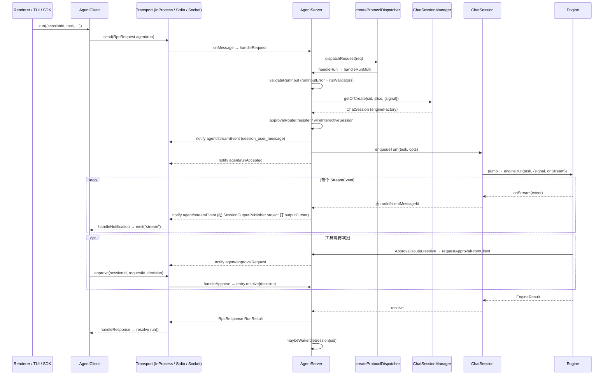
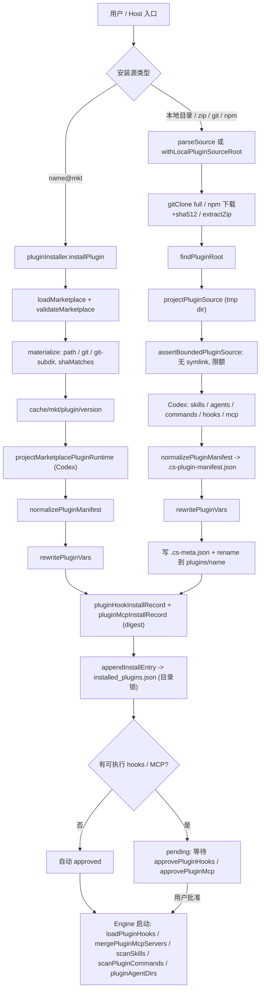
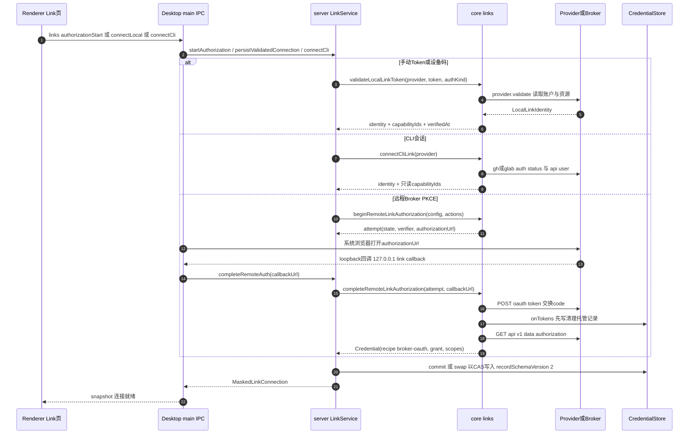
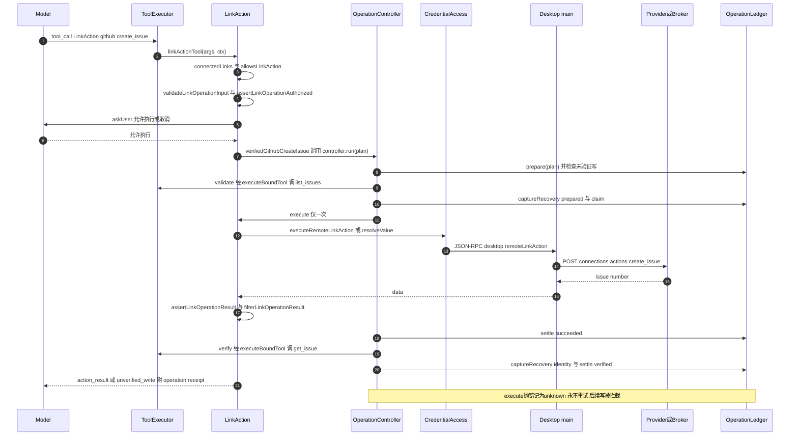
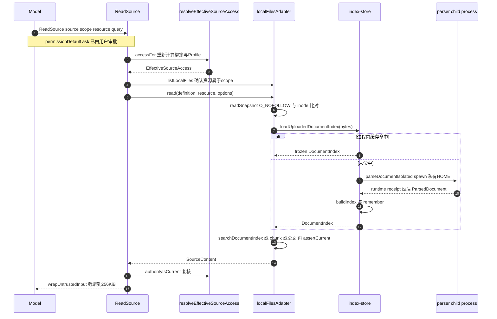

# CodeShell Core 架构文档 04：Protocol / Plugins / Skills / Links / Sources

> 范围：`packages/core/src/` 下的 `protocol/`（≈9.8k 行）、`plugins/`（≈9.3k 行）、`skills/`（≈2.2k 行）+ `index.skills.ts`、`links/`（≈8.7k 行）、`sources/`（≈3.5k 行）。
> 基线：`main` @ `df2ca0bda`（2026-10-20）。除非带包前缀（如 `packages/desktop/src/...`），所有 `file:line` 均相对于 `packages/core/src/`，并已在该基线上用 `grep -n` / 源码阅读核对。旧版章节（`docs/archive/architecture-2026-07/`）与 `docs/core-deep-dive` 中的旧文档仅作线索，本文以源码为准。
> 组织方式：每个子模块一节，节内按「A/模块职责 → B/文件清单 → C/关键类型与类（函数级）→ D/核心调用链 → E/接缝 → F/设计要点与坑」展开（Protocol/Skills 两节用数字小节编号，内容相同）。最后一节给出跨模块接缝总表。

## 0. 总览

| 子模块      | 一句话职责                                                                                                                                                                                                                          | 主要对外入口                                                                                                                                                                                                                                                                  |
| ----------- | ----------------------------------------------------------------------------------------------------------------------------------------------------------------------------------------------------------------------------------- | ----------------------------------------------------------------------------------------------------------------------------------------------------------------------------------------------------------------------------------------------------------------------------- |
| `protocol/` | Host ↔ Engine 的 JSON-RPC 2.0 风格协议：传输（InProcess / stdio NDJSON / TCP NDJSON）、`AgentServer`（多 session 路由、审批与宿主回环、后台唤醒）、`AgentClient`、`ChatSessionManager`/`ChatSession`                                | `.`：`AgentServer`、`AgentClient`、`createInProcessTransport`、`StdioTransport`、`SocketTransport`、`listenTcp`、`createServer/createClient`、`Methods`、`ErrorCodes`、`ChatSessionManager`；`./internal`：`createInProcessClient`；`./bin/agent-server-stdio`（worker 进程） |
| `skills/`   | `SKILL.md` 的发现（项目/用户/插件/Panel App）、frontmatter 解析、Host 侧安全管理与 GitHub 安装更新、冻结指令绑定与隔离验证                                                                                                          | `.`：`scanSkills`、`invalidateSkillCache`；`./internal/skills`（= `index.skills.ts`）：management + github；`./extension`：`readSkillSnapshot`、`InstructionBindingStore`、`runIsolatedInstruction`                                                                           |
| `plugins/`  | Agent Plugin 的获取（marketplace / git / npm / zip / 目录）→ 投影规范化（Codex→CC、manifest 冻结、`CLAUDE_*`→`CODESHELL_*` 变量改写）→ 注册表 → 信任（hooks/MCP digest + 审批）→ 运行时贡献（hooks、MCP、commands、agents、skills） | `.`：`readInstalledPlugins`、`listPluginHooks`、`mergePluginMcpServers`、审批/完整性 API、`pluginCatalog` 等；`./internal`：`installPlugin`、`installPluginFromSource`、`installPluginFromNpm`、`previewLocalPlugin`、`updatePluginByName`、marketplace 管理等                |
| `links/`    | Link = 已授权、可审计的外部 Provider 连接（GitHub/GitLab/Figma/…）；授权判定、CLI/Token/Broker 三类连接、`LinkAction` 模型工具、只发一次并独立复核的"已验证写"与操作账本/对账                                                       | `.`：`links/index.ts`、`remote*`、`local-oauth`；`./internal`：`allowsLinkAction`、`createOperationHookHost`、`createLinkOperationReviewStore` 等；`./extension`：`registerLocalLinkProviders`                                                                                |
| `sources/`  | Source = 可被模型只读访问的外部内容源（本地文件/集合/Link/MCP resource）；adapter 注册、绑定、有效访问计算、隔离子进程文档解析与索引、提示词上下文摘要                                                                              | `.`：`sources/types`、`resolve`、`collection`、`context-summary`；`./internal`：`registerConnectorAdapter`、`bindSource`、`resolveEffectiveSourceAccess`、`localFiles`/`mcpResource` adapter、文档解析 runtime 等                                                             |

依赖方向（只列本切片内部）：`protocol/server.ts` → `plugins/pluginCommandsLoader.ts`（插件 slash command 列表/展开）、`skills/scanner.ts`（`invalidateSkillCache`）；`skills/scanner.ts` → `plugins/installedPlugins.ts`（插件技能发现）；`skills/isolated-instruction-run.ts` → `protocol/factories.ts` + `transport.ts`；`sources/link-view.ts`（被 `sources/adapters/link.ts` 使用）→ `links/providers.ts`、`links/remote.ts`、`links/status.ts`、`links/authority.ts`。`protocol/` 不直接引用 `links/` 或 `sources/`——它们经 Engine 的工具系统（`LinkAction`、`ReadSource` 等）和 stdio 上复用的 `desktop/*` 私有方法与 Host 交互。

## 1. Protocol（`packages/core/src/protocol/`，host ↔ engine 协议层）

### 1.1 模块职责概述

`protocol/` 是 Engine 与一切宿主（TUI、Desktop、headless/TCP worker、SDK 嵌入方、Mobile Remote）之间的唯一正规通道。它做四件事：

1. **线协议定义**（`types.ts`）：JSON-RPC 2.0 风格信封（request / response / notification）、`Methods` 方法名表、`ErrorCodes`、所有请求参数/结果类型。
2. **传输抽象**（`transport.ts`、`tcp-transport.ts`）：3 方法 `Transport` 接口（`send / onMessage / close`），实现有进程内 EventEmitter 对、stdio NDJSON、TCP socket NDJSON。
3. **服务端**（`server.ts` 的 `AgentServer` + `chat-session-manager.ts` / `chat-session.ts`）：把请求路由到按 sessionId 隔离的 `ChatSession`（每个 session 一个 Engine、一个 FIFO turn 队列、一张 pendingApprovals 表），把 Engine 的 `StreamEvent` 包成 `agent/streamEvent` 通知推回，并把 Engine 需要"问宿主"的事情（工具审批、AskUserQuestion、浏览器动作、凭证注入、Panel、workspace 切换）复用同一条 `agent/approvalRequest` 通道反向请求宿主。
4. **客户端**（`client.ts` 的 `AgentClient`）：UI 侧句柄，维护 pending request 表、approval 路由元组，并把通知分发成 `stream / approvalRequest / approvalResolved / status / notification:<method>` 事件。

此外还有若干从 `server.ts` 拆出来的"纯函数/小类"：`dispatch.ts`（路由表 + run 参数校验）、`server-run-controls.ts`（cancel/steer）、`session-workspace-rpc.ts`（workspace 归属与 main-root 迁移）、`background-result-wakeup.ts`（后台任务完成后自动唤醒空闲 session）、`async-user-answer.ts`（异步 AskUser 的答案投递）、`session-message-*.ts`（跨 Session 发消息）、`server-output.ts`（输出日志游标投影）、`redact.ts`（配置脱敏）。

**协议版本**：`initialize` 返回 `CONTRACTS.agentProtocol.preferred`，当前为 `"1"`（`contracts.ts`），S0 阶段不做版本协商，参数被忽略。

### 1.2 文件清单

| 文件                           | 行数 | 职责                                                                                                                                                                                      |
| ------------------------------ | ---- | ----------------------------------------------------------------------------------------------------------------------------------------------------------------------------------------- |
| `index.ts`                     | 14   | 子模块 barrel：导出 `AgentServer`、`AgentClient`、`createInProcessTransport`、`StdioTransport`、`Methods`、`ErrorCodes` 及 plugin command 相关类型                                        |
| `types.ts`                     | 730  | 线协议：信封类型、`ErrorCodes`、`Methods`、全部 Params/Result 类型、`PendingApprovalMetadata`、`createRequest/Response/ErrorResponse/Notification`、`isRequest/isResponse/isNotification` |
| `transport.ts`                 | 110  | `Transport` 接口；`createInProcessTransport()`（两个互连 EventEmitter）；`StdioTransport`（readline 按行 NDJSON）                                                                         |
| `tcp-transport.ts`             | 90   | `SocketTransport`（任意 Duplex 上的 NDJSON）；`listenTcp()`（默认 127.0.0.1，无认证）                                                                                                     |
| `initialize.ts`                | 21   | `initializeResult()`：`{protocolVersion, contracts}` 握手结果                                                                                                                             |
| `dispatch.ts`                  | 228  | `createProtocolDispatcher()`（Map 路由，内置 `initialize`/`agent/backgroundWork*`，未命中走 extension handler）；`runInputError()`（agent/run 通用参数校验）；`goalExtensionInputError()` |
| `run-input.ts`                 | 28   | `runDiagnosticInputError()`（`modelTraceSource` 标签格式）；`isValidRunAttachment()`                                                                                                      |
| `server.ts`                    | 4949 | `AgentServer`：全部 RPC handler、审批/宿主回环通道、后台唤醒、跨 Session 消息、ProtocolObserver 生命周期分发、关闭/断开                                                                   |
| `chat-session.ts`              | 586  | `ChatSession`：单 session 的 Engine 持有者、FIFO turn 队列、取消/模型切换延迟到 run 边界、Goal resume 合成 turn、`runExclusive` 维护互斥                                                  |
| `chat-session-manager.ts`      | 740  | `ChatSessionManager`：sessionId→ChatSession 映射、容量上限、空闲回收、关闭墓碑、identity 派生、main-root 迁移所有权栅栏、冷恢复                                                           |
| `server-run-controls.ts`       | 197  | `runOptions()`（goal/continuation/trace 归一）；`handleCancelRequest()`；`handleSteerRequest()`                                                                                           |
| `session-workspace-rpc.ts`     | 266  | `SessionWorkspaceRpcHandlers`：`release / set / migrateMainRoot / completeMainRootMigration`                                                                                              |
| `background-result-wakeup.ts`  | 181  | `wakeSessionForBackgroundResults()`：把通知邮箱里的后台结果合并成一次合成 turn                                                                                                            |
| `background-work-rpc.ts`       | 66   | `handleBackgroundWork()`（列表）/`handleBackgroundWorkCancel()`（按 attempt 精确取消）                                                                                                    |
| `async-user-answer.ts`         | 84   | `deliverAsyncUserAnswer()`：异步提问的答案先尝试 steer 进原 turn，否则排队成后续 turn                                                                                                     |
| `session-message-result.ts`    | 59   | 跨 Session 消息的结果归类与回执信封构造                                                                                                                                                   |
| `session-message-workspace.ts` | 84   | `resolveSessionMessageWorkspace()`：跨 Session 投递时校验/推导目标 workspace 权限                                                                                                         |
| `server-output.ts`             | 51   | `publishProtocolNotification()`：对 `agent/streamEvent` 先经 `SessionOutputPublisher.project()` 打 outputCursor 再发送；`toCompactStreamStrategy()`                                       |
| `redact.ts`                    | 97   | `redactLlmConfig()`、`maskSecretValue()`、`isSecretKeyPath()`、`makeApiKeyPreview()`                                                                                                      |
| `helpers.ts`                   | 78   | `createInProcessClient(engine)`：一次性调用方的 server+client 对，`close()` 先关 server 再关 client                                                                                       |
| `factories.ts`                 | 118  | 公共稳定 API：`createServer({transport,llm,cwd,...})` 构造 Engine+AgentServer；`createClient()`                                                                                           |
| `mobile-remote-types.ts`       | 428  | Mobile Remote（手机 WS）线协议 DTO，纯类型：`MobileClientEvent` / `MobileServerEvent` / 设备/房间/附件类型                                                                                |

### 1.3 线协议

#### 1.3.1 信封与错误码（`types.ts`）

- `RpcRequest { jsonrpc:"2.0"; id; method; params? }`，`RpcResponse { id; result? | error? }`，`RpcNotification { method; params? }`（无 id）。
- 判别：`isRequest` = 有 method 且有 id；`isResponse` = 有 id 无 method；`isNotification` = 有 method 无 id。
- `createRequest` 用模块级自增 `_nextId`（进程内唯一，不跨进程唯一）。

| ErrorCode       | 值     | 语义                                                                             |
| --------------- | ------ | -------------------------------------------------------------------------------- |
| ParseError      | -32700 | 未使用（坏行在 transport 层被静默丢弃）                                          |
| InvalidRequest  | -32600 | 保留                                                                             |
| MethodNotFound  | -32601 | 未知 method（`dispatchExtensionRequest`）                                        |
| InvalidParams   | -32602 | 参数校验失败、乐观并发不匹配等                                                   |
| InternalError   | -32603 | handler 抛错 / engine 抛错                                                       |
| Overloaded      | -32001 | `maxSessions` 满、session 被别的连接占有、源 session 忙                          |
| SessionNotFound | -32002 | 磁盘上没有该 session（`requireExisting`、fork、query）                           |
| SessionClosed   | -32004 | session 已关闭/关闭中/不存在于内存                                               |
| Cancelled       | -32005 | 声明为"干净终态"，但实际 run 取消走的是**成功响应** `reason:"aborted_streaming"` |

#### 1.3.2 Client → Server 请求（`Methods`）

| Method                                   | Params                                                                                                                                                                      | Result                                                                                                                                                | Server handler                                                                                        |
| ---------------------------------------- | --------------------------------------------------------------------------------------------------------------------------------------------------------------------------- | ----------------------------------------------------------------------------------------------------------------------------------------------------- | ----------------------------------------------------------------------------------------------------- |
| `initialize`                             | 忽略                                                                                                                                                                        | `InitializeResult {protocolVersion:"1", contracts}`                                                                                                   | dispatch.ts 内置                                                                                      |
| `agent/run`                              | `RunParams`（见下）                                                                                                                                                         | `RunResult {runId?, text, reason, completionKind?, sessionId, turnCount, usage, extensions?, petWorkDelegation?}`                                     | `handleRun` → `handleRunMulti` / `handleRunLegacy`                                                    |
| `agent/forkSession`                      | `ForkSessionParams`：`{mode:"full", sourceSessionId, targetSessionId?, forkKind?:"side", throughEventId?, quickChatClaimId?}` 或 `{mode:"summary", fromEventId, toEventId}` | `FullForkSessionResult {sessionId, forkedFrom, workspace, copiedEventCount}` / `SummaryForkSessionResult {summary, sourceRange, estimatedTokens,...}` | `handleForkSession`                                                                                   |
| `agent/approve`                          | `ApproveParams {sessionId, requestId, decision, connectionId?, generation?}`                                                                                                | `{ok:true}`                                                                                                                                           | `handleApprove`                                                                                       |
| `agent/cancel`                           | `CancelParams {sessionId, reason?, expectedClientMessageId?}`                                                                                                               | `{ok:true[, stopped]}`                                                                                                                                | `handleCancelRequest`（server-run-controls）                                                          |
| `agent/configure`                        | `ConfigureParams {sessionId?, permissionMode?, planMode?, bypassPermissions?, effort?, model?, reloadModels?, clearModels?, reloadSettings?}`                               | `{ok}` 或 `{ok, model, key, maxContextTokens}`                                                                                                        | `handleConfigure`                                                                                     |
| `agent/query`                            | `QueryParams {type, sessionId?, key?, value?, ...}`                                                                                                                         | `QueryResult {type, data}`                                                                                                                            | `handleQuery`（见 1.3.4）                                                                             |
| `agent/inject`                           | `InjectParams {sessionId, content}`                                                                                                                                         | `{ok}`                                                                                                                                                | `handleInject` → `engine.injectContext`                                                               |
| `agent/steer`                            | `SteerParams {sessionId, text, id?, clientMessageId?, expectedClientMessageId?, attachments?}`                                                                              | `{ok, accepted, id?}`                                                                                                                                 | `handleSteerRequest` → `engine.enqueueSteer`                                                          |
| `agent/unsteer`                          | `UnsteerParams {sessionId, id}`                                                                                                                                             | `{ok, removed}`                                                                                                                                       | `handleUnsteer` → `engine.unsteer`                                                                    |
| `agent/closeSession`                     | `{sessionId}`                                                                                                                                                               | `{ok}`                                                                                                                                                | `handleCloseSession`                                                                                  |
| `agent/releaseWorkspace`                 | `{sessionId}`                                                                                                                                                               | `{ok, workspace\|null}`                                                                                                                               | `SessionWorkspaceRpcHandlers.release`                                                                 |
| `agent/setWorkspace`                     | `{sessionId, workspace:{root, kind:"main"\|"worktree"}}`                                                                                                                    | `{ok, workspace}`                                                                                                                                     | `SessionWorkspaceRpcHandlers.set`                                                                     |
| `agent/migrateSessionMainRoot`           | `MigrateSessionMainRootParams {sessionId, project, mainRoot, workspaceContext, projectTrusted, ownershipToken}`                                                             | `{status:"migrated",workspace}` \| `{status:"not-resident",ownershipToken}` \| `{status:"failed",error}`                                              | `SessionWorkspaceRpcHandlers.migrateMainRoot`                                                         |
| `agent/completeSessionMainRootMigration` | `{sessionId, ownershipToken}`                                                                                                                                               | `{released:true}`                                                                                                                                     | `...completeMainRootMigration`                                                                        |
| `agent/goalExtend`                       | `{sessionId, addTurns?, addTokenBudget?, addTimeBudgetMs?, addStopBlocks?}`                                                                                                 | `{ok, limits}`                                                                                                                                        | `handleGoalExtend`                                                                                    |
| `agent/goalUpdate`                       | `GoalUpdateParams {sessionId, objective?, paused?, expectedGoalId, expectedRevision}`                                                                                       | `{ok, updated, goal?, goalId?, revision?, paused?}`                                                                                                   | `handleGoalUpdate`                                                                                    |
| `agent/goalDelete`                       | `{sessionId, expectedGoalId, expectedRevision}`                                                                                                                             | `{ok, deleted}`                                                                                                                                       | `handleGoalClear(req, true)`                                                                          |
| `agent/goalClear`                        | `{sessionId}`                                                                                                                                                               | `{ok, cleared}`                                                                                                                                       | `handleGoalClear`                                                                                     |
| `agent/goalGet`                          | `{sessionId}`                                                                                                                                                               | `{ok, goal\|null, goalId?, revision?, paused}`                                                                                                        | `handleGoalGet`                                                                                       |
| `agent/backgroundShells`                 | `{sessionId, action?:"list"\|"output"\|"kill", shellId?}`                                                                                                                   | `{shells}` / `{header,text}` / `{ok}`                                                                                                                 | `handleBackgroundShells` → `backgroundShellManager`                                                   |
| `agent/backgroundWork`                   | `{sessionId, scope?:"session"\|"all"}`                                                                                                                                      | `{items}`                                                                                                                                             | dispatch.ts 内置 → `listBackgroundWorkForUI`                                                          |
| `agent/backgroundWorkCancel`             | `{sessionId, workId, kind:"shell"\|"subagent"\|"job", expectedStartedAt, expectedRuntimeGeneration?}`                                                                       | `{cancelled}`                                                                                                                                         | dispatch.ts 内置 → `cancelBackgroundWorkForUI`                                                        |
| `agent/getPetProjectionSnapshot`         | —                                                                                                                                                                           | —                                                                                                                                                     | **不在核心路由表**：由 pet 扩展通过 `ProtocolObserverHost.registerQuery` 注册（走 extension 通道）    |
| `pluginCommands/list`                    | `{cwd}`                                                                                                                                                                     | `{commands: ProtocolPluginCommandDescriptor[]}`（name/pluginName/description/argumentHint，**不含正文与路径**）                                       | `handlePluginCommandsList`                                                                            |
| `pluginCommands/expand`                  | `{cwd, name, rawArguments?}`                                                                                                                                                | `{prompt}`                                                                                                                                            | `handlePluginCommandExpand`                                                                           |
| 任意其他 method                          | 任意                                                                                                                                                                        | handler 返回值                                                                                                                                        | `dispatchExtensionRequest` → `protocolQueryHandlers`（由 composition 的 protocol contributions 注册） |

`RunParams` 关键字段（`types.ts:95` 起）：`sessionId`（必填、客户端生成）、`task`、`displayText`（≤20000）、`attachments`、`clientMessageId`（幂等）、`operationBatchToken`、`archiveBeforeCurrentTurn {fromClientMessageId?, segmentId?, summary?(≤4000)}`、`quickChatClaimId`、`injected`、`cwd`、`projectId/rootId`（仅 renderer 提示）、`workspaceContext`（只能由可信宿主注入，Desktop main 会剥掉 renderer 传来的）、`permissionMode`、`sandboxMode`（off/auto/seatbelt/bwrap）、`allowBackgroundShells`、`model`、`projectTrusted`、`planMode`、`behaviorMode`、`preset`、`toolAllowlist`（≤32）、`skillAllowlist`（≤8）、`ephemeral`、`maxTurns`（1–30）、`maxContextTokens`（4096–131072）、`profileParams`、`workspaceProfile`、`sessionBrief`、`sessionMessageTargets`、`kind`、`requireExisting`、`goal`/`goalContinuation`/`disableGoal`，以及已废弃 pet 别名 `petRuntimeContext`/`petWorkspaces`。

#### 1.3.3 Server → Client 通知

| Method                     | Params                                                                                                       | 发送点                                                                                                               |
| -------------------------- | ------------------------------------------------------------------------------------------------------------ | -------------------------------------------------------------------------------------------------------------------- |
| `agent/status`             | `{status:"ready"\|"running"\|"error"\|"shutdown", message?}`                                                 | 构造末尾 `ready`（server.ts:763）；legacy run 前后 `running/ready`；`close()` 发 `shutdown`                          |
| `agent/runAccepted`        | `{requestId, sessionId}`                                                                                     | `enqueueTurn` 之后、run 结束之前（server.ts:1846）                                                                   |
| `agent/streamEvent`        | `{sessionId, event: StreamEvent}`                                                                            | 每个 Engine 流事件、`session_user_message`、`goal_*`、`context_compact`、后台通知转换的 `background_agent_completed` |
| `agent/approvalRequest`    | `{requestId, request:ApprovalRequest, sessionId?, connectionId?, generation?, sourceSessionId?, childHost?}` | 工具审批 + 所有宿主回环（见 1.5.4）                                                                                  |
| `agent/approvalResolved`   | `{sessionId?, requestId, approved?, answer?}`                                                                | 异步提问答案被接纳、Goal 模式 AskUser 超时、child host 释放、取消                                                    |
| `agent/settingsChanged`    | `{}`                                                                                                         | 不由 AgentServer 发；stdio worker 在模型目录/能力安装变更时直接 `stdioTransport.send`（`cli/agent-server-stdio.ts`） |
| `agent/petProjectionDelta` | 扩展定义                                                                                                     | pet 扩展经 `ProtocolObserverHost.notify` 发送                                                                        |
| 扩展自定义                 | 任意                                                                                                         | `AgentClient.onExtensionNotification(method)` 订阅                                                                   |

同一条 stdio 管道上还复用了**非 AgentServer** 的 worker↔main 私有方法（由 `cli/agent-server-stdio.ts` 装配，不属于 `Methods`）：`desktop/operationBatch`、`desktop/credentialSnapshot`（`credentials/access.ts`）、`desktop/modelRequestSign`（`model-request-boundary/access.ts`）、`desktop/automationCreate`（`automation/desktop-authority-client.ts`）、`desktop/localOAuthLinkActionCancel`（links）、`agent/cronChanged`。

#### 1.3.4 `agent/query` 的 type 列表（`handleQuery`，server.ts:3058）

| type                                                                           | 引擎选择              | 作用                                                                                             |
| ------------------------------------------------------------------------------ | --------------------- | ------------------------------------------------------------------------------------------------ |
| `output_journal`                                                               | session 所属 engine   | `readOutputJournal(storageDir, sessionId, {after, through, maxBytes, maxFrames})`，断线恢复      |
| `usage`                                                                        | session/runtime/store | `engine.getUsageSummary`；非 session 范围需 `allowUsageAggregation`（且未开 identity）           |
| `tools`                                                                        | session 或 detached   | 工具名+描述列表                                                                                  |
| `sessions`                                                                     | chatManager           | `getLiveSessionSnapshot()`；legacy 用 `SessionManager.list(excludeKinds=hiddenSessionKinds)`     |
| `config`                                                                       | session 或 detached   | permissionMode/planMode/preset/model/cwd + `redactLlmConfig` + featureFlags + permissionRules    |
| `session_detail`                                                               | session               | `SessionManager.resume(id)` 的 state + transcript events                                         |
| `compact`                                                                      | session               | `engine.forceCompact`，若缩小则推 `context_compact` 事件                                         |
| `archive_range`                                                                | session               | `engine.archiveTurnRange(id,{start,end},anchors)`，strategy 固定 `range`                         |
| `archive_marker`                                                               | session               | `engine.appendArchiveMarker`（无模型调用的归档摘要）                                             |
| `models`                                                                       | detached              | ModelPool 列表 → `ProtocolModelEntry[]`                                                          |
| `providers`                                                                    | detached              | settings.providers + 模型计数 + 缓存信息，整体 `redactSecrets`                                   |
| `config_set`                                                                   | detached              | `engine.updateConfig(key,value)`；`isProtectedSettingKey` 拒绝信任根字段；回显 `maskSecretValue` |
| `config_get`                                                                   | detached              | `engine.readSetting(key)` + `maskSecretValue`                                                    |
| `permission_set`                                                               | detached              | `engine.setPermissionMode`                                                                       |
| `provider_add / provider_refresh / provider_delete / model_add / model_delete` | detached              | 改 settings providers[]/models[]；refresh 调 `fetchModelList`                                    |
| 其他                                                                           | detached              | `engine.queryCapability(type, params)`（CapabilityModule 贡献的 query）                          |

"detached engine" = `chatManager.createDetachedEngine()` 惰性构造并缓存在 `globalQueryEngine`，**不借用任何活 session 的 cwd/策略**；session 作用域查询走 `resolveEngineForSessionQuery()`（server.ts:2995），会为"磁盘上存在但不在内存"的 session 现场 `getOrCreate`。

#### 1.3.5 `StreamEvent`（`core/src/types.ts:685/720`）

公共信封字段：`timestamp?`、`runId?`、`clientMessageId?`、`outputCursor?`、`outputOriginCursor?`、`outputRecovery?:"incomplete"`。payload `type` 全集：

| 类别            | type                                                                                                                                                                                                          |
| --------------- | ------------------------------------------------------------------------------------------------------------------------------------------------------------------------------------------------------------- |
| 会话/轮次       | `session_started`(sessionId, promptTokens…)、`session_user_message`、`session_title`、`stream_request_start`、`turn_complete`(reason, completionKind, durationMs)、`turn_diff`、`steer_injected`、`tombstone` |
| 模型输出        | `text_delta`、`thinking_delta`、`assistant_message`、`usage_update`（大量缓存统计字段）                                                                                                                       |
| 工具            | `tool_use_start`、`tool_use_args_delta`、`tool_result`、`tool_summary`、`task_update`                                                                                                                         |
| 子 agent / 后台 | `agent_start`、`agent_backgrounded`、`agent_end`、`agent_heartbeat`、`background_agent_completed`(workKind agent/shell/video/cc)                                                                              |
| Goal            | `goal_progress`、`goal_set`、`goal_updated`、`goal_cleared`                                                                                                                                                   |
| 上下文          | `context_compact`(strategy micro/summary/window/snip/emergency/compacted/range/notes)、`context_transfer`、`memory_recalled`                                                                                  |
| 错误            | `error`                                                                                                                                                                                                       |

`ChatSession.pump()` 会在 `session_started` 时捕获 `runId/clientMessageId` 并盖到同一 run 的后续事件上（子 agent 事件 `agentId` 不覆盖；`steer_injected` 保留自身 clientMessageId）。

### 1.4 传输

| 实现                            | 位置                   | 帧格式                                             | 使用者                                                                                                                                                                                                                  |
| ------------------------------- | ---------------------- | -------------------------------------------------- | ----------------------------------------------------------------------------------------------------------------------------------------------------------------------------------------------------------------------- |
| `createInProcessTransport()`    | transport.ts:34        | 直接对象（EventEmitter，A.send→B.emit）            | TUI REPL（`tui/src/cli/commands/repl.ts:258`）、TUI headless `run.ts:225`、`createInProcessClient`（`run/EngineRunner.ts:227`）、`skills/isolated-instruction-run.ts:49`、SDK `createServer` 嵌入                       |
| `StdioTransport`                | transport.ts:76        | NDJSON（readline 每行 `JSON.parse`，坏行静默跳过） | Desktop/Server 的 worker 进程 `cli/agent-server-stdio.ts:391`；对端是 `@cjhyy/code-shell-server` 的 `WorkerBridgeCore`（Desktop `main/agent-bridge.ts:398` 用它 spawn `@cjhyy/code-shell-core/bin/agent-server-stdio`） |
| `SocketTransport` / `listenTcp` | tcp-transport.ts:25/69 | NDJSON over Duplex                                 | `cli/agent-server-tcp.ts:224`：每个连接一个 `AgentServer`，共享一个 `chatManager`；**无认证，默认绑 127.0.0.1**                                                                                                         |

没有 WebSocket 实现在 core 内：手机/浏览器走 `@cjhyy/code-shell-server` 的 HTTP+WS（`MobileClientEvent/MobileServerEvent` 是其 DTO，类型放在 core 只为让 web 包不依赖 server 实现）。Desktop renderer 不直接持有 Transport：preload 自己拼 JSON-RPC 行 `ipcRenderer.send("agent:msg", line)`（`desktop/src/preload/index.ts:432`），main 的 `ipcMain.on("agent:msg")`（`agent-bridge.ts:927`）经 `prepareAgentRunMetadata` 重写/校验后写入 worker stdin。

### 1.5 关键类

#### 1.5.1 `AgentServer`（server.ts:415）

**构造参数 `AgentServerOptions`**（server.ts:312）：`chatManager?`（多 session 模式）/ `engine?`（legacy 单 engine 模式，二者至少其一，否则 throw，server.ts:590）、`transport`、`settingsReader?`（配置热重载 layer 2，必须与 engineFactory 用同一闭包）、`readActiveGoalFromDisk? / updateActiveGoalOnDisk? / clearActiveGoalOnDisk?`（非活 session 的 goal 盘上操作）、`workspaceBridge?`、`panelBridge?`、`connectionId?`（提供即启用严格审批路由）、`resolveIdentity?`（多身份）、`allowUsageAggregation?`、`sessionDiskRoot?`、`notificationPersistence?` / `notificationMailbox?`、`ownsBackgroundWakeups?`（默认 true）、`approvalRouter?`、`composition?`。

**主要字段**：`baseChatManager`、`identityManagers`（identity→派生 manager）、`legacyEngine`、`globalQueryEngine`、`dispatchRequest`、`protocolObservers[]`、`protocolQueryHandlers`（extension method 表）、`runValidators`、`hiddenSessionKinds`、`lastSliceBySession`（唤醒重建用）、`pendingApprovalTargets`（requestId→路由元组）、`approvalTimers`、legacy 的 `running/abortController/pendingApprovals`、`childHostDisposers`、`wakeupsInFlight`、`outputPublisher`、`moduleScope / moduleReady`。常量 `APPROVAL_TIMEOUT_MS=5min`、`GOAL_ASKUSER_TIMEOUT_MS=10min`。

**构造流程（server.ts:565–764）**：

1. 绑定 notification mailbox（可附加持久化）、identity、legacy/goal 读写器、桥开关；严格模式由 `connectionId !== undefined` 决定；非严格时先 `approvalRouter.deregister(connectionId)` 清理旧宿主；`getInteractiveApprovalBackend().clearPromptFn()`。
2. 建 `SessionOutputPublisher`（按 session 取 storageDir，fallback 惰性 `SessionManager(sessionDiskRoot)`）。
3. 建 `SessionWorkspaceRpcHandlers`，以及 `createProtocolDispatcher({handlers:{...22 个...}})`（server.ts:614）。
4. 取 composition（参数 > legacyEngine.getComposition() > `compileComposition({})`），`attachProtocolContributions()` 异步挂载 observers 与 query handlers（`moduleReady`）。
5. `transport.onMessage`：只处理 request，`handleRequest` 抛错统一回 `InternalError`（server.ts:688）。
6. `approvalRouter.addConnection(connectionId, {requestApproval→requestApprovalFromClient, ownershipLost→failClosedApprovalTargets}, {claimUnownedSessions: !strict})`。
7. legacy 模式且非 headless：`legacyEngine.setAskUser(requestAskUserFromClient)`。
8. 订阅 `agentNotificationBus`：每个信封转成 legacy `background_agent_completed` 流事件推送；`kind==="result"` 时 `maybeWakeIdleSession`。
9. `ownsBackgroundWakeups` 时对 `restorePersistedSessions()` 返回的 session 逐个唤醒。
10. `notify(Status, ready)`。

**公开方法**：

- `close(): Promise<void>`（server.ts:4632）：幂等；`disconnectTransport(…, false)` → 退订 bus → 对所有 manager 的 session `cancelSessionApprovals(…,"session_closed")` → abort legacy run → 拒绝 legacy pending → 清计时器 → 快照 pending decisions → `observeServerClose` → 发 `shutdown` → `transport.close()` → 后台 `closeAllAsync()` 所有 manager + 等 moduleReady + dispose legacy/global engine + `moduleScope.dispose()`；错误聚合为 `AggregateError`。
- `disconnect(reason)`（server.ts:4730）：只释放本连接的审批所有权和模块 scope，不关共享的 manager（TCP 多连接用）。
- `getPendingDecisionSnapshot()`（server.ts:4760）：聚合各 observer 的 `snapshotPendingDecisions()`（resolver-free、structuredClone）。

**私有 handler（函数级）**：

- `handleRequest(req)`（1213）：若有 host activators 先 `await moduleReady`；已断开则 throw；`dispatchRequest(req)`。
- `handleRunMulti(req)`（1675）：校验 sessionId → `validateRunInput`（`runInputError` + 各模块 `runValidators`）→ 组 `sessionConfig` slice（cwd/workspaceContext/projectTrusted/preset（isolatedTask 默认 `general`）/maxTurns/maxContextTokens/goal）→ `requireExisting` 时 `sessionExistsOnDisk` → `trackRunStart` 登记可取消的"启动中"控制器 → `cm.getOrCreate(sid, slice, {signal})` → `observeSessionAttached` → `approvalRouter.register(sid, connectionId)`（被他人占有回 Overloaded）→ `rememberSessionSlice` → 可选 `session.requestModelSwitch(model)` → `wireInteractiveSession` → 有 displayText 时先推 `session_user_message` → `session.enqueueTurn(task, {...runOptions, …, onStream: observe+notify, approvalRouter})` → 释放 start 栅栏 → `notify(RunAccepted)` → `observeRunBoundary("start")` → `await run` → `observeRunBoundary("end")` → 回 `RunResult` → `maybeWakeIdleSession(sid)`；异常时若是启动前被取消则回 `aborted_streaming` 成功响应，否则 `InternalError` + 唤醒复查。
- `handleRunLegacy(req)`（1889）：单 engine 互斥（`running`），可设 permissionMode/model，发 `status: running`，直接 `legacyEngine.run()`；Abort 类错误转为 `aborted_streaming` 成功响应；finally 发 `status: ready`。
- `handleForkSession(req)`（1396）：大量参数互斥校验（full vs summary、side fork 不能带 throughEventId…）→ `assertSafeSessionId` → 源 session 不在内存则 `getOrCreatePersisted` → 非 side fork 时源忙则拒 → summary 模式在 `source.runExclusive()` 里 `selectContextPackage → summarizeContextPackage → createSummaryFork`；full 模式 `engine.forkSession(src, side? {snapshotMode:"completed", ephemeral:true} : {throughEventId})`；错误消息用正则映射到错误码。
- `handleApprove(req)`（2065）：严格模式先核对 `(connectionId, sessionId, generation, requestId)` 与 `pendingApprovalTargets` 和 router 当前所有者完全一致；多 session 路径只在该 session 的 `pendingApprovals` 中找（**绝不回落到全局表**）；`asynchronous` 条目走"提交中"状态机：校验答案非空 → `entry.resolve(decision)`（可能返回 admission promise）→ 确认条目未被替换 → `takeSessionApproval` → 发 `ApprovalResolved{approved:true, answer}`；普通条目删除、清计时器、`entry.resolve(decision)`。
- `handleCancel`（2212）→ `handleCancelRequest`（server-run-controls.ts:46）：带 `expectedClientMessageId` 时只停匹配的活跃 turn（`cancelActiveTurn`），不影响排队；否则 `cancelRunStarts` + `session.cancel()` + `cancelSessionApprovals`；legacy 路径 abort + 拒绝 pending。
- `handleGoalExtend`（2236）、`handleGoalUpdate`（2395，CAS `expectedGoalId/expectedRevision`；`paused:false` 且不能就地 resume 时 `queueGoalResumeTurn` → `ChatSession.enqueueGoalResumeTurn`；失败时 `reconcileFailedGoalResume` 回滚为 paused 并发 error 事件）、`handleGoalClear`（2563，删除别名要求 CAS；成功推 `goal_cleared`）、`handleGoalGet`（2660，活 session > 盘上读取器 > legacy）。`authorizeGoalControl`（2298）拒绝别的连接拥有的 session。
- `handleBackgroundShells`（2703）、`handleCloseSession`（2754：取消启动中 run → 取消审批 → `approvalRouter.release` → `chatManager.close` → `observeSessionClosed` → `backgroundShellManager.killSession` → `backgroundJobRegistry.dropForSession`）。
- `handleConfigure`（2786）：`reloadSettings` 先 `invalidateSkillCache()`；带 sessionId 时只改该 session（plan/permission、`runtime.clearModels/reloadModelsFromSettings`、`requestModelSwitch`、`refreshRuntimeConfig(diskDefaultsFrom(settings, disabledPlugins), ++configVersion)`）；全局时广播到每个活 session，并用 `lastBroadcastPatch` JSON 去重避免 hook 抖动。
- `handleInject`（3757）、`handleSteer`（3813）、`handleUnsteer`（3821）。
- `handlePluginCommandsList`（1237）/`handlePluginCommandExpand`（1257）：`pluginCommandContext(cwd)` 用 `computeEffectiveDisabledLists(new SettingsManager(cwd,"full"))` 求禁用插件；`scanPluginCommands()` + `describePluginCommands` / `expandPluginCommandBody(body, rawArguments)`。命令正文与安装路径从不跨越协议边界。
- `routeSessionMessage(input)`（1057）：模型工具 `SendMessageToSession` 的宿主实现。见 1.6.5。
- `maybeWakeIdleSession / wakeIdleSession / rehydrateSessionForWake / sliceForWakeRehydrate`（788–887）：见 1.6.4。
- `wireInteractiveSession(session, sid)`（893）：非 headless 时给 Engine 装 `setAskUser`、`setAskUserAsync`、`setBrowserBridge`、`setInjectCredential`、`setChildHostBindings`（子 agent 的独立 InteractiveApprovalBackend + 浏览器绑定/释放）、`setSessionMessageRouter`、可选 `setWorkspaceBridge`、`setPanelBridge`。**每次 getOrCreate/重建后都必须重装**，因为 engineFactory 每次给新 Engine。

#### 1.5.2 `ChatSession`（chat-session.ts）

字段：`id`、`currentEngine`、`pendingApprovals: Map<requestId,{resolve, metadata, submitting?}>`、`lastActivityAt`、`queue: QueuedTurn[]`、`active`、`exclusiveOperation`、`controller`、`pendingModel`、`cancelledActive`、`cancelledSinceLastTurn`、`cancellationGeneration`、`settlePromise`。

| 方法                                                                      | 行  | 说明                                                                                                                                                                                                                                                                 |
| ------------------------------------------------------------------------- | --- | -------------------------------------------------------------------------------------------------------------------------------------------------------------------------------------------------------------------------------------------------------------------- |
| `get engine`                                                              | —   | 当前 Engine                                                                                                                                                                                                                                                          |
| `replaceEngine(expected, replacement)`                                    | 164 | 只在空闲且 owner 未变时换 Engine（main-root 迁移用）                                                                                                                                                                                                                 |
| `enqueueTurn(task, opts)`                                                 | 174 | 清 `cancelledSinceLastTurn`，复制 allowlist，入队并 `pump()`；返回 `Promise<EngineResult>`                                                                                                                                                                           |
| `captureFollowUpOptions()`                                                | 198 | 深拷贝当前 turn 的权限/工作区/allowlist 等"授权快照"，供异步答案续跑                                                                                                                                                                                                 |
| `runExclusive(op)`                                                        | 232 | 与 turn 共用互斥：有活动/排队直接抛；用于 summary fork 的上下文打包                                                                                                                                                                                                  |
| `wasCancelledSinceLastTurn()` / `cancellationEpoch`                       | —   | Stop 之后抑制后台自动唤醒                                                                                                                                                                                                                                            |
| `cancel()`                                                                | 278 | `cancellationGeneration++`，标记活跃 turn 为用户取消，abort，排队 turn 全部以 `AbortError` 拒绝                                                                                                                                                                      |
| `matchesActiveTurn(id)` / `cancelActiveTurn(id)`                          | 303 | 精确停止某个 clientMessageId 的 turn                                                                                                                                                                                                                                 |
| `isBusy()` / `settled` / `queueDepth()`                                   | —   | 状态                                                                                                                                                                                                                                                                 |
| `extendGoalRun / getGoal / clearGoal / updateGoal / canResumeGoalInPlace` | —   | 代理到 Engine                                                                                                                                                                                                                                                        |
| `enqueueGoalResumeTurn(goal, opts)`                                       | 378 | 合成 `<system-reminder>用户已恢复持久目标…` turn（injected）；同 goalId 的待处理 resume 被替换；`guard` 在队首再检查 goal 未暂停且同实例                                                                                                                             |
| `requestModelSwitch(key)`                                                 | 419 | 忙时记 `pendingModel` 延迟到 run 边界；闲时 `engine.switchModel(key,{persist:false})` + `resetSessionUsage`                                                                                                                                                          |
| `pump()`（私有）                                                          | 465 | 取队首（跑 guard）→ 建 controller → 包装 onStream 注入 runId/clientMessageId → `engine.run(task, {...全部 TurnOpts, sessionId, signal})`（515）→ 用户取消的 Abort 错误转为 `aborted_streaming` 结果 → finally 释放 settled、应用延迟模型切换、`queueMicrotask(pump)` |

#### 1.5.3 `ChatSessionManager`（chat-session-manager.ts）

构造 `ChatSessionManagerOptions {runtime: EngineRuntime, engineFactory(slice), maxSessions=16, idleTtlMs=30min, projectionGeneration=1, identity="local", dataRoot?}`。`EngineConfigSlice` = EngineConfig 的 `permissionMode/preset/customSystemPrompt/appendSystemPrompt/goal/maxTurns/maxContextTokens/cwd/workspaceContext/projectTrusted/sessionStorageDir` 子集。

| 方法                                                                                                                                                                  | 行  | 说明                                                                                                                                                                                                                                                                                                              |
| --------------------------------------------------------------------------------------------------------------------------------------------------------------------- | --- | ----------------------------------------------------------------------------------------------------------------------------------------------------------------------------------------------------------------------------------------------------------------------------------------------------------------- |
| `forIdentity(identity)`                                                                                                                                               | 200 | `assertSafeIdentity`；派生 manager，engineFactory 注入 `sessionStorageDir=<dataRoot>/identities/<id>/sessions`                                                                                                                                                                                                    |
| `getOrCreate(id, slice, {allowReopen?, signal?})`                                                                                                                     | 217 | 循环等待 resident 迁移 / 迁移 claim / 关闭中，再同步 `getOrCreateNow`（无 await 间隙，与 `beginSessionMigration` 互斥）                                                                                                                                                                                           |
| `getOrCreateNow`（私有）                                                                                                                                              | 406 | 打开路径审批/交互审批会话；已存在则更新活动时间与 permissionMode；超 `maxSessions` 抛 `code=-32001`；`factory(slice)` → `new ChatSession` → `registerSessionGeneration` → 清墓碑                                                                                                                                  |
| `beginSessionMigration(id, token)` / `beginSessionMigrationAfterClose` / `completeSessionMigration`                                                                   | 261 | 证明"本 worker 是否持有 resident Engine"，否则安装 claim 栅栏让 Main 做一次盘上原子迁移                                                                                                                                                                                                                           |
| `migrateResidentSessionMainRoot(id, target)`                                                                                                                          | 313 | 事务顺序：构造并 restore 候选 Engine → 旧 Engine 原子提交盘上状态 → 同步 `replaceEngine` → dispose 旧 Engine                                                                                                                                                                                                      |
| `getOrCreatePersisted(id, slice, restoreModel)`                                                                                                                       | 380 | 探针 Engine 读 `readSessionMainRoot`，再用该 cwd 建真正 session（`projectTrusted` 默认 false）                                                                                                                                                                                                                    |
| `get / isClosing / isClosed / isUnavailable / sessionExistsOnDisk / forEachSession / getAnyLiveEngine / createDetachedEngine / getLiveSessionSnapshot / sessionCount` | —   | 查询                                                                                                                                                                                                                                                                                                              |
| `close(id)` → `closeSession(id, markClosed)`                                                                                                                          | 512 | 若在 resident 迁移中则排在其后；`incrementSessionGeneration` 使旧 run 失效 → `prepareSessionCloseFinalization` → `cancel()` → 清各类 session 级授权（路径、交互审批、凭证 allow、注入凭证 allow）→ 等 settled → dispose Engine（或 `mcpPool.unregisterOwner`）；`qchat-*` 不在内存时也要 `forgetEphemeralSession` |
| `closeAll()` / `closeAllAsync()`                                                                                                                                      | 604 | 释放 claim → 关所有 session → `backgroundShellManager.killAll()` → `clearAgentOutputFiles()`                                                                                                                                                                                                                      |
| `sweepIdle()` / `startIdleSweeper(60s)` / `stopIdleSweeper()`                                                                                                         | 640 | 跳过 `qchat-*`、忙、有 pending 审批、有后台 job 的 session；空闲回收**不** markClosed、**不**杀后台 shell                                                                                                                                                                                                         |

#### 1.5.4 审批与宿主回环通道（同一条 `agent/approvalRequest`）

Engine 需要宿主协助时，`AgentServer` 都生成 `requestId = nanoid(12)`，`registerSessionApproval()`（4776）把 `{resolve, metadata}` 放进 `session.pendingApprovals`（metadata 经 observers 的 `onApprovalCreated` 可改写），然后 `notify(ApprovalRequest, {...approvalRouteEnvelope, request:{toolName, args, description, riskLevel}})`。宿主用 `agent/approve` 回复（`decision` 为 `ApprovalResult` 或 JSON 字符串）。

| 场景                         | 方法                                                                  | toolName                                                                                                                                                                                                                 | 超时                                                                     | 结果解析                                                    |
| ---------------------------- | --------------------------------------------------------------------- | ------------------------------------------------------------------------------------------------------------------------------------------------------------------------------------------------------------------------ | ------------------------------------------------------------------------ | ----------------------------------------------------------- |
| 工具权限审批                 | `requestApprovalFromClient`（3869，由 ApprovalRouter handler 调）     | 真实工具名（经 `safeApprovalToolName` 清洗显示）                                                                                                                                                                         | 5 min → `{approved:false, failure:"timed_out"}`                          | 原样 ApprovalResult                                         |
| AskUserQuestion（同步）      | `requestAskUserForSession`（4079）                                    | `__ask_user__`                                                                                                                                                                                                           | 默认无；有 Goal 时 10 min，超时回中文"自行合理假设"并发 ApprovalResolved | answer 或 reason                                            |
| AskUser（异步、不阻塞 turn） | `requestAskUserAsyncForSession`（3959）                               | `__ask_user__`（args.asynchronous=true）                                                                                                                                                                                 | 无                                                                       | 立即返回"问题已展示"字符串；答案经 `deliverAsyncUserAnswer` |
| 浏览器动作                   | `makeBrowserBridge`（4177）→ `requestBrowserActionForSession`（4206） | `__browser_action__`，args.action ∈ requestTakeover/resumeControl/inspect/snapshot/click/type/navigate/scroll/readContent/extractLinks/waitForLoad/hover/selectOption/pressKey/fetchImages/screenshot/listTabs/switchTab | 5 min                                                                    | `parseHostLoopbackDecision`                                 |
| 凭证 Cookie 注入             | `requestCredentialInjectForSession`（4272）                           | `__credential_action__`（injectCookie）                                                                                                                                                                                  | 5 min                                                                    | 同上                                                        |
| Panel                        | `makePanelBridge`（4336）→ `requestPanelActionForSession`（4411）     | `__panel_action__`（list/open/tools/invoke）                                                                                                                                                                             | 5 min                                                                    | 同上；失败不得伪装为"空"                                    |
| Workspace 切换/解析          | `requestWorkspaceActionForSession`（4505）                            | `__workspace_action__`（switch / resolve_session_run）                                                                                                                                                                   | 5 min                                                                    | 失败 reject                                                 |
| 子 agent 浏览器绑定          | `setChildHostBindings` 回调内                                         | `__browser_action__`（activate / release，携带 `childHost`）                                                                                                                                                             | —                                                                        | 单向通知                                                    |

失败分类 `HostLoopbackFailure = denied | cancelled | session_closed | owner_lost | timed_out | unsupported | malformed`；内部条目取消时用 `InternalPendingCancellation` 哨兵（`__internalCancelled`），从而"用户按了 Stop"不会被模型理解成"用户拒绝"。`cancelSessionApprovals()`（4844）循环排干（先 internal 后 tool_approval，最多 1000 轮，防 resolver 重入注册）。`failClosedApprovalTargets()`（4900）在 ApprovalRouter 报告所有权丢失时以 `owner_lost` 收尾。

#### 1.5.5 `AgentClient`（client.ts）

字段：`transport`、`emitter`、`pendingRequests: Map<id,{onResponse?, resolve, reject}>`、`approvalRoutes: Map<requestId, {connectionId?, sessionId?, generation?}>`、`bgAgentHandlers`。

| 方法                                                                                                                                                                                                                                                      | 说明                                                                                                                         |
| --------------------------------------------------------------------------------------------------------------------------------------------------------------------------------------------------------------------------------------------------------- | ---------------------------------------------------------------------------------------------------------------------------- |
| `run(taskOrParams, sessionIdOrOptions?, onTransportResponse?)`（137）                                                                                                                                                                                     | 兼容字符串与对象两种形式；`logger.setSid`；`request(Methods.Run)`                                                            |
| `approve(sessionId, requestId, decision)` / `approve(requestId, decision)`（183）                                                                                                                                                                         | 自动把 approvalRequest 里记录的路由元组回填进 params，完成后删除                                                             |
| `cancel / forkSession / goalClear / goalDelete（MethodNotFound 时降级 goalClear）/ goalUpdate / goalGetState / goalGet / steer / unsteer / configure / query(type, arg, ...extra)（按 type 重排参数）/ listPluginCommands / expandPluginCommand / inject` | 一一对应 Methods                                                                                                             |
| `onStreamEvent / onApprovalRequest / onApprovalResolved / onStatus`（及 off\*）                                                                                                                                                                           | 事件订阅                                                                                                                     |
| `onBackgroundAgentCompleted / off…`                                                                                                                                                                                                                       | 对 stream 的类型化过滤包装                                                                                                   |
| `onExtensionNotification(method) / requestExtension(method, params)`                                                                                                                                                                                      | 扩展通道                                                                                                                     |
| `close()`（625）                                                                                                                                                                                                                                          | 拒绝所有 pending（"Client closed"），清监听，关 transport                                                                    |
| `handleResponse`（513）                                                                                                                                                                                                                                   | **先**调 `onResponse` 回调再 resolve/reject（保证与同一 chunk 后续通知的顺序）；错误包装成 `Error("[code] msg")` 并带 `code` |
| `handleNotification`（544）                                                                                                                                                                                                                               | 分发 StreamEvent / ApprovalRequest（记录路由）/ ApprovalResolved（删路由）/ Status / 其他 → `notification:<method>`          |

#### 1.5.6 其他辅助

- `SessionWorkspaceRpcHandlers`（session-workspace-rpc.ts）：`release(req)`→`engine.releaseSessionWorkspace`；`set(req)`→`engine.setSessionWorkspace`；`migrateMainRoot(req)`：校验 `workspaceContext` 的 projectId/mainRootId/主根路径与参数一致 → `manager.beginSessionMigrationAfterClose` → not-resident 直接把 token 交回 Main；resident 时 `migrateResidentSessionMainRoot` 后 `rememberSessionSlice` + `wireInteractiveSession`；`completeMainRootMigration(req)` 释放 claim。
- `wakeSessionForBackgroundResults()`（background-result-wakeup.ts:35）、`deliverAsyncUserAnswer()`（async-user-answer.ts:20）、`resolveSessionMessageWorkspace()`、`sessionMessageOutcome/Failure/ResultNotification()`：见调用链。
- `createServer/createClient`（factories.ts）：公共稳定 API；`createServer` 是允许 `new Engine(` 的白名单站点之一。
- `createInProcessClient(engine, {onStream})`（helpers.ts:48）：legacy 单 engine 模式的 server+client；`close()` 顺序 server→client，避免丢失 `shutdown` 通知。

#### 1.5.7 构造守卫（construction guard）

"protocol construction guard"不是运行时检查，而是 CI/lint 脚本 `scripts/check-no-engine-bypass.sh`（`bun run lint:engine-bypass`）：在 core/tui/desktop 源码中 grep `new Engine(`，只允许白名单：`core/src/engine/engine.ts`（类本身 + 子 agent spawn）、`core/src/protocol/factories.ts`、`tui/src/cli/commands/repl.ts`、`tui/src/cli/commands/run.ts`、`core/src/run/EngineRunner.ts`、`core/src/cli/agent-server-stdio.ts`、`core/src/cli/agent-server-tcp.ts`、`desktop/src/main/dream-service.ts`、`desktop/src/main/automation-host.ts`，测试文件和注释行除外。理由：直接 `new Engine + engine.run` 会绕过 TaskManager 接线、status 通知与进程内运行锁。运行时的配套约束是 `AgentServer` 构造时 `chatManager` 与 `engine` 至少其一（server.ts:590），以及 `Engine.run()` 自身的 `runInProgress` 互斥（engine/engine.ts:1451）。

### 1.6 核心调用链

#### 1.6.1 host 发起 `agent/run` → engine → 事件流回



逐跳 `file:line`（core/src 相对路径）：

1. `AgentClient.run` protocol/client.ts:137 → `request()` client.ts:501 → `transport.send`。
2. 跨进程时：`StdioTransport` 行解析 protocol/transport.ts:85（Desktop：preload `ipcRenderer.send("agent:msg")` → main `agent-bridge.ts:927` → `WorkerBridgeCore` 写 worker stdin；worker 端 `cli/agent-server-stdio.ts:391/444`）。
3. `AgentServer` 构造中的 `transport.onMessage` protocol/server.ts:688 → `handleRequest` server.ts:1213 → `dispatchRequest` = `createProtocolDispatcher` 返回的闭包 protocol/dispatch.ts:59（`routes.get(req.method)`）。
4. `handleRun` server.ts:1666 → `handleRunMulti` server.ts:1675 → `validateRunInput` server.ts:1384 → `runInputError` dispatch.ts:86。
5. `ChatSessionManager.getOrCreate` protocol/chat-session-manager.ts:217 → `getOrCreateNow` :406 → `factory(slice)`（宿主提供的 engineFactory）。
6. `wireInteractiveSession` server.ts:893；`session.enqueueTurn` server.ts:1809 → protocol/chat-session.ts:174 → `pump` :465 → `this.engine.run` :515 → `Engine.run` engine/engine.ts:1449。
7. 事件：`onStream` 闭包 server.ts:1816 → `notify` server.ts:4604 → `publishProtocolNotification` protocol/server-output.ts:29 → `SessionOutputPublisher.project` session/output-publisher.ts:113 → `transport.send(createNotification)`。
8. 客户端：`handleNotification` client.ts:544 → `emitter.emit("stream", {sessionId, event})`。
9. 结束：`transport.send(createResponse(req.id, runResult))` server.ts:1862 → `handleResponse` client.ts:513。

#### 1.6.2 取消（Stop）

`AgentClient.cancel(sessionId)` → `handleCancel` server.ts:2212 → `handleCancelRequest` protocol/server-run-controls.ts:46 → `cancelRunStarts`（server.ts:138，abort 尚未入队的 run 启动）→ `ChatSession.cancel` chat-session.ts:278（abort controller + 拒绝排队 turn）→ `cancelSessionApprovals` server.ts:4844 → 被中止的 `engine.run` 在 `pump` catch 中转为 `aborted_streaming` 成功结果 → `handleRunMulti` 回正常 `RunResult`。

#### 1.6.3 Steer（不打断注入）

`AgentClient.steer` → `handleSteerRequest` server-run-controls.ts:130 →（可选 `matchesActiveTurn`）→ `engine.enqueueSteer(sessionId, text, id, clientMessageId, attachments)` engine/engine.ts:1152 → TurnLoop 在下一个 step 边界消费并发 `steer_injected` 事件；`agent/unsteer` → `engine.unsteer` engine.ts:1194。

#### 1.6.4 后台结果自动唤醒

`agentNotificationBus.subscribe` server.ts:727（kind==="result"）或 run 结束后的复查 server.ts:1869 → `maybeWakeIdleSession` server.ts:788（`wakeupsInFlight` 去重）→ `wakeIdleSession` :808 → `wakeSessionForBackgroundResults` protocol/background-result-wakeup.ts:35：检查邮箱非空 → 取或 `rehydrate`（`rehydrateSessionForWake` server.ts:831：`lastSliceBySession` 或盘上 `readSessionMainRoot`，`projectTrusted:false`）→ 忙则 `await session.settled` 循环 → 跳过 headless / Stop 之后 → 解析 workspace → 再次校验所有权 → `notificationMailbox.drainAll` :147 → `enqueueTurn("<system-reminder>…</system-reminder>", {injected:true})` :154 → `turnCount===0` 或异常时 `restoreResults` 放回邮箱。

#### 1.6.5 跨 Session 消息（`SendMessageToSession`）

Engine 工具调用 `setSessionMessageRouter` 装入的 `routeSessionMessage` server.ts:1057：解析目标 slice（workspaceBridge 开启时 `resolveHostSessionWorkspace` 经 `__workspace_action__ resolve_session_run` 问 Desktop；否则 `resolveSessionMessageWorkspace` protocol/session-message-workspace.ts 校验 projectId/mainRootId 一致）→ `manager.getOrCreate(target, slice, {allowReopen:false})` → 注册审批所有权、`wireInteractiveSession` → 推 `session_user_message` → `targetSession.enqueueTurn(message)` → `Promise.race([tracked, setTimeout 0])`：已完成直接返回 `completed`，否则返回 `queued/started` 并在完成后把 `sessionMessageResultNotification` 投入源 session 邮箱（`delivery:"idle-drain"`），由 1.6.4 唤醒源 session。

#### 1.6.6 异步 AskUser 的答案投递

`requestAskUserAsyncForSession` server.ts:3959 注册 `asynchronous:true` 条目并立即返回 → 用户回答 `agent/approve` → `handleApprove` 异步分支 server.ts:2116 → resolver → `deliverAsyncUserAnswer` async-user-answer.ts:20：若提问的 run 仍是当前 run，先 `engine.enqueueSteer`（:70）注入当前 turn，run 结束时若未被消费则 `unsteer` 收回并 `enqueueTurn` 成后续 turn（复用 `captureFollowUpOptions` 的授权快照）。

### 1.7 与其他模块的接缝

**protocol 依赖（向内）**：`engine/engine.ts`（Engine、`diskDefaultsFrom`、EngineConfig）、`engine/runtime.ts`、`session/session-manager.ts`（`SessionManager`、`assertSafeSessionId`、`codeShellHome`）、`session/output-publisher.ts` / `output-journal.ts`、`tool-system/permission.ts`（`ApprovalRouter`、`InteractiveApprovalBackend`）、`tool-system/path-policy.ts`、`tool-system/builtin/agent-notifications.ts`（`agentNotificationBus`、`notificationQueue`）、`background-jobs.ts`、`background-work.ts`、`runtime/background-shell.ts`、`credentials/*-tool.ts`（清 session allow）、`composition/*`（`compileComposition`、`attachProtocolContributions`、`LifetimeScope`）、`capability-control/disabled-lists.ts`、`settings/manager.ts`、`plugins/pluginCommandsLoader.ts`、`skills/scanner.ts`（`invalidateSkillCache`）、`goal/lifecycle.ts`、`workspace/*`、`logging/*`、`contracts.ts`。

**谁用 protocol（向外）**：

- `@cjhyy/code-shell-core` 公共入口 `index.ts:284–308`：`AgentServer`、`AgentClient`、`createInProcessTransport`、`StdioTransport`、`SocketTransport`、`listenTcp`、`createServer/createClient`、`Methods`、`ErrorCodes`、`RunResult` 等、`mobile-remote-types` 全部类型；`ChatSessionManager/createChatSessionManager/LOCAL_CHAT_IDENTITY`（index.ts:118）。`/internal`：`createInProcessClient`、`ProtocolModelEntry`。`/extension`：`PendingApprovalMetadata`。
- core 内部：`cli/agent-server-stdio.ts`（Desktop/Server worker）、`cli/agent-server-tcp.ts`（automation TCP）、`run/EngineRunner.ts`、`skills/isolated-instruction-run.ts`。
- `packages/tui`：`cli/commands/repl.ts:258–281`（InProcess + ChatSessionManager maxSessions=4 + AgentServer + AgentClient）、`cli/commands/run.ts:225`（headless）。
- `packages/desktop`：main 侧 `agent-bridge.ts`（spawn worker，转发 `agent:msg`）、`parseStreamLine.ts`、`agent-run-metadata.ts`（改写/剥离 run 参数）、`mobile-remote-orchestrator.ts`、`pet/pet-dispatch-service.ts`、`panel-app-bridge.ts` 等使用 `Methods`；preload 拼 JSON-RPC 行。
- `packages/server`：`worker-bridge-core.ts`（transport 无关的 worker 驱动：spawn/framing/correlation）、`serve/headless-server.ts`、`serve/automation-worker.ts`、`mobile-remote/*`（`MobileClientEvent` 校验与派发）、`links/service.ts`、`panels/agent-task-host.ts`。
- `packages/web`：`hooks/useRemoteSocket.ts`、`useRemoteApp.ts`、`lib/streamReducer.ts`（消费 `MobileServerEvent` 与 StreamEvent）。
- `packages/pet`：通过 composition 的 `createProtocolObserver` / `validateRunParams` / `hiddenSessionKinds` 与 `registerQuery` 挂 `agent/getPetProjectionSnapshot`、推 `agent/petProjectionDelta`。

### 1.8 设计要点 / 坑

1. **两种模式并存**：`chatManager`（多 session，所有现代宿主）与 legacy `engine`（`createInProcessClient`/`createServer`）。很多 handler 都写了双路径；legacy 路径审批表是全局的，多 session 路径严格按 `(sessionId, requestId)` 查找，**不回落**。
2. **严格审批路由**：只要传了 `connectionId` 就要求 approve 回带 `connectionId+sessionId+generation+requestId` 四元组并与 `ApprovalRouter` 当前 owner 匹配；TCP 多连接时每个连接一个 AgentServer、共享 manager，`disconnect()` 只释放本连接所有权。
3. **取消是"成功响应"**：Stop 的 run 回 `RunResult{reason:"aborted_streaming", turnCount:0}`，而不是 `ErrorCodes.Cancelled`（该码目前基本未用）。
4. **模型切换延迟到 run 边界**：`requestModelSwitch` 忙时只记账；per-session 切换 `persist:false`，不会改写全局默认模型。
5. **配置热重载去重**：`reloadSettings` 的 patch 按 session 计算（项目级 capabilityOverrides 影响 MCP 合并），整体 JSON 相同则跳过，避免每次自动保存都 `reloadHooks()`。`reloadSettings` 还会 `invalidateSkillCache()`。
6. **`wireInteractiveSession` 必须在每次建/重建 Engine 后重装**，否则 AskUser/浏览器/Panel 桥丢失；headless Engine 故意不装 AskUser，使工具立即走 headless 错误分支而不是挂 300s。
7. **宿主回环的失败语义**：`HostLoopbackFailure` 分类 + 内部取消哨兵；宿主错误文本限 500 字符单行（`boundedHostDetail`），防注入与上下文膨胀；Panel `list` 失败不可报告为"无面板"。
8. **后台唤醒的竞态**：bus 事件与 run 边界复查两个触发器都可能看到对方 in-flight，因此 `wakeSessionForBackgroundResults` 在忙时**等待** settled 而不是放弃；`wakeupsInFlight` 防重复；`wasCancelledSinceLastTurn` 保证 Stop 优先；空闲回收不杀后台 shell，显式 closeSession 才杀。
9. **身份隔离**：`resolveIdentity` 存在时 `chatManager` getter 每个请求按连接解析 identity，派生 manager 落盘到 `identities/<id>/sessions`；开启 identity 时禁用跨 session usage 聚合。
10. **Transport 坏行静默丢弃**：NDJSON 解析失败不回 ParseError，调用方只能超时；`createRequest` 的 id 是进程级自增，不同进程的 client 可能撞 id（各自独立表，无实际冲突）。TCP 传输**无认证**。
11. **疑点（需核实）**：`handleRunMulti` 把 `sessionBrief` 与 `operationBatchToken` 放进传给 `enqueueTurn` 的对象（server.ts:1822/1835），但 `TurnOpts`（chat-session.ts）没有这两个字段，`pump()` 调 `engine.run` 时也未转发——多 session 路径下这两个 run 参数看起来会被丢弃，而 legacy 路径（server.ts:2000/2013）会直接传给 `Engine.run`（engine.ts:1622/1755/1807 使用它们）。
12. **`initialize` 也要等 moduleReady**：只有存在 host activators 时 `handleRequest` 才 await，保证 S1 能在握手中报告模块能力而不与其他请求竞态。
13. `ErrorCodes` 中 `-32003` 缺号；`Methods.GetPetProjectionSnapshot` / `PetProjectionDelta` 是 CODESHELL.md 明确允许的 pet 残留字符串。

---

## 2. Skills（`packages/core/src/skills/` + `index.skills.ts`）

### 2.1 模块职责概述

Skill = 一个目录 `<base>/<name>/SKILL.md`（YAML frontmatter + Markdown 正文，可附带脚本/资源）。`skills/` 负责：

- **发现**（`scanner.ts`）：扫描项目 `.code-shell/skills`、项目 `.agents/skills`、用户 `~/.code-shell/skills`、已安装插件的 `<installPath>/skills/*`、schema-v2 Panel App 的 `manifest.agent.skills`；带 mtime 键的 memoize 缓存；按 disabledSkills / disabledPlugins / skillAllowlist / Panel 绑定过滤。
- **解析**（`frontmatter.ts`）：与 Claude Code `frontmatterParser.ts` 字节兼容。
- **管理**（`management.ts`，Host-only）：安全的安装/编辑/删除，bundle 哈希做乐观并发，目录锁 + stage/backup 原子交换。
- **GitHub 安装/更新**（`github.ts`，Host-only）：inspect → preview → confirm → install，钉住 commit，写 `.cs-skill-meta.json` 供更新检查。
- **快照与冻结指令**（`snapshot.ts`、`instruction-bindings.ts`、`isolated-instruction-run.ts`）：给 capability 包（optimization-lab）用的只读快照、"采纳某个 Skill 修订为冻结指令"的绑定存储、以及在隔离 Engine 中验证一条指令并写回执。

**调用（invocation）不在本目录**：模型通过内置工具 `Skill`（`tool-system/builtin/skill.ts`）加载正文；提示词中的技能清单由 `prompt/composer.ts` + `tool-system/builtin/skill-prompt.ts` 生成。

`index.skills.ts`（3 行）= 包导出 `@cjhyy/code-shell-core/internal/skills`：`export * from "./skills/management.js"` + `"./skills/github.js"`，注释"Host-only Skill management; no engine construction or desktop runtime dependency"，供 Desktop main 与 Server Hub 使用，避免它们拉入整个 internal 入口。

### 2.2 文件清单

| 文件                                 | 行数 | 职责                                                                                                      |
| ------------------------------------ | ---- | --------------------------------------------------------------------------------------------------------- |
| `skills/index.ts`                    | 8    | barrel：`scanSkills`、`invalidateSkillCache`、`SkillDefinition`                                           |
| `skills/frontmatter.ts`              | 82   | `FRONTMATTER_REGEX`、`parseFrontmatter`（YAML 失败时 `quoteProblematicValues` 重试）、`coerceDescription` |
| `skills/scanner.ts`                  | 477  | 发现与缓存：`scanSkills(cwd, opts)`、`invalidateSkillCache()`                                             |
| `skills/management.ts`               | 376  | Host 侧安全文件管理：名称校验、markdown 校验、bundle 读取/哈希、stage/commit、install/edit/remove         |
| `skills/github.ts`                   | 808  | GitHub URL 解析、仓库检查、受限下载、安装、更新检查与原子更新                                             |
| `skills/snapshot.ts`                 | 63   | `readSkillSnapshot(name, cwd)`：带 revision 的只读快照                                                    |
| `skills/instruction-bindings.ts`     | 302  | `InstructionBindingStore`：冻结指令绑定的持久存储（zod schema、文件锁、撤销监听）                         |
| `skills/isolated-instruction-run.ts` | 132  | `runIsolatedInstruction()`：在受限隔离 Engine 中跑一次指令并写验证回执                                    |
| `index.skills.ts`                    | 3    | `./internal/skills` 子入口                                                                                |

### 2.3 关键类型与函数

**`SkillDefinition`**（scanner.ts）：`name`（目录名为准；插件/Panel 加前缀 `plugin:dir` / `panelId:dir`）、`description`、`content`（去 frontmatter 的正文）、`filePath`、`source: "project"|"user"|"plugin"|"panel-app"`。

**scanner.ts**

- `bases(cwd)`：cwd 非空时 `[cwd/.code-shell/skills (project), cwd/.agents/skills (project)]`，再加 `$HOME/.code-shell/skills (user)`（读 `process.env.HOME` 以便测试重定向）。
- `scanDirBases()`：按 realpath 去重 base 目录；同名先到先得（项目优先于用户）；允许目录或符号链接条目。
- `scanInstalledPlugins()`：读 `readInstalledPlugins()`（`plugins/installedPlugins.ts`），key `<plugin>@<marketplace>` 取 plugin 名，`resolveContainedPath` 保证 `skills/` 与每个 SKILL.md 都在 installPath 内（防符号链接逃逸）。
- `scanInstalledPanelApps(results, pins)`：读 Panel App 注册表（version 1），按项目 pins 选择保留的包版本（`retainedPanelAppManifestSync`），只认 `schemaVersion===2 && manifest.agent`，路径 `agent.skills[i]` 第 3 段为技能名。
- `memoized = memoize(scanOnce, key)`：key = `cwd \0 HOME \0 installed_plugins.json mtime \0 panel apps mtime \0 三个 base 目录 mtime \0 JSON(pins)`。
- `scanSkills(cwd, {disabledSkills?, disabledPlugins?, includeDisabledPanelApps?, skillAllowlist?})`：读 pins（失败则 null，fail closed 不给最新包）→ 缓存结果 → 过滤（Panel 绑定策略 `panelAppBindingPolicy(cwd)`、allowlist、disabledSkills 精确名、disabledPlugins 前缀）。过滤在缓存之后做，切换禁用列表不触发重扫。
- `invalidateSkillCache()`：清 memoize（编辑已有 SKILL.md 不改目录 mtime，需要显式失效；`AgentServer.handleConfigure(reloadSettings)`、management 写操作、InstallCapability 都会调用）。

**management.ts**（常量：markdown 2 MiB、bundle 50 MiB、200 文件）

- `assertSafeSkillName(v)`：`^[A-Za-z0-9][A-Za-z0-9._-]{0,127}$` 且无 `..`。
- `validateSkillMarkdown(content)`：非空、无 NUL、≤2MiB、frontmatter 必须闭合且是映射，name/description 必须是字符串。
- `skillMarkdownSummary(content)`。
- `skillRoot(scope, cwd?, create)`：逐段 realpath，拒绝符号链接的 `.code-shell` / `skills`。
- `assertOwnedSkillDirectory(filePath, roots)`：SKILL.md 必须是某个 root 的**直接子目录**里的普通文件。
- `readBoundedSkillFile(path, max)`：`O_NOFOLLOW|O_NONBLOCK` 打开（FIFO 不阻塞），fstat 校验普通文件与大小。
- `readSkillBundle(dir)`：递归（深度 ≤16，跳过 `.git`，拒绝符号链接/特殊文件），sha256 覆盖 `路径\0可执行位\0长度\0内容`，返回 `{revision, files, bytes, content}`。
- `withSkillDirectoryLock(root, fn)`：`<root>/.skill-mutation/mutation` 文件锁（`acquireFileLock`），只包同步的最终交换。
- `createSkillStageDirectory / stageSkillDirectory(source, root)`：在 `.skill-mutation` 内（无 SKILL.md，扫描器看不见）建 stage，复制后再算 revision 比对。
- `commitSkillDirectory(stage, root, name, expectedRevision?)`：锁内检查冲突（新装要求不存在；更新要求 revision 相等）→ 旧目录 rename 到 backup → stage rename 到 target → 复核 revision → 失败回滚 → `invalidateSkillCache()`。
- `installSkillFromDirectory(sourceDir, scope, cwd?, name?)`、`editSkillMarkdown(filePath, roots, content, expectedRevision)`（tmp + rename）、`removeOwnedSkill(filePath, roots, expectedRevision)`（先 rename 到 trash 再删）。
- `SkillConflictError`。

**github.ts**

- `parseGithubUrl(raw)` → `GithubUrlInfo {owner, repo, ref?, subpath?}`；`parseSkillSourceMeta`；内部 `fetchJson`（15s 超时、16MiB 上限）、`getRepoMeta`、`getRepoTree`（git trees API recursive）、`getRefCommit`、`getRawFile`。
- `inspectRepo(url, existingNames)` → `RepoInspection {url, defaultBranch, commit, skills: DetectedSkill[], isPlugin, totalDetected, warning?}`：解析 ref→commit，列出所有 `SKILL.md` blob（按 subpath 过滤），最多 25 个拉 frontmatter；`isPlugin` = 根有 `plugin.json`。
- `downloadSkillTree(info, ref, dirInRepo, destDir)`：tree 截断即拒绝；≤200 文件、单文件 10MiB、总 50MiB；拒绝 `mode 120000`（符号链接）与越界路径；raw.githubusercontent `redirect:"error"`；保留可执行位。
- `installFromGithub({inspection, selected, scope, cwd?, installName?})`：要求 selected 必须出现在 inspection 预览中 → 下载到 tmp → 写 `.cs-skill-meta.json {kind:"github", owner, repo, ref, dirInRepo, commit, installedAt}` → `installSkillFromDirectory`。
- `checkSkillUpdate(filePath)`：读 sidecar，比对 ref 当前 tip 与记录 commit（任何失败返回 `updateAvailable:false + reason`）。
- `updateSkillFromSource(filePath, deps)`：读 sidecar → `assertOwnedSkillDirectory` + 记录旧 bundle revision → tip 相同则跳过 → 下载新 commit + 新 sidecar → 复制进 stage → `commitSkillDirectory(stage, root, name, previous.revision)`（并发本地编辑会冲突失败，旧版保留）。

**snapshot.ts**：`readSkillSnapshot(name, cwd)` → `SkillSnapshot {name, source, filePath, markdown, frontmatter, body, revision, revisionKind:"bundle"|"markdown", extraFiles}`；bundle 不可安全读取时退回只校验 SKILL.md 的 markdown revision，绝不使用扫描器缓存的正文。

**instruction-bindings.ts**：

- zod schema：`InstructionScope {cwd, provider, model, sessionId?}`、`InstructionSnapshot {bindingId, cwd, provider, model, name, body(≤512KiB), bodyHash, sourceRevision, revision, sessionId?}`、`InstructionBinding {snapshot, scope, evidenceHash, receiptIds(1..1200), createdAt, revokedAt}`、`InstructionValidationReceipt`。
- `InstructionBindingStore(root = ~/.code-shell/instruction-bindings)`，文件 `bindings.json`（≤16MiB、≤1000 条），写入经 `mutateJsonFile`（跨进程锁）：
  - `list(cwd)`、`readReceipt(id)`（`receipts/<id>.json`）。
  - `adopt({scope, name, sourceRevision, body, evidenceHash, receiptIds})`：源 Skill 必须是**纯 bundle 且无附加文件**且 revision 未变；每个回执必须 completed 且 cwd/provider/model/name/sourceRevision/bodyHash 全部匹配；同 scope 同名只允许一个活绑定。
  - `revoke(cwd, bindingId, expectedRevision)`：标 `revokedAt` 并通知监听者。
  - `resolve(scope, sessionOnly)`：按 provider/model/session 过滤活绑定，源 Skill 若已改变则抛错（要求重新验证），session 级优先。
  - `isCurrent(snapshot)`、`provider()` → `InstructionBindingProvider {resolve, isCurrent, subscribe}`（subscribe 每秒轮询 + 撤销即时通知，失败 fail closed）。
- `instructionHash(body)` = sha256。

**isolated-instruction-run.ts**：`runIsolatedInstruction({cwd, llm, clientDefaults, name, sourceRevision, body, task, signal?, receiptRoot?})`（在 `runWithoutLogging` 中）：构造 snapshot → InProcess transport → `createServer({engineOverrides:{modelRequestSigner: ephemeral, settingsScope:"isolated", isSubAgent:true, maxTurns:4, enabledBuiltinTools:[], allowBackgroundShells:false, instructionSnapshots:[snapshot], skillAllowlist:[], headless:true}})` → `client.run({sessionId:"isolated-<uuid>", behaviorMode:"isolatedTask", ephemeral:true, toolAllowlist:[], skillAllowlist:[], disableGoal:true})` → `completed` = reason completed 且 `engine.getLoadedInstructionSnapshots()` 恰为这一条 → `writeFileAtomic(receipts/<id>.json)` → finally 逐层关闭/dispose。

### 2.4 核心调用链

#### 2.4.1 发现 → 列入提示词

`Engine` 构建 turn 时 `profileCanUseSkills`（engine/engine.ts:3161–3164：Skill 工具已注册且在本 run allowlist 内，否则传空 allowlist）→ `new PromptComposer(...)` → `PromptComposer.buildDynamicContextMessage` prompt/composer.ts:231 → `scanSkills(cwd, {disabledSkills, disabledPlugins, skillAllowlist})` :232 → `buildSkillListing(skills, budget…)` tool-system/builtin/skill-prompt.ts:89（按 token 预算先放名字再逐个扩展描述，按 plugin 前缀分组，提示"用 `Skill({query})` 搜索，`Skill({skill})` 加载"）。清单位于动态上下文尾部（缓存断点之后）。

#### 2.4.2 模型调用 Skill（invocation）

工具注册：tool-system/builtin/index.ts:721–731（`Skill`，`permissionDefault:"allow"`，只读、可并发，HARNESS 标签）。
执行 `skillTool(args, ctx)` tool-system/builtin/skill.ts：

1. `query` 模式：校验 → `searchSkillMetadata(scanSkills(...), query, offset, limit)`（只返回元数据，不加载正文）。
2. `skill` 模式：allowlist 外 → 明确拒绝；`disabledSkills` / `disabledPlugins` → 明确"已禁用"信息。
3. 若 `ctx.instructionSnapshots` 中有同名冻结快照 → 返回 `Frozen Skill revision: … + body`（替换 `$ARGUMENTS`/`{args}`），**不读盘**。
4. 否则 `scanSkills(ctx.cwd)` 找到定义 → 正文替换 `$ARGUMENTS`、`{args}`、`${CODESHELL_SKILL_DIR}`、`${CLAUDE_SKILL_DIR}` → 若为插件技能，前置该插件 MCP server 的连接失败健康信息 → 返回 `Base directory for this skill: <dir>\n\n<body>` 作为 tool_result。
5. 未找到 → 建议使用 `InstallCapability(kind='skill')`。

即：Skill 正文以 **tool result** 形式进入上下文（Claude Code 同款），而非系统提示注入；插件 SKILL.md 不会被自动注入（CODESHELL.md 已说明）。

#### 2.4.3 安装

- Host UI（Desktop `main/github-skill-service.ts`、`main/skills-service.ts`；Server `hub/skills-management.ts`）经 `@cjhyy/code-shell-core/internal/skills`：`inspectRepo` → 用户确认 → `installFromGithub` → `installSkillFromDirectory` → `skillRoot(create)` → `stageSkillDirectory` → `commitSkillDirectory`（锁、原子 rename、`invalidateSkillCache`）。
- 模型侧：`InstallCapability`（tool-system/builtin/install-capability.ts）`kind="skill"` 用 `profile/requirements.ts:82 buildSkillInstallArgs` 生成 `npx skills add <repo> [--skill …] --agent * --yes | --all [--full-depth]` 经 `safeSpawn` 执行，前后 `scanSkills` 比对项目技能，再 `invalidateSkillCache()` 并触发 `capabilityChangedSink`（stdio worker 将其转成 `agent/settingsChanged`）。

#### 2.4.4 冻结指令（optimization-lab 用）

`packages/optimization-lab/src/controller.ts:275/304` 读 `readSkillSnapshot` → `runner.ts:172` 调 `runIsolatedInstruction` 验证候选正文并得到回执 → `controller.ts:211` `InstructionBindingStore.adopt`（由 `queries.ts:72` 的 adopt query 触发）→ `module.ts:12` 把 `store.provider()` 作为 composition 的 `engine.instructionBindings` 交给 Engine（engine/engine.ts:1531/1834 消费）→ `engine/engine-instruction-context.ts` 把解析出的快照写入 `session.state.instructionSnapshots` 并在失效时清除上下文 → `skillTool` 第 3 步优先使用冻结版本。

### 2.5 与其他模块的接缝

- 依赖：`plugins/installedPlugins.ts`（插件安装表与 mtime）、`panel-apps/*`（manifest、注册表、绑定策略、项目 pins、保留包）、`settings/manager.ts`（`SettingsManager`、`userHome`）、`utils/memoize.ts`、`utils/file-mutex.ts`（`acquireFileLock`、`mutateJsonFile`、`writeFileAtomic`）、`session/session-manager.ts`（`codeShellHome`）、`protocol/factories.ts` + `transport.ts`、`model-request-boundary/access.ts`、`logging/logger.ts`。
- 被依赖：`tool-system/builtin/skill.ts`、`skill-prompt.ts`、`install-capability.ts`；`prompt/composer.ts`；`engine/engine.ts`、`engine-instruction-context.ts`、`engine/types.ts`；`plugins/loadPluginHooks.ts`；`capability-control/*`（禁用列表与项目能力）；`settings/schema.ts`；`protocol/server.ts`（`invalidateSkillCache`）。
- 包入口：`.`（`scanSkills`、`invalidateSkillCache`、`SkillDefinition`）；`./internal/skills`（management + github）；`./extension`（`readSkillSnapshot`、`InstructionBindingStore`、`instructionHash`、`runIsolatedInstruction`）。
- 外部包：Desktop main（github-skill-service、skills-service）、Server（`hub/skills-management.ts`、`panels/management.ts` 用 `parseGithubUrl`）、optimization-lab（module/controller）。

### 2.6 设计要点 / 坑

1. **名字以目录名为准**：frontmatter.name 不一致仅告警；插件/Panel 技能统一带 `<prefix>:` 命名空间，`disabledPlugins` 按第一个冒号前缀过滤。
2. **缓存失效是两段式**：目录 mtime 只覆盖增删，编辑内容必须显式 `invalidateSkillCache()`；缓存键包含 HOME 与 pins JSON。
3. **Panel App 技能 fail closed**：pins 或绑定策略读取失败时不暴露任何 Panel 技能，不回落到最新包。
4. **路径安全**：插件技能每层 realpath 包含检查；管理操作拒绝符号链接、FIFO、超限文件，只管理 root 的直接子目录；stage/backup/trash 都放在不含 SKILL.md 的 `.skill-mutation` 中，扫描器不可见。
5. **乐观并发**：所有修改都以 bundle revision（含可执行位与相对路径）为 CAS 条件；GitHub 安装钉住 inspect 时的 commit，安装的条目必须来自预览。
6. **两条安装路径不同源**：Host UI 用 core 自带的 GitHub 下载器；模型 `InstallCapability` 用外部 `npx skills` CLI，需要 Node/npx。
7. **冻结指令要求源 Skill 不变**：源技能改了 revision，`resolve()` 会抛错要求撤销/重新验证，而不是静默使用旧正文。

---

## 3. Plugins（`packages/core/src/plugins/`，插件安装、信任与运行时注入）

> 范围：`packages/core/src/plugins/` 下全部非测试源码（47 个文件，约 9.3k 行），含 `installer/` 与 `installer/codex/`。
> 下文 `file:line` 引用默认相对于 `packages/core/src/`；其他包会写全路径前缀（如 `packages/tui/src/...`）。
> 基线：`main` @ `df2ca0bda`（2026-10-20），所有引用均已用 `grep -n` / `cat -n` 对过源码。

### A. 模块职责概述

`plugins/` 负责“Agent Plugin”的**获取 → 投影（规范化）→ 登记 → 信任 → 运行时贡献**全链路。插件可以贡献 5 类能力：skills、slash commands、agents、hooks（子进程命令）、MCP servers，外加只读的 interface 元数据（logo/截图等）和 automation 模板。Desktop 的 Panel App 是**另一套**安装器（`panel-apps/installer.ts`），插件包里如果有 `.codeshell-panel/panel.json` 或声明 `panels`，安装会被拒绝。

这里有**两条并行的安装管线**，最后写进同一个注册表：

| 管线                            | 入口                                                                                                                                                  | 落盘位置                                                                                 | 注册 key         | 元数据文件                  |
| ------------------------------- | ----------------------------------------------------------------------------------------------------------------------------------------------------- | ---------------------------------------------------------------------------------------- | ---------------- | --------------------------- |
| Marketplace（兼容 Claude Code） | `pluginInstaller.ts` `installPlugin(plugin, marketplace)`                                                                                             | `~/.code-shell/plugins/cache/<mkt>/<plugin>/<version>`，version = SHA 前 12 位或 `local` | `<plugin>@<mkt>` | 无 `.cs-meta.json`          |
| Direct/Local（`installer/*`）   | `installPluginFromPath` / `installPluginFromSource`（git）/ `installPluginFromNpm` / `installLocalPlugin`（目录或 zip）/ `installReviewedLocalPlugin` | `~/.code-shell/plugins/<name>`                                                           | `<name>@local`   | `.cs-meta.json`（`CSMeta`） |

两条管线共用的部分：

- **注册表** `~/.code-shell/plugins/installed_plugins.json`（V2，兼容 CC 的结构，另加 CodeShell 自己的 digest/approval 字段）。读写在 `installedPlugins.ts`，跨进程锁用 `utils/file-mutex.ts`。
- **投影**：Codex 格式会转换成 CC 的目录布局（`installer/codex/*`），作者写的 manifest 会被冻结成可信的 `.cs-plugin-manifest.json`（`normalizeManifest.ts`），`CLAUDE_PLUGIN_ROOT/DATA` 会被替换成 `CODESHELL_PLUGIN_ROOT/DATA`（`varRewrite.ts`）。
- **信任层**：对 hooks（`hooks/hooks.json`）和 MCP（`mcp-servers.json` 或 `.mcp.json`）各算一份 SHA-256 digest。有可执行内容的安装默认是 `pending`，用户显式 approve 之后才会在运行时加载（`pluginHookIntegrity.ts` / `pluginHookApproval.ts` / `pluginMcpIntegrity.ts` / `pluginMcpApproval.ts`）。
- **运行时加载器**：都是遍历注册表，再按 `disabledPlugins` 过滤。hooks 由 `loadPluginHooks` 注册进 `HookRegistry`；MCP 由 `mergePluginMcpServers` 合并进 server map；commands 由 `scanPluginCommands` 提供；agents 由 `pluginAgentDirs` 提供；skills 不在本目录，在 `skills/scanner.ts:172 scanInstalledPlugins`。

Marketplace 侧：`marketplaceManager.ts`（clone/refresh/remove/load）、`knownMarketplaces.ts`（`known_marketplaces.json`）、`parseMarketplaceInput.ts`（解析用户输入）、`schemas.ts`（校验 `marketplace.json`）、`gitOps.ts`（git 子进程，非交互，统一加 `--`）。

磁盘布局（`$HOME` 优先取 `process.env.HOME`）：

```
~/.code-shell/
  plugins/                       ← pluginsRoot()；这一层目录也是锁对象（<dir>.lock）
    installed_plugins.json       ← InstalledPluginsV2，mode 0600
    known_marketplaces.json      ← KnownMarketplaces，mode 0600
    marketplaces/<mkt>/          ← sparse clone（只有 .claude-plugin、.agents/plugins）
    cache/<mkt>/<plugin>/<ver>/  ← marketplace 安装
    <name>/                      ← direct/local 安装
      .cs-meta.json  .cs-plugin-manifest.json  .cs-plugin-assets/  .code-shell-installed.json
      skills/ commands/ agents/ hooks/hooks.json  mcp-servers.json | .mcp.json
  plugin-data/<sha256(installKey)>/  ← CODESHELL_PLUGIN_DATA（优先取 $CODE_SHELL_HOME）
  settings.json                  ← disabledPlugins / disabledSkills（启用/禁用开关）
```

### B. 文件清单

| 文件（相对 `plugins/`）              | 行数 | 职责                                                                                                 |
| ------------------------------------ | ---- | ---------------------------------------------------------------------------------------------------- |
| `types.ts`                           | 98   | marketplace、注册表 V2 的 TS 类型（`PluginInstallEntry`、`KnownMarketplace` 等）                     |
| `schemas.ts`                         | 183  | 手写校验 `marketplace.json`：entry source 支持 git/github/git-subdir/local/url/字符串路径            |
| `gitOps.ts`                          | 208  | git 子进程封装：clone（默认 sparse）、sparse add、rev-parse、ls-remote、fetch+reset；非交互 env      |
| `marketplaceManager.ts`              | 236  | marketplace 的 add/refresh/remove/load/list，以及 CC/Codex manifest 定位和格式检测                   |
| `knownMarketplaces.ts`               | 161  | `known_marketplaces.json` 的有界读取、加锁写入，以及名称校验                                         |
| `parseMarketplaceInput.ts`           | 89   | 把用户输入解析成 `MarketplaceSource`，并派生 marketplace 名                                          |
| `pluginInstaller.ts`                 | 487  | marketplace 管线：materialize（path/git/git-subdir + SHA 校验）、install/uninstall、cache 路径安全   |
| `installedPlugins.ts`                | 265  | `installed_plugins.json` 的容错读取、加锁变更、append/remove entry                                   |
| `installedPluginSnapshot.ts`         | 78   | 带“出处证明”的注册表快照：inode/mtime identity、父目录链、TOCTOU 检测                                |
| `varRewrite.ts`                      | 177  | 安装时整树把 `CLAUDE_PLUGIN_ROOT/DATA` 替换成 `CODESHELL_*`，并写面包屑文件                          |
| `pluginHookIntegrity.ts`             | 448  | 安全读取并解析 `hooks/hooks.json`；digest、审批状态、review 快照                                     |
| `pluginHookApproval.ts`              | 210  | hooks 的 approve/revoke/review（按命令粒度做 diff）                                                  |
| `loadPluginHooks.ts`                 | 384  | 把插件 hooks 注册进 `HookRegistry`；给 UI 和宿主列出 hooks；matcher 语义                             |
| `pluginCommandHook.ts`               | 378  | 把插件 hook 作为子进程运行：环境变量契约、stdin/stdout 协议、超时、deny                              |
| `pluginHookCommand.ts`               | 379  | 把 `${CODESHELL_PLUGIN_ROOT}` 这类模板编译成安全的 shell 形式（POSIX 和 Windows cmd 各一套）         |
| `pluginMcpIntegrity.ts`              | 87   | MCP 声明的 digest 和审批状态                                                                         |
| `pluginMcpApproval.ts`               | 136  | MCP 的 list/approve/revoke                                                                           |
| `pluginCommandsLoader.ts`            | 361  | 扫描 `commands/*.md`（带 memoize），展开 `$ARGUMENTS`/`$1`/`KEY=` 占位符                             |
| `pluginCatalog.ts`                   | 228  | 可信的已安装插件目录：路径 containment、installationKind、automation 模板 revision                   |
| `pluginContent.ts`                   | 150  | 单个插件的内容清单（skills/commands/agents/hooks/MCP/automation），供详情页用                        |
| `pluginAutomationTemplates.ts`       | 76   | 把插件 automation 模板实例化成 cron job，并校验 revision                                             |
| `static-svg.ts`                      | 351  | composer icon SVG 白名单校验器（基于 saxes）                                                         |
| `installer/types.ts`                 | 154  | zod schema：Codex manifest、Canonical manifest、Overlay、Automations、`CSMeta`、`PluginInstallError` |
| `installer/detectFormat.ts`          | 7    | 有 `.codex-plugin/plugin.json` 就是 `codex`，否则是 `cc`                                             |
| `installer/paths.ts`                 | 30   | `assertSafePluginName`、`pluginsRoot`、`pluginInstallDir`、`pluginMetaPath`                          |
| `installer/parseSource.ts`           | 193  | 解析 `plugin install <source>`：local、remote（https/github:/ssh，`@ref`、`#subdir`）、npm           |
| `installer/sourcePath.ts`            | 62   | 相对子路径校验 + realpath containment                                                                |
| `installer/projectPluginSource.ts`   | 193  | **核心投影**：有界树检查、拷贝、Codex 转换、manifest 规范化、varRewrite                              |
| `installer/normalizeManifest.ts`     | 446  | 生成可信的 `.cs-plugin-manifest.json`；校验 interface 资产（PNG/JPEG/WebP/SVG）和 automations        |
| `installer/install.ts`               | 74   | `installPluginFromPath`：在 tmp 目录投影后 rename，再登记 `<name>@local`                             |
| `installer/installFromSource.ts`     | 67   | git 源：完整 clone 到 tmp，再走 `installPluginFromPath`，回写 source 和 commit                       |
| `installer/installFromArchive.ts`    | 207  | 目录/zip 统一入口、`findPluginRoot`、`deriveName`、`normalizePluginName`、覆盖安装                   |
| `installer/installFromNpm.ts`        | 346  | 公共 npm 源：固定 registry、sha512 校验、拒绝依赖、身份核对                                          |
| `installer/npmTar.ts`                | 351  | 自己实现的有界 tar 解析：只允许普通文件和目录，支持 PAX/GNU 长路径                                   |
| `installer/unzip.ts`                 | 237  | yauzl 解压：防 zip-slip、各项上限、GitHub 归档的子目录抽取                                           |
| `installer/preview.ts`               | 488  | 本地插件预览（跑和安装同一套投影）、reviewToken、按 review 安装                                      |
| `installer/update.ts`                | 179  | `reinstallAtomic`（备份 + 回滚）、`updatePluginByName`                                               |
| `installer/checkUpdate.ts`           | 52   | 用 ls-remote 和 `.cs-meta.json` 里的 commit 比较，判断有没有更新                                     |
| `installer/uninstall.ts`             | 19   | 卸载 local 插件：删目录、删 entry、清理 disable 标志                                                 |
| `installer/list.ts`                  | 37   | 列出带 `.cs-meta.json` 的安装                                                                        |
| `installer/pruneDisabled.ts`         | 84   | 卸载后清理 settings 里的 `disabledSkills`/`disabledPlugins`                                          |
| `installer/loadPluginAgents.ts`      | 39   | 把每个插件的 `agents/` 目录作为 `AgentSourceDir` 提供出去                                            |
| `installer/loadPluginMcp.ts`         | 370  | 严格规范化 MCP server 配置、读取单个插件、合并进全局 server map                                      |
| `installer/codex/convertAgents.ts`   | 137  | Codex `agents/**.toml` 转成 CC agent Markdown                                                        |
| `installer/codex/convertCommands.ts` | 84   | Codex `prompts/*.md` 和 `commands/*.md` 平铺到 `commands/`                                           |
| `installer/codex/convertHooks.ts`    | 108  | Codex 的 hooks 声明（路径/内联/数组）合并成 `hooks/hooks.json`                                       |
| `installer/codex/convertMcp.ts`      | 89   | Codex `mcpServers`（路径或内联），snake_case 字段转 camelCase                                        |
| `installer/codex/convertSkills.ts`   | 79   | 校验 `skills/*/SKILL.md` 都有 frontmatter，且没有 symlink，然后拷贝                                  |

### C. 关键类型与类

#### C.1 注册表与 marketplace 类型（`types.ts`）

- `MarketplaceSource = {source:"github",repo} | {source:"git",url}`；`MarketplaceFormat = "claude-code"|"codex"|"universal"`。
- `KnownMarketplace { source; installLocation; lastUpdated; format? }`，`KnownMarketplaces = Record<name, KnownMarketplace>`。
- `PluginEntrySource = string | {source:"git",url,ref?,sha?} | {source:"github",repo,ref?,sha?} | {source:"git-subdir",url,path,ref?,sha?}`。
- `PluginMarketplaceEntry { name; description?; author?{name,email?}; category?; source; homepage?; version? }`；`PluginMarketplace { name; description?; owner{name,email?}; plugins[] }`。
- `PluginInstallEntry`（注册表里的一行）：`scope:"user"`、`installPath`、`version`、`installedAt`、`lastUpdated`、`gitCommitSha?`，加上 CodeShell 扩展字段 `hookDigest?`、`approvedHookDigest?`、`approvedHookSnapshot?: StoredPluginHookReview[]`、`mcpDigest?`、`approvedMcpDigest?`。
- `StoredPluginHookReview { rawEvent; matcher?; command(≤4096，超长截断加 …); commandDigest(sha256 of full command); commandTruncated?; async?; timeoutMs? }`，只用于展示，不会被执行。
- `InstalledPluginsV2 { version: 2; plugins: Record<installKey, PluginInstallEntry[]> }`；`ValidationResult<T>`。

#### C.2 Marketplace manifest 校验（`schemas.ts`）

- `validatePluginEntrySource(raw, path)`（:18）：字符串原样保留；`git` 要求 url；`github` 要求 `repo` 里有 `/`；**`local`（Codex/agents 格式）会被归一成裸字符串路径**；**`url`（官方 claude-plugins-official 的写法）会被归一成 `git`，带 `path` 时变成 `git-subdir`**；其余类型报错。
- `validatePluginEntry(raw, i)`（:106）：必须有 name 和 source；可选字段做类型筛选。
- `validateMarketplace(raw)`（:146）：要求有 `name`。owner 优先取 `owner.name`（CC），其次 `interface.displayName`（Codex），最后用 marketplace name 兜底。**只要有一个 entry 不合法，整个 marketplace 就被拒绝**（遇到第一个错误就 return）。

#### C.3 插件 manifest 格式（`installer/types.ts`、`detectFormat.ts`、`normalizeManifest.ts`）

磁盘上共有 4 种 manifest：

1. **CC**：`.claude-plugin/plugin.json`。只读取 `version`、`description`、`name`（`deriveName` 用），其余字段忽略。CC 的 `hooks`/`mcpServers` 内联字段**不会读**，只认 `hooks/hooks.json` 和 `.mcp.json`。
2. **Codex**：`.codex-plugin/plugin.json`，对应 `CodexPluginManifest`（zod，`.passthrough()`）。字段：`name`、`version`（必填）、`description?`、`mcpServers?: string|record`、`skills?`、`agents?`、`hooks?: string|record|(string|record)[]`、`interface?: PluginInterfaceMetadata`。
3. **CodeShell overlay**：`.codeshell-plugin/plugin.json`，对应 `CodeShellPluginOverlay {schemaVersion:1, automations?}`（`.strict()`）。禁止出现 `panels`。
4. **规范化产物**：`.cs-plugin-manifest.json`，对应 `CanonicalPluginManifest {schemaVersion:1, name, version?, description?, interface?, automations?}`（`.strict()`）。这是运行时**唯一可信**的 manifest，pluginCatalog、preview、pluginContent 都读它。

其他 schema：

- `PluginInterfaceMetadata`（:69，`.strip()`）：displayName/shortDescription/longDescription/developerName/category/capabilities(≤32)/websiteURL/privacyPolicyURL/termsOfServiceURL（必须 https、不能带凭据，见 `HttpsPluginUrl`）/defaultPrompt(≤3)/brandColor(`#rrggbb`)/composerIcon/logo/logoDark/screenshots(≤3)。
- `PluginAutomationTemplate`（:11）：`id`（`^[a-z][a-z0-9-]{0,63}$`）、`title{default,en?,zh-CN?}`、`description?`、`schedule`、`prompt≤32KiB`、`timezone?`、`permissionLevel`（默认 `read-only`）、`workspace`（`current|none`，默认 `current`）。`PluginAutomationsManifest {version:1, templates≤32}`，superRefine 会拒绝重复 id。
- `CSMeta`（:138）：`{name, format:"cc"|"codex", version?, source, installedAt, commit?}`，写在 direct 安装目录下。
- `PluginInstallError extends Error`：安装器统一抛出的错误类型，TUI 用它判断是否“干净退出”。

函数：

- `detectPluginFormat(dir)`（`detectFormat.ts:5`）：二元判断，只看 `.codex-plugin/plugin.json` 存不存在。
- `normalizePluginManifest(sourceRoot, {name, version?, format, destinationRoot})`（`normalizeManifest.ts:366`）：读作者 manifest（≤1 MiB，必须是普通文件）。Codex 走 `CodexPluginManifest.parse`，CC 只取 description。接着读 overlay（`readCodeShellOverlay`:343，出现 `panels` 就拒绝），解析 automations，并对每个 template 调 `automation/scheduler.validateSchedule`。然后 `PluginInterfaceMetadata.parse`，再 `normalizeInterfaceAssets`（:263）：
  - 路径必须以 `./` 开头，不能含 `\`、`?`、`#`、`..`（`safeAuthorAssetPath`:52）；realpath 之后必须仍在源根目录内（`readAuthorAssetBytes`:225）。
  - 位图按魔数检测真实格式（PNG/JPEG/WebP，`detectRaster`:152），必须和扩展名一致；边长 ≤8192，像素总数 ≤40M；品牌资产 ≤2 MiB，截图 ≤5 MiB，且截图只能是 `./assets/*.png`。
  - `composerIcon` 可以是 `.svg`，走 `validatePluginComposerSvg`。
  - 资产以原始字节复制到 `.cs-plugin-assets/<composer-icon|logo|logo-dark|screenshot-N>.<ext>`，manifest 里的字段改写成这个规范路径。
  - 最后 `CanonicalPluginManifest.parse`，写 `.cs-plugin-manifest.json`。`name` 一律用安装名（options.name），不用作者写的 name。
- `readCanonicalPluginManifest(root)`（:436）：容错读取，失败返回 null。

#### C.4 安装源解析（`installer/parseSource.ts`、`sourcePath.ts`、`paths.ts`）

- `ParsedSource` 有三种：`{kind:"local", path}`（已 `resolve` 成绝对路径）；`{kind:"remote", url, ref?, subdir?, raw, inferredName}`；`{kind:"npm", packageName, selector, selectorKind:"exact"|"tag", raw, inferredName}`。
- `parseSource(input, {allowUnsafeTransport?})`（:134）：
  - 以 `npm:` 开头 → `parseNpmPluginSource`。
  - 不是 remote（没有 `github:` 前缀、没有 `scheme://`、也不是 SSH 简写）→ 按 local 处理。
  - 否则检查传输协议：只有 `https://` 默认放行（`unsafeTransport`:103），`http://`、`git://`、`file://` 需要显式 `allowUnsafeTransport`；SSH 简写 `git@host:...` 和 `github:` 不受限。
  - 解析顺序：先从最后一个 `#` 切出 `subdir`，再切 `@ref`（SSH 会先跳过 `user@`）；`github:owner/repo` 转成 `https://github.com/owner/repo.git`（`gitOps.githubRepoToCloneUrl`）。
  - `inferredName` 取 subdir 的最后一段，没有 subdir 时取仓库名去掉 `.git`。
- `parseNpmPluginSource`（:53）：scoped 包只认 `/` 之后的 `@` 作为版本分隔符。包名需匹配 `NPM_PACKAGE_NAME` 且 ≤214。selector 只接受精确 semver 或 dist-tag，**不接受范围**（`validRange !== null` 时拒绝），长度 ≤128。
- **没有单独的 `marketplace` 或 `archive` 源类型**：marketplace 源走 `installPlugin(plugin, mkt)`（TUI 写 `/plugin install name@mkt`，由 TUI 自己拆分）；archive（zip）走 `installLocalPlugin({kind:"zip"})`。
- `validateRelativePluginSubpath(subpath, label)`（`sourcePath.ts:19`）：非空、无 NUL、不是绝对路径、没有 `..` 段。`resolveContainedPluginSubpath(root, sub, label)`（:35）：对根和候选都做 realpath，然后检查候选是根本身或在根之下（Windows 下大小写不敏感）。
- `assertSafePluginName(name)`（`paths.ts:10`）：拒绝空、`.`、`..`、`/`、`\`、NUL。`pluginsRoot()` = `~/.code-shell/plugins`；`pluginInstallDir(name)` = `pluginsRoot/name`；`pluginMetaPath(name)` = `…/.cs-meta.json`。

#### C.5 Direct/Local 安装管线

- **`projectPluginSource(sourceDir, destinationRoot, name)`**（`projectPluginSource.ts:132`），本地类安装都汇到这里：
  1. 有 `.codeshell-panel/panel.json`（`PANEL_APP_MANIFEST_FILE`）就拒绝。
  2. `assertBoundedPluginSource`（:93 → `assertBoundedTreeEntry`:39）：**不允许任何 symlink**；不允许普通文件和目录以外的类型；深度 ≤32、条目数 ≤10k、单文件 ≤64 MiB、总量 ≤256 MiB、相对路径 ≤1024 字符。
  3. `detectPluginFormat`，然后整树 `cp` 到 destinationRoot。
  4. Codex 格式：`CodexPluginManifest.parse(readBoundedJson)`，然后依次调用 `copyCodexSkills`、`convertCodexAgentsDirectory`、`copyCodexCommands`、`copyCodexHooks(manifest.hooks)`；`resolveCodexMcpServers` 的结果按 `<name>:<server>` 加前缀，再过 `normalizePluginMcpMap(...,true)`。**只要有一个 server 不合法，安装就失败**；全部合法则写 `mcp-servers.json`。
  5. CC 格式：只从 `.claude-plugin/plugin.json` 读 version。
  6. `normalizePluginManifest`，然后 `rewritePluginVars(destinationRoot)`。返回 `{canonicalManifest, format, version}`。
- **`installPluginFromPath(sourceDir, name, installedAt, {source?, version?})`**（`install.ts:26`）：`assertSafePluginName`；目标目录已存在就报 “already installed”；在 `pluginsRoot/.tmp-<name>-<pid>-<uuid>` 里投影，写 `.cs-meta.json`，再 `rename` 到最终目录；接着 `appendInstallEntry("<name>@local", {..., ...pluginHookInstallRecord(finalDir), ...pluginMcpInstallRecord(finalDir, hasServers)})`。`installedAt` 由调用方传入。
- **`installPluginFromSource(parsed, name, installedAt)`**（`installFromSource.ts:22`）：只接受 remote。`mkdtemp(cs-tmp-clone-)`，`gitClone(url, tmp, {ref, full:true})`；有 subdir 时用 `resolveContainedPluginSubpath` 校验；然后 `installPluginFromPath(realSrc)`，再把 `.cs-meta.json` 的 `source` 改回原始字符串 `parsed.raw`，`commit` 写 `git rev-parse HEAD`（失败就省略）。finally 里总会删掉 tmp。
- **`installFromArchive.ts`**：
  - `withLocalPluginSourceRoot(input, op)`（:34）：`{kind:"dir"|"zip", path}`，路径 ≤4096 且不含 NUL。dir 直接 `findPluginRoot`；zip 先 `extractZip` 到 `cs-tmp-zip-`，再 `findPluginRoot`，结束后清理。
  - `findPluginRoot(dir)`（:152）：自身像插件根就直接返回；否则如果恰好只有一个非隐藏子目录，就下钻一层（只下钻一层）。“像插件根”指存在 `.claude-plugin/plugin.json` 或 `.codex-plugin/plugin.json`，或存在 `skills|commands|agents|hooks` 目录。
  - `deriveName(root)`（:174）：依次取 CC manifest name、Codex manifest name，都没有就用目录名。`normalizePluginName(raw)`（:197）：转小写，`[^a-z0-9._-]+` 替换成 `-`，去掉首尾的 `-.`。
  - `installRootMaybeOverwrite`（:73）：`overwrite` 为真且目标已存在时，走 `reinstallAtomic`，这样会保留 settings 里的 disable 标志。
  - `installPluginFromArchive(zip, installedAt, name?, opts?)`（:101）、`installLocalPlugin(input, installedAt, name?, opts?)`（:128）：都返回 `{dir, name}`。
- **`installFromNpm.ts`**：
  - `resolveNpmPlugin(parsed, {fetch?})`（:196）：请求 `https://registry.npmjs.org/<pkg>/<selector>`。`assertRegistryUrl`（:46）把 origin 固定为 registry.npmjs.org（不能带端口、凭据、query、hash）；`checkedFetch` 设 `redirect:"manual"`，只接受 200，超时 30s；元数据 ≤4 MiB。校验 name 一致、version 是精确 semver、exact 请求时版本必须一致；`assertSelfContained`（:67）发现任何 dependencies/optional/peer/bundled 字段非空就拒绝；tarball URL 也要求同一 origin；integrity 必须有 sha512。
  - `downloadVerifiedNpmTarball`（:249）：Content-Type 和 Content-Encoding（只接受 identity）白名单，大小 ≤64 MiB；边下载边算 sha512，以 `wx` 模式、0600 权限写盘，最后 `timingSafeEqual` 比对。
  - `installPluginFromNpm(parsed, name?, installedAt, opts)`（:315）：resolve → 下载 → `gunzipNpmTarball` → `extractNpmTar` → `verifyExtractedPackage`（`package/package.json` 的 name/version 必须和 registry 元数据一致，且同样不能有依赖）→ `findPluginRoot(package/)` → `installPluginFromPath(root, name, ts, {source:"npm:<pkg>@<ver>", version})`。不跑 lifecycle 脚本，不装依赖，不支持自动更新（Phase A）。
- **`npmTar.ts`**：`gunzipNpmTarball`（:26）用 Transform 限制解压后 ≤256 MiB。`extractNpmTar`（:217）是自己写的 512 字节块解析器：校验 header checksum；只认 `0`（普通文件）和 `5`（目录），硬链接、符号链接、设备、FIFO 一律拒绝；PAX `x/g`（≤64 KiB，`linkpath` 和 `size` 覆盖都拒绝）；GNU `L` 长路径；`safeTarPath`（:104）拒绝绝对路径、反斜杠、盘符、`..`，深度 ≤32；按小写路径去重，防止大小写不敏感文件系统上互相覆盖；条目 ≤10k，单文件 ≤64 MiB；结束块之后的尾部必须全是 0；extraction 目标必须是一个空的真实目录。
- **`unzip.ts`**：`safeJoin`（:32）防 zip-slip。`extractZip`（:58）：zip ≤128 MiB，条目 ≤10k，单条目 ≤64 MiB，解压总量 ≤256 MiB；以 `/` 结尾的条目建目录，其余**一律写成普通文件**（忽略 symlink 等属性）。`extractZipSubdirectory`（:78）给 GitHub 源码归档用：要求只有一层 wrapper、过滤 subdir（panel-apps 安装器在用）。yauzl 用 `createRequire` 懒加载。
- **`preview.ts`**：
  - `previewLocalPlugin(input)`（:396）：投影到 `cs-plugin-preview-` 临时目录（和安装同一套代码），列出 skills（SKILL.md ≤512 KiB）、commands、agents（递归）、hooks（`inspectPluginHooks`，invalid 直接报错）、MCP（CC 格式额外要求 `.mcp.json` 里**每个** server 都合法，`assertCcMcpPreviewComplete`:226）、automation 模板、interface。生成 warnings：executable-hooks、stdio-mcp、network-mcp、automation-templates、external-links、media。`reviewToken = digestProjection`（:354）：对投影树按排序做 sha256（域前缀 `codeshell-local-plugin-review-v1`，跳过带时间戳的 `.code-shell-installed.json`）。每类条目 ≤256，否则拒绝预览。
  - `installReviewedLocalPlugin(input, token, installedAt, opts)`（:459）：先 `assertBoundedPluginSource`，再 `cp` 一份私有快照（errorOnExist），对快照重新 preview，token 不一致就抛 `LocalPluginReviewChangedError`；一致则从**快照**安装（`installLocalPlugin`）。这样用户 review 之后、安装之前源目录被改的 TOCTOU 窗口就被关掉了。

#### C.6 更新 / 检查更新 / 卸载 / 列表 / 清理

- `reinstallAtomic(name, source, doInstall)`（`update.ts:43`）：先读出旧的 registry entries，把旧目录 `rename` 成 `<dir>.bak-<pid>-<uuid>`，`removeInstallEntries`，然后执行 `doInstall`。成功后在锁内用旧 entries 重新计算 `pluginHookInstallRecord` 和 `pluginMcpInstallRecord`，这样 digest 不变时之前的审批会被继承。失败时删掉半成品，把备份 rename 回来，在锁内恢复 entries，抛 `PluginInstallError("update failed; the old version ... was kept")`。
- `updatePluginByName(name, installedAt, force, opts)`（:129）：读 `.cs-meta.json` 并 `parseSource(meta.source)`。npm 源直接拒绝；remote 源总是重新 clone（相当于 force）；local 源要求路径还在。非 force 时：Codex 比较 manifest.version，相同就返回 “already up to date”；CC 没有版本可比，直接返回 “CC plugin needs --force”。
- `checkPluginUpdate(name, opts)`（`checkUpdate.ts:27`）：只对 remote 有效，比较 `gitLsRemote(url, ref)` 和 `meta.commit`（不区分大小写）。查不出结果时返回 `updateAvailable:false` 加 `reason`，不抛异常。
- `uninstallPluginByName(name)`（`uninstall.ts:8`）：`rmSync(pluginInstallDir(name))`，`removeInstallEntries("<name>@local")`，`pruneDisabledSettingsForPlugin(name)`。
- `listInstalledPlugins()`（`list.ts:15`）：遍历注册表，只输出有 `.cs-meta.json` 的行（`PluginListRow{name,format,version?,source,installedAt}`）。
- `pruneDisabledEntriesForPlugin(settings, name)`（`pruneDisabled.ts:32`）：纯函数，过滤 `disabledSkills` 里 `name:` 前缀的项和 `disabledPlugins` 里等于 name 的项。`pruneDisabledSettingsForPlugin(name)`（:56）：读 `~/.code-shell/settings.json`，过滤后用 tmp+rename 写回（0600），所有错误都吞掉。

#### C.7 Marketplace 管线（`pluginInstaller.ts`、`marketplaceManager.ts`、`knownMarketplaces.ts`、`parseMarketplaceInput.ts`、`gitOps.ts`）

- `pluginCacheDir(mkt, plugin, ver)`（`pluginInstaller.ts:60`）：三段都要过 `assertSafePluginName`，防止恶意 marketplace manifest 借路径穿越写到 cache 外面。
- `resolveSafePluginPath(installPath, root)`（:77）：realpath 之后必须**严格**在 root 之下（等于 root 也拒绝）。uninstall 删除前用它，pluginCatalog 也复用（root=pluginsRoot）。
- `shaMatches(declared, actual)`（:229）：declared 长度 7–40，作为前缀匹配，不区分大小写。
- `materialize(source, mktLocation, mkt, plugin)`（:238）：先写到 `_pending_` 占位目录，再复制到最终目录。
  - 字符串路径：先 `gitSparseCheckoutAdd(mktDir, path去掉./)`（marketplace 是 sparse clone，插件子树要按需检出），再 `materializePath`（containment 检查，`cp verbatimSymlinks`），version 记为 `"local"`。
  - git/github：`materializeGit`（完整 clone 到占位目录，再 rev-parse）。声明了 `sha` 就校验，不一致报 `sha mismatch`；version = sha 前 12 位。
  - git-subdir：`materializeGitSubdir` 先 clone 到 tmp，containment 检查后复制子目录。
- `projectMarketplacePluginRuntime(dir, name, format)`（:117）：只处理 Codex。在原目录上**就地**补出 agents/commands/hooks/mcp-servers.json（不会再 `copyCodexSkills`，因为 skills 已经在原位）。
- **`installPlugin(pluginName, marketplaceName)`**（:334）→ `InstallResult {ok, entry, freshlyCloned, varRewrite{filesScanned,filesRewritten}} | {ok:false,error}`：读 known marketplaces，`loadMarketplace` 找到 entry，`materialize`（抛出的异常也转成 `{ok:false}`），`detectPluginFormat`，`projectMarketplacePluginRuntime`，`normalizePluginManifest(version=entry.version??mat.version)`（失败就删 cacheDir），`rewritePluginVars`，`removeInstallEntries(key)`，再 `appendInstallEntry(key, {..., gitCommitSha, ...pluginHookInstallRecord(dir, previousEntries), ...pluginMcpInstallRecord(...)})`。
- `uninstallPlugin(plugin, mkt)`（:442）：对每条 entry 先过 `resolveSafePluginPath(entry.installPath, cacheRoot)` 再 rm；`rmdirSync` 掉空的父目录；`removeInstallEntries`；`pruneDisabledSettingsForPlugin`。返回 `{ok, removedFromManifest, removedFromDisk}`。`listInstalled()`（:477）：把注册表展开成按 key 排序的扁平列表。
- `marketplaceManager.ts`：
  - `marketplaceDir(name)`（:37）先过 `assertSafePluginName`。
  - `resolveManifestPath`（:56）优先 `.claude-plugin/marketplace.json`，其次 `.agents/plugins/marketplace.json`。`detectMarketplaceFormat`（:72）：两种都有是 universal，只有后者是 codex，其他情况 claude-code。
  - `addMarketplace(name, source)`（:93）：已存在且 source 相同时 `gitFetchAndReset`（best-effort）；否则删掉旧目录，`gitClone`（sparse）。之后定位 manifest，`JSON.parse`，`validateMarketplace`；任何一步失败都会 `rmSync` 整个 clone。成功后 `upsertKnownMarketplace(name, {source, installLocation, lastUpdated, format})`，返回 `{ok, name, marketplace, replaced}`。
  - `refreshMarketplace(name)`（:164）：就是用已知 source 再调一次 `addMarketplace`。`removeMarketplace(name)`（:177）：删 entry 和目录，**不会**卸载从它装的插件。`loadMarketplace(name)`（:191）：每次都重新读盘并校验，失败返回 null。`listMarketplaces()`（:220）：manifest 坏掉时 `pluginCount=-1`。
- `knownMarketplaces.ts`：名称正则 `NAME_RE=^[A-Za-z0-9][A-Za-z0-9._-]{0,127}$`（`isValidMarketplaceName`:24）。`readKnownMarketplaces`（:103）：lstat、O_NOFOLLOW、≤4 MiB，任何错误都返回空对象（`Object.create(null)`）。`parseKnownMarketplaces`（:78）**隔离**不合法的条目（跳过，不抛），github repo 要匹配 `GITHUB_REPO_RE`。`upsertKnownMarketplace`/`removeKnownMarketplace`/`writeKnownMarketplaces` 都走 `mutateJsonFile`（0600）。
- `parseMarketplaceInput(input, {allowUnsafeTransport?})`（`parseMarketplaceInput.ts:17`）：支持 4 种写法，以 `.git` 结尾的绝对本地路径、SSH `user@host:path`、`https://`（github.com 会补 `.git`，其他主机必须以 `.git` 结尾，`http://` 需要放行）、`owner/repo` 简写（`{source:"github"}`）。`deriveMarketplaceName(source)`（:77）：取最后一段、去 `.git`、转小写。
- `gitOps.ts`：`runGit`（:57）先检查 `isGitAvailable()`，不可用返回 `GIT_NOT_FOUND`；通过 `safeSpawn(resolveGit())` 执行，超时 60s，POSIX 下用独立进程组；macOS 上 xcrun stub 报错也当成 GIT_NOT_FOUND（`isMissingDeveloperToolsStderr`:30）。`nonInteractiveGitEnv`（:48）设置 `GIT_TERMINAL_PROMPT=0`，默认 `GIT_SSH_COMMAND=ssh -oBatchMode=yes -oStrictHostKeyChecking=accept-new`。`gitClone`（:122）：`clone --depth 1 --filter=blob:none --no-checkout [--branch ref] -- url dest`；`full` 时直接 checkout，否则 `sparse-checkout set --no-cone -- .claude-plugin .agents/plugins` 后 checkout，sparse 失败就退回完整 checkout。`gitSparseCheckoutAdd`、`gitRevParseHead`、`gitLsRemote`（`ls-remote -- url ref`，注释明确说这里的 `--` 是为防 `--upload-pack` RCE）、`gitFetchAndReset`（`fetch --depth 1 origin [-- ref]` 然后 `reset --hard`）。

#### C.8 变量改写（`varRewrite.ts`）

- **改写哪些变量**：`CLAUDE_PLUGIN_ROOT` → `CODESHELL_PLUGIN_ROOT`，`CLAUDE_PLUGIN_DATA` → `CODESHELL_PLUGIN_DATA`（`REWRITES`:37）。用 `split/join` 做字面子串替换，所以 `CLAUDE_PLUGIN_ROOT_SUFFIX` 这种也会被改，作者认为可以接受。
- **改写哪些文件**：安装目录下所有普通文件，递归。跳过 symlink、`.git/`、前 8 KiB 里有 NUL 的二进制文件，以及已经校验过的规范化 composer SVG（`.cs-plugin-assets/composer-icon.svg`，需要 `.cs-plugin-manifest.json` 声明它）。写失败（比如只读文件）静默跳过。
- **什么时候改写**：安装或更新时只做一次。local 管线在 `projectPluginSource.ts:191`（在 `normalizePluginManifest` 之后），marketplace 管线在 `pluginInstaller.ts:402`。都在计算 hook/MCP digest **之前**，所以 digest 覆盖的是改写后的字节。
- `rewritePluginVars(installPath)`（:124）返回 `RewriteSummary{filesScanned, filesRewritten, rewrittenPaths}`，并写面包屑 `.code-shell-installed.json`（含时间戳、rewrites、计数）。重复执行是幂等的。
- 设计原因（文件头注释）：如果运行时同时设置 Claude 的变量，插件会误判自己跑在 Claude Code 里，输出 CC 专用格式，所以选择在安装时改写文件，而不是双写环境变量。

#### C.9 Codex 转换（`installer/codex/*`）

- `copyCodexSkills(src, dest)`（`convertSkills.ts:19`）：`skills` 本身不能是 symlink，子树里也不能有 symlink（`assertNoSkillSymlinks`:70）。每个 `skills/<x>/SKILL.md` 必须有 `---` frontmatter，否则整个安装失败；然后 `cp` 到 `dest/skills`。
- `convertCodexAgentToml(toml, sourceName, pluginName)`（`convertAgents.ts:18`）：用 smol-toml 解析，`name` 和 `description` 必填。映射关系：`developer_instructions` → 正文，`model` → model，`mcp_servers`（≤256 个安全名字）→ `mcp: ["<plugin>:<server>"]`（和 MCP 合并时的 key 对齐）。其他字段原样保留成 `codex_<key>` 塞进 YAML frontmatter（v1 中不生效）。用 `agent/agent-definition.serializeAgentDefinition` 序列化。`convertCodexAgentsDirectory`（:87）：递归把 `agents/**.toml` 转成 `dest/agents/**.md`，每个文件都做 realpath containment。
- `copyCodexCommands(src, dest)`（`convertCommands.ts:24`）：先把 `prompts/*.md` 平铺进 `dest/commands/`，再拷 `commands/*.md`，所以同名时 `commands/` 的赢。正文不做改动，占位符在调用时由 `expandPluginCommandBody` 展开。
- `copyCodexHooks(src, dest, decl)`（`convertHooks.ts:80`）：`decl` 可以是路径字符串（`readHookDocument` 做两次 containment：resolve 一次、realpath 一次）、内联对象或两者混合的数组。都归一成 `{hooks:{Event:[groups]}}`，按事件合并后写 `dest/hooks/hooks.json`。`decl` 为 undefined 时什么都不做（源码自带的 hooks/hooks.json 已经被 cp 过来了）。
- `resolveCodexMcpServers(src, decl)`（`convertMcp.ts:53`）：对象直接用；字符串则读对应文件（有 containment 检查），接受 `{mcpServers:{}}` 包装或裸 map。之后 `normalizeCodexMcpFields`（:23）：`bearer_token_env_var` → `bearerTokenEnvVar`，`env_http_headers` → `envHeaders`，`env_vars` → `envVars`，已有 camelCase 键时以 camelCase 为准。

#### C.10 注册表（`installedPlugins.ts`、`installedPluginSnapshot.ts`）

- 文件格式：`{"version":2,"plugins":{"<plugin>@<mkt|local>":[PluginInstallEntry,...]}}`。上限：≤2048 个 key，每个 key ≤16 条 entry，key ≤256，路径 ≤4096，文件 ≤16 MiB；digest 必须匹配 `^[a-f0-9]{64}$`；`approvedHookSnapshot` ≤256 项且必须每项都合法，否则整段丢弃。
- `registryOf(value)`（:134）：容错规范化，不合法的 key 或 entry 会被**隔离跳过**；`scope` 不是 `"user"` 的 entry 会被丢掉。
- `readInstalledPlugins()`（:160）：lstat 拒绝 symlink，`O_NOFOLLOW` 打开，fstat 再检查一遍；损坏时返回空注册表（“让用户可以重装”）。
- `readInstalledPluginsForHookHost()`（:188）：通过 `readInstalledPluginSnapshot` 拿到 `{data, identity}`，给 hook 出处证明用。
- `mutateInstalledPlugins(mutation)`（:222）：走 `mutateJsonFile(path, {parse: parseInstalledPlugins(损坏就抛), serialize, mode:0o600, maxBytes:16MiB})`，锁的是**目录** `~/.code-shell/plugins`（proper-lockfile 会生成 `plugins.lock`），锁内重新读取，用唯一 tmp 文件加 rename 原子写入。`writeInstalledPlugins` 之后还会 `chmod 0600`。
- `appendInstallEntry(key, entry)`（:238）：先 `installEntryOf` 校验，超过 16 条就抛错。`removeInstallEntries(key)`（:253）返回是否真的删了。`pluginInstallKey(p, m)` 返回 `"p@m"`。
- `pluginSourceIdentity(path)`（`installedPluginSnapshot.ts:14`）：用 bigint stat 组出身份串，文件是 `dev:ino:mode:size:mtimeNs:ctimeNs:nlink`，目录是 `dev:ino:mode`。遇到 symlink 抛错。
- `readInstalledPluginSnapshot(path)`（:29）：要求路径是规范的（`resolve` 和 `realpath` 结果都等于自身），记录每一级父目录的 identity，文件必须是 `nlink==1` 的普通文件且 ≤16 MiB。读之前、读之后各比对一次 identity，父目录链也重新比对，然后 fatal UTF-8 解码。`identity` 返回 `<pin>:<sha256(content)>`。

#### C.11 Hooks：完整性、审批、加载、执行

**完整性（`pluginHookIntegrity.ts`）**

- 支持的事件只有 8 个（`SUPPORTED_PLUGIN_HOOK_EVENTS`:29）：SessionStart、UserPromptSubmit、PreToolUse、PostToolUse、PreCompact、Notification、Stop、SubagentStop。其他事件的结构会被校验，但内容丢弃。
- `readBoundedRegularFile(installPath)`（:108）：`hooks/` 必须是真实目录，`hooks.json` 必须是普通文件且 ≤1 MiB，realpath 后仍在安装目录内；用 `O_NOFOLLOW` 打开，对比 dev/ino 确认打开的就是 lstat 看到的那个文件，分块读取，读到超限立即中止。
- `parseHooksDefinition`（:189）：事件 ≤32，组 ≤128，命令 ≤256；matcher 必须是字符串、≤4096，而且能编译成 `RegExp`；只保留 `type:"command"` 的项；command ≤32768；`async` 必须是 boolean；`timeout_ms` 是 1–600000 之间的整数（**snake_case**）。
- `inspectPluginHooks(installPath)`（:322）返回 `PluginHooksSnapshot{state:"absent"|"valid"|"invalid", digest, definition, hasExecutableHooks, error?}`。digest = sha256(`codeshell-plugin-hooks-v1\0` + 原始字节)；absent 和 invalid 各用一个固定的哨兵 digest。**所有消费方**（digest 计算、审批、列表、运行时）都用这一份快照。
- `pluginHooksDigest`、`pluginHasExecutableHooks`：薄封装。
- `pluginHookReviewSnapshot(snapshot)`（:370）：生成用于展示的 review 列表（命令截断到 4096，同时保留完整命令的 sha256）。
- `verifyPluginHookIntegrity(entry, snap)`（:394）：entry 没有 `hookDigest` 就是 `legacy`，digest 相同是 `verified`，否则 `changed`。
- `pluginHookApprovalState(entry, snap)`（:408）：没有可执行 hook → `none`；legacy → `legacy`；changed → `changed`；`approvedHookDigest === hookDigest` → `approved`，否则 `pending`。
- `pluginHookInstallRecord(installPath, prev[])`（:424）：写入 `hookDigest`。如果没有可执行 hook，或者 prev 里有条 entry 已经批准过同一个 digest，就自动写 `approvedHookDigest` 和 `approvedHookSnapshot`；否则沿用 prev 里最后一次批准的 snapshot（给更新时做 diff 用）。invalid 永远不会自动批准。

**审批（`pluginHookApproval.ts`）**

- `matchingInstallKeys(data, target)`（:38）：target 可以是完整 install key，也可以是裸插件名；裸名对应多个安装时报错。
- `reviewPluginHooks(target)`（:126）→ `PluginHookReview{installKey, plugin, status, baselineAvailable, items: PluginHookReviewDiffItem[], error?}`。`diffHookReview`（:73）把每个 hook 标成 unchanged、changed（同事件下 commandDigest 或 matcher 相同的配对；同事件只剩一个候选时也配对）、added 或 removed。
- `approvePluginHooks(target)`（:134）：在锁内执行。invalid 拒绝；**磁盘上的 digest 和 install 时记录的不一致也拒绝**（必须先 reinstall 或 update）；legacy entry 会先补写 digest；然后写 `approvedHookDigest` 和 `approvedHookSnapshot`。
- `revokePluginHooks(target)`（:180）：legacy 先补写 digest，避免撤销后又回落到 legacy 信任；有可执行 hook 或 invalid 时删掉 `approvedHookDigest`；没有可执行 hook 时反而标为已批准（`none` 状态本来就不需要审批）。

**加载（`loadPluginHooks.ts`）**

- 事件映射 `EVENT_NAME_MAP`（:71）：SessionStart → `on_session_start`，UserPromptSubmit → `user_prompt_submit`，PreToolUse/PostToolUse → `pre_tool_use`/`post_tool_use`，PreCompact → `pre_compact`，Notification → `notification`，**Stop → `on_session_end`**，**SubagentStop → `notification`**（隐含 matcher `^agent_(completed|failed|cancelled)$`，`IMPLIED_NOTIFICATION_KIND`:88；只能通知，不能拦截）。
- `matcherAccepts(event, matcher, ctx)`（:98）：没有 matcher 就放行；SessionStart 匹配 `ctx.data.source`；Pre/PostToolUse 匹配 `toolName`（拿不到 toolName 时拒绝）；notification 匹配 `kind`；其他事件忽略 matcher。
- `pluginHookKey({plugin, rawEvent, command})`（:170）= `plugin:RawEvent:command`，作为 `capabilityOverrides.pluginHooks` 的单 hook 开关 key（matcher 不同但命令相同的两个 hook 会撞 key）。
- **`loadPluginHooks(registry, disabledPlugins, disabledPluginHooks, owner?)`**（:192）：遍历注册表，跳过被禁用的插件，对每条 entry 调 `inspectPluginHooks` 和 `pluginHookApprovalState`。`pending`、`changed`、`none` 跳过，**`approved` 和 `legacy` 加载**。逐个 hook 先查单 hook 开关，然后 `registry.register(event, handler, 80, "plugin:<name>:<RawEvent>")`，dispose 函数交给 `owner.own` 管理。handler 先过 `matcherAccepts`，再调 `runPluginCommandHook`。
- `listPluginHooks(disabled)`（:290）：给 UI 用，会去掉 installPath、timeout、source。`listPluginHooksForHost(disabled)`（:317）：给宿主用，额外带 `installPath`、`timeoutMs` 和 `source: PluginHookSource{installKey, installPath, installEntrySha256, hooksDigest, approval, approvedHookDigest, rawEvent, key, custody?{registryIdentity, hooksIdentity}}`。custody 只在注册表快照成功、并且 hooks.json 在 inspect 前后 identity 不变时才会给出。

**执行（`pluginCommandHook.ts`、`pluginHookCommand.ts`）**

- `PluginCommandHookSpec{command, installPath, pluginKey, dataPath?, timeoutMs?}`。`resolvePluginDataPath(key)`（:67）= `($CODE_SHELL_HOME || $HOME/.code-shell)/plugin-data/<sha256(installKey)>`，`mkdir 0700`。
- `runPluginCommandHook(spec, ctx, signal?)`（:140）：
  - 环境变量：从继承的 env 里**删掉 `CLAUDE_PLUGIN_ROOT` 和 `CLAUDE_PLUGIN_DATA`**，再设置 `CODESHELL_PLUGIN_ROOT`、`PLUGIN_ROOT`（Codex 别名）指向 installPath，`CODESHELL_PLUGIN_DATA`、`PLUGIN_DATA` 指向数据目录，`CODESHELL_HOOK_EVENT` 设为 snake*case 事件名。Windows 下还有 `CODESHELL_PLUGIN_HOOK_PATH*<n>`。
  - spawn 参数由 `preparePluginHookInvocation` 产出。默认超时 60s，用 `killChildTree` 杀进程树；stdout 超过 `MAX_HOOK_OUTPUT_BYTES` 就杀掉，视为失败；stderr 超限只截断。
  - stdin 写入 `{eventName, data}` 的 JSON（超过 `MAX_HOOK_STDIN_BYTES` 就不带 envelope 运行）。
  - 结果解析：exit 2，或者 JSON 里 `decision/permissionDecision` 为 deny/reject（顶层或 `hookSpecificOutput` 里）→ `{decision:"deny", messages:[stderr||reason]}`；其他非 0 退出码 → `{}`（不阻塞）；exit 0 时从 JSON 里取 `hookSpecificOutput.additionalContext`、`additional_context`（Cursor）或 `additionalContext`（SDK）→ `{messages:[ctx]}`。stdin 写入失败 → `{data:{hookFailure}}`。
- `preparePluginHookInvocation(cmd, {root, data}, platform, env)`（`pluginHookCommand.ts:370`）：命令里没有 `$CODESHELL_PLUGIN_ROOT|$CODESHELL_PLUGIN_DATA|$PLUGIN_ROOT|$PLUGIN_DATA`（`${}` 或裸写）时，原样交给 `shell:true`。
  - POSIX：`compilePosixPluginHookCommand`（:73）。模板只允许出现在“完整的、以根路径开头的路径词”里，编译后统一变成 `"${NAME}"`，路径值始终作为环境变量数据，不会进入 shell 源码。遇到以下情况一律拒绝：eval/source/`.`/`-c`/`-e`、控制流关键字、动态可执行词、解释器 flag 后面跟模板路径、反引号、heredoc、`$'…'`、算术展开、嵌套参数展开、未闭合的语法。
  - Windows：`windowsCommand`（:258）。路径放进 `CODESHELL_PLUGIN_HOOK_PATH_<i>`，以 `%VAR%` 引用；只允许 `%SystemRoot%\System32\cmd.exe /d /v:off /s /c`；可执行词本身必须是根路径模板；拒绝 `& | < > ^ ( )`、call/for/cmd、非系统 ComSpec、未知的 `%VAR%`；整行 ≤8191 字符。
  - 编译失败会抛异常，在 `runPluginCommandHook` 的 try 里被吞成 `{}` 加一条 console.error。

#### C.12 MCP（`installer/loadPluginMcp.ts`、`pluginMcpIntegrity.ts`、`pluginMcpApproval.ts`）

- `normalizePluginMcpServer(raw, key)`（`loadPluginMcp.ts:133`）：白名单字段，transport 只能是 `stdio|sse|streamable-http`。command ≤4096，url 只能是 http(s) 且不能带凭据，args ≤256，env 的 key 要像环境变量名，headers 名符合 RFC token 规则且值里没有 CRLF，envHeaders/envVars/bearerTokenEnvVar 都要是合法变量名，此外还有 credentialRef、enabled、connectTimeoutMs/connectRetries（复用 `mcp-connection-policy` 的校验）、`allowedTools`/`allowed_tools`、`disabledTools`/`disabled_tools`。**任何一个已知字段不合法，整个 server 就被丢弃**。不写 transport 时，有 url 没 command 推断为 streamable-http，否则 stdio；推断出 stdio 却没有 command 也会丢弃。
- `normalizePluginMcpMap(raw, plugin, alreadyKeyed)`（:234）：最多 64 个 server，名字 ≤96 且匹配 `^[A-Za-z0-9][A-Za-z0-9._-]*$`，key 统一成 `<plugin>:<server>`。
- `readPluginMcp(installPath, plugin)`（:307）：`mcp-servers.json` 存在时优先用它，即使它不合法也**不会**回退（返回 `{}`）；否则读 `.mcp.json`（CC 原生格式，接受 `{mcpServers}` 包装或裸 map）。读取统一走 `readContainedPluginJson`：拒绝 symlink、≤1 MiB、有 containment 检查。
- `applyOverride(pluginCfg, override)`（:274）：用户的 `mcpServerOverrides` 只能补充 enabled、tools、超时、env、credential 这类字段，不能改 command/args/url/transport。
- **`mergePluginMcpServers(base, disabledPlugins, overrides)`**（:344）：把 `base`（用户配置）复制一份，遍历注册表，跳过被禁用的插件；`pluginMcpApprovalState` 为 `pending`、`changed`、`none` 时跳过，**`approved` 和 `legacy` 合并**。key 已经在 base 里时不覆盖（用户配置优先）。最后套一层 `tool-system/host-mcp-servers.withHostMcpServers`。
- `pluginMcpDigest(installPath)`（`pluginMcpIntegrity.ts:38`）= sha256(`codeshell-plugin-mcp-v1\0` + `fileName\0` + bytes)。文件名也参与 digest，所以在 `mcp-servers.json` 和 `.mcp.json` 之间切换不会继承原来的审批。不存在用 `<absent>`，不安全用 `<unsafe>:<file>`。
- `verifyPluginMcpIntegrity`（:49）、`pluginMcpApprovalState(entry, hasServers)`（:59）：顺序是 changed → none → legacy → approved/pending，和 hooks 那边的判定顺序略有不同。`pluginMcpInstallRecord(path, hasServers, prev)`（:74）：没有 server，或 prev 已经批准过同一个 digest 时自动批准。
- `listPluginMcpTrust()`（`pluginMcpApproval.ts:56`）→ `PluginMcpTrustEntry{installKey, plugin, serverNames, status}`。`approvePluginMcp(target)`（:68）：digest 和记录不一致时拒绝，legacy 先补 digest，再写 approved。`revokePluginMcp(target)`（:104）：语义和 hooks 的 revoke 一致。

#### C.13 Commands、Agents、Skills

- `PluginCommand{name:"<plugin>:<cmd>", commandName, pluginName, description, argumentHint?, body, filePath}`；`PluginCommandDescriptor`。
- `scanOnce`（`pluginCommandsLoader.ts:122`）：按 key 排序遍历注册表，对 `commands/` 做 realpath containment，只扫一层 `*.md`。读取走 `readCommandFile`（`O_NOFOLLOW`，≤256 KiB），`parseFrontmatter` 和 `coerceDescription` 来自 `skills/frontmatter`；同名 namespaced 命令先到者胜。**这里不按 disabled 过滤**，过滤放在 `describePluginCommands` 里。
- `scanPluginCommands()`（:210）：memoize，key 是 `HOME\0installed_plugins.json 的 mtime`，所以安装/卸载后会自动失效。`invalidatePluginCommandsCache()`（:214）可以手动清缓存。
- `describePluginCommands(cmds, disabled)`（:273）：过滤掉被禁用插件的命令，按名排序，返回描述符。
- `expandPluginCommandBody(body, rawArgs)`（:342）：占位符包括 `$$` → `$`、`$ARGUMENTS`/`{args}` → 原始参数、`$1..$9` → 位置参数、`$KEY` → 命名参数 `KEY=value`（参数里没给的保持原样）。参数分词支持引号和反斜杠转义。预算：参数 ≤32K 字符，展开后 ≤512K 字符（`assertExpansionBudget`:307 会先预估一次）。
- `pluginAgentDirs(disabled)`（`loadPluginAgents.ts:12`）：返回 `AgentSourceDir{dir:<installPath>/agents, source:"plugin", pluginName}[]`，对目录做 realpath containment。带 pluginName 是为了让 agent 里写的 skill 白名单能加上 `<plugin>:` 前缀。
- Skills 不在 plugins/ 目录里：`skills/scanner.ts:172 scanInstalledPlugins` 遍历注册表，把 `<installPath>/skills/<x>/SKILL.md` 注册为 `<plugin>:<x>`（source `"plugin"`），同样做 containment；memo key 里包含 `installedPluginsMtime`（`skills/scanner.ts:337`）。

#### C.14 Catalog、Content、Automation、SVG

- `PluginCatalogEntry{installKey, name, marketplace|null, installationKind:"marketplace"|"direct"|"unknown", installPath, version, installedAt, lastUpdated, manifest|null, automationTemplates}`。
- `loadPluginCatalog({root?, installed?})`（`pluginCatalog.ts:160`）：每条 entry 先过 `resolveSafePluginPath(entry.installPath, pluginsRoot)`，不合格的行直接丢掉；同一个 key 有多行时取第一行。`installationKind`（:118）只按真实目录布局判断：`<root>/<name>` 且 mkt 为 local 或空 → direct；`cache/<mkt>/<name>/<ver>` → marketplace；其他是 unknown。同一 key 下多行 kind 不一致时也是 unknown。注释说明这样做是为了“不让破坏性路由依赖用户可写的标签”。
- `readCatalogPluginManifest(installPath)`（:80）：以 `O_NOFOLLOW` 读 `.cs-plugin-manifest.json`（≤4 MiB），再做 `CanonicalPluginManifest.parse`。
- `pluginAutomationTemplateRevision(key, tpl)`（:62）= sha256(`codeshell-plugin-automation-template-v1\0key\0JSON(tpl)`)。`loadPluginAutomationTemplateContributions()`（:213）只列出模板，不会创建 job。
- `instantiatePluginAutomationTemplate({scheduler, installKey, templateId, expectedRevision, cwd?, projectId?, rootId?, disabledPluginNames, maxJobs?})`（`pluginAutomationTemplates.ts:24`）：校验 revision 是 64 位 hex，并且等于当前 revision（防止 review 之后模板被改）；插件不能被禁用；`workspace:"current"` 时必须给 cwd；job 总数 ≤256。最后 `scheduler.create(title.default, schedule, prompt, {cwd…, timezone, permissionLevel, templateSource})`。
- `describePluginContent(pluginName, installPath, installKey?)`（`pluginContent.ts:104`）：用和运行时加载器一样的解析器汇总 skills、commands、agents、hooks（`listPluginHooks` 后按插件名和 installKey 过滤）、hookReview（`reviewPluginHooks`）、MCP 名（`readPluginMcp`）以及带 revision 的 automation 模板。
- `validatePluginComposerSvg(bytes)`（`static-svg.ts:228`）：用 saxes 解析，严格 UTF-8 解码，禁止实体、控制字符、doctype、PI、CDATA、注释和文本内容。元素只允许 svg/g/path/ellipse/circle/rect/line/polyline/polygon，属性和颜色都走白名单（命名色或 hex，**不允许 url()**）；path 的 d 由自写解析器校验命令元数，还有数字、段数、深度（16）、元素数（1024）等预算。根元素必须带 xmlns 和 viewBox，像素 ≤40M。返回 `{width, height}`。

### D. 核心调用链

#### D.1 插件安装（端到端）

**公开入口（调用方）**

| 调用方                                   | 位置                                                                    | 调用                                                                                           |
| ---------------------------------------- | ----------------------------------------------------------------------- | ---------------------------------------------------------------------------------------------- |
| TUI CLI `codeshell plugin install <src>` | `packages/tui/src/cli/commands/plugin.ts:29-45`                         | `parseSource` → `installPluginFromNpm` / `installPluginFromPath` / `installPluginFromSource`   |
| TUI `/plugin install name@mkt`           | `packages/tui/src/cli/commands/builtin/plugin-handler.ts:161`           | `installPlugin`                                                                                |
| Desktop 市场安装队列                     | `packages/desktop/src/main/marketplace-service.ts:432`                  | `installPlugin`，然后 `invalidateSkillCache()`                                                 |
| Desktop 核心插件引导                     | `packages/desktop/src/main/bootstrap-core-plugins.ts:104`               | `installPlugin`                                                                                |
| Desktop 本地预览/安装                    | `packages/desktop/src/main/marketplace-service.ts:569`、`:597`          | `previewLocalPlugin` → `installReviewedLocalPlugin`                                            |
| Desktop 更新                             | `packages/desktop/src/main/plugins-service.ts:249-252`                  | direct 安装用 `updatePluginByName`，marketplace 安装用 `refreshMarketplace` 加 `installPlugin` |
| LLM 工具 `InstallCapability`（需审批）   | `tool-system/builtin/install-capability.ts:412-415`、`:526-541`、`:230` | `installPlugin`（失败会 refresh 后重试一次）、`uninstallPlugin`、`previewLocalPlugin`          |

**Marketplace 路径**（`installPlugin`）：

1. `plugins/pluginInstaller.ts:339` 先 `readInstalledPlugins` 拿到 previousEntries，`:341` 调 `readKnownMarketplaces`，`:348` 调 `loadMarketplace`（`marketplaceManager.ts:191` → `schemas.ts:146 validateMarketplace`），`:355` 找到 entry。
2. 拉取：`pluginInstaller.ts:372` → `materialize`（:238）。字符串源在 `:264` 调 `gitSparseCheckoutAdd`，`:265` 调 `materializePath`；git/github 在 `:277` 调 `materializeGit`（`gitOps.ts:122 gitClone full`，`:167 gitRevParseHead`），`:285` 调 `shaMatches`；git-subdir 在 `:302` 调 `materializeGitSubdir`。最终路径由 `pluginCacheDir`（:60）生成。
3. 规范化：`pluginInstaller.ts:382 detectPluginFormat` → `:383 projectMarketplacePluginRuntime`（Codex 转换）→ `:384 normalizePluginManifest`（`installer/normalizeManifest.ts:366`）。
4. 变量改写：`pluginInstaller.ts:402 rewritePluginVars`（`varRewrite.ts:124`）。
5. 登记 + 完整性：`pluginInstaller.ts:406 removeInstallEntries` → `:416 pluginHookInstallRecord`（`pluginHookIntegrity.ts:424` → `:322 inspectPluginHooks`）→ `:417 pluginMcpInstallRecord`（`pluginMcpIntegrity.ts:74`，配合 `installer/loadPluginMcp.ts:307 readPluginMcp`）→ `:423 appendInstallEntry`（`installedPlugins.ts:238` → `:222 mutateInstalledPlugins` → `utils/file-mutex.ts:143 mutateJsonFile`）。

**Direct/Local 路径**：

1. 解析源：`installer/parseSource.ts:134`。
2. 拉取：git 走 `installer/installFromSource.ts:33 gitClone(full)`，`:40 resolveContainedPluginSubpath`；npm 走 `installer/installFromNpm.ts:324 resolveNpmPlugin`，`:332` 下载，`:333-334` gunzip + 解 tar，`:336` 身份核对，`:337 findPluginRoot`；zip 走 `installer/installFromArchive.ts:59 extractZip`，`:60 findPluginRoot`。
3. 投影：`installer/install.ts:47 projectPluginSource` → `installer/projectPluginSource.ts:142 assertBoundedPluginSource` → `:146 cp` → Codex 转换（`:153-173`）→ `:185 normalizePluginManifest` → `:191 rewritePluginVars`。
4. 落盘：`installer/install.ts:55` 写 `.cs-meta.json`，`:56 rename`。
5. 登记 + 完整性：`installer/install.ts:60 appendInstallEntry("<name>@local")`，`:66 pluginHookInstallRecord`，`:67 pluginMcpInstallRecord`。git 源随后在 `installer/installFromSource.ts:55-61` 回写 `source` 和 `commit`。

**审批（安装之后，用户主动）**：TUI 在 `packages/tui/src/cli/commands/builtin/plugin-handler.ts:364`（`approvePluginHooks`）和 `:399`（`approvePluginMcp`）；Desktop IPC 在 `packages/desktop/src/main/index.ts:5509` 和 `:5522`。最终都落到 `pluginHookApproval.ts:134` 和 `pluginMcpApproval.ts:68`，在锁内写 `approved*Digest`。

**Engine 启动时加载**：

- Hooks：`engine/engine.ts:784` 调 `loadPluginHooks(this.hooks, disabledPlugins, disabledPluginHooks, this.pluginHookScope)`（子 agent 不执行这一步）；设置热重载时在 `engine/engine.ts:622` 再执行一次，此前会先 dispose 掉旧的 `pluginHookScope`。
- Agents：`engine/engine.ts:285 ...pluginAgentDirs(disabledPlugins)`，优先级 user < plugin < project。
- MCP：`engine/disk-defaults.ts:70`、`cli/agent-server-stdio.ts:336`、`cli/agent-server-tcp.ts:145` 都调 `mergePluginMcpServers`。disabled 列表统一用 `capability-control/disabled-lists.ts computeEffectiveDisabledLists` 计算。
- Skills：`skills/scanner.ts:172 scanInstalledPlugins`。
- Commands：`protocol/server.ts:1247 describePluginCommands(scanPluginCommands())`，`:1310 expandPluginCommandBody`。TUI 和 Desktop 有各自的注册：`packages/tui/src/cli/commands/builtin/plugin-commands-registration.ts`、`packages/desktop/src/main/plugin-command-service.ts`。
- 工具 hook 描述符（受限进程路径）：`hooks/configured-tool-hooks.ts:63 listPluginHooksForHost`，只接受 approved 和 legacy。



#### D.2 卸载 / 启用 / 禁用 / 更新

- **卸载 marketplace 插件**：TUI 在 `plugin-handler.ts:190`，Desktop 在 `plugins-service.ts:213`，都调 `pluginInstaller.ts:442 uninstallPlugin`，内部依次是 `:455 resolveSafePluginPath`、`:457 rmSync`、`:465 rmdirSync`（空父目录）、`:470 removeInstallEntries`、`:473 pruneDisabledSettingsForPlugin`（`installer/pruneDisabled.ts:56`）。
- **卸载 local 插件**：TUI CLI 在 `plugin.ts:82`，Desktop 在 `plugins-service.ts:227`，都调 `installer/uninstall.ts:8`，内部是 `:14 rmSync`、`:15 removeInstallEntries(name@local)`、`:18 prune`。
- **启用/禁用**：plugins/ 里**没有**专门的 enable/disable 函数。开关就是 settings 里的 `disabledPlugins: string[]`（裸插件名，denylist），由 `capability-control/project.ts:149 projectPlugins` 投影成 `plugin:<name>` 能力，再由 `capability-control/service.ts:133 setEnabled` 写入：user scope 写 `disabledPlugins`，project scope 写 `capabilityOverrides.plugins` 三态值。单个 hook 的开关是 `capabilityOverrides.pluginHooks[pluginHookKey]`。`computeEffectiveDisabledLists`（`capability-control/disabled-lists.ts`）把 project 覆盖层叠到全局之上；no-repo 会话下改成白名单模式。各加载器生效时机：
  - hooks：`loadPluginHooks.ts:202` 整个插件跳过，`:216` 单 hook 跳过。Engine 构造时生效，设置热重载时（`engine.ts:622`）也会重新加载。
  - MCP：`loadPluginMcp.ts:354`。
  - agents：`loadPluginAgents.ts:18`。
  - commands：`pluginCommandsLoader.ts:278`。
  - skills：在 skills/scanner 的过滤层处理。
- **更新**：Desktop 在 `plugins-service.ts:249` 调 `installer/update.ts:129 updatePluginByName`，remote 源走 `:152 reinstallAtomic → installPluginFromSource`，local 源走 `:175 reinstallAtomic → installPluginFromPath`。`reinstallAtomic`（:43）的步骤是 `:57` rename 备份、`:60 removeInstallEntries`、`:63 doInstall`、`:65-95` 在锁内用旧 entries 重算 digest 并继承审批，失败时 `:99-108` 回滚。marketplace 插件的更新就是 `refreshMarketplace` 加重新 `installPlugin`，审批继承靠 `pluginInstaller.ts:339` 读到的 previousEntries。检查更新：`plugins-service.ts:330` 调 `installer/checkUpdate.ts:27`，再到 `gitOps.ts:175 gitLsRemote`。

#### D.3 Hook 运行时

1. 宿主触发事件后，`HookRegistry` 按优先级执行 handler（plugin 是 80，介于 builtin 的 100 和 settings 的 50 之间，见 `loadPluginHooks.ts:69`）。
2. handler（`loadPluginHooks.ts:233`）先 `matcherAccepts`（:98），通过后调 `runPluginCommandHook({command, installPath, pluginKey, timeoutMs}, ctx)`（`pluginCommandHook.ts:140`）。
3. `pluginCommandHook.ts:152-153` 解析并创建数据目录；`:161-165` 从 env 里删掉 `CLAUDE_PLUGIN_ROOT` 和 `CLAUDE_PLUGIN_DATA`；`:166` 调 `preparePluginHookInvocation`（`pluginHookCommand.ts:370`，POSIX 走 `:73`，Windows 走 `:258`）；`:170-182` spawn，注入的环境变量见下表。
4. `:337` 往 stdin 写 `{eventName, data}`；`:263-314` 在进程关闭时解析结果（exit 2 或 deny/reject 判为 deny，exit 0 时取 additionalContext 作为 messages）；`:216` 处理超时，`:211` 处理中止信号。

| 环境变量                                    | 值                                        | 备注                                               |
| ------------------------------------------- | ----------------------------------------- | -------------------------------------------------- |
| `CODESHELL_PLUGIN_ROOT`                     | installPath                               | 主名称；安装时 varRewrite 已把 CC 写法统一改成这个 |
| `PLUGIN_ROOT`                               | installPath                               | Codex 兼容别名                                     |
| `CODESHELL_PLUGIN_DATA`                     | `<home>/plugin-data/<sha256(installKey)>` | 稳定的可写状态目录，0700                           |
| `PLUGIN_DATA`                               | 同上                                      | Codex 兼容别名                                     |
| `CODESHELL_HOOK_EVENT`                      | snake_case 事件名                         | 例如 `pre_tool_use`                                |
| `CODESHELL_PLUGIN_HOOK_PATH_<i>`            | 规范化后的 Win32 路径                     | 仅 Windows 模板                                    |
| `CLAUDE_PLUGIN_ROOT` / `CLAUDE_PLUGIN_DATA` | **删除**                                  | 让插件里的宿主探测走 CodeShell 分支                |

#### D.4 Marketplace 添加 / 刷新

- 添加：TUI 在 `plugin-handler.ts:116-121`，Desktop 在 `marketplace-service.ts:350-355`，流程是 `parseMarketplaceInput`（`parseMarketplaceInput.ts:17`）→ `deriveMarketplaceName`（:77）→ `addMarketplace`（`marketplaceManager.ts:93`）。
  - `addMarketplace` 内部：`:97 marketplaceDir`（`assertSafePluginName`）→ 判断是否同源 → 同源走 `:110 gitFetchAndReset`，否则 `:113 rmSync` 后 `:115 gitClone`（sparse）→ `:121 marketplaceJsonPath`（`resolveManifestPath`:56）→ `:132 JSON.parse` → `:141 validateMarketplace` → `:153 upsertKnownMarketplace`（`knownMarketplaces.ts:145` → `mutateJsonFile`）。任何一步失败都 `rmSync` 掉整个 clone。
- LLM 工具：`tool-system/builtin/add-marketplace.ts:82` 直接用 `{source:"github"|"git"}` 调 `addMarketplace`，事先过 `isValidMarketplaceName`，permission 是 ask。
- 刷新：Desktop 在 `marketplace-service.ts:374`，调 `refreshMarketplace`（`marketplaceManager.ts:164`），也就是用已知 source 再执行一次 `addMarketplace`（同源，走 fetch+reset）。
- 删除：`marketplaceManager.ts:177`，删 entry 和目录，**不影响**已经装进 cache 的插件。

### E. 与其他模块的接缝

**对外导出（core 入口）**

- `index.ts`（稳定公开 SDK）导出：`readInstalledPlugins`、`InstalledPluginsV2`（:425-427）；manifest 相关的 zod schema 和 `PluginInstallError`（:429-441）；`normalizePluginManifest`、`readCanonicalPluginManifest`（:442-446）；`mergePluginMcpServers`、`readPluginMcp`（:447）；MCP 审批（:448-458）；`pluginsRoot`（:459）；`resolveSafePluginPath`（:540）；`listPluginHooks`、`pluginHookKey`（:541）；hook 审批（:542-553）；`describePluginContent`（:554-558）；catalog（:559-566）；automation（:567-571）；`pluginAgentDirs`（:572）；`appendInstallEntry`、`pluginInstallKey`、`removeInstallEntries`（:573-577）；commands loader（:779-788）。
- `index.internal.ts`（宿主专用的 `/internal`）导出：全部安装器（install、source、npm、npmTar、archive、preview、parseSource、detectFormat、`validatePluginComposerSvg`、uninstall、list、update、checkUpdate，:419-470）、`installPlugin`/`uninstallPlugin`/`listInstalled`（:471），以及 marketplace 的 add/refresh/remove/list/load、`parseMarketplaceInput`、`deriveMarketplaceName`（:472-479）。
- `index.extension.ts` **不导出**任何 plugins/ 内容，capability 包碰不到安装器。

**core 内部谁 import 了 plugins/**

- `engine/engine.ts:68-69`：`loadPluginHooks`、`pluginAgentDirs`。
- `engine/disk-defaults.ts:4`、`cli/agent-server-stdio.ts:51`、`cli/agent-server-tcp.ts:31`：`mergePluginMcpServers`。
- `skills/scanner.ts:14`：`installedPluginsPath`、`readInstalledPlugins`（插件 skills 和 memo key）。
- `protocol/server.ts:112`：commands loader。
- `hooks/configured-tool-hooks.ts:5-8`、`links/operation-hook-custody.ts:4-5`、`links/operation-hook-plans.ts:3`：`listPluginHooksForHost`、`matcherAccepts`、`PluginHookSource`、`installedPluginsPath`（hook 出处证明）。
- `capability-control/disabled-lists.ts:16`、`capability-control/service.ts:19`：注册表与类型。
- `tool-system/path-policy.ts:48`：`readInstalledPlugins`（插件目录的路径策略）。
- `tool-system/builtin/install-capability.ts:20-28`、`tool-system/builtin/add-marketplace.ts:12-14`：LLM 可调用的安装、市场工具（需审批）。
- `profile/catalog-store.ts:32`（`gitClone`、`githubRepoToCloneUrl`）、`profile/plugin-export-sources.ts:5`（注册表）。
- `panel-apps/installer.ts:25`、`themes/source.ts:5`：复用 `extractZip` 和 `extractZipSubdirectory`。

**外部包消费**

- TUI：`packages/tui/src/cli/commands/plugin.ts`（CLI install/list/update/uninstall）、`cli/commands/builtin/plugin-handler.ts`（`/plugin` 斜杠命令：marketplace、hooks/MCP 审批、automation）、`plugin-commands-registration.ts`（命令）、`repl.ts`/`run.ts`（`mergePluginMcpServers`）。
- Desktop main：`marketplace-service.ts`、`plugins-service.ts`、`bootstrap-core-plugins.ts`、`plugin-command-service.ts`、`plugin-automation-service.ts`、`plugin-media-service.ts`（catalog 和 SVG 校验）、`agents-service.ts`（`pluginAgentDirs`）、`index.ts`（IPC：hooks/MCP 的 approve/revoke、本地安装）。
- Server：`packages/server/src/hub/configuration.ts`、`mcp-configuration.ts` 用到 `mergePluginMcpServers`。

**plugins/ 依赖的其他 core 模块**

- `hooks/events.js`（`HookContext`、`HookEventName`、`HookResult`）、`hooks/registry.js`（`HookRegistry`）、`hooks/hook-output.js`（`MAX_HOOK_OUTPUT_BYTES`）、`hooks/shell-runner.js`（`writeHookStdin`、`closeHookStdin`、`MAX_HOOK_STDIN_BYTES`）。
- `composition/lifetime.js`（`LifetimeScope.own`，用于 hook 的 dispose）。
- `runtime/spawn-common.js`（`killChildTree`）、`runtime/safe-spawn.js`（`safeSpawn`）、`runtime/constrained-process/resources.js`（`sha256`）。
- `utils/file-mutex.js`（`mutateJsonFile`）、`utils/exec.js`（`resolveGit`、`isGitAvailable`）、`utils/memoize.js`。
- `skills/frontmatter.js`（`parseFrontmatter`、`coerceDescription`）。
- `agent/agent-definition.js`（`serializeAgentDefinition`）、`agent/agent-definition-registry.js`（`AgentSourceDir` 类型）。
- `tool-system/host-mcp-servers.js`（`withHostMcpServers`）、`tool-system/mcp-connection-policy.js`、`types.js`（`MCPServerConfig`、`MCPServerOverride`）。
- `automation/scheduler.js`（`validateSchedule`、`CronScheduler`、`CronJob`）。
- `panel-apps/manifest.js`（`PANEL_APP_MANIFEST_FILE`）。
- 第三方：zod、semver、smol-toml、yaml、yauzl、saxes。
- **没有** import `settings/`：`pruneDisabled.ts` 刻意自己读写 settings.json，以避开 SettingsManager 较重的依赖链。

### F. 设计要点 / 坑

**信任与完整性**

1. **digest 只覆盖声明文件，不覆盖被执行的脚本**。hook digest 只算 `hooks/hooks.json` 的字节，MCP digest 只算 `mcp-servers.json` 或 `.mcp.json`。hooks.json 里引用的 `${CODESHELL_PLUGIN_ROOT}/scripts/x.sh`，以及 MCP 的 command 所指向的二进制，在批准之后被改掉不会触发 `changed`。安装目录是用户可写的，这是信任模型里的已知边界。
2. **`legacy` 照样执行**。没有 `hookDigest`/`mcpDigest` 的旧 entry，在 `loadPluginHooks.ts:208` 和 `loadPluginMcp.ts:358` 都只跳过 `pending/changed/none`，所以 legacy 会照常加载。`configured-tool-hooks.ts` 也明确接受 `["approved","legacy"]`。revoke 会先补写 digest，把 legacy 迁出这个状态。
3. **approve 不能为“已经被篡改”的字节背书**。`approvePluginHooks` 和 `approvePluginMcp` 遇到磁盘 digest 和 install 时记录的不一致会直接抛错，要求先 reinstall 或 update（`pluginHookApproval.ts:149`、`pluginMcpApproval.ts:78`）。更新时只有 digest 完全相同才继承审批（`*InstallRecord` 里的 previousEntries）。
4. **两套 approval 状态判定顺序不同**。hooks 是 none → legacy → changed，MCP 是 changed → none → legacy。所以 hooks 文件变成“无可执行内容”时显示 none，而 MCP 文件改动后即使已经没有 server 也显示 changed。
5. **invalid 的 hooks 会失败关闭**：用固定的哨兵 digest，永远不会自动批准，preview 时直接报错，运行时 `definition` 为 null 所以什么都不注册。

**路径与解包安全**

6. 防路径穿越有多层：插件名、marketplace 名、version 段都过 `assertSafePluginName`；子路径过 `validateRelativePluginSubpath` 加 realpath containment；Codex 的 hooks、MCP、agents、commands、skills 引用各自独立做 containment；zip 有 `safeJoin`，tar 有 `safeTarPath`；删除前用 `resolveSafePluginPath`；运行时加载器（commands、skills、agents、MCP、hooks）读文件也都重新做 realpath containment，并尽量用 `O_NOFOLLOW`。
7. **local 管线完全禁止 symlink**（`assertBoundedPluginSource`），**marketplace 管线却用 `cp verbatimSymlinks:true` 保留 symlink**，也不检查大小和条目数（`pluginInstaller.ts:168/208/270`）。运行时靠各加载器自己的 containment 兜底，但 varRewrite 会跳过 symlink，preview 也不覆盖 marketplace 安装。
8. **`uninstallPluginByName` 没有保留名保护**。`pluginInstallDir("cache")` 或 `pluginInstallDir("marketplaces")` 都能通过 `assertSafePluginName`，`uninstallPluginByName("cache")` 会 `rmSync` 整个 marketplace cache（`installer/uninstall.ts:10-14`），而且它不检查目标目录里有没有 `.cs-meta.json`。反过来，想安装一个叫 `cache` 的 local 插件会报误导性的 “already installed”。
9. npm 源刻意做得很窄：origin 固定、禁止重定向、禁止依赖、身份双重核对、sha512 用 timingSafeEqual 比较，tar 只接受普通文件和目录，还有大小写冲突检测。不支持私有 registry、版本范围和自动更新（`updatePluginByName` 会直接拒绝 npm 源）。

**锁与原子性**

10. `installed_plugins.json` 和 `known_marketplaces.json` 共用**一把目录锁**（`~/.code-shell/plugins` 对应的 `<dir>.lock`），由 `mutateJsonFile` 在锁内重读、原子 rename。这与仓库约定“跨进程写共享文件必须走 CronStore 那把锁”一致。
11. **`pruneDisabledSettingsForPlugin` 写 `settings.json` 不加锁**（`installer/pruneDisabled.ts:73-80`，只做了 tmp+rename），和 SettingsManager 等其他写入者之间存在 lost-update 竞态，正是仓库记录过的那类根因。
12. **marketplace 安装不是原子的**：`materialize` 会先 `rm` 同版本的旧 cache 目录再复制；如果之后 `normalizePluginManifest` 失败，又会 `rm(mat.cacheDir)`，结果是同一 SHA 的旧安装被删掉，而注册表还指着它（`pluginInstaller.ts:268/294/391`）。`removeInstallEntries` 和 `appendInstallEntry` 是两次独立加锁，中间有一段“未登记”窗口。不同 SHA 的旧 cache 目录不会被回收，会在磁盘上堆积。相比之下 direct 管线的 `reinstallAtomic` 有完整的备份和回滚。
13. `installPluginFromPath` 在 `rename` 成功之后，如果 `appendInstallEntry` 抛错（比如超过每 key 16 条的上限），catch 只会删 tmpDir，`finalDir` 就成了没有登记的孤儿目录（`installer/install.ts:56-72`）。
14. `reinstallAtomic` 里对插件目录的 rename 不在锁内，同一个插件在两个进程里并发更新没有互斥，只有注册表写入受锁保护。

**Claude Code 兼容的怪癖**

15. **兼容策略是安装时改写，不是运行时双写**：`CLAUDE_PLUGIN_ROOT/DATA` 在磁盘上被改写，运行时又从 env 里删掉，目的是让插件里类似 `[ -n "$CLAUDE_PLUGIN_ROOT" ]` 的宿主探测走 CodeShell 分支。代价有三点：字面子串替换可能误伤其他标识符；只读文件会静默漏改；其他 `CLAUDE_*` 环境变量（如 `CLAUDECODE`）不会被删。
16. CC 的事件映射不是一一对应：`Stop` 映射到 `on_session_end`（会话结束，不是每一轮结束）；`SubagentStop` 只能通知，不能拦截；只支持 8 个事件，其余静默丢弃；hooks.json 的 `async` 会被解析，但加载器总是 await；超时字段只认 `timeout_ms`。
17. CC `plugin.json` 里的内联 `hooks` 和 `mcpServers` 字段**不会被读取**，只认 `hooks/hooks.json` 和 `.mcp.json`。marketplace entry 的 `url` 和 `local` source 会被归一成 git、git-subdir 或字符串路径。
18. hook 输出协议同时兼容三种 JSON 形态：CC 的 `hookSpecificOutput.additionalContext`、Cursor 的 `additional_context`、SDK 的 `additionalContext`。exit 2 当作 deny，stderr 作为 deny 原因。其他非 0 退出码一律不阻塞，所以坏掉的插件不会卡住 engine。

**其他值得注意**

19. **TUI CLI 本地安装少了 `await`**：`packages/tui/src/cli/commands/plugin.ts:44` 的 `installPluginFromPath(...)` 返回的是 Promise，却直接赋值后打印。结果是会输出 `[object Promise]`，安装错误也逃出 `runGuarded`，变成 unhandled rejection。另外本地安装名直接用 `basenameOf(path)`，没有经过 `normalizePluginName`。
20. **CC 插件 MCP 校验，预览路径和安装路径不对称**：preview（`assertCcMcpPreviewComplete`）要求 `.mcp.json` 里每个 server 都合法；直接安装（TUI 的 `plugin install`、marketplace）只会静默丢掉不合法的 server。Codex 两条路径都严格。
21. `readPluginMcp` 遇到不合法的 `mcp-servers.json` 不会回退到 `.mcp.json`；而 digest 计算也同样选中 `mcp-servers.json`，两边一致，换文件不能绕过审批。
22. direct 的 git 安装会把 `.git/` 一起 cp 进安装目录（`projectPluginSource` 整树拷贝），它也计入 1 万条目和 256 MiB 的预算，只有 varRewrite 会跳过它。
23. marketplace 名：TUI 和 Desktop 都通过 `deriveMarketplaceName` 派生，但调用 `addMarketplace` 前没有调 `isValidMarketplaceName`。只有 LLM 工具会预先检查。如果派生出的名字不满足 `NAME_RE`，clone 完成后 `upsertKnownMarketplace` 才抛错，clone 会成为孤儿。`AddMarketplace` 工具传入的 git url 也不经过 `parseMarketplaceInput` 的 http 拦截（依赖 permission ask 兜底）。
24. `validateMarketplace` 是“一错全错”：任何一个 entry 不合法，整个 marketplace 都加载不了。`knownMarketplaces` 和 `installedPlugins` 的读取则是“隔离坏条目”，策略正好相反。
25. 数据目录按 `installKey` 做 hash，所以 `x@local` 和 `x@mkt` 的数据互相隔离；卸载不会清理 `plugin-data/`。`resolvePluginDataPath` 读 `CODE_SHELL_HOME`，而其他所有 plugins/ 路径只读 `HOME`，两者不一致。
26. `pluginHookKey` 用 `plugin:RawEvent:command` 做 key，matcher 不参与。同一事件下命令相同、matcher 不同的两个 hook 会共用一个开关。
27. 运行时缓存：commands 和 skills 的 memo key 都包含 `installed_plugins.json` 的 mtime，安装后会自动失效。hooks 只在 Engine 构造和设置热重载时加载，所以审批或安装后要新会话（或触发一次 reload）才会生效。子 agent 永远不加载插件 hooks（`engine/engine.ts:775`）。

---

## 4. Links（`packages/core/src/links/` + `packages/link`）

> 基线：`main` @ `df2ca0bda`（2026-10-20）。所有 `file:line` 若无包前缀均相对 `packages/core/src/`。
> 本节覆盖 `links/`（非测试 ~8.7k 行）以及独立包 `packages/link`（`@cjhyy/code-shell-link`）与 Host 侧 Link 管理（`packages/server/src/links`、`packages/desktop/src/main/*link*`）的接缝。

### A. 模块职责概述

**Link = 一条“已授权、可审计”的外部 Provider 连接**（GitHub / GitLab / Figma / Notion / Slack / Linear / Sentry / Airtable / Todoist / Vercel）。它在存储上就是 `CredentialStore` 里的一条凭据记录（`type: "link"` 或 `type: "oauth"`），由 `meta.link*` 字段描述“账户 + 授权方式 + 能力 + 资源”：

| 字段（`Credential.meta`）                                          | 含义                                                                                                                                                |
| ------------------------------------------------------------------ | --------------------------------------------------------------------------------------------------------------------------------------------------- |
| `linkProvider` / `linkConnectionMethod`                            | Provider id 与连接方式 id（来自 manifest）                                                                                                          |
| `recordSchemaVersion: 2` + `linkRecipeId`                          | 新记录只持久化 **recipe**（`api-token` / `api-oauth` / `cli-session` / `broker-oauth` / `mcp-oauth`），派生轴由 `linkConnectionMetadata()` 只读投影 |
| `linkExecutionBackend` / `linkExecutionRuntime` / `linkAuthSource` | 旧记录的路由三轴（`http-token`/`cli`/`remote`/`mcp`；`local`/`server`；`manual-token`/`cli-session`/`browser-oauth`/`mcp-oauth`）                   |
| `linkAccountId` / `linkAccountLabel`                               | 稳定外部账户 id（钉住账户，防 CLI 切号）与展示名                                                                                                    |
| `linkCapabilityIds`                                                | 显式授予的 `provider.action` 列表                                                                                                                   |
| `linkResourceGroups` / `linkResourceLabels`                        | 显式选中的资源（repo / file / channel …），远程与 Figma 文件授权用                                                                                  |
| `linkRemoteIssuer/ConnectionId/GrantId/State`                      | 远程 Broker（Link Server）连接的 grant 标识与状态机（`connected`/`refreshing`/`reconnect`）                                                         |
| `linkOAuthState`                                                   | 本地 OAuth（device flow）/ MCP OAuth 刷新状态机                                                                                                     |
| `linkLastVerifiedAt`                                               | 授权校验时间，作为 CAS/授权快照的一部分                                                                                                             |
| `linkCleanupDisabled`                                              | 旧记录清理时的“冻结”标志                                                                                                                            |

三层分工（实现事实，**`packages/link/README.md` 有两处已过时**，见 F）：

1. **`packages/link`（可移植清单）**：Provider manifest、连接方式/授权引导文案（中英）、50 条版本化 **Operation Contract**（输入/输出 JSON Schema、资源策略、限额），以及与运行时无关的校验函数（`validateLinkOperationInput` / `assertLinkOperationAuthorized` / `filterLinkOperationResult`）。不含任何命令行、URL 拼接或凭据处理。
2. **`core/src/links`（可信执行内核）**：Provider 注册表（core **不自带任何 provider 实现**）、授权判定、状态读取、CLI 执行器、HTTP 传输、本地 OAuth 刷新、远程 Broker 授权/执行、Figma MCP、模型可调用的 `LinkAction` 工具，以及 GitHub 写操作的 “plan → approve → execute → verify → reconcile” 持久化写协议。
3. **Host（`packages/server/src/links` + Desktop main）**：`createDefaultLinkProviders()` 提供真实 `LocalLinkProviderSpec`（`server/src/links/providers/defaults.ts`），`createLinkService()` 负责授权交互（token / CLI / device-code / 远程 PKCE / Host OAuth 适配器）与凭据事务（CAS 写入），Desktop main 持有密钥并通过 JSON-RPC 代 worker 执行 OAuth/远程/MCP 动作。

### B. 文件清单

`packages/core/src/links/`（非测试）

| 文件                               | 行数 | 职责                                                                                                 |
| ---------------------------------- | ---: | ---------------------------------------------------------------------------------------------------- |
| `index.ts`                         |   79 | 桶导出（providers / LinkAction / status / cli / remote / local-oauth / figma-mcp / remote-adapters） |
| `types.ts`                         |   55 | `LocalLinkProviderSpec` / `LocalLinkActionSpec` / identity / validation 等核心接口                   |
| `providers.ts`                     |   74 | 进程内 Provider 注册表（`registerLocalLinkProviders` 冻结 + 去重校验）与 token 校验入口              |
| `authority.ts`                     |   77 | `linkAuthoritySnapshot`（授权指纹）与 `allowsLinkAction`（能力判定）                                 |
| `status.ts`                        |  266 | `getLinkStatus`：只读汇总已存连接就绪度 + CLI 登录探测（并发≤3）                                     |
| `cli.ts`                           |  916 | `gh`/`glab`/`ntn`/`td`/`vercel` CLI 会话绑定、状态、账户钉住、只读动作执行                           |
| `http.ts`                          |  250 | 主机白名单 HTTPS 请求、响应限长、参数/路径段校验工具                                                 |
| `request-once.ts`                  |   47 | 单次物理发送（`agent:false`、禁重定向、禁复用 socket），用于写与 token 交换                          |
| `local-oauth.ts`                   |  426 | 本地 browser-oauth（GitHub/GitLab device flow token）动作执行 + 刷新令牌轮换（CAS + 进程内 receipt） |
| `remote.ts`                        | 1022 | 远程 Link Broker：PKCE 授权开始/完成/撤销、动作执行、refresh 轮换与诊断                              |
| `remote-adapters.ts`               |  571 | 远程 Provider 适配器白名单、资源 id 规范化、请求准备与结果过滤                                       |
| `remote-overflow.node.fixture.mjs` |  243 | **测试 fixture**：Node 运行时下验证远程大响应溢出传输（由 `remote-providers.test.ts` 打包运行）      |
| `figma.ts`                         |  298 | Figma REST 动作参数/端点/结果规范化、8 MiB 限额、错误类型                                            |
| `figma-mcp-contract.ts`            |   57 | MCP 动作请求类型、`McpLinkActionError`、`isFigmaMcpCredential`（不加载 MCP 运行时）                  |
| `figma-mcp-params.ts`              |  193 | Figma URL→fileKey/fileType/nodeId 解析、MCP 工具参数映射、Make 资源 URI 校验                         |
| `figma-mcp.ts`                     |  343 | 通过一次性 `MCPManager` 连接官方 `mcp.figma.com` 执行只读 MCP 动作                                   |
| `github-create-issue.ts`           |   12 | `create_issue` 参数规范化                                                                            |
| `github-star.ts`                   |   27 | `get_repository/get_starred/set_starred` 参数规范化                                                  |
| `github-issue-state.ts`            |   40 | `update_issue`（仅 open/closed）参数 + issue 不可变身份校验                                          |
| `github-issue-batch.ts`            |  170 | Native 批量建 issue 的槽位预留（≤8）与批次策略摘要                                                   |
| `verified-write.ts`                |  188 | `create_issue` 的已验证写适配器（OperationController）                                               |
| `verified-star.ts`                 |  175 | `set_starred` 已验证写（期望状态语义，未变化不发请求）                                               |
| `verified-issue-state.ts`          |  188 | `update_issue` 已验证写（钉 repositoryId/issueId）                                                   |
| `operation-recovery.ts`            |  113 | GitHub 写操作的 `OperationPlan` 构造、冲突域、恢复输入                                               |
| `operation-reconcile.ts`           |  137 | 事后对账：固定只读集合观察当前状态（matches/differs/identity_changed）                               |
| `operation-reader.ts`              |  227 | 独立于 Engine 的 Host 只读执行器（自建 Registry/Permission/Executor/Hooks）                          |
| `operation-review.ts`              |  409 | Desktop 活动审阅的 Link 适配：`reconcile()` + 旧 transcript 证据恢复                                 |
| `operation-hooks.ts`               |  234 | 对账读取期间运行用户配置 Hook 的一次性 HookRegistry（约束进程）                                      |
| `operation-hook-host.ts`           |  215 | Native 启动配置下的 Hook 进程宿主（Docker 约束进程 + 资源捕获缓存）                                  |
| `operation-hook-plans.ts`          |  244 | 解析/冻结 Native Hook 资源计划配置（哈希、文件、launch）                                             |
| `operation-hook-custody.ts`        |   82 | Hook 源（settings/plugin）文件身份钉住                                                               |
| `operation-hook-credentials.ts`    |  102 | 禁止 Hook 资源读取已知凭据容器（~/.ssh、credentials.json 等）                                        |
| `source-reads.ts`                  |  280 | GitHub PR 文件/提交、Slack 精确消息/线程 的只读参数与结果规范化                                      |
| `legacy-cleanup.ts`                |  130 | 离线清理旧版（无 `recordSchemaVersion`）Link 记录                                                    |
| `link-action-tool.ts`              |  771 | 模型工具 `LinkAction`：查询 / 选连接 / 校验契约 / 审批 / 分派执行 / 结果过滤                         |

`packages/link/src/`（非测试，相关文件）

| 文件                           | 行数 | 职责                                                                                               |
| ------------------------------ | ---: | -------------------------------------------------------------------------------------------------- |
| `catalog.ts`                   |  705 | `LINK_PROVIDER_MANIFESTS`（10 个 Provider 的分类、连接方式、授权引导、`actionIds`）                |
| `types.ts`                     |  107 | `LinkProviderManifest` / `LinkConnectionMethodManifest` / `LinkCliSessionAuth` / `LinkBrowserAuth` |
| `recipes.ts`                   |  122 | `LINK_CONNECTION_RECIPES`、`resolveLinkRecipeId`、`linkConnectionMetadata`                         |
| `operation-types.ts`           |  118 | `LinkOperationContract` / `LinkOperationAuthorization` / `LinkOperationError`                      |
| `operations.ts`                |  584 | `LINK_OPERATION_CONTRACTS`（50 条，深冻结），`getLinkOperationContract`                            |
| `operation-validation.ts`      |  278 | Schema 匹配、输入快照、结果断言、授权与资源过滤                                                    |
| `figma.ts`                     |   29 | `FIGMA_MCP_SERVER_URL`、`FIGMA_MCP_ACTION_IDS`、`isFigmaMcpAction`                                 |
| `file-selection.ts`            |   92 | `resolveLinkFileSelection`（GitHub/Figma 精确文件选择输入）                                        |
| `management-types.ts`          |  258 | Host UI/HTTP 的 `LinkSnapshot`、`LinkAuthorization*`、`MaskedLinkConnection` 等视图类型            |
| `contracts/operations.v1.json` | 4525 | 契约快照，`operations.test.ts:31` 锁定与 TS 定义一致                                               |

### C. 关键类型与类

#### C.1 `packages/link`：manifest、recipe 与 operation contract

- **`LinkProviderManifest`**（`packages/link/src/types.ts`）：`id`、`displayName`、`category`、`connectionMethods[]`、`actionIds[]`、可选 `fileSelection`。`LinkConnectionMethodManifest` 字段：`executionRuntime: local|server`、`secretLocation`、`authKind: token|oauth`、`availability`、`authGuide`（创建凭据 URL、最小权限、双语步骤）、`browserAuth`（`device-code` | `authorization-code-pkce`）、`quickAuth`（`kind:"cli-session"`，仅展示用；命令 allowlist 由 core `cli.ts` 定死）。
- **`LinkConnectionRecipe`**（`recipes.ts`）：`auth`（`static-secret`/`oauth2`/`external-session`）× `executor`（`api`/`mcp`/`cli`）× `route`（`direct`/`brokered`）× `credentialOwner` × `executorOwner`。`resolveLinkRecipeId(meta)` 对旧记录按 `linkExecutionBackend/linkAuthSource` 推断 recipe；`linkConnectionMetadata(meta)` 把 recipe 反投影为旧三轴（`broker-oauth→remote/server`、`cli-session→cli/local`、`mcp-oauth→mcp/local`、`api-*→http-token/local`）。core 各处一律用这个投影读路由，**不要直接读 `meta.linkExecutionBackend`**。
- **`LinkOperationContract`**（`operation-types.ts`）：`operationId = provider.action`、`effect: read|write`、`executors`、`inputSchema/outputSchema`（受限 JSON Schema 子集）、`resourcePolicy`（`source: input|grant-filtered|account` + `group` + `selector`/`resultFilter`）、`limits`（输入 64 KiB/`create_issue` 256 KiB；响应 1 MiB/Figma 8 MiB；深度 20/256）、`repeatability: read-only|verified-write-once`。`operations.ts:101 operation()` 工厂：github/gitlab/notion/todoist/vercel 默认 `executors: ["api","cli"]`。
- **50 条 v1 契约**（`contracts/operations.v1.json` 键）按 provider：

  | Provider                             | 读（read）                                                                                                                                                                                         | 写（verified-write-once）               |
  | ------------------------------------ | -------------------------------------------------------------------------------------------------------------------------------------------------------------------------------------------------- | --------------------------------------- |
  | github                               | list_repositories、get_repository、get_starred、get_readme、get_file、list_issues、list_pull_requests、get_issue、get_pull_request、list_pull_request_files、list_pull_request_commits、get_commit | create_issue、update_issue、set_starred |
  | gitlab                               | list_projects、list_issues                                                                                                                                                                         | —                                       |
  | figma（REST）                        | get_file、read_design_content、get_nodes、get_images、get_image_fills、get_comments                                                                                                                | —                                       |
  | figma（MCP）                         | get_metadata、get_design_context、get_screenshot、get_variable_defs、get_motion_context、get_figjam、get_code_connect_map、get_libraries、search_design_system、list_resources、read_resource      | —                                       |
  | notion / linear / slack              | search、get_page / list_issues、list_teams / list_channels、get_channel_history、get_message、get_thread                                                                                           | —                                       |
  | sentry / airtable / todoist / vercel | list_organizations、list_projects / list_bases、list_tables / list_projects、list_tasks / list_projects、list_deployments                                                                          | —                                       |

- **校验函数**（`operation-validation.ts`）：
  - `snapshotLinkOperationInput / validateLinkOperationInput`：深拷贝为纯 JSON、限字节与深度、Schema 匹配，失败抛 `LinkOperationError("invalid_input")`。
  - `assertLinkOperationAuthorized(contract, params, authorization)`（:195）：recipe 必须存在、provider 一致、`capabilityIds` 包含 `operationId`、executor 在契约允许集内；**写 + CLI 一律拒绝**；`upstream-scoped` 在 brokered 下拒绝；`selected-resources` 时按 `selector`（`joined` / `identifier-or-url` / `slack-permalink`）从参数提取目标并比对 grant 组。
  - `assertLinkOperationResult`：结果限长/Schema 断言。`filterLinkOperationResult`（:149）：`grant-filtered` 列表按 `resultFilter.identityPath` 剔除未授权条目（无法证明身份即抛错）。

#### C.2 Provider 注册与授权判定

- **`LocalLinkProviderSpec`**（`links/types.ts`）：`id`、`displayName`、`tokenLabel/Placeholder`、`validate(ctx) → LocalLinkIdentity`、`actions: LocalLinkActionSpec[]`（每个含 `risk: discovery|read|write` 与 `execute({token, authKind, params, signal, fetchImpl})`）、可选 `credentialActionIds`（凭据校验可启用的子集）。
- **`providers.ts`**
  - `registerLocalLinkProviders(providers)`（:8）：可信组合接缝，Engine/Host 构造前调用一次；拒绝重复 id、无 `validate`/`execute`、`credentialActionIds` 引用未注册 action；逐项 `Object.freeze`。唯一生产调用方 `server/src/links/providers/index.ts:installDefaultLinkProviders`（TUI `tui/src/cli/main.ts:255`、Desktop、`server/links/catalog.ts` 调用）。
  - `getLocalLinkProvider(id)` / `listLocalLinkProviders()`（:38，返回去掉 `execute` 的摘要）。
  - `validateLocalLinkToken(providerId, token, {authKind})`（:53）：调用 provider `validate`，返回 `{identity, capabilityIds: provider.action ids（受 credentialActionIds 限制）, verifiedAt}`。
- **`authority.ts`**
  - `linkAuthoritySnapshot(credential)`（:9）：把“公共授权面”（id/type/recipe/provider/runtime/backend/account/issuer/connection/grant/capabilities/resources/remoteState/verifiedAt/clientId/tokenEndpoint/规范化 scopes/mcpServerUrl …）序列化为 JSON 字符串；**刻意排除轮换 token 与过期时间**。被 LinkAction、operation-review、figma-mcp、source link-view 用作“授权未变”比对键。
  - `allowsLinkAction(credential, provider, action)`（:46）：`linkCleanupDisabled` → false；Figma 的 MCP 与 API 动作互斥（MCP 需 `oauth` + 官方 URL + 显式 `figma.<action>`）；CLI backend 的写动作 → false；`server` runtime、Figma 新动作、GitHub `update_issue`/星标动作 **必须显式授予**；其余旧本地记录 `linkCapabilityIds` 为空时视为全部允许（“legacy unscoped bindings never expand”）。

#### C.3 状态：`status.ts`

- `savedLinkConnectionStatus(credential)`（:72）：只看元数据给出 `ready|unavailable|expired|invalid` 与固定原因（缺 secret、远程非 connected、本地 OAuth 刷新中断、过期且不可刷新、CLI 无账户绑定 …）；**不验证 token**。
- `getLinkStatus(options, deps)`（:168）：列出 catalog（`listLocalLinkProviders`），读 `credentialAccess.listMaskedWithStatus`，按 provider 归组连接；对 CLI provider 在 `settingsScope === "full"` 且 `probeCli !== false` 时调用 `getCliLinkStatus`，3 并发 worker；CLI 失败原因经 `cliFailureMessage`（:140）归一为固定文案（防止回显 token/env）。返回 `LinkStatusResult{kind:"link_status", credentialStore, providers, guidance}`。调用方：`LinkAction` 无 action 查询、TUI `tui/src/cli/commands/link.ts:17`。

#### C.4 CLI Provider：`cli.ts`

- `CONFIG`（:58）：五个 provider 的命令与参数 allowlist：`gh auth status --active --hostname github.com`、`gh auth login --web --clipboard …`、`glab … --use-keyring`、`ntn --version/login`、`td auth status --json`/`td auth login --read-only`、`vercel whoami/login`，以及**执行前从 env 删除的 token 变量**（`GH_TOKEN`、`GITLAB_TOKEN`、`NOTION_API_TOKEN`…），保证用的是 CLI 自己的会话而非环境 token。
  | Provider | 命令 | 状态检查 | 登录 | 身份端点 | 只读动作 |
  | --- | --- | --- | --- | --- | --- |
  | github | `gh` | `auth status --active --hostname github.com` + `api user` | `auth login --web --clipboard --git-protocol https --skip-ssh-key` | `user`、`user/repos` | 仓库/文件/README/issue/PR/星标读取 + PR 文件/提交/commit |
  | gitlab | `glab` | `auth status --hostname gitlab.com` + `api user` | `auth login --web --use-keyring` | `user`、`projects?membership=true` | list_projects、list_issues |
  | notion | `ntn` | `--version` + `api v1/users/me` | `login` | `v1/users/me` | search、get_page |
  | todoist | `td` | `auth status --json` | `auth login --read-only --json` | `project list --json` | list_projects、list_tasks |
  | vercel | `vercel` | `whoami --no-color` + `api /v2/user` | `login --no-color` | `/v2/user`、`/v10/projects` | list_projects、list_deployments |

- `managedLinkCliPath / resolveLinkCliExecutable`（:126/:134）：优先 `~/.code-shell/tools/link-cli/<provider>/<cmd>`（或 `CODESHELL_LINK_CLI_DIR`），否则 PATH 命令；不改系统 PATH。
- `runCliLinkCommand`（:160）：`execFile` + 超时 + 2 MiB 输出上限；登录时 `keepStdinOpen` 喂一个回车但不关 stdin。
- `api(provider, endpoint)`（:202）：拼 `gh api … --hostname`、`glab api … --output json`、`ntn api`、`vercel api`（Todoist 无 raw API）。
- `getCliLinkStatus`（:376）/ `connectCliLink(provider, {loginIfNeeded})`（:419）：未登录且允许时跑 `loginArgs`（15 min），再取 `liveIdentity`（用户 + 最多 12 个资源标签）；返回的 `capabilityIds` **过滤掉所有 `risk:"write"` 动作**。
- `assertCliLinkAccount(provider, expectedAccountId)`（:352）：每次执行前比对当前 CLI 账户 id，防切号扩权。
- `executeCliLinkAction`（:897）：写动作直接拒绝（“backend may follow redirects”）；按 provider 分派 `executeGithubCliAction`（list_repositories / get_repository / get_starred / get_readme / get_file / list_issues / list_pull_requests / get_issue / get_pull_request + `GITHUB_SOURCE_ACTIONS`）、GitLab（list_projects/list_issues）、Notion（search/get_page）、Todoist（list_projects/list_tasks）、Vercel（list_projects/list_deployments）。

#### C.5 传输：`http.ts` / `request-once.ts`

- `linkResponse`（`http.ts:44`）：只允许 `https:` 且 host ∈ `LOCAL_LINK_ALLOWED_HOSTS`（api.github.com、gitlab.com、api.figma.com、api.notion.com、api.linear.app、slack.com、sentry.io、api.airtable.com、api.todoist.com、api.vercel.com）；20 s 超时；`redirect:"error"`；**非 GET 默认走 `requestOnce`**。
- `linkRequestJson`（:85）/ `linkRequestStatus`（:69）：流式读取并在超过 1 MiB（或 `maxResponseBytes`）时取消，抛 `LinkProviderResponseTooLargeError`；非 2xx 抛 `LinkProviderHttpError(status, 归一化消息)`。
- 参数工具：`stringParam`、`intParam`（正整数并 clamp）、`assertPathSegment`（:189，拒绝 `.`/`..`/斜杠，含 decode 后）、`pathSegmentParam`、`pathParam`（逐段编码）、`pick/asRecord/asArray/firstString`。这些通过 `index.extension.ts` 暴露给 server 的 provider 实现复用。
- `requestOnce(url, init)`（`request-once.ts`）：`node:http(s)` 单次请求、`agent:false`（不复用陈旧 socket，用于授权码/refresh 交换）、3xx 直接拒绝、只接受 string/URLSearchParams body。

#### C.6 本地 OAuth：`local-oauth.ts`（**不是 loopback 授权流程**）

本地 browser-oauth 的授权是 Host 侧 **Device Code** 流程（`server/src/links/device-oauth.ts:LinkDeviceOAuthBroker`，GitHub/GitLab），拿到 token 后经 `service.commit` 存为 `recipe: api-oauth`。core 这里负责“持有凭据的进程内执行 + 刷新”：

- `executeLocalOAuthLinkAction(input, {store, signal, assertAuthorized, now, fetchImpl})`（:108）：
  1. `read()`：`store.resolve(id, scope)`，要求 `isBrowserOAuthLinkCredential`、local runtime、非 CLI、`linkAccountId/linkLastVerifiedAt` 与请求一致，否则 `LocalOAuthLinkError("changed")`。
  2. `parse()`：secret 的 `tokenEndpoint` 必须等于固定 `ENDPOINTS[provider].token`，无 `clientSecret`；GitLab 需 `read_api|api` scope。
  3. 过期或 `linkOAuthState==="refreshing"` → `refresh()`（:200）：以 refresh token 的 sha256 为 key 在进程内 `refreshes` Map 合并并发刷新；先 CAS 写 `linkOAuthState:"refreshing"`（持久化先于发送），`requestOnce` POST token 端点（一次、20 s），校验新 token（Bearer、`expires_in` ≤ 1 年、**scope 不得扩大**），再调 `account` 端点确认 `account.id === accountId`，最后 CAS 写回 `connected` + 新 secret；任何失败 CAS 写 `reconnect`。Receipt 不驱逐（上限 4096），旧副本必然 fail-closed。
  4. 执行 `action.execute({token, authKind:"oauth"})`；遇 401：写动作直接标 `reconnect`，读动作刷新后重试一次。
  5. 完成后再次 `read()` 并比较 `authority()`（provider/account/verifiedAt/capabilities/resources/clientId/scope），变化即 `changed`。
- `LocalOAuthLinkError.code`：`invalid_request|changed|forbidden|reconnect|busy`。

#### C.7 远程 Link（Broker）：`remote.ts` + `remote-adapters.ts`

“remote link” = 通过 **CodeShell Link Server（OAuth 2.0 授权服务器 + 数据代理）** 间接访问 Provider，上游 token 留在 Broker，本机只持 Broker 的 access/refresh token（`recipe: broker-oauth`，`runtime: server`）。

- `RemoteLinkConfiguration{issuer, clientId, redirectUri, clientSecret?}`；`RemoteLinkAttempt{state, verifier, expiresAt(10 min), authorizationUrl, providerId, actions, resourceFiles?}`。
- `beginRemoteLinkAuthorization(config, now, {providerId, actions, resourceFiles})`（:168）：issuer 必须是纯 origin（https 或 loopback http），redirectUri 同理；actions 经 `reviewedRemoteLinkActions` 白名单；生成 32B state + 48B PKCE verifier（S256）；构造 `/oauth/authorize?…&provider_id=&scope=provider:action …`；Figma 可附 `resource_mode=select|deferred` 与 `resource_files`（≤100）。
- `completeRemoteLinkAuthorization(attempt, callbackUrl, id, label, {onTokens})`（:441）：严格校验回调 origin/path/唯一 state/唯一 code/无 error；`consumedAttempts` WeakSet 保证一次性；`/oauth/token` 交换（`tokens()` :418 校验 Bearer、≤24h、scope 去重且 ⊆ 允许集）；**在下一次请求前先 `onTokens` 持久化“清理托管”记录**（:503，`linkRemoteState:"reconnect"`），以免取元数据失败时泄漏已铸造 grant；GET `/api/v1/data/authorization`（:517）校验 version/providerId/account/scopes/actions/connectionId/grantId（UUID）与 Figma 文件选择一致；返回完整 `Credential`（`recordSchemaVersion:2`、`linkRecipeId:"broker-oauth"`、`agentExposable:false`、`linkCapabilityIds = scopes.replace(":", ".")`）。
- `revokeRemoteLinkAuthorization(credential)`（:601）：POST `/oauth/revoke`（优先 refresh token）。
- `executeRemoteLinkAction(input{id, scope, grantId, action, params}, {store, signal, assertAuthorized, onDiagnostic})`（:643）：
  - preflight：`read()`（grantId 必须一致、状态 connected/refreshing）→ `prepare()`（`prepareRemoteLinkAction` 白名单参数 + 资源必须在 grant 内）→ `parse()`（secret issuer 与 meta 绑定、scopes 与 capabilities 一一对应）。
  - 过期前 30 s 或 refreshing：以 refresh token hash 合并刷新（`pendingRefreshes`，:940）；写 `refreshing` → `/oauth/token` refresh → 写 `connected`；失败按 broker 错误码三分：**消费前拒绝**（`invalid_request/invalid_client/...`）→ `configuration_error` 并回滚为 connected；`invalid_grant/grant_revoked/connection_revoked` → `reconnect`；其它 → `refresh_outcome_unknown`（不可重放）。
  - POST `/api/v1/data/connections/:connectionId/actions/:action`（:977，Figma 8 MiB 上限）；完成后重读并比较 `authority()`，再 `normalizeRemoteLinkActionResult` 过滤未授权资源。
  - `request()`（:295）：`requestOnce` + 20 s；只解析受审 `BROKER_ERROR_CODES` 枚举（≤4 KiB，500 ms）；`RemoteLinkExecutionDiagnostic` 只含枚举/状态，经 `logger` 输出。
  - `RemoteLinkError.code`：`invalid_request|unavailable|configuration_error|refresh_outcome_unknown|reconnect|changed|forbidden|file_not_authorized|unsupported_file_type|response_too_large|content_unavailable|busy`（消息为中文）。
- `remote-adapters.ts`：`REMOTE_LINK_PROVIDER_ADAPTERS`（:18，10 个 provider 的 `group` 与 action 白名单，“discovery 文档不能扩展”）、`LEGACY_GITHUB_ACTIONS`、`reviewedRemoteLinkActions`（:87）、`normalizeRemoteLinkResourceId`（:103，每 provider 一条正则）、`parseRemoteLinkResourceGroups`（:152，单组且组 id 必须是 provider 自己的、≤100 项、多字段一致性）、`prepareRemoteLinkAction`（:221，逐 action 允许键 + 资源归属；Figma 未授权文件抛 `RemoteLinkResourceNotGrantedError`）、`normalizeRemoteLinkActionResult`（:394，列表剔除 grant 外条目、保持与本地相同结果契约）。

#### C.8 Figma：`figma.ts` / `figma-mcp*.ts`

- `figma.ts`：`FIGMA_ACTIONS`（REST：get_file、read_design_content、get_comments、get_nodes、get_images、get_image_fills）、`FIGMA_NEW_ACTIONS`（需显式授予）、`parseFigmaFileInput`（URL 只提供标识，`/make/` 拒绝）、`figmaActionParameters`（`read_design_content` 默认 depth 2）、`figmaActionEndpoint`（固定 `api.figma.com/v1/files/...`）、`normalizeFigmaActionResult`（`read_design_content` 无文档内容抛 `FigmaContentUnavailableError`）。
- `figma-mcp-params.ts`：`figmaMcpTarget`（design/file/board→figjam/make/slides、node-id 唯一）、`figmaMcpParameters(action, params)`（允许键 + 选项名映射 `client_languages→clientLanguages` 等）、`assertFigmaMakeResourceUri`（只接受 `file://figma/make/{source|image}/<fileKey>/...`，先拒 dot 段）。
- `executeFigmaMcpLinkAction(input, {resolveOAuthAccess, createManager, ...})`（`figma-mcp.ts:119`）：只允许 `scope:"full"`；项目层与用户层解析出的凭据必须深相等（防项目覆盖换号）；`linkAuthoritySnapshot` 作为一次性 `CredentialAccess` 的授权栅栏；新建 `MCPManager(new ToolRegistry({builtinTools:[]}))`，连接 `streamable-http` 官方 URL（`connectRetries:0`）；`list_resources` 过滤非本文件资源，`read_resource` 必须先在同一授权下被 `get_design_context/list_resources` 发现（`resourceRefs`，TTL 30 min，≤2048）；图片块落盘为引用（`spillMcpImage`）；结束 `disconnectAll()`。
- 结果统一带 `backend:"mcp"`；错误收敛为 `McpLinkActionError`（`figma-mcp-contract.ts`）。

#### C.9 GitHub 源读取与写参数

- `source-reads.ts`：`GITHUB_SOURCE_ACTIONS = list_pull_request_files | list_pull_request_commits | get_commit`；`githubSourceParams/Endpoint`（每次一页、40 位 sha）、`normalizeGithubSourceResult`；Slack `parseSlackPermalink`、`slackSourceParams`（get_message/get_thread，limit ≤15）、`normalizeSlackSourceResult`。被 `cli.ts`、`remote-adapters.ts`、server provider 实现共用。
- `githubCreateIssueParameters`（owner/repo/title≤256/body≤20000）、`githubRepositoryParameters`/`githubSetStarredParameters`、`githubIssueStateParameters`（仅 `state: open|closed`）、`githubIssueIdentity`（拒 PR、校验 `repository_url`/`url` 精确匹配）。

#### C.10 `LinkAction` 工具：`link-action-tool.ts`

- 定义 `linkActionToolDef`（:43）：`name: "LinkAction"`；`inputSchema = { provider?: string, action?: string, connectionId?: string, params?: object }`（全部可选）。注册于 `tool-system/builtin/index.ts:1105-1118`：`permissionDefault:"allow"`、`isReadOnly:false`、`isConcurrencySafe:false`、默认规则 `allow(LinkAction)`；**写操作的审批在工具内部**（`ctx.askUser` 封闭选项）。
- `linkActionTool(args, ctx)`（:235）：包一层 `executeLinkAction`；结果 `kind ∈ {error, cancelled, unverified_write}` 时调用 `ctx.operations.onToolFailure()`（Session 级写保护）。
- `executeLinkAction`（:250）主流程：
  1. 无 `action` → `inspectConnections`（:146）：`getLinkStatus` + `connectedLinks` 生成 `providers` / `provider_actions` 视图（每连接可用 actions 经 `allowsLinkAction` 过滤），不连接、不刷新、不保存。
  2. 选连接：`connectedLinks`（:117）= `listMasked` 中 `type:"link"` 或远程或 Figma MCP、有 secret、`isUsableLinkCredential`（:96）、runtime local 或远程、provider 已注册；多个且未给 `connectionId` → `connection_required`；Figma MCP 动作无 MCP 连接 → `authorization_required`。
  3. 契约：`provider.actions` 查 action；`getLinkOperationContract`（:366）并要求 `effect` 与 `risk` 一致；写动作只允许 GitHub `create_issue/set_starred/update_issue`；CLI 写拒绝；`allowsLinkAction`。
  4. 参数：`canonicalOperationValue` 分离并限长 → GitHub 写参数规范化 → `validateLinkOperationInput` → 构造 `LinkOperationAuthorization`（`authorityRevision = linkAuthoritySnapshot`，资源有组则 `selected-resources` 否则 `upstream-scoped`）→ `assertLinkOperationAuthorized`（:434）。
  5. 写审批：要求 `ctx.operations` + `ctx.executeBoundTool` + `ctx.askUser`，弹“允许执行/取消”（:469）。
  6. 活性栅栏：`stillConnected()`（:497）每次比较 live 元数据的 `activeAuthority`（refreshing 视作 connected）、grant、account、verifiedAt、capability；`access.subscribe`（:515）凭据变化即 abort；`assertConnected` 在每个 await 前后调用。
  7. 分派 `execute()`：Figma MCP → `access.executeMcpLinkAction`（:537）；远程 → `access.executeRemoteLinkAction`（:552）；CLI → `assertCliLinkAccount` + `executeCliLinkAction`（:575）；browser-oauth → `access.executeLocalOAuthLinkAction`（:582）；其余 token → `access.resolveValue({purpose:"link"})`（:598，每次调用重新解析）+ `action.execute`（:605）。结束后 `assertLinkOperationResult` + `filterLinkOperationResult`（:613-614）。
  8. GitHub 写走 `verifiedGithubCreateIssue / SetStarred / UpdateIssue`（:623/:637/:651），返回 `operation` receipt；`kind` 为 `action_result` 或 `unverified_write`（:683），总带 `untrustedExternalContent:true`、`provenance`、`operationId`、`recipeId`。
- `isLinkActionAvailable(cwd, scope)`（:749）：是否存在可用连接（导出给 SDK）。

`LinkAction` 返回值 `kind` 一览（结果均为 JSON 字符串）：

| kind                     | 触发条件                                                             | 附带字段                                                                                                                              |
| ------------------------ | -------------------------------------------------------------------- | ------------------------------------------------------------------------------------------------------------------------------------- |
| `providers`              | 无 provider、无 action                                               | `providers[]`（connections + actions + cli 状态）、`connectionSelection`、`notice`                                                    |
| `provider_actions`       | 有 provider、无 action                                               | 该 provider 的连接、CLI 探测与可用 actions                                                                                            |
| `connection_required`    | 多个已存/可用连接且未指定 `connectionId`                             | `connections[]{id,label,account,runtime,available}`                                                                                   |
| `authorization_required` | Figma MCP 动作但无 MCP 连接，或 MCP 授权需重连                       | `backend:"mcp"`、`resourceUrl?`                                                                                                       |
| `cancelled`              | 写审批被拒 / 状态查询被取消                                          | provider、action                                                                                                                      |
| `error`                  | 参数、契约、权限、执行失败                                           | `code?`（`RemoteLinkError`/`LinkOperationError`/`McpLinkActionError` 等的 code）                                                      |
| `action_result`          | 读成功或写已 verified                                                | `data`、`runtime`、`connectionId`、`operationId`、`recipeId`、`provenance`、`content?`、`operation?`、`untrustedExternalContent:true` |
| `unverified_write`       | 写 receipt 非 `verified`（unknown / postcondition_failed / blocked） | 同上 + `operation`                                                                                                                    |

`CredentialAccess` 上与 Link 相关的方法（`credentials/access.ts`）：

| 方法                                   | 本地实现（`localCredentialAccess` :470） | Worker 实现（`createIpcCredentialAccess` :149）                                 |
| -------------------------------------- | ---------------------------------------- | ------------------------------------------------------------------------------- |
| `executeMcpLinkAction`                 | 懒加载 `links/figma-mcp.js` 后执行       | JSON-RPC `desktop/mcpLinkAction`（可取消 `desktop/localOAuthLinkActionCancel`） |
| `executeLocalOAuthLinkAction`          | `links/local-oauth.ts`                   | JSON-RPC `desktop/localOAuthLinkAction`                                         |
| `executeRemoteLinkAction`              | `links/remote.ts`                        | JSON-RPC `desktop/remoteLinkAction`（错误带 `remoteLinkCode`）                  |
| `resolveValue({purpose:"link"})`       | 直接解密                                 | `desktop/credentialResolve`                                                     |
| `listMasked / resolveMeta / subscribe` | 本地 store + 变更订阅                    | 主进程推送的快照                                                                |

#### C.11 已验证写与操作生命周期

- **`verifiedGithubCreateIssue({ctx, connection, params, assertConnected, execute})`**（`verified-write.ts:19`）：CLI 不支持；可选 `ctx.operations.batchAuthority("resolve")` 映射到 Native 预留批次槽；`githubOperationPlan` 生成 plan；调用 `ctx.operations.controller.run(plan, adapter)`（:81），adapter：
  - `preflight`：`ctx.previewToolPermission("LinkAction", get_issue …) === "allow"`、`ctx.operations.resolver.resolve(...)` 通道发现、要求 `list_issues/get_issue` 能力。
  - `validate`：经 `ctx.executeBoundTool` 再调 `LinkAction list_issues limit 1`（走完整权限/Hook 管线）。
  - `authorize`：`true`（LinkAction 已完成封闭审批）。
  - `execute`：调用传入的 `execute()`，取 `number` 作为 reference。
  - `verify`：独立 `get_issue` 比对 title/body/state=open，记录不可变 `issueId` 供恢复。
- **`verifiedGithubSetStarred`**（`verified-star.ts:17`）/ **`verifiedGithubUpdateIssue`**（`verified-issue-state.ts:21`）：`validate` 先读 `get_repository`（钉 `repositoryId`）与当前状态，已满足则 **不发写请求**；reference 编码为 `repoId/starred|unstarred/changed|unchanged` 或 `repoId/issueId/number/state/changed|unchanged`；`verify` 重读并要求不可变 id 一致。
- **`OperationController.run`**（`operations/controller.ts:71`，链路外但被 Link 使用）：`ledger.prepare` → 已有 verified/blocked/unknown 直接返回、`running` 封存 → Session 有未验证写则 `stale_reference` → `preflight` → `validate` → `authorize` → `captureRecovery("prepared")` → `ledger.claim` → **仅一次** `execute`（异常即 `unknown`，永不重试）→ `settle("succeeded")` → `verify`（失败计数 ≥2 停止）→ `captureRecovery("identity")` → `settle("verified")`。
- **`operation-recovery.ts`**：`GITHUB_OPERATION_CONFLICT_SCOPE`（:10，以小写 `owner/repo` 作为冲突域）、`githubOperationPlan(sessionId, originIntent, connection, action, params)`（:44，`intentId = <origin>:github.<action>`，channel `remote-link|local-link`，postcondition 声明）、`githubRecoveryInput`（:95，授权快照 + 当时策略：profile/scope/permissionMode/planMode/LinkAction 是否启用）。
- **`operation-reconcile.ts:observeGithubOperation`**（:16）：按 action 只用固定读集合（`get_repository/get_starred/get_issue`）观察，结果 `matches_current | differs_current | identity_changed | unavailable`；明确“当前状态匹配不证明原始尝试因果”。
- **`operation-reader.ts:createGithubOperationReader`**（:30）：Host 主动对账读取，不依赖 Engine：每次 `policy()` 重新加载 `SettingsManager`、profile、builtin 开关、configured Hooks 并求 revision 哈希；配置了 Hook 而无 `hookProcesses` → `hooks_unavailable`；自建 `ToolRegistry({builtinTools:["LinkAction"]})` + `PermissionClassifier`（`composePermissionRules` + preset allow，审批回调 `approveRead`）+ `ToolExecutor`；`read()`（:180）用 `executor.executeSingle` 跑 pinned 输入的 LinkAction。
- **`operation-review.ts:createLinkOperationReviewStore(root, {hookProcesses})`**（:26）：包装 `OperationReviewStore`（review/resolve），新增 `reconcile(sessionId, owner, id, revision, {cwd, settingsScope, assertCurrent, approveRead})`（:34）：读恢复记录（:53）→ 求原始 scope 与当前 scope 交集 → 无 plan 时从 transcript 的 `legacyLinkOperationCandidates`（:258）重建并 `provePlan` → 校验授权快照与原策略（拒 planMode、dontAsk/bypass）→ 订阅凭据变化 → `createGithubOperationReader` → `observeGithubOperation` → 等 Hook 容器回收（`reader.close()`）后 `store.observe` 落库。
- **Hook 托管四件套**：`operation-hooks.ts:createOperationHookRegistry`（:71，每个 descriptor 解析 closure、在约束进程 scope 中 `run`，钉住 `toolName/args`，`updatedInput` 不同或 deny 即锁存 `permission_denied`，异常锁存 `hooks_unavailable`）；`operation-hook-host.ts:createOperationHookHost(config, opts)`（:30，Native 启动配置：`inlineCommandSha256` 白名单 + ≤16 个资源计划，Docker 约束进程，资源捕获缓存、粘性 invalid）；`operation-hook-plans.ts:parseOperationHookHost`（:79）；`operation-hook-custody.ts:createHookSourceCustody`（:32，钉住 settings 来源或 plugin 安装目录各级 inode/mtime）；`operation-hook-credentials.ts:createHookCredentialPolicy/assertHookResourceNotCredential`（:41/:87）。
- **`github-issue-batch.ts`**：`normalizeGithubIssueBatch`（1–8 项、去重）、`createGithubIssueBatch({root, sessionId, originIntent, connection, items, assertCurrent})`（Native 在 ledger 中 `reserveBatch`；`resolve(params)` 按精确参数选槽、前序槽必须 verified；`finish/close` 封批）、`githubIssueBatchPolicy(cwd, profile)`（策略漂移即撤销批次）。调用方 `desktop/src/main/operation-batch-ipc.ts`。

#### C.12 `legacy-cleanup.ts`

- `isLegacyLinkConnection`：无 `recordSchemaVersion` 且显式 Link 归属（本地 http-token/cli，或 `agentExposable:false` 的远程/MCP oauth）。
- `previewLegacyLinkCleanup(store, scope)`：只返回 id/provider/scope/remote。
- `cleanupLegacyLinkConnections({store, scope, operationRoots, onDisabled})`：先对所有 ledger `protectUnresolvedWrites(provider)`，CAS 置 `linkCleanupDisabled`，回调 Host 栅栏，再 CAS 删除；远程记录走 `stageRemoteLinkRetirement` 保留撤销托管。CLI 入口 `server/src/links/legacy-cleanup-cli.ts`。

### D. 核心调用链

#### D.1 Link 授权（以 Desktop 为例；Host 层非 core 文件带包前缀）

1. Renderer Link 页 → IPC：
   - Token/本地 OAuth：`desktop/src/main/index.ts:4391 links:connectLocal` → `link-connections.ts:50 connectLocal` → core `validateLocalLinkToken`（`links/providers.ts:53` → provider `validate`，实现于 `server/src/links/providers/defaults.ts`）→ `server/src/links/service.ts:915 persistValidatedConnection` → `:846 commit`（组装 `type:"link"`、`recordSchemaVersion:2`、`linkRecipeId`、`linkCapabilityIds`，经 `change/swap` CAS 写 `CredentialStore`）。
   - CLI 会话：`index.ts:4365 links:connectCli` → `link-connections.ts:73` → core `connectCliLink`（`links/cli.ts:419` → `getCliLinkStatus` :376 → 必要时 `runCliLinkCommand(loginArgs)` :160 → `liveIdentity` :261）→ `persistValidatedConnection`，secret 为随机 `cli-binding:*`（不复制 CLI token）。HTTP 主机走 `service.ts:974 connectCli`（`loginIfNeeded:false`）。
   - 设备码（browser-oauth）：`remote-link-ipc.ts:233 links:authorizationStart` → `service.ts:1401 startAuthorization` → `mode.kind === "device-code"` → `startDeviceAuth`（:1767）→ `LinkDeviceOAuthBroker.start/complete`（`server/src/links/device-oauth.ts:192/:257`）→ `completeDevice` 内 `validateToken(..., {authKind:"oauth"})` + `commit(..., "browser-oauth")`。
   - 远程 Broker（PKCE + loopback）：`links:authorizationStart`/`links:remoteStart` → `service.ts:1851 startRemoteAuth` → `refreshRemoteCatalog` → core `beginRemoteLinkAuthorization`（`links/remote.ts:168`）→ 系统浏览器打开 `authorizationUrl`，回调落在 Desktop loopback `http://127.0.0.1:<port>/link/callback`（`desktop/src/main/link-loopback-callback.ts:22`）→ `service.ts:1959 completeRemoteAuth` → core `completeRemoteLinkAuthorization`（`service.ts:1996` → `remote.ts:441`：`/oauth/token` → `onTokens` 托管 :503 → `/api/v1/data/authorization` :517）→ `swap` 落库。
   - Figma MCP OAuth：Host OAuth 适配器（`desktop/src/main/figma-mcp-link.ts`，`HostLinkOAuthAdapter`）经 `service.ts:1192 startHostOAuth`。
     Host 侧 `createLinkService(options)`（`server/src/links/service.ts:236`）返回对象一览（core 之外，仅供定位）：

   | 方法                                                      | 作用                                                                                 | 调用的 core 能力                                                         |
   | --------------------------------------------------------- | ------------------------------------------------------------------------------------ | ------------------------------------------------------------------------ |
   | `snapshot()` :489                                         | 合成 `LinkSnapshot`（providers=manifest⊕执行器、masked connections、remote catalog） | `listLocalLinkProviders`、`isRemoteLinkCredential`                       |
   | `connectToken` :950                                       | 手动 token：校验后 commit（`api-token`）                                             | `validateLocalLinkToken`                                                 |
   | `connectCli` :974                                         | 绑定已有 CLI 会话（不登录）                                                          | `connectCliLink(loginIfNeeded:false)`                                    |
   | `persistValidatedConnection` :915                         | 受信 Host 已校验的结果直接入库（Desktop 用）                                         | —                                                                        |
   | `startAuthorization` :1401 / `respondAuthorization` :1542 | 按 authMode 分派 host-oauth / redirect / device-code / 交互式 CLI 步骤               | `beginRemoteLinkAuthorization`、`connectCliLink`                         |
   | `startDeviceAuth` :1767 / `completeDevice` :1712          | GitHub/GitLab 设备码                                                                 | `validateLocalLinkToken(authKind:"oauth")`                               |
   | `startRemoteAuth` :1851 / `completeRemoteAuth` :1959      | 远程 Broker PKCE（可选复用唯一已存连接）                                             | `begin/completeRemoteLinkAuthorization`、`revokeRemoteLinkAuthorization` |
   | `rename` :1034 / `disconnect` :1051                       | 改名 / 断开（远程连接先撤销 grant）                                                  | `revokeRemoteLinkAuthorization`                                          |
   | `retryRemoteCleanup` :288                                 | 重试远程 grant 退役托管                                                              | `revokeRemoteLinkAuthorization`                                          |
   | `cancelAuthorization` / `cancelOwner` / `close`           | 取消任务、按 owner 清理                                                              | —                                                                        |

2. 状态：`service.snapshot()`（`service.ts:489`）给 UI；模型/CLI 侧 `getLinkStatus`（`links/status.ts:168` → `savedLinkConnectionStatus` :72 + `getCliLinkStatus`）。



#### D.2 Link 操作（模型调用 → 计划 → 审批 → 执行 → 验证 → 记录/对账）

1. 模型发出 `LinkAction{provider, action, connectionId, params}` → `ToolExecutor` 按 `permissionDefault:"allow"` 放行（`tool-system/builtin/index.ts:1109`）→ `links/link-action-tool.ts:235 linkActionTool` → `:250 executeLinkAction`。
2. 选连接与契约：`connectedLinks` :117 → `getLinkOperationContract` :366 → `allowsLinkAction`（`links/authority.ts:46`）→ `validateLinkOperationInput` → `assertLinkOperationAuthorized` :434（`packages/link/src/operation-validation.ts:195`）。
3. 审批（写）：`ctx.askUser` :469。
4. 执行分派：远程 `access.executeRemoteLinkAction` :552 → worker 内 `credentials/access.ts:356`（`createIpcCredentialAccess` :149）发 JSON-RPC `desktop/remoteLinkAction` → `desktop/src/main/agent-bridge.ts:1375` → core `executeRemoteLinkAction`（`links/remote.ts:643`）→ Broker `/api/v1/data/connections/:id/actions/:action`（:977）。本地 OAuth 同理 `desktop/localOAuthLinkAction`（`access.ts:344` → `agent-bridge.ts:1342` → `links/local-oauth.ts:108`）；Figma MCP `desktop/mcpLinkAction` → `links/figma-mcp.ts:119`；非 Desktop 主机用 `localCredentialAccess`（`credentials/access.ts:470`）就地执行。CLI 与 token 动作在 worker 内直接执行（:575 / :598-605）。
5. 结果：`assertLinkOperationResult` / `filterLinkOperationResult` :613-614。
6. 写验证：`verifiedGithubCreateIssue`（`links/verified-write.ts:19` → `controller.run` :81 → `operations/controller.ts:71`：`preflight` :106 → `validate` :110 → `authorize` :113 → `captureRecovery` :118 → `claim` :119 → `execute` :124 → `verify` :148 → `captureRecovery("identity")` :153）；`verify` 内部再经 `ctx.executeBoundTool` 调 `LinkAction get_issue`。
7. 失败/未知：`unverified_write` → `ctx.operations.onToolFailure()`（:246）；ledger 中 `unknown` 阻止同 Session 后续写（`stale_reference`）。
8. 事后对账（用户在 Desktop 活动审阅触发）：`desktop/src/main/operation-resolution-ipc.ts:131 operationResolution:reconcile` → `:188 store.reconcile` → `links/operation-review.ts:34 reconcile` → `readRecovery` :53 → `createGithubOperationReader` :170（`links/operation-reader.ts:30`）→ `observeGithubOperation` :204（`links/operation-reconcile.ts:16`）→ `reader.read` → `executor.executeSingle`（`operation-reader.ts:193`，Hooks 经 `createOperationHookRegistry` 在约束进程中执行）→ `store.observe` :230。



### E. 与其他模块的接缝

**谁导入 links/\***

- core 公共入口 `index.ts:723-863`：provider 注册、`linkActionTool*`、`getLinkStatus`、CLI 函数、remote/local-oauth/figma-mcp 执行、remote adapters。
- `index.extension.ts:177-212`：`registerLocalLinkProviders`、`getLocalLinkProvider`、types、`http.ts` 工具、`source-reads`、GitHub 参数函数、`figma.ts` —— 供 `server/src/links/providers/*` 实现 provider。
- `index.internal.ts:174-181/517-530`：`createLinkOperationReviewStore`、legacy cleanup、`createOperationHookHost`、`createGithubIssueBatch`/`githubIssueBatchPolicy`、`allowsLinkAction`/`linkAuthoritySnapshot`、`executeFigmaMcpLinkAction`。
- core 内部：`tool-system/builtin/index.ts:138`（注册 LinkAction）、`credentials/access.ts:29-35/474`（本地执行 + 懒加载 figma-mcp）、`sources/link-view.ts:5-8`。
- 外部包：`server/src/links/{service,catalog,providers,legacy-cleanup-cli}.ts`；Desktop `agent-bridge.ts`、`link-connections.ts`、`remote-link-ipc.ts`、`figma-mcp-link.ts`、`operation-resolution-host.ts`、`operation-batch-ipc.ts`；TUI `cli/main.ts`（安装 providers）、`cli/commands/link.ts`（status）。`core/src/protocol/` **不直接引用** links（经 credentials/tools 间接）。

**links/\* 依赖**

- `@cjhyy/code-shell-link`：`linkConnectionMetadata`、`resolveLinkRecipeId`、契约与校验、`FIGMA_MCP_*`。
- credentials：`CredentialStore`（`resolve/compareAndSwap/list/recordIdentity/stageRemoteLinkRetirement`）、`getCredentialAccess/credentialAccessScope`、`parseOAuthCredentialSecret`、`isBrowserOAuthLinkCredential`、`assertMcpOAuthCredentialBinding`。
- operations：`OperationController`、`OperationLedger`、`canonicalOperationValue`、`OperationReviewStore`、`readOperationSessionOwner`。
- tool-system：`ToolContext`（`operations/executeBoundTool/askUser/previewToolPermission`）、`ToolRegistry`、`ToolExecutor`、`PermissionClassifier`、`MCPManager`/`spillMcpImage`、`boundToolResult`、`path-policy`。
- engine/settings/capability-control/hooks/plugins/runtime：`SettingsManager`、`resolveRunProfileState`、`composePermissionRules`、`buildToolVisibility`、`effectiveBuiltinLists`、`prepareConfiguredToolHooks`、`HookRegistry`、`validateHookResult`、`listPluginHooksForHost`、`createConstrainedDockerProcessHost`、`logger`。

### F. 设计要点 / 坑

1. **README 已过时**：`packages/link/README.md` 写“Core 也不反向依赖这个包”，但 core 的 `authority.ts`、`status.ts`、`remote.ts`、`local-oauth.ts`、`link-action-tool.ts` 等都 `import "@cjhyy/code-shell-link"`；也写“Core 负责执行本地 Actions”，实际 core **不带任何 provider 实现**，实现在 `server/src/links/providers/defaults.ts`，manifest 与执行器的组合校验在 `server/src/links/catalog.ts:composeLinkProviderCatalog`（id 与 actionIds 不一致直接抛错）。
2. **路由轴只读投影**：新记录只存 `linkRecipeId`，一律通过 `linkConnectionMetadata()` 取 backend/runtime/authSource；`recordSchemaVersion` 非 2 的新格式返回 undefined → 不可用（fail-closed）。
3. **授权快照 ≠ token**：`linkAuthoritySnapshot` 排除轮换 token/expiry，刷新不算“断连”；LinkAction 还把 `refreshing` 视作 `connected` 比较。任何 grant/account/capability/resources/verifiedAt 变化都会中止进行中的动作（`access.subscribe` + 每个 await 前后 `assertConnected`）。
4. **写操作极度保守**：只有 3 个 GitHub 写；CLI 写一律拒绝（无法保证单次物理请求/禁重定向）；非 GET 走 `requestOnce`；controller 对 `execute` 永不重试，异常即 `unknown` 并封锁同 Session 后续写；`set_starred/update_issue` 已满足时不发写请求但仍出 receipt。
5. **刷新令牌轮换的不可重放**：local-oauth 与 remote 都“先持久化 refreshing 再发送”，按 refresh token 哈希合并并发；进程重启后残留 `refreshing` 返回 `busy`/`orphaned_refresh`，需要用户重连。remote 只在 broker 明确“消费前拒绝”时回滚为 connected。
6. **凭据不进 worker**：Desktop 下 OAuth/远程/MCP 执行通过 JSON-RPC 在 main 进程完成（`agent-bridge.ts`），worker 只拿结果；token 类动作在 worker 侧经 `resolveValue({purpose:"link"})` 每次重新解析。
7. **Figma 两套通道互斥**：REST（API token/OAuth/远程）与 MCP（`mcp-oauth`，仅 `scope:"full"` 用户层）由 `allowsLinkAction` 和 `isFigmaMcpCredential` 严格分离；MCP `read_resource` 必须先在同一授权下“发现”；8 MiB 上限且不返回部分数据。
8. **资源 grant 双向执行**：输入侧 `assertLinkOperationAuthorized`/`prepareRemoteLinkAction` 校验目标，输出侧 `filterLinkOperationResult`/`normalizeRemoteLinkActionResult` 剔除 grant 外条目；无法证明身份即抛错。
9. **对账读取的 Hook 托管**：配置了 LinkAction Hook 而 Host 未提供 Native `hookProcesses` 时，对账结果是 `hooks_unavailable`，不会“跳过 Hook 直接读”；Hook 资源永远不能指向凭据容器。
10. **CLI 探测有作用域限制**：`settingsScope` 非 `full` 时跳过 CLI 状态检查；CLI 失败文案固定化，避免回显 token。
11. **`remote-overflow.node.fixture.mjs` 必须用 Node 跑**（注释：Bun 1.3.11 的 node:http 客户端多 MiB body 会卡住），与 MEMORY 中“node:test 文件要用 node 跑”一致。

---

## 5. Sources（`packages/core/src/sources/`）

### A. 模块职责概述

**Source = 一个可绑定到 workspace 的“只读数据源”**（ADR：`docs/todo/workspace-datasource-binding-adr.md`）。三层模型：

1. **SourceDefinition（全局目录）**：`codeShellHome()/sources.json`，描述源本身（`id`、`kind`、`label`、`adapterConfig`、可选 `credentialRef` 指向全局 `CredentialStore`、`enabled`）。**目录与项目设置都不存 secret**。
2. **WorkspaceSourceBinding（项目 settings 的 `sources` 键）**：`sourceId` + 显式 `scopes`（空数组 = 什么都不可见）+ `readPolicy: ask|deny`（无 allow 档）+ `priority`。
3. **EffectiveSourceAccess（运行时求交）**：binding × definition.enabled × 凭据状态 × Profile `sourceAccess` 收窄，默认 deny。

`kind` ∈ `mock`（仅测试）、`mcp-resource`（包装 MCP resources）、`local-files`（隐式 `project-uploads`，`${cwd}/.code-shell/uploads/`）、`link`（钉住一个只读 LinkAction + 参数）、`collection`（显式选择的本地文件/HTTPS 静态文件清单）。模型通过 `ListSources`（allow）与 `ReadSource`（ask）两个工具访问；Run 启动时 `buildSourcesContextSummary` 把绑定摘要注入系统上下文。

### B. 文件清单（`packages/core/src/sources/`，非测试）

| 文件                                   | 行数 | 职责                                                                                                                                      |
| -------------------------------------- | ---: | ----------------------------------------------------------------------------------------------------------------------------------------- | ------------ | -------- |
| `index.ts`                             |   12 | 桶导出（不含 documents/、link-view、collection-url、adapters/link                                                                         | collection） |
| `types.ts`                             |   87 | `SOURCE_KINDS`、`SourceDefinitionSchema`、`WorkspaceSourceBindingSchema`、`ProfileSourceAccessSchema`、运行时 scope/resource/content 形状 |
| `adapter.ts`                           |   47 | `ConnectorAdapter` 接口、`SourceAdapterContext`、kind→adapter 注册表                                                                      |
| `binding.ts`                           |   32 | 项目 settings `sources` 的 list/bind/unbind                                                                                               |
| `catalog.ts`                           |  233 | 全局 `sources.json` 读写（损坏条目隔离、文件锁原子写、集合 revision CAS）                                                                 |
| `resolve.ts`                           |  138 | `resolveEffectiveSourceAccess`：绑定×定义×凭据×Profile 求交                                                                               |
| `credential-status.ts`                 |   22 | `defaultCredentialStatus`：仅凭元数据判断 `ok                                                                                             | missing      | expired` |
| `context-summary.ts`                   |   36 | `buildSourcesContextSummary`：生成 `## Bound data sources` 提示段                                                                         |
| `link-view.ts`                         |   97 | Link 源定义校验（只读 action）、可用性、授权指纹                                                                                          |
| `collection.ts`                        |   89 | 集合清单 Schema（local/url 条目，≤1000，带 sha256/size/dev/ino）                                                                          |
| `collection-local.ts`                  |  171 | 本地集合文件：选择时捕获身份，读取时逐项比对                                                                                              |
| `collection-url.ts`                    |  476 | HTTPS 静态文件下载：公网地址校验、DNS 钉住、TLS 校验、≤3 次重定向、哈希比对                                                               |
| `truncate-utf8.ts`                     |   25 | UTF-8 安全的字节截断                                                                                                                      |
| `adapters/mock.ts`                     |   40 | 2 scope / 3 resource 的假源（仅 `NODE_ENV=test` 注册）                                                                                    |
| `adapters/local-files.ts`              |  355 | 上传文件源：路径规范化、TOCTOU 防护读取、文档索引查询/分块                                                                                |
| `adapters/mcp-resource.ts`             |   96 | MCP resources 包装，复用 Run 的 MCP allowlist                                                                                             |
| `adapters/link.ts`                     |   72 | Link 源：经 `executeBoundTool` 调 `LinkAction`，再校验连接未变                                                                            |
| `adapters/collection.ts`               |  147 | 集合源：每个条目一个 scope，读取/解析/查询                                                                                                |
| `documents/types.ts`                   |   36 | 解析上限（20 MiB 输入、1 MiB 文本、512 chunks、15 s）与索引类型                                                                           |
| `documents/parse.ts`                   |  406 | `parseDocument`：text / DOCX / PPTX / XLSX / PDF(pdfjs) 抽取，zip/xml 炸弹上限                                                            |
| `documents/worker.ts`                  |  330 | `parseDocumentIsolated`：子进程隔离解析（私有 HOME、并发 2、排队 16、超时）                                                               |
| `documents/parser-entry.ts`            |  114 | 子进程入口：先禁网络并自检 17 个探针，回报 runtime receipt 再解析                                                                         |
| `documents/index-store.ts`             |  248 | 进程内可信索引缓存（32 项/8 MiB）、分块、词法检索（含 CJK bigram）                                                                        |
| `documents/runtime.ts`                 |   25 | `createManagedDocumentParserResolver`：Host 托管 Node ≥22.13（PDF 用）                                                                    |
| `__fixtures__/runtime-mock.fixture.ts` |  162 | **测试 fixture**：禁网络/子进程的独立进程中端到端跑 ListSources/ReadSource                                                                |

### C. 关键类型与类

- **`SourceDefinitionSchema`**（`types.ts`）：`id` 匹配 `SOURCE_ID_RE`（`^[a-z0-9][a-z0-9_-]{0,63}$`）、`kind`、`label≤512`、`description≤4096`、`adapterConfig: record`、`credentialRef`（`[A-Za-z0-9_.-]{1,128}`）、`enabled=true`。`WorkspaceSourceBindingSchema`：`scopes` 唯一且 ≤1000、`readPolicy=ask`、`priority?: normal|high`（只影响提示排序，不授予权限）。运行时：`SourceScope{id,label}`、`SourceResourceMeta{id,scopeId,name,sizeBytes?,mimeType?}`、`SourceContent{resourceId,text,truncated}`。
- **`ConnectorAdapter`**（`adapter.ts`）：`kind`、`listScopes(def, ctx)`、`listResources(def, scopeId, ctx)`、`read(def, resourceId, {maxBytes, query?, limit?, chunk?, ...ctx})`。`SourceAdapterContext{cwd, settingsScope, signal, executeBoundTool, mcpContext, assertAuthorized, documentParserExecutable}` —— 注释强调“adapter 不得提升 project scope”。`registerConnectorAdapter` / `connectorAdapterFor` 为 Map 注册表；内置注册在 `tool-system/builtin/sources.ts:65 registerBuiltinSourceAdapters()`（模块加载即执行 :73）。
- **`catalog.ts`**：`sourceCatalogPath()`（:15）；`parseCatalog`（:19，`version:1`，≤4 MiB、≤1000 条、单条 ≤1 MiB，link/collection 额外校验，坏条目 warn 后跳过）；`load()` 拒 symlink；`mutateCatalog(mutation, guardedId)`（:77，`mutateJsonFile` 跨进程锁、目录 0700/文件 0600，guarded 时现有条目歧义即拒绝）；`listSourceDefinitions`（:126）、`readSourceDefinition`（:130）、`insertSourceDefinitionsIfAbsent`（:135，批量仅插入、不允许 collection）、`saveSourceDefinition(def, {expectedCollectionRevision})`（:165，集合必须换新 revision 的 CAS）、`deleteSourceDefinition`（:212）。
- **`binding.ts`**：`listBindings(sm, cwd)`（`getForScope("project")`，逐条 safeParse）、`bindSource`（替换同 id）、`unbindSource`，均经 `sm.saveProjectSetting("sources", …)`。
- **`resolve.ts`**：`resolveEffectiveSourceAccess(input)`（:71）：`listBindings` → `definitionFor`（`project-uploads` 用 `localFilesSourceFor`，否则 catalog）→ 非测试环境丢弃 mock → `statusOf`（:50：无定义 `dangling`、禁用/Link 不可用/凭据非 ok → `unavailable`）→ Link 源附 `credentialRevision`；有任何绑定或 uploads 有文件时**隐式追加** `project-uploads`（scope `uploads`、ask）→ Profile 选择（`resolveActiveWorkspaceProfileSelection`，选中但缺失的 Profile → 返回 `[]`）→ 按 `sourceAccess` 规则收窄 scopes、deny 优先，附 `profileRevision` → high priority 排前。`EffectiveSourceAccess` 字段：`sourceId,label,kind,scopes,readPolicy,priority,status,definition,profileRevision,credentialRevision`。
- **`credential-status.ts:defaultCredentialStatus`**：`resolveMeta` 不存在 → `missing`；oauth 过期且无 refresh token → `expired`；否则 `ok`。
- **`context-summary.ts:buildSourcesContextSummary`**（:18）：Profile 不再有效则空串；每源一行 `- label [high priority] (kind, status): scopes`，有 high 时加 `HIGH_PRIORITY_SOURCE_GUIDANCE`。
- **`link-view.ts`**：`linkSourceView(def)`（:21，`adapterConfig` 严格为 `{providerId, action, params≤16 KiB}`、必须有 `credentialRef`、action 不能是 write，返回 `scopeId = provider:action`）；`isLinkSourceAvailable(def, ctx)`（:39，只读元数据：provider 一致、本地 link 或远程 connected、`savedLinkConnectionStatus === ready`、browser-oauth 能力非空且可刷新、`allowsLinkAction`）；`linkSourceAuthorityRevision`（:84，`sha256(linkAuthoritySnapshot)`）。
- **adapters**
  - `linkSourceAdapter`（`adapters/link.ts:8`）：单 scope、单 resource `"result"`；`read` 要求 `executeBoundTool` + `assertAuthorized`，调用 `LinkAction{provider, action, connectionId: credentialRef, params}`（:33），校验返回 `kind:"action_result"` 且 connection/provider/action 一致，读后再次 `isLinkSourceAvailable`，`JSON.stringify(data)` 截断。
  - `createMcpResourceAdapter(getManager)` / `defaultMcpResourceAdapter()`：`adapterConfig.server` 必填；默认实现懒加载 `MCPManager.forContext(ctx)`，且 server 必须在 `ctx.allowedMcpServers` 内。
  - `localFilesAdapter`（`adapters/local-files.ts:302`）：`listResources` 故意抛错（改用 `listLocalFiles(cwd)` :319，≤10000 项，拒 symlink 的 `.code-shell`/uploads）；`resolveUploadTarget`（写/删名校验，三次 decode）；`resolveInsideUploads`（:109，workspace/.code-shell/uploads 逐级 realpath + lstat，目录身份 dev/ino）；`readSnapshot`（:175，`O_NOFOLLOW|O_NONBLOCK`、fstat 比对 ino、读后再 resolve 比对目录身份与 mtime、≤20 MiB、可选 `reserveInputBytes`）；`readUploadedDocument(resourceId, opts)`（:240）：快照 → `loadUploadedDocumentIndex`（:268）→ query/chunk/全文 → `assertCurrent()`（重读并比 hash）→ 截断，返回 Host-only receipt `{content, index, assertCurrent}`。
  - `collectionAdapter`（`adapters/collection.ts:114`）：scope = 条目 id；`readCollectionDocument(def, resourceId, opts)`（:28）：local 条目 `readCollectionLocalFile`（选中版本 dev/ino/size/mtime/sha256 全一致），url 条目 `downloadCollectionUrl`（:52）并以 `collectionUrlDocumentName` 推解析扩展名；解析/查询同 local-files；url 条目提供 `revalidateRemote()` 顺序重下载比对。
  - `mockAdapter`：固定 alpha/beta 资源。
- **collection 支撑**：`collectionConfig(def)`（拒 `credentialRef`）；`captureCollectionLocalFile(path, id, name)`（Native 选择时捕获身份）；`normalizeCollectionUrl`（https、无凭据/fragment、非目录、拒 localhost/内网后缀/私网 IP）；`downloadCollectionUrl`（`createDownloader`：DNS 结果必须全为公网、钉住解析地址并校验 TLS 对端地址、≤3 次重定向、30 s、size/sha256 期望比对、文档 MIME 白名单）。
- **documents**
  - `parseDocumentIsolated(bytes, filename, {signal, timeoutMs, resolveExecutable, onProcessExit})`（`documents/worker.ts:133`）：`acquireParserSlot`（并发 2、排队 16）；PDF 且有托管解析器时使用 Host 托管 Node（ASAR 路径改 `app.asar.unpacked`），否则 `process.execPath`（Bun `--smol` / Node `--max-old-space-size=192`，Electron 下 `ELECTRON_RUN_AS_NODE`）；`createParserEnvironment` 建私有 HOME/XDG/TMP（0700）；`spawn`（:180）后先校验首行 runtime receipt（pid/ppid/home/cwd/可执行路径/环境/目录权限/`networkProbesBeforeImport === 17`），输出 ≤8 MiB，超时/取消 SIGKILL，结束清理私有目录。
  - `parser-entry.ts`：在导入解析依赖前替换 `fetch`、`http(s).request/get`、`net/tls.connect` 为抛错并逐一探针验证（:27），stdout 写 receipt，stdin 读 `{bytes(base64), filename}`，动态 `import("./parse.js")`（:107）。
  - `parseDocument(bytes, filename)`（`parse.ts:314`）：DOCX（document.xml + 其它部件）、PPTX/XLSX（`orderedParts` + sharedStrings + `sheetText`）、PDF（Node ≥22.13、`pdfjs-dist` 可选依赖、≤200 页、禁字体/worker/wasm/XFA）、其它二进制拒绝、纯文本 `decodeText`；`TextBudget` 限 1 MiB 文本。
  - `index-store.ts`：`loadUploadedDocumentIndex(cwd, resourceId, bytes, {assertCurrent, resolveExecutable, documentName})`（:93，key = realpath(cwd)+resourceId+sha256+parserVersion+name；命中缓存仍调用 `assertCurrent`）→ `parseDocumentIsolated`（:122）→ `buildIndex`（:55，3000 字符块、200 重叠、代理对安全、chunk id = `c_` + sha256 前 24 位）→ `remember`（:23，冻结 + LRU 32 项/8 MiB）；`invalidateUploadedDocumentIndex`；`documentIndexText`；`searchDocumentIndex`（:191）/`searchDocumentIndexes`（跨文件稳定排序）基于 `rankChunks`（:169，词项 + CJK bigram，无模型/embedding）。
  - `createManagedDocumentParserResolver(root)`（`runtime.ts`）：`createManagedRuntimeProvider({root}).resolve("node")`，版本 <22.13 拒绝。由 `cli/agent-server-stdio.ts:109` 构造并作为 `ToolContext.documentParserExecutable` 下发。
- **`truncate-utf8.ts`**：`truncateUtf8Bytes/Text`：回退到非续字节边界。

### D. 核心调用链：Source 解析与读取

1. **绑定/目录管理（Desktop）**：`desktop/src/main/index.ts:3863 sources:catalogSave` / `:3877 sources:bindProject` / `:3897 sources:pickAndUploadProject` → `desktop/src/main/sources-service.ts`（`resolveEffectiveSourceAccess` :109、`connectorAdapterFor` :137）→ core `saveSourceDefinition`（`sources/catalog.ts:165`）/ `bindSource`（`sources/binding.ts`）；集合由 `desktop/src/main/source-collections-ipc.ts:21-25` → `source-collections-service.ts` → `captureCollectionLocalFile` + `saveSourceDefinition(..., {expectedCollectionRevision})`。
2. **上下文注入**：`engine/run-setup.ts:146 sourcesContextProvider` → `sources/context-summary.ts:18 buildSourcesContextSummary` → `resolveEffectiveSourceAccess`（`sources/resolve.ts:71`）。
3. **ListSources**：`tool-system/builtin/sources.ts:124 listSourcesTool` → `accessFor` :75（新建 `SettingsManager(cwd, scope)` → `resolveEffectiveSourceAccess`）→ 每 scope `resourcesFor` :99/:164（uploads → `listLocalFiles`，其余 `adapter.listResources`）。
4. **ReadSource（单资源）**：审批（`permissionDefault:"ask"`）后 `readSourceTool` :542 → **二次授权** `accessFor(...).find` :554（绑定仍在、status ok、readPolicy 非 deny、scope 已选）→ `connectorAdapterFor` :568 → 参数校验（query/chunk 仅文档源）→ `resourcesFor` :623 确认资源属于该 scope → `authorityIsCurrent`（整条 EffectiveSourceAccess JSON 深比较）→ 分派：
   - local-files：`adapter.read` :670 → `readUploadedDocument`（`sources/adapters/local-files.ts:240`）→ `readSnapshot` :175 → `loadUploadedDocumentIndex`（`sources/documents/index-store.ts:93`）→ `parseDocumentIsolated`（`sources/documents/worker.ts:133` → `spawn` :180 → `parser-entry.ts` → `parse.ts:314 parseDocument`）→ `buildIndex` → `remember` → `searchDocumentIndex` 或 chunk/全文 → `assertCurrent`。
   - collection：`readCollectionDocument`（`sources/adapters/collection.ts:28`）→ `readCollectionLocalFile` 或 `downloadCollectionUrl` → 同上索引链。
   - link：`linkSourceAdapter.read` → `ctx.executeBoundTool(LinkAction)`（`sources/adapters/link.ts:33`）→ D.2 的 LinkAction 读路径。
   - mcp-resource：`MCPManager.forContext(ctx).readResource`（受 `allowedMcpServers` 限制）。
     → 读后再 `authorityIsCurrent`、`resourceId` 一致 → 256 KiB 边界截断 → `wrapUntrustedInput(scrubSecrets(text), provenance)` :686。
     ReadSource 单资源读取的拒绝顺序（每步失败都返回 `Error: …` 文本，不抛异常）：

   | 顺序 | 检查                                                                                                        | 错误文案要点                                   |
   | ---: | ----------------------------------------------------------------------------------------------------------- | ---------------------------------------------- |
   |    1 | 源仍绑定于 workspace                                                                                        | `is not bound to this workspace`               |
   |    2 | `status === "ok"`                                                                                           | `is dangling/unavailable`                      |
   |    3 | `readPolicy !== "deny"`                                                                                     | `metadata-only`                                |
   |    4 | scope ∈ 绑定 scopes（集合跨文件查询除外）                                                                   | `scope … is not bound`                         |
   |    5 | 有 definition 与 adapter                                                                                    | `dangling` / `no adapter for kind`             |
   |    6 | query/chunk/limit 仅限 local-files/collection，chunk 形如 `c_[a-f0-9]{24}`，query 与 chunk 互斥，limit 1–20 | 各自文案                                       |
   |    7 | 资源出现在该 scope 的 listing 中                                                                            | `is not listed in scope`                       |
   |    8 | 授权在读前、读中（`assertAuthorized`）、读后均未变                                                          | `source authorization changed during the read` |
   |    9 | 返回 `resourceId` 与请求一致                                                                                | `returned a different resource id`             |



5. **ReadSource（跨文件查询）**：`resources[] + query` → `querySourceCollection` :259：每个资源独立走 `executeBoundTool(ReadSource)`（每文件各自审批，≤8 个、总输入 ≤40 MiB、索引 ≤4 MiB、30 s），通过 `boundToolServices` 的 `documentQueryService` 收集 Host-only receipt → `searchDocumentIndexes` :480 → URL 条目 `revalidateRemote` → `wrapUntrustedInput` :529；任一失败整体不返回结果。

### E. 与其他模块的接缝

- **导出**：`index.ts:199-220`（类型、`ConnectorAdapter`、collection 类型、resolve 类型、`BuildSourcesContextSummaryInput`）；`index.internal.ts:342-369`（catalog CRUD、`registerConnectorAdapter/connectorAdapterFor`、`collectionConfig`、collection local/url、`mockAdapter`、local-files 工具、mcp-resource 工厂、binding、`invalidateUploadedDocumentIndex`、`createManagedDocumentParserResolver`、`resolveEffectiveSourceAccess`、`defaultCredentialStatus`、`buildSourcesContextSummary`）。
- **core 内调用方**：`tool-system/builtin/sources.ts`（ListSources/ReadSource 与 adapter 注册）、`engine/run-setup.ts:7/147`（上下文摘要）、`cli/agent-server-stdio.ts:35/109`（PDF 解析器）。
- **外部调用方**：Desktop `sources-service.ts`、`profile-switch-service.ts:78`、`source-collections-service.ts`、`linked-file-sources-*`、`index.ts:3862-3906`（`sources:*` IPC）。
- **sources 依赖**：`settings/manager`（project scope 读写、`codeShellHome` via session-manager）、`profile/resolve`（Profile 选择）、`credentials/access`（`resolveMeta`，只读元数据）、`links/*`（`getLocalLinkProvider`、`isRemoteLinkCredential`、`savedLinkConnectionStatus`、`allowsLinkAction`、`linkAuthoritySnapshot`）、`tool-system`（`ToolContext`、`boundToolResult`、`MCPManager`）、`utils/file-mutex`（`mutateJsonFile`）、`runtime/managed-runtime`、`logging/logger`、`zod`、可选 `pdfjs-dist`。

### F. 设计要点 / 坑

1. **默认拒绝**：空 scopes = 不可见；`readPolicy` 只有 ask/deny；Profile 只能收窄；选中但缺失的 Profile 返回空集合而不是回退到全部绑定。
2. **审批前后双重授权**：ReadSource 在审批后重新计算 `EffectiveSourceAccess` 并在读前/读中（`assertAuthorized`）/读后多次整对象比较，Link 源还额外钉 `credentialRevision`、Profile 钉 `profileRevision`。
3. **隐式 `project-uploads`**：只要有任何绑定或 uploads 里有文件就会出现在上下文和 ListSources 中，不在全局 catalog；`localFilesAdapter.listResources` 故意抛错，必须用 `listLocalFiles(cwd)`。
4. **TOCTOU 防护贯穿文件读取**：uploads 与 local collection 都逐级 realpath/lstat、`O_NOFOLLOW`、fstat ino 比对、读后重解析目录身份；collection 条目在选择时冻结 dev/ino/size/mtime/sha256，文件变更必须显式“更新集合”，不会自动同步。
5. **解析隔离不是 OS 沙箱**：`parser-entry.ts` 只在 JS API 层禁网络并自检（注释明确说明不限制原生库）；真正的隔离是独立进程 + 私有 HOME + 超时 + 输出限长 + receipt 校验。PDF 需要 Node ≥22.13 与可选 `pdfjs-dist`，桌面版用 Host 托管 Node 且路径要换 `app.asar.unpacked`。
6. **索引只在进程内可信缓存**：`trustedIndexes` 不读写任何磁盘索引（旧的 workspace 可写索引文件被刻意忽略），命中缓存也必须用原始字节哈希与 `assertCurrent` 重新证明。
7. **mock 源**：只在 `NODE_ENV === "test"` 注册且非测试环境下 `resolveEffectiveSourceAccess` 直接丢弃 mock 定义。
8. **URL 集合的远程一致性是“顺序观察”**：`revalidateRemote` 是二次下载比对，不是原子快照（工具描述中也如此声明）；DNS 必须全部解析为公网地址并钉住 TLS 对端，防 SSRF/DNS rebinding。
9. **目录写入走 `mutateJsonFile` 文件锁**（与 MEMORY“跨进程写共享文件必须走那把锁”一致），坏条目隔离而非整体清空（与“严格校验叠加旧数据会全量清空”的教训一致）；CAS 路径下遇到歧义条目直接拒绝写入。
10. **`sources/index.ts` 桶导出不完整**：不包含 `documents/*`、`link-view`、`collection-url`、`adapters/link|collection`，宿主需从 `index.internal.ts` 或具体文件导入。

---

## 6. 跨模块接缝总表

| 接缝                                            | 生产方（本切片）                                                                                                       | 消费方                                                                                                                                                                                          | 机制                                                                                                                                                                                                                                                             |
| ----------------------------------------------- | ---------------------------------------------------------------------------------------------------------------------- | ----------------------------------------------------------------------------------------------------------------------------------------------------------------------------------------------- | ---------------------------------------------------------------------------------------------------------------------------------------------------------------------------------------------------------------------------------------------------------------- |
| Engine 运行入口                                 | `protocol/server.ts` `AgentServer` + `chat-session(-manager).ts`                                                       | TUI `repl.ts`/`run.ts`、Desktop worker `cli/agent-server-stdio.ts`、TCP worker `cli/agent-server-tcp.ts`、`run/EngineRunner.ts`、SDK `createServer`                                             | `Transport` + JSON-RPC；`new Engine(` 白名单由 `scripts/check-no-engine-bypass.sh` 守护                                                                                                                                                                          |
| Desktop renderer → worker                       | preload 拼 JSON-RPC 行                                                                                                 | `desktop/src/main/agent-bridge.ts`（`ipcMain.on("agent:msg")`）→ `@cjhyy/code-shell-server` `WorkerBridgeCore` → worker stdin                                                                   | IPC + stdio NDJSON；main 在 `agent-run-metadata.ts` 剥离/注入可信字段（workspaceContext、projectTrusted）                                                                                                                                                        |
| worker → Desktop main 反向请求                  | `cli/agent-server-stdio.ts` 装配                                                                                       | Desktop main                                                                                                                                                                                    | 同一 stdio 管道上的私有方法：`desktop/credentialSnapshot`、`desktop/modelRequestSign`、`desktop/automationCreate`、`desktop/operationBatch`、`desktop/localOAuthLinkActionCancel`、`desktop/remoteLinkAction`；通知 `agent/cronChanged`、`agent/settingsChanged` |
| 宿主回环（浏览器/Panel/凭证/workspace/AskUser） | `AgentServer` 的 `request*ForSession`                                                                                  | Desktop main（Electron 浏览器、Panel host、凭证存储、项目注册表）                                                                                                                               | 复用 `agent/approvalRequest` + `agent/approve`，`toolName` 为 `__browser_action__` / `__panel_action__` / `__credential_action__` / `__workspace_action__` / `__ask_user__`                                                                                      |
| 扩展协议面                                      | composition `protocol` 贡献（`attachProtocolContributions`）                                                           | `packages/pet`（projection observer、`agent/getPetProjectionSnapshot`、`agent/petProjectionDelta`）、其他 CapabilityModule                                                                      | `ProtocolObserver` 生命周期钩子 + `registerQuery` + `AgentClient.requestExtension / onExtensionNotification`                                                                                                                                                     |
| Mobile Remote DTO                               | `protocol/mobile-remote-types.ts`（纯类型）                                                                            | `packages/server/src/mobile-remote/*`、`packages/web/src/hooks/*`、Desktop `mobile-remote-orchestrator.ts`                                                                                      | 类型共享，避免 web 依赖 server 实现                                                                                                                                                                                                                              |
| 插件 → Engine                                   | `plugins/loadPluginHooks.ts`、`installer/loadPluginMcp.ts`、`installer/loadPluginAgents.ts`、`pluginCommandsLoader.ts` | `engine/engine.ts`（hooks、agents）、`engine/disk-defaults.ts` + worker（MCP 合并）、`protocol/server.ts`（commands）                                                                           | 每次 Engine 构造/设置热重载读注册表；只加载 `approved`/`legacy` 的 hooks/MCP                                                                                                                                                                                     |
| 插件 → Skills                                   | `plugins/installedPlugins.ts`                                                                                          | `skills/scanner.ts` `scanInstalledPlugins`                                                                                                                                                      | 读 `installed_plugins.json`，以其 mtime 作为技能缓存键的一部分                                                                                                                                                                                                   |
| 安装能力（模型侧）                              | `plugins/pluginInstaller.ts`、`skills/scanner.ts`                                                                      | `tool-system/builtin/install-capability.ts`（`InstallCapability`）                                                                                                                              | 插件走 marketplace 安装；技能走外部 `npx skills add`；完成后 `invalidateSkillCache()` + `capabilityChangedSink` → `agent/settingsChanged`                                                                                                                        |
| Host 管理 UI                                    | `index.skills.ts`、`plugins/installer/*`、`links/*`、`sources/*` 经 `./internal`                                       | Desktop main（`github-skill-service.ts`、`skills-service.ts`、`marketplace-service.ts`、`plugins-service.ts`、`link-connections.ts`）、Server（`hub/skills-management.ts`、`links/service.ts`） | 直接函数调用（Host 进程内），不走 AgentServer                                                                                                                                                                                                                    |
| 冻结指令                                        | `skills/instruction-bindings.ts`、`isolated-instruction-run.ts`                                                        | `packages/optimization-lab`（runner/controller/module）→ composition `engine.instructionBindings` → `engine/engine-instruction-context.ts` → `Skill` 工具                                       | `InstructionBindingProvider`                                                                                                                                                                                                                                     |
| Link Provider 实现                              | `links/providers.ts` `registerLocalLinkProviders`（`./extension`）+ `@cjhyy/code-shell-link` manifest                  | `packages/server/src/links/providers/defaults.ts`、`catalog.ts`                                                                                                                                 | core 只定义契约与执行框架，具体 provider 由 Host 注册                                                                                                                                                                                                            |

## 7. 全局设计要点（跨模块）

1. **"Core 定机制、Host 定授权"**：协议层永远不信任 renderer 传来的 `workspaceContext`/`projectTrusted`（由 Desktop main 注入）；插件 hooks/MCP 需要 Host UI 显式审批 digest；Link 写操作需要 askUser 确认且只发一次；Source 读取每次重新计算有效访问并复核。
2. **TOCTOU 是贯穿性主题**：plugin 预览 reviewToken + 私有快照安装；注册表快照的 inode/mtime 出处证明；skill bundle revision CAS；Link 操作账本的 prepare/claim/settle；source 本地读取的 `O_NOFOLLOW` + inode 比对。
3. **跨进程共享文件一律走 `utils/file-mutex.ts`**（`mutateJsonFile` / `acquireFileLock`）：`installed_plugins.json`、`known_marketplaces.json`、`instruction-bindings/bindings.json`、skill 目录变更锁。读取路径坏数据"隔离不清空"（`registryOf`、`parseKnownMarketplaces` 跳过坏条目）。
4. **缓存失效需要显式信号**：技能扫描缓存（`invalidateSkillCache`）、插件命令 memoize、设置热重载（`agent/configure {reloadSettings}`）三者在 Desktop 的扩展页安装与模型对话安装两条路径上都要触发，worker 用 `agent/settingsChanged` 通知 renderer 刷新。
5. **多 session / 多连接 / 多身份隔离**：`ChatSessionManager` 每 session 一个 Engine；`ApprovalRouter` 按 `(connectionId, sessionId, generation)` 管所有权；`resolveIdentity` 让同一 sessionId 在不同 identity 下落到不同存储根。
