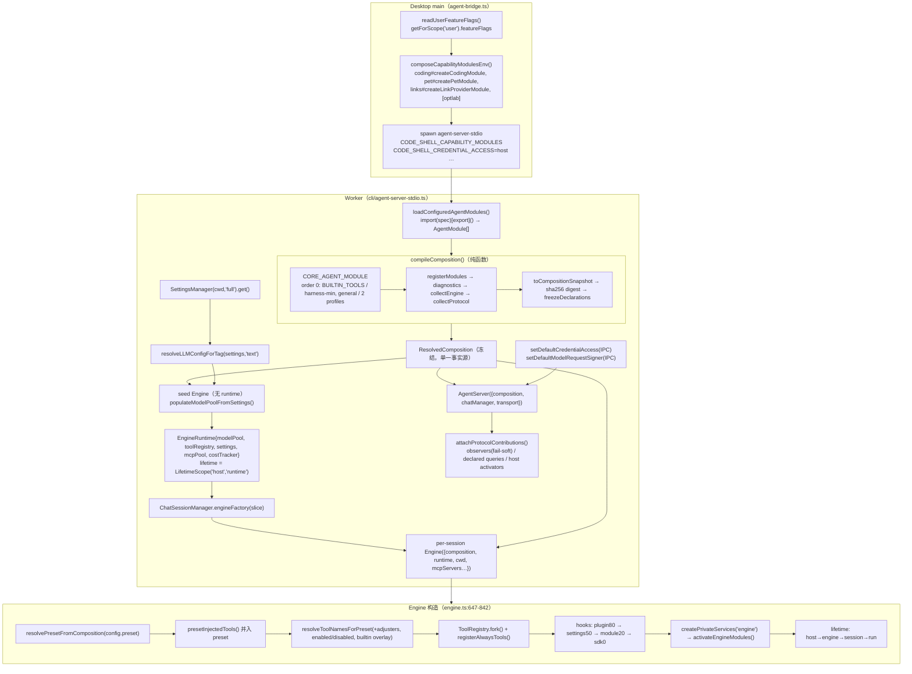

# 05 · Core：包入口契约 / Composition / Settings / Credentials / Runtime 架构（函数级）

> 基线：`main@df2ca0bda`，`@cjhyy/code-shell-core@0.9.45`（`packages/core/src/index.ts:7` `VERSION`）。
> 全部结论均对源码核验；`file:line` 以该基线为准。旧版章节（`docs/archive/architecture-2026-07/`）与 `docs/core-deep-dive` 仅作提示，凡与源码冲突处以本文为准。
> 本切片覆盖 `packages/core/src/` 下：入口文件（`index.ts` / `index.extension.ts` / `index.internal.ts` / `index.skills.ts` / `contracts.ts` / `types.ts` / `exceptions.ts` / `onboarding.ts` / `updater.ts`）以及目录 `composition/ preset/ product/ settings/ credentials/ services/ profile/ capability-control/ capabilities/ panel-apps/ runtime/ workspace/ remote/ data/ logging/ themes/ cli/ utils/ testing/`。Engine / protocol / tool-system / session 的内部只在"接缝"处引用。

---

## 目录

1. [包入口契约](#1-包入口契约)
2. [文件清单（逐目录）](#2-文件清单逐目录)
3. [关键类型与类（函数级）](#3-关键类型与类函数级)
4. [核心调用链（file:line）](#4-核心调用链fileline)
5. [磁盘布局](#5-磁盘布局)
6. [与其他模块的接缝](#6-与其他模块的接缝)
7. [设计要点与坑](#7-设计要点与坑)

---

## 1. 包入口契约

### 1.1 `packages/core/package.json` 的 `exports` 表

| 子路径                        | 产物                                         | 源文件                             | 定位                                                                                                                  |
| ----------------------------- | -------------------------------------------- | ---------------------------------- | --------------------------------------------------------------------------------------------------------------------- |
| `.`                           | `dist/index.js` / `.d.ts`                    | `src/index.ts`（864 行）           | **稳定公共 SDK**（semver 约束）                                                                                       |
| `./internal`                  | `dist/index.internal.js`                     | `src/index.internal.ts`（536 行）  | **仓库内 Host 面**（TUI/Desktop/Server），明确声明"不是稳定 SDK、无 semver 承诺"（`index.internal.ts:1-7`）           |
| `./internal/skills`           | `dist/index.skills.js`                       | `src/index.skills.ts`              | Host-only 的 Skill 管理：`export * from skills/management.js` + `skills/github.js`（无 Engine 构造、无 desktop 依赖） |
| `./extension`                 | `dist/index.extension.js`                    | `src/index.extension.ts`（212 行） | **能力包契约**：coding / pet / arena / optimization-lab 只能 import 这一个入口                                        |
| `./panel-app-runtime`         | `dist/panel-apps/runtime.js`                 | `src/panel-apps/runtime.ts`        | Panel App 生命周期协调器（纯 TS，无任何 import）                                                                      |
| `./browser/panel-app-runtime` | 同上（同一文件）                             | `src/panel-apps/runtime.ts`        | 同一产物的"浏览器安全"别名；Desktop renderer **唯一**允许运行时 import 的 core 入口                                   |
| `./bin/agent-server-stdio`    | `dist/cli/agent-server-stdio.js`（无 types） | `src/cli/agent-server-stdio.ts`    | Desktop/Server 用 `require.resolve()` 定位并 spawn 的 worker 入口（`desktop/src/main/agent-bridge.ts:211`）           |

另：`bin.code-shell-output-journal → dist/cli/output-journal-repair.js`（纯文件系统维护 CLI，见 §3.16）。
`sideEffects: ["./dist/data/*.json", "./dist/prompt/sections/*.md"]`——其余模块被视为无副作用可 tree-shake（但 `logging/logger.ts`、`services/analytics.ts` 等实际有模块级单例，见 §7）。
`build` = `clean → tsc → copy-assets`（`scripts/copy-assets.mjs` 拷贝 `prompt/sections/*.md`、`data/*.json`、`data/*.txt`）。

根 `tsconfig.json:20-26` 为类型检查提供源码别名：`@cjhyy/code-shell-core` → `src/index.ts`、`/internal`、`/extension`、`/bin/agent-server-stdio`，以及通配 **`@cjhyy/code-shell-core/*` → `packages/core/src/*`**（见 §7 坑 1）。

### 1.2 `.`（`src/index.ts`）——按区块列出主要导出

| 区块（行号）                     | 主要符号                                                                                                                                                                                                                                                                                                                                                                                                                                                                                                                                                                                                                                                                                                      | 源模块                                                    |
| -------------------------------- | ------------------------------------------------------------------------------------------------------------------------------------------------------------------------------------------------------------------------------------------------------------------------------------------------------------------------------------------------------------------------------------------------------------------------------------------------------------------------------------------------------------------------------------------------------------------------------------------------------------------------------------------------------------------------------------------------------------- | --------------------------------------------------------- |
| Types（11-52）                   | `Message` `ContentBlock` `ToolDefinition` `ToolCall` `ToolResult` `RegisteredTool` `TranscriptEvent(Type)` `SessionState` `SessionKind` `SessionWorkspace` `SessionProjectBinding` `SessionForkLineage` `ContextUsageAnchor` `SessionStatus` `TokenUsage` `CompiledInput` `Permission{Decision,Mode,Rule}` `TurnPhase` `TurnResult` `TerminalReason` `TurnCompletionKind` `StreamEvent` `TurnDiff{Snapshot,File}` `StreamCallback` `LLMConfig` `ClientDefaults` `LLMResponse` `Settings` `MCPServerConfig`；`Goal*` 生命周期类型                                                                                                                                                                              | `types.ts`、`goal/lifecycle.ts`                           |
| Exceptions（56-71）              | `FrameworkError` `LLMError` `LLMRateLimitError` `ContextLimitError` `ToolError` `ToolNotFoundError` `ToolExecutionError` `ToolTimeoutError` `PermissionDeniedError` `SessionError` `TranscriptError` `ConfigError` `CompositionError` `SandboxUnavailableError`                                                                                                                                                                                                                                                                                                                                                                                                                                               | `exceptions.ts`                                           |
| Composition（74-100）            | `compileComposition` `toCompositionSnapshot` `computeCompositionDigest` `compositionToolCatalog` `resolvePresetFromComposition`；类型 `AgentModule` `AgentEngineContributions` `AgentProtocolContributions` `AgentModuleToolContribution` `ResolvedComposition` `CompositionSnapshot` `AgentModulePrivateServiceContribution` `Engine/HostModuleActivationContext` `MaybeDisposable` `ModuleServiceHost`；**类** `LifetimeScope` + `ModuleScopeKind/Disposable/DisposableLike/Dispose`                                                                                                                                                                                                                        | `composition/*`                                           |
| Engine（104-126）                | `Engine` `loadAgentDefinitionsForCwd` `EngineConfig` `EngineHookConfig` `EngineResult` `RunBehaviorMode/Profile` `resolveLLMConfigForTag` `resolveAuxKey` `AgentDefinitionRegistry` `EngineRuntime(+Options)` `CostStateStore` `ChatSessionManager` 相关                                                                                                                                                                                                                                                                                                                                                                                                                                                      | `engine/*`、`agent/*`、`protocol/chat-session-manager.ts` |
| LLM（130-136）                   | `LLMClientBase` `createLLMClient` `registerProvider` `AnthropicClient` `OpenAIClient` `ModelPool` `ModelEntry` `modelEntriesFromConnections`                                                                                                                                                                                                                                                                                                                                                                                                                                                                                                                                                                  | `llm/*`、`engine/model-connections-pool.ts`               |
| Tools（140-260）                 | `ToolRegistry` `ToolExecutor` `ApprovalBackend` 等 permission 导出、`BUILTIN_TOOLS` `derivePresetExposure` `BuiltinTool(Fn)` `ToolContext` panel-bridge 类型、`fileCache` `invalidateFileCache` `validateToolArgs(Strict)` `createOffBackend`、`createFakeToolContext` `createToolRegistryHarness`、`Capability*` 贡献类型、`makeUpdateAutomationMemoryTool`、`MCPManager` `buildHttpHeaders` `buildStdioEnv` `createMcpAuthenticatedFetch`、`ExtensionTool` `ProtocolObserver*`、`Task/TaskStatus`                                                                                                                                                                                                           | `tool-system/*`、`capabilities/index.ts`                  |
| WorkspaceProfile（163-183）      | `SKILL_REPO_RE` `WORKSPACE_PROFILE_NAME_RE` `WorkspaceProfileSchema` `WorkspaceProfileRequirementsSchema` `buildSkillInstallArgs` `planProfileRequirements` `summarizeSkillConflicts` + 类型                                                                                                                                                                                                                                                                                                                                                                                                                                                                                                                  | `profile/index.ts`                                        |
| Workspace sources（186-220）     | `SOURCE_ID_RE` `SOURCE_KINDS` `SourceDefinitionSchema` … `Collection*Schema`                                                                                                                                                                                                                                                                                                                                                                                                                                                                                                                                                                                                                                  | `sources/*`                                               |
| Hooks（264-267）                 | `HookRegistry` `HookHandler` `HookEventName` `HookContext` `HookResult` `wrapHookMessages`                                                                                                                                                                                                                                                                                                                                                                                                                                                                                                                                                                                                                    | `hooks/*`                                                 |
| Panel lifecycle（271-282）       | `PanelAppLifecycleRuntime` + `PanelApp{Instance,LifecycleError,LifecycleEvent(Name),LifecycleHook(s),LifecycleHookContext,LifecycleModule,LifecycleRuntimeOptions}`                                                                                                                                                                                                                                                                                                                                                                                                                                                                                                                                           | `panel-apps/runtime.ts`                                   |
| Protocol（286-308）              | `AgentServer` `AgentClient` `createInProcessTransport` `StdioTransport` `SocketTransport` `listenTcp` `createServer` `createClient` `Methods` `ErrorCodes` 等                                                                                                                                                                                                                                                                                                                                                                                                                                                                                                                                                 | `protocol/*`                                              |
| Session（312-360）               | `Transcript` `SessionManager` `sessionMainRoot` `codeShellHome` `sessionsRoot` `buildForkState/Transcript` `FileHistory` undo 工具、`diffLines` `MemoryManager` `runDreamConsolidation`、**OAuth 原语** `authorize` `refreshToken` `generatePKCE` `createHardenedOAuthFetch`                                                                                                                                                                                                                                                                                                                                                                                                                                  | `session/*`、`services/*`                                 |
| Prompt / Presets（363-381）      | `PromptComposer` `SectionCache` `scanInstructions` `combineInstructions`；`BUILTIN_AGENT_PRESETS` `DEFAULT_AGENT_PRESET` `DEFAULT_CLI_PRESET`(deprecated) `resolveAgentPreset` `resolveBuiltinToolNames` `resolveToolNamesForPreset` `buildPresetSystemPrompt` `listPresetNames` `AgentPreset(Name)` `TaskToolRouting*`；`loadSection(s)` `availableSections`                                                                                                                                                                                                                                                                                                                                                 | `prompt/*`、`preset/*`                                    |
| Context / Skills（385-417）      | `ContextManager`、compaction、tool-result storage；`scanSkills` `invalidateSkillCache`                                                                                                                                                                                                                                                                                                                                                                                                                                                                                                                                                                                                                        | `context/*`、`skills/*`                                   |
| Capability control（420-427）    | **仅类型** `CapabilityServiceDeps` `CapabilityDescriptor` `CapabilityControl` `EffectiveDisabledLists`；`readInstalledPlugins`                                                                                                                                                                                                                                                                                                                                                                                                                                                                                                                                                                                | `capability-control/*`                                    |
| Plugins（430-459、540-577）      | manifest/信任/目录：`CodexPluginManifest` `CanonicalPluginManifest` `normalizePluginManifest` `mergePluginMcpServers` `approvePluginMcp` … `pluginsRoot`                                                                                                                                                                                                                                                                                                                                                                                                                                                                                                                                                      | `plugins/*`                                               |
| Panel Apps 安装（460-511）       | `PANEL_APP_{ICONS,MANIFEST_FILE,PERMISSIONS}` `PanelAppManifest` 三个 Error、`assertSafePanelAppId`、`check{Installed,Selected}PanelAppUpdate` `getInstalledPanelAppUpdateIdentity` `resolveGitHubPanelAppCommit` `discoverGitPanelApps` `installReviewed{Local,PanelAppUpdate}` `listInstalledPanelApps` `listProjectPanelApps` `inspectProjectPanelApps` `projectPanelAppPackagePins` `migrateProjectPanelAppPackagePins` `selectProjectPanelAppPackage` `parsePanelAppPackagePins` `retainInstalledPanelApp` `resolvePanelAppPackage` `listRetainedPanelAppPackages` 路径函数、`preview{Local,InstalledPanelAppUpdate}` `isPanelAppBound` `resolvePanelAppBinding{Policy,ProjectPath}` `uninstallPanelApp` | `panel-apps/index.ts`                                     |
| Themes（512-539）                | `previewLocalTheme` `installReviewedLocalTheme` `listInstalledThemes` `uninstallTheme` `themesRoot` … `detectThemeImage` `detectThemeWav`                                                                                                                                                                                                                                                                                                                                                                                                                                                                                                                                                                     | `themes/index.ts`                                         |
| Run（581-633）                   | `RunManager` `FileRunStore` `RunQueue` `EngineRunner` `RunApprovalBackend` `CheckpointWriter` `ArtifactTracker` `RunLock` `Heartbeat` evaluators、`createRunManager` 等                                                                                                                                                                                                                                                                                                                                                                                                                                                                                                                                       | `run/index.ts`                                            |
| Product（637-646）               | `defineProduct` + `Product{Definition,Preset,Adapter,Contract,RuntimeOptions,Instance}` `CustomTool`                                                                                                                                                                                                                                                                                                                                                                                                                                                                                                                                                                                                          | `product/index.ts`                                        |
| Logging / Settings（650-669）    | `logger`；`SettingsManager` `userHome` `SettingsScope`；`ModelRequestSigner*` 类型；`migrateConfig` `configVersionOf` `CURRENT_CONFIG_VERSION` `MigrationStep`；`SettingsSchema` `validateSettings`；`settingsJsonSchema` `writeSettingsSchemaFile`；`personalizationFrom`                                                                                                                                                                                                                                                                                                                                                                                                                                    | `settings/*`                                              |
| Credentials（670-719）           | `CredentialStore`、OAuth 工具函数、cookie-jar 工具、`useCredentialToolDef(For)` `sweepStaleCredentialCookies`、`getCredentialAccess` `setDefaultCredentialAccess` `createIpcCredentialAccess` `localCredentialAccess` `credentialAccessScope` `credentialAllowsEnvExposure` `credentialSecretHint` `isCredentialSecretAvailable` `materializeCookieSecret`、`EncryptionCipher` `PlaintextCipher` `set/getDefaultCredentialCipher`                                                                                                                                                                                                                                                                             | `credentials/index.ts`                                    |
| Links（720-757、834-863）        | `LOCAL_LINK_PROVIDERS` 等本地/远程/OAuth Link 执行与适配器                                                                                                                                                                                                                                                                                                                                                                                                                                                                                                                                                                                                                                                    | `links/*`                                                 |
| Cost / Data / Browser（761-832） | `CostTracker` `costTracker` `installCostTracking`、cost-ledger；`syncOpenRouterCatalog` `getOpenRouterSnapshot`；`flattenAxTree` 等 BrowserBridge 契约                                                                                                                                                                                                                                                                                                                                                                                                                                                                                                                                                        | `cost-*`、`data/*`、`tool-system/browser-bridge.ts`       |
| Contracts（864）                 | `CONTRACTS` `Contracts`                                                                                                                                                                                                                                                                                                                                                                                                                                                                                                                                                                                                                                                                                       | `contracts.ts`                                            |

注意根入口**不导出** `CORE_AGENT_MODULE`、`activateEngineModules`、`attachProtocolContributions`、`registerAlwaysTools`、`presetInjectedTools`（它们只在 `composition/index.ts` 内部桶里，Engine/AgentServer 直接相对 import）。

### 1.3 `/extension`（`src/index.extension.ts`）——能力包契约

按用途分组（全部"与根入口指向同一源模块"，以保证进程级单例身份一致，`index.extension.ts:89-96`）：

- **基础类型**：`ClientDefaults ContentBlock LLMConfig LLMResponse Message RegisteredTool SessionOrigin SessionStatus StreamEvent TerminalReason TurnCompletionKind TokenUsage ToolCall ToolDefinition`、`PendingApprovalMetadata`、`CreateMessageOptions`、`SessionWorkspace`、`PermissionRule/Mode`。
- **LLM**：`LLMClientBase` `createLLMClient` `registerProvider` `ModelPool` `ModelEntry` `resolveLLMConfigForTag` `resolveMaxOutput`（来自 onboarding）、`addTokenUsage`。
- **请求边界/成本/追踪**：`createEphemeralModelRequestSigner` `currentModelRequestCall` `currentUsageAttempt` `recordExternalModelCall` `ExternalModelCallInput` `ModelRequestSigner`。
- **Settings（只读意图）**：`SettingsManager` `userHome`；`isFeatureEnabled` `featureFlagNames` `resolveFeatureFlags` `FeatureFlagName` `FeatureFlagOverrides`（注释：只读面，flag 注册表留在 core）。
- **工具面**：`ToolContext`、Panel bridge 类型（`AgentPanelDescriptor` … `PanelHostBridge`）、`createSessionToolHost` + 类型（注释 60-65：**这是能力包能拿到的最强工具执行句柄，故意不导出 `ToolExecutor/ToolRegistry/PermissionClassifier`**）、`ToolVisibilityInputs` `FIRST_PHASE_EXPOSURE(_RATIONALE)` `HOST_MCP_SERVERS_ENV` `encodeHostMcpServers` `webSearchTool` `webFetchTool` `extractJSON(Array)` `ExtensionQueryHandler` `ExtensionTool`。
- **组合契约**：`Capability{ArtifactDetector,DynamicContextProvider,ToolServiceHost}`、`AgentModule` 全套类型、`LifetimeScope`(仅类型) 等、`BUILTIN_AGENT_PRESETS` `AgentPreset` `TaskToolRouting*` `BUILTIN_TOOLS` `derivePresetExposure` `BuiltinTool` `BuiltinToolExposure`。
- **共享进程资源**：`SessionManager` `codeShellHome` `readSkillSnapshot` `InstructionBindingStore` `instructionHash` `acquireLockOnPath` `mutateJsonFile` `invalidateFileCache` `notificationQueue` `resolveExecutable` `resolveGit` `safeSpawnShell` `buildSandboxEnv` `defaultShellBinary` `killChildTree` `killProcessGroup` `mergeShellEnv` `isExistingDirectory` `normalizeCwdPath` `backgroundJobRegistry` `SandboxBackend`。
- **产品域 seam（pet 等）**：`RunBehaviorProfile` `ProtocolLiveSession` `ProtocolObserver(Host)` `ToolVisibilityContext` `ApprovalRouter` `runIsolatedInstruction`。
- **过渡期 Link seam**：`registerLocalLinkProviders` `getLocalLinkProvider` + Link HTTP/GitHub/Slack/Figma 纯辅助函数。

`index.exports.test.ts:517-566` 断言：`/extension` 必须**不含** `Engine`、`sliceAnsi`、`acquireWorkspaceWriteLock`、model-trace/MCP 凭证绑定/Link host service 分区、以及 workspace 权威函数（`canonicalKey` `createWorkspaceContext` …）；并断言 `notificationQueue`、`acquireLockOnPath`、`mutateJsonFile` 与 `/internal` 是同一引用。

### 1.4 `/internal`（`src/index.internal.ts`）——Host 面

分组：

| 分组（行）                    | 符号                                                                                                                                                                                                                                                                                                                                                                                                                                                                                                                                                                                                                                            |
| ----------------------------- | ----------------------------------------------------------------------------------------------------------------------------------------------------------------------------------------------------------------------------------------------------------------------------------------------------------------------------------------------------------------------------------------------------------------------------------------------------------------------------------------------------------------------------------------------------------------------------------------------------------------------------------------------- |
| Model traces（9-39）          | `ModelTraceStore` `configureModelTracing` `withModelTraceContext` `recordModelTraceEvent` `recordExternalModelTrace` … `createNativeModelTraceFrameDecoder`                                                                                                                                                                                                                                                                                                                                                                                                                                                                                     |
| Session 输出（41-71）         | `SessionOutputCoverageStore` `outputUserMessage` `createRunTiming` `normalizeCumulativeUsageCounters` `McpResponseTooLargeError`、`assertMcpOAuthCredentialBinding` `assertMcpResourceTarget` `normalizeMcpServerUrl`、output journal 读写/备份                                                                                                                                                                                                                                                                                                                                                                                                 |
| Utils（73-153）               | intl、`env`、**workspace 权威**（`canonicalKey` `canonicalPath` `computeWorkspaceRootsDigest` `createWorkspaceContext` `legacySingleRootWorkspace` `validateWorkspaceContext` `workspacePrimaryRoot` + 类型）、`sliceAnsi` `execFileNoThrow`、`createManagedRuntimeProvider` `ManagedRuntimeError`、exec 工具、`gte`、**锁** `lock/lockSync/unlock/check` `acquireFileLock` `acquireLockOnPath` `mutateJsonFile` `acquireWorkspaceWriteLock`、`logForDebugging`、envUtils、earlyInput、toolDisplay、`classifyBashLines`、`formatDuration/Tokens`、`getTheme` `resolveThemeSetting`                                                              |
| Logging/请求边界（157-170）   | `rotateLogs` `recordUIEvent` `ModelRequestKeyStore` `assertDurableRequestOwner` `createIpcModelRequestSigner` `setDefaultModelRequestSigner`                                                                                                                                                                                                                                                                                                                                                                                                                                                                                                    |
| 工具系统/Host 服务（174-292） | `createLinkOperationReviewStore`、legacy link cleanup、`createOperationHookHost`、**`createConstrainedDockerProcessHost` + `Constrained*` 类型**、`getInteractiveApprovalBackend` `defaultSandboxConfig`、通知队列/总线、`backgroundJobRegistry`、background work、**automation 全套**（`startAutomation` `CronScheduler` `cronScheduler` `CronStore` `defaultCronStorePath` `bindCronTo{Engine,RunManager}` cron 解析、`runWriteJobInWorktree` …）、`asyncAgentRegistry`、`backgroundShellManager` `BackgroundShellManager`、`ENV_DENY_REGEX` `ENV_ALLOWLIST`、image provider、STT/语音、`BUILTIN_CATALOG` `getMergedCatalog` 等 model catalog |
| Protocol/LLM 扩展（296-311）  | `createInProcessClient`、`fetchModelList` `sanitizeApiKey` `PROVIDER_KINDS` `capabilitiesFor` `reasoningControlFor` `REASONING_EFFORTS` …                                                                                                                                                                                                                                                                                                                                                                                                                                                                                                       |
| Sources/Profile（335-411）    | source catalog CRUD、adapter 注册、collection、uploads、MCP resource adapter、binding；**WorkspaceProfile store/activation/switch-plan/resolve**、human repos；**`CapabilityService` `CapabilityNotFoundError` `project{Builtin,Mcp,Skills,Plugins}` `computeEffectiveDisabledLists` `effectiveProjectOverrides`**                                                                                                                                                                                                                                                                                                                              |
| Host 装配（419-504）          | plugin 安装/npm/tar/archive/preview/市场、**onboarding**（`hasApiKey` `resolveApiKey` `appendOnboardingResult` `detectEnvKeys`）、**updater**（`getCurrentVersion` `checkForUpdate` `scheduleAutoInstallOnExit` `getUpdateAvailable` `getAutoUpdateDisabledReason`）、`resolveInstance`、profile plugin export                                                                                                                                                                                                                                                                                                                                  |
| Settings 恢复（507-514）      | `inspectProjectSettingsRecovery` `repairProjectSettings` `restoreProjectSettings`（注释：受信管理员恢复，**故意不进 protocol config setter**）                                                                                                                                                                                                                                                                                                                                                                                                                                                                                                  |
| 其他                          | GitHub issue batch、operation session owner、`createSessionOperationServices`、link authority、Figma MCP link、operation batch authority client                                                                                                                                                                                                                                                                                                                                                                                                                                                                                                 |

测试约束（`index.exports.test.ts:493-515`）：`/internal` 导出集合必须**精确等于** `expectedRuntimeExports`；与根入口重名的符号必须引用相同；`/internal` 不得含 `Engine`、`Arena`。根入口不得重新长出 host-only 样本（`hostOnlySamples`），且不得有 `getSessionId` `markScrollActivity` `Arena` `formatArenaResult`。

### 1.5 谁可以 import 谁（规则与执行机制）

| 规则                                                                                                                                                                                                                              | 执行点                                                                                                                                         |
| --------------------------------------------------------------------------------------------------------------------------------------------------------------------------------------------------------------------------------- | ---------------------------------------------------------------------------------------------------------------------------------------------- | ------------------------------------------------------------- |
| core 源码不得 import `@cjhyy/code-shell-tui`（也不得相对路径进入 tui）                                                                                                                                                            | `eslint.config.js` `codeshellBoundaryImportsRule`，`coreToTui`                                                                                 |
| core 源码只能相对路径自引用；不得依赖任何其他 CodeShell workspace 包，**唯一例外** `@cjhyy/code-shell-link`（零依赖的 provider 契约）；测试文件可自引用包名                                                                       | 同上 `corePackageImport`（`eslint.config.js:241-261`）                                                                                         |
| 能力包（`packages/{coding,arena,pet,optimization-lab}/src`，非测试）只能 import `@cjhyy/code-shell-core/extension`；例外是 `coding/src/bin/agent-server-stdio.ts → /bin/agent-server-stdio`（该文件在本基线已不存在，见 §7 坑 2） | `capabilityToCoreEntry`（`eslint.config.js:264-277`）                                                                                          |
| 能力包不得依赖其他 CodeShell 产品/Host 包                                                                                                                                                                                         | `capabilityToWorkspace`                                                                                                                        |
| Desktop renderer 运行时 import 只允许 `@cjhyy/code-shell-core/browser/panel-app-runtime` 与 `@cjhyy/code-shell-web`；type-only import 不限                                                                                        | `rendererBrowserSafeRuntimeImports`（`eslint.config.js:55-58`）+ `@typescript-eslint/no-restricted-imports` regex `^@cjhyy/code-shell-core(?:$ | /(?!browser/panel-app-runtime$).+)`（`eslint.config.js:469`） |
| TUI/Desktop 的 host-only helper 从 `/internal` 取，不从 `.` 取                                                                                                                                                                    | `CODESHELL.md` 约定 + `index.exports.test.ts` 的 hostOnlySamples                                                                               |
| 内部所有 `new Engine(` 必须在 allowlist（engine.ts 自身、protocol/factories.ts、tui repl/run、run/EngineRunner.ts、cli/agent-server-{stdio,tcp}.ts、desktop dream-service/automation-host；测试除外）                             | `scripts/check-no-engine-bypass.sh`（`bun run lint:engine-bypass`）                                                                            |

### 1.6 `contracts.ts`——外部可见契约版本表

`CONTRACTS`（`contracts.ts:10-25`，`Object.freeze` 深冻结）：
`agentProtocol {supported:["1"], preferred:"1"}`、`panelApi: 14`、`cloudManagementAuthority: 2`、`cloudBrowserAuthority: 1`、`relayProtocol: 1`、`desktopControl: 1`、`mobileRemote: 1`、`outputJournal: 1`。
`_ContractLiteralTypes`（29-45）是编译期断言：任何把字面量拓宽成 `number/string` 的改动都会 typecheck 失败（下游 `typeof X` 依赖字面量类型，如 `DESKTOP_CONTROL_PROTOCOL_VERSION`）。Host 在 `initialize` 与 `/health` 中上报此表；`server/src/panels/bridge-contract.ts:4` `panelRuntimeApiVersion = CONTRACTS.panelApi`。Desktop `shared/panel-apps.ts` 与 `chat` 包里必须保持字面量的副本由 Desktop main 的 drift test 钉住。

---

## 2. 文件清单（逐目录）

### 2.1 根级入口文件

| 文件                 | 行数 | 职责                                                                                                                                                                                                                                          |
| -------------------- | ---- | --------------------------------------------------------------------------------------------------------------------------------------------------------------------------------------------------------------------------------------------- |
| `index.ts`           | 864  | 稳定公共 SDK barrel（§1.2）                                                                                                                                                                                                                   |
| `index.extension.ts` | 212  | 能力包契约 barrel（§1.3）                                                                                                                                                                                                                     |
| `index.internal.ts`  | 536  | 仓库内 Host barrel（§1.4）                                                                                                                                                                                                                    |
| `index.skills.ts`    | 3    | Host-only Skill 管理 barrel                                                                                                                                                                                                                   |
| `contracts.ts`       | 45   | 契约版本表 + 字面量类型断言                                                                                                                                                                                                                   |
| `types.ts`           | 1333 | 全局领域类型：Message/Tool/Transcript/Session/Permission/Approval/Turn/StreamEvent（巨型判别联合，685-994）/LLMConfig/ClientDefaults/MCPServerConfig/MCPServerOverride/SettingsHookConfig/`Settings`（旧形状接口）/附件元数据/Legacy pet 别名 |
| `exceptions.ts`      | 160  | 异常层级：`FrameworkError(details)` 为根；`CompositionError` 携带 `{code,key,firstModuleId,secondModuleId}`；`SandboxUnavailableError.code="SANDBOX_UNAVAILABLE"` 可不靠 instanceof 收窄                                                      |
| `onboarding.ts`      | 428  | 首次运行数据层：provider 目录、env key 探测、key 校验、模型池辅助、`appendOnboardingResult` 写 `~/.code-shell/settings.json`                                                                                                                  |
| `updater.ts`         | 441  | npm 自更新：检查、权限探测、退出后 detached `npm i -g`、`.update.lock`                                                                                                                                                                        |

### 2.2 `composition/`（1142 行）

| 文件                 | 职责                                                                                                                                                                                |
| -------------------- | ----------------------------------------------------------------------------------------------------------------------------------------------------------------------------------- |
| `types.ts`           | `AgentModule`、Engine/Protocol 贡献、激活上下文、`ResolvedComposition`、`CompositionSnapshot`、诊断类型                                                                             |
| `core-module.ts`     | `CORE_AGENT_MODULE`：把 core 的 builtin tools / presets / behavior profiles 表达成 order 0 模块                                                                                     |
| `compiler.ts`        | 纯函数 `compileComposition()`：注册、去重、冲突 fail-loud、默认 preset、preset 工具引用校验、digest、冻结                                                                           |
| `freeze.ts`          | `freezeDeclarations()`：深拷贝+冻结（含 Map/Set 只读 Proxy），绝不冻结作者输入                                                                                                      |
| `snapshot.ts`        | `toCompositionSnapshot()`（纯数据投影，字段顺序即规范序列化顺序）+ `computeCompositionDigest()`（sha256）                                                                           |
| `lifetime.ts`        | `LifetimeScope`（host/engine/session/run 树形所有权，逆序释放，AggregateError）+ `onceDispose`                                                                                      |
| `activation.ts`      | `activateEngineModules`、`createPrivateServices`、`activationContext`、`ownActivationResult`                                                                                        |
| `protocol-attach.ts` | `attachProtocolContributions`（observer fail-soft、query 白名单、host activators）、`registerProtocolQuery`                                                                         |
| `resolve-preset.ts`  | 运行期辅助：`resolvePresetFromComposition` `compositionToolCatalog` `presetInjectedTools` `compositionPromptSections` `registerAlwaysTools` `resolveCompositionInstructionBoundary` |
| `index.ts`           | 内部桶（含 `CORE_AGENT_MODULE`）                                                                                                                                                    |

### 2.3 `preset/`（532 行）

| 文件                   | 职责                                                                                                                                                                                                                       |
| ---------------------- | -------------------------------------------------------------------------------------------------------------------------------------------------------------------------------------------------------------------------- |
| `index.ts`             | `AgentPreset` 类型、`BUILTIN_AGENT_PRESETS`（`harness-min`、`general`）、默认 preset、`buildPresetSystemPrompt`、`resolveToolNamesForPreset`、builtin-only 的 `resolveAgentPreset/resolveBuiltinToolNames/listPresetNames` |
| `task-tool-routing.ts` | `routeInitialTools()`：按任务文本关键词为 ToolSearch 模式挑选初始 schema（不授予任何权限）；策略校验上限                                                                                                                   |

### 2.4 `product/`（338 行）

| 文件        | 职责                                                                                                             |
| ----------- | ---------------------------------------------------------------------------------------------------------------- |
| `types.ts`  | `ProductPreset`（brain）/`ProductAdapter`（hands）/`ProductContract`（quality）/`ProductDefinition`/`CustomTool` |
| `define.ts` | `defineProduct()`：合成 `{id:"product"}` AgentModule + `RunManager`                                              |
| `index.ts`  | 桶                                                                                                               |

### 2.5 `settings/`（2809 行）

| 文件                 | 职责                                                                                                                                                |
| -------------------- | --------------------------------------------------------------------------------------------------------------------------------------------------- |
| `manager.ts`         | `SettingsManager`：多层读取/合并/迁移/信任过滤/锁内写；`userHome` `noRepoDir` `isProtectedSettingKey` `setDottedSetting` `DANGEROUS_PROJECT_FIELDS` |
| `schema.ts`          | Zod `SettingsSchema`（`.passthrough()`）+ `CapabilityOverride(s)Schema` + `validateSettings`                                                        |
| `migrate-config.ts`  | `configVersion` 版本化迁移（v0→1 补 catalogId；v1→2 清误写 sandbox）                                                                                |
| `feature-flags.ts`   | `FEATURE_FLAGS` 注册表 + `isFeatureEnabled` 等                                                                                                      |
| `hook-provenance.ts` | 可执行 settings hook 的文件身份保管（dev/ino/父目录/前序候选缺席/rawSha256）                                                                        |
| `recovery.ts`        | 受信管理员级 project/local settings 检查、修复、按备份恢复                                                                                          |
| `schema-export.ts`   | `settingsJsonSchema()` / `writeSettingsSchemaFile(dir)`（Host 显式调用，load 不会写）                                                               |
| `personalization.ts` | `personalizationFrom(agent)`：三 host 统一传 `responseLanguage/userProfile/instructions`                                                            |

### 2.6 `credentials/`（2830 行）

| 文件                        | 职责                                                                                                                                                   |
| --------------------------- | ------------------------------------------------------------------------------------------------------------------------------------------------------ | ---- | ------ | --------------------------------------------------------------------------------------------------------------------------------------------------- |
| `types.ts`                  | `CredentialType = token                                                                                                                                | link | cookie | oauth`、`Credential`（含海量 Link `meta`）、OAuth secret/status、`credentialAllowsEnvExposure` `isCredentialSecretAvailable` `credentialSecretHint` |
| `cipher.ts`                 | `EncryptionCipher` 接口、`PlaintextCipher`（`plain:` 前缀）、进程默认 cipher setter/getter                                                             |
| `store.ts`                  | `CredentialStore`：user/project 两层 `credentials.json`；锁内 RMW、不可读即拒写、未知条目原样保留、CAS、Remote Link retirement                         |
| `access.ts`                 | `CredentialAccess` 抽象；`localCredentialAccess`（直读 store）与 `createIpcCredentialAccess`（worker→Host 快照+RPC）；本地 MCP OAuth 刷新；cookie 物化 |
| `oauth.ts`                  | OAuth secret 解析/状态/刷新判定/合并 token 响应                                                                                                        |
| `cookie-jar.ts`             | cookie jar ↔ Netscape cookies.txt、过期摘要                                                                                                            |
| `use-credential-tool.ts`    | `UseCredential` 工具（列表/取值/物化 cookie）+ 会话 allow 集                                                                                           |
| `inject-credential-tool.ts` | `InjectCredential`：把 cookie 凭证注入内置浏览器                                                                                                       |
| `use-gate.ts`               | 三档审批门：全局 autoApprove / 逐条 autoUseByAI → 会话记住 → 弹审批                                                                                    |
| `mcp-binding.ts`            | MCP server URL 规范化、resource 与 OAuth 凭证绑定断言                                                                                                  |
| `change-subscription.ts`    | 本地凭证文件变更订阅（轮询，兼容跨进程原子替换）                                                                                                       |
| `remote-link-retirement.ts` | Remote Link 撤销的持久化私有条目（stage/ready/claim/finish）                                                                                           |
| `index.ts`                  | 桶                                                                                                                                                     |

### 2.7 `services/`（2604 行）

| 文件                        | 职责                                                                                                                      |
| --------------------------- | ------------------------------------------------------------------------------------------------------------------------- |
| `memory-orchestrator.ts`    | `MemoryOrchestrator.run()`：会话结束的记忆抽取→ADD/UPDATE/DELETE 决策→会话摘要→dream 计数→auto-dream                      |
| `extract-memories.ts`       | 抽取 prompt 构建/解析（`MAX_MEMORIES_PER_EXTRACTION=2`）                                                                  |
| `session-memory.ts`         | `~/.code-shell/session-memories/<sid>.json` 保存/读/列/搜 + 摘要 prompt                                                   |
| `session-memory-sort.ts`    | 按 `createdAt` 倒序                                                                                                       |
| `auto-dream.ts`             | dream 节奏（≥5 会话且 ≥24h）、`auto-dream-state.json` 锁内 RMW、dream prompts                                             |
| `dream-consolidation.ts`    | `runDreamConsolidation()`：Memory\* 工具循环清理 dream scope                                                              |
| `global-dream-promotion.ts` | 全局记忆晋升闸门、用户直述全局偏好检测                                                                                    |
| `oauth.ts`                  | OAuth authorization-code + PKCE（loopback 回调；`openExternal` 由 Host 注入）、`refreshToken`、`createHardenedOAuthFetch` |
| `analytics.ts`              | 事件队列 + 文件 sink（`~/.code-shell/analytics/<date>.jsonl`），30s flush                                                 |
| `diagnostics.ts`            | 诊断条目记录到 `~/.code-shell/diagnostics/`                                                                               |
| `browser-open.ts`           | 平台无 shell 的打开 URL argv                                                                                              |
| `index.ts`                  | 桶                                                                                                                        |

### 2.8 `profile/`（2394 行，"数字人"WorkspaceProfile）

| 文件                | 职责                                                                                                                       |
| ------------------- | -------------------------------------------------------------------------------------------------------------------------- |
| `types.ts`          | `WorkspaceProfileSchema`、`requires`（skills from github / tools probe）、限额常量                                         |
| `store.ts`          | 全局库 `codeShellHome()/profiles/<name>/profile.json` CRUD（no-follow、原子写）                                            |
| `activation.ts`     | `activateWorkspaceProfile`（一次 `saveProjectSetting("profile", subtree)`）、`profileOverridesFromDefinition`（并集/独占） |
| `resolve.ts`        | "当前激活谁"唯一入口：session 绑定 > project `profile.active`                                                              |
| `switch-plan.ts`    | 切换影响预览（能力 before/after、指令长度、记忆层、缺失声明）                                                              |
| `requirements.ts`   | `requires` → 安装计划（`npx skills add` argv）、工具版本探测比较                                                           |
| `catalog.ts`        | 数字人仓库读取校验（`humans.json` + `humans/<name>/profile.json`）                                                         |
| `catalog-store.ts`  | 已注册仓库注册表 `human-repos.json` + 浅克隆缓存，staging 替换                                                             |
| `plugin-export*.ts` | 把 profile 导出为插件的预览/选择校验/安全路径                                                                              |
| `index.ts`          | 桶                                                                                                                         |

### 2.9 `capability-control/`（763 行）与 `capabilities/`（79 行）

| 文件                                   | 职责                                                                                                         |
| -------------------------------------- | ------------------------------------------------------------------------------------------------------------ |
| `capability-control/types.ts`          | `CapabilityDescriptor`、`CapabilityControl{settingsKey,mode,token}`、`WriteScope`、`CapabilityNotFoundError` |
| `capability-control/project.ts`        | 5 种投影：`projectBuiltin/Mcp/Skills/Agents/Plugins`（各自内联 control）                                     |
| `capability-control/overlay.ts`        | 三态 overlay 纯数学；`effectiveProjectOverrides`（唯一读取咽喉）                                             |
| `capability-control/disabled-lists.ts` | `computeEffectiveDisabledLists`（no-repo 白名单反转）                                                        |
| `capability-control/service.ts`        | `CapabilityService.list/setEnabled/setOverride`                                                              |
| `capabilities/index.ts`                | AgentModule 贡献小类型（旧 `CapabilityModule` 已删，保留 `Capability*` 名称）                                |

### 2.10 `panel-apps/`（3430 行）

| 文件                                       | 职责                                                                                                  |
| ------------------------------------------ | ----------------------------------------------------------------------------------------------------- |
| `manifest.ts`                              | `.codeshell-panel/panel.json` Zod 模式 v1/v2、权限枚举与依赖规则、agent tools/skills、`nativeEntries` |
| `paths.ts`                                 | 根目录/安装目录/包地址（`.versions/<id>/<digest>`）/注册表路径、三类 Error                            |
| `registry.ts`                              | `installed.json` 读写（proper-lockfile 目录锁）                                                       |
| `installer.ts`                             | 预览/审阅 token、安装/更新/保留包/卸载、Git 快照缓存、包内容审查                                      |
| `bindings.ts`                              | 项目绑定策略、`panelAppPins` 模式、worktree→主项目路径解析                                            |
| `project-packages.ts`                      | 项目 pin 读取/迁移/选择/列举/诊断                                                                     |
| `legacy-packages.ts`                       | 旧版本绑定的基线 pin（`legacy-projects.json`）                                                        |
| `package-content.ts`                       | 负载哈希（排除 host 元数据）、`.cs-panel-app-meta.json`、保留包 manifest 同步读取                     |
| `discovery.ts`                             | 有界深度查找 Panel 根                                                                                 |
| `source.ts`                                | Git 源规范化                                                                                          |
| `github-{archive,manifest,ref,request}.ts` | GitHub 归档下载、manifest 读取、smart-HTTP ref→commit 解析、abort 包装                                |
| `update-check.ts`                          | 只读版本发现（不授权、不安装）                                                                        |
| `runtime.ts`                               | `PanelAppLifecycleRuntime`（浏览器安全）                                                              |
| `index.ts`                                 | 桶                                                                                                    |

### 2.11 `runtime/`（3343 行）

| 文件                                                     | 职责                                                                                                                       |
| -------------------------------------------------------- | -------------------------------------------------------------------------------------------------------------------------- |
| `safe-spawn.ts`                                          | `safeSpawn`/`safeSpawnShell`：沙箱包装、UTF-8 drain、字节上限、abort/timeout 杀进程组                                      |
| `spawn-common.ts`                                        | 前后台共享：env allowlist/deny regex、`mergeShellEnv`、shell 解析（Git Bash/PowerShell）、`killChildTree/killProcessGroup` |
| `background-shell.ts`                                    | `BackgroundShellManager`：每会话 ≤16 个后台 shell、8MB 环形日志、pidfile 孤儿回收                                          |
| `ring-file.ts`                                           | 有界环绕文件 sink                                                                                                          |
| `output-clean.ts` / `truncate-output.ts` / `utf8-cut.ts` | ANSI 清理与进度折叠、头尾截断、UTF-8 安全切分                                                                              |
| `managed-runtime.ts`                                     | 受管二进制运行时（manifest+sha256+平台校验+TOCTOU recheck）                                                                |
| `constrained-process/{types,docker,layout,resources}.ts` | Host-only 受限进程（Docker unix socket、镜像 digest、seccomp、资源快照）                                                   |

### 2.12 其他

| 文件                                                   | 职责                                                                                                                    |
| ------------------------------------------------------ | ----------------------------------------------------------------------------------------------------------------------- | ------ | -------- |
| `workspace/canonical-key.ts`                           | `canonicalPath`（叶子可不存在的 realpath）、`canonicalKey`（darwin/win32 小写）                                         |
| `workspace/workspace-context.ts`                       | `WorkspaceContext` v1：多根、唯一 primary、互不重叠、`rootsDigest`；legacy 单根、rebase、removed roots                  |
| `remote/bridge.ts`                                     | `RemoteBridge`：SSH 跑远端 `code-shell run --output stream-json` 的 NDJSON 桥（**无任何入口导出/消费者**）              |
| `data/model-metadata.ts`                               | 读 `model-metadata.json`：`PROVIDERS` `KNOWN_MAX_OUTPUT` `KNOWN_CONTEXT_WINDOWS` `OPENROUTER_VENDORS` `MODEL_PRICING` … |
| `data/openrouter-models.ts` / `openrouter-sync.ts`     | 打包快照（require 一次）+ 运行时内存替换同步                                                                            |
| `data/static-catalogs.ts`                              | deepseek/zai/openai/gemini 静态模型元数据表                                                                             |
| `logging/logger.ts`                                    | JSONL 文件日志（engine / ui-ink 两桶、7 份轮转、ALS sid、secret 脱敏）                                                  |
| `logging/session-recorder.ts`                          | 本地 dev 会话 verbose 记录（`<repo>/log/<date>/{engine,ui}/session-<sid>.jsonl`）                                       |
| `logging/sanitize-messages.ts`                         | 图片 base64 剥离、`redactSecrets`、任务串清洗                                                                           |
| `themes/*`                                             | 主题包（`.cs-theme.json`）预览/审阅安装/列举/卸载、图片/WAV 嗅探                                                        |
| `cli/agent-server-stdio.ts`                            | Desktop/Server worker 入口（§4.1）                                                                                      |
| `cli/agent-server-tcp.ts`                              | 无认证 TCP headless 入口 + automation 调度                                                                              |
| `cli/graceful-shutdown.ts`                             | 信号/父 stdin EOF 幂等关闭                                                                                              |
| `cli/stdio-host-config.ts` / `stdio-session-config.ts` | `CODE_SHELL_WORKSPACE_ACCESS==="host"`；slice→preset/prompt、slice 无 cwd→`noRepoDir()`                                 |
| `cli/output-journal-repair.ts`                         | `code-shell-output-journal inspect                                                                                      | backup | restore` |
| `utils/*`                                              | 见 §3.17                                                                                                                |
| `testing/fetch-stub.ts`                                | `asGlobalFetch()`：给 fetch stub 补 `preconnect` 以满足 Bun 1.3 类型                                                    |

---

## 3. 关键类型与类（函数级）

### 3.1 Composition：AgentModule → ResolvedComposition → 激活

#### 3.1.1 背景：一次性 cutover

设计稿 `docs/todo/agent-module-resolved-composition-design.md`（含"实施偏差记录"§0）+ `docs/todo/agent-module-phase-c-delivery.md`。旧世界有两套模块接口（`CapabilityModule` 贡献工具/preset/prompt/动态上下文…；`ExtensionModule` 贡献普通工具/catalog tool/behavior profile/protocol query/observer…）以及进程级 registry（`registerCapability()`、`registerPreset()`/`_customPresets`、`registerSection()`、`composeToolCatalog()`、`registerExtensionModules()`）。Phase B 在一个 breaking release 中：

1. 统一为 `AgentModule`；coding 由常量 `CODING_CAPABILITY` 改为工厂 `createCodingModule()`；pet、arena 同步迁移。
2. Engine 只读 `ResolvedComposition`；AgentServer 只接收 composition；ChatSessionManager 建新 Engine 时传同一 composition。
3. 删除所有旧接口和全局状态（`capabilities/index.ts:8-13` 的注释即残留说明）。
4. 以 Phase A 落库的 `tests/fixtures/composition-golden.json`（`tests/composition-golden.test.ts`）证明逐项等价——**禁止为过测而重生成 golden**。

Phase C（2026-10-09）加入 `LifetimeScope`/activators/privateService。Phase D（request boundary）独立推进。

#### 3.1.2 `AgentModule`（`composition/types.ts:91-97`）

```ts
interface AgentModule {
  readonly id: string; // /^[a-z][a-z0-9-]*$/
  readonly engine?: AgentEngineContributions;
  readonly protocol?: AgentProtocolContributions;
  activateHost?(ctx: HostModuleActivationContext): MaybeDisposable;
  activateEngine?(ctx: EngineModuleActivationContext): MaybeDisposable;
}
```

`AgentEngineContributions`（62-81）字段及其被 Engine 消费的位置：

| 字段                      | 语义                                                                                                                | 编译规则                                                                              | Engine 消费                                                               |
| ------------------------- | ------------------------------------------------------------------------------------------------------------------- | ------------------------------------------------------------------------------------- | ------------------------------------------------------------------------- | ------------------------------------------------------------------------------- |
| `tools`                   | `{kind:"preset-tags", tool:BuiltinTool}` 加入组合工具目录；`{kind:"always", tool:ExtensionTool}` 直接注册、始终可见 | 跨模块工具名唯一；`assertPublicToolName`                                              | `compositionToolCatalog` → ToolRegistry 目录；`registerAlwaysTools`       |
| `presets`                 | `AgentPreset[]`                                                                                                     | host 模块可**遮蔽 core 同名 preset**（诊断 `core_preset_shadowed`）；host 间重名 fail | `resolvePresetFromComposition`                                            |
| `defaultPreset`           | 默认 preset 名                                                                                                      | 至多一个不同值；无则 `DEFAULT_AGENT_PRESET="harness-min"`；必须存在                   | 同上                                                                      |
| `promptSections`          | `{name: markdown}`                                                                                                  | 键唯一                                                                                | `compositionPromptSections` → `buildPresetSystemPrompt(…promptSections)`  |
| `dynamicContextProviders` | `(ctx)=>string`                                                                                                     | 按模块顺序有序收集                                                                    | 每轮动态上下文                                                            |
| `instructionBoundary`     | `(cwd)=>string                                                                                                      | null`                                                                                 | 每模块一个                                                                | `resolveCompositionInstructionBoundary`（首个非空）                             |
| `instructionBindings`     | `InstructionBindingProvider`                                                                                        | 每模块一个                                                                            | skills instruction binding                                                |
| `artifactDetectors`       | 工具调用→产物                                                                                                       | 有序                                                                                  | Run artifacts                                                             |
| `fileHistory`             | `{toolName, resolveTargets, resolveDiffTargets?}`                                                                   | 有序                                                                                  | FileHistory/undo                                                          |
| `sessionWorkspace`        | `{validateRoot, branchExists}`                                                                                      | 每模块一个；Engine 只取 `[0]`                                                         | `new SessionManager(dir, sessionWorkspaces[0]?.value)`（`engine.ts:795`） |
| `hooks`                   | `{event, handler, priority?, name?}`                                                                                | 规范名 `capability:${id}:${name ?? event:index}`，缺省优先级 20                       | `this.hooks.register(...)`（`engine.ts:789`）                             |
| `behaviorProfiles`        | `RunBehaviorProfile[]`                                                                                              | `id` 唯一                                                                             | `engine.ts:684` 合并（见下）                                              |
| `adjustToolSelection`     | `(names:Set, {preset,host})=>void`                                                                                  | 每模块一个                                                                            | `resolveToolNamesForPreset({adjusters})`                                  |
| `privateService`          | `{scope:"engine"                                                                                                    | "session", create(host), dispose?}`                                                   | scope 非法即 `invalid_service_scope`                                      | `createPrivateServices`；工具 executor 只能拿到"声明该工具的模块"自己的 service |

`AgentProtocolContributions`（83-89）：`queries`（`{type: handler}`，键唯一）、`createObserver(host)`（每模块一个）、`validateRunParams(params)=>string|null`、`hiddenSessionKinds`（唯一）。

激活上下文（30-46）：`ModuleActivationContext<THost> = {moduleId, scope:LifetimeScope, resolved:ResolvedModule, host, own(resource)}`。`HostModuleActivationContext.host = Readonly<Omit<ProtocolObserverHost,"registerQuery">>`；`EngineModuleActivationContext.host = Readonly<CapabilityToolServiceHost>`。注释"**No registry or Engine escapes this boundary: activators cannot add declarations**"——激活只能创建已声明贡献所需的资源。

`ModuleServiceHost extends CapabilityToolServiceHost { sessionId? }`；`CapabilityToolServiceHost`（`capabilities/index.ts:35-44`）= `{isSubAgent, settings:{get, getForScope}, resolveSandbox(cwd), readShellEnv(cwd), getSessionManager()}`。

#### 3.1.3 `CORE_AGENT_MODULE`（`composition/core-module.ts:14-21`）

```ts
{ id:"core", engine:{
    tools: BUILTIN_TOOLS.map(tool => ({kind:"preset-tags", tool})),
    presets: Object.values(BUILTIN_AGENT_PRESETS),          // harness-min, general
    behaviorProfiles: [QUICK_CHAT_RESTRICTED_PROFILE, ISOLATED_TASK_PROFILE] } }
```

core 永远 order 0、`source:"core"`，**不可卸载、不可被覆盖**（只有 preset 例外可被 host 遮蔽），本身不声明 `defaultPreset`。

#### 3.1.4 `compileComposition(options)`（`composition/compiler.ts:312-328`）——算法

输入 `CompileCompositionOptions = {core?: AgentModule /*仅测试*/, modules?: AgentModule[], expectedModules?: string[]}`。纯函数：相同输入 → 相同顺序、诊断、digest；**无 I/O、不创建资源**。

1. `registerModules`（27-61）：先 push core（`source:"core"`），再按数组顺序 push host 模块（`source:"host"`），`order = 已注册数`。id 不匹配 `/^[a-z][a-z0-9-]*$/` → `invalid_module_id`；重复 → `duplicate_module`；`expectedModules` 缺失 → `missing_expected_module`。
2. `moduleDiagnostics`（63-90）：对 host 模块产出 `empty_module` / `engine_only_module` / `protocol_only_module`（只是诊断，不抛）。
3. `collectEngine`（148-290）：
   - 工具：遍历模块收集，名重复 → `duplicate_tool`；结果顺序 = **全部 preset-tags（模块序）在前，全部 always（模块序）在后**（复刻旧 `composeToolCatalog()` + `registerExtensionModules()` 顺序）。
   - preset：首次出现记录；再次出现时若既有 owner 是 core 则**替换**并记 `core_preset_shadowed`，否则 `duplicate_preset`。
   - defaultPreset：多个不同值 → `conflicting_default_preset`；最终名不在 presets → `unknown_default_preset`。
   - preset 引用校验：每个 preset 的 `builtinTools` 中每个名字必须是 preset-tags 工具，否则 `unknown_preset_tool`（**always 工具不能出现在 preset.builtinTools 中**）。
   - `promptSections`/`behaviorProfiles` 用 `collectKeyed`（重复 → `duplicate_prompt_section`/`duplicate_behavior_profile`）。
   - hooks 规范化（250-258）；privateService scope 校验（260-272）。
   - 其余用 `collectMany`（键 `${moduleId}:${index}`）或 `collectSingle`（键=moduleId）。
4. `collectProtocol`（292-305）：queries（`duplicate_query`）、hiddenSessionKinds（`duplicate_hidden_session_kind`）、observerFactories/runValidators 每模块一个。
5. `hostActivators`/`engineActivators` = `collectSingle(m.activateHost/activateEngine)`。
6. `digest = computeCompositionDigest(toCompositionSnapshot(draft))`；`freezeDeclarations({...draft, digest})`。

错误统一抛 `CompositionError(message, {code, key, firstModuleId?, secondModuleId?})`（`exceptions.ts:130`）。

#### 3.1.5 `ResolvedComposition`（`types.ts:172-185`）与快照

```
{ version:1, digest, modules:ResolvedModule[{id,order,source}],
  engine: { tools, presets, defaultPreset, promptSections, dynamicContextProviders,
            instructionBoundaries, instructionBindings, artifactDetectors, fileHistory,
            sessionWorkspaces, hooks, behaviorProfiles, toolSelectionAdjusters, toolServices },
  protocol: { queries, observerFactories, runValidators, hiddenSessionKinds },
  diagnostics, hostActivators, engineActivators }
```

每个贡献都是 `ResolvedContribution<T> = {key, moduleId, value}`——provenance 永远可追溯到模块。

`toCompositionSnapshot`（`snapshot.ts:10-67`）：只含名字/模块/顺序/标签（工具 `{name,moduleId,exposure,presetTags}`、preset `{name,moduleId,isDefault}`、prompt 名、hook `{event,name,priority,moduleId}`、profile id、query type、observer/validator 模块、可选 `instructionBindings`、可选 `lifetimes{host,engine,services[{moduleId,scope}]}`）。**不含函数、prompt 正文、路径、密钥**。字段构造顺序就是规范序列化顺序：`computeCompositionDigest = sha256(JSON.stringify(snapshot))`——重排字段会改变 digest 与 golden。

`freezeDeclarations`（`freeze.ts:2-40`）：`WeakMap` 处理环；Map/Set 复制后包一层 Proxy，拦截 `add/set/delete/clear` 抛 `TypeError("Composition declarations are immutable")`，并改写 `forEach`/`valueOf` 防止拿到底层可变集合；非 plain object（类实例、函数）原样保留引用（因此 `BuiltinTool.execute` 等不被包装）。

#### 3.1.6 `LifetimeScope`（`composition/lifetime.ts:9-82`）

| 成员                       | 行为                                                                                                                                                                                            |
| -------------------------- | ----------------------------------------------------------------------------------------------------------------------------------------------------------------------------------------------- | --------- | ------------------------------- | ------------------------------------------------- |
| `constructor(kind: "host"  | "engine"                                                                                                                                                                                        | "session" | "run", id, detached?, parent?)` | `detached` 由父注入：子释放后从父 `children` 删除 |
| `get disposed`             | 自身已开始释放 **或任一祖先已 disposed**                                                                                                                                                        |
| `child(kind, id)`          | `assertOpen()` 后创建子 scope 并登记                                                                                                                                                            |
| `own(resource)`            | `assertOpen()`；函数直接入栈，`Disposable` 包成 `()=>r.dispose()`，`void` 忽略                                                                                                                  |
| `dispose()`                | 幂等返回同一 Promise；任务序列 = **子 scope（逆序）先于本层资源（逆序）**；同步 disposer 立即执行，异步的 await 完再继续；单个失败不阻断后续，最后 `AggregateError("Disposal failed: kind:id")` |
| `onceDispose(fn)`（85-95） | 绑定一次注册、绝不执行两次（ToolRegistry/HookRegistry/query 注册返回值都是这种 disposer，旧 disposer 不会删掉同名新注册）                                                                       |

所有权树（Phase C）：`EngineRuntime.lifetime = new LifetimeScope("host","runtime")`（`engine/runtime.ts:33`，own 了 modelPool/toolRegistry/sandboxCache/mcpPool 的清理）→ 每个 Engine `hostScope.child("engine", "engine-<rand>")`（`engine.ts:649`；无 runtime 时用 `config.lifetimeScope ?? new LifetimeScope("host","standalone")`）→ `child("session", sid)`（`engine.ts:863 openSessionLifetime`）→ run scope。AgentServer：`(runtime.lifetime ?? new LifetimeScope("host","protocol")).child("host", connectionId)`（`protocol/server.ts:652-654`）→ 每模块 `child("host", moduleId)`。

#### 3.1.7 激活（`composition/activation.ts`）

- `ownActivationResult(scope, result)`（12-23）：scope 未关闭则 `own`；**已关闭则立即执行迟到的 disposer**（关闭时 async factory 仍 pending 的资源不会泄漏）。
- `activationContext(composition, moduleId, scope, host)`（25-38）：`Object.freeze`，host 也冻结。
- `activateEngineModules(composition, scope, host)`（41-71）：按顺序 `await contribution.value(ctx)`；scope 已关闭就停；任何失败 → `scope.dispose()` 回滚**整个 owner 已获取的部分**，清理也失败则抛 `AggregateError([error, cleanup])`。
- `createPrivateServices(contributions, kind, scope, host, values, signal?)`（73-146）：只处理 `declaration.scope === kind` 的项；同步/异步 `create(host)`；`install` 把 value 放进 `values[moduleId]` 并 `scope.own(() => { delete values[moduleId]; return dispose?.(value) })`；任一失败或 signal abort → `beginRollback()`（`scope.dispose()`），并发 factory 的迟到值也被释放；最终 `AggregateError("Private service activation failed")`。signal 监听只在初始化期间存在。

Engine 构造中（`engine.ts:819-834`）：`moduleReady = createPrivateServices(toolServices,"engine",this.lifetime,serviceHost,this.engineServices).then(() => activateEngineModules(...))`；**构造函数保持同步**，`ready()`/`run()`/`dispose()` 观察同一失败；`void moduleReady.catch(()=>{})` 防未处理拒绝。session 级 service 在 `openSessionLifetime`（863-887）首次使用会话时创建。

#### 3.1.8 Protocol 侧挂接（`composition/protocol-attach.ts:23-109`）

`attachProtocolContributions({composition, scope, host, observers, queryHandlers, closeObserver, warn})`：

1. 为每个模块建 `scope.child("host", module.id)`。
2. 对每个 observer factory：给它一个冻结 host，其 `registerQuery(type, handler)` 只允许注册**本模块声明过**的 query（否则抛 "registered undeclared query"），且 owner 已 disposed 时拒绝（防止捕获的回调迟到注册）；observer 推入数组并 own 一个关闭器。**factory 抛错 = fail-soft**：该模块 owner 整体 dispose（撤销已注册的部分 query），记 warn，后续跳过该模块的 host activation，其他模块继续。
3. 对未失败模块、尚未被 observer 动态注册的声明 query，统一 `registerProtocolQuery`（`onceDispose`，只删除自己那次注册）。
4. 异步顺序执行 `hostActivators`（失败则 dispose 整个 connection scope 并抛）。

AgentServer 消费点：`protocol/server.ts:647-684`——`composition = options.composition ?? legacyEngine?.getComposition?.() ?? compileComposition({})`；`runValidators`、`hiddenSessionKinds` 直接取自 composition；`moduleReady = attachProtocolContributions(...)`。

#### 3.1.9 运行期辅助（`composition/resolve-preset.ts`）

| 函数                                                     | 行为                                                                                                                                                                                                     |
| -------------------------------------------------------- | -------------------------------------------------------------------------------------------------------------------------------------------------------------------------------------------------------- | --- | -------------------------------------------------------------------------------------------------------------------------------------------------- |
| `resolvePresetFromComposition(c, name?)`（14-23）        | `name                                                                                                                                                                                                    |     | c.engine.defaultPreset`；找不到抛 `Unknown agent preset "x". Available presets: …`。**在使用时解析**（preset 随会话 slice 与 settings 热重载变化） |
| `compositionToolCatalog(c)`（26-28）                     | 所有 preset-tags 工具（有效顺序）                                                                                                                                                                        |
| `presetInjectedTools(c)`（38-43）                        | **"不贡献任何 preset 的模块"所拥有的 preset-tags 工具**（pet 类 catalog tool）——强制并入当前 active preset（旧 `extensionModules.catalogTools` 语义的数据化推导）；core/coding 贡献了 preset，因此不注入 |
| `compositionPromptSections(c)`（46-50）                  | `{name: body}`                                                                                                                                                                                           |
| `registerAlwaysTools(c, registry)`（57-85）              | 在 Engine 本地 registry fork 上注册 always 工具；与运行时已注册工具撞名 → `ConfigError(duplicateCapabilityTool)`；返回 dispose                                                                           |
| `resolveCompositionInstructionBoundary(c, cwd)`（88-97） | 模块序第一个非空 boundary                                                                                                                                                                                |

### 3.2 Preset："coding 是一个 preset"

`AgentPreset`（`preset/index.ts:27-39`）：

| 字段                                         | 含义                                                              |
| -------------------------------------------- | ----------------------------------------------------------------- |
| `name` / `label` / `description`             | 标识与展示                                                        |
| `promptSections: readonly string[]`          | 有序 section 名（`prompt/sections/*.md` 或模块 `promptSections`） |
| `builtinTools: string[]`                     | **工具资格**（eligibility）集合                                   |
| `initialToolNames?`                          | ToolSearch 模式下初始暴露给模型的 schema；省略 = eager host       |
| `initialToolRouting?: TaskToolRoutingPolicy` | 仅影响初始 schema，**永不授予资格或权限**（注释 36）              |
| `defaultPermissionRules: PermissionRule[]`   | preset 级默认权限规则                                             |

内置（`BUILTIN_AGENT_PRESETS`，194-216）：

- `harness-min`：sections `["harness-base","orchestration","tone"]`，工具 = `deriveBuiltinPresetExposure("harness-min")`。
- `general`：sections `["base","orchestration","browser","tone"]`，工具 = `deriveBuiltinPresetExposure("general")`。
- 二者共享 `INITIAL_GENERAL_TOOLS`（17 个）与 `GENERAL_INITIAL_TOOL_ROUTING`（research/sources/files/automation/history 五条中英文关键词规则，min 8 / max 15）。

"工具属于哪个 preset"由**工具自己的元数据**决定：`BuiltinTool.exposure.presetTags`（`tool-system/builtin/index.ts:243-262`；`GENERAL_TAGS=["general"]`、`HARNESS_TAGS=["harness-min","general"]`、`EXPLICIT_ONLY=[]`），`derivePresetExposure(tag, tools)`（1178-1191）按 tag 过滤得到 `builtinTools` 与合并后的 `defaultPermissionRules`。`exposure.promptSections` 反向推出"工具门控 section"（`deriveToolGatedPromptSections`），例如 browser section 在无 browser 工具时被剔除。

**coding 作为 preset**：`packages/coding/src/index.capability.ts:360-377` 的 `createCodingModule()` 贡献 `CODING_TOOLS`（preset-tags）、两个 preset 与 `defaultPreset:"terminal-coding"`：

- `CODING_GENERAL_PRESET`（287-296）：`{...generalBase, builtinTools: general + coding 工具中 tag=general 的, ...}`，名字仍是 `"general"` → 在编译期**遮蔽** core 的 `general`（`core_preset_shadowed` 诊断）。
- `TERMINAL_CODING_PRESET`（298-318）：sections `["base","orchestration","coding","browser","tone"]`（`coding` section 来自模块 `promptSections`，读取 `coding/src/prompt/coding.md`），初始工具去掉 `Write` 加 `ApplyPatch`。
- 还贡献 `dynamicContextProviders:[gitDynamicContextProvider]`、`instructionBoundary`、`privateService{scope:"engine", create:createCodingToolService}`、`artifactDetectors`、`fileHistory`、`sessionWorkspace`（git worktree 校验）、`adjustToolSelection`（desktop host 去掉 `EnterWorktree/ExitWorktree`、加 `SwitchSessionWorkspace`）。
- 测试 `coding/src/capability.test.ts:38-39`：带 coding 的 composition 默认 preset 是 `terminal-coding`；`compileComposition({})` 默认 `harness-min`。

关键函数：

| 函数                                                                                                           | 行为                                                                                                                                                                                                                                                                                                                                                                              |
| -------------------------------------------------------------------------------------------------------------- | --------------------------------------------------------------------------------------------------------------------------------------------------------------------------------------------------------------------------------------------------------------------------------------------------------------------------------------------------------------------------------- |
| `buildPresetSystemPrompt(preset, optionsOrActiveToolNames?)`（270-294）                                        | 若给 `activeToolNames`：按 `toolCatalog`（或 core 默认）推导门控，剔除"其门控工具全部不在本轮活动集合"的 section；`loadSections(sections, options.promptSections)` + Windows Shell Guidance（仅 win32）                                                                                                                                                                           |
| `resolveToolNamesForPreset({preset, host, enabledBuiltinTools, disabledBuiltinTools, adjusters})`（301-319）   | `names = preset.builtinTools ∪ enabled`，依次调用 adjusters，最后删 disabled（**disabled 优先于 adjuster 的 add**）                                                                                                                                                                                                                                                               |
| `resolveAgentPreset/resolveBuiltinToolNames/listPresetNames`（223-233、321-333）                               | **降级为 builtin-only**；模块 preset 一律走 `resolvePresetFromComposition`                                                                                                                                                                                                                                                                                                        |
| `routeInitialTools({initialToolNames, eligibleToolNames, taskText, policy})`（`task-tool-routing.ts:138-199`） | 前置：有 initialToolNames、有 policy、eligible 含 `ToolSearch`，否则 `legacy`；`validatePolicy` 严格限额（managed≤128、rules≤32、terms 总≤256、term 只允许字母数字词组，**禁止正则**、min≥8、max≤15）；文本 NFKC+小写+剥标签，按规则命中词数排序；先加 `ToolSearch+core`，再加命中规则工具，再按 managed 补到 min；附加 preset 外的继承工具。只由 `engine/run-tooling.ts:77` 调用 |

`DEFAULT_CLI_PRESET` 已 `@deprecated`（产品 host 应以模块 `defaultPreset` 声明）。

### 3.3 Product：`defineProduct(definition, runtime)`（`product/define.ts:75-186`）

外部仓库的一键产品化入口：

1. 以固定 11 个基础工具 ∪ `adapter.enableTools` − `adapter.disableTools` 构造 `builtinTools`；默认 allow 规则（Read/Glob/Grep/AskUser\*/ToolSearch/TodoWrite）+ `adapter.permissionRules`。
2. 合成 `AgentPreset`（sections 默认 `["base","orchestration"]`）。
3. **不再 `registerPreset()`**：构造 `productModule = {id:"product", engine:{presets:[agentPreset], defaultPreset: agentPreset.name}}`（130-133）。
4. evaluator：无→`NoopEvaluator`，数组→`CompositeEvaluator`。
5. `new RunManager({store: new FileRunStore(runsDir ?? ~/.code-shell/runs), executor:{…, customTools, modules:[productModule]}, concurrency, evaluator, …})`；`RunManager` 构造中 `compileComposition({modules: localModules})`（`run/RunManager.ts:129`）。

注意：若 `enableTools` 含任何不在 core 目录中的名字，编译会抛 `unknown_preset_tool`（custom tool 走 EngineRunner 的 `customTools`，不进 preset）。

### 3.4 `SettingsManager`（`settings/manager.ts:213-964`）

#### 3.4.1 构造与作用域

```ts
new SettingsManager(cwd = process.cwd(), scope: "isolated"|"project"|"full" = "project",
                    projectTrusted = true, userConfigDirOverride?: string)
```

| scope                 | 读取的磁盘层                                                                                                        |
| --------------------- | ------------------------------------------------------------------------------------------------------------------- |
| `full`                | managed + user（`~/.code-shell`）+ project + local（**所有 host 入口用这个**：stdio/tcp worker、TUI、desktop main） |
| `project`（**默认**） | 仅 `${cwd}/.code-shell/settings{,.local}.json`；**SDK 嵌入永不静默继承宿主 `~/.code-shell`**（key/模型/MCP/hooks）  |
| `isolated`            | 无磁盘层，只有 flag overrides                                                                                       |

`userConfigDir()`（253）= override ?? `join(userHome(), ".code-shell")`，每次调用重新解析；`userHome()`（39）= `process.env.HOME ?? homedir()`（Bun 的 `homedir()` 进程启动时缓存，不随测试修改 HOME 变化）。**注意：SettingsManager 不看 `CODE_SHELL_HOME`**（§7）。

Engine 用 `new SettingsManager(config.cwd, config.settingsScope ?? "project", config.projectTrusted !== false)`（`engine.ts:4705-4714`，懒创建并缓存）。

#### 3.4.2 文件路径与合并顺序

| 优先级    | 名称    | 路径                                    | 读取条件    |
| --------- | ------- | --------------------------------------- | ----------- |
| 0（最低） | managed | `~/.code-shell/settings.managed.json`   | full        |
| 1         | user    | `~/.code-shell/settings.json`           | full        |
| 2         | project | `<cwd>/.code-shell/settings.json`       | 非 isolated |
| 3         | local   | `<cwd>/.code-shell/settings.local.json` | 非 isolated |
| 4（最高） | flag    | `load(flagOverrides)` 参数              | 有值即加入  |

每层 `.json` 缺失时回退同名 `.yaml`/`.yml`（`resolveConfigPath` 1071-1083；JSON 存在则 JSON 胜，YAML 是只读手写替代）。**不再读取 `~/.claude/settings.json`**（Claude Code 的 `model` 是字符串，合并曾导致启动崩溃，见 `load` 内注释）。

`deepMerge()`（917-964）：按优先级升序 `merge(result, source.data)`：

- `merge()`（1096-1126）：对象递归合并；**数组整体替换**；**`null` 值删除该键**（tombstone，可在高层删除低层的 record 条目）；跳过 `__proto__/prototype/constructor`。
- **唯一例外：顶层 `hooks` 数组跨层拼接**（user 在前 project 在后），某层 `"hooks": null` 清空其下所有层；同时记录 `mergedHookSources` 用于 provenance。

#### 3.4.3 `load(flagOverrides?, {persistMigrations?, hookOrigins?})`（261-397）

1. 重置 sources/merged/hookOrigins。
2. 按 scope 调 `loadJsonFile(path, name, priority)`（880-915）：普通路径 `resolveConfigPath` → `parseConfigFile`（no-follow 打开、≤4MB、JSON/YAML 解析、`sanitizeSettingsObject` 去原型键；**损坏文件静默跳过**）；`hookOrigins:true` 时改用 `readSettingsHookSnapshot` 同字节解析并配对 origin，失败则把该层标为 `unavailableHookPriority`。
3. 加 flag 层；按 priority 排序。
4. **版本迁移**：对 user 与 project 的 `settings.json` 各调 `applyConfigMigration`（405-437）：重读文件（或在 `persistMigrations:false` 时复用同一缓冲）→ `migrateConfig` → 若仅版本戳变化则不写；否则 `writeBackup(path)`（写 `settings.json.bak`）+ `atomicWriteJson` 并 `replaceSource`。只读预览（`persistMigrations:false`）只在内存迁移。
5. **信任闸门**：`projectTrusted === false` 时从 project/local 层删除 `DANGEROUS_PROJECT_FIELDS = ["permissions","env","localEnvironment","hooks","mcpServers"]`（186-192）。user/managed/flag 不受影响。
6. `deepMerge()`。
7. user 层 legacy `models[]/providers[]` 迁移（`migrateModels`），变化则备份+原子写+重合并（best-effort，任何异常吞掉）。
8. `validateMerged(raw)`（501-532）：`validateSettings`（Zod parse，**会 throw ZodError**）+ 计算 hook origins（仅 hookOriginsEnabled、来源未被更高的不可用层遮蔽、非 flag 层、数量对齐时才给 origin）；缓存到 `this.merged`。

`get()`（442）= 缓存或 `load()`；`invalidate()`（450）清缓存与 hook origins（**不会**静默重载可执行 origin）。`getHookOrigins()`（459-471）返回与 `merged.hooks` 平行的数组，定义 sha256 不匹配的位置为 `undefined`。

#### 3.4.4 分层读取（不合并）

- `getRawForScope(scope, cwd?, {strict?})`（708-728）：读单层原始对象（保留 `null` tombstone）；不可信项目同样剥离危险字段；`strict:true` 用 `readJsonObjectForMutation`（存在但不可读/不安全 → 抛，而不是返回 `{}`）。注释：值可能含凭证，**禁止直接暴露给 renderer/远端**。
- `getForScope(scope, cwd?)`（688-697）：`validateSettings(merge({}, raw))` 后只投影文件里实际存在的键（不合成默认值）——capability overlay 需要的"三态继承"视图。
- `tryProjectSettingsPath(cwd, filename, strict)`（749-778）：`realpathSync(cwd)` 必须是目录；`<root>/.code-shell` 若存在必须是**真实目录（非 symlink）**；cwd 不存在时返回未解析路径；非 strict 出错返回 null。

#### 3.4.5 写入 API 与锁

| 方法                                                                                            | 目标文件                                | 说明                                                                                                                                                     |
| ----------------------------------------------------------------------------------------------- | --------------------------------------- | -------------------------------------------------------------------------------------------------------------------------------------------------------- |
| `saveUserSetting(key, value)`（536-549）                                                        | `~/.code-shell/settings.json`           | dotted key；`mutateSettingsFile` 内 `setDottedSetting` + `validateSettings(merge({}, current))`，**持久化原始对象**（保留未知扩展字段与 null tombstone） |
| `saveProjectSetting(key, value, cwd)`（557-570）                                                | `<cwd>/.code-shell/settings.json`       | cwd 非空校验；**cwd 不存在则直接 return**（避免 mkdir 复活已删项目）                                                                                     |
| `saveLocalSetting(key, value, cwd)`（580-589）                                                  | `<cwd>/.code-shell/settings.local.json` | 同上                                                                                                                                                     |
| `mutateSettingsForScope(scope, cwd, mutate)`（603-631）                                         | 单层                                    | 回调拿到**该层原始对象**；返回 `false` 不写；用于需原子修改多个字段（如 `modelConnections + defaults`）；project/local cwd 不存在则抛                    |
| `delete{Project,Local,User}Setting(key[, cwd])`（637-652） → `deleteSettingFromFile`（654-678） | 单层                                    | YAML-aware：仅 YAML 存在时也能删（读 YAML、写回 JSON，JSON 胜）                                                                                          |

`mutateSettingsFile(path, mutate)`（859-878）是所有写入的唯一 RMW 实现：

```
assertSafeSettingsWriteTarget(path)       // 父目录必须真实目录；目标若存在须是普通文件
release = acquireFileLock(path)           // utils/file-mutex.ts:73 —— 锁的是父目录！
try { assertSafe…; current = readJsonObjectForMutation(path)   // 锁内重读；存在但不可读 → 抛，绝不以 {} 覆盖
      if (mutate(current) === false) return
      atomicWriteJson(path, current) }    // ≤4MB；writeFileAtomic(path, json, 0o600)
finally { release() }
```

`acquireFileLock(file)` 对 `dirname(file)` 调 `proper-lockfile.lockSync`（生成 `<dir>.lock`，即 `~/.code-shell.lock` 或 `<cwd>/.code-shell.lock`），`stale=10s`，失败后带抖动的同步退避（`Atomics.wait` 5~50ms）直到 30s 超时再抛（`file-mutex.ts:50-115`）。这与 `CronStore`、onboarding 的 `mutateJsonFile`、Desktop 设置服务**是同一把锁**（注释：48 个并发写不同键，未加锁时只剩 17 个）。

`isProtectedSettingKey(key)`（71-74）：首段 ∈ `{permissions, env, localEnvironment, hooks, mcpServers, mcpServerOverrides, panelAppPins}` → 通用 `config_set` 拒绝（`protocol/server.ts:3493`）。

#### 3.4.6 Settings schema（`settings/schema.ts`）

`SettingsSchema = z.object({...}).passthrough()`（88-725，未知键保留）。顶层字段（括号内为行号起点）：
`agent`(90：`preset` 字符串、`enabledBuiltinTools[]`、`disabledBuiltinTools[]`、`customSystemPrompt`、`appendSystemPrompt`、`responseLanguage`、`userProfile`、`instructions.compatClaude/compatCodex` 等)、`autoUpdates`(118)、`pet`(123)、`imageGen`(165)、`videoGen`(196)、`credentials[{id,catalogId,apiKey?,baseUrl?}]`(223)、`modelConnections[{id,catalogId,tag:text|image|video|audio|speech,model,baseUrl?,credentialId?,paramValues?}]`(244)、`defaults{text,image,video,audio,speech,auxText}`(265)、`permissions{defaultMode,rules[]}`(279)、`context`(297)、`session`(332)、`worktree`(339)、`mcpServers`(351)、`mcpServerOverrides`(409)、`disabledSkills/Plugins/PanelApps`、`panelAppBindings`、`panelAppPins`(455，`PanelAppPackagePinsSchema`)、`panelAppOverrides`、`disabledAgents`、`capabilityOverrides`(477：`skills/plugins/agents/mcp/builtin/pet/pluginHooks` 各为 `record<inherit|on|off>`)、`profile{active,preset?,overrides?}`(486)、`sources`(499)、`featureFlags`(509)、`memories`(517)、`instructions{fileName="CODESHELL.md", scanDirs, compatFileNames=["CLAUDE.md","AGENTS.md"], ignoreGitBoundary}`(529)、`search`(538)、`output`(571)、`images`(587)、`sandbox`(607)、`env`(630)、`localEnvironment`(638)、`hooks`(671)、`externalAgents`(692)、`credentialUse{autoApprove?}`(719)。

注意 `settings.credentials[]`（**模型 provider API key**，明文在 settings.json 里）与 `CredentialStore`（`credentials.json`，token/link/cookie/oauth，可加密）是**两套不同的凭证体系**（§3.6、§7）。

#### 3.4.7 Feature flags（`settings/feature-flags.ts`）

`FEATURE_FLAGS`：`web_search`(T)、`shell_tool`(T)、`fast_mode`(F)、`undo`(F)、`shell_snapshot`(F)、`external_agent_runtime`(T)、`external_host_tools`(T)、`optimization_lab`(F，Desktop 据此决定是否把 optimization-lab 模块加进 `CODE_SHELL_CAPABILITY_MODULES`)、`computer_use_cua`(F)。`isFeatureEnabled(overrides, name)`：布尔覆盖值优先，否则默认；`resolveFeatureFlags` 给 `/features` 用；未知名在 settings 中被容忍但永远视为关。

#### 3.4.8 迁移 / hook provenance / recovery

- `migrateConfig(input, migrations=MIGRATIONS)`（`migrate-config.ts:119-149`）：从 `configVersionOf`（缺省 0）开始逐步匹配 `from`，`CURRENT_CONFIG_VERSION = max(to) = 2`；总是打版本戳；`changed = stepsRan || !alreadyStamped`。v0→1 `backfillGenCatalogIds`（imageGen/videoGen providers 按 `adapterKind` 补 `catalogId`），v1→2 `clearMisWrittenSandboxAuto`（精确指纹 `{mode:auto,network:allow,[],[]}` 才删）。
- `readSettingsHookSnapshot(jsonPath)`（`hook-provenance.ts:120`）：选中第一个存在的候选（json→yaml→yml），记录文件 dev/ino/size/mtime、全部父目录身份、前序缺席候选、`rawSha256`，要求路径 canonical；`assertSettingsHookOriginCurrent`（195）重读重哈希，`assertSettingsHookOriginMetadataCurrent`（211）只复核元数据；`settingsHookDefinitionSha256`（224）键序无关摘要。消费者：`hooks/configured-tool-hooks.ts:62`、`links/github-issue-batch.ts:133`、`links/operation-reader.ts:47`（都用 `load(undefined,{persistMigrations:false, hookOrigins:true})`）。
- `recovery.ts`：`inspectProjectSettingsRecovery({cwd,scope})` → 诊断（missing/valid/invalid_syntax/invalid_settings）+ `revision`（所有候选字节哈希）；`repairProjectSettings({cwd,scope,candidatePath,expectedRevision,candidateSha256})` 与 `restoreProjectSettings({…backupId,expectedRevision})` 都走 `mutation()`（280-306）：revision CAS → 建 `.code-shell`（0700）→ 同一把 `acquireFileLock` → 锁内重新快照、校验目录 dev/ino → `backup()` 写 `<.code-shell>/settings-recovery/<uuid>.json`（目录 0700、`.gitignore="*"`、fsync）→ `replace()` 前再次复核 revision 后 rename。消费者：`tui/src/cli/commands/settings-recovery.ts`、`server/src/serve/settings-recovery-cli.ts`。

### 3.5 Credentials

#### 3.5.1 数据模型（`credentials/types.ts`）

`Credential = {id, type:"token"|"link"|"cookie"|"oauth", label, secret?, exposeAsEnv?, autoUseByAI?, autoInjectByAI?, meta?}`；`meta` 承载 cookie 的 platform/domain/scope/switchMode，以及大量 Link 连接元数据（`recordSchemaVersion:2`、`linkRecipeId`、`linkProvider`、`linkExecutionRuntime: local|server`、`linkAuthSource`、`linkExecutionBackend: http-token|cli|remote|mcp`、remote grant 状态、`agentExposable`、OAuth 端点/客户端/scopes、刷新诊断…）。
`CredentialStoreFile = {version:1, credentials: Credential[]}`。
不变量：`credentialAllowsEnvExposure(type)` 仅 token/link（结构化多秘密的 oauth/cookie 永不进 env）；`isCredentialSecretAvailable(secret)` 要求非空且**不以 `enc:` 开头**（解不开的密文保留在盘上但不可用）；`credentialSecretHint` 对 oauth/cookie 只给 `****`。

#### 3.5.2 加密边界（`credentials/cipher.ts`）

core 不持有平台密钥：`EncryptionCipher {encrypt, decrypt, canDecrypt?}`；存储为带标签字符串 `plain:<secret>` 或 `enc:<scheme>:<base64>`。`PlaintextCipher`：`decrypt` 接受 `plain:` 和无前缀旧值，遇 `enc:` 抛。进程默认 cipher（71-82）：`setDefaultCredentialCipher`——Desktop main 在启动时注入 `SafeStorageCipher`（`desktop/src/main/index.ts:3573`），headless/SDK 默认明文（文件 0600）。约束：`grep -R safeStorage packages/core/src` 必须为空。

#### 3.5.3 `CredentialStore`（`credentials/store.ts:146-640`）

`constructor(cwd?, cipher = getDefaultCredentialCipher(), userDirOverride?)`。路径 `pathFor(scope)`（171-181）：user → `<userDirOverride ?? ~/.code-shell>/credentials.json`；project → `<cwd>/.code-shell/credentials.json`（无 cwd 则 undefined）。

| 方法                                                                                   | 行为                                                                                                                                                               |
| -------------------------------------------------------------------------------------- | ------------------------------------------------------------------------------------------------------------------------------------------------------------------ |
| `recordIdentity(scope, id)`（183）                                                     | `sha256(realpath(path)\0scope\0id)`：跨 Store 实例的稳定记录身份                                                                                                   |
| `decryptSecret`（202，私有）                                                           | 不能解的值原样返回（只损失一条，不清空列表），下次 save 惰性重加密                                                                                                 |
| `readGuarded(scope)`（228-287，私有）                                                  | 父目录与文件须真实、≤32MB、O_NOFOLLOW；逐条 `normalizeCredential(v,false)`，不认识的条目进 `unknown[]`；**返回 `readable` 标志**：ENOENT=可读空库，其他错误=不可读 |
| `write(scope, file, preserved)`（289-331，私有）                                       | 只加密 `isCredentialSecretAvailable` 的明文（`enc:*` 原样保留）；再追加 `preserved`（未知条目原样回写，防旧版本删掉新版本的类型）；父目录 0700，文件 0600 原子写   |
| `mutate(scope, change)`（333-366，私有）                                               | `acquireFileLock(p)` → 锁内 `readGuarded` → **不可读则拒绝修改**（抛"move the corrupt file aside"）→ `change(file, unknown)` → 条数≤4096 → `write`                 |
| `save(scope, cred)`（369）                                                             | upsert；非 env 类型强制清掉 `exposeAsEnv`                                                                                                                          |
| `compareAndSwap(scope, id, expected, next, remoteRetirement?)`（388-436）              | 当前记录与 `expected` 深相等才替换/创建/删除；可同时 stage/adopt remote retirement（仅 user 层）；返回是否匹配                                                     |
| `stage/ready/claim/finishRemoteLinkRetirement`、`remoteLinkRetirementCount`（439-482） | Remote Link 撤销私有条目的持久化队列（claim 时同时读 project 层判断引用）                                                                                          |
| `patch(scope, id, fields)`（484）                                                      | 只改元数据保留 secret（renderer 拿不到明文，不能走 save）                                                                                                          |
| `updateExisting(scope, id, update)`（516）                                             | 锁内基于最新解密记录更新；**不会复活已删除的记录**；不可改 id                                                                                                      |
| `remove(scope, id)`（541）                                                             |                                                                                                                                                                    |
| `list(scope="full")` / `listWithStatus` / `listLayerWithStatus`（561-585）             | full = user 再 project（**project 同 id 胜出**）；"project" 只读 project 层（SDK/项目作用域引擎不得看到宿主 user 凭证）                                            |
| `resolve(id, scope)`（587）                                                            |                                                                                                                                                                    |
| `envExposures(scope)`（606-622）                                                       | `{exposeAsEnv: secret}`，仅 token/link，project 覆盖 user                                                                                                          |
| `listMasked(scope)`（624-639）                                                         | 去 secret，加 `hasSecret/secretHint/oauthStatus/cookieExpiry`                                                                                                      |

#### 3.5.4 访问抽象（`credentials/access.ts`）

`CredentialAccess`（65-113）：`listMasked(cwd, scope)`、`listMaskedWithStatus?`、`resolveMeta`、`envExposures`、`subscribe?`、`resolveValue?({cwd,id,scope,purpose:"use"|"mcp"|"link"})`、`resolveOAuthAccess?({id,scope:"full",serverUrl,forceRefresh?})`、`materializeCookie?`、`execute{Mcp,LocalOAuth,Remote}LinkAction?`。

- 进程默认：`setDefaultCredentialAccess`（141）/`getCredentialAccess()`（145，未设置时回退 `localCredentialAccess`）。
- `credentialAccessScope(settingsScope)`（436）：`full`/undefined → `"full"`，其他 → `"project"`。
- `localCredentialAccess`（470-538）：每次 `new CredentialStore(cwd)` 直读；`resolveValue` 拒绝 Remote Link / 浏览器 OAuth Link / Figma MCP 凭证与 `agentExposable===false`（除非 purpose=link），purpose=link 要求 `type==="link"`、`linkExecutionRuntime==="local"`、有 `linkProvider`，并返回 `resolveLinkCredentialAccessToken`；`materializeCookie` → `materializeCookieSecret`（tmpdir 下 `codeshell-cred-cookie-<id>-<pid>-<uuid>.txt`，0600，30 分钟后被 sweep）。
- `resolveLocalOAuthAccess(id, serverUrl, force)`（542-616）：只看 user+project full 列表中的 `oauth` 类型；`assertMcpOAuthCredentialBinding` 校验凭证与 MCP server/resource 绑定；`shouldRefreshOAuthCredential` 为 `no` 且非强制则直接返回；否则以 `localOAuthRefreshes` Map **按 id 单飞**，调用 `services/oauth.refreshToken`，`compareAndSwap("user", …)` 写回（期间被改动则抛 "changed during refresh"）。
- `createIpcCredentialAccess(transport)`（149-433）：worker 侧。Host 推送 `desktop/credentialSnapshot`（`{revision, entries:[{cwd, full, project, readableFull/Project, envFull, envProject}]}`），**只接受 revision 严格递增**的快照（防重放恢复已撤销授权），变化时通知 subscribers；同步方法（listMasked/resolveMeta/envExposures）全部读本地快照（按 cwd 精确匹配 entry）；异步方法发 JSON-RPC 请求：`desktop/credentialResolve`、`desktop/oauthAccessResolve`、`desktop/credentialMaterializeCookie`、`desktop/{mcp,localOAuth,remote}LinkAction`；超时 30s（remote 45s、localOAuth/mcp 90s），abort/超时发送 `desktop/localOAuthLinkActionCancel`；对已放弃的状态型 Action 保留 60s 回执 id 以便迟到回复仍能更新快照；把 `error.data.remoteLinkCode/mcpLinkCode` 还原为 `RemoteLinkError/McpLinkActionError`。

#### 3.5.5 AI 侧凭证工具

- `credentialUseGate(req, deps)`（`use-gate.ts:62-93`）：① `deps.autoApprove`（settings `credentialUse.autoApprove`）或 `deps.credentialAutoUse`（逐条 `autoUseByAI`）→ 放行；② `sessionAllow.has(id)` → 放行；③ 无 `ask` → `{allowed:false, reason:"no-ui"}`；④ 弹三选项（仅本次 / 本会话记住→加入 Set / 拒绝）。会话 allow 集按**凭证 id**，纯内存，由 Engine 持有注入。
- `useCredentialTool(args, ctx)`（`use-credential-tool.ts:150-261`）：无 id → 脱敏清单（过滤不可暴露的 Link 凭证）；有 id → `resolveMeta` → 过 gate → token/link 走 `access.resolveValue({purpose:"use"})`；cookie 走 `access.materializeCookie` 或回退本地物化；返回 JSON 字符串。
- `injectCredentialTool`：cookie 注入内置浏览器（`autoInjectByAI` 单独开关，风险高于只读取用）。

### 3.6 Services

#### 3.6.1 `MemoryOrchestrator`（`services/memory-orchestrator.ts:128`）

`new MemoryOrchestrator({callLLM, runDream?, projectDir?, baseDir?, memoryManager?, maxCount?, autoExtract?, recallTtlDays?})`；唯一构造点 `engine/auxiliary-pipeline.ts:194`（`callLLM` 使用 `usagePurpose:"aux_summary"`、`reasoning:off`、`maxTokens:1024`、`requestVisible:false`）。

`run(transcript, sessionId)`（161 起）：

1. **抽取**（`autoExtract===false` 跳过）：`collectExistingMemorySummaries` → `buildExtractionPrompt` → `callLLM` → `parseExtractionResponse(resp, maxCount)`；对每条先 `redactSecrets`，再 `decideWriteAction`（二次 LLM 判 ADD/UPDATE/DELETE/NOOP）；ADD global 走 `applyGlobalDreamPromotionGate`（用户直述全局偏好才晋升），ADD project 写 dream scope `origin:"auto"`；UPDATE/DELETE 只允许作用于 `origin ∈ {auto, dream}` 的条目（`manual` 受保护，计入 `guardedManualCount`）；写入后刷新决策上下文。
2. **会话摘要**（非 system 消息 ≥3）：`buildSessionMemoryPrompt` → `extractJSON` 容错（去末尾逗号重试）→ `saveSessionMemory`。
3. `recordSession(baseDir)`（auto-dream 计数 +1，锁内 RMW）。
4. **auto-dream**：`shouldAutoDream`（`minSessionsBetween=5`、`minTimeBetween=24h`）且有 `runDream` 且有记忆 → 先快照 `consumed = sessionsSinceLastDream` → `runDream` → `recordDreamComplete(consumed)`（减去 consumed 而非清零，保留运行期间新增的会话）。

#### 3.6.2 其他 service

| 符号                                                                            | 要点                                                                                                                                                                     |
| ------------------------------------------------------------------------------- | ------------------------------------------------------------------------------------------------------------------------------------------------------------------------ |
| `auto-dream.ts` `mutateState`（76）                                             | `mutateJsonFile(<resolveMemoryBaseDir>/auto-dream-state.json)`；`resolveMemoryBaseDir` = override ?? `CODE_SHELL_HOME` ?? `HOME/.code-shell`（`session/memory.ts:151`）  |
| `runDreamConsolidation(input)`（`dream-consolidation.ts:73`）                   | 要求 registry 中存在全部 Memory\* 工具，否则 `{ran:false}`；读 user/dream/global dream 三份记忆，跑 LLM tool-call 循环；被 Engine 与 Desktop `dream-service.ts` 两处驱动 |
| `session-memory.ts`                                                             | `memoryDir(baseDir) = <baseDir ?? HOME/.code-shell>/session-memories`；sid 正则校验、≤1MB、no-follow                                                                     |
| `services/oauth.ts` `authorize(config, {openExternal, signal, fetch,…})`（206） | 必须由 Host 注入 `openExternal`；ephemeral loopback server 校验 `state`、PKCE；`refreshToken(config, rt)`（334）；`createHardenedOAuthFetch`（103）                      |
| `analytics` 单例（104）                                                         | `init()` 才启用文件 sink + 30s interval + `beforeExit` flush                                                                                                             |
| `diagnostics` 单例（133）                                                       | `record/recordError/getRecent/generateReport`，每次写入时解析目录                                                                                                        |

### 3.7 WorkspaceProfile（"数字人"）

`WorkspaceProfile`（`profile/types.ts:105-134`）：`name`（目录名，`/^[a-z0-9][a-z0-9_-]{0,63}$/`）、`label`、`description?`、`basePreset`（仅引用，不在 schema 校验存在性）、`requires?{skills[{source:"github",repo,skills?,scope:"project",fullDepth}], tools[{bin,minVersion?,hint?}]}`、`exclusiveCapabilities=false`、`plugins/skills/mcp/agents`（force-enable 名单）、`sourceAccess?`（只能收窄）、`mainInstruction?`（≤32KB，注入系统提示，优先级低于本地 CLAUDE.md、高于 preset sections）、`portableMemory=false`（`profiles/<name>/` 作第二记忆层）、`version?`。

激活语义（`activation.ts`）：

- `workspaceProfileActivationSubtree(profile, installed?)`（89-101）→ `{active: name, preset: "general"（**硬编码**，不随定义的 basePreset 变化）, overrides: profileOverridesFromDefinition(...)}`。
- `profileOverridesFromDefinition`（42-71）：声明项 → `"on"`；`exclusiveCapabilities` 且 Host 提供 `installed` → 未声明的同类项 → `"off"`。
- `activateWorkspaceProfile(settings, name, cwd, installed?)`（73-86）：从库读 profile，**一次** `saveProjectSetting("profile", subtree, cwd)` 全量替换（原子性来源）。`deactivateWorkspaceProfile` = `deleteProjectSetting("profile")`。
- 设置里只存名字 + preset/overrides 快照；`mainInstruction`/`portableMemory` 等"活字段"始终由 `resolve.ts` 从库读取。

解析：`resolveActiveWorkspaceProfileSelection({sessionProfile?, cwd, settings})`（`resolve.ts:35-56`）：`name = sessionProfile ?? getForScope("project").profile.active`；库中不可读/缺失仍返回 `{name}`（授权调用方据此 fail closed）。消费者：`engine/run-setup.ts:22`、`engine/engine.ts:171`、`sources/resolve.ts:113`、`links/github-issue-batch.ts:134`。`workspaceProfilePresetFor`：preset 优先级 `agent.preset > profile.preset > composition 默认`（stdio worker 即 `settings.agent.preset ?? settings.profile?.preset`，`agent-server-stdio.ts:197`、`stdio-session-config.ts:8`）。

`planWorkspaceProfileSwitch`（`switch-plan.ts:31-93`）：用 `mergeCapabilityOverrides(current.overrides, directOverrides)` 与 `(next.overrides, directOverrides)` 分别对每个非 builtin 能力求 `applyOverride` 前后值，报告差异、指令变化、记忆层变化、缺失声明。

### 3.8 Capability control（三态 overlay）

数据形状：`settings.capabilityOverrides.{skills,plugins,agents,mcp,builtin,pet,pluginHooks}.<token> = "on"|"off"`（缺键 = inherit，**从不持久化字面量 "inherit"**）；全局基线：`disabledSkills/disabledPlugins/disabledAgents`（denylist）、`agent.enabledBuiltinTools/disabledBuiltinTools`（allow/deny 对）、`mcpServers[name].enabled`（record-flag）。

`overlay.ts`：

- `applyOverride(globalEnabled, override)`：on→true、off→false、其他→基线（垃圾值视为 inherit，"坏配置不能让所有能力消失"）。
- `effectiveDisabledList(globalDisabled, bucket)`、`whitelistDisabledList(allNames, bucket)`（仅 no-repo：默认全关，只有显式 on 保留）、`effectiveBuiltinLists(enabled, disabled, bucket)`（on/off 同时写入两边以确保胜出）。
- `mergeCapabilityOverrides(base, top)`（166-177）：六个 bucket 按键 top 胜；`pet` 只取 top（portable profile 不可注入 Pet 可见性）。
- **`effectiveProjectOverrides(settings, cwd, explicitProfileOverrides?)`（184-211）——唯一读取咽喉**：`project.capabilityOverrides` 被 `local.capabilityOverrides` 覆盖（pet 两层浅合并），再叠在 `explicitProfileOverrides ?? project.profile.overrides` 之上（profile 快照垫底，用户手写最高）。注释要求所有折叠消费方（engine / disabled-lists / capability service）都经此读取。

`computeEffectiveDisabledLists(sm, cwd, explicitProfileOverrides?)`（`disabled-lists.ts:36-76`）：never throws；cwd === `noRepoDir()` 时对 skills/plugins 走白名单（需扫描全部 skill 名与已安装插件名）；`disabledPluginHooks` 只来自 `pluginHooks` 的 off 键。消费者：stdio/tcp `engineFactory` 的 MCP 合并（`agent-server-stdio.ts:299`）、Engine `readDisabledLists`。

`CapabilityService`（`service.ts:62-211`，依赖全注入）：

- `list(cwd?)`：拼接 `projectBuiltin`（presetDefaults 与 effective 均由注入的 `resolveBuiltinToolNames` 算）、`projectMcp`、`projectSkills`、`projectPlugins`、`projectAgents`；有 cwd 时用 `effectiveProjectOverrides` 求 `enabled`，并给出 `globalEnabled/projectOverride（仅用户直写）/effectiveSource`。
- `setEnabled(id, on, {scope?, cwd?})`：`scope:"project"` → `setOverride(id, on?"on":"off")`；否则 `writeUserScope`。
- `setOverride(id, state, {scope:"project", cwd})`：`mutateSettingsForScope("project", cwd, …)` 写/删 `capabilityOverrides.<bucket>.<token>`，结构非对象时抛。
- `writeUserScope(id, on)`（私有）：按 descriptor 内联 `control` 路由——`record-flag` 改 `mcpServers[token].enabled` 后 `saveUserSetting("mcpServers", servers)`；denylist/allowlist 增删 token 后 `saveUserSetting(settingsKey, arr)`（见 §7 坑：读的是**合并后**视图）。

### 3.9 Panel Apps（core 部分）

#### 3.9.1 Manifest（`panel-apps/manifest.ts`）

文件 `.codeshell-panel/panel.json`；`PanelAppManifest = discriminatedUnion("schemaVersion", [v1, v2])`，v2 多一个 `agent?{tools[≤16]{name,description,inputSchema(object 且通过 validateToolInputSchemaStrict),readOnly}, skills[≤8] "agent/skills/<id>/SKILL.md"}`。公共字段：`id`、`version`、`title{default,en?,zh-CN?}`、`description?`、`entry`（嵌套、安全 POSIX 相对 `.html`，无隐藏段/查询/哈希）、`nativeEntries?{name:{entry:"app/tools/<n>.mjs", sha256}}`（≤16）、`icon`（13 种）、`placement:"right-dock"`、`singleton=true`、`permissions[≤16]`。

`PANEL_APP_PERMISSIONS`（19 项）：`context.session` `context.workspace` `storage` `external.open` `agent.submitPrompt` `agent.task` `workspace.{info,read,write}` `notifications.send` `audio.transcribe` `credentials.cookies` `automations.manage` `process` `resources` `resources.directRead` `credentials.connections` `media` `media.capture`。依赖规则（205-268）：`nativeEntries ⇒ process`；无重复；`agent.submitPrompt ⇒ context.session`；`workspace.read/write、audio.transcribe、media(.capture)、resources ⇒ context.workspace`；`resources.directRead ⇒ resources + process`；`automations.manage ⇒ context.session + context.workspace`。

#### 3.9.2 安装器（`panel-apps/installer.ts`）

| 函数                                                                                                                                         | 行为                                                                                                                                                                                                                                                                                                                                                                                                                                                |
| -------------------------------------------------------------------------------------------------------------------------------------------- | --------------------------------------------------------------------------------------------------------------------------------------------------------------------------------------------------------------------------------------------------------------------------------------------------------------------------------------------------------------------------------------------------------------------------------------------------- |
| `inspectPanelAppSource(root)`（494-579）                                                                                                     | 有界遍历；禁止包含 agent-plugin 内容（`FORBIDDEN_AGENT_CONTENT`）；读 manifest；entry 必须在包内且是文件；`nativeEntries` 按 sha256 校验；资产必须位于 entry 目录旁（README/LICENSE、声明的 agent skill 目录例外）且扩展名在白名单；计算 **`digest`（含所有文件，=审阅 token）** 与 **`packageDigest`（负载哈希，排除 host 元数据）**                                                                                                               |
| `previewLocalPanelApp(input)`（632）                                                                                                         | dir/zip 直接检查；git 则 `openGitPanelAppSource` 下载归档、检查后把临时树缓存为"已审阅快照"（TTL 10 分钟、最多 8 个）；返回 `PanelAppPreview{…, reviewToken: digest, alreadyInstalled, warnings}`                                                                                                                                                                                                                                                   |
| `discoverGitPanelApps(input)`（260）                                                                                                         | 一个仓库内发现多个 Panel 根                                                                                                                                                                                                                                                                                                                                                                                                                         |
| `installReviewedLocalPanelApp(input, expectedReviewToken, installedAt, {overwrite?, expectedId?, beforeCommit?, recordedRef?})`（1075-1110） | token 必须 64 hex；git 优先消费已审阅快照；→ `installReviewedPanelAppFromRoot`                                                                                                                                                                                                                                                                                                                                                                      |
| `installReviewedPanelAppFromRoot`（920-1073，私有）                                                                                          | 重新检查 digest==token → staging 拷贝再检查 → 写 `.cs-panel-app-meta.json` → **`lockPanelAppMutation(id)`**（`panel-apps/.operations/<id>` 的 proper-lockfile）→ 覆盖更新时先把旧负载 `prepareRetainedPackage` 保留到 `.versions/<id>/<oldDigest>`、记录 legacy pin → 准备新负载的保留包 → `beforeCommit()`（Host 重查授权/CAS）→ publish 保留包 → `replaceInstalledDirectory`（旧目录改名 `.backup-*`，失败回滚）→ `upsertInstalledPanelAppRecord` |
| `installReviewedPanelAppUpdate(id, token, at)`（1112）                                                                                       | 从注册表取原始源，`overwrite:true, expectedId:id`                                                                                                                                                                                                                                                                                                                                                                                                   |
| `resolvePanelAppPackage(id, digest)`（754-777）                                                                                              | 解析一个保留包并**复核内容 digest 与元数据**；"缺失/损坏的 pin 永不回退到最新目录"                                                                                                                                                                                                                                                                                                                                                                  |
| `listRetainedPanelAppPackages(id)`（779）                                                                                                    | 注册表成员身份才是安装授权；前后两次检查                                                                                                                                                                                                                                                                                                                                                                                                            |
| `retainInstalledPanelApp(id, expectedDigest)`（886）                                                                                         | 项目记录 pin 前把 legacy 安装物化为保留包                                                                                                                                                                                                                                                                                                                                                                                                           |
| `listInstalledPanelApps(appId?)`（1156）                                                                                                     | 遍历注册表，逐个检查安装目录，坏的跳过                                                                                                                                                                                                                                                                                                                                                                                                              |
| `uninstallPanelApp(id, {beforeCommit?})`（1176）                                                                                             | 锁内：先保留负载+记 legacy pin → 目录改名 `.remove-*` → 删注册记录（失败改回）→ rm                                                                                                                                                                                                                                                                                                                                                                  |

注册表 `registry.ts`：`installed.json = {version:1, apps:[{id,version,source:string|{kind:"git",url,ref?,subdir?},installedAt,lastUpdated}]}`（≤1024、≤4MB），`mutateRegistry` 对 `panel-apps/` 目录取 proper-lockfile（异步 retries）。

#### 3.9.3 项目绑定与 pin

- `resolvePanelAppBindingPolicy(user, project, hasProject)`（`bindings.ts:82-104`）：`globalDisabledApps = user.disabledPanelApps`；`boundApps = project.panelAppBindings` + legacy `panelAppOverrides` 的 on/off。`isPanelAppBound` = 有项目 ∧ 已绑定 ∧ 未全局禁用。"已安装 Panel 是全局目录，但在项目显式绑定前不贡献 UI/工具/Skill/存储"。
- `resolvePanelAppBindingProjectPath(cwd)`（40-62）：向上找 `.git`；若是 worktree 的 `gitdir:` 文件，解析回 `<project>/.git/worktrees/` 之前的主项目路径。
- `panelAppPins`（项目 settings 受保护键）：`{appId: {version, packageDigest}}`。`projectPanelAppPackagePins(projectPath, appId?)`（`project-packages.ts:22`，同步，严格读取 project 层）+ legacy 基线；`migrateProjectPanelAppPackagePins`（71）把旧绑定物化为 pin（锁内 `mutateSettingsForScope`，保留并发 pin/unbind）；`listProjectPanelApps`（140）/`inspectProjectPanelApps`（179）：有 pin → `resolvePanelAppPackage`（固定字节），无 pin → 当前目录安装；失败项进入 `issues[{code:"package_unavailable", selectionKey}]`，**绝不以目录字节替代失败的 pin**；前后两次严格解析 pins 防并发损坏。

#### 3.9.4 生命周期 runtime（`panel-apps/runtime.ts`）

`PanelAppLifecycleRuntime<THost, TContext>`（92-239）——UI 无关、Host 自带 service 对象：

| 方法                                        | 行为                                                                                                                                            |
| ------------------------------------------- | ----------------------------------------------------------------------------------------------------------------------------------------------- |
| `register(module{id, hooks})`               | id 唯一；返回的 unregister 在模块仍 active 或有挂载面板时抛                                                                                     |
| `has/isActive/mountedPanels(appId?)`        | 只读；面板返回克隆                                                                                                                              |
| `activate(appId, host)`                     | 已 active 直接返回；**先记状态再跑 hook**（StrictMode/重入幂等）                                                                                |
| `mountPanel(appId, panel, host)`            | 同 instanceId 已挂载则忽略；记录快照 → 自动 `activate` → 只有安装该快照的那一"代"才发 `panel_mount`（async activate 期间被卸载/重挂时不会误发） |
| `updatePanelContext` / `setPanelVisibility` | 未挂载抛；可见性不变不发事件                                                                                                                    |
| `unmountPanel` / `deactivate`               | deactivate 先卸载全部面板再发 `deactivate`                                                                                                      |
| `emit`（私有）                              | hook 可为单个或数组，逐个 await，异常交给 `options.onError`，互不影响                                                                           |

消费者：`desktop/src/renderer/panels/DesktopBuiltinPanelApp.tsx:44`（`DESKTOP_BUILTIN_PANEL_APP_RUNTIME`）。注释明确：**已安装的 web 内容不得经此边界 import**（它只服务受信代码模块）。

#### 3.9.5 Host 方法可用性（不在 core，接缝）

Panel Host API（API 14）的方法表与 `availableMethods`/`capabilities.bridge` 由 Host 计算：Desktop `desktop/src/main/panel-app-capabilities.ts:64-121`（`desktopPanelCapabilities(permissions, options)`：`context.get` + model trace 方法为基础，按权限分组展开，再按运行能力（audio/cookies/automations/tasks/process/resources）裁剪）；Server `server/src/panels/runtime.ts:1364`（`METHODS.filter(...)`）；Web `web/app/PanelHost.tsx` 广播其子集。规则（CODESHELL.md）：Guest 应使用 `availableMethods` 与 `capabilities.bridge`，**不要按 API 版本号推断方法存在**。

### 3.10 `runtime/`

- `safeSpawn(file, args, opts)` / `safeSpawnShell(command, opts)`（`safe-spawn.ts:134/156`）：共享 `runLifecycle`；Shell 模式经 `resolveSpawnTarget(command, {cwd, shell, sandbox})` 得到实际 argv（Seatbelt → `sandbox-exec -f profile shell -c cmd`；bwrap 且 `diagnosticPipe` 时追加 `--preserve-fds 1`），**以进程组 leader（detached:true）启动**，abort → SIGTERM + `ioDrainGraceMs`(100ms) 后 SIGKILL，timeout → 2s 宽限；`StringDecoder` 防多字节撕裂；单流 `DEFAULT_MAX_OUTPUT_BYTES=1_000_000` + `truncated`；所有退出路径清监听与 sandbox cleanup。非目标：权限分类（ToolExecutor 已做）、重试、格式化。
- `spawn-common.ts`：`ENV_ALLOWLIST`/`ENV_ALLOWLIST_WIN32` + `ENV_DENY_REGEX=/(KEY|TOKEN|SECRET|PASSWORD|PASSWD|CREDENTIAL|SESSION|AUTH|COOKIE|PRIVATE)/i` → `buildSandboxEnv`（代理变量故意不放行）；`mergeShellEnv(base, projectEnv)`（项目 `localEnvironment.env` **不**过 deny regex，属于用户自愿配置；win32 大小写去重、PATH 规范化）；`resolveShellInvocation/resolveGitBash/resolvePowerShell/defaultShellBinary`；`killChildTree`、`killProcessGroup(pgid,…)`、`groupAlive`。
- `BackgroundShellManager`（`background-shell.ts:188-717`，单例 `backgroundShellManager`）：`spawnBackground`（sid 安全校验、每会话 ≤16、`<codeShellHome>/bg-shells/<sid>/<shellId>.{json,log}`、8MB `RingFile`）、`get/readOutputRaw/listForSession/list`、`kill(shellId, expectSessionId?)`、`killSession`、`killAll`、`reapOrphansFromPidfiles()`（worker 启动时调用，`agent-server-stdio.ts:489`：仍存活的进程组登记为 `orphaned`，死掉的清 pidfile）。
- `createManagedRuntimeProvider({root, platform?, arch?})`（`managed-runtime.ts:198`）：`<root>/<id>/manifest.json`（≤16KB，含 `executable`、`sha256`、平台/架构、来源）+ 非空 `LICENSE`；逐段快照路径、realpath 不得逃逸、可执行位、内容 sha256；读完 `recheck` 全部快照（TOCTOU）。消费者：`sources/documents/runtime.ts`（`createManagedDocumentParserResolver`，stdio worker 由 `CODE_SHELL_DOCUMENT_RUNTIME_ROOT` 启用，`agent-server-stdio.ts:107-110`）。
- `createConstrainedDockerProcessHost(config)`（`constrained-process/docker.ts:83`）：配置必须给出绝对 docker 可执行 + sha256、`unix:///` endpoint、`sha256:` 镜像 digest、arm64/amd64、node 可执行 + sha256；冻结配置并钉住可执行文件身份；`ConstrainedProcessHost{capture(resources, layout), assertResourcesCurrent, createScope({signal, assertAuthorized}) → {scope{run(permit,input), terminateAndWait}, issue(spec)}, dispose}`——permit 只能由受信 Host 在该 scope 内签发，Hook 无法伪造。消费者：`links/operation-hook-host.ts:51`。

### 3.11 `workspace/`

`WorkspaceContext`（`workspace-context.ts:16-23`）：`{version:1, projectId, projectRevision(≥1), sessionMainRootId, roots[{id, path(绝对), role:"primary"|"secondary"}], rootsDigest}`。

| 函数                                                                                                                                   | 行为                                                                                                                                                                 |
| -------------------------------------------------------------------------------------------------------------------------------------- | -------------------------------------------------------------------------------------------------------------------------------------------------------------------- |
| `createWorkspaceContext(input)`（90）                                                                                                  | 1~256 个根、id 唯一、**恰好一个 primary 且 id = sessionMainRootId**、按 `canonicalKey` 两两**不得包含**；计算 `rootsDigest = sha256(sorted canonicalKeys join "\0")` |
| `validateWorkspaceContext(value)`（107）                                                                                               | 重新构造并核对 digest（拒绝伪造）                                                                                                                                    |
| `legacySingleRootWorkspace(cwd)`（124）                                                                                                | `projectId = legacy-<sha256(key)>`、单根 `legacy-root`；**从不持久化为绑定**（Engine `moduleServiceHost.resolveSandbox` 等处使用）                                   |
| `workspacePrimaryRoot`、`rebaseWorkspacePrimaryRoot`（147，worktree 切换只改 primary 路径不换 id）、`removedWorkspaceRootPaths`（162） |                                                                                                                                                                      |
| `canonicalPath(input)`（`canonical-key.ts:10`）                                                                                        | 叶子不存在时对最近存在祖先 realpath 再拼回后缀，去尾分隔符                                                                                                           |
| `canonicalKey(input)`（32）                                                                                                            | darwin/win32 再 `toLocaleLowerCase("en-US")`                                                                                                                         |

这些函数只在 `/internal`（"host-only workspace authority"），`/extension` 被测试禁止导出。

### 3.12 `remote/bridge.ts`

`RemoteBridge(config{host,user?,port?,identityFile?,remoteCommand?}, spawnFn?)`：`connect()` 以无 shell 的 `ssh -T [-p] [-i] user@host <remoteCmd>`（默认 `code-shell run --output stream-json`）启动，首个 stdout 数据即视为连接，30s 超时，单次 settle；`send(msg)` 写 NDJSON，写失败标记断开；`messages()` 异步迭代（跳过坏行，提前退出时关闭 readline）；`disconnect()`；`isConnected`。`buildSSHArgs` 纯函数。**未被任何 barrel 导出，仓库内除测试外无消费者**。

### 3.13 onboarding（`onboarding.ts`）

| 函数                                                                                                    | 行为                                                                                                                                                                                                                                                                                                                              |
| ------------------------------------------------------------------------------------------------------- | --------------------------------------------------------------------------------------------------------------------------------------------------------------------------------------------------------------------------------------------------------------------------------------------------------------------------------- |
| `detectEnvKeys()`（91）                                                                                 | 遍历 `PROVIDERS`（`data/model-metadata.json`）的 `envKey`，`sanitizeApiKey` 去 CRLF/BOM/引号/零宽                                                                                                                                                                                                                                 |
| `detectProviderFromApiKey(key, baseUrl?)`（119）                                                        | key 前缀 → baseUrl 前缀 → env 值相等                                                                                                                                                                                                                                                                                              |
| `validateApiKey(baseUrl, key)`（144）                                                                   | OpenRouter 走 `/auth/key`；其他 `GET <base>/models`，仅 401/403 判失败；网络错误放行；10s 超时                                                                                                                                                                                                                                    |
| `resolveApiKey(cli?, settings?)`（173）                                                                 | CLI → settings → 首个 provider env                                                                                                                                                                                                                                                                                                |
| `hasApiKey()`（188）                                                                                    | 只看 `~/.code-shell/settings.json` 中 `credentials[].apiKey` 或任意 `modelConnections`；**仅 env 不算已配置**                                                                                                                                                                                                                     |
| `resolveMaxOutput/resolveContextWindow(model)`（226/241）                                               | `KNOWN_*` 表 → OpenRouter 快照（`vendor/model`）→ undefined                                                                                                                                                                                                                                                                       |
| `deriveModelPoolKey(kind, modelId, used)`（266）                                                        | `provider-model` 键、去重复前缀、`-2/-3` 冲突后缀（替代会折叠同族模型的旧 `modelKey()`）                                                                                                                                                                                                                                          |
| `buildModelPool(provider, key)`（286）、`modelDisplayName`（319）                                       |                                                                                                                                                                                                                                                                                                                                   |
| `appendOnboardingResult({models[{instanceId,kind,model,apiKey?,baseUrl?}], activeId, tag?})`（347-428） | `mutateJsonFile(~/.code-shell/settings.json)`（与 SettingsManager 同一目录锁）；不可解析即抛不覆盖；为每个模型追加 `credentials[{id:"<instance>-key", catalogId, apiKey, baseUrl}]` 与 `modelConnections[...]`（同 id 跳过），设 `defaults[tag]=activeId`；`catalogIdForKind` 在合并目录中无同名 text 条目时回退 `"custom"`；0600 |

### 3.14 updater（`updater.ts`）

`checkForUpdate(pkg="@cjhyy/code-shell")`（66，非阻塞）→ `runCheck`（148）：`isAutoUpdaterDisabled()`（`NODE_ENV=development` / `DISABLE_AUTOUPDATER` / `~/.code-shell/settings.json` 的 `autoUpdates===false`，直接读 JSON 不经 SettingsManager）→ `getCurrentVersion()`（缓存）→ `npm view` 最新版（5s）→ semver `gt`（非法则字符串不等）→ `checkGlobalInstallPermissions()` → `_updateInfo{latestVersion, canAutoInstall, npmPrefix}`。`scheduleAutoInstallOnExit()`（85）：`process.once("exit")` 时若可自动安装则 `launchDetachedInstall`（`~/.code-shell/.update.lock` 以 `wx` 原子创建，5 分钟视为过期接管；日志 `~/.code-shell/update.log`）。头注释：**只由 Ink UpdateBanner 调用，绝不接入 headless `run`**。

### 3.15 `cli/`

- `agent-server-stdio.ts`：见 §4.1。
- `agent-server-tcp.ts`：`AGENT_TCP_PORT`(4321)/`AGENT_TCP_HOST`(127.0.0.1)，**v1 无认证**；同样的 seed Engine → EngineRuntime → ChatSessionManager；每个 TCP 连接一个 AgentServer（共享 chatManager），外加一个空 transport 的 `tcp-background-wakeup` server 拥有后台唤醒；`createRunManager({…, HeadlessApprovalBackend("approve-read-only")})` + `startAutomation({store: CronStore})` 7x24 跑定时任务。
- `graceful-shutdown.ts` `installGracefulShutdown(server, {proc?, signals=[SIGTERM,SIGINT,SIGHUP], parentInput?})`：幂等；`close()` 返回 Promise 则成功 exit(0) / 失败 exit(1)；`parentInput.once("end")` 也触发（父进程 stdin EOF）。
- `stdio-session-config.ts`：`resolveSessionAgentConfig(slice, settings)` = 协议 override 优先（preset/customSystemPrompt/appendSystemPrompt）；`resolveSessionCwd(slice)` = `slice.cwd ?? noRepoDir()`（绝不继承 worker 启动 cwd）。
- `output-journal-repair.ts`：`code-shell-output-journal inspect <abs-root> <sid> | backup … <new-abs-dir> | restore … <abs-dir>`；不引导 HOME/Engine/网络。

### 3.16 logging / data / themes / exceptions / types

- `logger`（`logging/logger.ts:403`，单例）：`debug/info/warn/error(msg, data)`、`child(ctx)`、`span(name)`、`setSid/getSid`；ALS：`runWithSid`、`enterSid`、`runWithoutLogging`；sink `~/.code-shell/logs/{engine,ui-ink}-YYYY-MM-DD.log`（cat ∈ ui/ink/render/stream → ui-ink），保留 7 份（`rotateLogs` 在 `/internal`）；级别：dev（`CODE_SHELL_DEV=1`/源码运行/`--debug`）为 debug 否则 info，`CODE_SHELL_LOG_LEVEL` 覆盖，`CODE_SHELL_DEBUG=mcp,api` 分类过滤，`CODE_SHELL_LOG=0` 关闭；写入前 `redactSecrets`；`attachErrorLogSink`、`getInMemoryErrors`（≤100）。`setLogsDir(dir)` 可重定向。
- `session-recorder.ts`：仅本地 dev 启用（模块加载时确定 `ENABLED`/`LOG_ROOT`），按天 `<repo>/log/<date>/{engine,ui}/session-<sid>.jsonl`，记录元数据，完整模型内容需 `CODE_SHELL_RECORD_MODEL_CONTENT=1`，单条 ≤256KB，7 天清理，argv 敏感参数脱敏。
- `sanitize-messages.ts`：`sanitizeContent/sanitizeMessages`（图片 base64 → `{omitted:true, bytes, media_type}` 桩）、`redactSecrets(value, depth)`、`sanitizeTaskString`。
- `data/`：`model-metadata.json` 是 `PROVIDERS`/价格/上下文表的唯一数据源（`onboarding` 重导出 `PROVIDERS`）；`openrouter-models.json` 构建期由 `scripts/sync-models.ts` 生成（**不随 build 自动运行**），运行时 `syncOpenRouterCatalog()` 只替换内存快照；`static-catalogs.ts` 对只返回 id 的 provider 做 left-join 元数据。
- `themes/`：清单 `.cs-theme.json`，资产目录 `.cs-theme-assets`；`previewLocalTheme(path)` → `ThemePreview{reviewToken…}`；`installReviewedLocalTheme(path, token)`（staging + 规范化 manifest + registry 锁）；`listInstalledThemes`、`uninstallTheme`；`detectThemeImage`（png/jpeg/webp/gif 尺寸嗅探）、`detectThemeWav`（声效 ≤2MB、音乐 ≤32MB）。
- `exceptions.ts`、`types.ts`：见 §2.1。

### 3.17 `utils/`（简述）

`file-mutex.ts`（`acquireFileLock` 目录锁、`acquireLockOnPath` 精确路径锁、`writeFileAtomic` 唯一 tmp+rename、`mutateJsonFile` 锁内重读 RMW 且 ≤16MB 默认上限）、`lockfile.ts`（`proper-lockfile` 的懒加载 + `createRequire`，因为 ESM/Electron main 下没有 `require`）、`workspace-write-lock.ts`（`acquireWorkspaceWriteLock(parent, filename)`：`mkdir` 锁目录 `.codeshell-workspace-write-<sha256(name)>.lock`，5s 异步重试，**崩溃留下的锁不按年龄抢占**，释放时校验 dev/ino 否则 `ELOCKCOMPROMISED`）、`exec.ts`（可执行查找缓存、`resolveGit`、`setGitPathOverride`）、`execFileNoThrow`、`env.ts`/`envUtils.ts`（平台、WSL、`isEnvTruthy`、Vertex/AWS region）、`earlyInput.ts`（TUI 启动前捕获 stdin）、`format.ts`、`intl.ts`（Segmenter 缓存）、`json.ts`（`extractJSON(Array)` 剥 markdown 围栏+括号配平）、`secret-scrubber.ts`、`semver.ts`、`sliceAnsi.ts`、`systemTheme.ts`/`theme.ts`（TUI 主题、OSC 颜色检测、xterm256）、`toolDisplay.ts`、`task-sanitizer.ts`、`memoize.ts`、`cwd-normalize.ts`、`debug.ts`。

---

## 4. 核心调用链（file:line）

### 4.1 Host 启动 → 组合模块 → 构建 Engine（Desktop worker：`cli/agent-server-stdio.ts`）

Desktop main 侧：`desktop/src/main/agent-bridge.ts:211` `require.resolve("@cjhyy/code-shell-core/bin/agent-server-stdio")`；`buildEnv`（398-425）注入 `ELECTRON_RUN_AS_NODE=1`、`CODE_SHELL_CREDENTIAL_ACCESS=host`、`CODE_SHELL_MODEL_REQUEST_SIGNING=host`、`CODE_SHELL_OPERATION_BATCH_ACCESS=host`、`CODE_SHELL_WORKSPACE_ACCESS=host`、`CODE_SHELL_DOCUMENT_RUNTIME_ROOT`，以及 `CODE_SHELL_CAPABILITY_MODULES = composeCapabilityModulesEnv({coding, pet, links}, readUserFeatureFlags(noRepoCwd), …)`（`desktop/src/main/capability-modules-env.ts:15-26`：`<coding>#createCodingModule,<pet>#createPetModule[,<links>#createLinkProviderModule][,<optlab>#createOptimizationLabModule]`；flag 只读 user 层 `getForScope("user").featureFlags`）。

Worker 内（顶层 await 模块，按执行顺序）：

1. `agent-server-stdio.ts:102` `cwd = AGENT_CWD ?? process.cwd()`；104-110 读取 Host 声明的能力（operation batch、workspace bridge、document runtime）——**在项目 settings/env 加载之前**捕获。
2. `:113` `composition = compileComposition({ modules: await loadConfiguredAgentModules() })`
   - `loadConfiguredAgentModules`（78-98）：按 `,` 分割 `specifier#exportName`（默认 `createModule`），`await import(specifier)`，导出不是函数即抛（fail loud），调用工厂得 `AgentModule`。
   - → `composition/compiler.ts:312` `compileComposition` → `registerModules`(27) → `moduleDiagnostics`(63) → `collectEngine`(148) → `collectProtocol`(292) → `toCompositionSnapshot`(snapshot.ts:10) → `computeCompositionDigest`(snapshot.ts:69) → `freezeDeclarations`(freeze.ts:2)。
   - 注释："Compile ONCE at the host root; seed engine, per-session engines and the AgentServer all consume this same composition (design §9.3)"。
3. `:121-127` `CODE_SHELL_DATA_ROOT` → `dataSessionsDir`；`configureModelTracing({storageDir: <sessions>/.model-traces, source:"stdio-worker"})`。
4. `:156` `settingsManager = new SettingsManager(cwd, "full")`；`:166` `settings = settingsManager.get()`（失败 → 打印截断原因并 `validateSettings({})` 回退，169-170，避免 worker 非零退出被 Host 视为断连）。
5. `:177` `seedLlm = resolveLLMConfigForTag(settings, "text", settings.defaults?.text)`；null → 打印"没有可用的文本模型连接"并 `process.exit(1)`（182-189）。
6. `:194` **seed Engine**：`new Engine({llm, cwd, preset: settings.agent.preset ?? settings.profile?.preset, enabled/disabledBuiltinTools, builtinToolHost:"desktop", composition, settingsScope:"full"})`（无 runtime → 构造中 `populateModelPoolFromSettings()`，`engine.ts:809/898`）。Engine 构造的组合消费见 §4.2。
7. `:208-217` 取出 `modelPool`、`getRuntimeToolRegistry()`、解析后的 `llm`/`clientDefaults`，`await seedEngine.dispose()`。
8. `:230` `mcpPool = new MCPManager(toolRegistry)`（占位共享池）；`:233` `new CostTracker()`；`:237` `runtime = new EngineRuntime({modelPool, toolRegistry, settings, mcpPool, costTracker, usageStorageDir})`。
9. `:265` `chatManager = new ChatSessionManager({runtime, engineFactory, maxSessions:16, idleTtlMs:30min, dataRoot?})`；`engineFactory(slice)`（274-367）：
   - `sessionCwd = resolveSessionCwd(slice)`（`stdio-session-config.ts:19`）；
   - `:288` 每会话 `new SettingsManager(sessionCwd, "full").load()`（失败回退 `freshSettings()` → 启动快照）；
   - `:299` `computeEffectiveDisabledLists(sessionSettingsManager, sessionCwd)`（`capability-control/disabled-lists.ts:36`）；
   - `:300` `new Engine({llm: runtime.modelPool.resolveLLMConfig() ?? resolvedLlmConfig, clientDefaults, cwd: sessionCwd, workspaceContext, runtime, origin:"desktop", builtinToolHost:"desktop", documentParserExecutable, operationBatchAuthority?, composition, settingsScope:"full", mcpServers: mergePluginMcpServers(live.mcpServers, disabledPlugins, live.mcpServerOverrides) (:336), permissionMode, projectTrusted, ...resolveSessionAgentConfig(slice, live) (:352), ...personalizationFrom(live.agent), maxTurns, maxContextTokens, sessionStorageDir})`。
10. `:372` `chatManager.startIdleSweeper()`；`:385-387` `cronScheduler.setStore(new CronStore(defaultCronStorePath(dataRoot)))` + `setExecutionEnabled(false)` + `loadJobs()`（worker 只持久化、不执行 cron）。
11. `:391` `stdioTransport = new StdioTransport(stdin, stdout)`；`:399` 除非 `CODE_SHELL_CREDENTIAL_ACCESS=local`，否则 `setDefaultCredentialAccess(createIpcCredentialAccess(stdioTransport))`；`:408` `setDefaultModelRequestSigner(createIpcModelRequestSigner(...))`；`setCronCreateAuthority`、`setCronChangedSink`、`setModelCatalogChangedSink`、`setCapabilityChangedSink`（→ `agent/cronChanged` / `SettingsChanged` 通知）。
12. `:444` `new AgentServer({chatManager, transport, composition, workspaceBridge, panelBridge:true, sessionDiskRoot, notificationPersistence, settingsReader: freshSettings, read/update/clearActiveGoalOnDisk})` → `protocol/server.ts:647-684` `attachProtocolContributions`（§3.1.8）。
13. `:469` `installGracefulShutdown({close: requestSigner.dispose → agentServer.close() → runtime.close()}, {parentInput: stdin})`；`:489` `backgroundShellManager.reapOrphansFromPidfiles()`。

其他 Host 的组合根（同一模式，不同模块集合）：

| Host                       | 位置                                                                                  | 模块                                                                                                                              |
| -------------------------- | ------------------------------------------------------------------------------------- | --------------------------------------------------------------------------------------------------------------------------------- |
| TUI REPL                   | `tui/src/cli/commands/repl.ts:160-164`                                                | `compileComposition({modules:[createCodingModule()], expectedModules:["coding"]})`；cron 另编一份（交互专属模块不进 cron Engine） |
| TUI headless `run`         | `tui/src/cli/commands/run.ts:80` `createRunComposition()`                             | coding，`expectedModules:["coding"]`                                                                                              |
| Desktop main capabilities  | `desktop/src/main/capabilities-service.ts:33,43`                                      | coding（用于能力总览的 preset 解析）                                                                                              |
| Server/headless worker     | `server/src/serve/headless-server.ts:546`、`server/src/panels/agent-task-host.ts:366` | 通过 `CODE_SHELL_CAPABILITY_MODULES` 注入 coding                                                                                  |
| TCP worker                 | `cli/agent-server-tcp.ts:105,139`                                                     | **不传 composition** → Engine 内 `compileComposition({modules: []})`，AgentServer `compileComposition({})`（仅 core）             |
| RunManager / defineProduct | `run/RunManager.ts:129`、`product/define.ts:130`                                      | `config.modules`（defineProduct 为 `{id:"product"}`）                                                                             |
| SDK `createServer`         | `protocol/factories.ts:85-93`                                                         | `engineOverrides` 里的 `composition`/`modules`，否则仅 core                                                                       |

### 4.2 Engine 构造中的组合消费（`engine/engine.ts`）

| 行        | 步骤                                                                                                                                                                                                                                                                   |
| --------- | ---------------------------------------------------------------------------------------------------------------------------------------------------------------------------------------------------------------------------------------------------------------------- |
| 647-649   | `hostScope = config.lifetimeScope ?? runtime.lifetime ?? new LifetimeScope("host","standalone")`；`this.lifetime = hostScope.child("engine", …)`                                                                                                                       |
| 660-665   | `composition` 与 `modules` 互斥（同时给抛 `ConfigError`）；`this.composition = config.composition ?? compileComposition({modules: config.modules ?? []})`                                                                                                              |
| 666-680   | `toolCatalog = compositionToolCatalog(c)`；从工具 `exposure.availability` / `rewriteDefinition` 构建 `toolGuards` / `toolRewriters`                                                                                                                                    |
| 684-690   | behavior profile 注册顺序：core 模块的 → `config.behaviorProfiles` → 非 core 模块的（后者按 id 覆盖前者）                                                                                                                                                              |
| 691-694   | `capabilityPromptSections`、`capabilityDynamicContextProviders`                                                                                                                                                                                                        |
| 695       | `this.preset = resolvePresetFromComposition(c, config.preset)`                                                                                                                                                                                                         |
| 700-713   | `presetInjectedTools(c)` 并入 `preset.builtinTools` 与 `defaultPermissionRules`                                                                                                                                                                                        |
| 714-720   | `PermissionController({presetRules: () => preset.defaultPermissionRules, …})`                                                                                                                                                                                          |
| 736-740   | `effectiveBuiltinLists(config.enabled, config.disabled, readBuiltinOverride(cwd))`（项目 `capabilityOverrides.builtin`；构造期冻结集合，运行中 `off` 只能在每轮工具列表中隐藏，`on` 需新会话）                                                                         |
| 741-757   | `runtimeToolRegistry = runtime.toolRegistry ?? new ToolRegistry({builtinTools: resolveToolNamesForPreset({preset, host, enabled+injected, disabled, adjusters: c.engine.toolSelectionAdjusters}), toolCatalog})`                                                       |
| 758-763   | `toolRegistry = runtimeToolRegistry.fork()`；own clear；`registerAlwaysTools(c, toolRegistry)`；每个工具 `setModuleOwner(name, moduleId)`                                                                                                                              |
| 764-790   | HookRegistry；plugin hooks（priority 80，sub-agent 跳过）→ settings shell hooks（50）→ 模块 hooks（20）→ SDK `config.hooks`（0）                                                                                                                                       |
| 795-798   | `new SessionManager(sessionStorageDir, c.engine.sessionWorkspaces[0]?.value)`                                                                                                                                                                                          |
| 800-816   | `modelPool = runtime.modelPool ?? new ModelPool()`；`AuxiliaryPipeline`；无 runtime 时 `populateModelPoolFromSettings()`；绑定 `boundModelKey`                                                                                                                         |
| 818-834   | `moduleServiceHost()`（848-861：`{sessionId?, isSubAgent, settings, resolveSandbox(cwd)→legacySingleRootWorkspace, readShellEnv, getSessionManager}`）→ `createPrivateServices(..., "engine", …)` → `activateEngineModules`；`runtime.ownEngine(() => this.dispose())` |
| 835-842   | 构造失败：`this.lifetime.dispose()`（失败仅 warn）并重抛                                                                                                                                                                                                               |
| 4066-4090 | 运行中 config patch 改了 `preset`：重新 `resolvePresetFromComposition` 以更新下一轮 prompt；**builtin 工具集合不重建**（构造期冻结且可能经 runtime 共享），工具差异只在新会话生效                                                                                      |

### 4.3 Settings 读取链

```
Engine.getSettingsManager()                          engine/engine.ts:4705  (cwd, settingsScope ?? "project", projectTrusted !== false)
 └─ SettingsManager.get()                            settings/manager.ts:442
     └─ load(flags?, opts?)                          :261
         ├─ loadJsonFile(managed/user/project/local) :880  → resolveConfigPath :1071 → parseConfigFile :966 → readBoundedRegularFile :1027 → sanitizeSettingsObject :110
         ├─ applyConfigMigration(user, project)      :405  → migrateConfig (migrate-config.ts:119) → writeBackup :833 / atomicWriteJson :821
         ├─ projectTrusted=false → 删 DANGEROUS_PROJECT_FIELDS   :335-344
         ├─ deepMerge()                              :917  → merge() :1096（null 删键、数组替换、hooks 拼接）
         ├─ migrateModels（user legacy models[]）     :354-387
         └─ validateMerged()                         :501  → validateSettings (schema.ts:729) → Zod parse
```

分层读取：`getForScope` `:688` / `getRawForScope` `:708` → `tryProjectSettingsPath` `:749` → `readJsonObject(ForMutation)` `:780/:794`。
Worker 会话级：每个新会话 `new SettingsManager(sessionCwd,"full").load()`（`agent-server-stdio.ts:288-294`）；运行中会话的热重载经 `AgentServer({settingsReader: freshSettings})`（`:457`）。
Shell 环境叠加：`RunEnvironmentResolver.readShellEnv(cwd)`（`engine/run-environment.ts:127-149`）：`localEnvironment.env` < `credentialAccess.envExposures(cwd, scope)` < `settings.env`。

### 4.4 Settings 写入链

**A. 协议通用写 `config_set`**

```
AgentServer handler "config_set"                    protocol/server.ts:3473
 ├─ isProtectedSettingKey(key) → 拒绝               settings/manager.ts:71 （permissions/env/localEnvironment/hooks/mcpServers/mcpServerOverrides/panelAppPins）
 └─ engine.updateConfig(key, value)                 engine/engine.ts:4719
     └─ SettingsManager.saveUserSetting(key, value) settings/manager.ts:536
         └─ mutateSettingsFile(~/.code-shell/settings.json)  :859
             ├─ assertSafeSettingsWriteTarget       :1047
             ├─ acquireFileLock(path) → lockSync(dirname) 带抖动重试 30s   utils/file-mutex.ts:73/95
             ├─ readJsonObjectForMutation（锁内重读，存在但不可读 → 抛）   :794 → readConfigFileForMutation :1004
             ├─ setDottedSetting（拒绝 __proto__ 等段、拒绝穿越继承对象） :144
             ├─ validateSettings(merge({}, current))（校验解析后形状，持久化原始对象）
             └─ atomicWriteJson → writeFileAtomic(path, json, 0o600)     :821 → file-mutex.ts:118
     → invalidate()  :450
 └─ 响应值经 maskSecretValue 脱敏
```

**B. 原子多字段写**：`configure-model-connection.ts:405`、`panel-apps/project-packages.ts:112`、`capability-control/service.ts:162` → `mutateSettingsForScope(scope, cwd, mutate)`（`manager.ts:603`）→ 同一 `mutateSettingsFile`。

**C. 能力开关**：`CapabilityService.setEnabled(id, on, {scope})`（`service.ts:133`）→ project：`setOverride` → `mutateSettingsForScope("project", …)`；user：`writeUserScope` → `saveUserSetting("mcpServers"|"disabledSkills"|…)`（`service.ts:200/209`）。

**D. Onboarding**：`appendOnboardingResult`（`onboarding.ts:347`）→ `mutateJsonFile(~/.code-shell/settings.json)`（`file-mutex.ts:143`）——绕过 SettingsManager 但共享同一目录锁。

**E. Profile 激活**：`activateWorkspaceProfile`（`profile/activation.ts:73`）→ `saveProjectSetting("profile", subtree, cwd)`（`manager.ts:557`）。

**F. 恢复**：`repairProjectSettings/restoreProjectSettings`（`settings/recovery.ts:308/327`）→ `mutation()` `:280`（revision CAS + 同一把锁 + 备份）。

### 4.5 Provider 凭证解析链（LLM API key）

LLM provider 的 key **不在 CredentialStore**，而在 settings 的 `credentials[]`：

```
resolveLLMConfigForTag(settings, "text", preferredId?)       engine/resolve-llm-config.ts:20
 ├─ getMergedCatalog()                                       model-catalog/index.ts（BUILTIN_CATALOG ∪ ~/.code-shell/model-catalog.user.json）
 ├─ modelEntriesFromConnections(modelConnections, credentials, catalog)   engine/model-connections-pool.ts:43
 │   └─ 每个 tag=text 的连接 → resolveInstance(inst, credentials, catalog)   model-catalog/resolve.ts:86
 │        ├─ findCatalogEntry(catalogId)（缺失 → 跳过该连接）
 │        ├─ cred = credentials.find(id === inst.credentialId)
 │        ├─ isCredentialCompatible(entry, cred, catalog, baseUrl)  :66（同 catalogId，或同 adapterKind 且端点 origin 相同；否则整条连接 null）
 │        └─ baseUrl = 连接覆盖 → 凭证 → catalog 默认；apiKey = cred.apiKey；needsKey = entry.needsKey !== false
 │      → ModelEntry{key=inst.id, provider: anthropic-style→"anthropic" else "openai", providerKind, model, baseUrl, apiKey, reasoning(paramValues.reasoning), extraBody(其余 params)}
 ├─ pick = preferredId → defaults.text → entries[0]（回退时 console.warn）
 ├─ pick.needsKey && !pick.apiKey → 返回 null（调用方给出"请在连接页填写凭证"）
 └─ new ModelPool([]).register(pick).toLLMConfig(pick)
```

长生命周期 Engine 中的同一逻辑：`populateModelPoolFromSettings()`（`engine.ts:898-993`）：`sm.invalidate(); settings = sm.get()` → 对每条 entry `modelPool.register` → 设缓存目录、恢复缓存的上下文窗口 → 非 sub-agent 时 `defaults.text` 命中则切换否则首个 → `config.llm = modelPool.toLLMConfig(entry)`；无连接但有 seed key → `autoPopulatePool`；`images.detail`、`model.temperature` 进入 `clientDefaults`。
CLI/env 回退：`onboarding.resolveApiKey(cli, settings)`（`onboarding.ts:173`）。

**CredentialStore 凭证（工具 / MCP / Link）解析链**：

```
工具 UseCredential: useCredentialTool(args, ctx)                 credentials/use-credential-tool.ts:150
 ├─ access = getCredentialAccess()                               credentials/access.ts:145
 │     Desktop worker: createIpcCredentialAccess(transport)      :149（快照 + desktop/credentialResolve RPC → Desktop main agent-bridge.ts:1333 → safeStorage 解密）
 │     Headless:       localCredentialAccess                     :470（new CredentialStore(cwd) → readGuarded → cipher.decrypt）
 ├─ scope = credentialScope(ctx.settingsScope)（full→full，否则 project）
 ├─ access.resolveMeta(cwd, id, scope) → 过滤 agentExposable
 ├─ credentialUseGate(...)                                       credentials/use-gate.ts:62
 └─ access.resolveValue({purpose:"use"}) / materializeCookie

MCP OAuth bearer: tool-system/mcp-manager.ts:253 起（credentialId 对应 oauth 凭证）
 └─ access.resolveOAuthAccess({id, scope:"full", serverUrl, forceRefresh?})
     └─ local: resolveLocalOAuthAccess                            access.ts:542
         ├─ assertMcpOAuthCredentialBinding                       credentials/mcp-binding.ts:39
         ├─ shouldRefreshOAuthCredential                          credentials/oauth.ts:185
         ├─ 单飞 refreshToken(...)                                services/oauth.ts:334
         └─ store.compareAndSwap("user", id, latest, next)       credentials/store.ts:388

Shell env: RunEnvironmentResolver.readShellEnv → credentialAccess.envExposures(cwd, scope)   engine/run-environment.ts:143 → store.list(scope) 仅 token/link
```

### 4.6 Panel App 加载与 Host 方法调用

core 负责"装什么、哪份字节、项目是否绑定"，Host 负责"沙箱、授予哪些方法"：

```
[安装] previewLocalPanelApp(input)                         panel-apps/installer.ts:632
        → inspectPanelAppSource(root)                      :494（reviewToken = 全量 digest）
      installReviewedLocalPanelApp(input, token, at, {beforeCommit})   :1075
        → installReviewedPanelAppFromRoot                   :920 → lockPanelAppMutation :723 → prepareRetainedPackage :822
        → replaceInstalledDirectory :698 → upsertInstalledPanelAppRecord (registry.ts:148)

[发现/加载] Desktop discoverPanelApps(locale, projectPath)   desktop/src/main/panel-apps-service.ts:45
        → inspectProjectPanelApps(projectPath)              panel-apps/project-packages.ts:179
            ├─ parsePanelAppPackagePins(getRawForScope("project",{strict}))   bindings.ts:18
            ├─ readInstalledPanelAppsRegistry()             registry.ts:138
            ├─ listInstalledPanelApps()                     installer.ts:1156
            ├─ 每个 app：projectPanelAppPackagePins → migrateProjectPanelAppPackagePins (:71) → resolvePanelAppPackage (installer.ts:754) 或目录安装
            └─ 失败 → issues[package_unavailable]（不替换字节）
        → Desktop 复核 pins 未变（panel-apps-service.ts:58-75），生成 descriptor/hostId
        → 绑定判断 resolvePanelAppBindingPolicy / isPanelAppBound   bindings.ts:82/106（panel-apps-service.ts:161/221）

[Skill 贡献] skills/scanner.ts:236 scanInstalledPanelApps(results, pins)
        → inspectProjectPanelAppPackagePins (project-packages.ts:43) → retainedPanelAppManifestSync (package-content.ts:32)
        → 仅绑定的 app 的 agent/skills/<id>/SKILL.md，source="panel-app"

[Host 方法] Desktop panel-app-bridge.ts:1544 → desktopPanelCapabilities(permissions, options)  panel-app-capabilities.ts:64
        → {host:"desktop", availableMethods, capabilities{packageAssets, …panelRuntimeCapabilities(...), modelTraces}}
        → Guest 通过 bridge 调用方法；Host 以 permissions + availableMethods 授权；绑定守卫 isPanelAppBoundToProject（panel-app-bridge.ts:506）

[受信内置面板生命周期] PanelAppLifecycleRuntime.mountPanel/updatePanelContext/…   panel-apps/runtime.ts:138/151
```

### 4.7 组合与启动总览图



---

## 5. 磁盘布局

### 5.1 用户级 `~/.code-shell/`（`userHome()=HOME` 解析；部分模块用 `codeShellHome()=CODE_SHELL_HOME||homedir()/.code-shell`，见 §7）

| 路径                                                                                                                                                                                                                                                                                                     | 写入者 / 格式                                                                    | 根解析                                                                               |
| -------------------------------------------------------------------------------------------------------------------------------------------------------------------------------------------------------------------------------------------------------------------------------------------------------- | -------------------------------------------------------------------------------- | ------------------------------------------------------------------------------------ | ---- |
| `settings.json`（0600）、`settings.json.bak`、`settings.yaml                                                                                                                                                                                                                                             | .yml`（只读替代）                                                                | SettingsManager、onboarding、Desktop 设置服务                                        | HOME |
| `settings.managed.json`                                                                                                                                                                                                                                                                                  | 只读（管理员下发）                                                               | HOME                                                                                 |
| `settings.schema.json`                                                                                                                                                                                                                                                                                   | `writeSettingsSchemaFile(dir)`（Host 显式）                                      | 调用方                                                                               |
| `credentials.json`（0600，目录 0700）                                                                                                                                                                                                                                                                    | CredentialStore user 层（含私有 remote retirement 条目）                         | HOME（或 `userDirOverride`）                                                         |
| `cron.json`                                                                                                                                                                                                                                                                                              | CronStore（`defaultCronStorePath(root?)`，默认 `homedir()/.code-shell`）         | homedir / DATA_ROOT                                                                  |
| `sessions/<sid>/{state.json, transcript.jsonl, pending-notifications.json, …}`、`sessions/.model-traces/`、`sessions/.usage-ledger/`                                                                                                                                                                     | SessionManager、模型追踪、usage ledger                                           | `codeShellHome()` / `CODE_SHELL_DATA_ROOT/sessions`                                  |
| `panel-apps/installed.json`、`panel-apps/<id>/`（当前目录安装，含 `.codeshell-panel/panel.json`、`.cs-panel-app-meta.json`）、`panel-apps/.versions/<id>/<digest>/`（不可变保留包）、`.versions/<id>/legacy-projects.json`、`.operations/<id>`（锁）、`.tmp-*` `.tmp-retained-*` `.backup-*` `.remove-*` | panel-apps installer/registry                                                    | HOME                                                                                 |
| `themes/installed.json`、`themes/<id>/.cs-theme.json`、`.cs-theme-assets/`                                                                                                                                                                                                                               | themes installer                                                                 | `CODE_SHELL_HOME ?? HOME` + `/.code-shell/themes`（测试下无 CODE_SHELL_HOME 直接抛） |
| `plugins/`                                                                                                                                                                                                                                                                                               | plugin installer（`pluginsRoot()`）                                              | HOME                                                                                 |
| `skills/`                                                                                                                                                                                                                                                                                                | 用户级 skills                                                                    | HOME                                                                                 |
| `profiles/<name>/profile.json`（目录 0700，同时是 portable memory baseDir）                                                                                                                                                                                                                              | profile store                                                                    | `codeShellHome()`                                                                    |
| `human-repos.json`、`human-repos/<key>/`                                                                                                                                                                                                                                                                 | 数字人仓库注册表与浅克隆                                                         | `codeShellHome()`                                                                    |
| `sources.json`                                                                                                                                                                                                                                                                                           | 数据源目录                                                                       | `codeShellHome()`                                                                    |
| `memory/{user,dream}/`、`project-memory/<slug>-<hash>/`、`memory-trash/<ISO>/<scope>/`、`auto-dream-state.json`                                                                                                                                                                                          | MemoryManager / auto-dream                                                       | `resolveMemoryBaseDir`：override → `CODE_SHELL_HOME` → HOME                          |
| `session-memories/<sid>.json`                                                                                                                                                                                                                                                                            | session-memory                                                                   | baseDir ?? HOME                                                                      |
| `bg-shells/<sid>/<shellId>.{json,log}`（8MB 环形）                                                                                                                                                                                                                                                       | BackgroundShellManager                                                           | `codeShellHome()`                                                                    |
| `logs/{engine,ui-ink}-YYYY-MM-DD.log`（保留 7）                                                                                                                                                                                                                                                          | logger                                                                           | `homedir()`（可 `setLogsDir`）                                                       |
| `analytics/<date>.jsonl`                                                                                                                                                                                                                                                                                 | analytics（需 `init()`）                                                         | `homedir()`                                                                          |
| `diagnostics/`                                                                                                                                                                                                                                                                                           | diagnostics                                                                      | HOME                                                                                 |
| `request-keys/owner-only-plaintext/`                                                                                                                                                                                                                                                                     | 默认 `ModelRequestKeyStore`（Desktop 改为 IPC 签名）                             | HOME                                                                                 |
| `model-catalog.user.json`                                                                                                                                                                                                                                                                                | 用户模型目录                                                                     | HOME                                                                                 |
| `cache/models/`                                                                                                                                                                                                                                                                                          | 模型列表缓存                                                                     | HOME                                                                                 |
| `runs/`                                                                                                                                                                                                                                                                                                  | `defineProduct` 默认 FileRunStore                                                | `homedir()`                                                                          |
| `no-repo/`                                                                                                                                                                                                                                                                                               | 纯对话会话的固定 cwd（`noRepoDir()`；技能/插件白名单模式）                       | HOME                                                                                 |
| `.update.lock`、`update.log`                                                                                                                                                                                                                                                                             | updater                                                                          | HOME                                                                                 |
| `~/.code-shell.lock`（目录）                                                                                                                                                                                                                                                                             | proper-lockfile 对 `~/.code-shell` 目录加锁的产物（settings/onboarding/cron 等） | —                                                                                    |

### 5.2 项目级 `<project>/.code-shell/`（必须是真实目录，不得为 symlink）

| 路径                                                        | 说明                                                                          |
| ----------------------------------------------------------- | ----------------------------------------------------------------------------- | -------------------------------------------------------------------------------------------------------------------------------------- |
| `settings.json` / `settings.yaml                            | .yml`                                                                         | project 层（可提交到 VCS）；`capabilityOverrides`、`profile`、`panelAppBindings`、`panelAppPins`（受保护）、`sources`、`featureFlags`… |
| `settings.local.json`                                       | local 层（机器私有、优先级更高；local 的 `capabilityOverrides` 覆盖 project） |
| `settings.json.bak`                                         | 版本迁移写回前的备份                                                          |
| `settings-recovery/<uuid>.json` + `.gitignore`（`*`）       | 恢复备份（目录 0700）                                                         |
| `credentials.json`                                          | CredentialStore project 层（同 id 覆盖 user）                                 |
| `skills/`                                                   | 项目 skills（另有 `<project>/.agents/skills`）                                |
| `uploads/`                                                  | 本地上传数据源                                                                |
| `<project>/.code-shell.lock`（目录，位于项目根）            | 对 `.code-shell` 目录加锁的产物                                               |
| `<parent>/.codeshell-workspace-write-<sha256>.lock`（目录） | `acquireWorkspaceWriteLock` 的发布锁                                          |

不可信项目（`projectTrusted=false`）：project/local 层的 `permissions/env/localEnvironment/hooks/mcpServers` 在 merge 前与 `getRawForScope` 中都被剥离。

---

## 6. 与其他模块的接缝

| 接缝                                             | 方向                                                                                                                                                                        | 契约                                                                                                                          |
| ------------------------------------------------ | --------------------------------------------------------------------------------------------------------------------------------------------------------------------------- | ----------------------------------------------------------------------------------------------------------------------------- | --------------------------- | ---------------- | ------------------------------------------------------------------------------- |
| 能力包 ↔ core                                    | coding/pet/arena/optimization-lab → `/extension`                                                                                                                            | 交付 `AgentModule` 工厂；只能通过声明式贡献 + 激活上下文接入；拿到的最强工具句柄是 `createSessionToolHost`                    |
| Host ↔ 模块装载                                  | Desktop/Server → worker                                                                                                                                                     | `CODE_SHELL_CAPABILITY_MODULES="spec#export,…"`；TUI 直接 `createCodingModule()`                                              |
| Host ↔ Engine/AgentServer                        | 同一 `ResolvedComposition` 实例                                                                                                                                             | Engine `config.composition`（与 `modules` 互斥）；AgentServer `options.composition`；ChatSessionManager 的 engineFactory 透传 |
| Engine ↔ preset                                  | `resolvePresetFromComposition`、`resolveToolNamesForPreset`、`buildPresetSystemPrompt`、`routeInitialTools`（`engine/run-tooling.ts:77`）                                   | 资格（builtinTools）/初始 schema（initialToolNames/routing）/权限（defaultPermissionRules）三者独立                           |
| Engine ↔ settings                                | `getSettingsManager()`（scope 默认 project）、热重载、`updateConfig`→`saveUserSetting`                                                                                      | 写入都走同一目录锁 RMW                                                                                                        |
| Engine ↔ capability-control                      | `effectiveBuiltinLists`、`readDisabledLists`（经 `effectiveProjectOverrides`/`computeEffectiveDisabledLists`）                                                              | 项目三态 overlay 只此一个读取咽喉                                                                                             |
| Engine ↔ profile                                 | `engine/run-setup.ts:22`、`engine.ts:171` `resolveActiveWorkspaceProfile(Selection)`                                                                                        | mainInstruction 注入 PromptComposer、portable memory、sourceAccess 收窄                                                       |
| Worker ↔ Desktop main（凭证）                    | `createIpcCredentialAccess`：`desktop/credentialSnapshot` 推送 + `desktop/credentialResolve                                                                                 | oauthAccessResolve                                                                                                            | credentialMaterializeCookie | …LinkAction` RPC | revision 单调；main 持有 safeStorage cipher（`desktop/src/main/index.ts:3573`） |
| Worker ↔ Desktop main（请求签名）                | `createIpcModelRequestSigner` / `setDefaultModelRequestSigner`                                                                                                              | 只发 prehash，不取 key                                                                                                        |
| Worker ↔ Desktop main（cron/catalog/capability） | `agent/cronChanged`、`SettingsChanged` 通知；`setCronCreateAuthority`                                                                                                       | worker 只持久化 cron，main 执行                                                                                               |
| core ↔ link 包                                   | `@cjhyy/code-shell-link` 的 `linkConnectionMetadata` 等（core 唯一允许的 workspace 依赖）                                                                                   | `credentials/access.ts:1`、`types.ts` 的 `LinkRecipeId`                                                                       |
| core ↔ Panel Host                                | core：manifest/安装/pin/绑定/生命周期；Host：方法表与沙箱（`desktop/src/main/panel-app-*.ts`、`server/src/panels/*`、`web/app/PanelHost.tsx`）                              | `CONTRACTS.panelApi=14`；按 `availableMethods` 而非 API 号判定                                                                |
| core ↔ skills scanner                            | `skills/scanner.ts:236` 读取已绑定 Panel 的 agent skills                                                                                                                    | 只读保留包 manifest，pin 失败仅拒绝该 app                                                                                     |
| core ↔ runtime 进程                              | `safeSpawnShell`（Bash 工具）、`BackgroundShellManager`（后台 Bash）、`createManagedRuntimeProvider`（文档解析器）、`createConstrainedDockerProcessHost`（operation hooks） | 前后台共享 env allowlist 与杀进程策略                                                                                         |
| core ↔ 测试运行器                                | `sessionsRoot()` 在测试下 fail closed；themes `userHome()` 测试下无 `CODE_SHELL_HOME` 抛；`testing/fetch-stub.ts`                                                           | 见 CODESHELL.md guarded runner                                                                                                |

---

## 7. 设计要点与坑

**入口与边界**

1. **tsconfig 通配别名掩盖深导入**：根 `tsconfig.json:26` `@cjhyy/code-shell-core/* → packages/core/src/*` 让任何深路径在 typecheck 下都能解析，但 `package.json exports` 只开放 7 个子路径——发布后/打包后深导入会在运行时失败。边界靠 ESLint 规则而不是类型系统把守。
2. **ESLint 白名单过期**：`eslint.config.js:265-268` 仍为 `packages/coding/src/bin/agent-server-stdio.ts` 保留例外，但该文件在本基线不存在（`coding/src/bin/` 为空；cutover 删除了 coding bin wrapper，worker 改由 env 加载模块）。
3. 同一 `dist/panel-apps/runtime.js` 有两个子路径（`/panel-app-runtime` 与 `/browser/panel-app-runtime`），renderer 只允许后者；该文件**必须保持零 import**才能维持"浏览器安全"。
4. 根入口的 `capability-control` 只导出类型；`CapabilityService` 在 `/internal`。`/internal` 导出集合由测试精确锁定，增删符号必须同步 `index.exports.test.ts`。

**Composition**

5. **golden 禁止重生成**（`tests/fixtures/composition-golden.json`）；`toCompositionSnapshot` 的字段构造顺序即 digest 的规范顺序，重排字段=改 digest。
6. 模块顺序有语义：工具顺序（preset-tags 在 always 之前）、behavior profile 覆盖、`instructionBoundary` 首个非空、`sessionWorkspaces[0]`（Engine 只取第一个，多个模块声明时其余被静默忽略）。
7. **core preset 可被遮蔽，host 之间不可**：coding 的 `"general"` 遮蔽 core `"general"`；而 `workspaceProfileActivationSubtree` 把 `profile.preset` **硬编码为 `"general"`**——在 coding host 中激活数字人会让 stdio worker 的 `settings.agent.preset ?? settings.profile.preset` 解析为 coding 版 general，而不是模块默认的 `terminal-coding`。
8. preset 的 `builtinTools` 只能引用 preset-tags 工具（`unknown_preset_tool`）；`defineProduct` 的 `enableTools` 若写了不存在的工具名，在 `RunManager` 构造时编译即抛。
9. `presetInjectedTools` 的推导规则是"**模块不贡献任何 preset** ⇒ 其 preset-tags 工具强制并入当前 preset"。给 pet 类模块加一个 preset 会**静默改变**其工具注入行为。
10. **TCP worker 与 SDK `createServer` 默认只有 core**：`agent-server-tcp.ts` 不传 composition，coding 工具与 `terminal-coding` 不存在；TCP 的 engineFactory 还使用启动时的 `settings` 快照与 `cwd`（不像 stdio 每会话重读），并且无认证。
11. Engine 构造保持同步：模块激活/私有服务失败**不会在 `new Engine()` 时抛出**，而是在 `ready()`/`run()`/`dispose()` 处暴露；需要确定性的调用方应 `await engine.ready()`。
12. Observer factory 失败是 fail-soft（仅 warn + 跳过该模块 host 激活），而 host/engine activator 失败会 dispose 整个 connection/engine scope。
13. `freezeDeclarations` 对类实例/函数保留引用（不深冻结），因此工具对象内部可变状态仍可被修改——"不可变"只覆盖 plain object/array/Map/Set 声明结构。

**Settings**

14. **SDK 默认 `project` scope**：Engine 不传 `settingsScope` 时完全不读 `~/.code-shell/settings.json`（含 key、modelConnections、MCP、hooks），这是有意的嵌入安全设计；所有 Host 入口显式用 `"full"`。
15. **数组整体替换、`null` 删除、只有顶层 `hooks` 拼接**：在 project 层写 `disabledSkills` 会完全替换 user 层列表；要"在项目里关一个"应使用 `capabilityOverrides`。
16. **锁是父目录锁且同步阻塞**：`acquireFileLock` 用 `Atomics.wait` 同步退避最长 30s——在 Electron 主线程或与同进程异步持锁者竞争时会冻结事件循环（CODESHELL.md "Synchronous file locks must not block an asynchronous holder"；内存记录"目录锁会冻结 Electron 主线程"）。同目录并列资源应用 `acquireLockOnPath`。所有跨进程写共享文件必须走这把锁（Memory/归档/AutoDream/Settings/浏览器容量是同一根因）。
17. **普通读宽容、写入严格**：`load()` 对损坏文件静默跳过（且 Zod 失败会 throw 整体校验错误）；写入路径对"存在但不可读"的文件拒绝覆盖。hand-edited 的 schema 非法文件会让 `get()` 抛 ZodError——worker 启动处专门兜底回退默认值（`agent-server-stdio.ts:164-171`）。
18. `saveProjectSetting/saveLocalSetting` 在 cwd 不存在时**静默 no-op**（防止 mkdir 复活已删项目），而 `mutateSettingsForScope` 在同样情况下**抛错**——两者语义不一致。
19. 迁移会**改写用户/项目文件**（带 `.bak`）；只读预览必须传 `persistMigrations:false`（Desktop `capabilities-service.ts:53`）。repo 提交的 project settings 可能因迁移被改动。
20. `isProtectedSettingKey` 只拦协议 `config_set`；`saveUserSetting` 本身不检查——Agent 工具（如 `install-capability.ts:960` 写 `mcpServers.*`）走的是受信写路径。

**Credentials**

21. **两套凭证**：模型 provider key 在 `settings.json` 的 `credentials[].apiKey`（明文、0600、由 SettingsManager 合并，project 层同样可提供），工具/MCP/Link 凭证在 `credentials.json`（可加密、两层、project 同 id 覆盖 user）。二者互不相通，命名相同易混淆。
22. `credentials.json` 读失败返回 `readable:false` 而非空；任何 mutate 在不可读时拒写；未知条目原样保留——"严格校验叠加旧数据会全量清空"的修复。不要绕过 `mutate` 直接写文件。
23. IPC 凭证访问的同步方法读的是**最近一次 Host 快照**，并且按 `cwd` 精确匹配 entry：Host 未为某 cwd 推送快照时，`listMasked` 返回空、`envExposures` 返回 `{}`（不会回退本地 store）。
24. 本地 OAuth 刷新以内存 Map 单飞，仅进程内有效；跨进程依赖 `compareAndSwap` 检测并发（失败抛"changed during refresh"）。

**路径解析（HOME vs CODE_SHELL_HOME）**

25. 用户目录有**至少四种解析方式**：`userHome()`（`HOME ?? homedir()`：settings、credentials、panel-apps、plugins、onboarding、updater…）、`codeShellHome()`（`CODE_SHELL_HOME || homedir()/.code-shell`：sessions、profiles、bg-shells、sources、human-repos）、`resolveMemoryBaseDir`（override → `CODE_SHELL_HOME` → HOME）、裸 `homedir()`（logger、analytics、`defaultCronStorePath`、`defineProduct` runsDir——Bun 下不随测试修改的 HOME 变化）。设置 `CODE_SHELL_HOME` 只迁移一部分状态；`themes/paths.ts` 更是 `join(CODE_SHELL_HOME, ".code-shell", "themes")`，会得到 `$CODE_SHELL_HOME/.code-shell/themes`（与 `codeShellHome()` 语义不一致）。
26. Identity 化部署（Server Phase 2）靠显式注入：`CODE_SHELL_DATA_ROOT`（sessions、cron）、`SettingsManager.userConfigDirOverride`、`CredentialStore.userDirOverride`、各 service 的 `baseDir`。漏注入任何一处都会回落到进程 HOME。

**Profile / Capability control**

27. `effectiveProjectOverrides` 是唯一读取咽喉；绕过它直接读 `getForScope().capabilityOverrides` 会丢掉 local 层与 profile 快照。
28. `CapabilityService.writeUserScope` 从**合并后**的 `settings.get()` 读取 `mcpServers`/`disabled*` 再写回 **user** 层：若 project/local 层也定义了这些键，切换一次就会把项目层的值固化进用户全局文件。
29. `exclusiveCapabilities` 只有在 Host 提供 `installed` 清单时才生效，否则退回并集语义（不会报错）。
30. 构造期冻结的 builtin 工具集合：项目 `capabilityOverrides.builtin.X="on"` 只在新会话生效；`"off"` 才能在运行中隐藏。

**Panel Apps / Runtime / 其他**

31. Panel pin 选择字节、绑定授予可用性、全局禁用是**三个独立权威**；pin 损坏永不回退到最新目录字节；保留包存在不等于安装授权（注册表成员身份才是）。
32. `panel-apps/registry.ts` 与 installer 用的是 proper-lockfile 的**异步** `lock`，与 settings 的同步 `lockSync` 是不同机制。
33. `spawn-common.ts` 头注释称 "safeSpawnShell … does not spawn detached"，但 `safe-spawn.ts:156-183` 的 `safeSpawnShell` 实际传 `detached: true`（`safeSpawn` 仅在 `opts.processGroup` 且非 win32 时 detached，`:145`）——注释过期，以代码为准。
34. `remote/bridge.ts` 是孤岛代码：未被任何入口导出、无生产消费者。
35. `updater` 只能由 TUI 的 UpdateBanner 触发；在任何 headless 路径调用都会在退出时触发后台 `npm i -g`。
36. `logger`/`analytics`/`diagnostics`/`backgroundShellManager`/`notificationQueue`/`cronScheduler` 都是模块级单例：必须保证各入口（`.`/`/extension`/`/internal`）解析到**同一模块实例**（测试断言了部分身份）；重复打包 core 会产生两份单例。
37. `sync-models.ts` 不在 build 中运行；`syncOpenRouterCatalog()` 只改内存，重启即失效。
