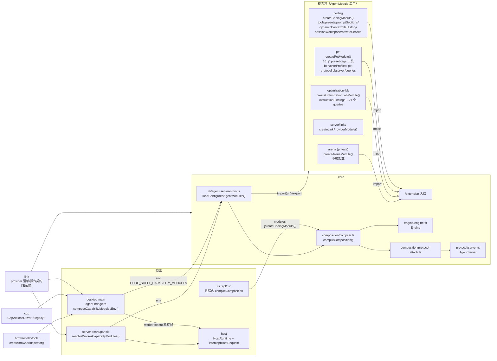

# 06 能力包与周边小包架构（函数层级）

> 基线：`main` @ `df2ca0bda`（2026-10-19），版本 0.9.45。下文所有 `file:line` 都对应这个提交，路径相对 `packages/`。
> 覆盖范围：`coding`、`pet`、`host`、`link`、`optimization-lab`、`cdp`、`browser-devtools`、`arena`（简述）。
> 说明：旧版章节（已归档到 `docs/archive/architecture-2026-07/`）只作线索参考，本文结论都已对照源码核过。

---

## 6.0 总览：能力包怎样接入 core 与宿主

### 6.0.1 唯一契约：`AgentModule`

所有"能力包"都只向 core 交一个工厂函数，返回 `AgentModule`（`core/src/composition/types.ts:91`）：

```ts
interface AgentModule {
  id: string;
  engine?: AgentEngineContributions; // 进 Engine 的贡献
  protocol?: AgentProtocolContributions; // 进 AgentServer（JSON-RPC 协议层）的贡献
  activateHost?(ctx): MaybeDisposable; // 宿主级生命周期激活
  activateEngine?(ctx): MaybeDisposable; // Engine 级生命周期激活
}
```

`engine` 和 `protocol` 两块的各字段，以及它们在 core 里被谁消费：

| 字段                                 | 含义                                                                                                                                                                                                   | core 消费点                                                                                                                                    |
| ------------------------------------ | ------------------------------------------------------------------------------------------------------------------------------------------------------------------------------------------------------ | ---------------------------------------------------------------------------------------------------------------------------------------------- |
| `engine.tools[]`                     | `{kind:"preset-tags", tool: BuiltinTool}`：带 `presetTags/availability/rewriteDefinition/defaultPermissionRules` 的完整元数据，并入工具目录；`{kind:"always"}`：普通 ExtensionTool，直接注册、始终可见 | `tool-system/registry.ts:79`（availability 守卫）、`engine/run-tooling.ts:558`（rewriteDefinition）                                            |
| `engine.presets[]` / `defaultPreset` | 新增/覆盖 preset；`defaultPreset` 全局最多一个模块声明                                                                                                                                                 | `composition/compiler.ts:312` 编译时校验                                                                                                       |
| `engine.promptSections`              | `{名字: markdown}`，供 preset 的 `promptSections` 按名引用                                                                                                                                             | `composition/resolve-preset.ts:49`                                                                                                             |
| `engine.dynamicContextProviders[]`   | 每次组装 system prompt 时调用，返回一段动态上下文                                                                                                                                                      | `engine/engine.ts:692` → `prompt/composer.ts:185`                                                                                              |
| `engine.instructionBoundary`         | 向上找 CODESHELL.md/CLAUDE.md 的停止边界（仓库根）                                                                                                                                                     | `composition/resolve-preset.ts:92`                                                                                                             |
| `engine.instructionBindings`         | 指令绑定提供者（optimization-lab 用）                                                                                                                                                                  | 编译进 `ResolvedComposition.engine.instructionBindings`                                                                                        |
| `engine.artifactDetectors[]`         | 从工具调用里识别"产物"（文档/commit）                                                                                                                                                                  | `run/RunManager.ts:146`                                                                                                                        |
| `engine.fileHistory[]`               | 声明某工具会改哪些文件，供 /undo 快照与回合 diff                                                                                                                                                       | `engine/engine.ts:2844`（`registerFileHistoryHook`）                                                                                           |
| `engine.sessionWorkspace`            | 校验 worktree 根、判断分支是否存在                                                                                                                                                                     | `engine/engine.ts:797`、`cli/agent-server-stdio.ts:441`                                                                                        |
| `engine.hooks[]`                     | 引擎 hook                                                                                                                                                                                              | 编译进 `hooks`                                                                                                                                 |
| `engine.behaviorProfiles[]`          | `RunBehaviorProfile`（如 pet）                                                                                                                                                                         | `engine/engine.ts:683`（按 id 建 Map），`engine/engine.ts:1560`（`behaviorMode` → profile）                                                    |
| `engine.adjustToolSelection`         | 按宿主改工具集合                                                                                                                                                                                       | `engine/engine.ts:754`                                                                                                                         |
| `engine.privateService`              | `scope: engine/session` 的私有服务，经 `ctx.capabilityServices[moduleId]` 给工具用                                                                                                                     | `engine/engine.ts:821`、`engine/engine.ts:876`                                                                                                 |
| `protocol.queries`                   | `agent/query` 的 type → handler                                                                                                                                                                        | `composition/protocol-attach.ts:78`（在观察者构造之后注册，type 已被观察者注册则跳过）；观察者的 `registerQuery` 只允许注册本模块已声明的 type |
| `protocol.createObserver`            | 协议观察者（看会话流、审批、运行边界）                                                                                                                                                                 | `composition/protocol-attach.ts:36`                                                                                                            |
| `protocol.validateRunParams`         | 校验 `agent/run` 参数                                                                                                                                                                                  | `protocol/server.ts:655`、`protocol/server.ts:1387`                                                                                            |
| `protocol.hiddenSessionKinds`        | 从通用会话列表里隐藏的会话 kind                                                                                                                                                                        | `protocol/server.ts:656`、`protocol/server.ts:3171`                                                                                            |

`compileComposition()`（`composition/compiler.ts:312`）把 `CORE_AGENT_MODULE` 与宿主给的模块合并成冻结的 `ResolvedComposition`（带 digest、diagnostics；工具顺序是"先全部 preset-tags 工具，再全部 always 工具"）。

### 6.0.2 两条加载路径

1. **Worker 进程路径（Desktop / server / Panel 任务）**：宿主在启动 stdio worker 时注入环境变量
   `CODE_SHELL_CAPABILITY_MODULES="<url>#<export>,<url>#<export>,..."`。worker 入口
   `core/src/cli/agent-server-stdio.ts:78 loadConfiguredAgentModules()` 逐个 `await import(url)`，取出导出名（默认 `createModule`），不是函数就直接抛错（fail-loud，注释说以前静默跳过会在很久以后才表现为"工具消失 / unknown behavior profile: pet"）。然后 `agent-server-stdio.ts:113` 只编译一次 `compileComposition({modules})`，seed engine、每个会话的 engine 和 AgentServer 共用这一份。
2. **进程内路径（TUI、Desktop 主进程里的辅助 engine）**：直接 `compileComposition({ modules: [createCodingModule()] })`。

### 6.0.3 各宿主实际加载了什么

| 宿主 / 位置                                                                                               | 加载方式                                                                                   | 模块                                                                                                                                                                                                                                                                                                                                 |
| --------------------------------------------------------------------------------------------------------- | ------------------------------------------------------------------------------------------ | ------------------------------------------------------------------------------------------------------------------------------------------------------------------------------------------------------------------------------------------------------------------------------------------------------------------------------------ |
| Desktop 主 worker：`desktop/src/main/agent-bridge.ts:218-219`、`:415`                                     | env，经 `desktop/src/main/capability-modules-env.ts:15 composeCapabilityModulesEnv()` 组装 | `@cjhyy/code-shell-capability-coding`（**根入口**）`#createCodingModule`、`@cjhyy/code-shell-pet/capability#createPetModule`、`out/main/link-provider-module.mjs#createLinkProviderModule`；用户级 feature flag `optimization_lab` 打开时再加 `@cjhyy/code-shell-capability-optimization-lab/capability#createOptimizationLabModule` |
| Desktop 主进程 `capabilities-service.ts:33`、`dream-service.ts:104`                                       | 进程内                                                                                     | 仅 coding                                                                                                                                                                                                                                                                                                                            |
| server `serve`：`server/src/serve/cli.ts:152 resolveWorkerCapabilityModules()` → `headless-server.ts:546` | env                                                                                        | coding + `@cjhyy/code-shell-server/links#createLinkProviderModule`（没传时只给 links）                                                                                                                                                                                                                                               |
| server Panel 任务 worker：`server/src/panels/agent-task-host.ts:366`                                      | env（默认）                                                                                | 仅 coding                                                                                                                                                                                                                                                                                                                            |
| TUI：`tui/src/cli/commands/repl.ts:161`、`:164`（cron 用）、`run.ts:81`                                   | 进程内                                                                                     | 仅 coding                                                                                                                                                                                                                                                                                                                            |
| arena                                                                                                     | **任何宿主都不加载**（`tui/src/cli/commands/arena.ts` 被 `tui/tsconfig.json` 排除）        | —                                                                                                                                                                                                                                                                                                                                    |

Pet 只在 Desktop 加载；server/TUI 没有 Mimi。

### 6.0.4 入口纪律

- `coding`、`pet`、`optimization-lab`、`arena` 的**非测试源码**只从 `@cjhyy/code-shell-core/extension`（`core/src/index.extension.ts`）导入。全仓 grep 结果：从 core 根入口 `.` 或 `/internal` 导入的文件全是 `*.test.ts`（例如 `coding/src/tools/drive-agent.test.ts`、`coding/src/integration/*.test.ts`）。
- `host` 是宿主侧包，`host/src/runtime.ts:1` 用 `import type { Contracts } from "@cjhyy/code-shell-core"`（只导类型，从根入口）。
- `link`、`cdp`、`browser-devtools` **零运行时依赖**（package.json 没有 `dependencies`），反过来是 core 依赖 `link`（`core/src/links/*`、`core/src/credentials/*`）。

### 6.0.5 接入关系图



---

## 6.1 `packages/coding` — 编码 / git / LSP / worktree 能力包

### 6.1.1 定位与依赖

- 包名 `@cjhyy/code-shell-capability-coding`，版本 0.9.45，公开发布（`files: dist, THIRD_PARTY_NOTICES.md`）。
- 依赖：只有 `@cjhyy/code-shell-core: workspace:*`。
- build：`tsc` 后跑 `copy-assets`，因为 `index.capability.ts:321` 运行时用 `readFileSync(new URL("./prompt/coding.md", import.meta.url))` 读 prompt 文件。
- exports（5 个子入口）：

| 子入口                | 文件                             | 内容                                                               |
| --------------------- | -------------------------------- | ------------------------------------------------------------------ |
| `.`                   | `src/index.ts`                   | 兼容根：`export *` capability + 各工具 + LSP + git + orchestration |
| `./capability`        | `src/index.capability.ts`        | `CODING_TOOLS`、两个 preset、`createCodingModule()`                |
| `./git`               | `src/index.git.ts`               | worktree、git utils、review prompt/target                          |
| `./orchestration`     | `src/index.orchestration.ts`     | 外部 Claude Code/Codex 编排、会话发现、quota                       |
| `./external-runtimes` | `src/external-runtimes/index.ts` | 把 Claude Code / Codex 当执行后端，并开回调 MCP bridge             |

> 注意：Desktop worker 和 server 加载的是**根入口** `.`（`agent-bridge.ts:218`、`serve/cli.ts:153`、`panels/agent-task-host.ts:366`），会把 orchestration/external-runtimes 一起求值；`index.ts` 头注释其实建议新宿主用 `/capability`。TUI、Desktop 主进程辅助 engine 用的是 `/capability`。

### 6.1.2 文件清单（非测试）

**能力装配层**

| 文件                         | 职责                                                                                                                                                      |
| ---------------------------- | --------------------------------------------------------------------------------------------------------------------------------------------------------- |
| `src/index.ts`               | 兼容根入口，re-export 一切                                                                                                                                |
| `src/index.capability.ts`    | 定义 `CODING_TOOLS`（9 个工具）、`CODING_GENERAL_PRESET`、`TERMINAL_CODING_PRESET`、prompt section、fileHistory、sessionWorkspace、`createCodingModule()` |
| `src/capability-runtime.ts`  | 私有服务 `createCodingToolService`、`codingToolService(ctx)`、`findCodingInstructionBoundary`、`gitDynamicContextProvider`、`codingArtifactDetector`      |
| `src/index.git.ts`           | `/git` 入口                                                                                                                                               |
| `src/index.orchestration.ts` | `/orchestration` 入口                                                                                                                                     |
| `src/prompt/coding.md`       | 42 行编码 prompt section（"先读再改"、"调查有预算：约 3 次只读调用后必须行动"等）                                                                         |

**git / worktree**

| 文件                           | 职责                                                                                                                                                      |
| ------------------------------ | --------------------------------------------------------------------------------------------------------------------------------------------------------- |
| `src/git/worktree.ts`          | 兼容 barrel → `./worktree/index.js`                                                                                                                       |
| `src/git/worktree/index.ts`    | re-export 下面 5 个                                                                                                                                       |
| `src/git/worktree/git-exec.ts` | `execGit`（异步，带超时/abort，杀进程树）、`execGitSync`、`gitOutput(Sync)`、`gitErrorMessage`、`normalizeBranchName`、`GIT_BIN`                          |
| `src/git/worktree/slug.ts`     | slug 校验、分支前缀规范化、`applyPrefix`、`isManagedWorktreeBranch`                                                                                       |
| `src/git/worktree/query.ts`    | `findGitRoot/findMainWorktreeRoot`、`listWorktreesFast/listWorktrees`、`branchExists`、`isGitWorktreeRoot`、`ownersForWorktree`                           |
| `src/git/worktree/diff.ts`     | `getWorktreeDiff`、`worktreeHasUncommittedOrAheadChanges`、`findComparisonBaseRef`                                                                        |
| `src/git/worktree/crud.ts`     | `createWorktree`、`copyWorktreeIncludes`、`runWorktreeSetup`、`removeWorktree`、`lock/unlockWorktree`、`inspectWorktreeChanges`、`cleanupAbortedWorktree` |
| `src/git/utils.ts`             | 同步 git/gh 小工具：`isGitRepo`、`getCurrentBranch`、`getGitStatus`、`getGitDiff(Stat)`、`getGitLog`、`gitAdd/Commit/Checkout`、`ghPrComments`            |
| `src/git/parse-log.ts`         | `parseGitLog()`                                                                                                                                           |
| `src/review/review-prompt.ts`  | `ReviewDimension`、`parseDimensions`、`buildReviewPrompt`                                                                                                 |
| `src/review/review-target.ts`  | `parseReviewArguments`（/review 参数分词）、`collectReviewTarget`（收集有上限的 diff）                                                                    |

**模型可调用的工具**

| 文件                                      | 工具名                                                    | 职责                                                              |
| ----------------------------------------- | --------------------------------------------------------- | ----------------------------------------------------------------- |
| `src/tools/worktree.ts`                   | `EnterWorktree`、`ExitWorktree`、`SwitchSessionWorkspace` | 切换会话工作区                                                    |
| `src/tools/apply-patch/index.ts`          | `ApplyPatch`                                              | V4A 补丁工具入口                                                  |
| `src/tools/apply-patch/parser.ts`         | —                                                         | `parsePatch(text, "strict"/"lenient")`                            |
| `src/tools/apply-patch/applier.ts`        | —                                                         | 两阶段原子应用 + 回滚                                             |
| `src/tools/apply-patch/seek-sequence.ts`  | —                                                         | 四档模糊行匹配                                                    |
| `src/tools/apply-patch/eol.ts`            | —                                                         | `detectEol/toLf/applyEol`                                         |
| `src/tools/apply-patch/types.ts`          | —                                                         | `Hunk`、`UpdateFileChunk`、`PatchParseError`、`PlannedFileChange` |
| `src/tools/apply-patch/backup-targets.ts` | —                                                         | `patchBackupTargets`（/undo）、`patchDiffTargets`（回合 diff）    |
| `src/tools/lsp.ts`                        | `LSP`                                                     | goToDefinition/findReferences/hover/getDiagnostics/getSymbols     |
| `src/tools/notebook-edit.ts`              | `NotebookEdit`                                            | .ipynb 读/插入/替换/删除 cell                                     |
| `src/tools/check-quota.ts`                | `CheckQuota`                                              | 查 Claude/Codex 剩余额度                                          |
| `src/tools/brief.ts`                      | `Brief`                                                   | 只做根入口兼容导出，**不暴露给模型**                              |
| `src/tools/drive-agent.ts`（1714 行）     | `DriveAgent`、`DriveAgentJobs`、`DriveClaudeCode`         | 把任务委派给外部 claude/codex CLI，支持后台、worktree 隔离、续接  |

**LSP**

| 文件                   | 职责                                                                                 |
| ---------------------- | ------------------------------------------------------------------------------------ |
| `src/lsp/servers.ts`   | `BUILTIN_LSP_SERVERS`（typescript/python/go/rust/json/css）、`detectLSPServer(path)` |
| `src/lsp/client.ts`    | `LSPClient`：stdio JSON-RPC，按字节做 Content-Length 分帧                            |
| `src/lsp/manager.ts`   | `LSPServerManager`（每个 workspace 一个）+ 模块级 LRU 表（最多 4 个）                |
| `src/lsp/root-path.ts` | `rootUriToPath()` = `fileURLToPath`                                                  |

**外部 agent 编排（`/orchestration`）**

| 文件                                                                  | 职责                                                                                                                                                                                       |
| --------------------------------------------------------------------- | ------------------------------------------------------------------------------------------------------------------------------------------------------------------------------------------ |
| `src/cc-orchestrator/agent-adapter.ts`                                | `claudeAdapter`/`codexAdapter`：拼 CLI 参数、解析 stream-json；`CC_COST_GUARD_PROMPT`                                                                                                      |
| `src/cc-orchestrator/external-agent-driver.ts`                        | `runAgentOnce()`：起一次无头 CLI，收集输出，记 model trace；`detectCodexImageInput`                                                                                                        |
| `src/cc-orchestrator/cc-capability.ts`                                | `probeClaudeCli/probeCodexCli`、`pathWithCommonBins`                                                                                                                                       |
| `src/cc-orchestrator/external-agent-session-store.ts`                 | `ExternalAgentSessionStore`：`~/.code-shell/external-agent-sessions.json`，记 CLI 会话 ↔ cwd/worktree 绑定（自带 mkdir 锁）                                                                |
| `src/cc-orchestrator/external-agent-bindings.ts`                      | `ExternalAgentBindingStore`、`detectExternalAgentWorktree`、`externalAgentResumeCwdError`                                                                                                  |
| `src/cc-orchestrator/external-agent-changes.ts`                       | 从 Claude/Codex transcript 里提取改动过的文件                                                                                                                                              |
| `src/cc-orchestrator/session-discovery.ts`                            | 发现 `~/.claude/projects/<encodedCwd>` 下的会话                                                                                                                                            |
| `src/cc-orchestrator/codex-session-discovery.ts`                      | 发现 `~/.codex` rollout 会话                                                                                                                                                               |
| `src/cc-orchestrator/related-session-discovery.ts`                    | 合并两边的"相关会话"                                                                                                                                                                       |
| `src/cc-orchestrator/session-history.ts` / `codex-session-history.ts` | 解析 transcript 尾部成 `SessionTailEvent`                                                                                                                                                  |
| `src/cc-orchestrator/codex-user-text.ts`                              | 从 Codex user message 里剥掉宿主注入的上下文                                                                                                                                               |
| `src/cc-orchestrator/relevance-judge.ts`                              | 用 aux LLM 判断"是否续接某会话"：`buildJudgePrompt/parseJudgeResponse/judgeContinuation`                                                                                                   |
| `src/cc-orchestrator/index.ts`                                        | barrel                                                                                                                                                                                     |
| `src/external-agents/{types,config}.ts`                               | `resolveExternalAgentConfig()`：claude/codex 命令、safe/dangerous 模式默认值                                                                                                               |
| `src/quota/{types,credentials,index}.ts`                              | `resolveQuotaCredentials`（Keychain/`~/.codex/auth.json`）、`queryCodexQuota`（`/backend-api/wham/usage`）、`queryClaudeQuota`（1-token 探针读 ratelimit 头）、`checkQuota`、`formatQuota` |

**外部运行时（`/external-runtimes`）**

| 文件                                                                                                | 职责                                                                                                                                         |
| --------------------------------------------------------------------------------------------------- | -------------------------------------------------------------------------------------------------------------------------------------------- |
| `src/external-runtimes/index.ts`                                                                    | barrel，头注释说明 Claude/Codex 共用一个 HTTP MCP bridge                                                                                     |
| `src/external-runtimes/session-factory.ts`                                                          | `startExternalRuntimeSession()`：bridge → SessionToolHost → runtime 的装配根                                                                 |
| `src/external-runtimes/shared/mcp-bridge.ts`                                                        | `startLoopbackMcpBridge()`：仅回环、Bearer token、POST `/mcp` 的 MCP 服务                                                                    |
| `src/external-runtimes/shared/session-context-store.ts`                                             | `SessionContextStore`：threadId → tool host，带 generation 围栏                                                                              |
| `src/external-runtimes/shared/spawn-env.ts`                                                         | `buildRuntimeSpawnEnv()`                                                                                                                     |
| `src/external-runtimes/turn-input.ts`                                                               | `textWithAttachmentReferences()`                                                                                                             |
| `src/external-runtimes/codex/{runtime,app-server-client,event-translator,model-discovery,index}.ts` | `CodexRuntime`（`codex app-server` JSON-RPC）、`CodexAppServerClient`、`CodexEventTranslator`（→ core `StreamEvent`）、`discoverCodexModels` |
| `src/external-runtimes/claude-code/{runtime,event-translator,mcp-config}.ts`                        | `ClaudeCodeRuntime`（每回合一个 `claude -p` 进程）、`ClaudeEventTranslator`、`buildClaudeMcpConfig/claudeBridgeArgs/claudeAllowedToolNames`  |

### 6.1.3 关键类型 / 类 / 函数

#### (1) 能力装配：`index.capability.ts` + `capability-runtime.ts`

- `defineTool(definition, execute, exposure)`（`index.capability.ts:44`）：把三件套拼成 `BuiltinTool`。
- `CODING_TOOLS`（`index.capability.ts:55`）：9 个工具及其权限元数据：

| 工具                         | permissionDefault | 只读 | presetTags                                                        | 其它                                                                                                                      |
| ---------------------------- | ----------------- | ---- | ----------------------------------------------------------------- | ------------------------------------------------------------------------------------------------------------------------- |
| DriveAgent                   | ask               | 否   | general, terminal-coding                                          | `timeoutMs=1_800_000`；`pathPolicy` 对 `attachmentPaths/additionalReadDirs` 做 read 校验；quickChat 下不可用              |
| DriveAgentJobs               | allow             | 否   | general, terminal-coding                                          | quickChat 下不可用                                                                                                        |
| DriveClaudeCode              | ask               | 否   | general, terminal-coding                                          | DriveAgent 的别名                                                                                                         |
| CheckQuota                   | allow             | 是   | terminal-coding                                                   | 默认规则 allow                                                                                                            |
| EnterWorktree / ExitWorktree | ask               | 否   | terminal-coding                                                   | —                                                                                                                         |
| SwitchSessionWorkspace       | ask               | 否   | `[]`（不进任何 preset，由 `adjustToolSelection` 在 desktop 加入） | —                                                                                                                         |
| ApplyPatch                   | ask               | 否   | terminal-coding                                                   | `pathResolver`：用 `parsePatch(...,"lenient")` 解析出每个 hunk 的 `path` 与 `movePath`，作为 write 目标交给 core 路径策略 |
| NotebookEdit                 | ask               | 否   | terminal-coding                                                   | `pathPolicy` 的 operation 来自 `action` 参数：`read` 算读，其它算写                                                       |
| LSP                          | allow             | 是   | terminal-coding                                                   | 默认规则 allow；`file_path` 读校验                                                                                        |

- `unavailableInQuickChat`（`:52`）：`behaviorProfile !== "quickChatRestricted"` 才可见。
- `codingInitialToolRouting(terminal)`（`:212`）：在 core `general` preset 的 `initialToolRouting` 上加两条关键词路由：`coding`（中英文关键词如"代码/修复/重构/补丁"）和 `worktree`（"工作树/分支"）。terminal 模式下把通用 `files` 规则里的 `Write` 去掉，`managedToolNames` 加入 `ApplyPatch`、去掉 `Write`，强制"终端编码用 ApplyPatch 不用 Write"。
- `CODING_GENERAL_PRESET`（`:287`）：保留 core `general` preset，只追加带 `general` 标签的 coding 工具（`derivePresetExposure("general", CODING_TOOLS)`，定义在 `core/src/tool-system/builtin/index.ts:1178`）。
- `TERMINAL_CODING_PRESET`（`:298`）：`promptSections: ["base","orchestration","coding","browser","tone"]`，`initialToolNames` = general 的去掉 Write 再加 ApplyPatch，`builtinTools` = general + `product-full`（core 全量 BUILTIN_TOOLS 中带该标签者）+ terminal-coding 标签的 coding 工具。
- `CODING_PROMPT_SECTIONS`（`:320`）：`{ coding: <coding.md 内容> }`。
- `notebookMutationTargets()`（`:324`）、`CODING_FILE_HISTORY`（`:332`）：给 core 的 file-history hook 声明 ApplyPatch 用 `patchBackupTargets/patchDiffTargets`、NotebookEdit 只在 insert/replace/delete 时算改动。
- `CODING_SESSION_WORKSPACE`（`:347`）：`validateRoot = isGitWorktreeRoot`、`branchExists`。
- `codingAdjustToolSelection(names, {host})`（`:352`）：`host === "desktop"` 时删掉 `EnterWorktree/ExitWorktree`，加上 `SwitchSessionWorkspace`（Desktop 的 worktree 切换必须走 UI 路径）。
- **`createCodingModule()`（`:360`）**：返回 `{id:"coding", engine:{tools(全部 preset-tags), presets:[general, terminal-coding], defaultPreset:"terminal-coding", promptSections, dynamicContextProviders:[gitDynamicContextProvider], instructionBoundary, privateService:{scope:"engine", create:createCodingToolService}, artifactDetectors, fileHistory, sessionWorkspace, adjustToolSelection}}`。没有 protocol 贡献。

`capability-runtime.ts`：

- `CODING_CAPABILITY_ID = "coding"`（`:12`）。
- `interface CodingToolService`（`:21`）：`getSessionManager()`、`readWorktreeSetupScripts(cwd)`、`readWorktreeBranchPrefix(cwd)`、`resolveWorktreeSetupSandbox`、`readWorktreeSetupShellEnv`。
- `createCodingToolService(host)`（`:29`）：core 用 `CapabilityToolServiceHost` 调它。子 agent（`host.isSubAgent`）读不到 setup 脚本/前缀；setup 脚本来自 project 作用域 `localEnvironment.setupScripts`，前缀来自 `settings.worktree.branchPrefix`。
- `codingToolService(ctx)`（`:57`）：工具里取服务：`ctx.capabilityServices["coding"]`。
- `findCodingInstructionBoundary(cwd)`（`:62`）：纯文件系统向上找 `.git`（目录或 worktree 的 `.git` 文件都算）。
- `gitDynamicContextProvider`（`:72`）：只在 preset 是 `terminal-coding` 时生效，拼 `gitStatus: Current branch: X` + status + 最近 5 条 commit。用的是 `git/utils.ts` 的**同步** git。
- `codingArtifactDetector`（`:90`）：`NotebookEdit` → document 产物；`Bash` 里以 `git commit` 开头 → `resource git:HEAD` 产物。

#### (2) git / worktree 层

`git-exec.ts`：

- `GIT_BIN = resolveExecutable("git")`（`:5`，Windows 下解析 PATHEXT）。
- `execGit(cwd, args, timeout=10000, signal?)`（`:7`）：`execFile` 封装；超时和 abort 都会调 core 的 `killChildTree(child, 1000)`；错误对象上挂 stdout/stderr。
- `execGitSync`（`:58`）、`gitOutput`（`:66`，失败返回 undefined，但 abort 照样抛）、`gitOutputSync`（`:80`）、`gitErrorMessage`（`:88`，优先取 stderr）、`normalizeBranchName`（`:98`，去 `refs/heads/`）。

`slug.ts`：

- `validateWorktreeSlug`（`:8`）：非空、≤64、只允许 `[a-zA-Z0-9._-]`、不能以 `.` 开头或含 `..`，防路径穿越。
- `normalizeWorktreeBranchPrefix`（`:16`）/`isValidWorktreeBranchPrefix`（`:26`）：按 git ref 规则校验，补尾部 `/`。默认 `worktree/`。
- `applyPrefix(prefix, slug, sessionId)`（`:44`）：`<prefix><slug>-<sessionId 前 8 位>`。
- `managedBranchPrefixes`（`:49`）/`isManagedWorktreeBranch`（`:56`）：配置的前缀加历史前缀 `worktree/`，用来判断"这个分支是不是 CodeShell 建的、允许删"。

`query.ts`：

- `findGitRoot(cwd)`（`:39`）= `findMainWorktreeRoot`（`:43`）：`rev-parse --path-format=absolute --git-common-dir` 的父目录，也就是说在 worktree 里调用也会解析到**主仓库**。
- `findWorktreeForBranch`（`:50`）、`assertBranchNotCheckedOut`（`:60`）、`branchExists`（`:71`）、`isGitWorktreeRoot`（`:85`，要求 `.git` 存在且 `--show-toplevel` 等于 cwd）、`currentBranch`（`:102`）。
- `listWorktreesFast(cwd, opts)`（`:110`）：解析 `git worktree list --porcelain`，标 `isMain`、`isManaged`，按 `workspaceOwners`（会话 → workspace）算出 `occupiedBySessionIds/occupiedByOtherSession`。
- `listWorktrees`（`:168`）：fast 版 + 可选 `getWorktreeDiff`。
- `ownersForWorktree`（`:182`）。

`diff.ts`：

- `getWorktreeDiff(path, baseRef?)`（`:15`）：baseRef 不存在就用 `findComparisonBaseRef`（`:43`，依次找 main/master/origin/main/origin/master），并行算 dirty 文件、base 以来改动的文件、ahead 提交数。
- `worktreeHasUncommittedChanges`（`:26`）、`worktreeHasUncommittedOrAheadChanges`（`:31`）。

`crud.ts`：

- `interface WorktreeSession`（`:25`）：`originalCwd/worktreePath/worktreeName/worktreeBranch/originalBranch/baseRef(不可变 commit)/baseRefLabel/includedFiles/sessionId/createdAt`。
- **`createWorktree(cwd, slug, sessionId, opts)`（`:113`）**：
  1. `validateWorktreeSlug` → `findGitRoot`（主仓）→ `applyPrefix` 算分支名；
  2. 路径固定为 `<主仓>/../.worktrees/<slug>-<sid8>`（`:125`），也就是主仓**同级**的 `.worktrees/`；
  3. `assertBranchNotCheckedOut` + 分支已存在就报错；
  4. 记下路径是否原本就存在（`worktreePathPreexisted`，`:133`）；
  5. `resolveWorktreeBase`（`:194`）：`head` → HEAD；`fresh` → 本地已知的 `origin/HEAD`（**不做网络 fetch**），没有就用 `origin/<当前分支>`，再没有就 HEAD；最后 `rev-parse --verify <label>^{commit}` 固定成 commit；
  6. `git worktree add -b <branch> <path> <commit>`（argv 形式，`:149`）；
  7. `symlinkLargeDirectories`（`:522`）：把 `node_modules/.venv/vendor/.pnpm-store` 和每个 `packages/*/node_modules` 软链过去（Windows 用 junction）；
  8. `copyWorktreeIncludes`（`:228`）：按 `.worktreeinclude` + 显式 pattern，只复制 `git ls-files --others --ignored --exclude-standard` 里出现的普通文件，并检查源/目标都在根目录内；
  9. 任何一步失败 → `cleanupAbortedWorktree(..., allowRecursiveDelete = !preexisted)`（`:73`），原本就存在的目录绝不 `rm -rf`。
- `selectPlatformScript(scripts, platform)`（`:97`）：darwin→macos、win32→windows、其它→linux，空白脚本视为没有，回退 `default`。
- `runWorktreeSetup(path, script, {sandbox, shellEnv, timeoutMs=120s, signal})`（`:349`）：用 core 的 `safeSpawnShell` 跑，沙箱开着时用 `buildSandboxEnv()`；输出上限 1MB。
- `inspectWorktreeChanges(path, baseRef)`（`:413`）：同步算 uncommitted + `rev-list --count base..HEAD`。
- `lockWorktree/unlockWorktree`（`:432/:437`）：DriveAgent 运行期间锁住防 prune；unlock 是幂等的（先看 porcelain 里有没有 `locked`）。
- **`removeWorktree(path, removeBranch, {prefix})`（`:449`）**：先用 `--git-common-dir` 找主仓；要删分支时先确认 `isManagedWorktreeBranch`，否则拒绝（"refusing to delete non-CodeShell worktree branch"）；`git worktree remove --force` 在主仓里执行；分支删除失败时返回 `{dirRemoved:true, branchDeleted:false, branchError}`，不抛。

`git/utils.ts`：给 TUI `/git` 命令、Desktop 各服务用的同步 git/gh 封装（`isGitRepo:37`、`resolveProjectRoot:57`、`getCurrentBranch:72`、`getGitStatus:76`、`getGitDiff:85`、`getGitDiffStat:94`、`getGitLog:101`、`getRemoteUrl:110`、`gitAdd:118`、`gitCommit:125`、`gitListBranches:136`、`gitCheckout:145`、`ghAvailable:160`、`ghPrComments:169`）。

`review/`：

- `parseReviewArguments(input)`（`review-target.ts:42`）：把 `/review` 参数分词成 `ReviewTarget`：`working(all/staged/unstaged)`、`base <ref>`（merge-base 起算）、`commit <hash>`。
- `collectReviewTarget(cwd, target)`（`review-target.ts:162`）：上限 `MAX_DIFF_BYTES=256KB`、新增文件 64KB、最多 100 个文件；固定 diff 选项（`--no-ext-diff --no-textconv --no-renames ...`，防止仓库配置的外部 diff 被执行）；有未合并冲突就报错；commit 哈希必须是 4-64 位 hex。
- `buildReviewPrompt(opts)`（`review-prompt.ts:68`）、`parseDimensions`（`:45`）：维度 security/performance/readability/correctness。
- 使用方：TUI `tui/src/cli/commands/builtin/git-commands.ts:160`、Desktop `desktop/src/main/review-service.ts:217`。

#### (3) worktree 工具：`tools/worktree.ts`

- `switchSessionWorkspaceTool(args, ctx)`（`:49`）：只做一件事，调 `ctx.workspaceBridge.switch(target)`（`workspaceBridgeForContext`，`:81`，兼容老的 `ctx.workspace.switch`，但遇到带 `version/roots/projectId` 的新 WorkspaceContext 一律不当作 bridge），成功后 `ctx.setSessionWorkspace(workspace)`。宿主没提供 bridge 就返回"不可用"。
- `enterWorktreeTool(args, ctx)`（`:122`）：见 6.1.5(a)。
- `exitWorktreeTool(args, ctx)`（`:252`）：见 6.1.5(b)。
- 辅助：`persistSessionWorkspace`（`:212`，`sessionManager.setSessionWorkspace` 返回 stateRevision 再回调 `ctx.setSessionWorkspace`）、`nextTurnNotice`（`:222`，明确告诉模型"下一回合才生效，本回合的文件/shell/沙箱仍指向旧 cwd"）、`sessionServices`（`:364`，需要 sessionId + coding 私有服务里的 SessionManager）、`otherSessionOwnersForWorktree`（`:374`）、`resolveWorktreeTarget`（`:412`）、`toSessionWorkspace`（`:460`）、`runSetupIfConfigured`（`:482`）。

#### (4) ApplyPatch：`tools/apply-patch/*`

- `applyPatchToolDef`（`index.ts:25`）：V4A 格式说明（`*** Begin Patch / Add File / Update File / Move to / @@ / End of File / Delete File / End Patch`）。
- `applyPatchTool(args, ctx)`（`index.ts:61`）：`parsePatch(..., "lenient")` → `applyPatch(hunks, {cwd: ctx.cwd, workspaceRoots: ctx.workspace.roots})` → 对每个 path/movePath 调 core `invalidateFileCache(resolve(cwd, p))`（缓存按绝对路径键）→ 返回 `A/M/D` 摘要。
- `parsePatch(text, mode)`（`parser.ts:43`）：`checkBoundariesLenient`（`:85`）在 strict 失败时额外接受 `<<EOF ... EOF` heredoc 包裹；`parseOneHunk`（`:108`）、`parseUpdateChunk`（`:190`）。
- `applyPatch(hunks, options)`（`applier.ts:48`）= `planHunks` + `commitPlanned`。
- `planHunks(hunks, cwd, roots)`（`applier.ts:83`）：
  - 每个 path 先过 `resolveAgainst`（`:349`）：realpath 最近的已存在祖先（`nearestRealPath`，`:366`），必须落在某个 workspace root 内，**防符号链接逃逸**；这一层是 applier 自己的最后防线，与执行器层的 pathPolicy 无关（`bypassPermissions` 时 pathPolicy 不拦）。
  - `schedule()` 不允许同一 path 出现两次。
  - add：记录目标原内容（可能存在 → 覆盖时可回滚）；delete：目标必须存在；update：读快照（`readSnapshotIfExists`，`:390`，返回原始 Buffer + `mode & 0o7777`），检测 EOL → 转 LF 匹配 → `applyChunksToText` → 按原 EOL 写回；move：源计划为删除、目标计划为新内容，并继承源文件权限 `newMode`。
- `applyChunksToText`（`:184`）：`@@ context` 先 `seekSequence` 定位锚点；纯新增 chunk **追加到文件末尾**（沿袭 codex 行为，即使有锚点）；找不到时去掉尾部空行哨兵重试；最后按起始下标从后往前 splice，保证结尾有换行。
- `seekSequence(lines, pattern, start, eof)`（`seek-sequence.ts:20`）：四档逐级放宽：精确 → 忽略行尾空白 → 忽略两端空白 → Unicode 标点归一（智能引号/破折号/NBSP）。
- **回滚** `commitPlanned(set, allowPartial)`（`:261`）：按插入顺序写；把"当前正在写的这个"也先放进 `attempted`（因为 `writeFile` 可能写了一半、`chmod` 可能在写完后失败）；出错时倒序恢复：原来不存在的就 `unlink`，存在的 `restoreSnapshot`（`:301`：先 chmod 成可写 → 写回原字节 → finally 恢复原 mode）。只恢复规划阶段捕获的字节，不再重新读盘。
- `writeChange`（`:318`）：删除 = unlink；写入时缺父目录就 mkdir；有 `newMode` 时额外 `chmod`（umask 和"目标已存在"都会让 `writeFile` 的 mode 失效）。
- `patchBackupTargets`（`backup-targets.ts:14`）：只返回 update/delete 的目标（add 没有旧内容可备份）；`patchDiffTargets`（`:40`）：所有 path + movePath（包括还不存在的），供回合 diff 区分"新建"和"覆盖"。

#### (5) LSP：`tools/lsp.ts` + `lsp/*`

- `lspTool(args, ctx)`（`tools/lsp.ts:66`）：相对路径按 `ctx.cwd` 解析 → `getLSPManager(cwd)`（按需创建）→ `detectLSPServer` → `manager.getClient(name)` → 按 action 发 `textDocument/definition|references|hover|documentSymbol`，或做 getDiagnostics（见 6.1.5(e)）。
- `LSPServerManager`（`lsp/manager.ts:22`）：构造时把 6 个内置 server 都登记成 `stopped`；`getClient`（`:38`）：ready 且存活直接返回；`starting` 时**固定等 2 秒**再返回；否则 `startServer`（`:59`）：`isCommandAvailable`（`:131`，自己扫 PATH/PATHEXT）→ `new LSPClient(cmd, args, rootPath)` → `start()` → `initialize(rootUri)`。`listServers`（`:104`）、`shutdownAll`（`:116`）。
- 模块级管理：`initializeLSPManager(cwd)`（`:211`）、`getLSPManager(cwd?, {create})`（`:244`，读也刷新 LRU；不传 cwd 时只有唯一一个 manager 才返回它）、`evictLeastRecentlyUsed`（`:222`，`MAX_LIVE_WORKSPACES=4`，被淘汰的 fire-and-forget `shutdownAll`）、`shutdownLSPManager`（`:265`）、`shutdownAllLSPManagers`（`:274`）。
- `LSPClient`（`lsp/client.ts:24`，继承 EventEmitter）：`start()`（`:48`，spawn + `unref()`，退出时 reject 所有 pending）、`initialize()`（`:68`，声明 definition/references/hover/documentSymbol/completion/workspace.symbol 能力，再发 `initialized`）、`request()`（`:90`，30s 超时）、`notify()`（`:122`）、`shutdown()`（`:130`）、`handleData()`（`:158`，Buffer 拼接、按字节比较 Content-Length，修过多字节 UTF-8 截断的问题；带 id 的响应 resolve pending，无 id 的通知 `emit("notification")`）。

#### (6) DriveAgent：`tools/drive-agent.ts`

- 常量：`DRIVE_AGENT_FOREGROUND_HANDOFF_MS = 110_000`（`:37`，前台跑超过 110s 自动转后台）、`DRIVE_AGENT_TOOL_TIMEOUT_MS = 1_800_000`（`:38`）。
- 参数（`driveAgentToolDef`，`:45`）：`prompt`、`cli: claude|codex`、`resumeSessionId`、`model`、`cwd`、`isolation: current|worktree|none`、`baseRef`、`include`、`cleanup: auto|keep|detach|discard`、`effectiveWorkspaceCwd`、`attachmentPaths`、`additionalReadDirs`、`permissionMode: default|acceptEdits|bypassPermissions`、`background`。
- `defaultRunner`（`:215`）→ `runAgentOnce(adapter, {...})`（`cc-orchestrator/external-agent-driver.ts:226`）。
- 写者冲突检测：`hasRunningDriveWriter`（`:268`，看后台 job 注册表 + 前台租约）、`duplicateCwdError`（`:693`）、`acquireForegroundDriveLease`（`:718`）。
- worktree 生命周期：`prepareDriveWorktree`（`:290`，`createWorktree(gitRoot, "drive-<cli>", seed, ...)` 后立即 `lockWorktree`，锁失败就删掉）、`finalizeDriveWorktree`（`:316`，`auto` = 有改动就 keep 否则 discard；`detach` 遇到未提交改动降级成 keep；检查失败时保留目录）、`safeFinalizeDriveWorktree`（`:393`）、`finalizeDriveWorktreeAfter`（`:417`）。
- 路径：`resolveAttachmentPaths`（`:540`）、`resolveAdditionalReadDirs`（`:569`，cwd 以外的目录只允许在 `permissionMode:"default"`（只读）时加入）。
- 后台：`trackBackgroundRun`（`:897`）→ `backgroundJobRegistry.start(jobId, sessionId, label, {kind:"drive-agent", worktree..., abort})` → `attachDriveCompletion`（`:742`）：完成时读外部 transcript 的改动文件 → `recordExternalFileChanges` → `notificationQueue.enqueue({workKind:"cc", ...}, sessionId)` → `backgroundJobRegistry.finish`。
- `waitForForegroundOrHandoff`（`:985`）、`makeAbortController`（`:1005`）、`recordSuccessfulSession`（`:634`，写 `ExternalAgentSessionStore` 绑定，供 resume 时强制回到原 cwd/worktree）。
- **`makeDriveAgentTool(runner, fixedCli?, options)`（`:1018`）**：主流程，见 6.1.5(f)。`driveAgentTool = makeDriveAgentTool()`（`:1404`）。
- `driveAgentJobsTool`（`:1636`）：`list`（`:1472`，默认只列当前会话的 running；`all/status/resultChars`）、`inspect`（`:1510`）、`cancel`（`:1543`）、`cleanup`（`:1576`，对 keep 下来的 worktree 做 detach/discard）。
- `makeDriveClaudeCodeTool`（`:1706`）/`driveClaudeCodeTool`（`:1714`）：固定 `cli:"claude"` 的兼容别名。

`agent-adapter.ts`：

- `claudeAdapter.buildArgs`（`:53`）：`-p <prompt> --output-format stream-json --verbose [--model] [--resume] [--add-dir ...] --disallowedTools Workflow --append-system-prompt <CC_COST_GUARD_PROMPT> --permission-mode <mode>`。硬禁 `Workflow`（注释：无人值守时 Workflow 会扇出一队 agent 烧 token），单个 Task 允许。`parseResult` 取 `type:"result"` 行。
- `codexAdapter.buildArgs`（`:114`）：`exec --json --color never --skip-git-repo-check`；权限映射：`default → --sandbox read-only`、`acceptEdits → --sandbox workspace-write`、`bypassPermissions → --dangerously-bypass-approvals-and-sandbox`；支持 `-i <image>`（先探测 CLI 是否支持）；`resume <id> -`；prompt 走 stdin（`promptViaStdin`）。`parseResult`：`thread.started.thread_id` 作 sessionId，最后一个 `agent_message` 作 finalText，`turn.failed/error` 记错误。

`runAgentOnce`（`external-agent-driver.ts:226`）：按需探测 codex `-i` 支持 → `spawn(command, args, {detached:false, env PATH=pathWithCommonBins()})`（**不 detach**：宿主被强杀时 CLI 不能逃逸成独立进程组继续改工作区）→ `recordExternalModelCall` 记录 trace（注明"只能看到 CLI 入口与最终结果"）→ 收集行 → `adapter.parseResult`。

#### (7) 外部运行时：`external-runtimes/*`

- **`startExternalRuntimeSession(options)`（`session-factory.ts:124`）**：
  1. `pinnedThreadId = "codeshell-<businessSessionId>"`，`new SessionContextStore()`，`startLoopbackMcpBridge({store, singleSessionThreadId: pinned})`；
  2. `createSessionToolHost({...})`（core `/extension` 提供）：授权边界，包含 registry、permissionMode、pathAccess、presetRules、projectTrusted、planMode、exposure（默认 `FIRST_PHASE_EXPOSURE` 白名单）、visibility、approvalBackend 等；
  3. 在 runtime 启动**之前** `store.register(pinned, host)`，第一回合的工具调用也能路由；
  4. codex：`new CodexRuntime(...)` 后 `await codex.start()`；claude：`new ClaudeCodeRuntime(...)`（第一次 `send` 才起进程）；
  5. 失败走 `close()`：先 unregister，再关 runtime、dispose host、关 bridge。
     返回 `ExternalRuntimeSession { kind, businessSessionId, runtimeSessionId, listTools, send, interrupt, close }`；`send` 同一时间只允许一个回合（`turnSink`）。
- `ExternalRuntimeSessionOptions`（`:48`）：注释强调安全相关字段（`projectTrusted` 等）**故意不给默认值**。
- `startLoopbackMcpBridge(options)`（`shared/mcp-bridge.ts:123`）：随机 32 字节 hex token；只接受回环地址（`isLoopback`，`:84`）、只接受 `POST /mcp`、校验 `Authorization: Bearer`、body 上限 1MB、拒绝 JSON-RPC batch；`initialize`、`notifications/*`、`tools/list`、`tools/call` 各自处理；threadId 优先用 pin，否则用 `_meta.threadId`（`threadIdFromMeta`，`:94`）。
- `SessionContextStore`（`shared/session-context-store.ts:47`）：`register`（`:71`）、`unregister`、`bumpGeneration`（`:91`，清空 map）、`resolve`（`:101`：缺 threadId / 未知 thread / generation 不一致一律拒绝，没有"用前台会话"之类的兜底）、`resolveBatch`（`:133`，跨 thread 的批量整体拒绝）。
- `CodexRuntime`（`codex/runtime.ts:81`）：`start()`（`:125`）：`initialize` → 有 `resumeRuntimeSessionId` 先 `thread/resume`，失败回退 `thread/start` → 建 `CodexEventTranslator` → 发 `session_started`；`send()`（`:213`）：首回合且非 resume 时把 `initialContext` 拼到 `<current_user_request>` 前，图片附件转 `localImage`，发 `turn/start`；`interrupt()`（`:268`，有超时）；`onServerRequest()`（`:324`）：`mcpServer/elicitation/request` → `answerMcpElicitation`（`:364`，**只**接受自家 MCP server 的 `mcp_tool_call` 审批，避免二次审批；第三方 server 一律拒绝），`item/tool/requestUserInput` → `hooks.onUserInput`，其它 `*requestApproval` → `hooks.onNativeApproval`，默认 decline。
- `ClaudeCodeRuntime`（`claude-code/runtime.ts:52`）：`send()`（`:82`）：每回合 spawn `claude -p --output-format stream-json --include-partial-messages --verbose [--model] [--resume <上一回合的 claude sessionId>] ...extraArgs ...claudeBridgeArgs`，token 通过 `buildRuntimeSpawnEnv({bridgeToken})` 注入；进程退出但没看到终止事件时补发 `error + turn_complete(model_error)`。
- `claudeBridgeArgs`（`claude-code/mcp-config.ts:154`）/`writeClaudeMcpConfigFile`（`:77`，0600 权限临时文件 + `cleanup()`）/`claudeAllowedToolNames`（`:114`）。
- 使用方：Desktop `desktop/src/main/external-runtime-service.ts:907`（registry 用 `[...BUILTIN_TOOLS, ...CODING_TOOLS]`，`:651`）。

#### (8) Quota

- `checkQuotaTool`（`tools/check-quota.ts:42`）→ `resolveQuotaCredentials()`（`quota/credentials.ts:85`：Codex 读 `~/.codex/auth.json`；Claude 在 macOS 用 `security find-generic-password -s "Claude Code-credentials" -w`，其它平台读 `~/.claude/.credentials.json`）→ `checkQuota({creds, providers, signal})`（`quota/index.ts:206`）→ `formatQuota`（`:221`）。
- `queryCodexQuota`（`:51`）：`GET https://chatgpt.com/backend-api/wham/usage`，零成本。
- `queryClaudeQuota`（`:108`）：用 `claude-haiku-4-5-20251001` 发 `max_tokens:1` 请求，从响应头 `anthropic-ratelimit-unified-<window>-*` 解析；`parseClaudeWindows`（`:174`）按前缀**发现**窗口（5h/7d/overage…），不写死窗口名。

### 6.1.4 如何接入宿主

- **Engine 侧**：`createCodingModule()` 的全部 engine 贡献由 `compileComposition` 编进 `ResolvedComposition.engine`，Engine 构造时分别装配（见 6.0.1 表）。工具执行时通过 `ctx.capabilityServices.coding`（`codingToolService`）拿到 SessionManager 和 settings 读取能力，**不直接 import core 的 SessionManager 单例**。
- **Desktop**：worker 侧经 env 加载；主进程直接 import 子入口：
  - `/git`：`automation-host.ts`、`desktop-services.ts`、`project-store.ts`、`recents-store.ts`、`review-service.ts`、`session-workspace-service.ts`（UI 驱动的 worktree 建/列/删，`:458`、`:484`、`:542`）、`mobile-remote-orchestrator.ts`；
  - `/orchestration`：`cc-room/*`、`mobile-remote/handle-*-event.ts`、`pet/external-session-*.ts`、renderer `cc-room/QuotaPanel.tsx`（类型）；
  - `/external-runtimes`：`external-runtime-service.ts`、`external-runtime-model-service.ts`、`external-runtime-state.ts`、`external-runtime-tracing.ts`；
  - `/capability`：`capabilities-service.ts`、`dream-service.ts`、`external-runtime-service.ts`（拿 `CODING_TOOLS`）。
  - 根入口：`settings-service.ts`。
- **SwitchSessionWorkspace 的回环**：模型调用 → core `protocol/server.ts:4517/:4557` 把它包成 `__workspace_action__` 审批请求 → Desktop `worker-host-runtime.ts` 的 `workspace.switch` 路由 → `browser-driver/intercept.ts:197` 起的处理 → `session-workspace-service.ts` 真正创建/切换 worktree。
- **TUI**：`repl.ts:161`/`run.ts:81` 进程内编译；`/git`、`/review` 内建命令用 `@cjhyy/code-shell-capability-coding/git`（`git-commands.ts:160`）。
- **server**：只通过 env 加载 coding，没有直接 import。

### 6.1.5 核心调用链

**(a) EnterWorktree 新建并切换**

```
模型调用 EnterWorktree{target:"feat-x"}
└─ enterWorktreeTool                                   tools/worktree.ts:122
   ├─ sessionServices(ctx)                             :364  → codingToolService(ctx).getSessionManager()
   ├─ mainRoot = sessionManager.readSessionMainRoot(sid) ?? ctx.cwd
   ├─ branchPrefix = codingToolService(ctx).readWorktreeBranchPrefix(mainRoot)   capability-runtime.ts:43
   ├─ resolveWorktreeTarget                            :412
   │  ├─ listWorktrees(mainRoot)                       git/worktree/query.ts:168
   │  ├─ 命中已有 path/branch → created:false
   │  └─ 否则 validateWorktreeSlug + createWorktree    git/worktree/crud.ts:113
   │      ├─ findGitRoot → applyPrefix → assertBranchNotCheckedOut
   │      ├─ resolveWorktreeBase                       :194
   │      ├─ execGit worktree add -b …                 :149
   │      ├─ symlinkLargeDirectories                   :522
   │      └─ copyWorktreeIncludes                      :228
   ├─ (abort 检查 → cleanupAbortedWorktree             crud.ts:73)
   ├─ toSessionWorkspace                               :460  (kind:"worktree", createdBy:"codeshell")
   ├─ runSetupIfConfigured                             :482
   │  ├─ readWorktreeSetupScripts → selectPlatformScript   crud.ts:97
   │  └─ runWorktreeSetup → core safeSpawnShell          crud.ts:349
   ├─ persistSessionWorkspace                          :212  → sessionManager.setSessionWorkspace + ctx.setSessionWorkspace
   └─ sessionManager.recordWorkspaceHandoff(sid, from, to)
返回文本包含 nextTurnNotice：下一回合才切换 cwd
```

**(b) ExitWorktree**

```
exitWorktreeTool                                       tools/worktree.ts:252
├─ 当前 workspace 必须是 kind:"worktree"
├─ hasPendingChanges = worktreeHasUncommittedOrAheadChanges(path, baseRef)   diff.ts:31
├─ action 缺省：干净 → detach；有改动 → 报错要求 keep/discard
├─ detach 但有改动 → 报错
├─ detach/discard 前 otherSessionOwnersForWorktree    :374
│   └─ 有其它会话占用 → 只把本会话切回 main，跳过删除
├─ discard → removeWorktree(path, true, {prefix})      crud.ts:449（只删 managed 分支）
├─ detach  → removeWorktree(path, false)
└─ persistSessionWorkspace(main) + recordWorkspaceHandoff
```

**(c) Desktop 下的工具集合调整**：`codingAdjustToolSelection`（`index.capability.ts:352`）由 `engine/engine.ts:754` 调用，desktop 里模型看不到 Enter/ExitWorktree，只能用 `SwitchSessionWorkspace` → `ctx.workspaceBridge.switch` → `__workspace_action__` 回环 → Desktop 主进程的 `session-workspace-service.ts` 建 worktree（`:542 createWorktree(mainRoot, trimmed, sessionId, {prefix})`）。

**(d) ApplyPatch 写入、回滚与文件历史**

```
执行前：core 路径策略用 pathResolver（index.capability.ts:156）算出所有 write 目标做权限/路径检查
执行前：core file-history hook（engine.ts:2839 registerFileHistoryHook）
        用 CODING_FILE_HISTORY → patchBackupTargets / patchDiffTargets 做快照
applyPatchTool                                         apply-patch/index.ts:61
├─ parsePatch(text,"lenient")                          parser.ts:43
├─ applyPatch(hunks,{cwd, workspaceRoots})             applier.ts:48
│  ├─ planHunks                                        :83
│  │  ├─ resolveAgainst → nearestRealPath → isInside   :349/:366/:384
│  │  ├─ readSnapshotIfExists（Buffer + mode）         :390
│  │  └─ applyChunksToText → seekSequence（4 档）      :184 / seek-sequence.ts:20
│  └─ commitPlanned                                    :261
│     ├─ writeChange（逐个）                           :318
│     └─ 失败：倒序 unlink / restoreSnapshot            :301
└─ invalidateFileCache(每个 path / movePath)
```

**(e) LSP getDiagnostics**

```
lspTool{action:"getDiagnostics"}                       tools/lsp.ts:66
├─ getLSPManager(ctx.cwd)                              lsp/manager.ts:244（LRU 4）
├─ detectLSPServer(file)                               lsp/servers.ts:68
├─ manager.getClient(name)                             manager.ts:38 → startServer :59
│  └─ LSPClient.start :48 → initialize :68
└─ getDiagnostics 分支                                 tools/lsp.ts:126-175
   ├─ 先 client.on("notification") 订阅
   ├─ 再 notify("textDocument/didOpen",{version:1,text})
   ├─ 等匹配 uri 的 textDocument/publishDiagnostics（10s 期限 DIAGNOSTICS_TIMEOUT_MS）
   └─ 超时返回"可能还在索引"；空数组返回"clean"；最多列 100 条
```

**(f) DriveAgent（后台 + 自动 worktree 隔离）**

```
makeDriveAgentTool(...)(args, ctx)                     drive-agent.ts:1018
├─ 解析 cli / permissionMode
│   └─ 未指定：外部运行时上下文 → "default"；否则 → "bypassPermissions"
├─ background 默认 true；外部运行时且宿主不支持完成投递 → 报错
├─ requestedCwd → resolveDriveWorkspaceRoot（git 根）
├─ hasRunningDriveWriter                               :268
│   └─ 同一工作区已有可写 DriveAgent 且未指定 isolation → isolation="worktree"
├─ resume：externalAgentSessionStore.get(cli, id)
│   ├─ 存储的 cwd 不存在 → 分情况报错（分支还在 / 已删）
│   └─ 强制使用存储的 cwd；有绑定 worktree 则 lockWorktree
├─ isolation==="worktree" → prepareDriveWorktree        :290（createWorktree + lockWorktree）
├─ resolveAttachmentPaths / resolveAdditionalReadDirs   :540 / :569
├─ 后台：trackBackgroundRun                             :897
│   ├─ duplicateCwdError                               :693
│   ├─ backgroundJobRegistry.start(...)
│   ├─ startRun → defaultRunner → runAgentOnce          external-agent-driver.ts:226
│   └─ attachDriveCompletion                           :742
│       ├─ readExternalChangedFiles → recordExternalFileChanges
│       ├─ safeFinalizeDriveWorktree（auto: 有改动 keep，否则 discard）
│       ├─ recordSuccessfulSession                      :634
│       ├─ notificationQueue.enqueue({workKind:"cc"}, sessionId)
│       └─ backgroundJobRegistry.finish
│   并调用 ctx.runYield.request("background_notification")
└─ 前台：acquireForegroundDriveLease → startRun → waitForForegroundOrHandoff(110s)
    └─ 超时 → 释放租约 → trackBackgroundRun(复用同一个 run Promise) 转后台
```

**(g) 外部运行时会话（Desktop 把 Codex/Claude 当执行后端）**

```
desktop external-runtime-service.ts:907 startExternalRuntimeSession
├─ startLoopbackMcpBridge(pinned)                      shared/mcp-bridge.ts:123
├─ createSessionToolHost(...)（core 授权边界）
├─ store.register(pinned, host)
├─ CodexRuntime.start → initialize → thread/resume|start      codex/runtime.ts:125
└─ send(input) → turn/start；app-server 回调 tools/call → bridge
     → store.resolve({threadId:pinned, generation}) → host.execute → ToolExecutor（权限/审批）
```

**(h) git 动态上下文**：`engine.ts:692` 收集 `dynamicContextProviders` → `prompt/composer.ts:185` 每次组装 prompt 时调用 `gitDynamicContextProvider`（`capability-runtime.ts:72`），仅 `terminal-coding` preset 输出 git 状态。

### 6.1.6 设计要点 / 坑

1. **默认 preset 由 coding 决定**：`defaultPreset: "terminal-coding"`，`compileComposition` 规定最多一个模块声明 defaultPreset。宿主不选 preset 时，加载了 coding 就等于用终端编码 preset；没加载 coding 的 worker（比如 serve 没传 workerCapabilityModules 时只有 links）就回到 core 默认。
2. **DriveAgent 默认 `bypassPermissions`**：非外部运行时上下文里，没传 `permissionMode` 就是 `bypassPermissions`（对 codex 等于 `--dangerously-bypass-approvals-and-sandbox`）。工具本身 `permissionDefault:"ask"` 是 CodeShell 这一层的唯一闸门。
3. **worktree 路径在主仓同级**：`<主仓>/../.worktrees/<slug>-<sid8>`。`findGitRoot` 永远解析到主仓，所以在 worktree 里再建 worktree 仍然落在主仓同级。
4. **`fresh` base 不联网**：只用本地已知的 `origin/HEAD`；要最新远端需要调用方先 fetch。
5. **回滚只覆盖 commit 阶段**：规划阶段失败什么都不写；commit 阶段失败会恢复原字节和权限，但这是 best-effort（恢复时的错误被吞掉，向上抛原始错误）。纯新增 chunk 总是追加到文件末尾，模型想定点插入必须带至少一行上下文。
6. **ApplyPatch 自带路径围栏**：不依赖执行器 pathPolicy，`bypassPermissions` 下也会拒绝 workspace roots 以外的写入（含符号链接逃逸）。
7. **LSP 的已知局限**：
   - `getClient` 遇到 `starting` 只固定 sleep 2s，没有真正等待；
   - `getDiagnostics` 每次都用 `version:1` 发 `didOpen`，对同一文件重复调用时有些 server 会忽略重复 open，可能等不到新诊断，只能等 10s 超时；
   - `handleData` 只处理"响应"和"通知"，**server→client 的请求（带 id + method，如 `workspace/configuration`）不会回复**；
   - `formatLocationResult` 用 `uri.replace("file://","")`，不做百分号解码（`root-path.ts` 修过的同类问题在这里没改）；
   - 子进程 `unref()`，不会阻止进程退出；LRU 最多 4 个 workspace。
8. **`gitDynamicContextProvider` 用同步 git**（`execSync` 系列），每次组装 prompt 都在 worker 主线程跑 3 个 git 命令。
9. **外部会话存储有自己的锁**：`ExternalAgentSessionStore.withLock` 用 `<file>.lock` 目录锁（等待 5s，30s 视为 stale 并删除，没有心跳），和 core 的 CronStore 锁不是同一把。
10. **Claude bridge 按端口绑定会话**：Claude Code 不发 threadId，所以一个 bridge 只服务一个会话（"端口就是归属"）；Codex 虽然发 `_meta.threadId`，但它的第一次 `tools/list` 在 thread 建立前就到了、无法路由，所以也改成每会话一个 bridge。代价是每个会话多占一个端口。
11. **Codex 审批只对自家 MCP 自动同意**：`answerMcpElicitation` 不对第三方 MCP server 代为同意。
12. 宿主加载根入口会把 `/orchestration` 和 `/external-runtimes` 一起求值，这和 `index.ts` 头注释建议的"新宿主用子入口"不一致。

---

## 6.2 `packages/pet` — Mimi（顶层个人助理）能力包

### 6.2.1 定位与依赖

- 包名 `@cjhyy/code-shell-pet`，0.9.45，公开发布（`files: dist`），只依赖 `@cjhyy/code-shell-core`。
- 定位（`src/index.ts` 头注释）：Pet 领域以前在 core 里，现在搬到这里：投影领域模型、按 owner 划分的会话/待决策读模型、DelegateWork 委派契约。**core 自己不含任何 pet 逻辑**，只提供通用扩展缝。
- exports：

| 子入口         | 文件                      | 内容                                                           | 是否浏览器安全                                 |
| -------------- | ------------------------- | -------------------------------------------------------------- | ---------------------------------------------- |
| `.`            | `src/index.ts`            | 全部类型、工具、profile、projection、long-task 等领域模型      | 是（node 依赖只在 Sessions 工具里动态 import） |
| `./capability` | `src/index.capability.ts` | 只有 `createPetModule`                                         | —                                              |
| `./protocol`   | `src/index.protocol.ts`   | 投影的 wire 契约：3 个方法名 + 类型                            | 是                                             |
| `./team`       | `src/index.team.ts`       | 数字人团队数据契约 `parseDigitalHumanTeam`                     | 是                                             |
| `./disclosure` | `src/index.disclosure.ts` | 基于 `node:fs` 读磁盘会话（catalog/latest-result/search/todo） | 否（Node-only）                                |

- 宿主：只有 Desktop。worker 侧 `agent-bridge.ts:219` 解析 `@cjhyy/code-shell-pet/capability`；主进程 `desktop/src/main/pet/*` 约 30 个文件直接 import 根入口和 `/disclosure`；preload `pet-api.ts` 只用类型。

### 6.2.2 文件清单（非测试）

**装配与 profile**

| 文件                            | 职责                                                                                                                                                    |
| ------------------------------- | ------------------------------------------------------------------------------------------------------------------------------------------------------- |
| `src/capability.ts`             | `createPetModule()`：16 个工具、`pet` behavior profile、协议观察者、run 参数校验、隐藏会话 kind                                                         |
| `src/profile.ts`                | `PET_SYSTEM_PROMPT`（"你是本地工作经理和调度员，不是执行 agent"）、`PET_ALLOWED_TOOL_NAMES`、`PetRunScopedServices`、`PET_BEHAVIOR_PROFILE`             |
| `src/run-params.ts`             | `petRunOptionsFrom(profileParams)`（解析/冻结 workspaces、reusableSessions、hostActions、gateway、followUps、outboundTargets…）、`validatePetRunParams` |
| `src/projection-extension.ts`   | `createPetProjectionObserver(host)`、`PET_HIDDEN_SESSION_KINDS = ["pet"]`                                                                               |
| `src/protocol.ts`               | `PetProjectionDelta`、`PetReportToMimiEvent`、方法名 `agent/petProjectionDelta`、`agent/getPetProjectionSnapshot`、`agent/petReportToMimi`              |
| `src/types.ts`                  | 投影类型：`PetSessionProjection`、`PendingDecisionProjection`、`PetProjectionSnapshot`、状态枚举、`LOCAL_PET_OWNER="local-user"`                        |
| `src/session-index.ts`          | `SessionIndex`：把 catalog + live 快照 + 流事件 + worker 生命周期归并成每个会话的投影                                                                   |
| `src/pending-decision-index.ts` | `PendingDecisionIndex`：工具审批 / ask_user 的待决策表；`safePendingTitle`                                                                              |
| `src/tool-arguments.ts`         | `hasOnlyDeclaredToolArguments`（忽略 ToolRegistry 附加的执行字段）                                                                                      |

**工具**

| 文件                                                 | 工具                                                        | 职责                                                                 |
| ---------------------------------------------------- | ----------------------------------------------------------- | -------------------------------------------------------------------- |
| `src/delegate-work.ts` + `src/delegation.ts`         | `DelegateWork`                                              | 把一个执行目标委派给宿主提供的一个 Workspace（新会话或续接）         |
| `src/report-to-mimi.ts`                              | `ReportToMimi`、`RequestMimiDelivery`                       | **工作会话**里用：向 Mimi 汇报 / 请求 Mimi 发 IM（目前只有 wechat）  |
| `src/host-actions.ts`                                | `GatewayReply`、`ControlLongTask`、`Memory`                 | 通用 host action 信封：回合内只记录请求，回合结束后由宿主执行        |
| `src/mobile-remote.ts`                               | `MobileRemote`                                              | 开/关手机远程（host action `mobileRemote`）                          |
| `src/session-control.ts`                             | `BindConversationSession`、`WatchSession`、`ManageSessions` | 会话绑定 / 关注 / 归档（host action）                                |
| `src/follow-ups.ts` + `src/registered-follow-ups.ts` | `FollowUps`、`ManageFollowUp`                               | 待跟进事项读取与变更                                                 |
| `src/gateway.ts`                                     | `Gateway`                                                   | IM 渠道目录查询（只读）；`parsePetGatewayCatalog`                    |
| `src/outbound-message.ts`                            | `SendMessage`                                               | 主动外发消息（host action `outboundMessage`），按可选目标重写 schema |
| `src/sessions-tool.ts`                               | `Sessions`                                                  | list/search/describe 磁盘上的工作会话（渐进披露）                    |
| `src/current-time.ts`                                | `CurrentTime`                                               | 当前时间                                                             |

**领域模型（纯函数，宿主负责持久化）**

| 文件                                | 职责                                                                                                                                        |
| ----------------------------------- | ------------------------------------------------------------------------------------------------------------------------------------------- |
| `src/long-task.ts`（1330 行）       | 持久长任务状态机：`createPetLongTask`、`transitionPetLongTask`、`parsePetLongTask`、`buildPetLongTaskContext`、`petLongTaskResumePrompt`    |
| `src/topic-segment.ts`              | 话题分段：`shouldStartNewSegment`（默认 12h 空闲）、`buildCarryoverBrief`、`buildWorkMemoryEntry`                                           |
| `src/segment-closure.ts`            | 分段收尾：`locateClosureWindow`、`buildClosureInput`、`parseClosureResponse`、`SEGMENT_CLOSURE_SYSTEM_PROMPT`                               |
| `src/context-recall.ts`             | `selectPetMemories`                                                                                                                         |
| `src/conversation-session.ts`       | barrel：下面 4 个"会话进入 Work Session"的模块                                                                                              |
| `src/conversation-session-route.ts` | IM 会话 ↔ Work Session 的持久路由（enter/leave/suspend/过期 24h/提示 2h）                                                                   |
| `src/session-visit-receipt.ts`      | 用户在 Work Session 里聊完回来时给 Mimi 的"访问回执"                                                                                        |
| `src/bound-session-commands.ts`     | 绑定状态下**不经模型**的命令（离开会话等）                                                                                                  |
| `src/im-session-list.ts`            | IM 里展示的会话列表（不暴露原始 sessionId，用序号）                                                                                         |
| `src/migration-summary.ts`          | 旧 Mimi 会话的一次性迁移摘要                                                                                                                |
| `src/team.ts`                       | 数字人团队                                                                                                                                  |
| `src/disclosure/*.ts`               | `catalog`（L1 会话目录）、`latest-result`（L2 最新结果）、`search`（全文检索）、`todo-snapshot`、`jsonl`（尾部读）、`selector`、`constants` |

### 6.2.3 关键类型 / 函数

#### (1) `createPetModule()`（`capability.ts:90`）

```ts
{
  id: "pet",
  engine: {
    tools: 16 个 {kind:"preset-tags", tool},
    behaviorProfiles: [PET_BEHAVIOR_PROFILE],
  },
  protocol: {
    queries: { "agent/getPetProjectionSnapshot": 占位（抛错）},
    createObserver,               // 包了一层 createPetProjectionObserver
    validateRunParams: validatePetRunParams,
    hiddenSessionKinds: ["pet"],
  },
}
```

- `buildPetParts()`（`:122`）：闭包里放 `reportToMimi` sink。`createProtocolObserver(host)`（`:124`）被 core 调用时把 sink 设成 `event => host.notify("agent/petReportToMimi", event)`，`onServerClose` 时清空。`ReportToMimi`/`RequestMimiDelivery` 两个工具的 `execute` 闭包引用同一个 sink（这就是注释里说"同一模块实例"的原因）。
- 占位 query：`protocol-attach.ts:36` 只允许观察者通过 `registerQuery` 注册**本模块已声明**的 query type，所以模块必须先声明 `agent/getPetProjectionSnapshot`（值是一个会抛错的占位）。顺序是先构造观察者——观察者在 `projection-extension.ts:281` 用 `host.registerQuery` 注册真实 handler——再遍历声明的 queries，只有 `queryHandlers` 里还没有该 type 时才注册声明值（`protocol-attach.ts:78-83`）。所以正常情况下占位不会生效；观察者构造失败时整个模块被标记 failed，占位也不注册。
- 16 个工具全部 `presetTags: ["harness-min","general"]`，权限多数 `allow` 并带默认 allow 规则，`RequestMimiDelivery` 是 `ask`。真正决定可见性的是各自的 `availability`：

| 工具                                                                                                                            | availability                                                                                                                     |
| ------------------------------------------------------------------------------------------------------------------------------- | -------------------------------------------------------------------------------------------------------------------------------- |
| DelegateWork                                                                                                                    | `behaviorProfile === "pet"` 且 `profileMeta.petWorkspaces` 非空（`delegate-work.ts:94`）                                         |
| GatewayReply/ControlLongTask/Memory/MobileRemote/BindConversationSession/WatchSession/ManageSessions/ManageFollowUp/SendMessage | `hostActionAvailability(kind)`（`host-actions.ts:243`）：pet profile 且宿主在 `profileMeta.petHostActionKinds` 里声明了该 kind   |
| ReportToMimi                                                                                                                    | 当前会话 id 可汇报（`report-to-mimi.ts:84`），任何 profile 都可见——这是给**工作会话**用的                                        |
| RequestMimiDelivery                                                                                                             | 可汇报 + 非子 agent + 非 pet profile（`:88`）                                                                                    |
| Gateway / Sessions                                                                                                              | 只看 `profileMeta.petGateway` / `profileMeta.petSessions` 是否存在（这两个 meta 只由 pet profile 的 `buildVisibilityMeta` 生成） |
| FollowUps                                                                                                                       | pet profile 且 `profileMeta.petFollowUps === true`                                                                               |
| CurrentTime                                                                                                                     | `behaviorProfile === "pet"`                                                                                                      |

- 三个工具有 `rewriteDefinition`（每回合按 meta 重写 schema）：`rewriteDelegateWorkDef`（把 `workspace_id`、`session_id` 改成 enum）、`rewriteGatewayReplyDef`、`rewriteSendMessageDef`。

#### (2) `PET_BEHAVIOR_PROFILE`（`profile.ts:138`）

| 字段                                               | 值                                                                                                                                                         | 效果（core 消费点）                                                                                                          |
| -------------------------------------------------- | ---------------------------------------------------------------------------------------------------------------------------------------------------------- | ---------------------------------------------------------------------------------------------------------------------------- |
| `id`                                               | `"pet"`                                                                                                                                                    | `engine.ts:1560` 按 `behaviorMode` 选 profile                                                                                |
| `activateForSessionKinds`                          | `["pet"]`                                                                                                                                                  | `engine.ts:1566`/`:4382`：kind 为 pet 的会话自动套用                                                                         |
| `systemPromptAppend`                               | `PET_SYSTEM_PROMPT`                                                                                                                                        | 追加到 system prompt                                                                                                         |
| `allowedToolNames`                                 | `PET_ALLOWED_TOOL_NAMES`（`:102`）：上面 14 个 pet 工具名（不含 ReportToMimi/RequestMimiDelivery）+ core 的 `SaveContextNote`/`NewContext`/`SearchHistory` | `run-tooling.ts:193` 设置 `toolCtx.allowedToolNames`                                                                         |
| `contextStrategy`                                  | `"notes"`                                                                                                                                                  | —                                                                                                                            |
| `forcePermissionMode`                              | `"default"`                                                                                                                                                | `engine/run-workspace.ts:111`                                                                                                |
| `maxTurns`                                         | 6                                                                                                                                                          | 经理回合只澄清/查看/派发，限制坏工具循环                                                                                     |
| `disablePlanMode`、`disableMcp`                    | true                                                                                                                                                       | —                                                                                                                            |
| `memoryCurrentProjectOnly`                         | true                                                                                                                                                       | 不加载其它项目的记忆                                                                                                         |
| `runtimeContextTag/Heading`                        | `pet-world` / `# Trusted Pet Runtime Context (non-durable)`                                                                                                | 宿主注入的运行时上下文块                                                                                                     |
| `onUserInputChanged`                               | 调 `invalidatePetGatewayReply()`                                                                                                                           | 回合中途被 steer 时作废已起草的 IM 回复                                                                                      |
| `buildVisibilityMeta(profileParams)`               | `:158`                                                                                                                                                     | 生成 `profileMeta`（petWorkspaces/petReusableSessions/petHostActionKinds/petGateway/…），`engine.ts:3291` 传给工具可见性判断 |
| `createRunServices({profileParams, reportResult})` | `:171`                                                                                                                                                     | `run-tooling.ts:196` 每次 run 调用一次，结果放进 `toolCtx.runScopedServices`                                                 |

`createRunServices` 返回的 `PetRunScopedServices`（`:123`）关键方法：

- `requestPetWorkDelegation(request)`（`:193`）：每个 Mimi 回合**只允许一次**委派；`workspaceId` 必须在列表里；`normalizePetWorkDelegation` 通过后 `reportResult("workDelegation", delegation)`。
- `requestPetHostAction(request)`（`:206`）：kind 必须在宿主声明的 `hostActionKinds` 里；同一 kind 每回合一次（返回 `reason:"already_accepted"`）；`gatewayReply` 特殊：后来的草稿**替换**前一个（因为宿主在整个 run 结束后才发送）；每次变更 `reportResult("hostActions", [...])`。
- `invalidatePetGatewayReply()`：删除待发的 gatewayReply 草稿。

core 把 `reportResult(key, value)` 收集到 `profileReportedResults`（`engine.ts:1712`），最终出现在 `RunResult.extensions.pet[key]`（`engine/types.ts:262` 注释），兼容字段 `petWorkDelegation`（`run-finalize.ts:405-411`）。

#### (3) `DelegateWork`（`delegate-work.ts` + `delegation.ts`）

- `delegateWorkToolDef`（`:22`）：`workspace_id`、`objective`（≤8000）、`executor`（只广告 `codeshell`）、`session_id`、`session_continuation{prior_thread, reason}`，`additionalProperties:false`。描述文字强调：续接必须给出证据，只凭"同一个 Workspace/URL/文件/主题"不能证明是同一工作线。
- `delegateWorkToolDefFor(workspaces, reusableSessions)`（`:106`）：把可选 Workspace/Session 列表写进描述并变成 enum；没有可复用会话时整个 `session_id/session_continuation` 字段从 schema 里拿掉。
- `delegateWorkTool(args, ctx)`（`:167`）：校验参数集合 → workspace_id 精确匹配（不 trim 后相等就报错）→ executor `codex` 明确拒绝（"不要悄悄替换成 CodeShell 会话"）→ session 必须属于同一 Workspace → `normalizePetWorkDelegation`（`delegation.ts:86`：续接时 `prior_thread` 必须**逐字等于**候选会话的显示名，`reason` 非空）→ `services.requestPetWorkDelegation` → 返回 `{status:"accepted", launchStatus:"pending", workspace, objective, session:{mode:"new"|"reuse", ...}}`。真正启动会话是宿主的事。

#### (4) 投影观察者 `createPetProjectionObserver(host)`（`projection-extension.ts:45`）

内部状态：`PendingDecisionIndex`、`SessionIndex`、`petCatalog`（sessionId → updatedAt）、`publishedSessionIds`、单调 `petProjectionVersion`、`petProjectionDisconnected/Closing` 闩锁。

- 过滤：`isQuickChatSessionId`（`qchat-` 前缀）和 `kind === "pet"` 的会话不进投影（Mimi 不观察自己和快聊）。
- `sendPetProjectionDelta`（`:61`）：传输已断开且不在关闭流程中就丢弃；维护 `publishedSessionIds`；`host.notify("agent/petProjectionDelta", delta)`。
- `discardHiddenSession`（`:70`）：会话首次 run 时可能先以默认 kind 被投影出去，等 Engine 落盘 kind=pet 后要补发 `session-remove`，否则会永远显示"运行中"。
- `currentPetSessionProjection`（`:105`）：合并 live 快照（busy/queueDepth/lastActivityAt）与索引（title/phase/summary/terminal），有待决策时 `phase:"waiting-decision"`、摘要"等待用户决定（N）"。
- `buildPetProjectionSnapshot`（`:145`）：响应 `agent/getPetProjectionSnapshot`。
- 观察者回调：`onSessionAttached`、`onSessionStream`（→ `recordPetStreamEvent`，`:165`：`SessionIndex.applyStreamEvent` 后发 `session-upsert`）、`onRunBoundary`、`onApprovalCreated`（`:295`：pet/快聊会话的审批标记 `surfaceable:false`；`PendingDecisionIndex.created` 后发 `pending-upsert` + `session-upsert`）、`onApprovalTransition`（→ `pending-remove`）、`onSessionClosed`（→ `session-remove`）、`onServerClose`（→ `worker-state: disconnected`）、`snapshotPendingDecisions`。
- `PendingDecisionIndex.created/transition`（`pending-decision-index.ts:50/:73`）：只收 `surfaceable` 且非 `internal` 的；transition 要求 `routeGeneration` 匹配，防止旧路由的迟到结果关掉新请求。
- `SessionIndex`（`session-index.ts:112`）：`replaceCatalog`、`applyLiveSnapshot`、`applyStreamEvent`、`setPendingDecisionCount`、`applyWorkerLifecycle`；磁盘状态为 `active` 但空闲超过 6h（`STALE_ACTIVE_AFTER_MS`）的视为 `failed`，防止 Mimi 把任务派给一个永远不会回应的死会话。

#### (5) 其它工具要点

- `reportToMimiTool`（`report-to-mimi.ts:94`）：message 1-8000 字、最多 4 个绝对路径附件；`reportId = sha256(sessionId, originClientMessageId, message, attachments)` 前 32 位，用于宿主去重；返回文字明确要求模型"不要声称 IM 已送达"。
- `requestMimiDeliveryTool`（`:132`）：channel 目前只认 `wechat`。
- `hostActionService(ctx)`（`host-actions.ts:250`）：从 `ctx.runScopedServices.requestPetHostAction` 取服务；`controlLongTaskTool`（`:460`）、`memoryTool`（`:526`）、`gatewayReplyTool`（`:367`）都只"记录请求"，返回文字都要求模型不要提前声称已完成。
- `sessionsTool`（`sessions-tool.ts:98`）：执行时才 `await import("./index.disclosure.js")`，保证根入口浏览器安全；list/search/describe 的结果带 `untrusted` 提示。

### 6.2.4 如何接入宿主（Desktop）

1. **worker 加载**：`agent-bridge.ts:219` → `composeCapabilityModulesEnv`（`capability-modules-env.ts:20`，`<url>#createPetModule`）→ worker `loadConfiguredAgentModules`。
2. **Mimi 回合发起**：`desktop/src/main/pet/pet-dispatch-service.ts` 的 `dispatchNow`（`:1918`）→ `requestChatRun(command, {...})`（`:2345`），参数里 `behaviorMode:"pet"`、`kind:"pet"`、`permissionMode:"default"`、`profileParams:{runtimeContext, workspaces, reusableSessions, hostActions, gateway, gatewayReply, sessionsRootDir, followUps, outboundTargets}`。
3. **结果读取**：`readPetWorkDelegations(result)`（`pet-dispatch-service.ts:630`，读 `extensions.pet.workDelegation(s)`，兼容旧字段）、`readPetHostActionRequests`（`:654`）。
4. **投影 / 汇报通知**：`agent-bridge.ts:1711 routePetProjectionLine`（`agent/petProjectionDelta` 只给主进程观察者，不进 renderer 通用通道）、`:1750 routePetReportLine`（`agent/petReportToMimi`）。
5. 长任务收尾：`reportLongTaskClosure`（`pet-dispatch-service.ts:1302`）再跑一次 Mimi 回合判断是否续办，同样读 `workDelegations`（`:1482`）。

### 6.2.5 核心调用链

**(a) DelegateWork 端到端**

```
Desktop 主进程
pet-dispatch-service.dispatchNow                     :1918
└─ requestChatRun(... behaviorMode:"pet", profileParams)   :2345
      ↓ agent/run（stdio JSON-RPC）
worker: AgentServer
├─ runValidators → validatePetRunParams              protocol/server.ts:1387 → pet/run-params.ts:452
└─ Engine.run
   ├─ behaviorMode "pet" → PET_BEHAVIOR_PROFILE       engine.ts:1560
   ├─ profileMeta = buildVisibilityMeta(profileParams) engine.ts:3291 → profile.ts:158
   │    └─ 工具可见性：delegateWorkAvailability        delegate-work.ts:94
   │    └─ 定义重写：rewriteDelegateWorkDef            :98（workspace_id enum）
   ├─ runScopedServices = createRunServices(...)      run-tooling.ts:196 → profile.ts:171
   └─ 模型调用 DelegateWork
      └─ delegateWorkTool                             delegate-work.ts:167
         ├─ normalizePetWorkDelegation                delegation.ts:86
         └─ services.requestPetWorkDelegation         profile.ts:193
             └─ reportResult("workDelegation", d)     → engine.ts:1712 收集
   RunResult.extensions.pet.workDelegation            (+ 兼容 petWorkDelegation, run-finalize.ts:405)
      ↓ 响应
Desktop 主进程
readPetWorkDelegations(response.result)              pet-dispatch-service.ts:630 / :2414
├─ Workspace 必须在宿主列表里；reuse 的 Session 必须在可复用集合且属于同一 Workspace
├─ 再跑一次 normalizePetWorkDelegation（worker 结果也是信任边界，含旧 worker 重放）
└─ 启动/续接 Work Session
```

**(b) 投影**

```
Work Session 的流事件 / 审批 / run 边界（AgentServer）
└─ ProtocolObserver 回调（protocol-attach.ts:36 注入）
   └─ createPetProjectionObserver                    projection-extension.ts:45
      ├─ SessionIndex / PendingDecisionIndex 更新
      └─ host.notify("agent/petProjectionDelta", delta)
Desktop agent-bridge.routePetProjectionLine          agent-bridge.ts:1711
└─ petWorkerGeneration.normalizeDelta → emitPetProjection → pet-state-aggregator 等
快照：agent/query{type:"agent/getPetProjectionSnapshot"} → buildPetProjectionSnapshot :145
```

**(c) 工作会话向 Mimi 汇报**

```
工作会话模型调用 ReportToMimi{message}
└─ reportToMimiTool                                  report-to-mimi.ts:94
   └─ sink(event) = host.notify("agent/petReportToMimi")   capability.ts:125
Desktop agent-bridge.routePetReportLine              agent-bridge.ts:1750
└─ parsePetReportToMimiEvent → pet-report-event / 投递到 IM
```

**(d) Host action（以 Memory 为例）**

```
Mimi 回合：memoryTool → hostActionService(ctx)({kind:"memory", payload})   host-actions.ts:526
└─ requestPetHostAction（校验 kind、每回合一次）→ reportResult("hostActions", [...])   profile.ts:206
回合结束：Desktop readPetHostActionRequests(:654) → 执行 → 把真实结果拼回回复
```

### 6.2.6 设计要点 / 坑

1. **"回合内只记录，回合后执行"**：所有会产生副作用的 Mimi 工具都不直接做事，只把结构化请求写进 `RunResult.extensions.pet`，由宿主在 run 结束后执行并把真实结果补进回复。工具返回文字都在约束模型"不要提前声称成功"。
2. **双重校验**：`normalizePetWorkDelegation` 在 worker 工具里跑一次，在 Desktop 读结果时再跑一次。
3. **续接门槛很严**：显式 `session_id` 必须同时提供 `prior_thread`（逐字等于会话显示名）和 `reason`；失败**不会**自动改成新建会话，错误文案都写明"不要用新会话代替"。
4. **每回合一次委派**，`maxTurns: 6`，`disableMcp`，`forcePermissionMode:"default"`：Mimi 是调度员，不是执行者。
5. **ReportToMimi 的 sink 绑定在观察者上**：观察者没创建（或 `onServerClose` 后）时 sink 为 undefined，工具返回"通道不可用"。
6. **pet 会话自己被隐藏**：`hiddenSessionKinds:["pet"]` 让通用会话列表看不到 Mimi 会话；投影也不观察 pet 和 `qchat-` 会话。首次 run 先以默认 kind 出现、后来才变成 pet 的情况由 `discardHiddenSession` 补一个 remove。
7. **浏览器安全**：根入口不能静态引入 `node:fs`，所以磁盘读取放在 `/disclosure`，Sessions 工具运行时动态 import。
8. 宿主必须在 `profileParams.hostActions` 里声明 kind，对应工具才可见；`gatewayReply` 还要求同时给 `gatewayReply` 能力描述，否则会被 `petRunOptionsFrom` 过滤掉（`run-params.ts:390` 起）。workspaces/reusableSessions 任何一项解析失败会让整个列表置空（DelegateWork 随之不可见）。

---

## 6.3 `packages/host` — 宿主能力注册表与 worker 私有请求分发

### 6.3.1 定位与依赖

- 包名 `@cjhyy/code-shell-host`，公开发布，依赖 core（只用类型 `Contracts`，从根入口 `import type`）。
- exports 只有 `.`：`HostRuntime`、`HostAdapter`、`HostService`，以及 `host-requests.ts` 的 `classifyHostRequest`、`interceptHostRequest`、`isHostAuthorityRequest`、`unsupportedAskUserDecision`、`unsupportedHostRequestResponse`、`unsupportedLoopbackAnswer`、`unsupportedLoopbackCapability`、类型 `HostApproval/HostRequest/ServeHostCapabilities`。

### 6.3.2 文件清单

| 文件                   | 职责                                                                                                                                                                             |
| ---------------------- | -------------------------------------------------------------------------------------------------------------------------------------------------------------------------------- |
| `src/index.ts`         | 导出                                                                                                                                                                             |
| `src/runtime.ts`       | `HostRuntime`：服务注册、能力归属、启动/停止回滚、`dispatch`                                                                                                                     |
| `src/host-requests.ts` | 把 worker stdout 上的私有帧分类成 `authority`（`desktop/*` 方法请求）或 `loopback`（`agent/approvalRequest` 里工具名为 `__xxx__` 的回环），并为不支持的宿主生成"unsupported"应答 |

### 6.3.3 关键类型 / 函数

- `HostAdapter`（`runtime.ts:5`）：`kind: "electron"|"headless"|"container"`、`label`、`contracts?`、`start?/stop?`。平台机制留在 adapter 里，服务不 import Electron。
- `HostService`（`:14`）：`id`、`capabilities[]`、`hostRequests?: {[capability]: (req) => boolean}`；**缺 handler 表示由 adapter 已有的下游路由负责**。
- `HostRuntime`（`:24`）：
  - `register(service)`（`:37`）：只能在 `created` 状态注册；服务 id 不能重复；capability 全局唯一（一个能力只能有一个 owner）；`hostRequests` 的 key 必须是声明过的 capability。
  - `start()`（`:54`）：`adapter.start` → 逐个 `service.start(adapter)`；任何一步失败调用 `stop()` 回滚，回滚也失败就抛 `AggregateError`。
  - `stop()`（`:84`）：按启动逆序停服务，再停 adapter，收集错误。
  - `capabilities()`（`:103`）、`supports(cap)`（`:107`，必须 `running`）、`dispatch(request)`（`:111`）：找 owner 的 handler 执行，没有 handler 返回 false。
- `host-requests.ts`：
  - `LOOPBACKS`（`:7`）：`__browser_action__→browser`、`__credential_action__→credential.browserCookie`、`__workspace_action__→workspace.switch`、`__panel_action__→panel`；其它 `__` 开头的工具名原样作为 capability；`__ask_user__` 不算回环。
  - `classifyHostRequest(message, line)`（`:104`）：`id` + `method` 以 `desktop/` 开头 → `authority`；`method === "agent/approvalRequest"` 且工具名是回环 → `loopback`（带 `approval`）。
  - **`interceptHostRequest(message, line, {runtime, sendLine, approve})`（`:118`）**：分类失败返回 false（交给普通路由）；`runtime.supports(cap)` 就 `dispatch`；不支持时：authority 回 JSON-RPC `-32601` 错误（`unsupportedHostRequestResponse`，`:71`），loopback 用 `approve({decision:{approved:true, answer: unsupportedLoopbackAnswer}})` 应答（`childHost.activate/release` 这种单向帧直接吞掉）。
  - `unsupportedAskUserDecision`（`:48`）：AskUser 需要真人回答，不支持的宿主必须返回 `approved:false`，绝不合成答案。

### 6.3.4 接入宿主

| 宿主              | 位置                                                                                                                             | 注册的服务                                                                                                                                                                                                                                                                                                                                                                                                                  |
| ----------------- | -------------------------------------------------------------------------------------------------------------------------------- | --------------------------------------------------------------------------------------------------------------------------------------------------------------------------------------------------------------------------------------------------------------------------------------------------------------------------------------------------------------------------------------------------------------------------- |
| Desktop           | `desktop/src/main/worker-host-runtime.ts:16 createDesktopWorkerHost()`（`new HostRuntime` 在 `:35`），`agent-bridge.ts:373` 使用 | 一个 `desktop-adapter` 服务，capabilities = `browser`、`credential.browserCookie`、`workspace.switch`、`panel`、`desktop/operationBatch`、`desktop/automationCreate`、7 个凭据类 `desktop/*`（credentialResolve、credentialMaterializeCookie、oauthAccessResolve、remoteLinkAction、localOAuthLinkAction、mcpLinkAction、modelRequestSign）；`intercept(line)` 先处理无 id 的 `desktop/*` 通知，再走 `interceptHostRequest` |
| server serve      | `server/src/serve/headless-server.ts:339`                                                                                        | `{id:"panels", capabilities: hubAuth ? ["panel"] : []}`（**没有 handler**：支持但交给下游路由）                                                                                                                                                                                                                                                                                                                             |
| server Panel 任务 | `server/src/panels/agent-task-host.ts:130`、`:390`                                                                               | headless adapter；AskUser 用 `unsupportedAskUserDecision`（`:238`）                                                                                                                                                                                                                                                                                                                                                         |

### 6.3.5 调用链

```
worker stdout 一行 JSON
└─ Desktop agent-bridge → workerHost.intercept(line)            worker-host-runtime.ts:50
   ├─ 无 id 的 desktop/* 通知 → routes[method](line)
   └─ interceptHostRequest                                      host-requests.ts:118
      ├─ classifyHostRequest                                    :104
      ├─ runtime.supports → runtime.dispatch → handler(line)    runtime.ts:111
      └─ 不支持：authority → -32601；loopback → agent/approve{approved:true, answer:unsupported}
```

### 6.3.6 设计要点 / 坑

- "支持但没 handler" = `dispatch` 返回 false = `interceptHostRequest` 返回 false，帧继续走下游路由（headless serve 的 `panel` 就是这样）。
- 不支持的回环工具用 `approved:true` + 一个 `{ok:false, failure:"unsupported"}` 的答案应答，而不是拒绝审批：让工具拿到结构化的"不支持"结果，而不是表现成用户拒绝。
- 注册表只在 `created` 状态可变，启动后不能再加服务。
- 注释称这是 "Step 1.1 registry"，大服务和 v2 客户端传输层还没迁过来。

---

## 6.4 `packages/link` — 框架无关的 Link 提供方清单与操作契约

### 6.4.1 定位与依赖

- 包名 `@cjhyy/code-shell-link`，公开发布，**零依赖**。这是 core 唯一允许依赖的产品包（ESLint 护栏）。
- 内容是可序列化的元数据和纯校验函数，不含凭据、不含执行代码。
- 消费方：core（`core/src/links/*`、`core/src/credentials/*`、`core/src/sources/link-view.ts`）、server（`server/src/links/*`、`project-runtime/proxy.ts`）、desktop main/preload/renderer（凭据 UI、linked file sources）、web（`link-authorization*.ts`）。

### 6.4.2 文件清单

| 文件                          | 职责                                                                                                                                                                  |
| ----------------------------- | --------------------------------------------------------------------------------------------------------------------------------------------------------------------- |
| `src/index.ts`                | 导出                                                                                                                                                                  |
| `src/types.ts`                | `LinkProviderManifest`、`LinkConnectionMethodManifest`、`LinkAuthGuide`、`LinkCliSessionAuth`、`LinkBrowserAuth`、本地化文本等                                        |
| `src/catalog.ts`（705 行）    | `LINK_PROVIDER_MANIFESTS`：github、gitlab、sentry、vercel、slack、notion、linear、todoist、airtable、figma；`getLinkProviderManifest`、`localizeLinkText`             |
| `src/operation-types.ts`      | `LinkValueSchema`（受限 JSON Schema 子集）、`LinkResourcePolicy`、`LinkOperationContract`、`LinkConnectionRecipe`、`LinkOperationAuthorization`、`LinkOperationError` |
| `src/operations.ts`（584 行） | `LINK_OPERATION_CONTRACTS`（42 个操作契约，含少量 write）、`getLinkOperationContract(provider, action)`                                                               |
| `src/operation-validation.ts` | 输入快照校验、结果校验、结果按授权资源过滤、授权断言                                                                                                                  |
| `src/recipes.ts`              | 5 种连接 recipe 及旧元数据兼容映射                                                                                                                                    |
| `src/file-selection.ts`       | `resolveLinkFileSelection(providerId, input)`：GitHub 文件 / Figma 文件的精确选择                                                                                     |
| `src/figma.ts`                | Figma MCP 常量：`FIGMA_MCP_SERVER_URL`、scope、工具/动作 id                                                                                                           |
| `src/management-types.ts`     | 管理 UI 的视图类型：`LinkProviderView`、`LinkSnapshot`、`MaskedLinkConnection`、授权步骤/失败                                                                         |

### 6.4.3 提供方清单模型（provider manifest）

```
LinkProviderManifest
├─ id / displayName / category(developer|communication|work|design) / icon / accent / featured
├─ description: {zh,en}
├─ connectionMethods[]: LinkConnectionMethodManifest
│   ├─ executionRuntime: local|server       secretLocation: device|server
│   ├─ authKind: token|oauth                availability: available|coming-soon
│   ├─ oauthProfileId? / tokenLabel? / tokenPlaceholder?
│   ├─ authGuide?: {title, summary, createCredentialUrl, docsUrl, permissions[], steps[], note}
│   ├─ browserAuth?: {kind:"browser-oauth", flow: device-code|authorization-code-pkce, ...}
│   └─ quickAuth?: {kind:"cli-session", command, ...}（绑定 provider 自己的 CLI 登录，不导出 token）
├─ actionIds[]
└─ fileSelection?: {kind: github-file|figma-file, action, resourceGroup}
```

`catalog.ts` 的两个工厂：`localToken(...)`（`:6`，本地 token 方式）、`managedOAuth(displayName)`（`:26`，id `managed-oauth`，服务端托管 OAuth）。client id 是宿主配置，**故意不写进可移植清单**。

### 6.4.4 操作契约与 recipe

- `operation(provider, action, inputSchema, outputSchema, resourcePolicy, options)`（`operations.ts:101`）生成 `LinkOperationContract`：`operationId = provider.action`；`executors` 默认 github/gitlab/notion/todoist/vercel 为 `["api","cli"]`、其余 `["api"]`；限制：输入 64KB（`create_issue` 256KB）、响应 1MB（figma 8MB）、深度 20/256；write 操作的 `repeatability = "verified-write-once"`。
- `LinkResourcePolicy.source`：`input`（资源在参数里，用 `selector` 解析：`joined` / `identifier-or-url` / `slack-permalink`）、`grant-filtered`（列表结果要按授权资源过滤，`resultFilter.collection/identityPath`）、`account`。
- `LINK_CONNECTION_RECIPES`（`recipes.ts:3`）：

| recipe       | auth             | executor | route    | 凭据归属               | 执行归属     |
| ------------ | ---------------- | -------- | -------- | ---------------------- | ------------ |
| api-token    | static-secret    | api      | direct   | current-host           | current-host |
| api-oauth    | oauth2           | api      | direct   | current-host           | current-host |
| cli-session  | external-session | cli      | direct   | external-session-owner | current-host |
| broker-oauth | oauth2           | api      | brokered | broker                 | broker       |
| mcp-oauth    | oauth2           | mcp      | direct   | current-host           | current-host |

- `resolveLinkRecipeId(metadata)`（`:54`）：schema v2 记录必须显式 `linkRecipeId`；旧记录从 `linkExecutionBackend/linkAuthSource` 推断。`linkConnectionMetadata()`（`:83`）：只读的兼容投影，"持久化 recipe，不持久化派生轴"。

### 6.4.5 校验函数与调用链

- `snapshotLinkOperationInput(contract, input)`（`operation-validation.ts:115`）：深拷贝成纯 JSON（拒绝循环/非 JSON）、检查字节数和 schema，返回**分离的快照**（防 TOCTOU）；`validateLinkOperationInput`（`:108`）是它的断言版。
- `assertLinkOperationAuthorized(contract, params, authorization)`（`:195`）：recipe 存在、provider 一致、connection/account/authorityRevision 非空、executor 在契约允许列表、`capabilityIds` 包含 operationId；**CLI 连接不允许 write**；`upstream-scoped` 授权下 brokered 路由必须有显式资源授权；`selected-resources` 时按 selector 从参数里算出目标资源并核对授权组。
- `assertLinkOperationResult`（`:135`）、`filterLinkOperationResult`（`:149`：`grant-filtered` 操作把结果集合里身份不在授权列表的条目全部去掉，证明不了资源范围就报 `invalid_result`）。
- core 侧：`core/src/links/link-action-tool.ts:366 getLinkOperationContract` → `:434 assertLinkOperationAuthorized` → 执行 → `:613 assertLinkOperationResult` → `:614 filterLinkOperationResult`。
- server 侧：`server/src/links/runtime/operation.ts:17-30`（取契约 → `snapshotLinkOperationInput` → 执行 → 校验结果）；`server/src/links/catalog.ts:56` 把 `LINK_PROVIDER_MANIFESTS` 与本地 provider 合并。
- 能力模块：server 的 `@cjhyy/code-shell-server/links#createLinkProviderModule`（Desktop 经 `desktop/src/main/link-provider-module.ts` 转导出，单独打成 worker 入口 `out/main/link-provider-module.mjs`）——这个 AgentModule 在 server 包里，不在 link 包里。

### 6.4.6 设计要点

- 清单是"展示元数据"，CLI 命令白名单、client id 等都由宿主负责。
- "内容特征从不决定是否需要授权"（`assertLinkOperationAuthorized` 注释）。
- `LinkValueSchema.pattern` 只接受内置目录里审核过的有界正则。

---

## 6.5 `packages/optimization-lab` — 私有实验能力（Desktop-only，默认关闭）

### 6.5.1 定位与依赖

- 包名 `@cjhyy/code-shell-capability-optimization-lab`，`private: true`；依赖 core + `zod`。
- 只在 Desktop 用户级 feature flag `optimization_lab` 打开时由 `composeCapabilityModulesEnv`（`capability-modules-env.ts:22`）加入 worker。
- 作用：对一个 skill/指令文本做"基线 → 候选（反思一次）→ 筛选 → 最终评估"的离线优化实验，有预算授权、租约、账本、人工盲评、报告与采纳（写入 core 的 InstructionBindingStore）。
- exports：`.`（`createOptimizationLabModule`、`buildEvidenceBundle`、`freezeDataset/validateDataset`、`VERDICT_POLICY` 及类型）、`./capability`（只有工厂）。Desktop 主进程 `optimization-lab-ipc.ts`、`optimization-lab-evidence.ts`、renderer `optimization-lab/*`（类型与数据集编辑器）使用根入口。

### 6.5.2 文件清单（非测试）

| 文件                                                                                  | 职责                                                                                                                                                                            |
| ------------------------------------------------------------------------------------- | ------------------------------------------------------------------------------------------------------------------------------------------------------------------------------- |
| `src/module.ts`                                                                       | `createOptimizationLabModule(options)`：`engine.instructionBindings = new InstructionBindingStore(root).provider()`，`protocol.queries = createOptimizationLabQueries(options)` |
| `src/queries.ts`                                                                      | 21 个 `optimization_lab_*` query（zod 严格校验参数），按 `projectKey(cwd)` 缓存 controller                                                                                      |
| `src/controller.ts`（1394 行）                                                        | `OptimizationLabController`：prepare/grant/start/stop/revoke/grading/report/adopt 全流程                                                                                        |
| `src/store.ts`                                                                        | `ExperimentStore`：实验目录、状态机（draft…failed 共 14 态）、原子写、有界读、制品存储                                                                                          |
| `src/ledger.ts`（972 行）                                                             | `ExperimentLedger`：预算账本（beginOperation/reserveAttempt/dispatch/settle/unknown/finishOperation/recoverUnknown）                                                            |
| `src/lease.ts`                                                                        | `ExperimentLease`：带围栏的租约（acquire/heartbeat/release）                                                                                                                    |
| `src/runner.ts`                                                                       | `executeText`、`runTrial`、`hardPassed`                                                                                                                                         |
| `src/strategy.ts` + `src/candidate.ts`                                                | `reflectionInput/reflectOnce`（策略 `reflect_once_v1`）、`validateCandidates`、`candidateHash`                                                                                  |
| `src/grading.ts`                                                                      | 人工盲评：`createGradingTemplate`、`importGrading`、`verifyGradingRecord`、`fullyGraded`（`human_blind_v1`）                                                                    |
| `src/report.ts`                                                                       | `trialVerdict`、`buildReport`                                                                                                                                                   |
| `src/evidence.ts`                                                                     | `redactEvidenceText`（脱敏 Bearer、URL 凭据、内联二进制等）、`buildEvidenceBundle`、`verifyEvidenceBundle`、`importEvidenceBundle`                                              |
| `src/assertions.ts`                                                                   | `evaluateAssertions`（硬断言）                                                                                                                                                  |
| `src/overfit-hints.ts`                                                                | `overfitHints`                                                                                                                                                                  |
| `src/store-paths.ts`                                                                  | `projectKey(cwd)` = realpath 的 sha256 前 16 位；`labRoot(cwd)` = `~/.code-shell/optimization-lab/<key>`                                                                        |
| `src/providers/connection.ts`                                                         | `SUPPORTED_ADAPTERS = openai/openrouter/anthropic`、`resolveSelectedConnection`、`assertSameConnection`、`discoverConnections`                                                  |
| `src/providers/metered-fetch.ts`                                                      | `createMeteredFetch`：每次 HTTP 尝试都经账本 admit/dispatch/finish                                                                                                              |
| `src/contracts/{experiment,dataset,eval-case,grant,canonical-json,verdict-policy}.ts` | 计划（`planHash`）、数据集冻结（holdout ≥3 个来源组、≤16MB）、用例 schema、预算授权、规范化 JSON 哈希、与 `evals/harness/cases.json` 同步的判定词表                             |
| `src/test-fixtures/foundation.ts`、`test-utils/backend-test.ts`                       | 测试夹具                                                                                                                                                                        |

### 6.5.3 接入与调用链

```
Desktop renderer → IPC → optimization-lab-ipc.ts:333 query(check, `optimization_lab_${name}`, params)
  → worker agent/query{type} → createOptimizationLabQueries handler（zod.parse）   queries.ts:40
     → OptimizationLabController(cwd)
        ├─ prepare/prepareTrial → ExperimentStore.create（status draft/ready）
        ├─ grant → appendGrant（authorized）                             controller.ts:666
        ├─ start(id, expectedRevision, operationId)                       controller.ts:717
        │   ├─ 幂等：operationId 已执行直接返回
        │   ├─ 版本号、授权有效期、模块开关、人工评分完整性检查
        │   ├─ lease.acquire → store.mutate(状态推进) → void this.run(...)  :1184
        │   └─ run: baselining → (awaiting_baseline_grading) → proposing → screening
        │           → (awaiting_screening_grading) → final_evaluating → report_ready
        ├─ export/importGrading、report
        └─ adopt(id, reportHash) → InstructionBindingStore（core/src/skills/instruction-bindings.ts:82）
```

### 6.5.4 设计要点

- 所有 query 都是"可信宿主查询"，**不是模型工具**（`queries.ts` 注释）。
- 每个状态变更都要 `expectedRevision`，启动要 `operationId` 且首次必须等于授权里的 `startOperationId`；预算耗尽后必须有新的授权 revision 才能继续。
- 计划、授权、数据集都做规范化 JSON 哈希；数据集读取拒绝符号链接（测试覆盖了 `unsafe dataset`）。
- 账本把"结果未知"（超时/断连）作为独立状态记录，恢复时 `recoverUnknown`，保守计费。

---

## 6.6 `packages/cdp` — 环境无关的 CDP 浏览器动作层（legacy 兼容）

### 6.6.1 定位与依赖

- 包名 `@cjhyy/code-shell-cdp`，private，零依赖。
- 通过注入的 `CdpSender`（发一条 CDP 命令、返回结果）驱动页面，可接 Electron `webContents.debugger`、裸 CDP WebSocket 等。
- CODESHELL.md 明确：生产路径用 Desktop `src/browser-library/` 的 Puppeteer 驱动和独立 Playwright 后端，`packages/cdp` 的 driver 是**兼容导出，不是生产回退**。核对结果：Desktop 里 `CdpBrowserDriver`（`desktop/src/main/browser-driver/cdp-driver.ts:60` 内部 `new CdpActionsDriver`）只被 `browser-driver/index.ts` 导出，没有生产调用方；但 Puppeteer/Playwright 驱动仍在用本包的**纯函数和常量**（`CONTENT_CHAR_CAP`、`READ_PAGE_STATE_EXPRESSION`、`encodeReadCursor/parseReadCursor`、`hashText`、`normalizePageText` 等，见 `desktop/src/browser-library/puppeteer-browser-driver.ts:17-27`、`desktop/src/main/browser-runtime/playwright-driver.ts:25`），`electron-screenshot.ts` 用其类型。

### 6.6.2 文件清单

| 文件                       | 职责                                                                                                  |
| -------------------------- | ----------------------------------------------------------------------------------------------------- |
| `src/index.ts`             | 导出                                                                                                  |
| `src/sender.ts`            | `CdpSender` 类型（`(method, params?, sessionId?) => Promise<any>`）、`PageInfo`                       |
| `src/types.ts`             | `AXNode`、`RawSnapshot`、`CdpActionResult`、`CdpContentResult`、`CdpExtractResult`、`CdpImageData` 等 |
| `src/driver.ts`（1104 行） | `CdpActionsDriver` + 文本/游标/提取脚本工具函数                                                       |
| `src/keymap.ts`            | 按键表：`keyInfo`、`normalizeKey`、`planKeySequence(spec, platform)`、`MODIFIER_BITS`                 |
| `src/scroll-state.ts`      | `READ_PAGE_STATE_EXPRESSION`（页内求值的滚动状态脚本）                                                |

### 6.6.3 `CdpActionsDriver`（`driver.ts:95`）

- 构造：`(send, pageInfo, options)`。
- `ensureEnabled`（`:105`，一次性 `DOM.enable` + `Accessibility.enable`）、`resetDomains`（`:113`，导航后重置）。
- 观察：`snapshot()`（`:118`，`Accessibility.getFullAXTree` + `currentDocumentId`）、`currentDocumentId`（`:129`，`Page.getFrameTree` 的 `frameId:loaderId`，用于导航后让快照/游标失效）。
- 定位：`centerOf(backendNodeId)`（`:148`，`scrollIntoViewIfNeeded` → `getBoxModel` → 与布局视口求交取中心，节点脱离返回 null 视为 stale）。
- 动作：`clickNode`（`:169`）、`typeNode`（`:185`）、`focusNode`（`:226`）、`hoverNode`（`:247`）、`pressKey`（`:263`）、`selectOptionNode`（`:285`）、`navigate`（`:473`，`validateNavigationUrl` 只允许 http/https/about）、`waitForLoad`（`:607`）、`scroll`（`:629`）。
- 读取：`readContent`（`:488`，带游标分页，默认 12000、最大 24000 字符）、`extractLinks`（`:568`，最多 200 条）、`fetchImageData`（`:318`）、`screenshot`（`:358`，最长边 1568）。
- 纯函数：`normalizePageText`（`:812`）、`encodeReadCursor/parseReadCursor`（`:821/:825`）、`hashText`（`:844`）、`buildExtractScript`（`:969`）、`cleanPageText`（`:1097`）。

### 6.6.4 要点

- 动作方法直接收 `backendNodeId`，不维护 ref 状态；"精确元素身份、任务授权、撤销"都留在传输层之上（CODESHELL.md）。
- `sessionId` 参数预留给多 target，Electron 这条线从不传。

---

## 6.7 `packages/browser-devtools` — 宿主无关的浏览器诊断采集

### 6.7.1 定位与依赖

- 包名 `@cjhyy/code-shell-browser-devtools`，private，零依赖，约 270 行。
- 只做有界的 Console/Network 采集和 DOM/Performance 摘要，通过注入的页面适配器工作；不选 target、不持有浏览器连接、不跑任意脚本、不开 CDP 端口。core 保留 `BrowserInspect` 契约，Desktop 负责 target 选择、权限、调试器附着、撤销和 Puppeteer/Playwright 适配。
- 唯一使用方：`desktop/src/browser-library/browser-inspector.ts:1`（`createPuppeteerInspector`/`createPlaywrightInspector` 都是 `createBrowserInspector(page)`）。

### 6.7.2 文件清单

| 文件               | 职责                                 |
| ------------------ | ------------------------------------ | ------- | ------- | ----------- | ------------------------------------------------------------------------------ | ------------- | --------------------------------------------------------------------------------------------------------------------------------------------------------------------------------- |
| `src/index.ts`     | 导出 `createBrowserInspector` 及类型 |
| `src/contracts.ts` | `BrowserInspectOptions{mode: dom     | console | network | performance | stop, selector?, maxEntries?}`、`BrowserInspectResult{ok, mode, code?: BLOCKED | TARGET_CLOSED | FAILED, url?, data?, detail?}`、`BrowserInspectorPage`（`url/isClosed/mainFrame?/evaluate/on/off`，Puppeteer 和 Playwright 的 Page 都满足）、`BrowserInspector{inspect, dispose}` |
| `src/inspector.ts` | `createBrowserInspector(page)` 实现  |

### 6.7.3 `createBrowserInspector(page)`（`inspector.ts:15`）

- 环形缓冲：console/network 各最多 `RECORD_CAP = 100` 条。
- `console` 模式：首次调用才订阅 `console`/`pageerror`，返回最近 `maxEntries`（默认 50、上限 100）条，文本截 1000 字。
- `network` 模式：订阅 `response`/`requestfailed`，URL 经 `safeUrl` 只保留 `origin + pathname`（去掉 query/fragment，非 http(s) 协议打码）。
- `dom` 模式：页内 BFS（最多访问 1000 个节点、队列上限 1000），跳过 script/style/隐藏元素；`input/textarea/contenteditable` **不取文本且不展开子节点**；记录 tag/id/role/rect/少量计算样式；也遍历 shadowRoot。
- `performance` 模式：navigation/paint/resource 条目，URL 同样脱敏。
- `stop`：取消订阅并清空缓冲。
- `framenavigated` 主框架导航时自动 `stop()`（**诊断历史只属于当前文档**，防止新页面读到旧页面日志）；`close` 时 `dispose`。
- 每次 `evaluate` 有 8s 超时。

---

## 6.8 `packages/arena` — 保留的私有 Arena 源码（简述）

### 6.8.1 定位

- 包名 `@cjhyy/code-shell-arena`，private，依赖 core（只从 `/extension` 导入）+ `zod`，约 9.8k 行。
- **宿主不再加载、发布也不包含**。TUI 里残留的 `tui/src/cli/commands/arena.ts`（import `@cjhyy/code-shell-arena/runtime`）被 `tui/tsconfig.json` 的 `exclude` 排除（注释："dormant Arena command source…must not ship in the public TUI"），`tui/package.json` 也不依赖 arena。根 `tsconfig.json:56-57` 保留了路径映射，供源码和测试继续编译。
- CODESHELL.md 约束：不要把 Arena 的 import、内建工具、设置或固定 RPC query 加回 core。

### 6.8.2 结构

| 子入口 / 目录                                                                                                          | 内容                                                                                                                                                                                                                                                                                                                          |
| ---------------------------------------------------------------------------------------------------------------------- | ----------------------------------------------------------------------------------------------------------------------------------------------------------------------------------------------------------------------------------------------------------------------------------------------------------------------------- |
| `./runtime`（`index.runtime.ts`）                                                                                      | `Arena` 类、`createArenaModule`、`arenaTool/arenaToolDef`、`ArenaCapabilitySettingsSchema`、`getArenaStatus`、`saveArenaSettingsByKeys`、`MODEL_PRESETS`、终端/会话渲染                                                                                                                                                       |
| `.`（`index.ts`）                                                                                                      | runtime + 策略、planner、证据采集、lens、各阶段函数、账本、claim 状态迁移、`IterativeArena`（迭代模式）                                                                                                                                                                                                                       |
| `src/capability.ts`                                                                                                    | `createArenaModule()`（`:549`）：`engine.tools = [{kind:"always", tool: ARENA_TOOL}]`、`protocol.queries = ARENA_QUERIES`                                                                                                                                                                                                     |
| `src/arena.ts`                                                                                                         | `Arena.run(topic, flags)`（`:96`）流水线：Phase 0 `planArena` → 1 `collectEvidence` → 2 `getStrategyForPlan` → 3 选工具 → 4 `runParticipantResearchWithDossiers`（并行）→ 4b claim 注册 → 5 按模式路由：planning 走 `runVerificationReview` + `buildConsensus` + `runDetailExpansion`，review/discussion 走交叉评审/辩论/裁决 |
| `src/strategies/`、`src/phases/`、`src/lenses/`、`src/providers/`（repo/git/docs/none）、`src/iterate/`、`src/render/` | 策略、阶段、视角、证据源、迭代模式、渲染                                                                                                                                                                                                                                                                                      |

### 6.8.3 要点

- 它是 `kind:"always"` 工具（不走 preset 标签）的唯一例子。
- 现状是"源码 + 测试仍可编译运行，产品不可达"。

---

## 6.9 横向对照

| 包               | AgentModule id        | engine 贡献                                                                                                                                                                                           | protocol 贡献                                                        | 谁加载                                          | 运行时依赖     |
| ---------------- | --------------------- | ----------------------------------------------------------------------------------------------------------------------------------------------------------------------------------------------------- | -------------------------------------------------------------------- | ----------------------------------------------- | -------------- |
| coding           | `coding`              | 9 个 preset-tags 工具、2 个 preset、defaultPreset、promptSections、dynamicContext、instructionBoundary、artifactDetectors、fileHistory、sessionWorkspace、adjustToolSelection、privateService(engine) | 无                                                                   | Desktop worker/主进程、server serve/panels、TUI | core           |
| pet              | `pet`                 | 16 个 preset-tags 工具、behaviorProfile `pet`                                                                                                                                                         | queries（投影快照）、observer、validateRunParams、hiddenSessionKinds | 仅 Desktop worker                               | core           |
| optimization-lab | `optimization-lab`    | instructionBindings                                                                                                                                                                                   | 21 个 queries                                                        | Desktop worker（flag 开启时）                   | core、zod      |
| arena            | `arena`               | 1 个 always 工具                                                                                                                                                                                      | queries                                                              | 无                                              | core、zod      |
| host             | —（不是 AgentModule） | —                                                                                                                                                                                                     | —                                                                    | Desktop main、server                            | core（仅类型） |
| link             | —                     | —                                                                                                                                                                                                     | —                                                                    | core、server、desktop、web                      | 无             |
| cdp              | —                     | —                                                                                                                                                                                                     | —                                                                    | desktop（纯函数/常量；driver 仅兼容）           | 无             |
| browser-devtools | —                     | —                                                                                                                                                                                                     | —                                                                    | desktop                                         | 无             |

**关键接缝总结**

1. 能力包只交 `AgentModule` 工厂；core 通过 `compileComposition` 一次性冻结组合，Engine 和 AgentServer 从同一份组合里取各自需要的贡献。
2. worker 宿主用 `CODE_SHELL_CAPABILITY_MODULES="url#export,..."` 选择加载哪些包；加载失败直接抛错。
3. 工具通过 `ctx.capabilityServices[moduleId]`（coding 的 SessionManager/settings）和 `ctx.runScopedServices`（pet 的委派/host action 服务）拿宿主能力，结构化结果经 `reportResult` 进 `RunResult.extensions[profileId]`。
4. 需要宿主 UI/权限的动作走"回环审批帧"（`__workspace_action__` 等），由 `host` 包的 `interceptHostRequest` 在宿主侧分发，不支持时给出结构化的 unsupported 应答。
5. `link`/`cdp`/`browser-devtools` 是零依赖的纯契约/纯算法层，授权、target 选择、凭据都留在宿主。
