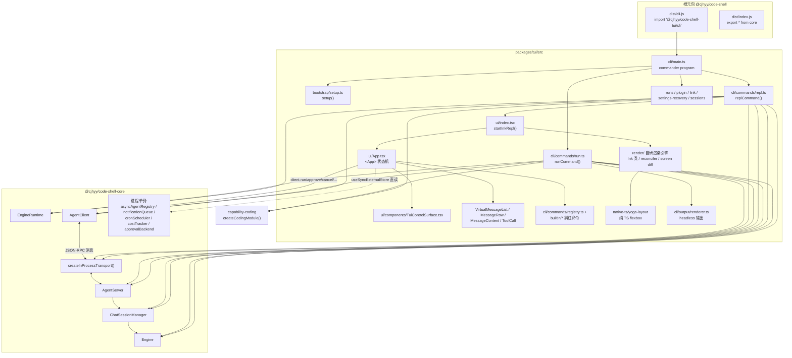
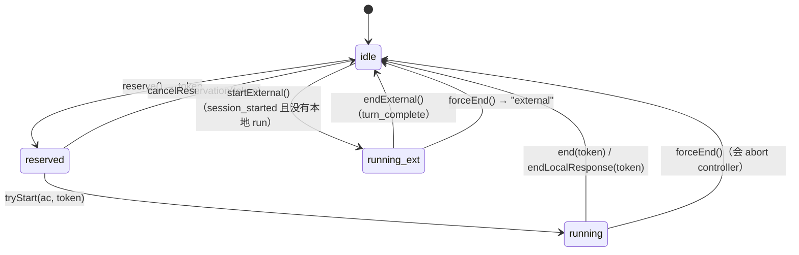
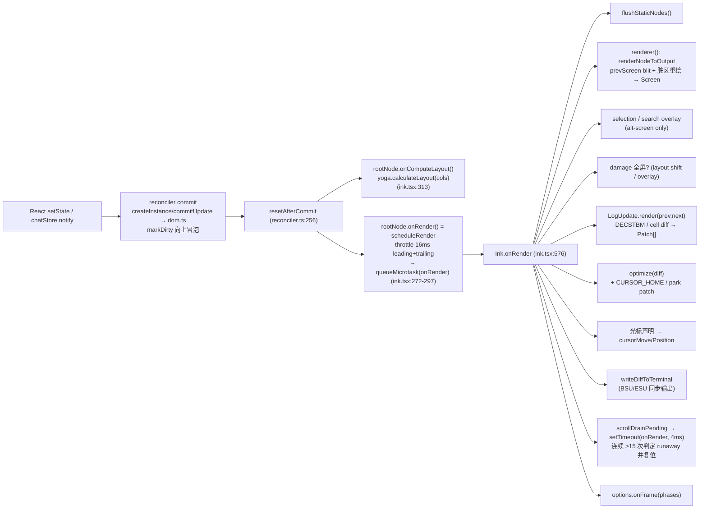

# 07 · TUI 包（`@cjhyy/code-shell-tui`）与 `code-shell` 元包：函数层级架构

> 基线：`main` @ `df2ca0bda`（2026-10-19），版本 0.9.45。下文的 `file:line` 都对应这个提交，路径默认相对 `packages/tui/src/`（另有说明的除外）。
> 规模：非测试 TS/TSX 共 43,210 行，其中 `render/` 20,906、`ui/` 12,778、`cli/` 6,412、`native-ts/` 2,712、`utils/` 183、`voice/` 119、`bootstrap/` 100；测试文件 43 个，3,730 行。
> 旧文档 `docs/archive/architecture-2026-07/09-tui.md` 的结构仍然可以参考，但里面的行号已经整体偏移，而且还写着已经不存在的 `arena` 子命令（见 §6.9）。本文的结论都对着源码核对过。

---

## 1. 定位与依赖

### 1.1 一句话定位

TUI 是 **CodeShell 的终端宿主（product composition root）**。它在**同一个进程里**拼出完整的协议栈：`Engine` → `EngineRuntime` → `ChatSessionManager` → `AgentServer` ⇄ 进程内 transport ⇄ `AgentClient`。UI 层（Ink 风格的 React 树）**只拿到 `AgentClient`**，所有引擎交互都经过协议调用 `run / approve / cancel / configure / query / goal*`。渲染不依赖 npm 上的 `ink`，用的是包内自维护的渲染引擎 `src/render/`，再加上一份纯 TS 实现的 Yoga 移植 `src/native-ts/yoga-layout/`。



### 1.2 `packages/tui/package.json`

| 字段               | 值                                                                                                                                                                                                                                                                                                                                      | 说明                                                                                                             |
| ------------------ | --------------------------------------------------------------------------------------------------------------------------------------------------------------------------------------------------------------------------------------------------------------------------------------------------------------------------------------- | ---------------------------------------------------------------------------------------------------------------- |
| `exports["."]`     | `dist/index.js`                                                                                                                                                                                                                                                                                                                         | `src/index.ts:9` 只做了一件事：`export { VERSION } from "@cjhyy/code-shell-core"`。UI 组件**不经过包入口导出**。 |
| `exports["./cli"]` | `dist/cli/main.js`                                                                                                                                                                                                                                                                                                                      | 元包的 shim 就 import 这里。                                                                                     |
| `bin.code-shell`   | `./dist/cli/main.js`                                                                                                                                                                                                                                                                                                                    | TUI 自己也声明了同名 bin（见 §6.10）。                                                                           |
| `scripts.build`    | `clean && tsc -p && copy-assets init/templates`                                                                                                                                                                                                                                                                                         | `/init` 用的 `.md` 模板要拷到 dist。                                                                             |
| 运行时依赖         | `@cjhyy/code-shell-core`、`@cjhyy/code-shell-capability-coding`、`@cjhyy/code-shell-server`，外加 `react@19.2.6`、`react-reconciler@0.33.0`、`commander`、`chalk`、`marked`+`marked-terminal`、`cli-highlight`、`wrap-ansi`、`strip-ansi`、`get-east-asian-width`、`emoji-regex`、`bidi-js`、`signal-exit`、`usehooks-ts`、`lodash-es`… | **没有 `ink`**，依赖里的 `auto-bind`/`signal-exit` 等是自研 `render/` 在用。                                     |

`tsconfig.json` 有两个要点：

- `paths: { "react/compiler-runtime": ["./src/react-compiler-runtime-shim.js"] }`：`render/` 下有些组件是 React Compiler 的产物（`Box.tsx`、`Text.tsx`、`AlternateScreen.tsx`、`ClockContext.tsx` 等都 `import { c } from "react/compiler-runtime"`），这些 import 统一映射到 `react-compiler-runtime-shim.ts:9` 里的 `c(size)`。
- `exclude` 里加了 `src/cli/commands/arena.ts`：Arena CLI 的源码还留着，但不参与编译，也不发布。

`bunfig.toml` 里设置了 `preload = ["../core/test-setup.ts"]`，把测试的 `.code-shell` home 重定向到临时目录。

### 1.3 根元包 `@cjhyy/code-shell`

- 根 `package.json` 声明 `"bin": { "code-shell": "./dist/cli.js" }`、`main/types: dist/index.*`，依赖只有 core 和 tui（`workspace:*`）。
- `scripts/build-meta.ts` 在 `bun run build` 的最后一步执行（排在 tui、chat 之后），做四件事：
  1. `rm -rf dist`。清掉历史遗留的 tsup chunk，避免把它们 publish 出去。
  2. 写 `dist/index.js` 和 `dist/index.d.ts`，内容都是 `export * from "@cjhyy/code-shell-core";`，给旧 SDK 用户保留 `import { Engine } from "@cjhyy/code-shell"` 的写法。
  3. 写 `dist/cli.js`（`#!/usr/bin/env node` + `import "@cjhyy/code-shell-tui/cli";`），然后 `chmod 755`。
  4. 写 `dist/cli/main.js`（`import "../cli.js"`）：旧的全局 link 还指向 `dist/cli/main.js`，靠它继续可用。
- 开发时不经过元包：`bun run dev:tui` 等价于 `CODE_SHELL_DEV=1 CODESHELL_UI_PERF=1 bun run packages/tui/src/cli/main.ts`。

### 1.4 从 core 引入了什么（`.` 与 `/internal`）

**`@cjhyy/code-shell-core`（`.`，公开 SDK）**，共 91 处 import，主要有：
`Engine`、`EngineRuntime`、`ChatSessionManager`、`SessionManager`、`AgentServer`、`AgentClient`、`createInProcessTransport`、`SettingsManager`、`MCPManager`、`compileComposition`、`resolveLLMConfigForTag`、`personalizationFrom`、`mergePluginMcpServers`、`costTracker`、`installCostTracking`、`formatUsageCost`、`sessionsRoot`、`userHome`、`writeSettingsSchemaFile`、`logger`、`getOpenRouterSnapshot`、`syncOpenRouterCatalog`、`FileRunStore`、`RunManager`、`MemoryManager`、`FileHistory`、`earliestSnapshotsPerFile`、`renderDiffPreview`、`scanSkills`、`scanPluginCommands`、`expandPluginCommandBody`、`invalidateSkillCache`、`PluginInstallError`、`getLinkStatus`、`localCredentialAccess`、`ModelPool`，以及类型（`StreamEvent`、`SessionStatus`、`LLMConfig`、`ClientDefaults`、`PermissionMode`、`AgentPresetName`、`UsageSummary`、`LinkStatusResult` 等）。

**`@cjhyy/code-shell-core/internal`（仓内宿主面）**，共 66 处 import，按用途分组：

- 引擎与宿主装配：`getInteractiveApprovalBackend`、`defaultSandboxConfig`、`configureModelTracing`、`cronScheduler`、`CronStore`、`bindCronToEngine`、`rotateLogs`、`getCurrentVersion`。
- 后台工作单例：`asyncAgentRegistry`、`backgroundJobRegistry`、`notificationQueue`、`buildNotificationMessage`、`buildNotificationSummary`。
- UI 辅助：`recordUIEvent`、`formatDuration`、`formatTokens`、`TOOL_DOT_COLORS`、`formatToolArgs`、`singleLine`、`formatBytes`、`classifyBashLines`、`getTheme`、`resolveThemeSetting`、`sliceAnsi`、`getGraphemeSegmenter`、`logForDebugging`、`isEnvTruthy`、`stopCapturingEarlyInput`。
- Onboarding 与模型目录：`detectEnvKeys`、`appendOnboardingResult`、`PROVIDER_KINDS`、`fetchModelList`、`defaultCacheDir`、`getMergedCatalog`、`resolveApiKey`。
- 更新：`checkForUpdate`、`getUpdateAvailable`、`scheduleAutoInstallOnExit`、`getAutoUpdateDisabledReason`。
- 插件与市场：`installPluginFrom{Path,Npm,Source}`、`parseSource`、`listInstalledPlugins`、`updatePluginByName`、`uninstallPluginByName`、`addMarketplace`、`listMarketplaces`、`removeMarketplace`、`installPlugin`、`uninstallPlugin`、`listInstalled`、`computeEffectiveDisabledLists`。
- 类型：`TaskInfo`、`ApprovalResult`、`ApprovalScope`、`OnboardingResult`、`ProviderConfig`、`SandboxConfig` 等。

**其他包**：

- `@cjhyy/code-shell-capability-coding/capability` 的 `createCodingModule()`，`repl.ts:38`、`run.ts:25` 用。
- `@cjhyy/code-shell-capability-coding/git` 的 git 辅助函数，`builtin/git-commands.ts:6` 用。
- `@cjhyy/code-shell-server/links` 的 `installDefaultLinkProviders()`，`cli/main.ts:255` 动态 import。
- `@cjhyy/code-shell-arena/runtime`：只有被排除编译的 `arena.ts` 用到。

---

## 2. 文件清单（按目录，不含测试）

### 2.1 根与 `bootstrap/`

| 文件                             | 职责                                                                                                             |
| -------------------------------- | ---------------------------------------------------------------------------------------------------------------- |
| `index.ts` / `index.d.ts`        | 包入口，只 re-export `VERSION`。                                                                                 |
| `react-compiler-runtime-shim.ts` | 实现 `react/compiler-runtime` 的 `c(size)` memo 槽，供编译过的 render 组件使用。                                 |
| `bootstrap/setup.ts`             | `setup()`：轮转日志，写 settings schema，检查 Node≥20.10，校验 cwd，拒绝以 root 身份跑 bypass，chdir，探测 git。 |

### 2.2 `cli/`

| 文件                                                   | 职责                                                                                                                                                   |
| ------------------------------------------------------ | ------------------------------------------------------------------------------------------------------------------------------------------------------ |
| `cli/main.ts`                                          | commander 根程序：定义共享选项、全部子命令、preAction→`setup()`、exit 时打印成本汇总、`unhandledRejection` 兜底、`installCostTracking`、`parseAsync`。 |
| `cli/parse-int-option.ts`                              | `parsePositiveInt` / `positiveIntOption`：正整数参数解析，非法时抛 commander 的 `InvalidArgumentError`。                                               |
| `cli/input/read-stdin.ts`                              | `readAllStdin`、`resolveTaskFromArgOrStdin`：没有位置参数且 stdin 是管道时，从 stdin 读 task。                                                         |
| `cli/input/ndjson-reader.ts`                           | `NdjsonReader`：SDK 模式的 NDJSON 输入解析。**生产代码没有引用，只有测试用。**                                                                         |
| `cli/input-compiler.ts`                                | `compileInput()`：早期的输入编译器。**未被引用（死代码）。**                                                                                           |
| `cli/exit.ts`                                          | `cliError` / `cliOk`：返回类型为 `never` 的退出辅助函数。**未被引用。**                                                                                |
| `cli/output/renderer.ts`                               | headless 输出：`TextRenderer`、`JsonRenderer`、`JsonlRenderer`、`StreamJsonRenderer`、`createRenderer(format)`。                                       |
| `cli/output/terminal-ui.ts`                            | marked 终端渲染、spinner、banner、任务列表格式化等老工具。**未被引用。**                                                                               |
| `cli/commands/repl.ts`                                 | `replCommand()`：交互模式的组合根（详见 §3.3）。                                                                                                       |
| `cli/commands/run.ts`                                  | `runCommand()`、`createRunComposition()`、`writeLastMessage()`、`mergeSandboxConfig()`：headless 单次执行。                                            |
| `cli/commands/drain-notifications.ts`                  | `hasRunningBackgroundWork()`（递归查子会话）、`drainBackgroundNotifications()`（轮询等后台工作结束后 drain 通知队列）。                                |
| `cli/commands/max-context-tokens.ts`                   | `resolveMaxContextTokens(llmConfig, settingsMax)`。                                                                                                    |
| `cli/commands/runs.ts`                                 | `createRunsCommand()`：`runs list/get/submit/resume/cancel/events/recover`，底层是 `FileRunStore` + `RunManager`。                                     |
| `cli/commands/plugin.ts`                               | `createPluginCommand()`：`plugin install/list/update/uninstall`，带 `runGuarded` 错误包装。                                                            |
| `cli/commands/link.ts`                                 | `createLinkCommand()`：`link status`（`getLinkStatus` + `localCredentialAccess`）；`isLinkStatusCommand()` 用来跳过 setup。                            |
| `cli/commands/settings-recovery.ts`                    | `createSettingsRecoveryCommand()`：`inspect/repair/restore` 三个子命令；`isSettingsRecoveryCommand()` 用来跳过 setup。                                 |
| `cli/commands/registry.ts`                             | 斜杠命令注册表 `CommandRegistry`，以及 `CommandContext`、`SlashCommand`、`RestoredChatEntry` 类型。                                                    |
| `cli/commands/arena.ts`                                | Arena CLI（tsconfig 排除，**不编译、不挂载**）。                                                                                                       |
| `cli/commands/builtin/core-commands.ts`                | `/exit /clear /cost /effort /tasks /model /sid /session /tools /memory /compact /resume /diff /status /version /export /config`，并导出 `/init`。      |
| `cli/commands/builtin/git-commands.ts`                 | `/commit /branch /review /pr-comments /autofix-pr`。                                                                                                   |
| `cli/commands/builtin/git-diff.ts`                     | `gitDiff`、`gitDiffStat`（`execFileSync git`）。                                                                                                       |
| `cli/commands/builtin/list-files.ts`                   | `listFiles(pattern)`（`execFileSync`）。                                                                                                               |
| `cli/commands/builtin/export-md.ts`                    | 把会话 transcript 导出成 Markdown。                                                                                                                    |
| `cli/commands/builtin/extra-commands.ts`               | `/login /logout /mcp /models /skills /plugin /log`。                                                                                                   |
| `cli/commands/builtin/more-commands.ts`                | `/files /release-notes /security-review /feedback`。                                                                                                   |
| `cli/commands/builtin/utility-commands.ts`             | `/copy /undo /hooks /fullscreen /update`。                                                                                                             |
| `cli/commands/builtin/advanced-commands.ts`            | `/voice`（占位）。                                                                                                                                     |
| `cli/commands/builtin/features-command.ts`             | `/features`。                                                                                                                                          |
| `cli/commands/builtin/permissions-command.ts`          | `/permissions`。                                                                                                                                       |
| `cli/commands/builtin/goal-command.ts`                 | `/goal`，以及 `canExecuteGoalCommandWhileRunning()`。                                                                                                  |
| `cli/commands/builtin/loop-command.ts`                 | `/loop`，以及 `buildLoopCommandPrompt()`。                                                                                                             |
| `cli/commands/builtin/image-command.ts`                | `/image`：读本地图片并编码成 `<codeshell-image>` 块，挂到 `pendingImages`。                                                                            |
| `cli/commands/builtin/plugin-handler.ts`               | `runPluginCommand()`：`/plugin` 子命令分发（marketplace、hooks/MCP trust、自动化模板等）。                                                             |
| `cli/commands/builtin/plugin-commands-registration.ts` | `buildPluginSlashCommands()`：把已安装插件的 command 转成 `SlashCommand`。                                                                             |
| `cli/commands/builtin/init/index.ts`                   | `initCommand`（`/init`）：探测仓库后让模型生成或改进 `CODESHELL.md`，再 `client.inject` 注入上下文。                                                   |
| `cli/commands/builtin/init/detect.ts`                  | `detect()`、`pickIntent()`、`summarize()`：仓库特征探测。                                                                                              |
| `cli/commands/builtin/init/templates/*.md`             | `create/empty/improve/migrate/rules-scaffold-suffix` 五个 prompt 模板。                                                                                |

### 2.3 `ui/`

| 文件                                                                                                                                                                    | 职责                                                                                                                                                                                                                                                    |
| ----------------------------------------------------------------------------------------------------------------------------------------------------------------------- | ------------------------------------------------------------------------------------------------------------------------------------------------------------------------------------------------------------------------------------------------------- |
| `ui/index.tsx`                                                                                                                                                          | `startInkRepl()`：初始化历史，渲染 `<ThemeProvider><App/>`，`waitUntilExit`，收尾后 `process.exit(0)`。                                                                                                                                                 |
| `ui/App.tsx`                                                                                                                                                            | 根组件 `App`：会话、流、审批、输入、命令、goal 镜像的状态机（2,318 行）。模块顶层构建 `commandRegistry`。                                                                                                                                               |
| `ui/app-helpers.tsx`                                                                                                                                                    | 纯函数与小组件：`renderEntry`、`dispatchSlashCommandSafely`、`canExecuteCommandWhileRunning`、`shouldDrainBackgroundNotifications`、`shouldSuppressCancelledMainStreamEvent`、goal 版本判断、`friendlyError/Reason`、`classifyError`、`ModeIndicator`。 |
| `ui/store.ts`                                                                                                                                                           | `ChatStore` 外部存储（单例 `chatStore`）、`ChatEntry` 联合类型、`createEntry`、`isEntryFinalized`。                                                                                                                                                     |
| `ui/query-guard.ts`                                                                                                                                                     | `QueryGuard`：同步的 idle/reserved/running 状态机，带 token 和 external owner。                                                                                                                                                                         |
| `ui/stream-attempt.ts`                                                                                                                                                  | `StreamAttempt`：记录某次 model 请求开始前已有的 entry id，收到 `tombstone` 时回滚。                                                                                                                                                                    |
| `ui/pending-questions.ts`                                                                                                                                               | AskUser 问题队列 reducer 与 `answerPendingQuestion()`。                                                                                                                                                                                                 |
| `ui/permission-mode.ts`                                                                                                                                                 | `TuiPermissionMode`（plan/normal/bypass）、`nextPermissionMode`、`permissionConfigurePayload`。                                                                                                                                                         |
| `ui/fullscreen-mode.ts`                                                                                                                                                 | `FullscreenModeContext`、`INITIAL_FULLSCREEN_MODE`（读环境变量 `CODESHELL_FULLSCREEN`）、`TAIL_ENTRY_LIMIT`。                                                                                                                                           |
| `ui/slice-anchor.ts`                                                                                                                                                    | `computeSliceStart()`：flow 模式下按 UUID 锚定的列表切片，CAP=200，STEP=50。                                                                                                                                                                            |
| `ui/input-history.ts`                                                                                                                                                   | JSONL 历史（`~/.code-shell/history.jsonl`）：`initHistory`、`addToHistory`、`removeLastFromHistory`、`flushHistorySync`、`searchHistory`、`createHistoryNavigator`。                                                                                    |
| `ui/onboarding-runner.tsx`                                                                                                                                              | `runInkOnboarding()`：单独挂载一个只含 `OnboardingPrompt` 的 Ink 根。                                                                                                                                                                                   |
| `ui/perf-probes.ts`                                                                                                                                                     | 环境变量 `CODESHELL_UI_PERF=1` 才开启的探针：事件循环延迟、stream 速率、App 渲染计数、Ink 帧耗时。                                                                                                                                                      |
| `ui/theme.ts`                                                                                                                                                           | `ThemeProvider`、`useTheme`、`useThemeSetting`、`resolveColor`。                                                                                                                                                                                        |
| `ui/truncate.ts`                                                                                                                                                        | 按显示宽度截断或换行：`truncatePathMiddle`、`truncateToWidth`、`wrapText` 等。                                                                                                                                                                          |
| `ui/dev-seed.ts`                                                                                                                                                        | `applyDevSeed()`：开发种子数据。                                                                                                                                                                                                                        |
| `ui/terminal-renderer.ts`                                                                                                                                               | `TerminalRenderer` 类。**未被引用。**                                                                                                                                                                                                                   |
| `ui/vim-mode.ts`                                                                                                                                                        | vim 键位状态机。**只有测试引用，生产代码没挂。**                                                                                                                                                                                                        |
| `ui/hooks/useVirtualScroll.ts`                                                                                                                                          | 视口窗口化：算 range、spacer 高度、测量高度缓存。                                                                                                                                                                                                       |
| `ui/hooks/useSessionUsage.ts`                                                                                                                                           | `client.query("usage")` 拉会话用量，用 generation 加 sid 双重围栏。                                                                                                                                                                                     |
| `ui/hooks/useCostSummary.ts`                                                                                                                                            | 旧的成本 hook。**未被引用。**                                                                                                                                                                                                                           |
| `ui/components/TuiControlSurface.tsx`                                                                                                                                   | 底部模态和输入的路由器（transcript / onboarding / 模型选择 / 会话选择 / provider 向导 / 模型管理 / AskUser / 输入框）。                                                                                                                                 |
| `ui/components/CommandInput.tsx`                                                                                                                                        | 输入框：斜杠补全、历史导航、`onArrowOut` 把焦点交给 Dock。                                                                                                                                                                                              |
| `ui/components/TextInput.tsx`                                                                                                                                           | 底层编辑器：多行、Emacs 键位、按词跳转、粘贴清洗、反色光标。                                                                                                                                                                                            |
| `ui/components/PermissionPrompt.tsx`                                                                                                                                    | 工具审批对话框（Write/Edit 带 diff 预览，四个选项）。                                                                                                                                                                                                   |
| `ui/components/AskUserPrompt.tsx`                                                                                                                                       | `__ask_user__` 问题 UI（pick/review 两个阶段，支持多选和 Other）。                                                                                                                                                                                      |
| `ui/components/FullscreenLayout.tsx`                                                                                                                                    | 布局骨架：scrollable / overlay / bottom / 新消息 pill；`useUnseenDivider()`。                                                                                                                                                                           |
| `ui/components/VirtualMessageList.tsx`                                                                                                                                  | 消息列表：fullscreen 下是 `ScrollBox` + 虚拟滚动，flow 下是锚定切片。                                                                                                                                                                                   |
| `ui/components/MessageRow.tsx`                                                                                                                                          | `React.memo` 边界加 `areMessageRowPropsEqual`。                                                                                                                                                                                                         |
| `ui/components/MessageContent.tsx`                                                                                                                                      | assistant markdown 渲染（流式稳定前缀、LRU 缓存、表格）、`UserMessage`、`ErrorMessage`、`RateLimitMessage`、`ContextLimitMessage`、`ThinkingMessage`。                                                                                                  |
| `ui/components/ToolCall.tsx`                                                                                                                                            | `ToolCallStart`、`ToolCallRunning`、`ToolCallResult`（默认折叠 3 行，按工具类型渲染输出和 diff）。                                                                                                                                                      |
| `ui/components/DiffLine.tsx`                                                                                                                                            | 单行 diff 着色，`classifyDiffLine()`。                                                                                                                                                                                                                  |
| `ui/components/AgentBlock.tsx`                                                                                                                                          | 子 agent 的开始和结束标记块。                                                                                                                                                                                                                           |
| `ui/components/AgentDock.tsx`                                                                                                                                           | 底部 Dock：最多显示 5 个后台或子 agent，可以切换视图；`getVisibleAgents()`。                                                                                                                                                                            |
| `ui/components/SpinnerWithVerb.tsx`                                                                                                                                     | 带动词和 thinking 摘要的 spinner，自定义 memo 比较器，宽度固定。                                                                                                                                                                                        |
| `ui/components/Spinner.tsx`                                                                                                                                             | 小 spinner，TaskList 和 AgentBlock 用。                                                                                                                                                                                                                 |
| `ui/components/StatusLine.tsx`                                                                                                                                          | 状态栏：模型、effort、token、成本、ctx%、耗时；运行时每秒 tick 一次。                                                                                                                                                                                   |
| `ui/components/TaskList.tsx`                                                                                                                                            | TodoWrite 任务列表。                                                                                                                                                                                                                                    |
| `ui/components/Banner.tsx` 及 `DogLogo` / `KunHead` / `KunLogo` / `BabyHand`                                                                                            | 启动 banner 和随机 logo。                                                                                                                                                                                                                               |
| `ui/components/UpdateBanner.tsx`                                                                                                                                        | 检查更新并提示。                                                                                                                                                                                                                                        |
| `ui/components/WelcomeTips.tsx`                                                                                                                                         | 首次进入（非 resume）时的提示，会探测 `CODESHELL.md` 是否存在。                                                                                                                                                                                         |
| `ui/components/ModelSelector.tsx`                                                                                                                                       | 模型选择列表（Alt+M 或不带参数的 `/model`）。                                                                                                                                                                                                           |
| `ui/components/ModelManager.tsx`                                                                                                                                        | 模型和 provider 管理面板（`/models`）。                                                                                                                                                                                                                 |
| `ui/components/ProviderModelFlow.tsx`                                                                                                                                   | 新增 provider 或模型的向导：`deriveModelAlias`、`deriveProviderKey`、`validateAlias`。                                                                                                                                                                  |
| `ui/components/OnboardingPrompt.tsx`                                                                                                                                    | 首次配置向导（也用于 `/login`）。                                                                                                                                                                                                                       |
| `ui/components/SessionPicker.tsx`                                                                                                                                       | `/resume` 的会话选择器。                                                                                                                                                                                                                                |
| `ui/components/model-display.ts`                                                                                                                                        | `fmtTokens`、`modelTags`。                                                                                                                                                                                                                              |
| `ui/components/PermissionDialog.tsx`、`ScrollView.tsx`、`CodeBlock.tsx`、`ContextUsageBar.tsx`、`DiffView.tsx`、`StructuredDiff.tsx`、`ThemedBox.tsx`、`ThemedText.tsx` | **当前都没有被生产代码引用**（遗留或备用）。                                                                                                                                                                                                            |

### 2.4 `render/`（自研终端渲染引擎，20.9k 行）

README 定义的**公开 API** 只有 `render/index.ts` 导出的那些：`Box`、`Text`、`Spacer`、`Newline`、`ScrollBox`、`AlternateScreen`、`Ansi`、`NoSelect`、`Button`、`Link`、`RawAnsi`、`Static`、`useApp`、`useInput`、`useStdin`、`useStdout`（shim）、`forceRedraw`、`render`、`renderSync`、`createRoot`。其余文件都算内部实现。

| 分组       | 文件                                                                                                                                                                                                     | 职责                                                                                                                                                                              |
| ---------- | -------------------------------------------------------------------------------------------------------------------------------------------------------------------------------------------------------- | --------------------------------------------------------------------------------------------------------------------------------------------------------------------------------- |
| 入口       | `index.ts`                                                                                                                                                                                               | 公开 API 的 re-export；`forceRedraw()` 调 `instances.get(stdout).forceRedraw()`。                                                                                                 |
|            | `root.ts`                                                                                                                                                                                                | `renderSync`、`render`（`wrappedRender`，先 `await Promise.resolve()` 再同步渲染）、`createRoot`、`getInstance`（按 stdout 复用实例）。                                           |
|            | `instances.ts`                                                                                                                                                                                           | `WeakMap<stdout, Ink>`。                                                                                                                                                          |
| 核心       | `ink.tsx`                                                                                                                                                                                                | `Ink` 类：帧循环 `onRender`、alt-screen、resize/SIGCONT、selection、search、光标停放、console/stderr 拦截、`unmount` 恢复终端。                                                   |
|            | `reconciler.ts`                                                                                                                                                                                          | `react-reconciler` host config：`createInstance`、`commitUpdate`，在 `resetAfterCommit` 里依次触发 `onComputeLayout` 和 `onRender`；`dispatcher`；commit/yoga 计时。              |
|            | `renderer.ts`                                                                                                                                                                                            | `createRenderer(root, stylePool)`：校验 yoga 尺寸，复用 `Output`，调 `renderNodeToOutput`，产出 `Frame`。                                                                         |
|            | `render-node-to-output.ts`                                                                                                                                                                               | DOM 绘制到 `Output`：文本换行和样式、OSC8、边框、裁剪、ScrollBox 视口裁剪和 sticky、blit 复用、layout shift 检测、scroll drain。                                                  |
|            | `output.ts`                                                                                                                                                                                              | `Output`：cell 缓冲操作（write/clip/blit/clear），带字形簇缓存。                                                                                                                  |
|            | `screen.ts`                                                                                                                                                                                              | `Screen` 紧凑 cell 缓冲；`CharPool`、`StylePool`、`HyperlinkPool` 驻留池；`blitRegion`、`clearRegion`、`shiftRows`、`diff`、`diffEach`。                                          |
|            | `frame.ts`                                                                                                                                                                                               | `Frame`、`FrameEvent`、`Patch`、`Diff` 类型，`emptyFrame`、`shouldClearScreen`。                                                                                                  |
|            | `log-update.ts`                                                                                                                                                                                          | `LogUpdate.render(prev, next, altScreen, decstbmSafe)`：帧间 diff 转成 patch（DECSTBM 硬件滚动、全量 reset、逐 cell 写入）；`screenToAnsi`。                                      |
|            | `optimizer.ts`                                                                                                                                                                                           | `optimize(diff)`：合并和去冗余 patch。                                                                                                                                            |
|            | `terminal.ts`                                                                                                                                                                                            | 终端能力探测（同步输出 DEC 2026、xterm.js、扩展键位、进度）、`writeDiffToTerminal()`（BSU/ESU 包裹）。                                                                            |
|            | `render-to-screen.ts`                                                                                                                                                                                    | 离屏渲染加搜索定位：`renderToScreen`、`scanPositions`、`applyPositionedHighlight`。                                                                                               |
|            | `dom.ts`                                                                                                                                                                                                 | 内部 DOM 节点：`createNode`、`appendChildNode`、`insertBeforeNode`、`removeChildNode`、`setAttribute`、`setStyle`、`markDirty`（向上冒泡）、文本测量函数、`findOwnerChainAtRow`。 |
|            | `node-cache.ts`                                                                                                                                                                                          | 每节点的布局缓存 `nodeCache`、`pendingClears`（blit 和清除用）。                                                                                                                  |
|            | `focus.ts`                                                                                                                                                                                               | `FocusManager`：Tab 焦点链。                                                                                                                                                      |
|            | `hit-test.ts`                                                                                                                                                                                            | `hitTest`、`dispatchClick`、`dispatchHover`。                                                                                                                                     |
|            | `selection.ts`                                                                                                                                                                                           | 全屏文本选区：start/update/finish、选词选行、URL 识别、随滚动平移、`getSelectedText`、`applySelectionOverlay`。                                                                   |
|            | `searchHighlight.ts` / `searchMatches.ts`                                                                                                                                                                | 搜索高亮叠加、匹配位置计算。                                                                                                                                                      |
|            | `devtools.ts` / `dirty-diag.ts`                                                                                                                                                                          | 可选开启的帧和 blit 计数器（环境变量 `CODESHELL_RENDER_DEBUG`）、"为什么脏了"的诊断。                                                                                             |
| 布局       | `layout/node.ts`、`layout/geometry.ts`、`layout/engine.ts`、`layout/yoga.ts`                                                                                                                             | 布局适配接口；`YogaLayoutNode` 包装 `native-ts/yoga-layout`。                                                                                                                     |
|            | `get-max-width.ts`、`measure-element.ts`、`measure-text.ts`、`line-width-cache.ts`、`widest-line.ts`                                                                                                     | 尺寸测量和行宽缓存（流式时已完成的行不变，可以缓存）。                                                                                                                            |
| 文本与样式 | `styles.ts`                                                                                                                                                                                              | Box/Text 样式到 yoga 属性的映射。                                                                                                                                                 |
|            | `colorize.ts`                                                                                                                                                                                            | 颜色解析（truecolor/256/ansi，以及 xterm.js 特判）。                                                                                                                              |
|            | `squash-text-nodes.ts`                                                                                                                                                                                   | 把嵌套 Text 压平成带样式的段。                                                                                                                                                    |
|            | `wrap-text.ts`、`wrapAnsi.ts`                                                                                                                                                                            | ANSI 感知的换行和截断（CJK 宽字符边界）。                                                                                                                                         |
|            | `stringWidth.ts`                                                                                                                                                                                         | 显示宽度（优先 `Bun.stringWidth`，没有就走 JS 回退）。                                                                                                                            |
|            | `bidi.ts`                                                                                                                                                                                                | 双向文本重排。                                                                                                                                                                    |
|            | `tabstops.ts`                                                                                                                                                                                            | Tab 展开。                                                                                                                                                                        |
|            | `render-border.ts`                                                                                                                                                                                       | 边框绘制。                                                                                                                                                                        |
|            | `osc8-url.ts`、`supports-hyperlinks.ts`                                                                                                                                                                  | OSC 8 超链接。                                                                                                                                                                    |
|            | `Ansi.tsx`                                                                                                                                                                                               | `<Ansi>`：把 ANSI 字符串解析成 Text 树。                                                                                                                                          |
| 输入       | `parse-keypress.ts`                                                                                                                                                                                      | `parseMultipleKeypresses(state, input)`：键盘、鼠标（SGR）、粘贴、终端响应（DECRPM/DA/OSC）的状态机解析。                                                                         |
|            | `terminal-querier.ts`                                                                                                                                                                                    | `TerminalQuerier`：发查询序列、等响应（`da1`、`decrqm`、`xtversion`、`kittyKeyboard` 等）。                                                                                       |
|            | `terminal-focus-state.ts`                                                                                                                                                                                | DECSET 1004 焦点信号。                                                                                                                                                            |
|            | `events/*`（`dispatcher`、`emitter`、`event`、`terminal-event`、`input-event`、`keyboard-event`、`click-event`、`focus-event`、`paste-event`、`resize-event`、`terminal-focus-event`、`event-handlers`） | DOM 风格的捕获和冒泡事件系统。`InputEvent` 把 ParsedKey 转成 `{input, key}`。                                                                                                     |
| termio     | `termio.ts`、`termio/{ansi,csi,dec,esc,osc,sgr,parser,tokenize,types}.ts`                                                                                                                                | ANSI/CSI/DEC/OSC/SGR 常量和解析器（例如 `ENTER_ALT_SCREEN`、`ENABLE_MOUSE_TRACKING`、`BSU/ESU`）。                                                                                |
| 组件       | `components/App.tsx`                                                                                                                                                                                     | 渲染层根组件（不是 `ui/App.tsx`）：stdin 原始模式引用计数、`handleReadable`、按键批处理、鼠标和选区、Ctrl+Z 挂起、提供各种 Context。                                              |
|            | `components/{Box,Text,Spacer,Newline,ScrollBox,AlternateScreen,Static,RawAnsi,NoSelect,Button,Link,ErrorOverview}.tsx`                                                                                   | 基础组件。`ScrollBox` 提供命令式滚动句柄。`AlternateScreen` 负责 DEC 1049 和鼠标跟踪。                                                                                            |
|            | `components/{AppContext,StdinContext,CursorDeclarationContext,TerminalSizeContext,TerminalFocusContext,ClockContext}.ts(x)`                                                                              | Context。                                                                                                                                                                         |
| hooks      | `hooks/use-{app,input,stdin,declared-cursor,animation-frame,interval,selection,search-highlight,tab-status,terminal-focus,terminal-title,terminal-viewport}.ts`                                          | `useInput` 在 layout effect 里开启 raw mode，并把监听挂到 `internal_eventEmitter('input')` 上。                                                                                   |
| 其他       | `clearTerminal.ts`、`cursor.ts`、`constants.ts`（`FRAME_INTERVAL_MS=16`）、`useTerminalNotification.ts`（OSC 9;4 进度）、`warn.ts`、`global.d.ts`、`types.d.ts`、`README.md`                             | —                                                                                                                                                                                 |

### 2.5 `native-ts/`、`voice/`、`utils/`

| 文件                             | 职责                                                                                                                                                               |
| -------------------------------- | ------------------------------------------------------------------------------------------------------------------------------------------------------------------ |
| `native-ts/yoga-layout/index.ts` | 纯 TS 版的 Yoga flexbox 子集（row/column、grow/shrink/basis、align/justify、margin/padding/border/gap、min/max、absolute、display none、measure 函数），带计数器。 |
| `native-ts/yoga-layout/enums.ts` | Yoga 枚举。                                                                                                                                                        |
| `voice/index.ts`                 | `enableVoice`、`speak`（macOS `say` / Linux `espeak`）、`isRecordingAvailable`、`recordAndTranscribe`（**stub**）。**未被任何生产代码 import。**                   |
| `utils/colorizer.ts`             | `CHALK_COLORIZER`：core `Colorizer` 接口的 chalk 实现，`costTracker.formatSummary` 用。                                                                            |
| `utils/fullscreen.ts`            | tmux control mode、鼠标跟踪和点击开关等环境判断（`isMouseClicksDisabled` 由 `render/components/App.tsx` 使用）。                                                   |

---

## 3. 关键函数与组件

### 3.1 CLI 解析与子命令（`cli/main.ts`）

**模块顶层的执行顺序**：

1. `new Command()`，设置 `.name("code-shell").version(getCurrentVersion())`（`main.ts:43-50`）。
2. `addCommonOptions(cmd)`（`:54`）定义这些选项：`-m/--model`、`-p/--provider`（**故意不给默认值**，否则会遮住 settings 里的 provider）、`--preset`、`--base-url`、`--api-key`、`--permission-mode`、`-o/--output`（默认 `"text"`）、`--max-turns`（`positiveIntOption`，默认 100）、`--effort`（默认 `"high"`）。
3. `addInteractiveOptions(cmd)`（`:79`）：`--resume <sessionId>`、`--prefill <text>`。
4. 注册子命令：

| 子命令                                              | 定义位置                      | 动作                                                                                                                                                                                                                                                        |
| --------------------------------------------------- | ----------------------------- | ----------------------------------------------------------------------------------------------------------------------------------------------------------------------------------------------------------------------------------------------------------- |
| `run [task]`                                        | `main.ts:87-116`              | `resolveTaskFromArgOrStdin(task)`，没有 task 就 `exit(2)`，否则 `runCommand({task, ...resolveOpts, waitBackgroundAgents, backgroundWaitMs})`。额外选项：`--resume`、`--output-last-message <file>`、`--no-wait-background-agents`、`--background-wait-ms`。 |
| `repl`                                              | `main.ts:120-124`             | `replCommand({...resolveOpts(opts), prefill})`。                                                                                                                                                                                                            |
| `sessions [-n]`                                     | `main.ts:128-147`             | 动态 import `SessionManager`，`sm.list(limit)`，每行打印 `formatSessionStatus(s.status)`（`:19`）。                                                                                                                                                         |
| `runs list/get/submit/resume/cancel/events/recover` | `runs.ts:93-305`              | `openRunStore()` 返回 `FileRunStore`，`createRunManager()` 返回 `RunManager`。                                                                                                                                                                              |
| `plugin install/list/update/uninstall`              | `plugin.ts:13-89`             | 调 core/internal 的 `installPluginFrom*` 等，外面套 `runGuarded()`（`:91`）。                                                                                                                                                                               |
| `link status`                                       | `link.ts:26-44`               | `queryLocalStatus()` 调 `getLinkStatus(options, {credentialAccess: localCredentialAccess})`，再 `formatLinkStatus()`。                                                                                                                                      |
| `settings-recovery inspect/repair/restore`          | `settings-recovery.ts:23-110` | 动态 import `core/internal` 的恢复 API。                                                                                                                                                                                                                    |
| 默认 `[task]`                                       | `main.ts:177-188`             | 有 task 走 `runCommand`，没有就走 `replCommand`。用了 `.passThroughOptions()`，所以根选项放在子命令后面注册，防止根选项吃掉 `run --output` 这类同名选项。                                                                                                   |

5. `resolveOpts(opts)`（`:192`）把 commander 的 opts 映射成 `{model, provider, preset, baseUrl, apiKey, permissionMode, output, maxTurns, resume, effort, outputLastMessage}`。
6. `program.hook("preAction")`（`:218`）：如果是 `link status` 或 `settings-recovery`，直接 return（只读诊断，不该写日志和 schema）；其余情况调 `setup({cwd: process.cwd(), permissionMode: opts.permissionMode ?? "acceptEdits"})`。
7. `process.on("exit")`（`:231`）：只要 `costTracker` 有 token 或请求记录，就往 stderr 打 `formatSummary(CHALK_COLORIZER)`。
8. `process.on("unhandledRejection", reportFatal)`（`:249`）。`reportFatal` 打印 stack 后 `exit(1)`。
9. 顶层 `await installCostTracking()`（`:254`），先把所有 LLM 调用接入成本统计；然后动态 import `@cjhyy/code-shell-server/links` 并执行 `installDefaultLinkProviders()`（`:255-256`）。
10. `await program.parseAsync()`（`:262`），失败走 `reportFatal`。

### 3.2 Bootstrap：`setup()`（`bootstrap/setup.ts:21`）

`setup` **不负责组装引擎**，只做进程级的前置检查：

1. `rotateLogs()`（core/internal，保留最近 7 天）；尽力执行 `writeSettingsSchemaFile(~/.code-shell)`。
2. `process.version` 低于 20.10 就报错退出（`:38-47`）。
3. 用 `statSync(cwd).isDirectory()` 校验 cwd（`:50-58`）。
4. `permissionMode === "bypassPermissions"`、且 `getuid() === 0`、且 `IS_SANDBOX !== "1"` 时拒绝启动（`:61-75`）。
5. 必要时 `process.chdir(cwd)`（`:79-88`）。
6. `execSync("git rev-parse --is-inside-work-tree")` 只探测、不阻塞（`:91-99`）。

引擎和 coding 能力包的组装在 `replCommand` 和 `runCommand` 里完成。

### 3.3 交互组合根：`replCommand()`（`cli/commands/repl.ts:69`）

按代码顺序：

| 步骤                   | 位置       | 做什么                                                                                                                                                                                                                                                                                                                                              |
| ---------------------- | ---------- | --------------------------------------------------------------------------------------------------------------------------------------------------------------------------------------------------------------------------------------------------------------------------------------------------------------------------------------------------- |
| 1. 加载设置            | `:74-75`   | `new SettingsManager(cwd, "full")`，全层级读取，包括 `~/.code-shell`。                                                                                                                                                                                                                                                                              |
| 2. Onboarding 判定     | `:86-122`  | `hasSavedAuth = --api-key ∥ credentials[].apiKey ∥ modelConnections.length>0`。**只有环境变量不算已配置**。没配置时：stdin 不是 TTY 就 `exit(1)`；否则 `runInkOnboarding()`（单独一个 Ink 根），把向导结果覆盖到 provider/model/baseUrl，然后重新读 settings。                                                                                      |
| 3. 模型追踪            | `:124`     | `configureModelTracing({storageDir: <storageDir>/.model-traces, source: "tui"})`。                                                                                                                                                                                                                                                                  |
| 4. 解析 LLM            | `:129-146` | `resolveLLMConfigForTag(settings, "text", defaults.text)`；解析失败时退回 CLI 参数和默认值（`openai` + OpenRouter base URL + `anthropic/claude-opus-4-6`）。`getEffortConfig(effort)`（`:56`）把 effort 映射成 temperature 和 maxTokens。                                                                                                           |
| 5. ClientDefaults      | `:152`     | `{temperature}`。temperature 是跨模型的运行时参数，不放在 LLMConfig 里。                                                                                                                                                                                                                                                                            |
| 6. **组合编译**        | `:160-164` | `compileComposition({modules:[createCodingModule()], expectedModules:["coding"]})`；cron 另外编译一份 `cronComposition`，保证只在交互模式下用的模块不会进入 cron 引擎。                                                                                                                                                                             |
| 7. `sharedCfg`         | `:167-191` | `clientDefaults`、`preset`、`enabled/disabledBuiltinTools`、`composition`、`permissionMode`、`custom/appendSystemPrompt`、`...personalizationFrom(settings.agent)`、`maxTurns`、`maxContextTokens`、`sessionStorageDir`、`mcpServers: mergePluginMcpServers(...)`、**`approvalBackend: getInteractiveApprovalBackend()`**、`settingsScope:"full"`。 |
| 8. Seed Engine         | `:196-208` | `new Engine({llm, clientDefaults, cwd, composition, settingsScope:"full"})`，构造时会填充 model pool 和 tool registry。取出 `getModelPool()`、`getRuntimeToolRegistry()`、`getConfig().llm` 之后立即 `dispose()`。                                                                                                                                  |
| 9. EngineRuntime       | `:213-225` | `new MCPManager(toolRegistry)` 只是一个空壳；`new EngineRuntime({modelPool, toolRegistry, settings, mcpPool, costTracker, usageStorageDir})`。                                                                                                                                                                                                      |
| 10. ChatSessionManager | `:228-255` | `engineFactory(slice)` 每次 `new Engine({llm: resolvedLlmConfig, cwd, runtime, origin:"tui", ...sharedCfg, ...slice 覆盖})`；`maxSessions: 4`，`idleTtlMs: 30min`；然后 `startIdleSweeper()`。                                                                                                                                                      |
| 11. 传输               | `:258`     | `createInProcessTransport()` 返回 `[serverTransport, clientTransport]`。                                                                                                                                                                                                                                                                            |
| 12. Goal 磁盘读写      | `:262-265` | `new SessionManager(storageDir, composition.engine.sessionWorkspaces[0]?.value)`。                                                                                                                                                                                                                                                                  |
| 13. AgentServer        | `:268-278` | `new AgentServer({chatManager, composition, transport, settingsReader, readActiveGoalFromDisk, updateActiveGoalOnDisk, clearActiveGoalOnDisk})`。                                                                                                                                                                                                   |
| 14. AgentClient        | `:281`     | `new AgentClient({transport: clientTransport})`。                                                                                                                                                                                                                                                                                                   |
| 15. Cron               | `:289-315` | `cronScheduler.setStore(new CronStore())`，`loadJobs()`，`bindCronToEngine(...)`：每次触发都新建一个 headless Engine，用 `cronComposition`、`req.permissionMode`、`req.approvalBackend`（只读）和 `sandbox: defaultSandboxConfig(req.sandboxMode)`，跑完 `run(prompt, {signal})` 再 `dispose()`。                                                   |
| 16. 会话 id            | `:320`     | `options.resume ?? "tui-main"`，**固定的逻辑会话 id**。                                                                                                                                                                                                                                                                                             |
| 17. 挂载 UI            | `:323-348` | `startInkRepl({client, model, effort, maxTurns, cwd, maxContextTokens, sessionId, prefill, onExit})`。`onExit` 依次执行 `server.close()`、`runtime.close()`、`client.close()`，用嵌套 try/finally 保证每一步都会跑到。                                                                                                                              |

**`runCommand()` 和 `replCommand()` 的差异**（`run.ts:86`）：

| 维度                     | REPL                              | run                                                                                                                                          |
| ------------------------ | --------------------------------- | -------------------------------------------------------------------------------------------------------------------------------------------- |
| 没有模型连接时           | 走 Ink onboarding                 | `resolved` 为空且没有 `--api-key` 就报错 `exit(1)`（`:102-107`）                                                                             |
| CLI 参数覆盖已解析的连接 | 不覆盖（catalog 优先）            | `--provider/--model/--base-url` 会覆盖（`:118-122`）                                                                                         |
| 沙箱                     | 不设                              | `mergeSandboxConfig(settings.sandbox, "auto")`（`:127`、`:300`）                                                                             |
| approvalBackend          | `getInteractiveApprovalBackend()` | 不设，配合 `headless: true`，Engine 退回 headless 审批                                                                                       |
| maxSessions              | 4                                 | 1                                                                                                                                            |
| clientDefaults           | 由 effort 显式传入                | 继承 seed 的 `getConfig().clientDefaults`（`:174`）                                                                                          |
| sessionId                | `"tui-main"` 或 `--resume`        | `run-<uuid>` 或 `--resume`（`:230`）                                                                                                         |
| 输出                     | Ink                               | `createRenderer(format)`，然后 `client.onStreamEvent(env => renderer.onEvent(env.event))`（`:233-236`）                                      |
| 收尾                     | `onExit` 之后 `process.exit(0)`   | `drainBackgroundNotifications`，可选 `writeLastMessage`，`server.close()` 再 `client.close()`，最后 `process.exit(reason==="completed"?0:1)` |

### 3.4 `startInkRepl()`（`ui/index.tsx:42`）

1. `initHistory(sessionId, cwd)`，`applyDevSeed()`，`logger.setSid(sessionId)`（`:44-49`）。
2. OpenRouter 目录快照超过 24 小时就后台执行 `syncOpenRouterCatalog()`（`:54-60`），可以用 `CODESHELL_NO_MODEL_SYNC=1` 关掉。
3. `keepAlive = setInterval(()=>{}, 2^31-1)`（`:65`）：在 `useInput` 的 effect 对 stdin 执行 `ref()` 之前，防止事件循环提前退出。
4. `render(<ThemeProvider><App .../></ThemeProvider>, {stdout, stdin, stderr, exitOnCtrlC:false, patchConsole:false, onFrame})`（`:68-101`）。`onFrame` 把每帧的 phases 交给 `recordInkFrame()` 和 `renderDevtools.recordFrame()`。
5. `await instance.waitUntilExit()`；`finally` 里执行 `clearInterval`、`flushHistorySync()`、`instance.cleanup()`，再 `await options.onExit?.()`（失败只记 warn）（`:103-120`）。
6. `process.exit(0)`（`:121`）。**写在 `await startInkRepl()` 后面的代码永远不会执行**，所以清理逻辑必须通过 `onExit` 传进来。

### 3.5 REPL 顶层组件 `App`（`ui/App.tsx:157`）

**模块顶层**（`:124-137`）：`const commandRegistry = new CommandRegistry()`，依次 `registerAll(coreCommands / gitCommands / utilityCommands / advancedCommands / extraCommands / moreCommands / buildPluginSlashCommands())`，`register(permissionsCommand / featuresCommand / imageCommand / goalCommand / loopCommand)`。插件命令在 **import 时扫描一次**，之后安装的新插件要重启才会出现。

**Props**：`client`、`model`、`effort`、`maxTurns`、`cwd`、`maxContextTokens`、`sessionId?`、`prefill?`、`queryGuard?`（测试注入用）。

**状态清单**：

| 名称                                                                                                                           | 类型和来源                                                                  | 用途                                                              |
| ------------------------------------------------------------------------------------------------------------------------------ | --------------------------------------------------------------------------- | ----------------------------------------------------------------- |
| `chatLog`                                                                                                                      | `useSyncExternalStore(chatStore)`（`:186`）                                 | 主会话的消息条目                                                  |
| `isQueryActive`                                                                                                                | `useSyncExternalStore(queryGuard)`（`:213`）                                | 主查询是否在跑                                                    |
| `hasRunningBgAgents` / `agentsSnapshot`                                                                                        | `useSyncExternalStore(asyncAgentRegistry, ...)`                             | 后台 agent，**直接读 core 的进程单例**                            |
| `isRunning`                                                                                                                    | `isQueryActive ∥ hasRunningBgAgents`                                        | 控制 spinner、StatusLine、Shift+Tab                               |
| `notificationSnapshot`                                                                                                         | `useSyncExternalStore(notificationQueue.subscribe, getSnapshot(sessionId))` | 后台完成通知                                                      |
| `fullscreen`                                                                                                                   | `useState(INITIAL_FULLSCREEN_MODE)`，通过 `FullscreenModeContext` 下发      | `/fullscreen`                                                     |
| `input` / `queuedInputs`                                                                                                       | `useState`                                                                  | 输入框；运行中提交的输入会进入缓存队列                            |
| `tasks` / `agentTasks`                                                                                                         | `useState`（主会话的 TodoWrite 快照，以及每个子 agent 各自的快照）          | TaskList；全部完成 3 秒后自动清空                                 |
| `viewMode` / `dockFocusIdx`                                                                                                    | `useState`                                                                  | 主视图或某个 agent 的 transcript；Dock 的键盘焦点                 |
| `sessionId` + `sidRef`                                                                                                         | `useState` + ref                                                            | 事件处理器同步读取最新 sid                                        |
| `model` / `activeMaxContextTokens` / `currentEffort` / `permMode`                                                              | `useState`                                                                  | 状态栏和配置                                                      |
| `pendingApproval`                                                                                                              | `useState<{requestId, toolName, description, riskLevel, args}>`             | 权限对话框                                                        |
| `pendingQuestions`                                                                                                             | `useReducer(reducePendingQuestions)`                                        | AskUser 队列                                                      |
| `modelEntries` / `sessionEntries` / `modelManager` / `wizard` / `showOnboarding`                                               | `useState`                                                                  | 各个模态                                                          |
| `screen` / `cursorIdx`                                                                                                         | `useState`                                                                  | `prompt` 或 `transcript`（Ctrl+O）                                |
| `streamMode` / `thinkingContent`                                                                                               | `useState`                                                                  | spinner 的模式和 thinking 摘要                                    |
| `contextTokens`                                                                                                                | `useState`                                                                  | 上下文条的基数                                                    |
| `streamingTokensRef` / `runStartRef`                                                                                           | ref                                                                         | StatusLine 和 Spinner 自己的 interval 读取，**不触发 App 重渲染** |
| `textBufferRef` / `thinkingBufferRef` + 定时器 ref                                                                             | ref                                                                         | 50ms 合并缓冲                                                     |
| `streamAttemptRef`                                                                                                             | `new StreamAttempt()`                                                       | tombstone 回滚                                                    |
| `cancelledRef` / `cancellationEpochRef` / `localRunTokenRef` / `cancelledLocalRunTokensRef` / `cancelledExternalRunPendingRef` | ref                                                                         | 乐观取消的多重围栏                                                |
| `pendingContextRef` / `pendingImagesRef`                                                                                       | ref                                                                         | 插件命令暂存的上下文、`/image` 暂存的图片块                       |
| `activeGoal*Ref`（objective/id/revision/paused/legacy/sessionId）+ `goalMirrorEpochRef`                                        | ref                                                                         | `/goal` 的状态镜像，带 CAS 版本                                   |

**主要的 Effect 和回调**：

| 名称                                                                                                                                       | 位置         | 说明                                                                                                                                                                                                                                                    |
| ------------------------------------------------------------------------------------------------------------------------------------------ | ------------ | ------------------------------------------------------------------------------------------------------------------------------------------------------------------------------------------------------------------------------------------------------- |
| goal 水合                                                                                                                                  | `:304-352`   | sessionId 变化时调 `client.goalGetState(sid)`，用 epoch 和 sid 做围栏                                                                                                                                                                                   |
| `useSessionUsage`                                                                                                                          | `:355`       | 调 `client.query("usage", {scope:"session", includeChildren:true})`                                                                                                                                                                                     |
| 审批订阅                                                                                                                                   | `:473-532`   | `client.onApprovalRequest(handleApproval)` / `onApprovalResolved`（详见 §4.3）                                                                                                                                                                          |
| `flushTextBuffer`                                                                                                                          | `:584-643`   | 把 `textBufferRef` 里每个 agentId 的增量合并进最后一条 streaming `assistant_text`；没有就新建一条，同时删掉同 agent 的 `thinking` 条目                                                                                                                  |
| `finalizeStreamPresentation`                                                                                                               | `:646-662`   | 先 flush，再删掉 `thinking` 和 `tool_running`，把所有 streaming 条目标记为 `false`，重置 streamMode 和 thinking                                                                                                                                         |
| `handleStreamEvent`                                                                                                                        | `:671-1112`  | 按 StreamEvent 类型分支处理（见下表）                                                                                                                                                                                                                   |
| stream 订阅                                                                                                                                | `:1116-1129` | `client.onStreamEvent(envelopeHandler)`；**envelope 的 sessionId 和当前 sid 不同就丢弃**（后台唤醒或其他客户端产生的事件不能改动当前会话）                                                                                                              |
| `openModelSelector` / `openSessionPicker` / `fetchModelManagerState` / `openModelManager` / `refreshModelManagerState` / `startOnboarding` | `:1135-1277` | 对应调用 `client.query("models"/"sessions"/"providers")`                                                                                                                                                                                                |
| 全局 `useInput`                                                                                                                            | `:1279-1520` | 全局快捷键（见 §3.7）                                                                                                                                                                                                                                   |
| `submitToEngine`                                                                                                                           | `:1532-1745` | 一次 run 的完整生命周期（见 §4.2）                                                                                                                                                                                                                      |
| 后台通知注入                                                                                                                               | `:1761-1812` | 满足 `shouldDrainBackgroundNotifications` 时执行 `notificationQueue.drainAll(sid)`，然后 `submitToEngine(xml, {asInjection:true, chatSummary})`                                                                                                         |
| `handleSubmit`                                                                                                                             | `:1814-1850` | 处理 `/force`、运行中缓存、斜杠命令分流、普通消息                                                                                                                                                                                                       |
| 队列消费                                                                                                                                   | `:1852-1857` | 不在运行、输入框为空时取出 `queuedInputs[0]` 交给 `handleSubmit`                                                                                                                                                                                        |
| `handleSlashCommand`                                                                                                                       | `:1859-2091` | 构建 `cmdCtx`，然后 `dispatchSlashCommandSafely`                                                                                                                                                                                                        |
| 渲染                                                                                                                                       | `:2145-2317` | `scrollableContent`（Banner、`VirtualMessageList`、Spinner、TaskList）、`overlayContent`（`PermissionPrompt`）、`bottomContent`（分隔线、`TuiControlSurface`、延后问题提示、`ModeIndicator`、`StatusLine`、`AgentDock`），最外层是 `<FullscreenLayout>` |

**`handleStreamEvent` 分支表**（只有 `agentId === undefined` 的事件才进入主信息流，子 agent 的事件除了 `agent_start/end` 和 `task_update` 之外基本都丢弃）：

| 事件                                | 位置        | 处理                                                                                                                                                                                            |
| ----------------------------------- | ----------- | ----------------------------------------------------------------------------------------------------------------------------------------------------------------------------------------------- |
| 所有事件的公共前置                  | `:673-682`  | `recordStreamEvent`；`shouldSuppressCancelledMainStreamEvent(cancelledRef, ev)`：已取消时丢弃非生命周期的主流事件；低频事件写 `recordUIEvent(sid,"ui.stream_event")`                            |
| `session_started`                   | `:685`      | `setSessionId(ev.sessionId)`；如果当前没有本地 run（`localRunTokenRef===null`），就 `queryGuard.startExternal()` 把它视为服务端驱动的回合（Goal resume、后台唤醒）；`promptTokens>0` 时设置 ctx |
| `turn_complete`                     | `:715`      | `streamAttempt.clear()`；`queryGuard.endExternal()` 返回 true 时执行 `finalizeStreamPresentation()`；清掉 external 取消标记                                                                     |
| `stream_request_start`              | `:726`      | flush，`streamAttempt.begin(messageId, entries)`，把之前的 streaming 条目定稿，追加一条 `thinking` 占位                                                                                         |
| `tombstone`                         | `:754`      | `streamAttempt.revoke(messageId)`：删掉本次请求新增的 assistant/thinking/tool 占位，用于模型重试                                                                                                |
| `thinking_delta`                    | `:773`      | 追加到 `thinkingBufferRef`，50ms 后 `setThinkingContent`                                                                                                                                        |
| `text_delta`                        | `:781`      | 追加到 `textBufferRef`，`streamingTokensRef += tokens`，50ms 后 `flushTextBuffer`                                                                                                               |
| `tool_use_start`                    | `:822`      | flush，定稿 streaming，删掉 thinking 和 tool_running，追加 `tool_start` 和 `tool_running`                                                                                                       |
| `tool_use_args_delta`               | `:864`      | 按 `toolCallId` 找到 `tool_start` 原地替换 args，只替换这一条，其他条目的引用保持不变                                                                                                           |
| `tool_result`                       | `:883`      | 删掉 `tool_running`，追加 `tool_result`                                                                                                                                                         |
| `agent_start` / `agent_end`         | `:907/:922` | 追加 AgentBlock 标记；end 时清理该 agent 的 thinking 和 tool_running                                                                                                                            |
| `task_update`                       | `:948`      | 带 agentId 的写入 `agentTasks`，否则写 `tasks`                                                                                                                                                  |
| `goal_set/updated/cleared/progress` | `:965-1052` | 用 `shouldApplyGoalUpdateEvent` / `goalEventMatchesActive` 做 goalId 和 revision 的 CAS 判断后再更新镜像                                                                                        |
| `context_compact`                   | `:1054`     | 追加 `system/compact_boundary` 条目，ctx 设为 `after`                                                                                                                                           |
| `usage_update`                      | `:1070`     | `promptTokensSource!=="session_cumulative"` 时更新 ctx                                                                                                                                          |
| `error`                             | `:1084`     | 已取消或是子 agent 的错误就忽略；否则 `classifyError` 加 `friendlyError`，追加 `error` 条目。**error 不是终止事件**，只有 `turn_complete` 才能释放 external guard                               |

### 3.6 状态管理

**`ChatStore`（`ui/store.ts:78`）**：

- `entries` 是**不可变数组**，每次更新都返回新引用。`update(fn)` 如果 `Object.is(next, prev)` 就跳过 notify，这一点让 `useSyncExternalStore` 的身份比较和 `MessageRow` 的 memo 都能成立。
- `append`、`setEntries`、`clear`、`commitInterruptedStreaming(suffix)`（`:145`）：把正在 streaming 的条目定稿并加上 `[Request interrupted by user]`，同时删掉所有 thinking。
- `notify()` 对每个监听器单独 try/catch，一个抛错不影响其余。
- `ChatEntry` 联合类型：`user`、`assistant_text{streaming}`、`tool_start`、`tool_running`、`tool_result`、`thinking`、`error{errorKind}`、`status`、`system{subtype}`、`agent_start`、`agent_end`，各自带可选的 `agentId`。id 由全局计数器生成，格式 `e<n>`。
- `isEntryFinalized(e)`（`:69`）：streaming 的 assistant_text、tool_running 和 thinking 都不算定稿。

**`QueryGuard`（`ui/query-guard.ts:18`）**：同步的外部 store，解决 React 批处理造成的 1–10ms 双提交窗口。



`endLocalResponse(token)`（`:142`）在 `AgentClient` 解析到 Run 响应的那一刻**同步**调用（作为 `client.run` 的第三个参数 `onTransportResponse` 传入），用来堵住微任务交接的缝隙：同一个数据块里紧跟着的 external `session_started` 不会被旧 run 的 `finally` 误释放。

**`StreamAttempt`（`ui/stream-attempt.ts:5`）**：`begin` 时记下当前所有 entry id；`revoke(messageId)` 时保留旧 id、非流式条目和子 agent 条目，其余删除。

**`pending-questions.ts`**：

- `reducePendingQuestions` 处理 `receive / open_next / defer / draft / submitting / resolve` 六种 action。
- `activeQuestion()`：同步（required）问题优先，其次是用户用 Ctrl+G 主动打开的 asynchronous 问题。asynchronous 问题不抢焦点。
- `answerPendingQuestion()`：问题带 sessionId 时用三参数形式 `approve(sid, reqId, decision)`，即使用户已经切到别的会话，答案也会回到发起问题的那个任务。

**`permission-mode.ts`**：`plan → normal → bypass` 循环。`permissionConfigurePayload` 的映射是：`plan` 对应 `{planMode:true, permissionMode:"default"}`，`normal` 对应 `acceptEdits`，`bypass` 对应 `bypassPermissions`。注意 UI 初始状态是 `"normal"`，而 CLI 默认也是 `acceptEdits`，两者一致。

**`fullscreen-mode.ts`**：默认 fullscreen。只有 `CODESHELL_FULLSCREEN` 设成 `0/false/off` 时才进入 flow 模式。

**Goal 镜像**：一组 ref 加 `goalMirrorEpochRef`。慢返回的 `goalGetState`、流事件、本地 `/goal` 改动三方竞争时，用 epoch 和 revision 判定谁是最新的。

### 3.7 输入处理

**渲染层管线**（与 UI 无关）：

1. `render/components/App.tsx`：`handleSetRawMode(true)`（`:214`）引用计数，第一次开启时 `stdin.setRawMode(true)` 并 `addListener('readable', handleReadable)`（`:236`）。
2. `handleReadable`（`:337`）：如果 stdin 静默超过 5 秒，先 `onStdinResume`（重新声明鼠标模式，应对 tmux 重新 attach）；然后循环 `stdin.read()`，逐块调 `processInput`。出错时重新挂监听器，防止 Bun 的流卡死。
3. `processInput`（`:314`）：`parseMultipleKeypresses(state, chunk)` 得到 `ParsedInput[]`，再用 `reconciler.discreteUpdates(processKeysInBatch, ...)` 在**一个**高优先级批次里处理全部按键。不完整的转义序列启动定时器，超时后 flush（粘贴和普通输入的超时时间不同）。
4. `processKeysInBatch`（`:449`）：
   - `response` 类型交给 `querier.onResponse`；
   - `mouse` 类型交给 `handleMouseEvent`（选区、点击、滚轮）；
   - FOCUS_IN/OUT 更新焦点状态；
   - Ctrl+Z 调 `handleSuspend`（SIGSTOP/SIGCONT）；
   - 其余按键 `emit('input', new InputEvent(item))`（`:511`），同时 `dispatchKeyboardEvent` 走 DOM 冒泡。
5. `useInput(handler)`（`hooks/use-input.ts:42`）：在 layout effect 里 `setRawMode(true)`，然后 `internal_eventEmitter.on('input', handleData)`（`:84`）。**每个调用了 `useInput` 的组件都会收到每一次按键**，没有自动的焦点隔离，所以 App 的全局处理器必须自己检查当前有没有打开的 overlay。

**App 全局键位**（`App.tsx:1279` 起，按代码顺序）：

| 键                  | 条件                                        | 行为                                                                                                                                                                                         |
| ------------------- | ------------------------------------------- | -------------------------------------------------------------------------------------------------------------------------------------------------------------------------------------------- |
| Ctrl+G              | 没有任何模态，处于 prompt 屏，Dock 没有焦点 | `dispatchQuestion({type:"open_next"})`，打开延后的问题                                                                                                                                       |
| ↑ / ↓ / Enter / Esc | `dockFocusIdx !== null`                     | Dock 内导航。Enter 切换到 main 或某个 agent 的视图；Esc 释放焦点                                                                                                                             |
| Esc                 | `viewMode==="agent"` 且没有模态             | 回到 main 视图                                                                                                                                                                               |
| Ctrl+C              | `isRunning`                                 | flush，删掉 tool_running，`commitInterruptedStreaming`，`queryGuard.forceEnd`，`client.cancel(sid,"user-cancel")`，**把所有 running 的后台 agent 也 cancel 掉**（`:1378`），设置各种取消围栏 |
| Ctrl+C              | 空闲                                        | `exit()`，即 `useApp().exit`，最终触发 `Ink.unmount`                                                                                                                                         |
| Shift+Tab           | 不在运行                                    | `nextPermissionMode`，然后 `client.configure({sessionId, planMode, permissionMode})`                                                                                                         |
| Esc                 | `isQueryActive` 且没有模态                  | 和 Ctrl+C 一样取消，但**只取消主查询**，还会 `removeLastFromHistory()`（`:1456`）                                                                                                            |
| Alt+M               | 不在运行，没有模态                          | `openModelSelector()`（Ctrl+M 在终端里等同于 Enter，所以不可用）                                                                                                                             |
| 滚轮                | fullscreen，没有 overlay                    | `listRef.scrollBy(±1)`（`:1475`）                                                                                                                                                            |
| PgUp / PgDn         | fullscreen，没有 overlay                    | 每次滚动 `viewportHeight-2` 行                                                                                                                                                               |
| Ctrl+O              | 任何时候                                    | 在 prompt 和 transcript 之间切换（transcript 下条目展开显示）                                                                                                                                |
| ↑ / ↓ / Esc         | transcript 屏                               | 移动或清除 `cursorIdx`，只在 user、assistant_text、tool_result 之间移动                                                                                                                      |

**`CommandInput`（`ui/components/CommandInput.tsx:48`）**：

- `showAutocomplete = !fromHistory && value.startsWith("/") && !value.includes(" ")`。按 name 或 description 过滤，下拉最多显示 8 条。
- 补全展开时：↑/↓ 选择，Tab 补全成 `"/cmd "`，Esc 清空输入框。
- 补全没展开时：↑/↓ 调 `historyRef.current.up/down`（`createHistoryNavigator`）。历史已经翻到底且输入为空时调 `onArrowOut("down")`，把焦点交给 AgentDock。
- `handleSubmit(v)`（`:150`）：补全展开且输入不是精确命令名时，Enter 只做补全；否则 `addToHistory(v)`，然后 `onSubmit(v)`。
- `inlineHint`：输入恰好是 `"/cmd "` 时，在后面用暗色显示 usage 的参数部分。

**`TextInput`**：`key.return` 触发 `onSubmit(value)`（`:94-95`）。支持 Backspace/Delete、←/→（加 Ctrl 或 Meta 按词跳转）、Ctrl+A/E/K/U/W、Alt+B/F/D。粘贴时去掉除 `\n`、`\t` 以外的控制字符，`\r` 换成 `\n`。光标用 ANSI 反色绘制；`cursorResetCounter` 变化时光标跳到末尾。

**`input-history.ts`**：

- 历史持久化在 `~/.code-shell/history.jsonl`，最多 500 条，按项目分组，当前会话的条目优先；会迁移旧版纯文本历史。
- `removeLastFromHistory()` 给 ESC 撤销用。
- `flushHistorySync()` 在退出时同步落盘。

### 3.8 斜杠命令

**注册表 `CommandRegistry`（`cli/commands/registry.ts:112`）**：

- `register(cmd)` 把 name 和每个 alias 都写进 `Map`。
- `dispatch(input, ctx)`（`:132`）：按空白切分，`name = parts[0].toLowerCase()`，其余拼回作为 `arg`；找不到命令就 `ctx.addStatus("Unknown command…")`；找到就 `return cmd.execute(arg, ctx)`。
- `helpText()`（`:145`）按 `core/git/context/config/advanced` 五组生成帮助。
- `listCommands()`（`:190`）去重后按名字排序，供补全使用。

**`CommandContext`（`:22`）** 把 App 的能力打包给命令用，包括：`client`、`cwd`、`model/setModel`、`setMaxContextTokens`、`sessionId/setSessionId`、`queryGuard`、`addStatus`、`addMessage`（按 markdown 渲染）、`setNextContext`、`exit`、`effort/setEffort`、`tasks`、`clearChat`、`chatLog`、`loadChatEntries`、`startOnboarding`、`openModelSelector/SessionPicker/ModelManager`、`fullscreen/setFullscreen/toggleFullscreen`、`pendingImages{add,clear,list}`、`submitGoal`、`submitPrompt`、`updateGoal`、`deleteGoal`、`clearGoal`、`activeGoal*`。

**全部内置斜杠命令**（不含 `buildPluginSlashCommands()` 动态生成的插件命令）：

| 命令               | 别名                      | 组       | 文件                            | 行为与主要调用                                                                                                                                                                                                                            |
| ------------------ | ------------------------- | -------- | ------------------------------- | ----------------------------------------------------------------------------------------------------------------------------------------------------------------------------------------------------------------------------------------- |
| `/help`            | —                         | —        | `App.tsx:1861`                  | **在 App 里本地拦截**，`addStatus(commandRegistry.helpText())`。运行中也能用                                                                                                                                                              |
| `/exit`            | `/quit`                   | core     | core-commands:77                | `ctx.exit()`                                                                                                                                                                                                                              |
| `/clear`           | —                         | core     | :84                             | `ctx.clearChat()`：`chatStore.clear()`，清任务快照，重新显示 Banner。**只清 UI，不清服务端会话历史**                                                                                                                                      |
| `/cost`            | —                         | core     | :90                             | `costTracker` 的 `formatSummary`，参数 `stats` 或 `detail`                                                                                                                                                                                |
| `/effort`          | —                         | core     | :136                            | `ctx.setEffort(level)`（只改显示状态）                                                                                                                                                                                                    |
| `/tasks`           | —                         | core     | :150                            | 渲染 `ctx.tasks`                                                                                                                                                                                                                          |
| `/model`           | `/m`                      | core     | :184                            | 不带参数时 `openModelSelector()`；带 key 时 `query("models")` 校验后 `client.configure({sessionId, model})`，再 `setModel`                                                                                                                |
| `/sid`             | —                         | core     | :250                            | 打印 sid。运行中也能用                                                                                                                                                                                                                    |
| `/session`         | `/sessions`               | core     | :263                            | 子命令 show、list（`query("sessions")`）、tag（`client.run("/tag …")`）、resume（只给提示）                                                                                                                                               |
| `/tools`           | —                         | core     | :321                            | `query("tools")`                                                                                                                                                                                                                          |
| `/memory`          | `/memories`               | context  | :337                            | 在 UI 进程里直接 `new MemoryManager(cwd)`，支持 list/add/delete/edit/clear/open                                                                                                                                                           |
| `/compact`         | —                         | context  | :427                            | `query("compact")`，返回 before/after                                                                                                                                                                                                     |
| `/resume`          | —                         | core     | :455                            | 不带参数时 `openSessionPicker()`；带参数时 `query("sessions")` 按序号、preview 或 id 前缀匹配，再 `query("session_detail", sid)`，把 transcript 转成 `RestoredChatEntry[]` 后 `loadChatEntries()`                                         |
| `/diff`            | —                         | git      | :599                            | `gitDiff`、`gitDiffStat`                                                                                                                                                                                                                  |
| `/status`          | —                         | core     | :620                            | `query("config")` + `query("tools")`，支持 `env` 和 `doctor`                                                                                                                                                                              |
| `/version`         | —                         | core     | :706                            | 版本号                                                                                                                                                                                                                                    |
| `/export`          | —                         | core     | :719                            | `query("session_detail")` 后输出 json 或 markdown（`export-md.ts`）                                                                                                                                                                       |
| `/config`          | —                         | config   | :758                            | show/get 用 `query("config")`；set 用 `query("config_set")` 再 `client.configure()`                                                                                                                                                       |
| `/init`            | —                         | config   | init/index.ts:95                | `detect` 和 `pickIntent` 后，**自己 reserve QueryGuard**，`client.run(buildPrompt)`，再 `client.inject(sid, CODESHELL.md)`                                                                                                                |
| `/commit`          | —                         | git      | git-commands:25                 | 有 `-m` 时直接提交；否则自己 reserve guard，用 diff 和 log 拼 prompt 交给 `client.run`，拿到 commit message 后 `gitAdd` + `gitCommit`                                                                                                     |
| `/branch`          | —                         | git      | :102                            | 列出、创建或切换分支                                                                                                                                                                                                                      |
| `/review`          | —                         | git      | :133                            | 自己 reserve guard，`client.run(review prompt)`                                                                                                                                                                                           |
| `/pr-comments`     | —                         | git      | :192                            | `gh` CLI 拉取 PR 评论                                                                                                                                                                                                                     |
| `/autofix-pr`      | —                         | git      | :219                            | 拉 PR 评论后 `client.run`                                                                                                                                                                                                                 |
| `/security-review` | `/sec`                    | git      | more-commands:63                | `client.run(security prompt)`                                                                                                                                                                                                             |
| `/files`           | —                         | core     | :14                             | `listFiles(pattern)`                                                                                                                                                                                                                      |
| `/release-notes`   | `/changelog`、`/whatsnew` | core     | :31                             | 读 CHANGELOG                                                                                                                                                                                                                              |
| `/feedback`        | `/bug`                    | core     | :131                            | 往 `~/.code-shell/feedback/feedback.jsonl` 追加一行                                                                                                                                                                                       |
| `/login`           | —                         | config   | extra-commands:50               | 带 key 时改写 settings 里的 credential 再 `client.configure(loginConfigureParams)`；不带 key 时 `startOnboarding()`                                                                                                                       |
| `/logout`          | —                         | config   | :113                            | 删除已保存的 key，然后 `client.configure`                                                                                                                                                                                                 |
| `/mcp`             | —                         | config   | :163                            | `query("config")` 显示 MCP 状态                                                                                                                                                                                                           |
| `/models`          | —                         | config   | :193                            | `openModelManager()`                                                                                                                                                                                                                      |
| `/skills`          | —                         | config   | :206                            | `scanSkills()`                                                                                                                                                                                                                            |
| `/plugin`          | —                         | config   | :250                            | `runPluginCommand()`（plugin-handler），然后 `client.configure()` 重新加载                                                                                                                                                                |
| `/log`             | `/logs`                   | config   | :287                            | 读 `~/.code-shell/logs/<date>.log`，可按 sid、turn 或 cat 过滤                                                                                                                                                                            |
| `/features`        | —                         | config   | features-command:12             | `query("config")` 列出 feature flags                                                                                                                                                                                                      |
| `/permissions`     | `/perm`                   | config   | permissions-command:18          | `query("config")` 查看；`query("permission_set")` 修改                                                                                                                                                                                    |
| `/copy`            | —                         | core     | utility-commands:10             | 用 `pbcopy`、`clip` 或 `xclip` 复制最后一条 assistant 回复                                                                                                                                                                                |
| `/undo`            | —                         | core     | :42                             | `FileHistory.loadFromDir(sessionDir)` 先预览 diff，加 `confirm` 才真正还原（最近一轮，或用 `all` 还原整个会话）                                                                                                                           |
| `/hooks`           | —                         | core     | :162                            | **占位**：协议还不支持                                                                                                                                                                                                                    |
| `/fullscreen`      | —                         | core     | :171                            | `setFullscreen(on/off/toggle)`                                                                                                                                                                                                            |
| `/update`          | —                         | core     | :200                            | `getUpdateAvailable()`、`getAutoUpdateDisabledReason()`                                                                                                                                                                                   |
| `/voice`           | —                         | core     | advanced-commands:9             | **占位**                                                                                                                                                                                                                                  |
| `/image`           | `/img`                    | core     | image-command:113               | 把图片编码成 `<codeshell-image>` 块放进 `pendingImages`，下一次提交时拼到消息里                                                                                                                                                           |
| `/goal`            | —                         | core     | goal-command:95                 | 设置目标走 `submitGoal`，即 `submitToEngine(obj, {goal})`；`edit/pause/resume` 走 `updateGoal`（CAS）；`delete/clear` 走 `deleteGoal` 或 `clearGoal`；不带参数显示当前状态。部分子命令运行中也能用（`canExecuteGoalCommandWhileRunning`） |
| `/loop`            | —                         | core     | loop-command:14                 | `submitPrompt(buildLoopCommandPrompt(arg), "/loop …", {disableGoal:true})`                                                                                                                                                                |
| `/force <msg>`     | —                         | —        | `App.tsx:1820`                  | **只在运行中、由 `handleSubmit` 拦截**：把 msg 放进队列，然后 `client.cancel(sid,"user-force")`                                                                                                                                           |
| `/<plugin-cmd>`    | —                         | advanced | plugin-commands-registration:18 | `expandPluginCommandBody(body,arg)` 后 `setNextContext`，**不立刻执行**，等用户按 Enter 提交                                                                                                                                              |

### 3.9 消息渲染与虚拟化

**`renderEntry(entry, key, expanded)`（`app-helpers.tsx:232`）** 按 entry 类型分发：

- `user` → `UserMessage`
- `assistant_text` → `MessageContent`（嵌套的子 agent 消息加 `│ ⎿ ` 前缀）
- `thinking` → 只有嵌套时才渲染 `ThinkingMessage`
- `tool_start/running/result` → `ToolCall*`
- `agent_start/end` → `AgentBlock*`
- `error` → 按 kind 分别用 `RateLimitMessage`、`ContextLimitMessage` 或 `ErrorMessage`
- `system` → compact_boundary、memory_saved、bg_agent_notification 或普通暗色文本
- `status` → 暗色文本

**`MessageRow`（`MessageRow.tsx:75`）**：`React.memo(Impl, areMessageRowPropsEqual)`。比较器只看 `entry` 引用、`columns`、`isStreaming`（任意一边在 streaming 就必须重渲染）、`isSelected`、`expanded`；**故意不比较 `render` 闭包**，因为 memo 命中时直接复用上一次的输出，不会再调用新闭包。

**`VirtualMessageList`（`VirtualMessageList.tsx:78`）**：

- `keys = useMemo(entries.map(id))`，然后 `useVirtualScroll(scrollRef, keys, columns)` 得到 `{range, topSpacer, bottomSpacer, measureRef, spacerRef}`。
- 订阅 `scroll.subscribe`：不在底部（`!isSticky()`）时调 `onScrollAway()`，触发"N new"分隔线和 pill。
- **flow 模式**（`:147`）：`computeSliceStart(entries, sliceAnchorRef)`，然后 `entries.slice(start)` 全部渲染，旧内容留在终端原生的 scrollback 里。**不使用 `<Static>`**：Static 会在当前物理光标处追加内容，而光标停在输入框里，会把输入区弄乱。
- **fullscreen 模式**（`:184`）：`<ScrollBox stickyScroll>` 内放 top spacer（`overflow="hidden"`）、`entries.slice(start,end)`（每项包一层 `overflow="hidden"` 的 Box，`ref={measureRef(id)}`），以及**仅在 `bottomSpacer>0` 时才挂载**的 bottom spacer。
- `CursorOutline` 在 memo 边界外面给 transcript 光标所在条目画左边框。

**`useVirtualScroll`（`hooks/useVirtualScroll.ts:142`）的常量**：

| 常量                 | 值  | 作用                                                              |
| -------------------- | --- | ----------------------------------------------------------------- |
| `DEFAULT_ESTIMATE`   | 3   | 未测量条目的估计高度，宁可偏低                                    |
| `OVERSCAN_ROWS`      | 80  | 视口上下各多渲染 80 行                                            |
| `COLD_START_COUNT`   | 30  | 视口高度为 0 时先渲染的条目数                                     |
| `SCROLL_QUANTUM`     | 40  | scrollTop 快照的量化步长，滚轮每一格不会都触发 React commit       |
| `PESSIMISTIC_HEIGHT` | 1   | 计算覆盖范围时按最小高度假设                                      |
| `MAX_MOUNTED_ITEMS`  | 300 | 同时挂载的条目上限                                                |
| `SLIDE_STEP`         | 25  | 每次 commit 最多新挂载 25 条，把一次性约 290ms 的同步阻塞摊到多帧 |

**`MessageContent`（`MessageContent.tsx:543`）**：

- `streaming` 时用 `StreamingMarkdown`（`:433`）：`stablePrefixRef` 记录已经稳定的前缀；每次只对**不稳定的尾部**跑 `markedLexer`，最后一个内容 token 之前的部分晋升为稳定；稳定部分交给 `StableBlockRenderer`（memo，`renderHybrid` 带表格提取）；尾部有 markdown 语法才 `cachedRender(renderMarkdown)`，否则直接 `<Ansi>`；末尾画一个 `▌` 光标。
- 定稿后用 `FinalMarkdown`：`useMemo(renderHybrid(text, width))`。
- `cachedRender` 用 `Map` 做 LRU，最多 500 条，key 是 text 加宽度；`getMarkedInstance(width)` 按宽度缓存 `Marked + markedTerminal` 实例；`hasMarkdownSyntax` 判断能否走纯文本快路径；`extractTable` 和 `MarkdownTable` 把表格渲染成 flex 组件，列宽由 `calculateMarkdownTableColumnWidths` 计算。

**`ToolCall`**：

- `ToolCallStart` 显示工具名和 `formatToolArgs`。
- `ToolCallRunning` 显示 spinner 行。
- `ToolCallResult` 默认折叠成 3 行（`COLLAPSED_LINES`），transcript 模式下展开；`renderToolOutput(toolName, content, expanded)` 根据工具类型选择 diff、Bash 分类或纯文本渲染，先 `stripSystemReminders`。

**其他组件**：

- `FullscreenLayout`（`:39`）：fullscreen 下用 `<AlternateScreen>` 包住 body。body 是一个 column，`scrollable` 外层包 `overflow="hidden"`，pill 和 overlay 放在中间，`bottom` 也包 `overflow="hidden"`。从 fullscreen 切到 flow 时，把 transcript 摘要直接 `process.stdout.write` 到主屏，让历史进入 scrollback。
- `SpinnerWithVerb`：自定义 memo 比较，宽度固定为 160 列，避免每次 tick 改变宽度导致 layout shift。
- `StatusLine`：只在 `isRunning` 时开一个 1 秒的 interval，读取 ref 里的实时 token 数和耗时。
- `AgentDock`：显示 `getVisibleAgents(asyncAgentRegistry.getSnapshot(), now)`（运行中的和刚结束、仍在淡出窗口内的 agent），最多 5 个，耗时列宽度固定为 12。

### 3.10 权限提示 UI

- **`PermissionPrompt`（`ui/components/PermissionPrompt.tsx:44`）**：
  - 边框颜色按 `riskLevel` 区分：high 红、medium 黄、其他青。
  - `previewKindFor(toolName)`：`Write` 用 `WritePreview`（全部按新增行显示），`Edit` 用 `EditPreview`（old 为删除行、new 为新增行，最多 40 行），其余工具走 `describeArgs`（Bash 显示命令，文件类工具显示路径，WebFetch 显示 URL，其他显示 8 行 JSON）。
  - 四个选项：`Yes`（once）、`Yes, allow <scope> for this session`（session）、`Yes, allow <scope> for this project (saved)`（project）、`No (esc)`。`scopeLabel` 对 Bash 取命令的第一个词。
  - 快捷键：`↑/↓/Enter`、`1-4`、`y/a/p/n`、`Esc`（等于 No）。
  - `onDecision(approved, scope)` 由 App 定义（`App.tsx:2202`）：先 `setPendingApproval(null)`，再 `client.approve(requestId, {approved, always: scope!=="once", scope})`，失败静默吞掉。
- **AskUser**：
  - 服务端的 `requestAskUserFromClient` 发出 `toolName:"__ask_user__"`，args 带 `question/header/options/multiSelect/asynchronous`。
  - App 把它放进 `pendingQuestions`，由 `TuiControlSurface` 渲染 `AskUserPrompt`。
  - 回答时调 `answerPendingQuestion(client, q, {approved:true, answer})`，取消时传 `{approved:false, reason:"(user declined to answer)"}`。
  - 带 `asynchronous` 的问题可以 `onDefer` 延后，之后用 Ctrl+G 重新打开。
- **渲染位置**：`overlayContent` 只承载 PermissionPrompt。`TuiControlSurface` 在 `pendingApproval` 存在时返回 `null`，隐藏输入框；Spinner 在等待审批或同步问题时也隐藏（`App.tsx:2182`）。
- **`ModeIndicator`**（`app-helpers.tsx:189`）：底部显示 `⏵ / ⏵⏵ / ⏵⏵⏵`，对应 plan、auto-accept edits、bypass。

### 3.11 `TuiControlSurface` 的路由优先级（`TuiControlSurface.tsx:71`）

按顺序检查，第一个满足的分支生效：

1. `screen==="transcript"`：显示提示行。
2. `showOnboarding` → `OnboardingPrompt`。完成后 `client.configure({reloadModels:true, model: key})`，再 `applyModelConfigureResult`。
3. `modelEntries` → `ModelSelector`，选中后 `client.configure({model})`。
4. `sessionEntries` → `SessionPicker`，选中后 `handleSlashCommand("/resume <id>")`。
5. `wizard==="flow" && modelManager` → `ProviderModelFlow`。完成后依次调 `query("provider_add")`、`query("model_add")`，再 `configure({reloadModels:true})`，最后 `refreshModelManagerState()`。
6. `modelManager` → `ModelManager`，可以 switch、sync（`syncOpenRouterCatalog`）、refresh/delete provider、delete model。
7. `pendingQuestion` → `AskUserPrompt`。
8. `pendingApproval` → `null`。
9. 默认分支：显示排队提示和 `CommandInput`。`disabled` 在 Dock 有焦点时为 true；`onArrowOut` 把焦点交给 Dock。

### 3.12 自研渲染层 `render/`

**一帧从 React setState 到终端字节的流程**：



**`Ink` 类的关键方法**（`render/ink.tsx:123`）：

| 方法                                                                                                                             | 位置                | 说明                                                                                                                                                                                                                                                                                                                                                                                                                                       |
| -------------------------------------------------------------------------------------------------------------------------------- | ------------------- | ------------------------------------------------------------------------------------------------------------------------------------------------------------------------------------------------------------------------------------------------------------------------------------------------------------------------------------------------------------------------------------------------------------------------------------------ |
| `constructor`                                                                                                                    | `:240`              | `autoBind`；按需 `patchConsole/patchStderr`；创建 front/back 两帧和 Style/Char/Hyperlink 池；`new LogUpdate`；用 `throttle(queueMicrotask(onRender), 16ms)` 生成 `scheduleRender`；`onExit(this.unmount)`（signal-exit）；TTY 下监听 `resize` 和 `SIGCONT`；`dom.createNode('ink-root')`；`FocusManager`；`createRenderer`；`reconciler.createContainer(rootNode, ConcurrentRoot, …)`（`:326`）；提前创建 `exitPromise` 并挂一个空的 catch |
| `render(node)`                                                                                                                   | `:1690`             | 外面包一层渲染层的 `<App …>`（传入 stdin/stdout、`onExit={this.unmount}`、选区和点击回调、光标声明）以及 `TerminalWriteProvider`，然后 `updateContainerSync` + `flushSyncWork`                                                                                                                                                                                                                                                             |
| `onRender()`                                                                                                                     | `:576`              | 帧协调，见上图                                                                                                                                                                                                                                                                                                                                                                                                                             |
| `handleResize` / `handleResume`                                                                                                  | `:388/:359`         | 更新尺寸、重置帧、重新进入 alt-screen                                                                                                                                                                                                                                                                                                                                                                                                      |
| `enterAlternateScreen` / `exitAlternateScreen` / `setAltScreenActive`                                                            | `:441/:476/:1099`   | `AlternateScreen` 组件在 `useInsertionEffect` 里调用这些方法                                                                                                                                                                                                                                                                                                                                                                               |
| `forceRedraw` / `repaint` / `invalidatePrevFrame`                                                                                | `:1060/:1036/:1088` | `forceRedraw` 被 App 在 viewMode 切换时调用（`App.tsx:253`）                                                                                                                                                                                                                                                                                                                                                                               |
| `pause` / `resume` / `suspendStdin` / `resumeStdin`                                                                              | `:1019-1680`        | 把终端交给外部程序（编辑器等）时用                                                                                                                                                                                                                                                                                                                                                                                                         |
| `copySelection*` / `setSearchHighlight` / `dispatchClick` / `dispatchKeyboardEvent` / `handleMultiClick` / `handleSelectionDrag` | `:1254-1610`        | 全屏交互                                                                                                                                                                                                                                                                                                                                                                                                                                   |
| `unmount(error?)`                                                                                                                | `:1703`             | 先渲染最后一帧，退订 exit 监听，恢复 console 和 stderr；TTY 下用 **`writeSync`** 依次写退出 alt-screen、关鼠标跟踪、`drainStdin`、关 modifyOtherKeys 和 Kitty 键盘协议、DFE、DBP、显示光标、清 iTerm2 进度和 tab 状态；然后 `updateContainerSync(null)`，从 `instances` 删除，`yogaNode.free()`，最后 resolve 或 reject `exitPromise`                                                                                                      |

**其他组成部分**：

- **`reconciler.ts`**：React 19 风格的 host config（没有 updatePayload，`commitUpdate(old,new)` 直接拿新旧 props）。`resetAfterCommit` 在测试环境下走 `onImmediateRender`，生产环境走 `onRender`（节流）。
- **`renderer.ts:32`**：yoga 尺寸非法时返回空 screen；alt-screen 下高度强制等于 `terminalRows`，溢出会打 warn；每帧开始先执行 `resetLayoutShifted/ScrollHint/ScrollDrainNode`，prevScreen 被污染或有绝对定位节点被移除时不 blit；返回的 `Frame` 带 `scrollHint`（DECSTBM 用）和 `scrollDrainPending`。
- **`ScrollBox`**：命令式滚动。`scrollBy` 直接改 DOM 节点的 `pendingScrollDelta` 和 `stickyScroll`，标记 dirty 后让 Ink 重绘，**不经过 React state**。`isSticky()`、`subscribe()`、`getViewportHeight()` 都给 `VirtualMessageList` 用。
- **`AlternateScreen`**：挂载时写 `ENTER_ALT_SCREEN + CSI 2J + CSI H (+ ENABLE_MOUSE_TRACKING)`，再 `ink.setAltScreenActive(true, mouse)`；卸载时反向恢复。
- **`native-ts/yoga-layout`**：单遍 flexbox 子集，替代 WASM 版 Yoga。`root.ts` 里的 `await Promise.resolve()` 是从原先 `await loadYoga()` 留下来的微任务边界。

### 3.13 Headless 输出（`cli/output/renderer.ts`）

`createRenderer(format)`（`:119`）根据格式返回渲染器：

- `TextRenderer`（`:21`）：只把**主 agent** 的 `text_delta` 写到 stdout；agent 的开始和结束、工具调用、结果和错误都写到 stderr，子 agent 加缩进和 `│` 前缀。
- `JsonRenderer`（`:91`）：累积文本，最后输出一个对象。
- `JsonlRenderer`（`:101`）和 `StreamJsonRenderer`（`:110`）：每个事件输出一行，最后输出 result。

### 3.14 Voice

- `voice/index.ts`：TTS 用系统命令（`say`/`espeak`），STT 只是 stub。
- `/voice` 命令只输出"not yet implemented"，**没有 import voice 模块**。
- 整个 voice 目录没有接入任何链路。

---

## 4. 核心调用链（带 `file:line`）

### 4.1 启动：`code-shell` → REPL 挂载

```
[shell] code-shell                                   (根 package.json bin → dist/cli.js)
 └─ dist/cli.js: import "@cjhyy/code-shell-tui/cli"  (scripts/build-meta.ts 生成)
     └─ packages/tui/dist/cli/main.js（源码 cli/main.ts）
         ├─ 顶层：注册 run/repl/sessions/runs/plugin/link/settings-recovery/默认动作  main.ts:87-188
         ├─ process.on("exit") 打印成本汇总                                       main.ts:231
         ├─ process.on("unhandledRejection", reportFatal)                        main.ts:249
         ├─ await installCostTracking()                                          main.ts:254
         ├─ installDefaultLinkProviders()（server/links）                        main.ts:255-256
         └─ await program.parseAsync()                                           main.ts:262
             ├─ preAction hook → setup({cwd, permissionMode})                    main.ts:218-228
             │   └─ setup(): rotateLogs → Node 版本 → cwd → root 检查 → chdir → git 探测   setup.ts:21-99
             └─ 默认 action（无 task）→ replCommand({...resolveOpts, prefill})   main.ts:181-187
                 └─ replCommand()                                                repl.ts:69
                     ├─ new SettingsManager(cwd,"full")                          repl.ts:74
                     ├─ [未配置] runInkOnboarding()                               repl.ts:108 → onboarding-runner.tsx:14
                     ├─ resolveLLMConfigForTag(settings,"text")                  repl.ts:138
                     ├─ compileComposition({modules:[createCodingModule()]})     repl.ts:160
                     ├─ seedEngine = new Engine(...) → getModelPool/getRuntimeToolRegistry → dispose   repl.ts:196-208
                     ├─ new EngineRuntime({...})                                 repl.ts:218
                     ├─ new ChatSessionManager({engineFactory: slice => new Engine({...sharedCfg})})   repl.ts:228-255
                     ├─ createInProcessTransport()                               repl.ts:258 → core protocol/transport.ts:34
                     ├─ new AgentServer({chatManager, composition, transport,...})   repl.ts:268 → core protocol/server.ts:415
                     │   └─ ctor: approvalRouter.addConnection(connectionId, {requestApproval})   server.ts:698
                     ├─ new AgentClient({transport})                             repl.ts:281 → core protocol/client.ts:90
                     ├─ cronScheduler.setStore/loadJobs/bindCronToEngine         repl.ts:289-315
                     └─ await startInkRepl({client,..., sessionId:"tui-main", onExit})   repl.ts:323
                         └─ startInkRepl()                                       ui/index.tsx:42
                             ├─ initHistory / applyDevSeed / logger.setSid       ui/index.tsx:45-49
                             ├─ keepAlive interval                               ui/index.tsx:65
                             └─ render(<ThemeProvider><App/></ThemeProvider>, opts)   ui/index.tsx:68
                                 └─ wrappedRender → await Promise.resolve → renderSync   render/root.ts:107,76
                                     └─ getInstance(stdout, () => new Ink(opts))   root.ts:172 → ink.tsx:240
                                         └─ instance.render(node) → 包上渲染层 <App> → updateContainerSync   ink.tsx:1690-1701
                                             └─ ui/App.tsx:157 首次渲染：订阅 chatStore/queryGuard/asyncAgentRegistry；
                                                effect: client.onApprovalRequest(:527) / client.onStreamEvent(:1127)
```

**注意**：真正的会话 Engine 不在启动时创建。首次 `client.run` 时，`AgentServer.handleRunMulti` 调 `chatManager.getOrCreate(sid, slice)`（core `server.ts:1744`），这时才执行 `engineFactory` 创建 Engine。

### 4.2 用户输入消息 → submit → engine run → stream 事件 → 渲染

```mermaid
sequenceDiagram
  autonumber
  participant TI as TextInput
  participant CI as CommandInput
  participant App as App (ui/App.tsx)
  participant QG as QueryGuard
  participant CS as chatStore
  participant AC as AgentClient
  participant AS as AgentServer
  participant SS as ChatSession / Engine
  participant Ink as Ink.onRender

  TI->>CI: key.return → onSubmit(value) (TextInput:94)
  CI->>CI: handleSubmit: addToHistory(v) (CommandInput:171)
  CI->>App: onSubmit(v) = handleSubmit (App:1814)
  App->>App: 运行中? /force 或进队列 (1820/1829)
  App->>App: 以 "/" 开头? → handleSlashCommand (1842)
  App->>App: submitToEngine(trimmed,{asInjection:false}) (1847)
  App->>QG: reserve() → token (1543)
  App->>QG: tryStart(AbortController, token) (1559)
  App->>CS: append user 条目 (1590)
  App->>App: 拼接 <context> 和 /image 块 (1601-1624)
  App->>AC: client.run({task, sessionId, goal?}, undefined, handleTransportResponse) (1643)
  AC->>AS: RPC Methods.Run (client.ts:166)
  AS->>SS: handleRunMulti → getOrCreate → session.enqueueTurn(task,{onStream}) (server.ts:1675/1744/1809)
  SS->>SS: engine.run(task) (chat-session.ts:515 → engine.ts:1449)
  loop 每个流事件
    SS-->>AS: onStream(event)
    AS-->>AC: notify StreamEvent {sessionId, event} (server.ts:1818)
    AC-->>App: emitter "stream" → envelopeHandler (App:1117)
    App->>App: handleStreamEvent(event) (App:671)
    alt text_delta
      App->>App: textBufferRef 累积，50ms 后 flushTextBuffer (781/584)
      App->>CS: update: 追加到最后一条 streaming assistant_text
    else tool_use_start / tool_result
      App->>App: flushTextBuffer
      App->>CS: update: tool_start + tool_running / tool_result
    end
    CS-->>App: notify → useSyncExternalStore 重渲染
    App->>Ink: reconciler commit → resetAfterCommit → scheduleRender
    Ink->>Ink: onRender: renderNodeToOutput → LogUpdate diff → writeDiffToTerminal
  end
  AS-->>AC: RPC 响应 RunResult
  AC->>App: onTransportResponse() → handleTransportResponse (1626)
  App->>QG: endLocalResponse(token)
  App->>App: finalizeStreamPresentation() (646)
  AC-->>App: await 返回 result
  App->>App: setSessionId(result.sessionId); await refreshUsage (1666-1667)
  App->>CS: append system/turn_duration (1678-1681)；reason 不是 completed 时追加 status
  App->>QG: finally end(token) (1719)
```

关键细节：

- 每 50ms 最多 flush 一次增量；StatusLine 的 token 计数走 `streamingTokensRef`，**不会触发 App 重渲染**。
- `handleTransportResponse` 在同一个数据块里**同步**执行 finalize，因此如果同一块里后面紧跟着一个 external 回合（Goal resume）的 `session_started`，它看到的是已经定稿的状态。
- 乐观取消：ESC 让 `cancellationEpochRef` 加一，于是 `runWasCancelled()` 为真，晚到的 result（1–7 秒后）不再追加 turn_duration 或 error。
- 后台注入走同一个 `submitToEngine`，区别是 `asInjection:true`（`App.tsx:1811`）：追加的是 `system/bg_agent_notification` 摘要，完整 XML 发给模型。

### 4.3 审批请求的往返

```
Engine 工具执行 → PermissionChecker 判定需要询问
 └─ InteractiveApprovalBackend（sharedCfg.approvalBackend，repl.ts:187；core tool-system/permission.ts:289）
     └─ ApprovalRouter 按 sessionId 找到所属连接 → handler.requestApproval(request, target)
         └─ AgentServer.requestApprovalFromClient(request, route)                 core server.ts:3869
             ├─ requestId = nanoid(12)；registerSessionApproval(session, {...expiresAt}, resolve)
             └─ notify(Methods.ApprovalRequest, {sessionId, requestId, connectionId, generation, request})
 └─ AgentClient.handleNotification: case ApprovalRequest                          core client.ts:557-575
     ├─ approvalRoutes.set(requestId, {connectionId, sessionId, generation})
     └─ emitter.emit("approvalRequest", requestId, request, meta)
 └─ App.handleApproval                                                            ui/App.tsx:475
     ├─ toolName === "__ask_user__" → dispatchQuestion({type:"receive", question})   App.tsx:483-512
     │    └─ TuiControlSurface → AskUserPrompt → answerPendingQuestion(client,q,decision)   pending-questions.ts:110
     │         └─ client.approve(sessionId, requestId, {approved, answer|reason})
     └─ 否则 setPendingApproval({requestId, toolName, description, riskLevel, args})   App.tsx:515
          └─ overlayContent = <PermissionPrompt …/>                               App.tsx:2195
               └─ 用户按 y/a/p/n、1-4、Enter 或 Esc → onDecision(approved, scope)   PermissionPrompt.tsx:63-90
                    └─ setPendingApproval(null); client.approve(requestId, {approved, always: scope!=="once", scope})   App.tsx:2202-2219
                         └─ AgentClient.approve(两参数形式) → 用 approvalRoutes 补全路由 → RPC Methods.Approve   client.ts:183
                              └─ AgentServer.handleApprove → 按 (sessionId, requestId) 找到挂起的 resolver → resolve(decision)   server.ts:2065
                                   └─ InteractiveApprovalBackend：scope 为 session 时记入会话授权，为 project 时写入 settings.local.json
                                        └─ Engine 继续执行或拒绝该工具
 └─ 服务端结束挂起时 notify(ApprovalResolved) → App.handleResolved → dispatchQuestion({type:"resolve"})   App.tsx:524
```

AskUser 的服务端入口是 `requestAskUserFromClient`（core `server.ts:4571`，`toolName:"__ask_user__"`）。它和工具审批共用 `ApprovalRequest` 通道和 `approve()` 回复方法。

### 4.4 斜杠命令分发

```
TextInput Enter → CommandInput.handleSubmit                            CommandInput.tsx:150
  └─ App.handleSubmit(trimmed)                                         App.tsx:1814
      ├─ isQueryActive 且 head==="/force" → 进队列 + client.cancel(sid,"user-force")   :1820-1827
      ├─ isQueryActive 且 !canExecuteCommandWhileRunning(trimmed) → 进队列           :1829（只有 /sid、/help 和部分 /goal 子命令放行）
      └─ trimmed.startsWith("/") → handleSlashCommand(trimmed)         :1842
          ├─ "/help" → addStatus(commandRegistry.helpText())          :1861
          ├─ 构建 cmdCtx（client、setters、submitGoal/submitPrompt/updateGoal/…）   :1888-2070
          └─ dispatchSlashCommandSafely(commandRegistry, cmd, cmdCtx, addStatus)   :2071 → app-helpers.tsx:118
              └─ try { Promise.resolve(registry.dispatch(cmd, ctx)).catch(e => addStatus("Command failed: …")) }
                  └─ CommandRegistry.dispatch → commands.get(name).execute(arg, ctx)   registry.ts:132-142
                      ├─ 纯 UI 类：ctx.addStatus / addMessage / setFullscreen / open*
                      ├─ 协议查询类：ctx.client.query("sessions" | "session_detail" | "config" | "tools" | "compact" | …)
                      ├─ 配置类：ctx.client.configure({...})
                      ├─ 模型回合类（A）：ctx.submitPrompt / submitGoal → App.submitToEngine（有 user 气泡，会 finalize）
                      └─ 模型回合类（B）：自己 queryGuard.reserve/tryStart，然后 ctx.client.run(prompt, sid)，最后 queryGuard.end
                                        （/commit /review /autofix-pr /security-review /init /session tag）
```

运行中排队的输入，在 `isQueryActive` 变为 false 且输入框为空时，由 `App.tsx:1852-1857` 的 effect 逐条重新送进 `handleSubmit`。

### 4.5 退出与清理

```
路径 A：空闲时 Ctrl+C（App.tsx:1389-1390）或 /exit（core-commands.ts:80）
  └─ useApp().exit → 渲染层 App.handleExit（render/components/App.tsx:384）
      ├─ handleSetRawMode(false)
      └─ props.onExit = Ink.unmount                                   ink.tsx:1692 → :1703
          ├─ 最后一帧；restoreConsole/Stderr；退订 resize/SIGCONT
          ├─ writeSync：EXIT_ALT_SCREEN、关鼠标、drainStdin、关 kitty/modifyOtherKeys、DFE、DBP、SHOW_CURSOR…   :1727-1752
          ├─ updateContainerSync(null) + flushSyncWork；instances.delete；yogaNode.free()
          └─ resolveExitPromise()
  └─ ui/index.tsx：await instance.waitUntilExit() 返回                   :104
      └─ finally：clearInterval(keepAlive) → flushHistorySync() → instance.cleanup() → await onExit()   :109-116
          └─ repl.ts onExit：server.close() → runtime.close() → client.close()   repl.ts:337-347
              （server.close 中止进行中的 run 并关闭 chatManager 的会话；runtime.close 回收后台 shell 等资源）
      └─ process.exit(0)                                              ui/index.tsx:121
          └─ main.ts process.on("exit")：往 stderr 打印 costTracker.formatSummary   main.ts:231-236

路径 B：进程被信号或异常终止
  └─ signal-exit：onExit(this.unmount)（ink.tsx:282）保证终端模式恢复
  └─ 未处理的 rejection → reportFatal → exit(1)（main.ts:241-249）

路径 C：headless run
  └─ runCommand finally：server.close() → client.close() → process.exit(code)   run.ts:283-292
```

### 4.6 补充：headless `run`

`main.ts:103` 调 `resolveTaskFromArgOrStdin`，然后 `runCommand`（`run.ts:86`），组装和 REPL 同构（`:129-227`）。接着：

1. `client.onStreamEvent(renderer.onEvent)`（`:236`）
2. `await client.run(task, runSessionId)`（`:240`）
3. `renderer.onComplete`
4. `drainBackgroundNotifications(sid, {wait, timeoutMs: 5min})`（`:255`、`drain-notifications.ts:72`）：每 100ms 轮询 `hasRunningBackgroundWork`，会递归检查子会话
5. 往 stderr 写摘要
6. 可选 `writeLastMessage`
7. `exitCode = completed ? 0 : 1`

---

## 5. 与 core 的接缝

| 接缝                         | TUI 侧                                                                                                                                                                                                                                                                                                               | core 侧                                                                                           | 说明                                                                                                                                                                                              |
| ---------------------------- | -------------------------------------------------------------------------------------------------------------------------------------------------------------------------------------------------------------------------------------------------------------------------------------------------------------------- | ------------------------------------------------------------------------------------------------- | ------------------------------------------------------------------------------------------------------------------------------------------------------------------------------------------------- |
| **组合根**                   | `repl.ts:160`、`run.ts:79` 的 `compileComposition({modules:[createCodingModule()], expectedModules:["coding"]})`                                                                                                                                                                                                     | `composition/compiler.ts:312`                                                                     | TUI 是**产品组合根**：coding 能力在这里显式注入，engine 本身不硬编码。`expectedModules` 缺失时会报错。cron 用独立的 composition                                                                   |
| **Engine 构造**              | seed Engine 加 `engineFactory`，`origin:"tui"`                                                                                                                                                                                                                                                                       | `Engine`、`EngineRuntime`、`ChatSessionManager`                                                   | seed 只用来取 model pool 和 tool registry，用完就 dispose；`MCPManager` 只是满足类型的空壳，每个会话的 Engine 自己连 MCP                                                                          |
| **协议传输**                 | `createInProcessTransport()`，`AgentServer` 加 `AgentClient`                                                                                                                                                                                                                                                         | `protocol/transport.ts:34`、`server.ts:415`、`client.ts:90`                                       | UI 只依赖 `AgentClient`。换成 TCP 或 WS transport，理论上就是一个远程客户端                                                                                                                       |
| **Client 方法**              | `run`（三参数，带 `onTransportResponse`）、`approve`（两种签名）、`cancel(sid, reason)`、`configure({sessionId, model, planMode, permissionMode, reloadModels})`、`query(name, args)`、`inject`、`goalGetState/goalUpdate/goalDelete/goalClear`、`onStreamEvent`、`onApprovalRequest`、`onApprovalResolved`、`close` | `client.ts`                                                                                       | `query` 用到的名字：`models`、`providers`、`sessions`、`session_detail`、`config`、`config_set`、`tools`、`compact`、`usage`、`permission_set`、`provider_add/refresh/delete`、`model_add/delete` |
| **审批后端**                 | `approvalBackend: getInteractiveApprovalBackend()`                                                                                                                                                                                                                                                                   | `tool-system/permission.ts:786`（单例）、`ApprovalRouter`；`AgentServer` 在构造时 `addConnection` | 进程级单例。REPL 的 cron 引擎换成 `bindCronToEngine` 给的只读后端                                                                                                                                 |
| **流事件契约**               | `handleStreamEvent` 用到的类型：`session_started`、`turn_complete`、`stream_request_start`、`tombstone`、`thinking_delta`、`text_delta`、`tool_use_start`、`tool_use_args_delta`、`tool_result`、`agent_start/end`、`task_update`、`goal_*`、`context_compact`、`usage_update`、`error`                              | `StreamEvent` 联合类型                                                                            | envelope `{sessionId, event}`，按 sid 过滤；子 agent 事件通过 `agentId` 区分                                                                                                                      |
| **进程单例直读（绕过协议）** | `asyncAgentRegistry`（subscribe/getSnapshot/hasRunning/list/cancel）、`notificationQueue`（subscribe/getSnapshot/drainAll）、`backgroundJobRegistry`、`cronScheduler`、`costTracker`                                                                                                                                 | `core/internal`                                                                                   | **只在进程内 transport 下成立**。如果把 TUI 改成远程客户端，Dock、后台通知注入、Ctrl+C 取消后台 agent、成本汇总都会失效                                                                           |
| **Goal 磁盘读写**            | `new SessionManager(storageDir, workspace)`，作为 `readActiveGoalFromDisk/update/clear` 回调注入 AgentServer                                                                                                                                                                                                         | `SessionManager`                                                                                  | 必须和 Engine 用同一个 storage root，否则 `/resume` 看到的是另一棵 `state.json` 树                                                                                                                |
| **设置作用域**               | `new SettingsManager(cwd, "full")`，`settingsScope:"full"`                                                                                                                                                                                                                                                           | `SettingsManager`                                                                                 | SDK 默认是 `project`；终端宿主显式读取完整层级，包括 `~/.code-shell`                                                                                                                              |
| **追踪与日志**               | `configureModelTracing({source:"tui"})`、`logger.child({cat:"ui"})`、`recordUIEvent(sid, …)`                                                                                                                                                                                                                         | `core/internal`                                                                                   | UI 事件写到 `ui.jsonl`，和引擎日志按 sid 对齐                                                                                                                                                     |
| **UI 进程直接读写的副作用**  | `/memory` 用 `MemoryManager(cwd)`，`/undo` 用 `FileHistory.loadFromDir`，`/login` 直接改 `~/.code-shell/settings.json`，`/plugin` 调 marketplace API，`/skills` 调 `scanSkills()`，插件命令在 import 时 `scanPluginCommands()`                                                                                       | `core` `.` 与 `/internal`                                                                         | 这些不经过协议，直接在 UI 进程里读写磁盘；改完通常再 `client.configure()` 触发重新加载                                                                                                            |
| **元包**                     | `dist/index.js` 执行 `export * from core`，`dist/cli.js` import tui 的 `./cli`                                                                                                                                                                                                                                       | —                                                                                                 | 元包本身没有逻辑                                                                                                                                                                                  |

---

## 6. 设计要点与坑

### 6.1 运行时安全 ESLint 规则的实际作用范围

- `eslint.config.js:498-507` 只对 **`packages/tui/src/render/**/\*.{ts,tsx}`**（不含测试）启用 6 条 `custom-rules`：
  - `no-sync-fs`（`:129`）：从 `node:fs` 导入的同步方法
  - `no-top-level-side-effects`（`:204`）
  - `no-top-level-dynamic-import`（`:195`）
  - `no-process-exit`（`:166`）
  - `no-process-cwd`（`:175`）
  - `no-process-env-top-level`（`:184`）
- CODESHELL.md 里写的是"TUI renderer production code"，**范围确实只有 `render/`**。`ui/` 和 `cli/` 不受约束，所以 `ui/App.tsx` 顶层构建 `commandRegistry` 并同步 `scanPluginCommands()`，`ui/input-history.ts` 和 `WelcomeTips.tsx` 用同步 fs，`fullscreen-mode.ts` 在顶层读环境变量，这些都合规。
- `render/` 里有 19 处带理由的 suppress，例如：`ink.tsx:1727` 和 `:1909` 的 `writeSync`（退出时异步写会丢）、`reconciler.ts:2` 整文件关闭 top-level side effect、`devtools.ts:60` 的一次性 debug logger、`dirty-diag.ts:22` 在启动时读取的环境开关。

### 6.2 渲染性能要点

1. **流增量合并**：text 和 thinking 增量都先进 ref 缓冲，50ms 定时 flush（`App.tsx:536-643`（text 缓冲 `:536`、thinking 缓冲 `:549-566`）），React 每秒最多大约 20 次 commit。实时 token 数和耗时放在 ref 里，由 StatusLine 和 Spinner 各自的 interval 读取。
2. **不可变 store 加 memo 行**：`chatStore.update` 每次只替换被改动的那一条（`tool_use_args_delta` 也是原地 clone 加 reseat），其余条目引用保持不变，所以 `MessageRow` 能 memo 命中。
3. **`overflow="hidden"` 防护**：一个 dirty 节点会让它后面所有兄弟节点失去 blit（`render-node-to-output.ts` 里 renderChildren 遇到第一个非裁剪的 dirty 兄弟就清掉 prevScreen）。因此 FullscreenLayout 的 scrollable 和 bottom 两个区域、虚拟列表的 top spacer 和每个条目都包了 clipsBothAxes，把 dirty 隔离起来（见 `VirtualMessageList.tsx:186-222`、`FullscreenLayout.tsx:93-110` 的注释）。缺了它，滚动时会出现 `blit=0, write=100%` 的闪烁。
4. **bottom spacer 只在需要时挂载**：始终挂载一个 `height=0` 的 spacer 会让高度在 0 和 N 之间来回翻转，破坏 DECSTBM 快路径（`VirtualMessageList.tsx:244-257`）。
5. **虚拟滚动的量化和分批挂载**：`SCROLL_QUANTUM=40`、`SLIDE_STEP=25`、`MAX_MOUNTED_ITEMS=300`。
6. **流式 markdown 的稳定前缀**：每次只 lex 尾部；500 条 LRU 加按宽度缓存的 Marked 实例；纯文本走快路径。
7. **帧调度**：reconciler commit 之后 `throttle(16ms, leading+trailing)` 加 `queueMicrotask`，等 layout effect（光标声明）提交后再绘制，避免光标落后一个按键。
8. **Screen 池化与 diff**：char、style、hyperlink 都做驻留，每 5 分钟 `resetPools()`；`optimize()` 合并 patch；能用同步输出（DEC 2026）时用 BSU/ESU 包裹，tmux 下跳过。
9. **SpinnerWithVerb 宽度固定**为 160 列，AgentDock 耗时列固定为 12 列，避免每秒 tick 引起 layout shift 并触发全屏 damage。
10. **基准测试**：`bun run bench:render`。`render/README.md` 记录了 2026-09-11 的基线，例如 `streaming-200-deltas` 每次更新 20.57ms。

### 6.3 取消语义是"乐观"的，有多层围栏

- ESC 只取消主查询，判断依据是 `isQueryActive`；Ctrl+C 还会取消所有后台 agent，空闲时则直接退出。
- UI 立即回到 idle，服务端 abort 要 1–7 秒才能传播完。为此有 `cancelledRef`（压制晚到的流事件和 error）、`cancellationEpochRef`（让晚到的 result 不再追加条目）、`cancelledLocalRunTokensRef`、`cancelledExternalRunPendingRef`（external 回合要等到 `turn_complete` 才清标记）。
- `shouldSuppressCancelledMainStreamEvent` 会放行 `session_started`、`turn_complete` 和 `goal_*` 这些生命周期事件，保证 guard 能正常收尾。

### 6.4 `isRunning` 和 `isQueryActive` 的区别

- `isRunning = isQueryActive || hasRunningBgAgents`。后台 agent 还在跑时，spinner 和 StatusLine 都显示运行中，Shift+Tab 和 Alt+M 被禁用。
- 但 ESC 和"运行中输入是否进队列"看的是 `isQueryActive`。所以主回合结束后，即使后台 agent 还在跑，也能正常发消息。

### 6.5 斜杠命令自己调 `client.run` 时不会定稿流式条目（推断，未运行验证）

`/commit`、`/review`、`/autofix-pr`、`/security-review`、`/init`、`/session tag` 都是自己 `queryGuard.reserve()` 后直接 `ctx.client.run()`，**不经过 `submitToEngine`**。后果有两个：

- 不会追加 user 气泡，也不会追加 turn_duration。
- `turn_complete` 分支只在 `queryGuard.endExternal()` 成功时才调 `finalizeStreamPresentation()`，而这里的 guard 是 local owner，所以那条 `assistant_text` 会一直保持 `streaming:true`，显示 `▌` 光标，直到下一个回合的 `stream_request_start` 把它定稿。

改成 `ctx.submitPrompt(prompt, displayText)`（`/loop` 已经这么做）可以统一这个生命周期。

### 6.6 `useInput` 是广播，不按焦点分发

每个 `useInput` 都会收到每一次按键。App 的全局处理器必须对每个分支手动检查 `!pendingQuestion && !pendingApproval && !showOnboarding && !modelEntries && !modelManager && !sessionEntries`。Esc 尤其要让给模态组件（例如 ProviderModelFlow 里 Esc 是后退一步）。新增模态时，**必须同步更新这些 overlay 判断**（`App.tsx:1281-1292`、`:1340-1351`、`:1418-1427`），否则 Esc 会被根处理器抢走。

另外，`overlayOpen` 这个 const 在源码中声明于 `:1761`，却在更早的 `useInput` 闭包里被引用（`:1475`、`:1479`）。目前没问题，因为闭包只在渲染结束后才会执行，到那时 TDZ 已经过去；但如果把它改成渲染期间同步读取，就会抛 TDZ 错误。

### 6.7 Fullscreen 与 flow 两种模式

- 默认 fullscreen（alt-screen 加 ScrollBox 加虚拟滚动）：resize 时能干净重绘，鼠标可以选择文本。
- flow 模式把历史交给终端原生 scrollback，并用 slice anchor（CAP 200 / STEP 50）减少 `fullResetSequence_CAUSES_FLICKER`。
- 切换 viewMode（main 和 agent transcript 之间）时调 `forceRedraw()`（`App.tsx:253`）。否则 flow 模式下 log-update 的收缩路径只擦当前视口，旧内容会残留在屏幕上。
- 从 fullscreen 切到 flow 时，`FullscreenLayout` 只打印每条一行的**纯文本摘要**，ANSI 格式会丢失。

### 6.8 固定的会话 id 和会话切换

- REPL 默认 sid 是 `"tui-main"`，所以每次启动都会续上同一个逻辑会话，除非服务端判定需要新建，并通过 `session_started` 返回权威 sid。
- `setSessionId` 在 sid 真的变化时会清空任务快照、viewMode 和 Dock 焦点（`App.tsx:277-291`）。
- `/clear` 只清 UI，不重置服务端会话历史。

### 6.9 CLI 默认值遮蔽了 `run.ts` 里的回退值

- commander 给 `--max-turns` 的默认值是 100，`-o/--output` 是 `"text"`，`--effort` 是 `"high"`（`main.ts:70-72`）。因此 `run.ts:142` 的 `options.maxTurns ?? 30`、`run.ts:232` 的 `options.output ?? settings.output.format` **永远走不到回退分支**：headless 实际的 maxTurns 是 100，`settings.output.format` 不起作用。
- `runCommand` 也完全没用 `effort`。
- 相比之下，`--provider` 已经刻意去掉了默认值（`main.ts:58-62` 的注释），其他几个选项还没这样处理。
- 旧文档 [`09-tui.md`](../archive/architecture-2026-07/09-tui.md)（2026-07 版）写的 `arena` 子命令已经不存在：`arena.ts` 被 tsconfig 排除，main.ts 也没有注册。

### 6.10 两个同名 `code-shell` bin

根元包的 `bin` 指向 `dist/cli.js`（shim），TUI 包自己的 `bin` 指向 `dist/cli/main.js`。全局同时安装两个包时，谁的 bin 生效取决于安装顺序；`build-meta.ts` 还额外写了 `dist/cli/main.js` 兼容旧的 link。两条路径最终执行的是同一份 `tui/dist/cli/main.js`。

### 6.11 硬编码的 `~/.code-shell` 路径

- `/log` 读 `~/.code-shell/logs/<date>.log`，`/feedback` 写 `~/.code-shell/feedback`，`input-history` 写 `~/.code-shell/history.jsonl`，这些都直接用 `homedir()`。
- `/undo` 在 `config.sessionStorageDir` 缺失时退回 `~/.code-shell/sessions`。
- 这些路径不受 core 的 `codeShellHome()` 或测试 HOME 隔离影响。测试要靠 guarded runner 提供的全新 HOME。

### 6.12 死代码与占位

- **未被生产代码引用**：`cli/input-compiler.ts`、`cli/exit.ts`、`cli/output/terminal-ui.ts`、`cli/input/ndjson-reader.ts`（只有测试）、`ui/terminal-renderer.ts`、`ui/vim-mode.ts`（只有测试）、`ui/hooks/useCostSummary.ts`、`ui/components/{PermissionDialog,ScrollView,CodeBlock,ContextUsageBar,DiffView,StructuredDiff,ThemedBox,ThemedText}.tsx`、`voice/index.ts`、`cli/commands/arena.ts`（被排除编译）。
- **占位命令**：`/hooks`、`/voice`。
- 删除或接入这些代码之前，先确认没有测试依赖它们。

### 6.13 终端状态有很多状态需要恢复

- alt-screen、鼠标跟踪、Kitty 和 modifyOtherKeys 键盘协议、焦点上报、括号粘贴、光标显示、iTerm2 进度、tab 状态，全部要在 `Ink.unmount` 里用同步写恢复。
- `signal-exit` 兜底异常退出的情况。
- Ctrl+Z 挂起前也要先关闭这些模式（`render/components/App.tsx:395`）。
- 修改渲染层时，必须在真实终端里验证 resize、SIGCONT、tmux attach 和外部编辑器交接，只看 React 快照不够。
