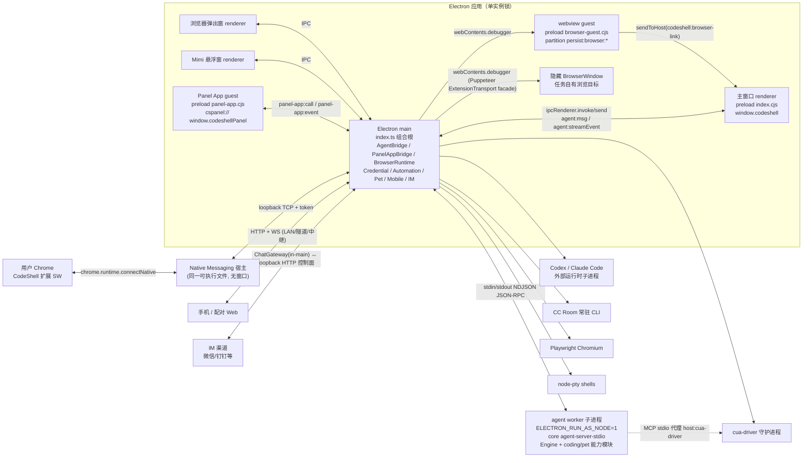
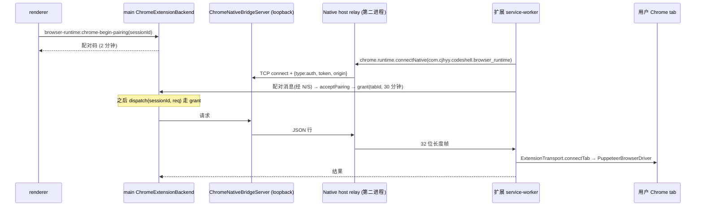
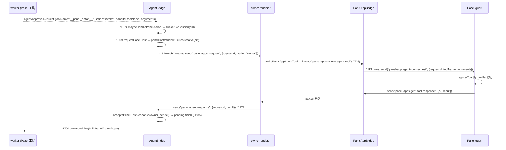

# 08 · Desktop 主进程侧架构（main / preload / shared / browser-library / chrome-extension）

> 范围：`packages/desktop/src/main/**`、`src/preload/**`、`src/shared/**`、`src/browser-library/**`、`src/chrome-extension/**`、`src/browser-guest-link.ts`，以及 `packages/desktop/package.json` 与 `scripts/build*.ts` 的构建/打包配置。**不含** renderer 与 mobile UI。
>
> 基线：仓库 `main` @ `df2ca0bda`，`@cjhyy/code-shell-desktop` 0.9.45。所有 `file:line` 均在该基线上用 `grep -n` 核对过（路径相对 `packages/desktop/src/`，除非另写包名）。
>
> 旧文档 `docs/archive/architecture-2026-07/10-desktop-and-mobile.md` 中「浏览器动作走 `electron-cdp.ts` + `packages/cdp` 驱动、默认操作当前激活的 webview」的描述**已过时**：现在生产路径是 Puppeteer（`browser-library/`）经伪造 `chrome.debugger` facade 驱动 Electron `webContents.debugger`，默认目标是任务自有的隐藏窗口，而不是用户打开的 tab（见 §3.8、§6）。

---

## 0. 一句话总览

Desktop main 是一个**组合根（composition root）+ 权限中介**：

- **Engine 不在 main 进程里**。交互式会话全部跑在一个全局单例的 **agent worker 子进程**里（Electron 二进制以 `ELECTRON_RUN_AS_NODE=1` 运行 `@cjhyy/code-shell-core/bin/agent-server-stdio`），通过 stdio NDJSON JSON-RPC 通信；`AgentBridge`（`main/agent-bridge.ts`）是 main 侧的 Electron 适配层，底层的 spawn/分帧/关联逻辑在 `@cjhyy/code-shell-server/worker` 的 `WorkerBridgeCore`。
- **例外（main 进程内的 Engine）**只有两处，且在 `scripts/lint-engine-bypass` 白名单内：定时自动化的无头只读 Engine（`main/automation-host.ts:298`）和手动「整理/Dream」的 seed Engine（`main/dream-service.ts:98`）。
- renderer 只能通过 preload 暴露的 `window.codeshell.*` 访问一切；聊天协议是**透明中继**：preload 把 JSON-RPC 行塞进 `ipcRenderer.send("agent:msg")`，main 在少数点上校验/改写（`agent/run` 的信任与工作区元数据）后原样写入 worker stdin。
- worker 需要「只有宿主能做的事」（驱动浏览器、注入 Cookie、切换工作区、调用 Panel、解密凭证、签名模型请求、创建自动化）时，走**宿主回环（host loopback）**：要么伪装成 `agent/approvalRequest`（`toolName: "__browser_action__"` 等），要么发 `desktop/*` 私有方法；main 拦截后执行并用 `agent/approve` 或 JSON-RPC 回复写回 stdin，**这些行永远不会到达 renderer**。

---

## 1. 进程模型

### 1.1 进程 / 执行上下文清单

| #   | 进程 / 上下文                                                  | 谁创建                                                                                                                     | 代码入口                                                                                              | 说明                                                                                                                                       |
| --- | -------------------------------------------------------------- | -------------------------------------------------------------------------------------------------------------------------- | ----------------------------------------------------------------------------------------------------- | ------------------------------------------------------------------------------------------------------------------------------------------ |
| P1  | **Electron main**                                              | OS                                                                                                                         | `out/main/index.mjs`（源 `main/index.ts`）                                                            | 组合根；持有所有 IPC handler、窗口、浏览器运行时、凭证解密（safeStorage）、调度器、移动端 HTTP/WS 服务、IM 网关                            |
| P2  | **主窗口 renderer**                                            | `createWindow()` `main/index.ts:1429`                                                                                      | `out/renderer/index.html` + preload `out/preload/index.cjs`                                           | `contextIsolation:true, sandbox:true, nodeIntegration:false, webviewTag:true`（`index.ts:1450-1458`）                                      |
| P3  | **浏览器弹出窗 renderer**                                      | `createBrowserPopout()` `index.ts:3115`                                                                                    | 同一 `index.html?popout=browser&url=…` + `index.cjs`                                                  | 宿主一个 BrowserPanel；同样调用 `hardenWebviewGuests`                                                                                      |
| P4  | **Mimi 桌宠悬浮窗 renderer**                                   | `createPetWidgetWindowNow()` `index.ts:2938`                                                                               | 同一 `index.html?popout=pet` + `index.cjs`                                                            | `frame:false, transparent:true, alwaysOnTop:true`                                                                                          |
| P5  | **浏览器面板 `<webview>` guest**                               | renderer 的 BrowserPanel                                                                                                   | preload 被 main 强制替换为 `out/preload/browser-guest.cjs`（`index.ts:1358`）                         | partition 只允许 `persist:browser*` / `browser:qchat:*`；页面世界拿不到任何 API，只有可信点击会 `sendToHost`                               |
| P6  | **Panel App guest**                                            | renderer 的 `<webview src="cspanel://…">` 或 `PanelAppWindows` 的 `WebContentsView`                                        | preload `out/preload/panel-app.cjs`，暴露 `window.codeshellPanel`                                     | 独立 partition（`safePartition(hostId, projectPath)`），`cspanel://` 协议由 main 提供文件                                                  |
| P7  | **任务自有隐藏浏览器窗**                                       | `BackgroundBrowserRuntime` → `openBrowserHost()`（`main/browser-host/index.ts:107`）                                       | 无 preload                                                                                            | `show:false`，与会话 BrowserPanel 同 partition（共享登录态），可 `show()` 给人接管                                                         |
| P8  | **登录抓 Cookie 窗口 / 云工作台窗口 / Link 授权窗口**          | `credentials-login/index.ts`、`cloud-workbench-window.ts:140`、`remote-link-manager.ts`                                    | 无 preload 或受限                                                                                     | 外部站点；`buildWindowOptions` 不注入我们的 preload                                                                                        |
| C1  | **agent worker 子进程（全局唯一）**                            | `WorkerBridgeCore.ensureWorker()`（`packages/server/src/worker-bridge-core.ts:171`）                                       | `process.execPath` + `@cjhyy/code-shell-core/bin/agent-server-stdio`（`agent-bridge.ts:211`）         | 懒启动：只有 `agent/run`（及 fork/compact 查询）会 spawn；崩溃 3 次/60s 判 `gave_up`，**不主动重启**，下一次 run 再 spawn                  |
| C2  | **External Agent Runtime 子进程**（Codex / Claude Code）       | `ExternalRuntimeService.start/ensure`（`external-runtime-service.ts:554/566`）→ `startExternalRuntimeSession`（coding 包） | —                                                                                                     | 每会话一个子进程 + 一个监听端口；`before-quit` 显式 `stopAll()`                                                                            |
| C3  | **CC Room 常驻 CLI 子进程**                                    | `RoomManager.createAgent`（`index.ts:1207`）→ `ResidentAgentProcess("claude")` / `CodexRoomAgent("codex")`（server 包）    | —                                                                                                     | 「双端房间」：桌面与手机共用同一个常驻 CLI                                                                                                 |
| C4  | **Playwright 独立 Chromium**                                   | `DedicatedPlaywrightBackend`（`browser-runtime/playwright-backend.ts:77`）                                                 | `playwright-core`（不打包，运行时依赖）                                                               | 仅自动化（`backendPreference:"dedicated-playwright"`）或显式 `auto` 时使用；懒启动、最多 3 个 context、5 分钟空闲回收                      |
| C5  | **cua-driver 守护进程**（Computer Use，feature flag）          | `CuaDriverHost`（`computer-use/cua-driver-host.ts`）                                                                       | `cua-driver serve --embedded`                                                                         | 必须是 main 的**直接子进程**，以便留在 macOS TCC 责任链；worker 通过 `CODE_SHELL_HOST_MCP_SERVERS` 得到 `host:cua-driver` MCP 代理声明     |
| C6  | **node-pty 终端**                                              | `pty-service.ts:262 ptyStart`                                                                                              | `node-pty`（native，asarUnpack）                                                                      | 每个 renderer webContents 拥有各自 pty；窗口销毁后 `ptyReapDestroyed` 回收                                                                 |
| C7  | **git / 编辑器 / 登录 shell 探测等短命子进程**                 | `desktop-services.ts`（`execFile("git")`）、`login-shell-path.ts`、`editor.ts`、`link-cli-installer.ts`…                   | —                                                                                                     | 一次性                                                                                                                                     |
| C8  | **cloudflared 隧道**                                           | `TunnelManager`（server 包）由 `mobileRemote:start {mode:"tunnel"}` 启动                                                   | —                                                                                                     | 默认关闭                                                                                                                                   |
| X1  | **Chrome Native Messaging 宿主**（同一可执行文件的第二次启动） | 用户的 Chrome 按 manifest 启动 CodeShell 并带 extension origin 参数                                                        | `index.ts:603-611` → `runChromeNativeMessagingHost`（`browser-runtime/chrome-native-protocol.ts:85`） | 不拿单实例锁、不建窗口；把 Chrome stdin/stdout 的 32 位长度帧桥接到主实例的 loopback TCP（`ChromeNativeBridgeServer`）                     |
| X2  | **CodeShell Chrome 扩展 service worker**                       | 用户的 Chrome                                                                                                              | `chrome-extension/service-worker.ts`（打包到 `resources/chrome-extension`）                           | 用 Puppeteer `ExtensionTransport.connectTab` 驱动用户授权的那个 tab                                                                        |
| I1  | **main 内的 Engine（例外）**                                   | 自动化 cron 触发 / Dream 按钮                                                                                              | `automation-host.ts:298`、`dream-service.ts:98`                                                       | 无头、只读审批后端、MCP 关闭、cron/AskUser/后台 shell 工具被剥离                                                                           |
| I2  | **main 内的 ChatGateway（IM）**                                | `ImGatewayService.start()`（`im-gateway-service.ts:417`）                                                                  | `@cjhyy/code-shell-chat`                                                                              | 在 main 进程内运行，但通过 loopback HTTP 访问 `GatewayControlServer`（`im-gateway-control-server.ts:306-327`），与独立网关进程使用同一协议 |
| I3  | **main 内的移动端 HTTP+WS 服务**                               | `RemoteHostManager`（server 包，`index.ts:1006`）                                                                          | `@cjhyy/code-shell-server/mobile-remote`                                                              | 局域网 / 隧道 / 中继三种传输；服务 `out/mobile` 静态资源                                                                                   |

> 注意「多窗口 ≠ 多 agent」：`index.ts:665-670` 的注释写明 bridge 是进程全局的，所有窗口共享同一个 worker，窗口只是同一 worker 的不同视图。

### 1.2 进程拓扑图



### 1.3 进程间通道一览

| 通道                                         | 方向                               | 载荷                                                                      | 关键代码                                                      |
| -------------------------------------------- | ---------------------------------- | ------------------------------------------------------------------------- | ------------------------------------------------------------- | ------------------------------------------------ |
| `ipcRenderer.send("agent:msg", line)`        | renderer→main                      | 完整 JSON-RPC 行（字符串）                                                | preload `preload/index.ts:432`；main `agent-bridge.ts:927`    |
| `webContents.send("agent:msg", line)`        | main→renderer                      | worker 的非流式行（响应、通知）                                           | `agent-bridge.ts:602`                                         |
| `webContents.send("agent:streamEvent", env)` | main→renderer                      | `{sessionId,event,seq,epoch}` 已入快照的流事件                            | `agent-bridge.ts:600`、`:2572`、`owned-external-stream.ts:32` |
| `webContents.send("agent:lifecycle", evt)`   | main→renderer                      | `{type:"exited"                                                           | "gave_up", code?, sessionIds}`                                | `agent-bridge.ts` 构造函数 `onExit/onSpawnError` |
| `ipcMain.handle(...)` / `ipcRenderer.invoke` | renderer↔main                      | 约 400 个领域通道（§3.5）                                                 | 大部分在 `index.ts` 模块顶层注册                              |
| worker stdin/stdout                          | main↔worker                        | NDJSON；宿主回环用 `agent/approvalRequest`+`agent/approve` 与 `desktop/*` | `WorkerBridgeCore`、`worker-host-runtime.ts`                  |
| `cspanel://`、`csmedia://`、`cstheme://`     | guest/renderer→main                | 自定义特权协议（`protocol.handle`）                                       | 预注册 `panel-app-protocol.ts:139`                            |
| `ipcRenderer.sendToHost`                     | webview guest→宿主 renderer        | 可信点击产生的链接请求                                                    | `preload/browser-guest.ts`、`browser-guest-link.ts`           |
| loopback TCP                                 | Native host relay ↔ main           | JSON 行 + token 认证                                                      | `chrome-native-server.ts`、`chrome-native-protocol.ts:120`    |
| loopback HTTP + bearer                       | ChatGateway ↔ GatewayControlServer | 宠物聊天/路由/事件推送                                                    | `im-gateway-control-server.ts:306`                            |
| HTTP+WS                                      | 手机 ↔ RemoteHostManager           | `session.stream` 等                                                       | `index.ts:1006`、`mobile-remote-orchestrator.ts`              |

### 1.4 worker 启动环境（`AgentBridge` 构造，`agent-bridge.ts:398-425`）

| 变量                                   | 值                                                                        | 作用                                                                                                                                     |
| -------------------------------------- | ------------------------------------------------------------------------- | ---------------------------------------------------------------------------------------------------------------------------------------- |
| `ELECTRON_RUN_AS_NODE`                 | `1`                                                                       | 让 Electron 二进制当 Node 用                                                                                                             |
| `CODESHELL_AGENT_STDIO`                | `1`                                                                       | stdio 传输                                                                                                                               |
| `CODE_SHELL_CREDENTIAL_ACCESS`         | `host`                                                                    | worker 不能自己解密凭证，必须 `desktop/credentialResolve` 回问 main                                                                      |
| `CODE_SHELL_MODEL_REQUEST_SIGNING`     | `host`                                                                    | 模型请求签名由 main（`model-request-signing-service.ts`）完成                                                                            |
| `CODE_SHELL_OPERATION_BATCH_ACCESS`    | `host`                                                                    | 操作批次需要 main 私有准入                                                                                                               |
| `CODE_SHELL_WORKSPACE_ACCESS`          | `host`                                                                    | 工作区切换走 `__workspace_action__`                                                                                                      |
| `CODE_SHELL_CAPABILITY_MODULES`        | `composeCapabilityModulesEnv({coding, pet, links}, featureFlags, optLab)` | worker 加载的能力模块绝对 URL：coding 包、`@cjhyy/code-shell-pet/capability`、`out/main/link-provider-module.mjs`、可选 optimization-lab |
| `CODE_SHELL_HOST_MCP_SERVERS`          | `hostMcpServersEnv()`                                                     | cua-driver 运行时注入 `host:cua-driver`；否则显式置空以清除继承值                                                                        |
| `CODE_SHELL_DOCUMENT_RUNTIME_ROOT`     | `desktopManagedRuntimeRoot(...)`                                          | 文档解析用的托管运行时                                                                                                                   |
| `CODE_SHELL_REMOTE_LINK_CLIENT_SECRET` | `undefined`                                                               | 防止机密泄漏进 worker                                                                                                                    |

`fallbackCwd` 为 `resolveNoRepoCwd()` = `~/.code-shell/no-repo`（`agent-bridge.ts:182`），避免「无项目对话」时 worker 落在 `$HOME`。

### 1.5 构建与打包

| 产物                                                       | 构建                                                  | 关键点                                                                                                                                                                                                                                      |
| ---------------------------------------------------------- | ----------------------------------------------------- | ------------------------------------------------------------------------------------------------------------------------------------------------------------------------------------------------------------------------------------------- |
| `out/main/index.mjs` + `out/main/link-provider-module.mjs` | `scripts/build-main.ts` esbuild ESM、`splitting:true` | external：`electron`、`playwright-core`、`@cjhyy/code-shell-core`、`@cjhyy/code-shell-link`、`@cjhyy/code-shell-capability-coding`（与 worker 共享同一份注册表/错误构造器）；`.md` 以 text 加载；banner 注入 `require/__filename/__dirname` |
| `out/preload/{index,browser-guest,panel-app}.cjs`          | esbuild CJS，`external:electron`                      | 三个 preload 分别给主窗口、webview guest、Panel guest                                                                                                                                                                                       |
| `out/renderer/`                                            | vite                                                  | 非本文范围                                                                                                                                                                                                                                  |
| `out/mobile/`                                              | `vite.mobile.config.ts`                               | 由 `RemoteHostManager({mobileRootDir})` 托管（`index.ts` 中 `resolve(__dirname,"../mobile")`）                                                                                                                                              |
| `resources/chrome-extension`                               | `scripts/build-chrome-extension.ts`                   | extraResources；被注册为 Chrome 扩展路径                                                                                                                                                                                                    |
| `out/native/cua-driver`、`codeshell-permissions`           | `build-computer-use-*.ts`                             | 仅 mac extraResources                                                                                                                                                                                                                       |
| `package.json#build`                                       | electron-builder                                      | `asarUnpack` node-pty 与 core 文档解析依赖；`dependencies` 只保留运行时 require 的包（core、coding、pet、optimization-lab、node-pty、playwright-core），其余全是 devDependencies（`//deps` 注释）                                           |

---

## 2. 文件清单（按子系统）

> 行数为基线 `wc -l`。`*.test.ts` 不列。fixture/smoke 文件单独列在末尾。

### 2.1 启动 / 组合根 / 进程级基础设施

| 文件                                 | 行   | 职责                                                                                                                                                                        |
| ------------------------------------ | ---- | --------------------------------------------------------------------------------------------------------------------------------------------------------------------------- |
| `main/index.ts`                      | 7330 | **组合根**：模块顶层构造所有单例并注册绝大多数 `ipcMain` handler；`createWindow`、`hardenWebviewGuests`、桌宠窗、浏览器弹出窗；`app.whenReady` 启动序列；`before-quit` 关停 |
| `main/quick-chat-startup-cleanup.ts` | 45   | `acquireDesktopInstanceLock`（`requestSingleInstanceLock`）、`registerSecondInstanceFocus`、仅拥有者实例才执行的 Quick Chat 启动清理                                        |
| `main/desktop-shutdown.ts`           | 36   | `createDesktopShutdownHandler`：`before-quit` 时 `preventDefault`，按序执行 flushRenderers→disposeOperationResolution→cleanup，全部成功后才 `app.quit()`                    |
| `main/seed-defaults.ts`              | 165  | 首次运行把内置 agents、种子 marketplace 写入 `~/.code-shell`                                                                                                                |
| `main/bootstrap-core-plugins.ts`     | 121  | 首次运行软预装核心插件（skill-creator 等）                                                                                                                                  |
| `main/login-shell-path.ts`           | 412  | 探测登录 shell 的 PATH/环境并合并到 `process.env`（GUI 启动时 PATH 不全的问题）                                                                                             |
| `main/managed-runtime-service.ts`    | 79   | 定位应用自带运行时（托管 Node 等），把其 bin 目录追加进 PATH；`managed-runtimes:*` handler                                                                                  |
| `main/legacy-project-migration.ts`   | 107  | 旧项目注册表迁移服务                                                                                                                                                        |
| `main/window-state-store.ts`         | 85   | 主窗口尺寸/位置/最大化持久化                                                                                                                                                |
| `main/menu.ts`                       | 150  | `installAppMenu`/`refreshAppMenu`：含「最近项目」的应用菜单，菜单项发 `menu:*` 事件                                                                                         |
| `main/desktop-logger.ts`             | 172  | `dlog(source, event, data)`：写 `~/.code-shell/logs/desktop/desktop-YYYY-MM-DD.log` 与按会话拆分的 jsonl                                                                    |
| `main/redact-secrets.ts`             | 73   | 日志落盘前屏蔽机密键                                                                                                                                                        |
| `main/capability-modules-env.ts`     | 31   | 每次 spawn worker 时重新组装 `CODE_SHELL_CAPABILITY_MODULES`，读取用户 feature flags                                                                                        |
| `main/link-provider-module.ts`       | 3    | worker 侧加载的独立入口：让被打包进 Desktop 的 server Link 提供者对 worker 可见                                                                                             |
| `main/paths.ts`                      | 17   | 纯路径辅助（无 Electron/fs 依赖）                                                                                                                                           |
| `main/output-coverage.ts`            | 1    | 转出 web 包的输出覆盖类型                                                                                                                                                   |

### 2.2 Agent Bridge（main ↔ worker）

| 文件                                     | 行   | 职责                                                                                                                                                                                        |
| ---------------------------------------- | ---- | ------------------------------------------------------------------------------------------------------------------------------------------------------------------------------------------- |
| `main/agent-bridge.ts`                   | 2648 | `AgentBridge`：worker 生命周期、renderer↔worker 中继、宿主回环拦截链、会话快照、Panel 宿主路由、宠物投影、外部事件注入                                                                      |
| `main/worker-host-runtime.ts`            | 84   | `createDesktopWorkerHost`：把宿主请求路由表交给 `@cjhyy/code-shell-host` 的 `HostRuntime`+`interceptHostRequest`                                                                            |
| `main/agent-run-metadata.ts`             | 397  | `prepareAgentRunMetadata`：校验单帧、剥离 renderer 伪造字段（`bucket/browserPartition/workspaceContext/projectTrusted`）、解析项目/根/信任、生成 tentative cwd；`reserveHostSessionMaps` 等 |
| `main/agent-run-browser-registration.ts` | 60   | 无 renderer 的宿主驱动 run 恢复浏览器 bucket/partition 绑定                                                                                                                                 |
| `main/agent-bridge-fallback.ts`          | 225  | 无 worker 时的兜底回复（backgroundShells/backgroundWork/goalGet/goalClear 读盘）；Quick Chat fork/run 请求解析                                                                              |
| `main/quick-chat-fork-router.ts`         | 119  | Quick Chat fork RPC 的全局 wire id 与响应路由                                                                                                                                               |
| `main/quick-chat-ownership.ts`           | 167  | `QuickChatOwnershipRegistry`：进程内 Quick Chat 会话的 claim/fork/settle/墓碑                                                                                                               |
| `main/worker-run-ownership.ts`           | 78   | 当前 worker 实际拥有的运行中会话集合（worker 退出时回报 sessionIds）                                                                                                                        |
| `main/web-configuration-gate.ts`         | 58   | 配置写入期间阻塞新 `agent/run`（返回 Overloaded「配置正在更新」）                                                                                                                           |
| `main/SessionSnapshotStore.ts`           | 234  | 每会话事件环形快照（默认 2000 条 + 字节上限），`epoch` 标识 main 生命周期，供 renderer 重挂载回放                                                                                           |
| `main/main-output-publisher.ts`          | 135  | 把 main 自产输出与（可能迟到的）worker 输出按 `outputCursor` 合并                                                                                                                           |
| `main/owned-external-stream.ts`          | 44   | 外部运行时流：入快照一次后只发给拥有者窗口                                                                                                                                                  |
| `main/parseStreamLine.ts`                | 63   | 解析 worker 行为快照追加项 / 实时流信封                                                                                                                                                     |
| `main/session-validation.ts`             | 13   | `assertDesktopSessionId`                                                                                                                                                                    |
| `main/session-run-workspace.ts`          | 89   | worker 发起的跨会话 run 走同一项目注册表/信任解析                                                                                                                                           |

### 2.3 项目 / 会话 / 工作区 / 历史数据

| 文件                                             | 行    | 职责                                                                                                                          |
| ------------------------------------------------ | ----- | ----------------------------------------------------------------------------------------------------------------------------- |
| `main/project-store.ts`                          | 1235  | `ProjectStore`（V2 注册表）：项目/多根/主根、realpath 身份、同步解析 `resolveExactRootSync`/`resolveProjectRootByIdSync`      |
| `main/project-runtime-store.ts`                  | 368   | 项目与云运行时绑定/偏好（无凭证）                                                                                             |
| `main/mounted-project-root.ts`                   | 152   | 挂载根身份键与校验                                                                                                            |
| `main/renderer-project-path.ts`                  | 173   | renderer 传入 projectId/rootId → 权威路径                                                                                     |
| `main/renderer-configuration-authority.ts`       | 102   | renderer 配置读写目标的权威解析                                                                                               |
| `main/project-authority-ipc.ts`                  | 381   | `projectRegistry:*`、`workspace:*` handler                                                                                    |
| `main/session-workspace-service.ts`              | 711   | 会话 worktree 列表/切换/释放/清理（UI 与 worker 共用）                                                                        |
| `main/session-cwd-index.ts`                      | 344   | `SessionCwdIndex`：sessionId→cwd/workspaceRoot/projectId 的 tentative/confirmed 索引                                          |
| `main/session-catalog-store.ts`                  | 415   | 侧栏会话目录持久化（有界、防坏数据）                                                                                          |
| `main/session-catalog-ipc.ts`                    | 90    | `sessionCatalog:*`；`flushRenderers()` 在退出时请求 renderer 落盘并等待确认                                                   |
| `main/session-transcript-cache.ts`               | 635   | renderer 投影的一次性 transcript 缓存文件                                                                                     |
| `main/session-transcript-ipc.ts`                 | 106   | `sessions:listDisk/rawEvents/transcript/outputJournal/transcriptPage`                                                         |
| `main/transcript-reader.ts`                      | 872   | 读 `~/.code-shell/sessions/<id>/transcript.jsonl` 并折叠为 UI 项、分页                                                        |
| `main/rawTranscript.ts`                          | 134   | 原始事件读取（保留游标字段）                                                                                                  |
| `main/session-fs-service.ts`                     | 27    | 会话工作区内的目录/文件读取                                                                                                   |
| `main/session-titles-store.ts`                   | 14    | 会话标题注册表适配                                                                                                            |
| `main/recents-store.ts`                          | 347   | 最近/置顶项目                                                                                                                 |
| `main/trust-store.ts`                            | 258   | 工作区信任（异步读写 + `getTrustCachedSync` 同步缓存，未知即不信任）                                                          |
| `main/activity-history-ipc.ts`                   | 59    | `sessions:list/setArchived/titles/rename`、`logs:tail`、`usage:summary`、`runs:list/get`；并注册 transcript 与 modelTrace IPC |
| `main/run-history-service.ts`                    | 320   | 运行历史（旧 runs + 会话 run 回执）                                                                                           |
| `main/runs-service.ts`                           | 423   | 读 `~/.code-shell/runs/<id>/`                                                                                                 |
| `main/usage-history-service.ts`                  | 32    | 请求回执的用量视图                                                                                                            |
| `main/trace-history-service.ts`                  | 13    | 本机模型 trace 历史                                                                                                           |
| `main/model-trace-ipc.ts`                        | 31    | `modelTraces:*`（仅原生主框架）                                                                                               |
| `main/desktop-model-trace-scopes.ts`             | 22    | trace 可见范围解析                                                                                                            |
| `main/auxiliary-model-tracing.ts`                | 37    | 辅助模型调用的 trace 包装                                                                                                     |
| `main/logs-service.ts`                           | 102   | 日志尾读                                                                                                                      |
| `main/file-history-service.ts`                   | 77    | 轮次级 undo/redo                                                                                                              |
| `main/fs-service.ts`                             | 128   | 文件浏览面板读目录/读文件                                                                                                     |
| `main/local-file-preview-service.ts` / `-ipc.ts` | 95/19 | `fsLocal:exists/readPreview`：只读元数据预览                                                                                  |
| `main/file-search-service.ts`                    | 269   | @-mention 文件模糊搜索                                                                                                        |
| `main/mobile-project-meta.ts`                    | 23    | 项目元数据给移动端                                                                                                            |

### 2.4 设置 / 模型 / 记忆 / 数字人 / 扩展生态

| 文件                                                                                                                         | 行           | 职责                                                         |
| ---------------------------------------------------------------------------------------------------------------------------- | ------------ | ------------------------------------------------------------ |
| `main/settings-service.ts`                                                                                                   | 275          | `readSettings/writeSettings`（user/project 作用域）          |
| `main/model-meta-service.ts`                                                                                                 | 198          | 解析模型真实 `maxContextTokens`                              |
| `main/search-probe-service.ts` / `image-probe-service.ts` / `mcp-probe-service.ts`                                           | 125/112/312  | 搜索/图片/MCP 连接探测                                       |
| `main/capabilities-service.ts`                                                                                               | 120          | 扩展能力开关与覆盖                                           |
| `main/memory-service.ts`                                                                                                     | 237          | 包装 core `MemoryManager`（列/读/写/删/待审批）              |
| `main/dream-service.ts`                                                                                                      | 130          | 手动 Dream 记忆整理（**main 内 seed Engine**）               |
| `main/profiles-service.ts`                                                                                                   | 880          | WorkspaceProfile（数字人）门面：激活/保存/导入导出/仓库/依赖 |
| `main/profile-switch-service.ts` / `-ipc.ts`                                                                                 | 172/44       | 数字人切换预览与采纳                                         |
| `main/profile-requirements-service.ts`                                                                                       | 152          | 数字人依赖安装执行层                                         |
| `main/profile-plugin-export-service.ts` / `-ipc.ts`                                                                          | 231/95       | 数字人导出为插件（独占新目录）                               |
| `main/profile-memory-promotion-service.ts` / `-ipc.ts`                                                                       | 304/95       | 记忆提升到 profile                                           |
| `main/digital-human-catalog.ts` / `digital-human-team-service.ts`                                                            | 22/228       | 内置目录 / 团队定义读写                                      |
| `main/agents-service.ts`                                                                                                     | 231          | 子 agent 角色定义 CRUD                                       |
| `main/skills-service.ts` / `skill-update-entry.ts` / `github-skill-service.ts` / `github-skill-review.ts`                    | 218/58/30/87 | 技能枚举、更新、GitHub 安装与「已预览」证明                  |
| `main/plugins-service.ts`                                                                                                    | 334          | 已装插件枚举/卸载/更新                                       |
| `main/plugin-command-service.ts` / `plugin-media-service.ts` / `plugin-display-metadata.ts` / `plugin-automation-service.ts` | 76/294/70/49 | 插件斜杠命令、媒体资源、作者元数据、模板生成自动化           |
| `main/marketplace-service.ts`                                                                                                | 612          | 插件市场源与安装任务                                         |
| `main/sources-service.ts`                                                                                                    | 199          | 数据源目录/绑定/上传                                         |
| `main/source-collections-{service,host,ipc,owner}.ts`                                                                        | 301/65/26/54 | 资料集合（权限在 main，按调用捕获 owner）                    |
| `main/linked-file-sources-{service,host,ipc}.ts`                                                                             | 264/78/25    | 关联文件源                                                   |
| `main/theme-asset-protocol.ts` / `theme-asset-url.ts` / `theme-import-dialog.ts` / `theme-pack-conversion.ts`                | 141/70/17/61 | `cstheme://` 资源协议与主题包                                |

### 2.5 Git / 审阅 / 编辑器 / 终端

| 文件                       | 行   | 职责                                                                                                                                         |
| -------------------------- | ---- | -------------------------------------------------------------------------------------------------------------------------------------------- |
| `main/desktop-services.ts` | 1141 | git status/branches/diff/numstat/worktree 创建/陈旧 worktree 清理、`openExternal`、`revealInFinder`、`openPath`、`openInEditor`、`undoFiles` |
| `main/review-service.ts`   | 377  | 审阅面板 status/diff/recentCommits/preparePrompt                                                                                             |
| `main/editor.ts`           | 67   | 外部编辑器候选与调用                                                                                                                         |
| `main/pty-service.ts`      | 356  | node-pty 终端（每 webContents 的会话表、Git Bash 解析）                                                                                      |
| `main/port-probe.ts`       | 53   | localhost 开发服务器端口探测（浏览器面板书签）                                                                                               |

### 2.6 媒体 / 附件 / 图片

| 文件                                                                                         | 行          | 职责                                                                 |
| -------------------------------------------------------------------------------------------- | ----------- | -------------------------------------------------------------------- |
| `main/image-read-service.ts` / `image-save.ts`                                               | 238/75      | 读图为 dataURL、回复附件检查；Lightbox 下载                          |
| `main/media-preview-service.ts` / `media-preview-authority.ts`                               | 397/23      | `csmedia://` 播放与预览，按会话挂载根授权、按 owner webContents 释放 |
| `main/media/panel-media-service.ts`                                                          | 398         | Panel 的 legacy 媒体托管适配（文档/历史/录制），**不再放处理器**     |
| `main/media/media-jobs.ts` / `media-job-recipe.ts`                                           | 583/59      | 历史媒体任务与回执迁移                                               |
| `main/media/media-recording-ingest.ts`                                                       | 621         | 录制分片接收                                                         |
| `main/media/media-documents.ts` / `media-types.ts` / `media-library.ts` / `media-storage.ts` | 166/58/9/11 | 版本化文档、类型、兼容导出                                           |

### 2.7 浏览器自动化（main 侧）

| 文件                                                    | 行      | 职责                                                                                                                                      |
| ------------------------------------------------------- | ------- | ----------------------------------------------------------------------------------------------------------------------------------------- |
| `main/browser-runtime/runtime.ts`                       | 339     | `DesktopBrowserRuntime`：产品级运行时，按 owner/profile 选择后端、懒租约、进度守卫；单例 `browserRuntime`                                 |
| `main/browser-runtime/backend.ts`                       | 39      | 后端接口（`in-app` / `dedicated-playwright`）                                                                                             |
| `main/browser-runtime/in-app-browser-backend.ts`        | 114     | 默认后端：在会话 BrowserPanel 同 partition 中开任务自有隐藏目标                                                                           |
| `main/browser-runtime/playwright-backend.ts`            | 571     | `DedicatedPlaywrightBackend`：独立 Chromium 持久 profile（`~/.code-shell/browser-runtime/profiles`）                                      |
| `main/browser-runtime/playwright-driver.ts`             | 752     | `PlaywrightBrowserDriver`：BrowserBridge 的 Playwright 实现                                                                               |
| `main/browser-runtime/built-in-handoff.ts`              | 267     | `BuiltInTabClaimBackend`：用户显式把某个可见 tab 授权给会话（TTL 30 分钟、最长 60 分钟）                                                  |
| `main/browser-runtime/chrome-extension-runtime.ts`      | 621     | `ChromeExtensionBackend`：配对码、tab 授权、经扩展驱动用户 Chrome                                                                         |
| `main/browser-runtime/chrome-extension-singleton.ts`    | 14      | 单例                                                                                                                                      |
| `main/browser-runtime/chrome-native-protocol.ts`        | 171     | Native Messaging 帧编解码、`runChromeNativeMessagingHost` relay                                                                           |
| `main/browser-runtime/chrome-native-server.ts`          | 240     | 主实例 loopback 认证端点                                                                                                                  |
| `main/browser-runtime/chrome-native-registration.ts`    | 146     | 写 Chrome NativeMessagingHosts manifest                                                                                                   |
| `main/browser-runtime/dispatch.ts`                      | 161     | `dispatchInteractiveBrowserRuntimeAction`：claim→Chrome→runtime 的路由；子 agent 浏览器生命周期                                           |
| `main/browser-runtime/dispatch-owner.ts`                | 3       | `interactive:<sessionId>` owner id                                                                                                        |
| `main/browser-runtime/child-browser-lifetime.ts`        | 32      | 绑定到某 worker 生命周期的子浏览器释放器                                                                                                  |
| `main/browser-runtime/stream-projection.ts`             | 53      | 给浏览器工具流事件加可见性注解                                                                                                            |
| `main/browser-runtime/profile.ts`                       | 20      | runtime profile id / partition / 路径                                                                                                     |
| `main/browser-runtime/index.ts`                         | 63      | 导出面                                                                                                                                    |
| `main/browser-driver/background-runtime.ts`             | 845     | `BackgroundBrowserRuntime`：隐藏 BrowserWindow 目标池（上限 3、5 分钟空闲回收、串行动作、域名策略、敏感输入拦截、可揭示接管）             |
| `main/browser-driver/electron-puppeteer.ts`             | 212     | 用 `chrome.debugger` facade 把 Puppeteer `ExtensionTransport` 接到 `webContents.debugger`；`get/acquire/authorize/releaseElectronBrowser` |
| `main/browser-driver/electron-screenshot.ts`            | 46      | 原生 `capturePage` 截图                                                                                                                   |
| `main/browser-driver/automation-host.ts`                | 519     | `handleBrowserAction`（webview guest 路径，按 guest 串行）与 `dispatchBrowserBridgeAction`（任意 BrowserBridge 的 switch 分发）           |
| `main/browser-driver/active-guest.ts`                   | 505     | webview guest 注册表：bucket↔partition↔guest、会话↔bucket、工作区注册                                                                     |
| `main/browser-driver/intercept.ts`                      | 310     | 四种回环（browser/credential/workspace/panel）的解析与回复构造                                                                            |
| `main/browser-driver/policy.ts` / `load-policy.ts`      | 118/106 | 域名白名单、敏感词/秘密形状判定、只读动作集；从 settings 加载（5s TTL）                                                                   |
| `main/browser-driver/cdp-driver.ts` / `electron-cdp.ts` | 234/8   | 兼容导出：原始 CDP 驱动；`electron-cdp.ts` 现在只是把 `getElectronBrowser` 重导出为 `driverFor`                                           |
| `main/browser-driver/index.ts`                          | 29      | 导出面                                                                                                                                    |
| `main/browser-host/index.ts`                            | 178     | `openBrowserHost`/`buildWindowOptions`/`destroyPartitionStorage`：统一外部站点 BrowserWindow 的加固与生命周期                             |
| `browser-guest-link.ts`                                 | 65      | guest 可信点击→`internal-tab`/`external` 链接请求（`isTrusted` 失败即拒）                                                                 |

### 2.8 浏览器库（Puppeteer，共享给 Electron 与 Chrome 扩展）

| 文件                                          | 行   | 职责                                                                                |
| --------------------------------------------- | ---- | ----------------------------------------------------------------------------------- |
| `browser-library/puppeteer-browser-driver.ts` | 1091 | `PuppeteerBrowserDriver implements BrowserBridge`：快照/ref、动作、读取、截图、检查 |
| `browser-library/dom-observation.ts`          | 217  | 在目标 frame 内执行的自包含 DOM 收集函数                                            |
| `browser-library/wait-condition.ts`           | 45   | 等待条件序列化                                                                      |
| `browser-library/scroll-observation.ts`       | 16   | 滚动进度有界观测                                                                    |
| `browser-library/browser-inspector.ts`        | 10   | 适配 `@cjhyy/code-shell-browser-devtools` 的 Console/Network 收集器                 |

### 2.9 Chrome 扩展

| 文件                                       | 行  | 职责                                                                                                                                  |
| ------------------------------------------ | --- | ------------------------------------------------------------------------------------------------------------------------------------- |
| `chrome-extension/service-worker.ts`       | 206 | 连 native host `com.cjhyy.codeshell.browser_runtime`、处理请求、持久化已附加 tab 并在重启时强制 detach                                |
| `chrome-extension/browser-sessions.ts`     | 277 | `ExtensionBrowserSessions`：授权与动作排序（Puppeteer 负责协议路由）                                                                  |
| `chrome-extension/puppeteer-connection.ts` | 50  | `connectGrantedTab`：`ExtensionTransport.connectTab` → `PuppeteerBrowserDriver`（`sourceKind:"attached-chrome", isUserBrowser:true`） |
| `chrome-extension/webcrypto.ts`            | 3   | Puppeteer BiDi 依赖的 webcrypto 垫片                                                                                                  |

### 2.10 凭证 / Cookie / Link / OAuth

| 文件                                                                                                                                                                                                                             | 行                       | 职责                                                                                      |
| -------------------------------------------------------------------------------------------------------------------------------------------------------------------------------------------------------------------------------- | ------------------------ | ----------------------------------------------------------------------------------------- |
| `main/credential-cipher.ts`                                                                                                                                                                                                      | 51                       | `SafeStorageCipher`（Electron safeStorage；不可用时退化为 `plain:` 仅属主可读）           |
| `main/credential-access-service.ts`                                                                                                                                                                                              | 139                      | **信任边界**：给 worker 的凭证元数据快照、按需解析值、物化 cookie 文件                    |
| `main/credential-action.ts`                                                                                                                                                                                                      | 132                      | 按会话 cwd 解析 cookie 凭证归属；从浏览器回刷                                             |
| `main/credential-migration.ts`                                                                                                                                                                                                   | 166                      | 凭证存储迁移                                                                              |
| `main/credentials-service.ts`                                                                                                                                                                                                    | 252                      | Cookie 读写：域名列表、抓 jar、恢复、cookie 租约临时文件与清扫                            |
| `main/cookie-credential-browser.ts`                                                                                                                                                                                              | 132                      | 把选定登录恢复到浏览器并转移刷新所有权                                                    |
| `main/cookie-credential-auto-refresh.ts`                                                                                                                                                                                         | 378                      | 恢复后监听 cookie 变化自动回写凭证                                                        |
| `main/credentials-login/index.ts` / `login-state.ts`                                                                                                                                                                             | 315/129                  | 登录窗口抓 Cookie（注入哨兵脚本 + nonce）；登录态判定与用户名抓取                         |
| `main/mcp-oauth-service.ts` / `mcp-oauth-profiles.ts`                                                                                                                                                                            | 1233/32                  | MCP OAuth 登录/刷新/吊销（宿主注册元数据不接受 renderer 输入）                            |
| `main/model-request-signing-service.ts`                                                                                                                                                                                          | 69                       | 宿主侧模型请求签名                                                                        |
| `main/link-authorization-manager.ts` / `link-connections.ts` / `link-cli-installer.ts` / `link-loopback-callback.ts` / `link-system-browser.ts` / `link-device-oauth.ts` / `link-account-access.ts` / `link-provider-catalog.ts` | 308/91/347/204/83/8/52/6 | Link 连接：原生授权适配、交互登录、托管 CLI 安装、loopback 回调、系统浏览器授权、账号租约 |
| `main/remote-link-ipc.ts` / `remote-link-manager.ts` / `remote-link-navigation.ts` / `remote-link-window.ts`                                                                                                                     | 334/168/78/12            | 远程 Link 授权 IPC 与窗口                                                                 |
| `main/figma-mcp-link.ts`                                                                                                                                                                                                         | 498                      | Figma MCP Link 适配                                                                       |

### 2.11 云账号 / 云环境 / 设备中继

| 文件                                                           | 行                    | 职责                                                                  |
| -------------------------------------------------------------- | --------------------- | --------------------------------------------------------------------- |
| `main/desktop-remote-services.ts`                              | 115                   | 组合云账号、移动端控制器、云管理（不启动）                            |
| `main/cloud-account-{manager,store,http,links,profile,ipc}.ts` | 827/139/155/149/60/70 | 云账号登录/注册/GitHub 登录与绑定、grant 仅存 main、HTTPS 传输        |
| `main/account-github-link.ts`                                  | 133                   | GitHub Link 续接（token 不进 renderer）                               |
| `main/cloud-environment-service.ts` / `-ipc.ts`                | 852/127               | 云环境发现/绑定/连接/请求/上传，`cloudEnvironment:${method}` 动态注册 |
| `main/cloud-management-{manager,http,contract}.ts`             | 299/107/177           | 显式云管理操作                                                        |
| `main/cloud-native-policy.ts`                                  | 136                   | 云会话 id/帧大小校验                                                  |
| `main/cloud-workbench-{window,policy,capture,ipc}.ts`          | 330/137/69/21         | 云工作台窗口（独立 origin partition）与屏幕采集                       |
| `main/device-relay-{enrollment,store,ipc}.ts`                  | 123/131/46            | 设备中继注册与机密存储；`mobileRemote:start/stop/…/relay*`            |
| `main/desktop-remote-link-configuration.ts`                    | 34                    | 远程 Link 部署元数据                                                  |

### 2.12 移动端远程 / 配对 Web

| 文件                                                                                                   | 行          | 职责                                                                        |
| ------------------------------------------------------------------------------------------------------ | ----------- | --------------------------------------------------------------------------- |
| `main/mobile-remote-controller.ts`                                                                     | 478         | 三种传输（lan/tunnel/relay）统一 owner；start/stop 栅栏                     |
| `main/mobile-remote-orchestrator.ts`                                                                   | 434         | 认证后的手机事件路由（会话、房间、审批、权限模式）                          |
| `main/mobile-remote/handle-client-event.ts`                                                            | 666         | 手机事件处理；`injectAndAwaitResult`（也被自动化 resume 复用）              |
| `main/mobile-remote/handle-room-event.ts` / `handle-cc-room-event.ts` / `external-runtime-commands.ts` | 211/127/267 | 房间、CC Room、外部运行时命令                                               |
| `main/mobile-remote/output-recovery.ts` / `output-recovery-authority.ts`                               | 279/145     | 手机端输出恢复的读授权                                                      |
| `main/desktop-web-service.ts`                                                                          | 224         | 给 `RemoteHostManager` 的 webApi（Panel/自动化/工作区等），页面逻辑在共享包 |

### 2.13 IM 网关 / CC Room

| 文件                                                                     | 行      | 职责                                                                                                                                                   |
| ------------------------------------------------------------------------ | ------- | ------------------------------------------------------------------------------------------------------------------------------------------------------ |
| `main/im-gateway-service.ts`                                             | 1568    | `ImGatewayService`：在 main 内运行 `ChatGateway`，钉钉/微信设置与发现，`im-gateway:*` IPC                                                              |
| `main/im-gateway-control-server.ts`                                      | 1522    | `GatewayControlServer`：127.0.0.1 随机端口 HTTP + bearer（描述符 `~/.code-shell/im-gateway/desktop-control.json`），宠物聊天、会话路由、事件发布与回执 |
| `main/im-gateway-chat-requests.ts`                                       | 129     | 进程内请求关联                                                                                                                                         |
| `main/cc-room/approval-bridge.ts`                                        | 139     | CC Room 的审批暂存与双端推送/清理                                                                                                                      |
| `main/cc-room/transcript-subscriptions.ts` / `transcript-checkpoints.ts` | 562/171 | 外部 CLI transcript 追尾订阅与检查点                                                                                                                   |
| `main/cc-room/linked-session-resolver.ts` / `linked-session-ipc.ts`      | 194/90  | 从 CLI 磁盘身份解析关联会话；`ccRoom:roomHistory`                                                                                                      |

### 2.14 External Agent Runtimes（Codex / Claude Code 作为模型选项）

| 文件                                                                                                                                                                          | 行                          | 职责                                                                                                 |
| ----------------------------------------------------------------------------------------------------------------------------------------------------------------------------- | --------------------------- | ---------------------------------------------------------------------------------------------------- |
| `main/external-runtime-service.ts`                                                                                                                                            | 1563                        | `ExternalRuntimeService`：start/ensure/send/interrupt/stop/goal，**显式认领 Panel owner** 与信任     |
| `main/external-runtime-state.ts`                                                                                                                                              | 780                         | 绑定持久化与会话记录器（写入同一 transcript 格式）                                                   |
| `main/external-runtime-approvals.ts`                                                                                                                                          | 271                         | 外部运行时审批→renderer 同一对话框                                                                   |
| `main/external-runtime-goals.ts` / `external-runtime-goal-rpc.ts`                                                                                                             | 351/161                     | 外部会话的 goal 语义；拦截 renderer 的 `agent/goal*` RPC                                             |
| `main/external-runtime-operations.ts` / `-tracing.ts` / `-source-context.ts` / `-handoff.ts` / `-launch.ts` / `-availability.ts` / `-model-service.ts` / `-browser-bucket.ts` | 163/210/72/68/104/103/94/10 | 提交租约、trace、来源上下文、连续性 handoff、Codex 启动解析、可用性探测、模型目录、隔离浏览器 bucket |

### 2.15 自动化 / 定时任务

| 文件                                                                               | 行        | 职责                                                                                             |
| ---------------------------------------------------------------------------------- | --------- | ------------------------------------------------------------------------------------------------ |
| `main/automation-host.ts`                                                          | 462       | `buildDesktopAutomationRunner`（**main 内无头 Engine**）、`makeCronRunnerWithResume`、工作区解析 |
| `main/automation-service.ts`                                                       | 290       | 调度器门面：list/get/create/update/delete/pause/resume/runNow/cancelRun/reload                   |
| `main/automation-authority.ts`                                                     | 342       | 创建/更新/续接的工作区权限解析                                                                   |
| `main/automationMemory.ts` / `automationToolset.ts` / `automation-notification.ts` | 103/46/99 | 跨次运行记忆、禁用工具表、生命周期通知                                                           |
| `main/panel-automation-host.ts`                                                    | 92        | 配对 Web 借用 main 调度器                                                                        |

### 2.16 Mimi（Pet）宿主侧

| 文件                                                                                                                                                                                                | 行                             | 职责                                                                                                         |
| --------------------------------------------------------------------------------------------------------------------------------------------------------------------------------------------------- | ------------------------------ | ------------------------------------------------------------------------------------------------------------ |
| `main/pet/pet-dispatch-service.ts`                                                                                                                                                                  | 2912                           | `PetDispatchService`：Mimi 管理者回合（隐藏 pet 会话上的 `agent/run`）、委派、长任务结果汇报、follow-up 唤醒 |
| `main/pet/pet-state-aggregator.ts`                                                                                                                                                                  | 706                            | `PetStateAggregator`：融合 worker 投影、磁盘会话目录、外部 CLI 会话为 Mimi 快照                              |
| `main/pet/pet-ipc.ts`                                                                                                                                                                               | 775                            | `pet:*` IPC（快照/派发/注意力/长任务/记忆/日志/偏好/归档…）与广播                                            |
| `main/pet/pet-long-task-coordinator.ts` / `pet-long-task-store.ts`                                                                                                                                  | 1271/254                       | 长任务启动、监视、中断恢复、关闭回调                                                                         |
| `main/pet/pet-work-delegation-host.ts`                                                                                                                                                              | 130                            | DelegateWork 工具的 main 执行边界                                                                            |
| `main/pet/pet-segment-controller.ts` / `pet-segment-closure-service.ts`                                                                                                                             | 275/302                        | 话题段边界与收尾（journal + 自动记忆 + 归档范围）                                                            |
| `main/pet/pet-memory-store.ts` / `pet-memory-host.ts` / `pet-work-memory-store.ts` / `pet-journal-store.ts`                                                                                         | 421/64/207/267                 | 记忆、工作记忆段、日志                                                                                       |
| `main/pet/pet-follow-up-{runtime,service,host,wake-coordinator,id}.ts` / `pet-registered-follow-up-store.ts` / `pet-summary-{service,store}.ts`                                                     | 131/226/110/197/15/484/189/157 | follow-up 编排、cron 唤醒、摘要                                                                              |
| `main/pet/pet-host-action-{receipts,completion}.ts` / `host-action-reply.ts` / `pet-receipt-store.ts` / `pet-report-{event,receipt-store}.ts`                                                       | 301/162/363/72/83/121          | 宿主动作回执与 IM 回复富化                                                                                   |
| `main/pet/pet-attention-policy.ts` / `pet-im-decisions.ts` / `pet-context-links.ts` / `pet-work-inbox-store.ts` / `pet-metadata-store.ts`                                                           | 189/332/216/267/77             | 注意力、IM 决策、上下文关联、工作收件箱                                                                      |
| `main/pet/session-bridge-wiring.ts` / `session-conversation-bridge.ts` / `session-turn-scheduler.ts` / `session-bind-host-action.ts` / `conversation-session-*.ts` / `reusable-session-resolver.ts` | 516/223/116/133/105+305/44     | IM 会话进入 Work Session 的绑定、steer/排队决策                                                              |
| `main/pet/external-session-{adapter,state,visibility}.ts`                                                                                                                                           | 284/68/185                     | 外部 Codex/Claude 会话发现与活跃度                                                                           |
| `main/pet/pet-widget-window-state.ts` / `pet-session-archive.ts` / `pet-auto-archive.ts` / `pet-worker-generation.ts` / 其他小工具                                                                  | —                              | 悬浮窗尺寸、归档、worker 代际栅栏、有界 JSON、并发 map、mtime 缓存                                           |

### 2.17 任务收件箱（Task Inbox）

| 文件                                                                                                 | 行                            | 职责                                                              |
| ---------------------------------------------------------------------------------------------------- | ----------------------------- | ----------------------------------------------------------------- |
| `main/task-inbox/task-inbox-service.ts`                                                              | 68                            | 调度刷新与订阅                                                    |
| `main/task-inbox/task-inbox-sources.ts`                                                              | 624                           | 从会话/自动化/Mimi 委派/子 agent/后台 shell/job 汇总来源          |
| `main/task-inbox/task-inbox-{projector,store,mappers,actions,ipc,types,pet-view,background-host}.ts` | 103/280/165/161/158/268/30/70 | 投影、可重建读模型、映射、动作、`taskInbox:*` IPC、浏览器安全类型 |

### 2.18 Panel App 宿主

| 文件                                                                                                                                                                                                                                                                                                             | 行     | 职责                                                                                                                                                        |
| ---------------------------------------------------------------------------------------------------------------------------------------------------------------------------------------------------------------------------------------------------------------------------------------------------------------- | ------ | ----------------------------------------------------------------------------------------------------------------------------------------------------------- |
| `main/panel-app-bridge.ts`                                                                                                                                                                                                                                                                                       | 4060   | `PanelAppBridge`：guest 绑定、`panel-app:call` 方法分发（约 70 个方法）、限流/大小/超时、存储、工作区读写、进程、资源、媒体、Cookie、自动化、Agent 工具调用 |
| `main/panel-app-protocol.ts`                                                                                                                                                                                                                                                                                     | 589    | `cspanel://` 协议、资源注册、partition 准备、媒体读取/采集授权                                                                                              |
| `main/panel-app-windows.ts`                                                                                                                                                                                                                                                                                      | 218    | 独立 Panel 窗口（`BrowserWindow` + `WebContentsView`）                                                                                                      |
| `main/panel-host-routing.ts`                                                                                                                                                                                                                                                                                     | 110    | Agent→Panel 请求的 owner 窗口路由与广播回退规则                                                                                                             |
| `main/panel-apps-service.ts` / `panel-app-policy*.ts` / `panel-app-capabilities.ts` / `panel-app-inspection-cache.ts` / `panel-app-install-service.ts` / `panel-app-update-service.ts` / `panel-app-management.ts` / `panel-app-project-packages.ts` / `panel-app-discovery-queue.ts` / `panel-project-scope.ts` | —      | 列表/绑定守卫/能力声明/包检查缓存/安装更新/管理/项目作用域                                                                                                  |
| `main/project-panel-ipc.ts` / `project-panel-version-ipc.ts`                                                                                                                                                                                                                                                     | 308/52 | `panel-apps:*` 与版本历史/恢复                                                                                                                              |
| `main/panel-app-{agent-task-models,agent-task-service,process-service,storage-store,directory-bookmarks}.ts`                                                                                                                                                                                                     | 1–11   | 与 Web 宿主共享实现的重导出                                                                                                                                 |

### 2.19 其他子系统

| 文件                                                                                                                                    | 行                    | 职责                                                              |
| --------------------------------------------------------------------------------------------------------------------------------------- | --------------------- | ----------------------------------------------------------------- |
| `main/operation-batch-{host,ipc}.ts` / `operation-resolution-{host,ipc}.ts`                                                             | 39/355/70/291         | 操作批次与「操作结果确认」原生审阅（私有 Native 准入）            |
| `main/optimization-lab-{host,ipc,evidence}.ts`                                                                                          | 51/591/355            | Optimization Lab（feature flag），走专用 `requestOptimizationLab` |
| `main/computer-use/{service,desktop-setup,cua-driver-host,permissions,settings-ipc}.ts` + `native/permissions.swift`                    | 101/83/449/214/105/27 | Computer Use：守护进程、TCC 权限助手、`computerUse:*`             |
| `main/desktop-notifier.ts` / `native-desktop-notification.ts` / `desktop-notification-routes.ts` / `background-notification-content.ts` | 224/34/172/173        | 原生通知去重、点击打开会话、各类通知路由                          |
| `main/updater.ts` / `updater-feed.ts` / `updater-signature.ts` / `updater-error-classify.ts`                                            | 376/34/19/44          | electron-updater（只检查+通知，手动下载/安装）                    |

### 2.20 preload

| 文件                                                                                                                                                                                                                                                                                                                      | 行     | 职责                                                                                                                    |
| ------------------------------------------------------------------------------------------------------------------------------------------------------------------------------------------------------------------------------------------------------------------------------------------------------------------------- | ------ | ----------------------------------------------------------------------------------------------------------------------- |
| `preload/index.ts`                                                                                                                                                                                                                                                                                                        | 1892   | `contextBridge.exposeInMainWorld("codeshell", …)`（`:512`）；JSON-RPC `rpc()`、流/审批/生命周期分发、外部运行时透明合流 |
| `preload/types.d.ts`                                                                                                                                                                                                                                                                                                      | 2984   | `window.codeshell` 的 renderer 可见类型                                                                                 |
| `preload/panel-app.ts`                                                                                                                                                                                                                                                                                                    | 160    | `window.codeshellPanel`：`getContext/call/callResult/registerTool/on`                                                   |
| `preload/browser-guest.ts`                                                                                                                                                                                                                                                                                                | 12     | 只监听捕获阶段 click/auxclick，可信点击 `sendToHost`                                                                    |
| `preload/pet-api.ts`                                                                                                                                                                                                                                                                                                      | 525    | `codeshell.pet.*`                                                                                                       |
| `preload/{project-authority,session-catalog,session-transcript,task-inbox,model-trace,operation-batch,operation-resolution,optimization-lab,computer-use,cloud-account,cloud-environment,device-relay,mobile-remote,notification-navigation,profile-plugin-export,profile-memory-promotion,project-panel-version}-api.ts` | 11–127 | 各命名空间的薄 `ipcRenderer.invoke` 封装                                                                                |
| `preload/rpc-identity.ts`                                                                                                                                                                                                                                                                                                 | 21     | 每个 preload 实例独立的 RPC id 前缀（多窗口/移动端/宿主共用一个 worker，id 不能撞）                                     |
| `preload/external-runtime-session-state.ts` / `agent-side-effect-events.ts` / `session-stream-types.ts` / `project-*-types.ts`                                                                                                                                                                                            | —      | 外部运行时会话状态订阅、worker 资源通知→window 事件、类型                                                               |

### 2.21 shared（main 与 renderer 共同依赖，不可 import 两侧私有模块）

| 文件                                                                                                                                                                                                                                                                                                                                                                                     | 职责                                                                                                                                             |
| ---------------------------------------------------------------------------------------------------------------------------------------------------------------------------------------------------------------------------------------------------------------------------------------------------------------------------------------------------------------------------------------- | ------------------------------------------------------------------------------------------------------------------------------------------------ |
| `browser-partition.ts`                                                                                                                                                                                                                                                                                                                                                                   | **partition 唯一定义**：前缀 `persist:browser` / `browser:qchat`，`isBrowserPartition`、`sanitizeBrowserBucket`                                  |
| `browser-profile.ts`                                                                                                                                                                                                                                                                                                                                                                     | profile 模型：默认「每项目一个 profile」共享登录，可显式命名，Quick Chat 永远临时；`browserPartitionForBucket/ForProfile`、`browserProfileLabel` |
| `browser-workspace.ts`                                                                                                                                                                                                                                                                                                                                                                   | 会话的页面工作区（与登录 profile 分离）                                                                                                          |
| `browser-source.ts`                                                                                                                                                                                                                                                                                                                                                                      | 浏览器来源（内置/用户 Chrome/远程），`requiresStrictApproval`、`parseDebugEndpoint`（仅 loopback）                                               |
| `tab-control.ts` / `tab-control-shared.ts`                                                                                                                                                                                                                                                                                                                                               | tab 独占写控制接口（全异步，为多实例服务端预留）                                                                                                 |
| `tenant-profile.ts`                                                                                                                                                                                                                                                                                                                                                                      | 服务端租户浏览器身份                                                                                                                             |
| `agent-panels.ts`                                                                                                                                                                                                                                                                                                                                                                        | Agent→Panel 宿主请求/响应线格式                                                                                                                  |
| `panel-apps.ts`                                                                                                                                                                                                                                                                                                                                                                          | Panel 描述符、权限名、API 版本                                                                                                                   |
| `stream-envelope.ts` / `top-level-run-lifecycle.ts` / `session-catalog.ts`                                                                                                                                                                                                                                                                                                               | 流信封校验、顶层 run 存活推断、侧栏目录                                                                                                          |
| `external-runtime-models.ts` / `pet-*.ts` / `cloud-*.ts` / `device-relay.ts` / `mobile-remote.ts` / `media-preview.ts` / `operation-*.ts` / `optimization-lab.ts` / `profile-*.ts` / `digital-human-*.ts` / `review.ts` / `theme-packs.ts` / `plugin-*.ts` / `project-runtime.ts` / `renderer-configuration.ts` / `linked-file-sources.ts` / `source-collections.ts` / `computer-use.ts` | 各领域跨进程 DTO 与校验                                                                                                                          |

### 2.22 fixture / smoke（非生产）

`main/cloud-environment-node.fixture.ts`、`cloud-management.fixture.ts`、`linked-file-sources-host.fixture.ts`、`remote-link-ipc.fixture.ts`、`settings-write-worker.fixture.ts`、`link-loopback-callback.smoke.mjs`、`main/__fixtures__/*`。

---

## 3. 关键类与函数

### 3.1 `main/index.ts`：组合根

#### 3.1.1 模块加载期（`whenReady` 之前）就执行的事

| 行              | 动作                                                                                                                                  |
| --------------- | ------------------------------------------------------------------------------------------------------------------------------------- | ----------------------------- |
| `:603-611`      | `nativeMessagingOriginFromArgv(process.argv)`：若是 Chrome 拉起的 native host，直接 `runChromeNativeMessagingHost(...)` 后 `app.exit` |
| `:615`          | `registerPanelAppSchemePrivileges()`：一次性把 `csmedia` / `cspanel` / `cstheme` 注册为特权 scheme（必须早于 ready）                  |
| `:621-622`      | `app.setName("code-shell")`、Windows `setAppUserModelId`                                                                              |
| `:623`          | `mainWindows = new Set<BrowserWindow>()`：所有窗口所有权判断的根                                                                      |
| `:624`          | `MediaPreviewService`（按 owner webContents 授权）                                                                                    |
| `:640`          | `sendToOwnerWindow(webContentsId, channel, payload)`：只发给拥有该会话的窗口                                                          |
| `:654`          | `ownsDesktopInstance = acquireDesktopInstanceLock(app)`；非拥有者实例后续所有 ready/quit 逻辑短路                                     |
| `:671`          | `let bridge: AgentBridge                                                                                                              | null`（第一个窗口创建时构造） |
| `:687`          | `panelAppBridge = new PanelAppBridge({...})`，`:871` `registerIpc()`                                                                  |
| `:872`          | `panelAppWindows = new PanelAppWindows({preloadPath: …/panel-app.cjs})`；`:881` `panel-apps:open-window`                              |
| `:888`          | `imGatewayService = new ImGatewayService(...)` + `registerImGatewayIpc`                                                               |
| `:1000-1062`    | `TrustedDeviceStore`、`MobileUploadService`、`RemoteHostManager`（含 `createDesktopWebService` webApi）、`PendingMobileApprovals`     |
| `:1069-1081`    | `CloudflaredBinary`、`TunnelManager`、`AccessPasscode`、`createDesktopRemoteServices`（云账号/移动控制器/云管理）                     |
| `:1100`         | `captureLinkAccount = createLinkAccountAccess(cloudAccountManager)`；随后 `setDefaultCredentialAccess` 包一层账号租约                 |
| `:1188`         | `ApprovalBridge`（CC Room 审批，双端推送）                                                                                            |
| `:1207`         | `RoomManager`（claude 常驻进程 / codex 房间 agent）                                                                                   |
| `:1269`         | `registerCloudEnvironmentIpc`                                                                                                         |
| `:1275`         | `MobileRemoteOrchestrator`                                                                                                            |
| `:1302-1308`    | 启动时清理 14 天未用的房间                                                                                                            |
| `:3805`~`:7240` | 约 270 个 `ipcMain.handle/on` 在**模块顶层**注册（§3.5）                                                                              |
| `:7246`         | `window-all-closed`：非 mac 退出                                                                                                      |
| `:7251`         | `before-quit`：`createDesktopShutdownHandler(...)`                                                                                    |
| `:7328`         | `activate`：mac 点 Dock 时无窗口则 `createWindow()`                                                                                   |

#### 3.1.2 `app.whenReady()`（`:3439`）启动序列

1. `:3441` `desktopNotifier = new DesktopNotifier(userData/notifications/delivered.json, {...openSession})`
2. `:3475` `await projectStore.warm()`；`writeSettingsSchemaAtStartup()`；`cleanupKnownAttachments()`
3. `:3480` `installThemeAssetProtocol()`；`session.defaultSession.protocol.handle("csmedia", mediaPreviewService.respond)`
4. `:3485` `await chromeExtensionRuntimeService.start()`（启动 loopback native bridge server）
5. `:3489` `await initializeDesktopComputerUse(...)`（必须在第一个 worker 拿到 MCP env 之前）
6. `:3502` `installChromeNativeMessagingHost(...)`（写 manifest）
7. `:3516` `gatewayControlServer = new GatewayControlServer({...petChat, routeSession})` → `start()`
8. `:3541` `imGatewayService.startConfiguredAtLaunch()`
9. `:3545` `runOwnedQuickChatStartupCleanup(...)`
10. `:3556` `injectLoginShellPathAtStartup`；`:3561` `injectDesktopManagedRuntimePath`
11. `:3573` `setDefaultCredentialCipher(new SafeStorageCipher())`；`createLinkService()`（`will-quit` 关闭）；`migrateKnownCredentialStores`
12. `:3592` `warmTrustCache().then(panelAppBridge.initializeMedia)`
13. `:3595` `const initialWindowReady = createWindow()`；`:3596` `initUpdater()`；`:3597` `sweepStaleLeases()`、`sweepStaleCredentialCookies()`
14. `:3606` `applyGitPathFromSettings().then(seedDefaults).then(bootstrapCorePlugins)`（不阻塞）
15. 等 `initialWindowReady` 后建自动化：`:3620` `emitAutomationEvent`（→`bridge.ingestExternalEvent`）、`:3644` `buildDesktopAutomationRunner`、`:3654` `injectResumeTurn`（→`injectAndAwaitResult(bridge,"agent/run",{requireExisting:true})`）、`:3693` `makeCronRunnerWithResume`、`:3698` `startAutomation({store:new CronStore(defaultCronStorePath()), runner, onJobEvent})`、`:3735` `setAutomationScheduler`、`petFollowUpWakeCoordinator.start()`、订阅 `agentNotificationBus` 发后台结果通知
16. task inbox 启动；`:3756` 5 秒后首次 `sweepStaleWorktrees("startup")`，之后每小时一次

#### 3.1.3 `createWindow()`（`:1429`）

1. `loadWindowState()` → `new BrowserWindow({... webPreferences:{preload: out/preload/index.cjs, contextIsolation, sandbox, webviewTag}})`（`:1432`）；`mainWindows.add(win)`
2. `hardenWebviewGuests(win)`（`:1319`，见下）
3. 首个窗口时一次性安装 CSP（`:1527` `onHeadersReceived` 仅对 `file://`/dev URL/devtools 生效，guest 分区不受影响）与权限处理（`:1546` 只对自身 renderer 放行 `media` 与 `clipboard-sanitized-write`）
4. `setWindowOpenHandler`：http(s) 外开并 deny；`will-navigate`：非 dev URL 一律阻止
5. `loadRenderer`（`:1574`）：dev 用 `VITE_DEV_URL` 并开 DevTools；prod `loadFile(out/renderer/index.html)`
6. 生命周期钩子：`render-process-gone`/`destroyed`/`did-start-navigation` 释放媒体预览所有权；`closed`（`:1623`）取消外部运行时审批、`stopOwnedBy`、删 `mainWindows`、非 mac 最后一个窗口时 `browserRuntime.closeAll()`、`ptyReapDestroyed`
7. **首个窗口**（`bridge` 为空）：
   - `:1635` `bridge = new AgentBridge(win, mcpOAuthResolver, quickChatForkLifecycle, workerAutomationCreate, modelRequestSigner, captureLinkAccount)`
   - `bridge.subscribeOutbound` → task inbox 刷新、移动端镜像（`mobileRemote.broadcast({type:"session.stream"...})`）、`pendingMobileApprovals.observeOutboundLine`
   - `:1700` `ExternalRuntimeApprovals`；`:1705` `ExternalRuntimeService({registerSession, emit→ingestOwnedExternalEvent, toolContextOverrides:{panels, browser: interactiveBrowserBridgeForSession, injectCredentialToBrowser}, backgroundWork…})`
   - `setExternalGoalRpcHandler(createExternalGoalRpcHandler(...))`
   - 整套 Mimi：`PetMetadataStore`、`:1847 PetWorkDelegationHost`、`PetWorkMemoryStore`、`:1854 PetStateAggregator`、`ExternalSessionVisibilityController`、`PetLongTaskStore`、`PetMemoryStore`、`PetWorkInboxStore`、`PetHostActionReceiptStore`、`PetJournalStore`、`:1949 PetLongTaskCoordinator`、`PetImDecisions`、`PetHostActionReceiptService`、`:2201 PetDispatchService`、`PetReportReceiptStore`、`PetAttentionPolicy`
   - `:2550` `petInitialization`（异步：确定 pet 会话 id、建 `PetSegmentController` 与收尾服务、backfill、一次性上下文迁移 `agent/query {type:"archive_marker"}`、`longTaskCoordinator.start()`、`attention.start()`、自动归档）
   - `:2716` `registerPetIpc({...})` —— **在 loadRenderer 之前**注册，handler 内部 `afterReady(ready, …)` 等待水合
   - `:2793` `loadRenderer()`；`await petInitialization`；`petRuntimeReady = true`；`markPetIpcReady()`
8. **后续窗口**：`:2799` `bridge.attachWindow(win)` + `loadRenderer()`
9. `:2803` `installAppMenu(win)`

#### 3.1.4 `hardenWebviewGuests(win)`（`:1319`）

- `will-attach-webview`：
  - `src` 以 `cspanel:` 开头：`validatePanelAppEntryUrl` + `preparedPanelAppPartitionProjectPath` 校验，否则 `preventDefault`；preload 固定为 `panel-app.cjs`，sandbox/contextIsolation/webSecurity，`allowpopups=false`
  - 其余：preload 强制为 `browser-guest.cjs`（`:1358`），**`allowpopups=true`**（为了让 `setWindowOpenHandler` 能截获 URL，但每次都 deny），partition 只认 `isBrowserPartition(...)`，否则回落 `BROWSER_PARTITION`（`persist:browser`）
- `did-attach-webview`：Panel guest → `panelAppBridge.registerGuest(guest, win, resource, projectPath)`；浏览器 guest → `rememberAttachedGuest(...)`，`setWindowOpenHandler` 把 http(s) 转成 `browser:open-tab`，`will-navigate` 只允许 `http/https/about`

#### 3.1.5 其他重要函数

| 函数                                                                                                                                                                    | 行                                              | 作用                                                            |
| ----------------------------------------------------------------------------------------------------------------------------------------------------------------------- | ----------------------------------------------- | --------------------------------------------------------------- |
| `createPetWidgetWindowNow` / `createPetWidgetWindow` / `setPetWidgetSurfaceMode` / `destroyPetWidgetWindow` / `setPetWidgetVisibility` / `broadcastPetWidgetVisibility` | `:2938`/`:3056`/`:3068`/`:3080`/`:5989`/`:5983` | 桌宠悬浮窗创建、锚点持久化、显示控制                            |
| `createBrowserPopout(parent, url)`                                                                                                                                      | `:3115`                                         | 浏览器弹出窗；`popoutParents`/`browserAnchorsByParent` 维护锚点 |
| `dispatchGatewayPetChat(request)`                                                                                                                                       | `:3250`                                         | IM 网关 → Mimi 聊天                                             |
| `browserPartitionForBucket` / `assertRendererSessionAccess` / `requireRendererBrowserPartition`                                                                         | `:4484`/`:4493`/`:4508`                         | 浏览器类 IPC 的会话/窗口归属校验                                |
| `transcribeConfiguredAudio` / `ensureDesktopMicrophoneAccess`                                                                                                           | `:4845`/`:4873`                                 | STT                                                             |
| `sweepStaleWorktrees(reason)`                                                                                                                                           | `:6504`                                         | 定期清理托管 worktree，跳过时发 `git:worktreeCleanupSkipped`    |
| `validateRendererSettingsPatch` / `applyRendererSettingsSideEffects`                                                                                                    | `:6672`/`:6689`                                 | 设置写入校验与副作用（git path、能力模块、通知 worker）         |
| `deleteDesktopSession(id)`                                                                                                                                              | `:6878`                                         | 删除会话（含 bridge 释放、附件、快照）                          |

### 3.2 `AgentBridge`（`main/agent-bridge.ts:253`）

**持有的状态**（字段，均为 main 进程内存）：`core: WorkerBridgeCore`、`windows: Set<BrowserWindow>`、`snapshots: SessionSnapshotStore`、`mainOutput: MainOutputPublisher`、`workerRuns: WorkerRunOwnership`、`outboundTaps`、`ownedExternalTaps`、`lastRunContext`、`sessionCwd: Map`、`childBrowserLifetime`、`sessionMainRootMigrationClaims`、`hostReservations`、`tentativeRunsByRequest`、`panelHostWindowRoutes`、`pendingPanelHostRequests`、`localOAuthLinkActions`、`credentialSnapshotCwds`、`quickChatForkRouter`、`petProjectionObservers`、`petReportObservers`、`trustedLabRequests`、`petWorkerGeneration`、`workerHost`（`createDesktopWorkerHost` 路由表）。

**构造函数**（`:384`）：组装 `WorkerBridgeCore`（`entryPath=agentEntry`、`buildEnv`、`prepareInbound`、`onStderr`、`onWorkerStarted`、`onSpawnFailed`、`onSpawnError`、`onExit`），`core.subscribeLines(handleWorkerLine)`（`:478`），`registerWindow(window)`，建 `QuickChatForkRouter`，`attachIpcListener()`。

| 方法                                                                                                                 | 可见性         | 行                      | 做什么 / 调用谁                                                                                                                                                                                                                                                                                                                                                                                                                                  |
| -------------------------------------------------------------------------------------------------------------------- | -------------- | ----------------------- | ------------------------------------------------------------------------------------------------------------------------------------------------------------------------------------------------------------------------------------------------------------------------------------------------------------------------------------------------------------------------------------------------------------------------------------------------ |
| `setExternalGoalRpcHandler(h)`                                                                                       | public         | `:256`                  | 安装外部运行时 goal RPC 拦截器                                                                                                                                                                                                                                                                                                                                                                                                                   |
| `attachWindow(win)` / `registerWindow`                                                                               | public/private | `:501`/`:505`           | 加入广播集合；窗口关闭时释放 panel 路由并让该窗口的 pending panel 请求失败                                                                                                                                                                                                                                                                                                                                                                       |
| `handleWorkerLine(line)`                                                                                             | private        | `:528`                  | **worker→main 拦截链**：`webConfiguration.observe` → `updateTentativeRunLifecycle` → `workerHost.intercept`（宿主回环/`desktop/*`）→ `maybeHandleCronChanged` → `routePetProjectionLine` → `routePetReportLine` → quick chat fork 结算 → `parseSnapshotAppend` → `mainOutput.observeWorker` → `annotateBrowserRuntimeStreamEvent` → `snapshots.append` → `safeSend("agent:streamEvent")` 或 `safeSend("agent:msg")` → `outboundTaps`（移动端等） |
| `handleAgentRunMetadata(prepared)`                                                                                   | private        | `:624`                  | `core.ensureWorker(cwd)`（**懒 spawn 点**）、`workerRuns.beginRun`、记录 `lastRunContext`/`sessionCwd`、tentative cwd 索引、恢复浏览器 bucket 注册、`pushCredentialSnapshot(cwd)`、`webConfiguration.beginRun`                                                                                                                                                                                                                                   |
| `updateTentativeRunLifecycle` / `evictPendingTentativeRuns`                                                          | private        | `:676`/`:716`           | `RunAccepted` 时确认 tentative cwd，错误时驱逐                                                                                                                                                                                                                                                                                                                                                                                                   |
| `agentRunMetadataDeps()`                                                                                             | private        | `:723`                  | 给 `prepareAgentRunMetadata` 注入信任、项目解析、会话索引等                                                                                                                                                                                                                                                                                                                                                                                      |
| `setOperationBatchResolver` / `requestOperationBatchRun` / `maybeHandleOperationBatch`                               | public/private | `:786`/`:791`/`:839`    | 操作批次的私有准入 run                                                                                                                                                                                                                                                                                                                                                                                                                           |
| `prepareInboundLine(line, meta)`                                                                                     | private        | `:885`                  | 宿主注入行（移动端/宠物/自动化）的入口改写：Optimization Lab 只能走专用通道；`agent/run` 受配置门/根迁移门约束                                                                                                                                                                                                                                                                                                                                   |
| `cwdForSessionOrThrow`                                                                                               | private        | `:915`                  | 解析会话原始 cwd（cookie 注入必须用发起会话的 cwd）                                                                                                                                                                                                                                                                                                                                                                                              |
| `attachIpcListener()`                                                                                                | private        | `:923`                  | 注册 `agent:msg`（`:927`）、`desktop:log`（`:1115`）、`panel:agent-response`（`:1122`）                                                                                                                                                                                                                                                                                                                                                          |
| `failPendingQuickChatForks` / `safeSend`                                                                             | private        | `:1139`/`:1145`         | 广播并清理已销毁窗口                                                                                                                                                                                                                                                                                                                                                                                                                             |
| `maybeHandleBrowserAction(line)`                                                                                     | private        | `:1175`                 | `__browser_action__`：子浏览器 activate/release 或 `dispatchInteractiveBrowserRuntimeAction` → `core.sendLine(buildBrowserActionReply)`（`:1221`）                                                                                                                                                                                                                                                                                               |
| `maybeHandleCronChanged`                                                                                             | private        | `:1229`                 | worker 的 `agent/cronChanged` → `reloadAutomations()`，不转发                                                                                                                                                                                                                                                                                                                                                                                    |
| `maybeHandleAutomationAuthorityMessage`                                                                              | private        | `:1246`                 | `desktop/automationCreate` → `workerAutomationCreate`（main 侧鉴权创建）                                                                                                                                                                                                                                                                                                                                                                         |
| `abortLocalOAuthLinkActions`                                                                                         | private        | `:1278`                 | worker 退出时中止进行中的本地 OAuth                                                                                                                                                                                                                                                                                                                                                                                                              |
| `maybeHandleCredentialAccessMessage`                                                                                 | private        | `:1285`                 | `desktop/credentialResolve` / `credentialMaterializeCookie` / `oauthAccessResolve` / `remoteLinkAction` / `localOAuthLinkAction(Cancel)` / `mcpLinkAction` / `modelRequestSign`                                                                                                                                                                                                                                                                  |
| `maybeHandleCredentialAction`                                                                                        | private        | `:1505`                 | `__credential_action__`（InjectCredential 工具）：按会话 cwd 解析 cookie 并恢复到浏览器                                                                                                                                                                                                                                                                                                                                                          |
| `maybeHandleWorkspaceAction`                                                                                         | private        | `:1566`                 | `__workspace_action__`：`resolve_session_run` / `switch` → `switchSessionWorkspaceForUi` → 发 `workspace:changed`                                                                                                                                                                                                                                                                                                                                |
| `requestPanelHost(req)`                                                                                              | private        | `:1609`                 | 按 `panelHostWindowRoutes.resolve` 找 owner 窗口发 `panel:agent-request`（`:1640`）；无 owner 时只允许发现类动作广播，调用类失败关闭；20 秒超时                                                                                                                                                                                                                                                                                                  |
| `maybeHandlePanelAction`                                                                                             | private        | `:1674`                 | `__panel_action__` → `requestPanelHost` → `core.sendLine(buildPanelActionReply)`（`:1700`）                                                                                                                                                                                                                                                                                                                                                      |
| `routePetProjectionLine` / `emitPetProjection` / `routePetReportLine`                                                | private        | `:1711`/`:1738`/`:1750` | `Methods.PetProjectionDelta` 与 `PET_REPORT_TO_MIMI_METHOD` 只给 main 观察者，绝不进 renderer                                                                                                                                                                                                                                                                                                                                                    |
| `hasLiveWorker` / `workerGeneration` / `isSessionRunning`                                                            | public         | `:1781`/`:1816`/`:1820` | 状态查询                                                                                                                                                                                                                                                                                                                                                                                                                                         |
| `requestOptimizationLab(type, params)`                                                                               | public         | `:1786`                 | 唯一能铸造 Optimization Lab 准入的入口                                                                                                                                                                                                                                                                                                                                                                                                           |
| `notifyWebConfigurationChanged(cwd?)`                                                                                | public         | `:1848`                 | 配置变更后通知 worker                                                                                                                                                                                                                                                                                                                                                                                                                            |
| `requestPetProjectionSnapshot` / `subscribePetProjection` / `subscribePetReports`                                    | public         | `:1859`/`:1876`/`:1883` | Mimi 读模型                                                                                                                                                                                                                                                                                                                                                                                                                                      |
| `requestWorker(method, params, [timeout], {settleOnExit, failFast, waitForRunCompletion, meta})`                     | public         | `:1888-1990`            | **宿主发起的关联 RPC**（宠物/IM/Panel/自动化 resume）：`agent/run` 会 `ensureWorker`；结果映射为 `{ok,result}` / `{ok:false,message,code}`                                                                                                                                                                                                                                                                                                       |
| `pushCredentialSnapshot(cwd?)` / `buildLatestCredentialSnapshot`                                                     | public/private | `:1993`/`:2006`         | 发 `desktop/credentialSnapshot`（只含元数据）                                                                                                                                                                                                                                                                                                                                                                                                    |
| `getSnapshot(sessionId, sinceSeq)`                                                                                   | public         | `:2019`                 | 供 `agent:subscribe` 回放                                                                                                                                                                                                                                                                                                                                                                                                                        |
| `forgetSession` / `releaseSessionResources` / `hasKnownSession`                                                      | public/private | `:2024`/`:2031`/`:2041` | 会话资源回收（浏览器 bucket、Chrome 授权、runtime owner）                                                                                                                                                                                                                                                                                                                                                                                        |
| `reserveHostSession` / `hostReservation` / `rebindHostSessionBucket`                                                 | public         | `:2046`/`:2063`/`:2069` | 宿主驱动会话（移动端/宠物委派）预留 cwd 与 bucket                                                                                                                                                                                                                                                                                                                                                                                                |
| `claimSessionPanelOwner` / `sessionPanelOwnerRevision` / `hasSessionPanelOwner` / `panelOwnerWebContentsId`          | public         | `:2096`-`:2120`         | 会话 owner 窗口（很多授权都以它为准）                                                                                                                                                                                                                                                                                                                                                                                                            |
| `registerExternalSession` / `releaseExternalSession`                                                                 | public         | `:2151`/`:2166`         | 外部运行时会话登记（含隔离浏览器 bucket）                                                                                                                                                                                                                                                                                                                                                                                                        |
| `panelBridgeForSession(sid)`                                                                                         | public         | `:2181`                 | 给 main 内运行的 agent（外部运行时）的 `PanelHostBridge`，与 worker 共用 `requestPanelHost`                                                                                                                                                                                                                                                                                                                                                      |
| `injectCredentialForSession`                                                                                         | public         | `:2231`                 | 同上，cookie 注入                                                                                                                                                                                                                                                                                                                                                                                                                                |
| `injectWorkerMessage(line, meta)`                                                                                    | public         | `:2272`                 | 宿主注入不需要关联的行（受配置门约束）                                                                                                                                                                                                                                                                                                                                                                                                           |
| `subscribeOutbound` / `subscribeOwnedExternalStream` / `getLastRunContext`                                           | public         | `:2317`/`:2328`/`:2335` | 观察者与默认上下文                                                                                                                                                                                                                                                                                                                                                                                                                               |
| `closeSession` / `releaseWorkspace` / `setWorkspace` / `migrateSessionMainRoot` / `completeSessionMainRootMigration` | public         | `:2346`-`:2492`         | 会话关闭与 worktree/主根迁移（迁移期间拒绝新 run）                                                                                                                                                                                                                                                                                                                                                                                               |
| `ingestExternalEvent` / `captureExternalOutputSource` / `publishExternalEvent` / `ingestOwnedExternalEvent`          | public/private | `:2515`-`:2582`         | 自动化/外部运行时等 main 内生产者把事件写进同一快照与流                                                                                                                                                                                                                                                                                                                                                                                          |
| `broadcastAutomationSession` / `broadcastPetDelegationSession`                                                       | public         | `:2608`/`:2627`         | 发 `agent/automationSession` / `agent/petDelegationSession` 通知让侧栏即时出现                                                                                                                                                                                                                                                                                                                                                                   |
| `kill()`                                                                                                             | public         | `:2644`                 | `modelRequestSigner.dispose()` + `core.kill()`（SIGTERM）                                                                                                                                                                                                                                                                                                                                                                                        |

`WorkerBridgeCore`（`packages/server/src/worker-bridge-core.ts`）提供：`ensureWorker(cwd)`（`:171`，`spawn(execPath,[entry],{stdio:pipe})`）、`sendLine`（`:336`）、`request(method, params, opts)`（`:378`，id 关联、`consume`/`settleOnExit`/`failFast`/`waitForRunCompletion`/`ensureWorker`）、`injectWorkerMessage`、`subscribeLines`、`canSend/hasChild/hasLiveWorker/workerGeneration`、`kill`（`:499`）。重启限额：`DEFAULT_RESTART_LIMIT=3`、窗口 60 s。

### 3.3 宿主回环（host loopback）路由

`createDesktopWorkerHost`（`main/worker-host-runtime.ts:16`）建立能力→处理器表，交给 `@cjhyy/code-shell-host` 的 `HostRuntime`：

| worker 发出                                                                                                                                                 | 能力名（`packages/host/src/host-requests.ts:7`） | AgentBridge 处理器                                 | 回复方式                                                  |
| ----------------------------------------------------------------------------------------------------------------------------------------------------------- | ------------------------------------------------ | -------------------------------------------------- | --------------------------------------------------------- |
| `agent/approvalRequest` + `toolName:"__browser_action__"`                                                                                                   | `browser`                                        | `maybeHandleBrowserAction`                         | `agent/approve {decision:{approved:true, answer:<json>}}` |
| `… "__credential_action__"`                                                                                                                                 | `credential.browserCookie`                       | `maybeHandleCredentialAction`                      | 同上                                                      |
| `… "__workspace_action__"`                                                                                                                                  | `workspace.switch`                               | `maybeHandleWorkspaceAction`                       | 同上                                                      |
| `… "__panel_action__"`                                                                                                                                      | `panel`                                          | `maybeHandlePanelAction`                           | 同上                                                      |
| `desktop/operationBatch`                                                                                                                                    | 同名                                             | `maybeHandleOperationBatch`                        | JSON-RPC result                                           |
| `desktop/automationCreate`                                                                                                                                  | 同名                                             | `maybeHandleAutomationAuthorityMessage`            | JSON-RPC result                                           |
| `desktop/credentialResolve` `credentialMaterializeCookie` `oauthAccessResolve` `remoteLinkAction` `localOAuthLinkAction` `mcpLinkAction` `modelRequestSign` | 同名                                             | `maybeHandleCredentialAccessMessage`               | JSON-RPC result/error                                     |
| 其他 `__xxx__`（未支持）                                                                                                                                    | —                                                | `interceptHostRequest` 自动回 `unsupported` answer | 防止 worker 挂起                                          |

`__ask_user__` 被显式排除（`host-requests.ts:15`），与普通工具审批一样**转发给 renderer**。core 侧的发起点例如 `packages/core/src/protocol/server.ts:4205 requestBrowserActionForSession`：`registerSessionApproval` + 超时 + `notify(Methods.ApprovalRequest, {request:{toolName:"__browser_action__", args}})`。

### 3.4 `SessionSnapshotStore`（`main/SessionSnapshotStore.ts:67`）

- `epoch = randomUUID()`：main 生命周期标识，renderer 据此判断 seq 是否仍有效
- `append(sessionId, event)`（`:92`）：分配单调 `seq`，按条数（默认 2000）/字节/总字节淘汰；维护 `topLevelRun` 生命周期与 `outputCursor`（覆盖率持久化到 `SessionOutputCoverageStore`）
- `get(sessionId, sinceSeq)`（`:179`）：返回 `{epoch, events, nextSeq, topLevelRunning, outputCursor…}`
- `onWorkerExit(ownedSessionIds)`（`:212`）：worker 退出时把这些会话标记为不再运行（快照本身保留，供重挂载与 resume）

### 3.5 IPC 通道（renderer → main）按领域

> 全部 `ipcMain.handle`，标 `(on)` 的是 `ipcMain.on`（fire-and-forget）。行号为注册处。约 400 个唯一通道。

**Agent / 会话核心**

| 通道                                                                                                   | 位置                              | 说明                                                                                                                                                                                                                            |
| ------------------------------------------------------------------------------------------------------ | --------------------------------- | ------------------------------------------------------------------------------------------------------------------------------------------------------------------------------------------------------------------------------- |
| `agent:msg` (on)                                                                                       | `agent-bridge.ts:927`             | JSON-RPC 透明中继（`agent/run`、`agent/cancel`、`agent/approve`、`agent/steer`、`agent/goal*`、`agent/configure`、`agent/query`、`agent/forkSession`、`agent/closeSession`、`agent/backgroundShells`、`agent/backgroundWork`…） |
| `desktop:log` (on)                                                                                     | `agent-bridge.ts:1115`            | renderer 日志落盘                                                                                                                                                                                                               |
| `panel:agent-response` (on)                                                                            | `agent-bridge.ts:1122`            | renderer 对 `panel:agent-request` 的应答                                                                                                                                                                                        |
| `agent:pendingApprovals`                                                                               | `index.ts:6957`                   | 重挂载时恢复待审批（原生 + 外部运行时）                                                                                                                                                                                         |
| `agent:subscribe`                                                                                      | `index.ts:6975`                   | 会话快照回放 `(sessionId, sinceSeq)`                                                                                                                                                                                            |
| `sessions:delete` / `quickChat:claimSession` / `quickChat:isClaimActive` / `quickChat:cleanupSession`  | `index.ts:6917-6950`              | 会话删除与 Quick Chat 归属                                                                                                                                                                                                      |
| `sessions:list/setArchived/titles/rename`、`logs:tail`、`usage:summary`、`runs:list/get`               | `activity-history-ipc.ts:21-53`   | 活动历史                                                                                                                                                                                                                        |
| `runs:delete`                                                                                          | `index.ts:7089`                   |                                                                                                                                                                                                                                 |
| `sessions:listDisk/rawEvents/transcript/outputJournal/transcriptPage`                                  | `session-transcript-ipc.ts:26-84` | 读盘 transcript                                                                                                                                                                                                                 |
| `sessionCatalog:load/importLegacy/apply/writeTranscript/readTranscript/deleteTranscript/flushComplete` | `session-catalog-ipc.ts:33-40`    | 侧栏目录与 transcript 缓存                                                                                                                                                                                                      |
| `session:content-search` / `files:searchProject`                                                       | `index.ts:5026`/`:5023`           | 搜索                                                                                                                                                                                                                            |
| `modelTraces:list/sessions/get/getConfig/setConfig`                                                    | `model-trace-ipc.ts:21-25`        |                                                                                                                                                                                                                                 |
| `taskInbox:list/get/act`                                                                               | `task-inbox-ipc.ts:78-139`        |                                                                                                                                                                                                                                 |

**项目 / 工作区 / 文件 / Git**

| 通道                                                                                                                                                                                                                                                                       | 位置                                                    |
| -------------------------------------------------------------------------------------------------------------------------------------------------------------------------------------------------------------------------------------------------------------------------- | ------------------------------------------------------- |
| `projectRegistry:list/sessionMainRoots/createFromPicker/addRootFromPicker/removeRoot/migrateSessionMainRoot/setPrimary/revealRoot/openRoot/rename/setPinned/remove/resolveForCwd/resolveForCwdBatch/beginLegacyMigration/authorizeLegacyMigration/completeLegacyMigration` | `project-authority-ipc.ts:78-217`                       |
| `workspace:current/authority/gitStatus/gitBranches/profiles/list/diff/switch/release/releaseMany/cleanup`                                                                                                                                                                  | `project-authority-ipc.ts:221-347`                      |
| `git:check` `git:projectStatus/projectBranches/projectSwitchBranch/projectStashAndSwitchBranch` `git:setPrefs`                                                                                                                                                             | `index.ts:4828`、`:6404-6468`                           |
| `review:status/diff/recentCommits/preparePrompt`                                                                                                                                                                                                                           | `index.ts:6430-6448`                                    |
| `files:undo/turnUndoState/undoTurn/redoTurn`                                                                                                                                                                                                                               | `index.ts:6560-6584`                                    |
| `fsRoot:readDir/readFile/exists`、`fsSession:readDir/readFile/exists`、`fsLocal:exists/readPreview`                                                                                                                                                                        | `index.ts:6629-6654`、`local-file-preview-ipc.ts:11-15` |
| `no-repo:cwd`、`recents:list`、`trust:get/set/risks`                                                                                                                                                                                                                       | `index.ts:6662`、`:7216`、`:7200-7211`                  |
| `shell:openExternal/revealInFinder/openPath/openInEditor`                                                                                                                                                                                                                  | `index.ts:6529-6552`                                    |
| `pty:start/write/resize/kill`                                                                                                                                                                                                                                              | `index.ts:6590-6612`                                    |
| `dialog:pickSkillDir/pickPluginSource/pickPanelAppSource/pickGitBinary`                                                                                                                                                                                                    | `index.ts:5893-5955`                                    |

**设置 / 模型 / 记忆**

| 通道                                                                                                    | 位置                                    |
| ------------------------------------------------------------------------------------------------------- | --------------------------------------- |
| `settings:get/getConfiguration/set/setConfiguration`                                                    | `index.ts:6664-6713`                    |
| `catalog:list/save/delete/origins`、`models:resolve-meta/reasoning-control/list`                        | `index.ts:5557-5581`                    |
| `search:probe`、`image:probe`、`mcp:probe/listMerged/invalidate`                                        | `index.ts:5535`、`:5546`、`:5427-5531`  |
| `memory:list/read/save/delete/pending:list/pending:approve/pending:demote/pending:reject/promote/dream` | `index.ts:6739-6865`                    |
| `memory:previewProfilePromotion/commitProfilePromotion`                                                 | `profile-memory-promotion-ipc.ts:67/79` |
| `stt:transcribe/available/describe/ensureMicAccess`                                                     | `index.ts:4881-4928`                    |
| `capabilities:list/setEnabled/setOverride`                                                              | `index.ts:3812-3839`                    |

**扩展生态（插件/技能/agent/市场/主题/数字人/数据源）**

| 通道                                                                                                                                                                                                                                                  | 位置                                                                  |
| ----------------------------------------------------------------------------------------------------------------------------------------------------------------------------------------------------------------------------------------------------- | --------------------------------------------------------------------- |
| `plugins:list/media/detail/createAutomationFromTemplate/uninstall/uninstallLocal/update/checkUpdate/installJobs/install/retryInstallJob/previewLocal/installLocal`                                                                                    | `index.ts:4125-4948`                                                  |
| `plugin-commands:list/expand`、`hooks:listPlugin/approvePlugin/revokePlugin`、`mcp:listPluginTrust/approvePlugin/revokePlugin`                                                                                                                        | `index.ts:4137-5524`                                                  |
| `marketplace:list/load/recommended/add/addRecommended/remove/refresh`                                                                                                                                                                                 | `index.ts:4931-4939`                                                  |
| `skills:list/read/checkUpdate/update/uninstall/inspectGithub/installFromGithub/installLocal`                                                                                                                                                          | `index.ts:3805-5403`                                                  |
| `agents:list/read/save/delete`                                                                                                                                                                                                                        | `index.ts:5218-5315`                                                  |
| `themes:list/pickAndPreview/install/uninstall`                                                                                                                                                                                                        | `index.ts:4964-4996`                                                  |
| `profiles:list/activate/deactivate/setSession/catalog/install/listRepos/addRepo/removeRepo/forceDelete/previewDeletion/previewRequirements/installRequirements/save/pickDefinitionImport/importReviewedDefinition/exportDefinition/exportRepo/delete` | `index.ts:3921-4076`                                                  |
| `profiles:previewSwitch/adoptSwitch`、`profiles:previewPluginExport/cancelPluginExport/commitPluginExport`                                                                                                                                            | `profile-switch-ipc.ts:24/27`、`profile-plugin-export-ipc.ts:40-58`   |
| `digital-human-teams:list/save/delete`                                                                                                                                                                                                                | `index.ts:4113-4121`                                                  |
| `sources:catalogList/catalogSave/catalogDelete/projectAccess/bindProject/unbindProject/listScopes/pickAndUploadProject/deleteProjectUpload`                                                                                                           | `index.ts:3862-3906`                                                  |
| `sources:collections:create/get/update/pick/delete`、`sources:linkedFiles:snapshot/add`                                                                                                                                                               | `source-collections-ipc.ts:21-25`、`linked-file-sources-ipc.ts:21/24` |

**凭证 / Link / OAuth**

| 通道                                                                                                                                                                         | 位置                         |
| ---------------------------------------------------------------------------------------------------------------------------------------------------------------------------- | ---------------------------- |
| `credentials:list/save/remove/patchMeta`                                                                                                                                     | `index.ts:4169-4423`         |
| `credentials:cookieDomains/cookiePreview/captureCookieJar/captureAllCookies/captureAllCookiesAllSessions/restoreCookieToBrowser/loginCapture`                                | `index.ts:4692-4766`         |
| `links:listLocalProviders/cliStatus/cliInstallStatus/installCli/browserAuthStatus/startBrowserAuth/completeBrowserAuth/cancelBrowserAuth/connectCli/connectLocal`            | `index.ts:4210-4391`         |
| `links:remoteSnapshot/authorizationStart/authorizationGet/authorizationRespond/authorizationCancel/authorizationOpen/remoteStart/remoteCancel/remoteRename/remoteDisconnect` | `remote-link-ipc.ts:222-318` |
| `mcpOAuth:login/refresh/logout`                                                                                                                                              | `index.ts:4465-4477`         |

**浏览器**

| 通道                                                                                   | 位置                    | 说明                                                                                     |
| -------------------------------------------------------------------------------------- | ----------------------- | ---------------------------------------------------------------------------------------- |
| `browser:register-session-bucket` (on)                                                 | `index.ts:4523`         | 会话↔bucket↔partition 绑定（不得改绑他窗口会话、外部运行时 bucket 不可被覆盖）           |
| `browser:guest-attached` (on)                                                          | `index.ts:4563`         | renderer 上报 guest 元数据（guestId/bucket/partition/engineSessionId）                   |
| `browser-runtime:grant-built-in/revoke-built-in/handoff-status`                        | `index.ts:4611-4647`    | 把可见 tab 显式交给 agent（授权时同时关掉 Chrome 授权和 runtime 目标，保证只有一个目标） |
| `browser-runtime:chrome-begin-pairing/chrome-status/chrome-revoke/chrome-installation` | `index.ts:4652-4681`    | 用户 Chrome 扩展配对                                                                     |
| `browser:popout`、`browser:probePorts`                                                 | `index.ts:6061`/`:6308` |                                                                                          |
| `browser:anchor/anchors-sync/anchor-remove/anchor-update` (on)                         | `index.ts:6320-6384`    | 弹出窗与主窗的元素锚点同步                                                               |

**Panel App**

| 通道                                                                                                                                                                | 位置                                              |
| ------------------------------------------------------------------------------------------------------------------------------------------------------------------- | ------------------------------------------------- |
| `panel-apps:list/listExtensions/bindings/setProjectBinding/listForProjects/previewLocal/discoverGit/previewUpdate/checkUpdate/installLocal/installUpdate/uninstall` | `project-panel-ipc.ts:97-250`                     |
| `panel-apps:packageHistory/previewRestore/restore/cancelRestore`                                                                                                    | `project-panel-version-ipc.ts:18-45`              |
| `panel-apps:prepare/bind/invoke-agent-tool`                                                                                                                         | `panel-app-bridge.ts:707-726`（仅可信宿主窗口）   |
| `panel-app:agent-tool-response` (on)、`panel-app:get-context`、`panel-app:call`                                                                                     | `panel-app-bridge.ts:730-734`（来自 Panel guest） |
| `panel-apps:open-window`                                                                                                                                            | `index.ts:881`                                    |

**外部运行时 / CC Room / 房间**

| 通道                                                                                                                                                                                                                                        | 位置                                                     |
| ------------------------------------------------------------------------------------------------------------------------------------------------------------------------------------------------------------------------------------------- | -------------------------------------------------------- |
| `externalRuntime:available/models/start/send/interrupt/approvalDecision/stop`                                                                                                                                                               | `index.ts:6094-6303`                                     |
| `rooms:list/projects/create/open/close/send/history`                                                                                                                                                                                        | `index.ts:5711-5750`                                     |
| `ccRoom:probe/codexProbe/listSessions/listCodexSessions/openSession/openLinkedSession/takeOverLinkedSession/subscribeTranscript/unsubscribeTranscript/send/respondApproval/readHistory/readCodexHistory/closeSession`、`ccRoom:roomHistory` | `index.ts:5755-5874`、`cc-room/linked-session-ipc.ts:11` |
| `quota:get`                                                                                                                                                                                                                                 | `index.ts:5883`                                          |

**自动化**：`automation:list/get/create/update/delete/pause/resume/runNow/cancelRun`（`index.ts:7116-7195`）。

**Mimi**：`pet:get-snapshot/get-work-memory/open-session/dispatch/get-attention/set-active-session/attention-receipt/work-inbox-dismissed-get/work-inbox-dismissed-update/long-tasks-get/long-task-control/long-tasks-clear-terminal/long-task-clear/memories-get/memory-add/memory-update/memory-remove/session-latest-result/summaries-get/follow-up-control/journal-get/segment-transcript/prefs-get/prefs-set-auto-extract/session-archive`（`pet/pet-ipc.ts:404-677`）；悬浮窗 `pet:widget-visible-get/widget-visible/widget-context-menu(on)/widget-move(on)/widget-expanded/widget-surface/widget-open-overview`（`index.ts:5979-6054`）。

**移动端 / 云 / 中继 / IM**

| 通道                                                                                                                                                                                                    | 位置                                      |
| ------------------------------------------------------------------------------------------------------------------------------------------------------------------------------------------------------- | ----------------------------------------- |
| `mobileRemote:listDevices/revokeDevice/removeDevice/renameDevice/onlineDevices/cloudflaredInstalled/downloadCloudflared/passcodeStatus/setPasscode/tunnelStatus/updatePermissionModes/approvalResolved` | `index.ts:5633-5673`                      |
| `mobileRemote:start/stop/pairingUrl/status/relayStatus/relayEnroll/relayForget`                                                                                                                         | `device-relay-ipc.ts:18-42`               |
| `cloudAccount:status/capabilities/login/register/github/links/profile/cancelSignIn/logout`                                                                                                              | `cloud-account-ipc.ts:20-66`              |
| `cloudEnvironment:{discover,login,listBindings,bind,select,getSelection,connect,start,request,listSessions,readConfiguration,upload,disconnect}`                                                        | `cloud-environment-ipc.ts:95`（循环注册） |
| `cloud:open-workbench`                                                                                                                                                                                  | `cloud-workbench-ipc.ts:15`               |
| `im-gateway:status/start/stop/ensureConfig/dingtalkGetSetup/dingtalkSaveSetup/dingtalkStartDiscovery/dingtalkStopDiscovery/wechatLogin/wechatCancelLogin/wechatSubmitVerification`                      | `im-gateway-service.ts:1529-1560`         |

**其他**：`operationBatch:options/start`（`operation-batch-ipc.ts:204/220`）、`operationResolution:review/resolve/reconcile`、`optimizationLab:query/previewEvidence/importEvidence/adopt/authorize/exportFile/importGrading/importDataset/exportDataset`、`computerUse:status/setEnabled/requestPermission/openSettings/restart`、`attachments:stageImageDataUrl/cleanup/inspect/markSent`、`media:getPreview/releasePreview`、`images:readDataUrl/save`、`updater:check/download/install/status`、`app:version`、`managed-runtimes:list/resolve`、`window:new/isFullscreen`、`notify:show`、`badge:set`。

### 3.6 main → renderer 推送通道

| 通道                                                                                                                                                                                                                                                                                                | 来源                                  | 用途                                                 |
| --------------------------------------------------------------------------------------------------------------------------------------------------------------------------------------------------------------------------------------------------------------------------------------------------- | ------------------------------------- | ---------------------------------------------------- |
| `agent:msg`                                                                                                                                                                                                                                                                                         | AgentBridge / `serve/sessionsChanged` | worker 响应与通知（审批请求、状态、自动化会话公告…） |
| `agent:streamEvent`                                                                                                                                                                                                                                                                                 | AgentBridge / 外部流                  | 已入快照的流事件                                     |
| `agent:lifecycle`                                                                                                                                                                                                                                                                                   | AgentBridge                           | worker 退出/放弃                                     |
| `panel:agent-request`                                                                                                                                                                                                                                                                               | AgentBridge                           | Agent 要求 renderer 操作 Panel                       |
| `panel-app:event` / `panel-app:agent-tool-request`                                                                                                                                                                                                                                                  | PanelAppBridge                        | 推给 Panel guest                                     |
| `workspace:changed`、`projectRegistry:changed`                                                                                                                                                                                                                                                      | 工作区/注册表                         |                                                      |
| `browser:open-url`、`browser:open-tab`、`browser:reload`、`browser:anchors-state`、`browser:anchor-*-from-popout`                                                                                                                                                                                   | 浏览器子系统                          |                                                      |
| `externalRuntime:sessionState/approvalRequest/approvalResolved`                                                                                                                                                                                                                                     | 外部运行时                            |                                                      |
| `ccRoom:approvalRequest/approvalResolved/transcriptRecovery`、`room:message`                                                                                                                                                                                                                        | CC Room                               |                                                      |
| `pet:projection-event/chat-event/attention-event/long-tasks-changed/memories-changed/journal-changed/follow-ups-changed/work-inbox-dismissed-changed/widget-visibility-changed/widget-open-overview`                                                                                                | Mimi                                  |                                                      |
| `sessionCatalog:changed/flushRequested`、`taskInbox:changed`、`git:worktreeCleanupSkipped`                                                                                                                                                                                                          | 数据层                                |                                                      |
| `pty:data/exit`、`updater:status`、`window:fullscreen`、`notification:open-session`、`menu:*`、`themes:changed`、`plugins:installJobsChanged`、`plugin-commands:changed`、`panel-apps:changed`、`im-gateway:event`、`mobileRemote:*`、`cloudAccount:statusChanged`、`cloudEnvironment:event/status` | 其他                                  |                                                      |

### 3.7 preload：`window.codeshell` API 面

`preload/index.ts:512` `contextBridge.exposeInMainWorld("codeshell", {...})`。内部机制：

- `rpc(method, params, timeoutMs=30000)`（`:405`）：`createPreloadRpcIdFactory()` 生成 id，`pending.set(id)`，`ipcRenderer.send("agent:msg", line)`（`:432`）；`agent/run` 传 `0` 关闭超时（运行可能数分钟，靠 Stop/lifecycle 收尾）
- `ipcRenderer.on("agent:msg")`（`:265`）：有 id 无 method → `takePreloadRpcResponse` 结算；`agent/streamEvent`→stream 监听者；`agent/automationSession`、`agent/mobileSession`、`agent/petDelegationSession`、`agent/approvalRequest`（`:334`）、`agent/approvalResolved`、`agent/mobilePermissionMode`、`agent/status`；`forwardAgentSideEffectEvent` 把资源通知转为 `window` 事件
- `ipcRenderer.on("agent:streamEvent")`（`:260`）、`agent:lifecycle`（`:347`，worker exited/gave_up 时**拒绝所有在途 RPC**）
- 外部运行时**透明合流**：`externalRuntime:event`/`approvalRequest` 并入同一监听者；`cancel()` 对外部会话改走 `externalRuntime:interrupt`；`approve()` 对 `externalApprovalIds` 改走 `externalRuntime:approvalDecision`

**顶层成员**（按功能分组，括号为 preload 行号）：

| 组             | 成员                                                                                                                                                                                                                                                                                                                                                                                                                                                                                                                                                                                                                                                                                                                                                                                                                                                                                                                                                                                                                                                                                                                                                                                                                                                                                                                                                                                                                                                                                                                                                                                                                                                                                                                                                                                                                                                                                                                                                                                                                                                                                                                                                                                                                                                                                                                                                                                   |
| -------------- | -------------------------------------------------------------------------------------------------------------------------------------------------------------------------------------------------------------------------------------------------------------------------------------------------------------------------------------------------------------------------------------------------------------------------------------------------------------------------------------------------------------------------------------------------------------------------------------------------------------------------------------------------------------------------------------------------------------------------------------------------------------------------------------------------------------------------------------------------------------------------------------------------------------------------------------------------------------------------------------------------------------------------------------------------------------------------------------------------------------------------------------------------------------------------------------------------------------------------------------------------------------------------------------------------------------------------------------------------------------------------------------------------------------------------------------------------------------------------------------------------------------------------------------------------------------------------------------------------------------------------------------------------------------------------------------------------------------------------------------------------------------------------------------------------------------------------------------------------------------------------------------------------------------------------------------------------------------------------------------------------------------------------------------------------------------------------------------------------------------------------------------------------------------------------------------------------------------------------------------------------------------------------------------------------------------------------------------------------------------------------------------- |
| 基础           | `platform`(517)、`getPathForFile`(524)、`log`(533)、`windowToken`(1474)、`newWindow`、`getAppVersion`、`isWindowFullscreen`、`onWindowFullscreenChange`、`setBadgeCount`、`notify`、`onMenuEvent`(1445)                                                                                                                                                                                                                                                                                                                                                                                                                                                                                                                                                                                                                                                                                                                                                                                                                                                                                                                                                                                                                                                                                                                                                                                                                                                                                                                                                                                                                                                                                                                                                                                                                                                                                                                                                                                                                                                                                                                                                                                                                                                                                                                                                                                |
| 聊天/运行      | `run`(535)、`cancel`(568)、`steer`(585)、`unsteer`(604)、`goalExtend/goalClear/goalUpdate/goalDelete/goalGet`(609-658)、`listBackgroundShells/backgroundShellOutput/killBackgroundShell/listBackgroundWork`(667-687)、`approve`(691)、`closeSession`(770)、`forkSession`(771)、`compactSession`(781)、`configure`(786)、`subscribeSession`(1009)、`getPendingApprovals`(847)                                                                                                                                                                                                                                                                                                                                                                                                                                                                                                                                                                                                                                                                                                                                                                                                                                                                                                                                                                                                                                                                                                                                                                                                                                                                                                                                                                                                                                                                                                                                                                                                                                                                                                                                                                                                                                                                                                                                                                                                           |
| 事件订阅       | `onStreamEvent`(794)、`onAutomationSession`、`onMobileSession`、`onPetDelegationSession`、`onApprovalRequest`(855)、`onApprovalResolved`、`onMobilePermissionMode`、`onStatus`、`onAgentLifecycle`(883)、`onWorktreeCleanupSkipped`                                                                                                                                                                                                                                                                                                                                                                                                                                                                                                                                                                                                                                                                                                                                                                                                                                                                                                                                                                                                                                                                                                                                                                                                                                                                                                                                                                                                                                                                                                                                                                                                                                                                                                                                                                                                                                                                                                                                                                                                                                                                                                                                                    |
| 会话/历史      | `sessionCatalog.*`、`listSessions`、`setSessionArchived`、`deleteSession`、`claimQuickChatSession`、`isQuickChatClaimActive`、`cleanupQuickChatSession`、`listSessionTitles`、`renameSession`、`tailLog`、`getUsageSummary`、`listRuns`、`getRun`、`deleteRun`、`modelTraces.*`、`searchSessionContent`、（`createSessionTranscriptApi` 展开的 transcript 方法）                                                                                                                                                                                                                                                                                                                                                                                                                                                                                                                                                                                                                                                                                                                                                                                                                                                                                                                                                                                                                                                                                                                                                                                                                                                                                                                                                                                                                                                                                                                                                                                                                                                                                                                                                                                                                                                                                                                                                                                                                       |
| 项目/工作区    | `createProjectAuthorityApi` 展开：`projectRegistry`/workspace/git/review/fs 系列（`list`、`createFromPicker`、`resolveForCwd`、`getSessionWorkspace`、`switchSessionWorkspace`、`releaseSessionWorkspace`、`getReviewDiff`、`readProjectDir`、`searchProjectFiles`…）、`setGitPrefs`、`pickSkillDir`、`pickGitBinary`、`checkGit`、`noRepoCwd`、`getTrust/setTrust/getTrustRisks`、`recents`                                                                                                                                                                                                                                                                                                                                                                                                                                                                                                                                                                                                                                                                                                                                                                                                                                                                                                                                                                                                                                                                                                                                                                                                                                                                                                                                                                                                                                                                                                                                                                                                                                                                                                                                                                                                                                                                                                                                                                                           |
| 文件/附件/媒体 | `openExternal`、`revealInFinder`、`openPath`、`openInEditor`、`readImageDataUrl`、`getMediaPreview`、`releaseMediaPreview`、`stageAttachmentImageDataUrl`、`cleanupAttachments`、`inspectAttachments`、`markAttachmentsSent`、`saveImage`、`undoFiles`、`turnUndoState`、`undoTurn`、`redoTurn`                                                                                                                                                                                                                                                                                                                                                                                                                                                                                                                                                                                                                                                                                                                                                                                                                                                                                                                                                                                                                                                                                                                                                                                                                                                                                                                                                                                                                                                                                                                                                                                                                                                                                                                                                                                                                                                                                                                                                                                                                                                                                        |
| 记忆           | `listMemory`、`readMemory`、`saveMemory`、`deleteMemory`、`listPendingMemory`、`approvePendingMemory`、`demotePendingMemory`、`rejectPendingMemory`、`promoteMemoryToGlobal`、`runDream`、（profile 记忆提升 API）                                                                                                                                                                                                                                                                                                                                                                                                                                                                                                                                                                                                                                                                                                                                                                                                                                                                                                                                                                                                                                                                                                                                                                                                                                                                                                                                                                                                                                                                                                                                                                                                                                                                                                                                                                                                                                                                                                                                                                                                                                                                                                                                                                     |
| 设置/模型      | `getSettings`、`getConfigurationSettings`、`updateSettings`、`updateConfigurationSettings`、`getModelCatalog`、`saveCatalogEntry`、`deleteCatalogEntry`、`getCatalogOrigins`、`resolveModelMeta`、`reasoningControl`、`listModels`、`probeSearch`、`probeImage`、`probeMcpServers`、`listMergedMcpServers`、`invalidateMcpProbeCache`、`transcribeAudio`、`sttAvailable`、`sttDescribe`、`ensureMicAccess`、`listCapabilities`、`setCapabilityEnabled`、`setCapabilityOverride`、`managedRuntimes.{list,resolve}`                                                                                                                                                                                                                                                                                                                                                                                                                                                                                                                                                                                                                                                                                                                                                                                                                                                                                                                                                                                                                                                                                                                                                                                                                                                                                                                                                                                                                                                                                                                                                                                                                                                                                                                                                                                                                                                                      |
| 自动化         | `listAutomations`、`getAutomation`、`createAutomation`、`updateAutomation`、`deleteAutomation`、`pauseAutomation`、`resumeAutomation`、`runAutomationNow`、`cancelAutomationRun`                                                                                                                                                                                                                                                                                                                                                                                                                                                                                                                                                                                                                                                                                                                                                                                                                                                                                                                                                                                                                                                                                                                                                                                                                                                                                                                                                                                                                                                                                                                                                                                                                                                                                                                                                                                                                                                                                                                                                                                                                                                                                                                                                                                                       |
| 扩展           | `listSkills`、`readSkillBody`、`checkSkillUpdate`、`updateSkill`、`installLocalSkill`、`uninstallSkill`、`inspectGithubSkill`、`installFromGithub`、`listAgents`、`readAgentBody`、`saveAgent`、`deleteAgent`、`listPlugins`、`getPluginMedia`、`listPluginCommands`、`expandPluginCommand`、`onPluginCommandsChanged`、`getPluginDetail`、`createAutomationFromPluginTemplate`、`uninstallPlugin`、`uninstallLocalPlugin`、`updatePlugin`、`checkPluginUpdate`、`listMarketplaces`…`refreshMarketplace`、`listPluginInstallJobs`、`onPluginInstallJobsChanged`、`installPlugin`、`retryPluginInstallJob`、`pickPluginSource`、`previewLocalPlugin`、`installLocalPlugin`、`listPluginHooks/approvePluginHooks/revokePluginHooks`、`listPluginMcpTrust/approvePluginMcp/revokePluginMcp`、`listInstalledThemes`、`pickAndPreviewTheme`、`installTheme`、`uninstallTheme`、`onThemesChanged`                                                                                                                                                                                                                                                                                                                                                                                                                                                                                                                                                                                                                                                                                                                                                                                                                                                                                                                                                                                                                                                                                                                                                                                                                                                                                                                                                                                                                                                                                            |
| 数字人/数据源  | `listProfiles`、`activateProfile`、`deactivateProfile`、`previewProfileSwitch`、`adoptProfileSwitch`、`setSessionWorkspaceProfile`、`listProfileCatalog`、`installCatalogProfile`、`listProfileRepos`、`addProfileRepo`、`removeProfileRepo`、`forceDeleteProfile`、`previewProfileDeletion`、`previewProfileRequirements`、`installProfileRequirements`、`saveProfile`、`pickProfileDefinitionImport`、`importReviewedProfileDefinition`、`exportProfileDefinition`、`exportProfileRepo`、`deleteProfile`、（插件导出 API）、`listDigitalHumanTeams`、`saveDigitalHumanTeam`、`deleteDigitalHumanTeam`、`listSourceCatalog`、`linkedFileSources`、`sourceCollections`、`saveSourceCatalog`、`deleteSourceCatalog`、`projectSourceAccess`、`bindProjectSource`、`unbindProjectSource`、`listSourceScopes`、`pickAndUploadProjectSources`、`deleteProjectUpload`                                                                                                                                                                                                                                                                                                                                                                                                                                                                                                                                                                                                                                                                                                                                                                                                                                                                                                                                                                                                                                                                                                                                                                                                                                                                                                                                                                                                                                                                                                                        |
| Panel          | `listPanelApps`、`listPanelAppExtensions`、`getPanelAppBindings`、（版本 API）、`setPanelAppProjectBinding`、`listPanelAppsForProjects`、`preparePanelApp`、`bindPanelApp`、`invokePanelAppAgentTool`、`onPanelAppsChanged`、`onAgentPanelRequest`、`respondAgentPanelRequest`、`pickPanelAppSource`、`previewLocalPanelApp`、`discoverGitPanelApps`、`checkPanelAppUpdate`、`previewPanelAppUpdate`、`installLocalPanelApp`、`installPanelAppUpdate`、`uninstallPanelApp`、`openPanelAppWindow`                                                                                                                                                                                                                                                                                                                                                                                                                                                                                                                                                                                                                                                                                                                                                                                                                                                                                                                                                                                                                                                                                                                                                                                                                                                                                                                                                                                                                                                                                                                                                                                                                                                                                                                                                                                                                                                                                       |
| 浏览器         | `probeLocalhostPorts`、`openBrowserPopout`、`sendBrowserAnchor`、`onBrowserAnchorFromPopout`、`syncBrowserAnchors`、`onBrowserAnchorsState`、`onBrowserOpenTab`、`onBrowserReload`、`registerBrowserSessionBucket`、`registerBrowserGuest`、`grantBuiltInBrowserToRuntime`、`revokeBuiltInBrowserFromRuntime`、`getBuiltInBrowserRuntimeHandoff`、`beginChromeBrowserRuntimePairing`、`getChromeBrowserRuntimeStatus`、`revokeChromeBrowserRuntime`、`getChromeBrowserRuntimeInstallation`、`sendBrowserAnchorRemove`、`sendBrowserAnchorUpdate`、`onBrowserAnchorUpdateFromPopout`、`onBrowserAnchorRemoveFromPopout`                                                                                                                                                                                                                                                                                                                                                                                                                                                                                                                                                                                                                                                                                                                                                                                                                                                                                                                                                                                                                                                                                                                                                                                                                                                                                                                                                                                                                                                                                                                                                                                                                                                                                                                                                                 |
| 终端           | `ptyStart`、`ptyWrite`、`ptyResize`、`ptyKill`、`onPtyData`、`onPtyExit`                                                                                                                                                                                                                                                                                                                                                                                                                                                                                                                                                                                                                                                                                                                                                                                                                                                                                                                                                                                                                                                                                                                                                                                                                                                                                                                                                                                                                                                                                                                                                                                                                                                                                                                                                                                                                                                                                                                                                                                                                                                                                                                                                                                                                                                                                                               |
| 更新           | `checkForUpdate`、`downloadUpdate`、`installUpdate`、`getUpdaterStatus`、`onUpdaterStatus`                                                                                                                                                                                                                                                                                                                                                                                                                                                                                                                                                                                                                                                                                                                                                                                                                                                                                                                                                                                                                                                                                                                                                                                                                                                                                                                                                                                                                                                                                                                                                                                                                                                                                                                                                                                                                                                                                                                                                                                                                                                                                                                                                                                                                                                                                             |
| 命名空间对象   | `pet`（`getSnapshot, getWorkMemory, openSession, dispatch, onChatEvent, onProjectionEvent, getAttentionSnapshot, onAttentionEvent, setActiveSession, markAttentionReceipt, get/updateDismissedWorkItemIds, getLongTasks, controlLongTask, clearTerminalLongTasks, clearLongTask, listMemories, add/update/removeMemory, getLatestResult, getSummaries, controlFollowUp, listJournal, getSegmentMessages, get/setMemoryAutoExtract, archiveSession, getWidgetVisibility, setWidgetVisible, setWidgetSurface, setWidgetExpanded, moveWidget, showWidgetContextMenu, openWidgetOverview…`）、`taskInbox{list,get,act}`、`operationResolution`、`operationBatch`、`optimizationLab`、`computerUse`、`cloudAccount{status,capabilities,login,register,signInWithGitHub,linkGitHub,manageLinks,profile,cancelSignIn,logout}`、`cloudEnvironment{discover,login,listBindings,bind,select,getSelection,connect,start,request,listSessions,readConfiguration,upload,disconnect}`、`openCloudWorkbench`、`mcpOAuth{login,refresh,logout}`、`links{authorization*,remote*,listLocalProviders,cliStatus,cliInstallStatus,installCli,browserAuth*,connectCli,connectLocal}`、`credentials{list,save,remove,patchMeta,cookieDomains,cookiePreview,captureCookieJar,captureAllCookies,captureAllCookiesAllSessions,restoreCookieToBrowser,loginCapture}`、`externalRuntime{available,models,start,send,interrupt,stop,onSessionState}`、`imGateway{status,start,stop,ensureConfig,getDingTalkSetup,saveDingTalkSetup,start/stopDingTalkDiscovery,loginWechat,cancelWechatLogin,submitWechatVerification,onEvent}`、`mobileRemote{start,stop,pairingUrl,status,relay…,listDevices,revokeDevice,removeDevice,renameDevice,onlineDevices,cloudflaredInstalled,downloadCloudflared,passcodeStatus,setPasscode,tunnelStatus,updatePermissionModes,notifyApprovalResolved,on*}`、`rooms{list,projects,create,open,close,send,history,onMessage}`、`ccRoom{probe,codexProbe,listSessions,listCodexSessions,openSession,openLinkedSession,takeOverLinkedSession,send,respondApproval,roomHistory,roomHistoryPage,readHistory,readCodexHistory,subscribeTranscript,unsubscribeTranscript,closeSession,onTranscriptRecovery,onRoomMessage,onApprovalRequest,onApprovalResolved}`、`quota{get}`；以及展开的 `createNotificationNavigationApi`、`createProfilePluginExportApi`、`createProfileMemoryPromotionApi` |

**`window.codeshellPanel`**（`preload/panel-app.ts:160`）：`getContext()`→`panel-app:get-context`；`call(method, params)` / `callResult(...)`→`panel-app:call`（错误用 `__codeshellPanelError` 编码，含 `code`/`retryAfterMs`）；`registerTool(name, handler)`：收到 `panel-app:agent-tool-request` 执行后回 `panel-app:agent-tool-response`（结果 ≤256 KiB，未注册工具 5 秒后报错）；`on(event)`：`context.changed`、`process.output`、`process.exit`、`agent.task.changed`、`media.job.changed`、`tasks.changed`。

**browser-guest preload**（`preload/browser-guest.ts`）：只做一件事——捕获阶段的 `click`/`auxclick` 经 `guestLinkRequestFromClick`（要求 `isTrusted`）后 `ipcRenderer.sendToHost("codeshell:browser-link", {url, disposition})`。

### 3.8 浏览器子系统

#### 3.8.1 身份模型：bucket → profile → partition（`shared/browser-profile.ts`、`browser-partition.ts`）

```text
bucket（renderer 的面板作用域, 形如 <repoKey>::<tab>）
   │  browserProfileIdForBucket / resolveBrowserProfileId(bucket, chosen)
   ▼
profileId
   ├─ project:<repoKey>      默认: 同项目所有会话共享登录
   ├─ named:<chosen>         显式: 隔离账号 / 跨项目 SSO
   └─ qchat:<bucket>         Quick Chat: 永远临时
   │  browserPartitionForProfile
   ▼
partition（= Cookie jar）
   ├─ persist:browser:<sanitized profile>   持久
   └─ browser:qchat:<sanitized profile>     非持久
```

- 历史上 partition 由带 sessionId 的 bucket 派生，导致每开新会话就丢登录（文件头注释提到 72 个分区目录 1.9 GB），现改为按 profile。
- `BrowserWorkspaceRegistry`（`shared/browser-workspace.ts`）把「操作哪些页面」与「用哪个登录」分开：默认每会话独立 workspace、共享 project profile。
- main 侧注册表 `browser-driver/active-guest.ts`：`registerSessionBucket(sessionId, bucket, partition?)`（`:107`）、`rememberAttachedGuest`（`:118`）+ `registerAttachedGuestMetadata`（`:135`）两阶段登记 guest、`partitionForSession`（`:278`）、`bucketForSession`（`:255`）、`sessionIdsForBucket`、`listGuestsForSession`、`focusGuestForSession`、`forgetSession`（`:328`）。`assertExpectedPartition` 保证 bucket 与 partition 一致。
- 自动化等无 renderer 的 runtime 用 `browserRuntimePartition(profileId)` = `persist:browser-runtime:<id>`（`browser-runtime/profile.ts`）；Playwright 用文件系统 profile `~/.code-shell/browser-runtime/profiles/<id>`。

#### 3.8.2 路由：`dispatchInteractiveBrowserRuntimeAction(sessionId, request, runtime, child?)`（`browser-runtime/dispatch.ts:49`）

优先级（非子 agent）：

1. `builtInTabClaimBackend.dispatch(sessionId, req)`（`:68`）——用户显式授权的可见 tab（`BuiltInTabClaimBackend`，`built-in-handoff.ts:61`：`grant/revoke/clearSession/revokeGuest/status/dispatch`；授权过期/被撤后返回 `NEEDS_HUMAN`，**不会**自动换目标）。内部调用 `handleBrowserAction`（webview guest 路径）。
2. `chromeExtensionBackend.dispatch(sessionId, req)`（`:70`）——用户 Chrome 中授权的 tab（`ChromeExtensionBackend`：`start/stop/beginPairing/status/revoke/forgetSession/dispatch/handleExtensionMessage`，配对 2 分钟、授权 30 分钟、高后果动作名需要严格审批）。
3. 否则 `runtime.acquire({ownerId:"interactive:<sid>", profileId: sessionId, visibility:"milestones"})`（`:109`）→ `dispatchBrowserBridgeAction(request, lease.bridge)`（`:124`）。`requestTakeover` 则以 `visibility:"full"` 获取并 `lease.show()`。

子 agent（`childHost`）有独立 owner `interactive:<sid>:child:<src>:<binding>`，必须先 `activateChildBrowserRuntime`，释放后所有调用返回 `TARGET_CLOSED`。

`interactiveBrowserBridgeForSession(sid)`（`dispatch.ts:135`）把同一路由包装成 `BrowserBridge` 对象，给**在 main 内跑 agent loop 的会话**（外部运行时工具）使用。

#### 3.8.3 `DesktopBrowserRuntime`（`browser-runtime/runtime.ts:83`，单例 `browserRuntime` `:339`）

- `acquire(options)`（`:112`）：一个 owner 只能绑定一个 profile；返回**懒租约**（`bridge` 是 `lazyBrowserBridge`，首次调用才 `acquireBackend`），`withProgressGuard` 检测重复 read/scroll 无进展
- `acquireBackend`（`:167`）：按 `backendPreference`（默认 `in-app`，自动化指定 `dedicated-playwright`，`auto` 时按序回落）选择并记住后端；失败时 `backend.close(ownerId)` 防半开
- `close(ownerId)` / `closeAll()`（`:213`/`:220`）

后端：

| 后端                   | 类                                                         | 实现                                                                                                                                                                                                                            |
| ---------------------- | ---------------------------------------------------------- | ------------------------------------------------------------------------------------------------------------------------------------------------------------------------------------------------------------------------------- |
| `in-app`               | `InAppBrowserBackend`（`in-app-browser-backend.ts:40`）    | `partitionForSession(profileId)` 找到会话 BrowserPanel 的 partition，`backgroundBrowserRuntime.acquire({ownerId, partition})`（`:60`）开**同 partition 的隐藏窗口**——共享 Cookie，但不控制用户 tab；`withIdentity` 打上来源标识 |
| `dedicated-playwright` | `DedicatedPlaywrightBackend`（`playwright-backend.ts:77`） | 系统 Chrome/Edge 候选 `defaultLaunchCandidates()`，`launchPersistentContext`；最多 3 context、5 min 空闲回收、每 entry 串行队列                                                                                                 |

`BackgroundBrowserRuntime`（`browser-driver/background-runtime.ts:141`）：`acquire`（`:172`，懒）、`ensureTarget`（`:620`，`openBrowserHost({show:false, partition})` → `deps.createDriver(webContents)` 即 `getElectronBrowser`）、`bridgeFor`（`:260`，所有动作入串行队列、执行域名策略 `isDomainAllowed`、敏感输入 `isSensitiveAction` fail-closed、`requestHumanTakeover` 时 `revealTargetForHuman`）、`pauseTarget`、`scheduleIdleEviction`、`makeTargetCapacity`（上限 3）、`disposeEntry`、`pruneContinuity`（记住最近目标 1 小时以便恢复）。

#### 3.8.4 Electron ↔ Puppeteer 适配（`browser-driver/electron-puppeteer.ts`）

关键技巧：Puppeteer 官方的 `ExtensionTransport` 本来跑在 Chrome 扩展里调用 `chrome.debugger`；这里在 main 进程的 `globalThis.chrome.debugger` 上装一个**facade**（`installFacade` `:94`），把 `attach/detach/sendCommand/onEvent` 转给 `webContents.debugger`。

- 每次连接分配一代 `token`（`tabId` 字段承载 token，而不是 webContents id），`routes` 表按 token 路由；`invalidate()` 删除 token，迟到的 transport.close 不会误断新连接
- 拒绝 `Browser.*` 与除 `Target.setAutoAttach` 外的 `Target.*`（越权到整个浏览器），未知子 session 拒绝
- DevTools 打开、debugger detach、webContents 销毁都会 `invalidate`
- `getElectronBrowser(wc)`（`:145`）：懒连接 → `connect({transport})` → 必须恰好 1 个 page → `new PuppeteerBrowserDriver(page, {captureScreenshot: captureElectronPage, isActive})`；10 s 连接超时
- `releaseElectronBrowser`（`:128`，暂停：放到 `paused` 集合，后续 `get` 直接报「控制已暂停」）、`acquireElectronBrowser`（`:134`，显式恢复）、`authorizeElectronBrowser`（`:140`，记录授权不立即 attach）

#### 3.8.5 `PuppeteerBrowserDriver`（`browser-library/puppeteer-browser-driver.ts:115`）

实现 core 的 `BrowserBridge`。所有操作经 `enqueue` 串行；`framenavigated`/`framedetached` 时 `resetRefs()` 使旧 ref 失效；`page.close`/abort 信号 `dispose()`。

| 方法                                                | 行            | 说明                                                                                                                  |
| --------------------------------------------------- | ------------- | --------------------------------------------------------------------------------------------------------------------- |
| `snapshot()`                                        | `:166`        | `collect("interactive",250)` 跨 frame 收集交互元素，生成 `snapshotId`/`documentId`/ref；含敏感元素时返回 `needsHuman` |
| `click/hover/type/selectOption/pressKey`            | `:207-287`    | `actOnRef` → `resolve(ref)`（校验 documentId 与连接性）→ `ready(handle)` → 动作 → `success/failure`                   |
| `navigate(url)` / `waitForLoad(timeout, condition)` | `:296`/`:302` | `pageWaitCondition` 注入                                                                                              |
| `scroll(dir, amount)`                               | `:354`        | `observeScrollProgress` 有界观测                                                                                      |
| `readContent({cursor,maxChars})` / `extractLinks()` | `:415`/`:473` | `readFrameText`、`encodeReadCursor`（`@cjhyy/code-shell-cdp` 的共享常量与编码）                                       |
| `fetchImages(refs)` / `screenshot(ref?)`            | `:526`/`:567` | 宿主 `captureScreenshot` 优先（Electron 原生截图）                                                                    |
| `listTabs()` / `switchTab()`                        | `:585`/`:599` | 单目标驱动只有一个 tab                                                                                                |
| `requestHumanTakeover()` / `inspect(options)`       | `:607`/`:624` | 接管；`createPuppeteerInspector`（browser-devtools）Console/Network/DOM/Performance                                   |
| `dispose/resetRefs/resetDomains/currentPageInfo`    | `:140-162`    |                                                                                                                       |

预算：观测总 15 s、主 frame 8 s、子 frame 2 s（`:69-71`）。

#### 3.8.6 webview guest 路径（显式授权的可见 tab）

`browser-driver/automation-host.ts`：`handleBrowserAction(req, deps)`（`:188`）按 guest id 串行 → `performBrowserAction`（`:211`）：`isActive` 检查（授权代际）、`deps.policy()` 域名白名单、写动作敏感判定 + `requestApproval`（无审批器即拒）、`driverForGuest`（缓存 per-guest 驱动）。`dispatchBrowserBridgeAction(req, bridge)`（`:410`）是通用的 action→BrowserBridge 方法 switch。

#### 3.8.7 用户 Chrome（扩展 + Native Messaging）



### 3.9 凭证与云账号

- **加密**：`SafeStorageCipher`（`credential-cipher.ts:19` `encrypt/decrypt/canDecrypt`），在 `whenReady` 中 `setDefaultCredentialCipher`（`index.ts:3573`）。Linux `basic_text` 后端视为不可加密（`index.ts` 中模型签名器 `encryptionAvailable`）。
- **worker 只拿元数据**：`buildCredentialSnapshot`（`credential-access-service.ts:31`）经 `desktop/credentialSnapshot` 推送；需要值时 worker 发 `desktop/credentialResolve` → `resolveCredentialValueForWorker`（`:46`）；需要 cookies.txt 时 `desktop/credentialMaterializeCookie` → `materializeCredentialCookieForWorker`（`:83`，临时文件，启动时 `sweepStaleCredentialCookies` 清理）。
- **Cookie**：`credentials-service.ts`：`listCookieDomains`（`:83`）、`getCookiesForDomain`（`:91`）、`captureCookieJar`（`:103`）、`captureAllCookies`（`:117`）、`captureAllCookiesFromSessions`（`:131`）、`restoreCookiesToBrowser`（`:173`）、`createCookieLease/cleanupLease/sweepStaleLeases`（`:212-238`）。`restoreCookieCredentialToBrowser`（`cookie-credential-browser.ts:52`）恢复后交给 `CookieCredentialAutoRefresh.bind`（`cookie-credential-auto-refresh.ts:122`）监听变化并 `flushNow` 回写。
- **登录抓取**：`loginAndCaptureCookies`（`credentials-login/index.ts:189`）：`openBrowserHost` 打开登录页，注入带 nonce 的保存/取消哨兵（`injectionScript` `:77`），通过 console 消息识别，`evaluateLoginState` 判定后抓 jar。
- **MCP OAuth**：`McpOAuthService`（`mcp-oauth-service.ts:377`）`login/refresh/revokeDetachedCredential`；worker 经 `desktop/oauthAccessResolve` 调 `resolveAccessToken`（`index.ts:1635` 传入）。
- **云账号**：`CloudAccountManager`（`cloud-account-manager.ts:112`）`status/capabilities/linkGitHub/signInWithGitHub/cancelSignIn/logout/captureRootAccount/getCredential`；grant 只存在 main（`CloudAccountStore`）。`createLinkAccountAccess`（`link-account-access.ts:11`）把云账号转为 Link 执行租约，worker 与 main 内外部运行时共用（`setDefaultCredentialAccess` 包装）。

### 3.10 自动化宿主

- 调度器：core 的 `startAutomation({store: CronStore(defaultCronStorePath()), runner, onJobEvent})`（`index.ts:3698`），持久化于 `~/.code-shell/cron.json`；`automation-service.ts` 是 UI 门面（`setAutomationScheduler` `:81`、`reloadAutomations` `:134`、`createAutomation` `:154`、`updateAutomation` `:187`、`deleteAutomation/pauseAutomation/resumeAutomation/runAutomationNow/cancelAutomationRun` `:256-288`）。
- runner 三分支：
  1. Mimi follow-up 唤醒任务 → `petFollowUpWakeCoordinator.wake(job)`
  2. `job.resumeSessionId` 存在 → `makeCronRunnerWithResume`（`automation-host.ts:438`）先 `validateAutomationResumeAuthority`，再 `injectResumeTurn` → `injectAndAwaitResult(bridge, "agent/run", {task, sessionId, requireExisting:true})`；会话已删返回 `stop` 自动停用并通知
  3. 否则 `buildDesktopAutomationRunner`（`:246`）：`resolveDesktopAutomationWorkspace` → `resolveLLMConfigForTag` → `readAutomationMemory` 拼 `appendSystemPrompt` → `browserRuntime.acquire({backendPreference:"dedicated-playwright", visibility:"hidden", profileId:"automation:<jobId>"})` → `new Engine({headless:true, origin:"automation", mcpServers:{}, disabledBuiltinTools: AUTOMATION_DISABLED_TOOLS, allowBackgroundShells:false, sandbox, browserBridge})`（`:298`）→ 注册 `UpdateAutomationMemory` 自定义工具 → `engine.run(prompt, {onStream})`；`session_started` 时 `onSession` 公告（→`bridge.broadcastAutomationSession`），事件经 `SessionOutputPublisher` → `bridge.ingestExternalEvent(..., {browserVisibility:"hidden"})`；`finally` 中 `engine.dispose()` + 释放浏览器租约。
- worker 里 AI 调 `CronCreate` 时：worker 发 `desktop/automationCreate` → main 鉴权创建（`desktopAutomationAuthorityDeps`）；之后 worker 发 `agent/cronChanged` → `reloadAutomations()`。

### 3.11 Panel 宿主

- **协议**：`cspanel://<hostId>/<entry>`，`preparePanelApp(id, projectPath)`（`panel-app-protocol.ts:216`）返回 `{src, partition}` 并为该 partition `installProtocolForPartition`；`validatePanelAppEntryUrl`（`:238`）、`preparedPanelAppPartitionProjectPath`（`:249`）；请求处理 `handlePanelAppRequest`（`:322`）只服务已注册资源内的文件并加 CSP。
- **`PanelAppBridge`**（`panel-app-bridge.ts:470`）：
  - `registerIpc()`（`:706`）；`registerGuest(guest, owner, resource, projectPath)`（`:763`，锁定导航到入口 URL、deny 弹窗）；`bindGuest`（`:1161`，renderer 用 tabId 把 guest 绑定到会话/项目）；`bindWindowGuest`（`:876`，独立窗口继承源 tab 的绑定）；`revokeGuest/revokeAppId`（`:809/826`）
  - `call(sender, method, params)`（`:1379`）：等待绑定 → `assertProjectBinding` → 参数大小（默认上限，`media.*`/`storage.set`/`workspace.writeText` 各有放宽）→ 滑动窗口限流（媒体/资源分片单独预算 512）→ `panelExecutionGate.run(...)` → `dispatch`（`:2020`）→ 超时（PDF 导出、转写、登录、进程同意等各自超时）→ 结果大小 → **再次** `assertLiveProjectBinding`（异步期间被撤销则不泄露结果）
  - `dispatch` 支持的方法族：`context.get`；`storage.get/set/delete/getSnapshot/compareAndSet`；`workspace.info/list/readText/writeText/openPath/revealPath/exportPdf`；`external.open`；`notifications.send`；`agent.submitPrompt`、`agent.task.start/get/list/cancel/models`；`automations.list/create/createUnique/update/updateIfRevision/delete/deleteIfRevision/pause/resume/runNow`；`credentials.cookies.list/listForTask/loginAndSave/restore/authorizeProcess`、`credentials.connections.*`；`filesystem.pickDirectory/getKnownDirectory/restoreDirectory/openDirectory`；`process.spawn/write/get/find/info/cancel/end/resolveEntry`；`audio.status/requestMicrophoneAccess/transcribe`；`resources.*`、`media.*`、`tasks.*`、`modelTraces.*`
  - `submitPrompt`（`:3285`）：外部运行时模型 → `ExternalRuntimeService.ensure/send`；否则 `bridge.requestWorker("agent/run", {...sessionId, cwd, bucket}, PANEL_AGENT_RUN_TIMEOUT_MS, {settleOnExit, failFast, meta:{origin:"host", producer:"panel-submit-prompt"}})`，立即返回 `{accepted, clientMessageId}`
  - `invokeAgentTool`（`:1044`）：向 guest 发 `panel-app:agent-tool-request`（`:1113`），等 `panel-app:agent-tool-response`
  - 其他公开：`initializeMedia/shutdownMedia`、`getWindowSource`、`authorizePanelDirectory`、`sharedToolJobs`
- **`PanelAppWindows.open(sender, target)`**（`panel-app-windows.ts:51`）：每源 guest 一个窗口；`BrowserWindow` + `WebContentsView({preload: panel-app.cjs, partition, sandbox})`；先 `registerGuest` + `bindWindowGuest` 再 `loadURL`，加载后再绑一次。
- **Agent → Panel**（Panel 工具，见 §4.5）：路由规则在 `panel-host-routing.ts`：`PanelHostWindowRoutes.resolve`、`acceptsPanelHostResponse`（只接受 owner 窗口应答）、`allowsPanelHostBroadcastFallback`（只有发现/打开类动作允许广播）。

### 3.12 Mimi（宠物）宿主

- Mimi 的「管理者回合」运行在**同一个 worker** 的隐藏 pet 会话里（pet 行为档由 `@cjhyy/code-shell-pet/capability` 能力模块提供），main 通过 `bridge.requestWorker("agent/run", …)` 驱动（`pet-dispatch-service.ts:1086` 等）。`shared/pet-settings.ts` 规定外部运行时模型不能作为 Mimi 模型。
- `PetStateAggregator`（`pet-state-aggregator.ts:234`）：`start/stop/getSnapshot/notifyWorkMemorySegmentsChanged/upsertExternalSession/removeExternalSession(ByCli)/resolveNavigation/refreshCatalog`；输入为 `bridge.subscribePetProjection`（worker 的 `PetProjectionDelta`）+ `listDiskSessions` + 外部 CLI 适配器。
- `PetDispatchService`（`:818`）：`getSessionId`、`dispatch(command)`（`:1911`）、`wakeFollowUp`（`:1179`）、`reportLongTaskClosure`（`:1302`）、`reportSessionMessage`（`:1682`）。
- 委派：`PetWorkDelegationHost`（DelegateWork 工具执行边界）→ `bridge.reserveHostSession` + `requestWorker("agent/run")` 并 `broadcastPetDelegationSession`。
- 段落收尾：`PetSegmentController` + `createPetSegmentClosureService`（一次 aux 调用产出 journal + 自动记忆，然后 `archiveRange` 压上下文）。
- IM：`GatewayControlServer.petChat` → `dispatchGatewayPetChat`（`index.ts:3250`）；`routeSession` → `PetImDecisions.replyToSession` 或 `SessionBridgeWiring.routeInbound`。

### 3.13 External Agent Runtimes

`ExternalRuntimeService`（`external-runtime-service.ts`）：`isEnabled/areHostToolsEnabled/get/hasSession/isSessionRunning/canResumeGoal/getGoal/updateGoal/extendGoal/isCompatible/getCwd/start(:554)/ensure(:566)/send(:1086)/captureActiveRun/interrupt(:1416)/stop(:1479)/stopAll(:1545)/stopOwnedBy(:1557)`。底层 `startExternalRuntimeSession`（coding 包）启动 Codex/Claude Code 子进程，适配器把输出翻译为同一 `StreamEvent`，经 `bridge.ingestOwnedExternalEvent` 只发给 owner 窗口；工具通过 `toolContextOverrides`（`panels`、`browser`、`injectCredentialToBrowser`）复用与 worker 相同的宿主 seam；审批由 `ExternalRuntimeApprovals` 推到 renderer 的同一对话框。

### 3.14 移动端 / IM / CC Room

- `RemoteHostManager`（server 包）承担 HTTP+WS、配对、口令、上传；`onClientEvent` → `MobileRemoteOrchestrator.handleMobileClientEvent`（`mobile-remote-orchestrator.ts:384`）→ `mobile-remote/handle-client-event.ts`（`injectAndAwaitResult` 把手机的 `agent/run` 注入同一 worker）。
- 手机看到的流：`bridge.subscribeOutbound` 镜像（`index.ts` createWindow 内）；审批状态 `PendingMobileApprovals` 观察 outbound 行并在 `agent:pendingApprovals` 中复用。
- `MobileRemoteController`（`mobile-remote-controller.ts:36`）：`start({mode:"lan"|"tunnel"|"relay"})`（`:209`）、`stop`、`dispose`、`status`、`relayStatus`、`retireAccountRelay`。
- `ImGatewayService`（`im-gateway-service.ts:291`）：`start/startConfiguredAtLaunch/stop/status/ensureConfig/getDingTalkSetup/saveDingTalkSetup/startDingTalkDiscovery/stopDingTalkDiscovery/submitWechatVerification/cancelWechatLogin/listOwnerMessageTargets/dispose`。`GatewayControlServer`（`im-gateway-control-server.ts:217`）：`start/stop/publish/eventContext/acknowledgeDirectDelivery`。
- CC Room：`RoomManager`（server 包）+ `ApprovalBridge.request/respond`（审批暂存，超时自动拒绝，`onResolve` 双端清卡）+ `createRoomTranscriptSubscriptions`。

### 3.15 通知 / 更新 / 终端 / 菜单 / 日志

- `DesktopNotifier.notify(input)`（`desktop-notifier.ts:58`）：持久化去重（`delivered.json`）、有焦点窗口时抑制（部分通知强制）、点击 → `findNotificationWindow` → `notification:open-session`。路由函数 `notifyPetTaskClosure/notifyMissingAutomationResumeTarget/notifyMissedAutomation/notifyBackgroundResult`（`desktop-notification-routes.ts`）。
- `initUpdater()`（`updater.ts:211`）：仅打包版；`CODESHELL_UPDATE_FEED` 或 `app-update.yml`；`autoDownload=false`、`autoInstallOnAppQuit=false`；`checkForUpdate/downloadUpdate/quitAndInstall`（`:314/336/362`）；状态通过 `updater:status` 推送；预发布版本 `allowPrerelease`。
- `pty-service.ts`：`ptyStart(wc, opts)`（`:262`）、`ptyWrite/Resize/Kill`、`ptyReapDestroyed`（`:325`）、`ptyKillAll`（`:354`）；会话 id 校验 `assertValidPtySessionId`；Windows 解析 Git Bash。
- `installAppMenu(win)`（`menu.ts:11`）、`refreshAppMenu`（`:145`）。
- `dlog(source, event, data)`（`desktop-logger.ts`）。

---

## 4. 核心调用链

### 4.1 应用启动 → ready → 建窗 → worker → renderer 连接

```mermaid
sequenceDiagram
  participant OS
  participant Main as main/index.ts
  participant Win as BrowserWindow
  participant Br as AgentBridge
  participant Core as WorkerBridgeCore
  participant R as renderer+preload
  participant W as worker
  OS->>Main: 加载 out/main/index.mjs
  Main->>Main: :603 native host 判定; :615 特权 scheme; :654 单实例锁
  Main->>Main: 模块顶层构造单例 + 注册 ~270 个 ipcMain handler
  Main->>Main: :3439 app.whenReady
  Main->>Main: :3475 projectStore.warm, :3480 协议, :3485 Chrome bridge, :3489 ComputerUse, :3516 GatewayControl, :3573 safeStorage cipher
  Main->>Win: :3595 createWindow() → :1432 new BrowserWindow(preload index.cjs)
  Main->>Br: :1635 new AgentBridge(win,…)
  Br->>Core: agent-bridge.ts:398 new WorkerBridgeCore(env…); :478 subscribeLines
  Br->>Br: :923 attachIpcListener → ipcMain.on("agent:msg")
  Main->>Main: Pet/外部运行时/移动镜像装配; :2716 registerPetIpc
  Main->>Win: :2793 loadRenderer()
  R->>Main: invoke agent:pendingApprovals (:6957), agent:subscribe (:6975)
  Main-->>R: 快照回放 {epoch, events, nextSeq}
  Note over Core,W: worker 此时仍未启动（懒）
  R->>Br: 首次 send("agent:msg", agent/run)
  Br->>Core: :624 handleAgentRunMetadata → core.ensureWorker(cwd)
  Core->>W: worker-bridge-core.ts:181 spawn(execPath,[agent-server-stdio])
```

### 4.2 renderer 发消息 → preload → IPC → bridge → engine → 事件回流

| 步  | 位置                                            | 说明                                                                                                                                                         |
| --- | ----------------------------------------------- | ------------------------------------------------------------------------------------------------------------------------------------------------------------ |
| 1   | `preload/index.ts:535-562` `run(task, opts)`    | `rpc("agent/run", {task, cwd, sessionId, bucket, browserPartition, permissionMode, attachments…}, 0)`                                                        |
| 2   | `preload/index.ts:405-432` `rpc()`              | 生成 id、登记 pending、`ipcRenderer.send("agent:msg", line)`                                                                                                 |
| 3   | `agent-bridge.ts:927` `ipcMain.on("agent:msg")` | `prepareAgentRunMetadata(line, {origin:"renderer"})`（`agent-run-metadata.ts:77`：单帧校验、删除 renderer 不可信字段、项目/根解析、信任注入、tentative cwd） |
| 4   | `agent-bridge.ts:~960-1035`                     | Optimization Lab 拒绝；外部 goal RPC 拦截；配置门/根迁移门；Quick Chat claim/fork 改写                                                                       |
| 5   | `agent-bridge.ts:1039` → `:624`                 | `handleAgentRunMetadata`：`ensureWorker`、`beginRun`、浏览器 bucket、`pushCredentialSnapshot`；`:1045` `claimSessionPanelOwner(sessionId, sender.id)`        |
| 6   | `agent-bridge.ts:1060-1090`                     | `!core.canSend()` → `buildNoChildFallbackReply` 兜底                                                                                                         |
| 7   | `agent-bridge.ts:1096`                          | `core.sendLine(outLine)` → worker stdin                                                                                                                      |
| 8   | worker                                          | `agent-server-stdio` → `AgentServer` → `ChatSessionManager` → `Engine.run`，`notify(agent/streamEvent)`、`runAccepted`、最终 result                          |
| 9   | `worker-bridge-core.ts:205-215`                 | readline 逐行；`settleMatchingRequest` 先吃掉宿主关联响应；其余分发给 listeners                                                                              |
| 10  | `agent-bridge.ts:528` `handleWorkerLine`        | 拦截链（§3.2）；流事件 `snapshots.append` 后 `safeSend("agent:streamEvent")`（`:600`）；其他行 `safeSend("agent:msg")`（`:602`）；`outboundTaps`→手机        |
| 11  | `preload/index.ts:260` / `:265`                 | 流 → `streamListeners`；响应 → 结算 `rpc()` Promise                                                                                                          |

```mermaid
sequenceDiagram
  participant UI as renderer
  participant P as preload
  participant B as AgentBridge (main)
  participant C as WorkerBridgeCore
  participant W as worker Engine
  participant Ph as 手机 (outboundTaps)
  UI->>P: codeshell.run(task, opts)
  P->>B: ipcRenderer.send("agent:msg", {id, method:"agent/run"})
  B->>B: prepareAgentRunMetadata / handleAgentRunMetadata
  B->>C: ensureWorker(cwd); sendLine
  C->>W: stdin NDJSON
  W-->>C: stdout agent/runAccepted
  W-->>C: stdout agent/streamEvent × N
  C-->>B: handleWorkerLine
  B->>B: workerHost.intercept? → 否; snapshots.append
  B-->>P: agent:streamEvent {sessionId, event, seq, epoch}
  B-->>Ph: session.stream
  P-->>UI: onStreamEvent 回调
  W-->>C: {id, result}
  C-->>B: (非 consume) 同样分发
  B-->>P: agent:msg 响应行
  P-->>UI: run() Promise resolve
```

### 4.3 工具审批往返（普通工具）

1. worker Engine 遇到需审批工具 → `InteractiveApprovalBackend` → `AgentServer.notify(Methods.ApprovalRequest, {sessionId, requestId, request:{toolName,…}})`（core `protocol/server.ts`，例如 `:3937`）
2. main `handleWorkerLine`（`agent-bridge.ts:528`）：`workerHost.intercept` 中 `loopbackCapability(toolName)` 对普通工具名返回 `undefined` → 不拦截 → `safeSend("agent:msg", line)`（`:602`）；同时 `outboundTaps` 让 `PendingMobileApprovals.observeOutboundLine` 记录（手机也能审批）
3. preload `:334` `method === "agent/approvalRequest"` → `approvalListeners` → renderer 弹窗
4. 用户决定 → `codeshell.approve(sessionId, requestId, "approve"|"deny", reason?, answer?, scope?, pathScope?)`（`preload/index.ts:691`），构造 `{approved:true, always?, scope?, pathScope?, answer?}`；外部运行时请求则改走 `externalRuntime:approvalDecision`
5. `rpc("agent/approve", …)`（`:764`）→ `agent:msg` → main 透明转发 → worker 解析 pending 并继续；worker 发 `agent/approvalResolved` 广播清卡
6. renderer 重挂载 / 新窗口：`getPendingApprovals()` → `agent:pendingApprovals`（`index.ts:6957`）从 `pendingMobileApprovals.replayAllLines()` + `externalRuntimeApprovals.pendingForWindow` 重建
7. 手机审批：手机 → `RemoteHostManager` → orchestrator → `bridge.injectWorkerMessage(agent/approve)`；`mobileRemote:approvalResolved` 让桌面清卡

### 4.4 浏览器工具调用 → 驱动

```mermaid
sequenceDiagram
  participant E as worker Engine (Browser 工具)
  participant S as core AgentServer
  participant B as AgentBridge
  participant D as browser-runtime/dispatch.ts
  participant RT as DesktopBrowserRuntime
  participant BG as BackgroundBrowserRuntime
  participant EP as electron-puppeteer
  participant PD as PuppeteerBrowserDriver
  E->>S: browserBridge.click(ref)
  S->>S: server.ts:4205 requestBrowserActionForSession
  S-->>B: agent/approvalRequest {toolName:"__browser_action__", args:{action:"click", ref}}
  B->>B: :531 workerHost.intercept → capability "browser" → :1175 maybeHandleBrowserAction
  B->>D: :1208 dispatchInteractiveBrowserRuntimeAction(sid, req)
  D->>D: :68 builtInTabClaimBackend.dispatch → 无授权 undefined
  D->>D: :70 chromeExtensionBackend.dispatch → 无授权 undefined
  D->>RT: :109 runtime.acquire({ownerId:"interactive:sid", profileId:sid, visibility:"milestones"})
  D->>D: :124 dispatchBrowserBridgeAction(req, lease.bridge)
  RT->>RT: lazyBridge → acquireBackend → InAppBrowserBackend
  RT->>BG: in-app-browser-backend.ts:60 targetPool.acquire({partition: partitionForSession(sid)})
  BG->>BG: ensureTarget → openBrowserHost(show:false, partition)
  BG->>EP: createDriver(webContents) = getElectronBrowser(wc) (:145)
  EP->>EP: installFacade; ExtensionTransport.connectTab(token); puppeteer.connect
  EP-->>BG: PuppeteerBrowserDriver
  BG->>BG: bridgeFor: 串行队列 + 域名策略 + 敏感输入检查
  BG->>PD: click(ref) → actOnRef → handle.click()
  PD-->>D: BrowserResult JSON
  D-->>B: resultJson
  B->>S: :1221 core.sendLine(buildBrowserActionReply) = agent/approve {answer: json}
  S-->>E: parseHostLoopbackDecision → 结果
```

要点：用户可见 tab 只有在 `browser-runtime:grant-built-in`（`index.ts:4611`）之后才会被使用；授权时会 `chromeExtensionRuntimeService.forgetSession` + `browserRuntime.close(interactive:<sid>)`，保证同一会话只有一个目标。

### 4.5 Panel App 方法调用 与 Agent→Panel 工具

**(a) Panel guest 调宿主方法**

1. guest JS：`window.codeshellPanel.call("workspace.readText", {path})`（`preload/panel-app.ts:94`）→ `ipcRenderer.invoke("panel-app:call", method, params)`
2. main `panel-app-bridge.ts:734` → `call(sender, …)`（`:1379`）：`waitForBoundGuest(bindingFor(sender))` → `assertProjectBinding` → 大小/限流 → `panelExecutionGate.run(() => dispatch(binding, method, params, signal))`（`:2020`）→ 例如 `workspaceReadText`（`:3644`，`trustedWorkspaceRoot` + 路径段白名单 + 有界读取）
3. 超时包装 → 结果大小检查 → `assertLiveProjectBinding` → 返回；错误经 `panelBridgeFailure` 编码为 `__codeshellPanelError`
4. `agent.submitPrompt`（`:2102` → `:3285`）会向 worker 提交 `agent/run`（`requestWorker`），进度经会话流回到 renderer，再由 renderer 推 `context.changed` 等事件

**(b) Agent 调用 Panel 工具（`Panel` 内置工具）**



无 owner 窗口（headless/手机/外部运行时未认领）时，`invoke` 失败关闭并给出可操作的说明；`list/open/tools` 这类发现动作允许广播。

### 4.6 关停

| 步                                                                                                                                                                                                                                                                                                                                                                                                                                                                                                                                                                                                                                                                                              | 位置                           |
| ----------------------------------------------------------------------------------------------------------------------------------------------------------------------------------------------------------------------------------------------------------------------------------------------------------------------------------------------------------------------------------------------------------------------------------------------------------------------------------------------------------------------------------------------------------------------------------------------------------------------------------------------------------------------------------------------- | ------------------------------ |
| `app.on("before-quit", createDesktopShutdownHandler({...}))`                                                                                                                                                                                                                                                                                                                                                                                                                                                                                                                                                                                                                                    | `index.ts:7251`                |
| handler：非拥有者实例或已完成则放行；否则 `event.preventDefault()`，串行执行三步，任一步失败则**中止退出**并记录（`desktop-shutdown.ts`）                                                                                                                                                                                                                                                                                                                                                                                                                                                                                                                                                       | `desktop-shutdown.ts:2-36`     |
| 步 1 `flushRenderers`：`sessionCatalogIpc.flushRenderers()` 向窗口发 `sessionCatalog:flushRequested` 并等 `sessionCatalog:flushComplete`                                                                                                                                                                                                                                                                                                                                                                                                                                                                                                                                                        | `session-catalog-ipc.ts:56-73` |
| 步 2 `disposeOperationResolution`：`disposeOperationBatchHost()` + `disposeOperationResolutionHost()`                                                                                                                                                                                                                                                                                                                                                                                                                                                                                                                                                                                           | `index.ts:7256-7260`           |
| 步 3 `cleanup`：`cloudEnvironment.dispose`、task inbox 释放、cookie 自动刷新关停、`browserRuntime.closeAll()`（`:7267`）、`bridge?.kill()`（`:7268` → `WorkerBridgeCore.kill` SIGTERM）、宠物各组件 stop/flush、`disposePetIpc`、`automationHandle?.stop()`（`:7294`）、`ptyKillAll()`（`:7296`）、`transcriptSubscriptions.closeAll`、`roomManager.closeAll`、`externalRuntimeService.stopAll()`（`:7302`）、`getCuaDriverHost()?.stop()`；`Promise.allSettled([imGatewayService.dispose, mobileRemoteController.dispose, cloudManagementManager.dispose, gatewayControlServer.stop, …flush, panelAppBridge.shutdownMedia, chromeExtensionRuntimeService.stop, …])`；`mobileUploads.dispose()` | `index.ts:7261-7322`           |
| 全部成功 → `done=true` → `app.quit()`（再次触发 `before-quit` 时直接放行）                                                                                                                                                                                                                                                                                                                                                                                                                                                                                                                                                                                                                      | `index.ts:7324`                |
| `will-quit`：`linkCleanup.close()`                                                                                                                                                                                                                                                                                                                                                                                                                                                                                                                                                                                                                                                              | `index.ts:3576`                |

---

## 5. 与其他包的接缝

| 包                                                                | 导入入口                                                                                                                                                                                                    | Desktop main 用它做什么                                                                                                                                                                                                                                     | 接缝方向/约束                                                                              |
| ----------------------------------------------------------------- | ----------------------------------------------------------------------------------------------------------------------------------------------------------------------------------------------------------- | ----------------------------------------------------------------------------------------------------------------------------------------------------------------------------------------------------------------------------------------------------------- | ------------------------------------------------------------------------------------------ |
| `@cjhyy/code-shell-core`（`.`）                                   | 177 处                                                                                                                                                                                                      | `SettingsManager`、`SessionManager`、`CredentialStore`、`Engine`（仅两处）、`Methods`/`ErrorCodes`、`BUILTIN_TOOLS`、`BrowserBridge` 类型、插件 hook/MCP 信任、`sessionsRoot`/`codeShellHome`                                                               | main 是 core 的宿主；core 在 `out/main` 中**不打包**（external），与 worker 共享同一份模块 |
| `@cjhyy/code-shell-core/internal`                                 | 109 处                                                                                                                                                                                                      | `startAutomation`/`CronStore`/`agentNotificationBus`/`backgroundJobRegistry`/`notificationQueue`、模型目录、STT、git path、`SessionOutputCoverageStore`、`acquireLockOnPath`、`isOperationBatchAuthorityFrame`、`executeFigmaMcpLinkAction`、`canonicalKey` | 宿主专用面（CODESHELL.md：tui/desktop 只从 `/internal` 取宿主 helper）                     |
| `@cjhyy/code-shell-core/extension`                                | 10 处                                                                                                                                                                                                       | `PanelHostBridge` 类型、能力模块/feature flag、外部运行时工具上下文                                                                                                                                                                                         | 能力包契约                                                                                 |
| `@cjhyy/code-shell-core/bin/agent-server-stdio`                   | `agent-bridge.ts:211`                                                                                                                                                                                       | worker 入口                                                                                                                                                                                                                                                 | 进程边界：stdio JSON-RPC                                                                   |
| `@cjhyy/code-shell-server/worker`                                 | `WorkerBridgeCore`、`previewLine`、`WorkerFrameMeta`                                                                                                                                                        | 无 Electron 依赖的 worker 驱动核心                                                                                                                                                                                                                          | Desktop 与未来 server 宿主复用                                                             |
| `@cjhyy/code-shell-server/mobile-remote`                          | `RemoteHostManager`、`TrustedDeviceStore`、`PendingMobileApprovals`、`RoomManager`、`ResidentAgentProcess`、`CodexRoomAgent`、`TunnelManager`、`CloudflaredBinary`、`AccessPasscode`、`MobileUploadService` | 手机远程与 CC Room                                                                                                                                                                                                                                          | main 只做组合与窗口所有权                                                                  |
| `@cjhyy/code-shell-server/storage`                                | `listDiskSessions`、`archiveDiskSession`、附件 staging、`stablePromptHash`…                                                                                                                                 | 会话/附件存储                                                                                                                                                                                                                                               |                                                                                            |
| `@cjhyy/code-shell-server/panels`                                 | Panel 管理/进程/存储/agent task 共享实现                                                                                                                                                                    | Desktop 与配对 Web 同一套 Panel 语义                                                                                                                                                                                                                        | `panel-app-*-service.ts` 多为重导出                                                        |
| `@cjhyy/code-shell-server/links`、`/remote-relay`、`/desktop-web` | Link 服务、云账号中继、配对 Web API                                                                                                                                                                         |                                                                                                                                                                                                                                                             |                                                                                            |
| `@cjhyy/code-shell-host`                                          | `HostRuntime`、`interceptHostRequest`                                                                                                                                                                       | 宿主回环能力路由（`worker-host-runtime.ts`）                                                                                                                                                                                                                | 不支持的能力自动回 unsupported                                                             |
| `@cjhyy/code-shell-pet`（`.`/`/capability`/`/disclosure`）        | 投影类型、`PET_REPORT_TO_MIMI_METHOD`、`DEFAULT_SEGMENT_IDLE_MS`、`buildMigrationSummary`、`searchSessionTranscripts`                                                                                       | Mimi 宿主侧                                                                                                                                                                                                                                                 | worker 通过 `CODE_SHELL_CAPABILITY_MODULES` 加载 `/capability`；main 只消费投影与报告      |
| `@cjhyy/code-shell-capability-coding`                             | `/git`（worktree 前缀）、`/orchestration`（Claude/Codex 会话发现、quota、CLI 探测、transcript 解析）、`/external-runtimes`（`startExternalRuntimeSession`）、`/capability`（`CODING_TOOLS`）                | 外部运行时与 CC Room；worker 加载 coding 能力模块                                                                                                                                                                                                           | external（不打包）                                                                         |
| `@cjhyy/code-shell-web`                                           | `SessionSnapshotStore`/`MainOutputPublisher`/输出恢复用的覆盖与游标逻辑                                                                                                                                     | 与 Web 客户端同一套流/游标语义                                                                                                                                                                                                                              |                                                                                            |
| `@cjhyy/code-shell-chat`                                          | `ChatGateway`、渠道工厂、`materializeOutgoingAttachments`、`/wechat`、`/codeshell`                                                                                                                          | IM 网关在 main 内运行                                                                                                                                                                                                                                       |                                                                                            |
| `@cjhyy/code-shell-cdp`                                           | 读取游标/文本归一化常量                                                                                                                                                                                     | Puppeteer/Playwright 驱动共用                                                                                                                                                                                                                               | 原 CDP 驱动仅兼容导出                                                                      |
| `@cjhyy/code-shell-browser-devtools`                              | `createBrowserInspector`                                                                                                                                                                                    | `BrowserInspect` 收集器                                                                                                                                                                                                                                     | 宿主中立                                                                                   |
| `@cjhyy/code-shell-link`                                          | `linkConnectionMetadata` 等                                                                                                                                                                                 | Link provider 契约                                                                                                                                                                                                                                          | external                                                                                   |
| renderer                                                          | 只经 `window.codeshell.*`；类型从 `preload/types.d.ts`、`shared/*`                                                                                                                                          | ESLint 守卫：renderer 运行时只能 import `core/browser/panel-app-runtime` 与 `code-shell-web`                                                                                                                                                                |

---

## 6. 设计要点与坑

1. **「透明中继」不是完全透明**。`agent:msg` 原则上原样转发，但 `agent/run` 一定经过 `prepareAgentRunMetadata`：renderer 传来的 `bucket`/`browserPartition`/`workspaceContext`/`projectTrusted` 会被**删除**并由 main 权威重算（`agent-run-metadata.ts` 的 `delete paramsRecord.*`）。在 renderer 侧加字段想影响信任/工作区是无效的，必须改 main。
2. **worker 懒启动且不自动重启**。只有 `agent/run`（以及 fork/compact 查询、宿主 `requestWorker("agent/run")`）会 `ensureWorker`。崩溃后只发 `agent:lifecycle`，preload 拒绝所有在途 RPC（`preload/index.ts:347`）；无 worker 时只有少数只读/读盘请求有兜底回复（`agent-bridge-fallback.ts`），其他请求会被丢弃——新增「无 worker 也要回复」的 RPC 时必须加兜底，否则 renderer 等 30 s 超时。
3. **多窗口共享一个 worker**。preload 的 RPC id 必须带实例前缀（`rpc-identity.ts`），宿主请求用 `desktop-pet-host-N`、`desktop-host-approve-<uuid>` 等前缀，避免与 renderer id 撞车。流事件广播到所有窗口，但**会话 owner** 决定 Panel 调用、浏览器 IPC 授权、外部运行时流、通知跳转；第二个窗口不能改绑他人会话的浏览器 bucket（`index.ts:4493`）。
4. **宿主回环行绝不能进 renderer**。`__browser_action__` 等借用审批协议，如果拦截链漏掉，renderer 会弹一个奇怪的审批框。新增 `__xxx__` 时必须在 `@cjhyy/code-shell-host` 的 `LOOPBACKS` 与 `createDesktopWorkerHost` 路由表里同时登记，否则 `interceptHostRequest` 会回 unsupported（不会挂死，但功能不可用）。`__ask_user__` 故意不在其中。
5. **浏览器默认不碰用户的 tab**。旧实现「操作当前激活 webview」已经被替换：默认目标是 `InAppBrowserBackend` 在同 partition 中打开的隐藏窗口（共享登录但不共享页面），可见 tab 必须显式 `grant-built-in`，用户 Chrome 必须配对。授权过期返回 `NEEDS_HUMAN` 而不是静默换目标。文档/调试时不要再假设「agent 在用户眼前的 tab 上点」。
6. **partition = Cookie jar，且字节级一致**。`shared/browser-partition.ts` 与 `browser-profile.ts` 是唯一定义，main 与 renderer 都从这里派生；`sanitizeBrowserBucket` 不 trim。历史 bug：partition 曾按 sessionId 派生，每个新会话都丢登录；迁移旧数据时要按 URL 编码后的目录名查找。
7. **Puppeteer facade 是自研适配**。`electron-puppeteer.ts` 冒充 `chrome.debugger`；token 是连接代际而非 webContents id；打开 DevTools 会使控制失效（会话会看到「控制已暂停」）；`Browser.*`/`Target.*` 被拦截。升级 `puppeteer-core`（当前 23.7.1，deep import `lib/esm/puppeteer/puppeteer-core-browser.js`）时要重点回归。
8. **两处 main 内 Engine 是白名单例外**。`automation-host.ts` 与 `dream-service.ts` 在 `lint:engine-bypass` 白名单里；新增 `new Engine(` 会被 lint 拦下。自动化 Engine 关闭 MCP、剥离 cron/AskUser/后台 shell 工具、用独立 Playwright profile（`automation:<jobId>`），而 resume 型任务则完全不建 Engine，直接把 prompt 注入现有会话。
9. **大部分 IPC 在模块顶层注册**，但 `agent:msg` 等 3 个通道在第一个窗口创建时（`AgentBridge` 构造）注册，`pet:*` 在第一个窗口的 `createWindow` 中、`loadRenderer` 之前注册（handler 内部等待 `petInitialization`）。改动启动顺序时要保证 renderer 加载前这些 handler 已存在。
10. **`index.ts` 是 7330 行的巨型组合根**。它同时是依赖注入容器和大量 handler 的实现处；很多 handler 依赖 `let` 变量（`bridge`、`petDispatchService`、`externalRuntimeService`…）在运行时才被赋值，调用前都要判空（`bridge?.`）。抽取子模块时，常见做法是 `registerXxxIpc(deps)` 返回 disposer（参考 `activity-history-ipc.ts`、`session-catalog-ipc.ts`）。
11. **关停是「失败即不退出」**。`createDesktopShutdownHandler` 任一步抛错就 `pending=undefined` 并保留应用运行（用户需再次退出），这是为了不丢 renderer 未落盘的会话目录与操作审阅状态；不要在 cleanup 中加入可能长期挂起的步骤（已用 `Promise.allSettled` 收敛）。Windows 上外部运行时子进程与端口不会随父进程死，必须 `stopAll()`。
12. **单实例 + Native host 第二进程**。Chrome 拉起的 native host 是同一可执行文件，`index.ts:603` 必须在任何单实例锁/窗口逻辑之前识别并 `app.exit`；它不持有锁，所以 `ownsDesktopInstance` 判定（`:654`）对它为 false。所有 `whenReady`/`before-quit`/`window-all-closed` 都先检查 `ownsDesktopInstance`。
13. **CSP 只作用于自身 renderer**。`onHeadersReceived` 仅匹配 `file://`、dev URL 与 `devtools://`；guest 在独立 partition 不受影响（否则第三方站点的自托管字体会被 `font-src 'self'` 拒绝）。新增窗口若宿主 BrowserPanel，必须调用 `hardenWebviewGuests(win)`，否则 guest 会落入 defaultSession。
14. **`allowpopups=true` 是有意为之**。只有开启它 `setWindowOpenHandler` 才会被调用；每次都返回 `deny`，只取 URL 开内部 tab。另外 Electron 已知问题使 `target=_blank` 点击不一定触发该 handler，所以还有 guest preload 的可信点击转发（`browser-guest-link.ts`）。
15. **凭证解密只在 main**。worker 环境 `CODE_SHELL_CREDENTIAL_ACCESS=host`，worker 只拿元数据快照；cookie 物化的临时文件与 cookie 租约文件在启动时清扫。safeStorage 不可用时退化为 `plain:`（仅属主可读），Linux `basic_text` 后端被视为不加密。macOS 沙箱阻止 Keychain 时可能伪装成 token 失效（见 memory）。
16. **跨进程共享文件必须走同一把锁**。main 与 worker 都会写 `~/.code-shell` 下的 cron、记忆、设置等；参考 CODESHELL.md 关于同步文件锁不能阻塞同进程异步持有者的说明——Electron 主线程上的阻塞锁重试会冻结 UI。
17. **Panel 结果在返回前再次验证绑定**。`PanelAppBridge.call` 在异步操作结束后 `assertLiveProjectBinding`，即使操作成功，guest/挂载根被撤销也不会泄露结果；新增 Panel 方法时要放进 `dispatch` 而不是绕过 `call`，否则会丢失限流、大小、超时与二次校验。
18. **外部运行时与原生运行时共用一套 UI 协议**。preload 把 `externalRuntime:*` 事件并入 `onStreamEvent`/`onApprovalRequest`，并在 `cancel`/`approve` 内部按会话/请求 id 改道。renderer 不需要知道传输差异；但 main 侧外部会话没有经过 `agent/run`，必须显式 `claimSessionPanelOwner`，否则 Panel 调用失败关闭。
19. **构建 external 列表决定运行时依赖**。`build-main.ts` 的 external（electron、playwright-core、core、link、coding）必须出现在 `dependencies` 并被 electron-builder 打包；其他依赖必须是 devDependencies（`package.json#//deps`）。把新运行时依赖设为 external 却放在 devDependencies，会在打包版里 `ERR_MODULE_NOT_FOUND`。
20. **旧文档过时点**：`docs/archive/architecture-2026-07/10-desktop-and-mobile.md` §5 中「`electron-cdp.ts` 是唯一接触 `webContents.debugger` 的层」「`cdp-driver.ts` 包装 package driver」「动作路径是 active webview guest → CDP driver」均不再成立：`electron-cdp.ts` 现在只是对 `electron-puppeteer.ts` 的重导出，生产驱动是 `browser-library/puppeteer-browser-driver.ts`，默认目标是 runtime 自有隐藏窗口。
