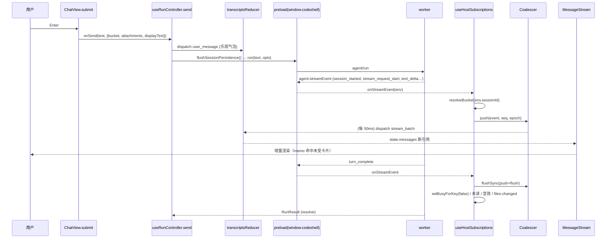

# 09 · Desktop Renderer / Mobile Web / packages/web 架构（函数级）

> 基线：`main@df2ca0bda`（2026-10-20）。所有 `file:line` 已用 `grep -n` 对当前工作树核验；
> 行号随提交漂移，引用前请 `git diff` 确认。
> 路径约定：`renderer/` = `packages/desktop/src/renderer/`，`mobile/` = `packages/desktop/src/mobile/`，
> `web/` = `packages/web/`。Desktop main/preload 不在本章范围（只在接缝处引用 preload 的方法名）。

---

## 0. 一页结论

| 产物                                                           | 源码根                                                       | 构建                                                      | 运行环境                                   | 与 Host 的通信                                                |
| -------------------------------------------------------------- | ------------------------------------------------------------ | --------------------------------------------------------- | ------------------------------------------ | ------------------------------------------------------------- |
| **Desktop Renderer**（主窗口 / 宠物小窗 / 浏览器弹窗）         | `renderer/` (~150k 行含 i18n)                                | `packages/desktop/vite.config.ts` → `out/renderer`        | Electron BrowserWindow（contextIsolation） | **只**通过 preload 暴露的 `window.codeshell.*`（IPC）         |
| **Desktop 托管的 Web 入口**（手机/平板/浏览器访问 `/mobile/`） | `mobile/main.tsx`（14 行入口）+ **`web/app/DesktopApp.tsx`** | `vite.mobile.config.ts` → `out/mobile`，`base:"/mobile/"` | 普通浏览器                                 | 同源 WebSocket `/ws`（配对设备协议）+ cookie HTTP `/api/v1/*` |
| **`@cjhyy/code-shell-web` 库**                                 | `web/src/` (~8k 行)                                          | `tsc -p web/tsconfig.json` → `web/dist`                   | 浏览器（零 Electron/Node）                 | 被 renderer（少量纯函数）、`web/app`、`mobile/` 消费          |
| **独立 Web SPA（Hub/Website）**                                | `web/app/` (~28k 行)                                         | `web/vite.config.ts` → `web/dist-app`                     | 浏览器                                     | `/ws` 上的 core JSON-RPC（`ProtocolClient`）+ `/api/v1/*`     |

关键事实（与旧文档不同之处）：

1. **`mobile/App.tsx` 与 `mobile/components/*` 已是遗留代码**：`mobile/main.tsx:4,14` 现在挂载的是
   `web/app/DesktopApp.tsx` 的 `<DesktopApp/>`（与独立 Hub 共用 `Workbench`）。旧 `App.tsx` 仍被
   `tsconfig.mobile.json` 的 `include: ["src/mobile", ...]` 类型检查，组件仍有单测（`ApprovalCard.test.tsx`
   等以相对路径导入），但没有任何入口引用它。
2. Renderer **没有 zustand / redux / react-router**。状态 = `App.tsx` 里一个 `useReducer(transcriptsReducer)` +
   约 60 个 `useState` + 大量 `useRef`（给只注册一次的 IPC 回调读最新值）+ 少量 React Context +
   若干模块级「外部 store」（`useSyncExternalStore`）。路由 = `view.viewMode` 字符串（localStorage `codeshell.view`）。
3. 有**两套流式 reducer**：Desktop 主聊天用 `renderer/types.ts:932 applyStreamEvent`（富模型：Turn、子 Agent、
   Goal、文件 diff、缓存用量）；`web/src/lib/streamReducer.ts:172 reduceStream`（扁平 `ChatItem[]`）服务
   Web/Mobile、CC Room（`renderer/cc-room/CCConversationView.tsx:20`）。两者语义相近但**不等价**。

---

## 1. 定位与依赖

### 1.1 构建配置

| 文件                                               | 要点                                                                                                                                                                                                                                                                                                                                                                                                                                                                                                                                                                           |
| -------------------------------------------------- | ------------------------------------------------------------------------------------------------------------------------------------------------------------------------------------------------------------------------------------------------------------------------------------------------------------------------------------------------------------------------------------------------------------------------------------------------------------------------------------------------------------------------------------------------------------------------------ |
| `packages/desktop/vite.config.ts`                  | `root: src/renderer`，`base: "./"`（file:// 加载），dev 端口 **5273**（`strictPort`），`outDir: out/renderer`，`chunkSizeWarningLimit: 1000`，`manualChunks: rendererManualChunks`；插件 `@vitejs/plugin-react` + `@tailwindcss/vite`（Tailwind v4）；`optimizeDeps.include` 预打包全部 Radix + lucide（避免会话中途 re-optimize 导致 `504 Outdated Optimize Dep`）；alias `@renderer`/`@` → `src/renderer`，`@cjhyy/code-shell-web` → `../web/src/index.ts`（**直接打包源码**，绕开可能过期的 dist）。注释明确：main/preload 用 esbuild 另行构建，renderer 是 "thin client"。 |
| `packages/desktop/vite.mobile.config.ts`           | `root: src/mobile`，**`base: "/mobile/"`（必须绝对，远端 Host 只路由 `/mobile` 前缀）**，`publicDir: ../web/app/public`（manifest/service worker/offline.html 与 SPA 共用），dev `127.0.0.1:5373`（显式 IPv4，避免 main 进程代理目标歧义），`outDir: out/mobile`；只有 react 插件；同样 alias `@cjhyy/code-shell-web` 到源码。                                                                                                                                                                                                                                                 |
| `packages/desktop/vite-chunks.ts`                  | `rendererManualChunks(id)`：`packages/web/src/` → `codeshell-web`；react/react-dom/scheduler → `react-vendor`；lucide → `icons-vendor`；Radix + cmdk → `ui-vendor`；react-markdown/remark/rehype/unified/mdast/micromark/hast/unist → `markdown-vendor`；highlight.js → `syntax-vendor`；@xterm → `terminal-vendor`。                                                                                                                                                                                                                                                          |
| `packages/web/vite.config.ts`                      | `root: app`，`outDir: dist-app`；dev proxy `^/api/` 与 `/ws`（ws:true）→ `127.0.0.1:8790`（本地 `code-shell-serve`）。产物由 `packages/server/src/serve/cli.ts:157 resolveWebAppRoot()` 定位为静态根。                                                                                                                                                                                                                                                                                                                                                                         |
| `packages/desktop/tsconfig.json`                   | `paths`: `@/*`→`src/renderer/*`，`@ui/*`→`src/renderer/components/ui/*`，`@protocol`→`../server/src/mobile-remote/types.ts`，`@mobile/*`→`src/mobile/*`，`@cjhyy/code-shell-web(/*)`→`../web/src/*`；`strict: true` + `noImplicitAny: false`；**exclude `src/mobile`**。                                                                                                                                                                                                                                                                                                       |
| `packages/desktop/tsconfig.mobile.json`            | `include: ["src/mobile", "src/renderer/components/ui", "src/renderer/lib", "../server/src/mobile-remote/types.ts"]`，`types: []`（无 node 类型）——确保 mobile 只能碰 shadcn 原语与 `lib/utils`。`bun run typecheck`（desktop）= `tsc --noEmit && tsc -p tsconfig.mobile.json --noEmit`。                                                                                                                                                                                                                                                                                       |
| `packages/web/tsconfig.json` / `tsconfig.app.json` | 库：`rootDir: src`，`declaration: true`，`types: []`；SPA：`include: app/**`，`types: ["vite/client"]`，`noEmit`。`web` 的 `typecheck` 两个都跑。                                                                                                                                                                                                                                                                                                                                                                                                                              |
| `packages/web/package.json`                        | `exports: { ".": dist/index.js }`，`files: [dist, dist-app]`；`build = clean && tsc && vite build`（清两个产物目录，防止发布陈旧资源）；依赖 `@cjhyy/code-shell-core`（仅类型）、`@cjhyy/code-shell-link`、`qrcode`；peer `react 19.2.6`；dev `react-markdown`/`remark-gfm`。                                                                                                                                                                                                                                                                                                  |
| `packages/desktop/components.json`                 | shadcn 生成配置（组件落在 `renderer/components/ui/*`）。                                                                                                                                                                                                                                                                                                                                                                                                                                                                                                                       |

### 1.2 `@/*` 别名

仅存在于 desktop 两个 tsconfig 与 vite 配置。`@/` 与 `@renderer/` 等价指向 `renderer/`；遗留 mobile 代码用
`@/lib/utils`、`@ui/button`、`@/i18n`、`@mobile/components/*`。其他包（含 `web/`）一律相对路径或包名导入。

### 1.3 ESLint 运行时导入边界（`eslint.config.js`）

两层同时生效：

1. **`@typescript-eslint/no-restricted-imports`**（`eslint.config.js:457-481`，files `packages/desktop/src/renderer/**/*.{ts,tsx}`）：
   - 正则 `^@cjhyy/code-shell-core(?:$|/(?!browser/panel-app-runtime$).+)` → 只允许 `@cjhyy/code-shell-core/browser/panel-app-runtime`；
   - `@cjhyy/code-shell-tui(/*)`、`@cjhyy/code-shell` 禁止；
   - `allowTypeImports: true`：`import type` 一律放行（renderer 大量 `import type { StreamEvent } from "@cjhyy/code-shell-core"`）。
2. **自定义规则 `custom-rules/codeshell-boundary-imports`**：`rendererBrowserSafeRuntimeImports = new Set(["@cjhyy/code-shell-core/browser/panel-app-runtime", "@cjhyy/code-shell-web"])`（`eslint.config.js:55-58`）；在 `isInsideRoot(filename, desktopRendererRoot)` 分支（`:290-301`）里，非类型导入若是任一 codeshell 包、或相对路径跨入其他 workspace 包根，就报 `rendererToCodeshell`。测试与 `test-utils/` 关闭此自定义规则（`:487-496`）。

实际运行时导入点（核验 `grep "from \"@cjhyy/code-shell-web\""`）：`transcriptHydration.ts:6`、`transcripts.ts:30`、
`types.ts:9`、`uiLanguage.ts:13`、`app/outputJournalRecovery.ts:9`、`app/useHostSubscriptions.ts:5`、
`runtime/cloudHistory.ts:9`、`runtime/CloudProjectRuntime.ts:10`、`cc-room/CCConversationView.tsx:24-25`、
`automation/mergeTranscripts.ts:21`、`i18n/dict.ts:34`、`credentials/LinkConnectionDialog.tsx:20`；
`panel-app-runtime` 仅 `panels/DesktopBuiltinPanelApp.tsx:5`（运行时）与 `panels/apps/quickChatPanelApp.tsx:3`（类型）。

### 1.4 第三方栈

- React **19.2.6**（根 `overrides` 锁定）；`react-dom/client` `createRoot` + `StrictMode`。
- UI：Radix（dialog/dropdown/popover/select/switch/tabs/tooltip/slider/checkbox/scroll-area/separator/label/slot）
  - shadcn 包装（`renderer/components/ui/*`）+ `cmdk`（命令面板/combobox）+ `lucide-react` + `class-variance-authority`/`clsx`/`tailwind-merge`（`lib/utils.ts cn()`）+ Tailwind v4 + `tw-animate-css`。
- Markdown：`react-markdown@9` + `remark-gfm@4` + `rehype-raw` + `rehype-sanitize` + `rehype-highlight@7`（highlight.js 显式语言集）。
- 终端：`@xterm/xterm` + `addon-fit`（仅 `panels/TerminalPanel.tsx`，经 `PanelRegistry` 懒加载）。
- `qrcode`（配对二维码），`@xterm`，`electron <webview>`（Browser Panel / Panel App）。

### 1.5 多窗口入口（`renderer/main.tsx`）

`main.tsx:16 initTheme()` 后按 `?popout=` 分三种：

| 条件                              | 挂载树                                                                                                                                                                   | 用途           |
| --------------------------------- | ------------------------------------------------------------------------------------------------------------------------------------------------------------------------ | -------------- |
| `popout=pet`（`main.tsx:49`）     | `I18nProvider > SessionPersistenceGate > PetStateProvider > PetDesktopWindow`，并给 `<html>` 加 `pet-widget-window`                                                      | 桌面宠物小窗   |
| `popout=browser`（`main.tsx:64`） | `<PopoutBrowser initialUrl>`（`main.tsx:25`）：订阅 `window.codeshell.onBrowserAnchorsState`，渲染 `BrowserPanel`，圈选通过 `sendBrowserAnchor/Remove/Update` 回传主窗口 | 浏览器弹出窗口 |
| 默认（`main.tsx:70-88`）          | `installQuickChatPanelApp()` → `I18nProvider > DialogProvider > ToastProvider > SessionPersistenceGate > PetStateProvider > App`                                         | 主窗口         |

`index.html` 不写 meta CSP：CSP 由 main 进程 `webRequest.onHeadersReceived` 下发（dev 需 blob: worker）。

---

## 2. 文件/目录清单（按功能域）

行数为非测试源码行数。`*.fixture.tsx`/`*.browser.fixture.mjs` 为浏览器测试夹具，不列。

### 2.1 App 壳与全局编排（`renderer/` 根 + `app/`）

| 文件                                                                                                                                                                 | 行                     | 职责                                                                                                                                                                                                                                                                                                                                                                                  |
| -------------------------------------------------------------------------------------------------------------------------------------------------------------------- | ---------------------- | ------------------------------------------------------------------------------------------------------------------------------------------------------------------------------------------------------------------------------------------------------------------------------------------------------------------------------------------------------------------------------------- | ------------------------------------------------------ |
| `main.tsx`                                                                                                                                                           | 89                     | 三种窗口入口（见 1.5）。                                                                                                                                                                                                                                                                                                                                                              |
| `App.tsx`                                                                                                                                                            | 3174                   | **总编排器**：持有 transcripts reducer、审批队列、busy/queued/unread 集合、项目/会话索引、视图模式、覆盖（权限/模型/Goal）、composer 草稿等；把它们注入一组 `app/use*` hook；渲染 TopBar/Sidebar/页面/ChatView/SessionPanelDock/Settings。懒加载 `SettingsPage`、`CredentialsPage`、`DigitalHumansView`、`ApprovalsView`、`AutomationView`、`SessionPanelDock`（`App.tsx:157-176`）。 |
| `app/AppShell.tsx`                                                                                                                                                   | 53                     | `AppShell`（平台 class、侧栏折叠）与 `AppMainView` 布局壳。                                                                                                                                                                                                                                                                                                                           |
| `app/ResponsiveSidebar.tsx` / `useResponsiveSidebar.ts`                                                                                                              | 132/61                 | <640px 时侧栏变抽屉（`SIDEBAR_BREAKPOINT=640`），窄屏打开不改写桌面偏好。                                                                                                                                                                                                                                                                                                             |
| `app/useHostSubscriptions.ts`                                                                                                                                        | 1175                   | **所有 Host → Renderer 推送的唯一订阅点**：流事件、自动化/移动端/宠物委派会话公告、审批请求/已决、移动端权限模式、状态、Agent 生命周期、worktree 清理跳过。                                                                                                                                                                                                                           |
| `app/useRunController.ts`                                                                                                                                            | 1247                   | **所有 Renderer → Host 的 run 操作**：`send`/`sendQuickChat`/`queueInput`/`forceSend`/`stop`/`compactActiveSession`/`extendGoal`/`decideEnvelope`。                                                                                                                                                                                                                                   |
| `app/useTranscriptBuckets.ts`                                                                                                                                        | 554                    | 活动会话 hydration（本地快照 + 磁盘 transcript 分页 + 输出 journal + main 快照回放）、`loadEarlierHistory`、busy 时钟、flush 前把 transcript 快照写入持久层。                                                                                                                                                                                                                         |
| `app/useSessionNavigation.ts`                                                                                                                                        | 490                    | 选择会话、新建草稿、项目增删改/置顶/归档、会话改名/置顶/归档/删除、打开自动化 run/磁盘会话/历史会话。                                                                                                                                                                                                                                                                                 |
| `app/usePanelBuckets.ts`                                                                                                                                             | 1033                   | 每个会话 bucket 的右侧 dock 状态（tabs/active/revealFile/openUrl/subagent）、Quick Chat 会话生命周期、composer seed、浏览器圈选 anchors（含弹窗同步）、面板宽度拖拽。                                                                                                                                                                                                                 |
| `app/SessionPanelDock.tsx`                                                                                                                                           | 245                    | 右侧 dock 容器：包 `PanelArea`，并给内置 Panel App 提供 `getService(QUICK_CHAT_PANEL_APP_ID)`。                                                                                                                                                                                                                                                                                       |
| `app/usePanelAppCatalog.ts`                                                                                                                                          | 168                    | 拉 Panel App 目录 → `replacePanelApps()` 写入 `PANEL_REGISTRY`；订阅 `onPanelAppsChanged`。                                                                                                                                                                                                                                                                                           |
| `app/useSessionIndices.ts`                                                                                                                                           | 46                     | 首帧从 `loadSessionIndex` 播种，之后订阅 `SessionPersistence`（main 的跨窗口会话目录）。                                                                                                                                                                                                                                                                                              |
| `app/useTrackedProjects.ts` / `useProjectRegistrySync.ts`                                                                                                            | 21/101                 | 项目列表 = `projects.ts` 的外部 store（`useSyncExternalStore`）；sync hook 调 `projectRegistry.list()`、做旧 localStorage 项目迁移、订阅 `projectRegistry.onChanged`。                                                                                                                                                                                                                |
| `app/useBucketOverrides.ts`                                                                                                                                          | 47                     | 按 bucket 的权限/模型/Goal 覆盖（localStorage 投影）。                                                                                                                                                                                                                                                                                                                                |
| `app/useIdleTranscriptEviction.ts`                                                                                                                                   | 160                    | 内存只保留最近 `RETAINED_IDLE_TRANSCRIPT_BUCKETS=10` 个空闲 transcript；有待决交互/在跑/排队的 bucket 受保护。                                                                                                                                                                                                                                                                        |
| `app/useAutomationSessionImport.ts`                                                                                                                                  | 203                    | 把自动化 run / 磁盘会话导入侧栏投影，分页加载磁盘会话目录。                                                                                                                                                                                                                                                                                                                           |
| `app/useSessionHistorySync.ts`                                                                                                                                       | 127                    | 历史页的改名/删除结果回写到已加载侧栏。                                                                                                                                                                                                                                                                                                                                               |
| `app/useNotificationSessionNavigation.ts` / `notificationSessionNavigation.ts`                                                                                       | 84/78                  | 原生通知点击 → 定位已存在会话（绝不新建空会话）。                                                                                                                                                                                                                                                                                                                                     |
| `app/useExternalRuntimeModels.ts`                                                                                                                                    | 72                     | 外部 Agent Runtime（codex / claude-code）模型列表，不阻塞本地模型加载。                                                                                                                                                                                                                                                                                                               |
| `app/switchActiveModel.ts`                                                                                                                                           | 79                     | 同一会话内原生 Engine 与外部 Runtime 生命周期互斥切换。                                                                                                                                                                                                                                                                                                                               |
| `app/outputJournalRecovery.ts`                                                                                                                                       | 126                    | `recoverDesktopOutputJournal()`：先重建完整输出前缀，再与 main 快照拼接。                                                                                                                                                                                                                                                                                                             |
| `app/mergeHistoryWindows.ts`                                                                                                                                         | 140                    | 合并磁盘历史窗口与本地缓存窗口。                                                                                                                                                                                                                                                                                                                                                      |
| `app/approvalPermission.ts`                                                                                                                                          | 24                     | 读请求会话自己的默认权限（与前台页面无关）。                                                                                                                                                                                                                                                                                                                                          |
| `app/appUtils.ts`                                                                                                                                                    | 135                    | `PanelBucketState`、`parsePanelBucket`、`browserPartitionForBucket`、`resolveMainComposerBucket`、移动端权限模式互转、`stablePromptHash`。                                                                                                                                                                                                                                            |
| `app/panelResize.ts`、`useThemeAudio.ts`、`ThemeMusicMiniPlayer.tsx`                                                                                                 | 138/49/50              | dock 拖拽宽度钳制；主题音效（只在主 App 挂载）；全局可见的背景音乐迷你播放器。                                                                                                                                                                                                                                                                                                        |
| `TopBar.tsx`                                                                                                                                                         | 482                    | 顶栏：项目/会话标题、工作区指示、状态徽章、面板/侧栏开关；`React.memo(TopBarImpl, topBarPropsEqual)`（`TopBar.tsx:77,440`）。                                                                                                                                                                                                                                                         |
| `topbar/WorkspaceIndicator.tsx`                                                                                                                                      | 1140                   | 会话 worktree/分支/diff 摘要与清理入口。                                                                                                                                                                                                                                                                                                                                              |
| `topbar/StatusPopover.tsx`、`liveActivity.ts`                                                                                                                        | 268/183                | 状态弹层（Goal、运行中 agent、任务）；`summarizeLiveActivity` 从 messages 推导"正在做什么"。                                                                                                                                                                                                                                                                                          |
| `Sidebar.tsx`                                                                                                                                                        | 1629                   | 左侧：一级导航（来自 `PAGE_REGISTRY`）、项目分组（`ProjectGroup:951`）、无项目对话（`NoRepoSection:1194`）、会话悬浮卡、项目根目录对话框、账户入口。                                                                                                                                                                                                                                  |
| `sidebarSessionVisibility.ts`                                                                                                                                        | 57                     | 会话排序/折叠/揭示项目。                                                                                                                                                                                                                                                                                                                                                              |
| `shell/CommandPalette.tsx`、`SearchBar.tsx`、`SearchDialog.tsx`、`SessionSearchModal.tsx`、`sessionContentSearch.ts`、`useSessionContentSearch.ts`、`searchFocus.ts` | 206/82/82/293/55/52/16 | ⌘K 命令面板（`buildCommands`）、会话内查找、跨会话搜索（`>` 前缀进入内容搜索，调 `searchSessionContent`）。                                                                                                                                                                                                                                                                           |
| `pages/PageRegistry.ts`                                                                                                                                              | 276                    | 全屏页注册表（侧栏一级导航 + App 渲染共用）；**仅内置**，插件 UI 走 Panel App。                                                                                                                                                                                                                                                                                                       |
| `view.ts`                                                                                                                                                            | 81                     | `BUILTIN_VIEW_MODES`（chat/pet/pet_settings/pet_personalization/pet_memory/digital_humans/sessions/traces/approvals/automation/settings_page/project_config/credentials/logs）、`loadView`（含旧路由迁移 `customize                                                                                                                                                                   | settings→settings_page`、`runs→traces`）、`saveView`。 |
| `workspace-trust/TrustGate.tsx`                                                                                                                                      | 307                    | 首次打开项目的信任确认（`getTrust`/`setTrust`）。                                                                                                                                                                                                                                                                                                                                     |
| `updater/UpdaterBanner.tsx`                                                                                                                                          | 431                    | 侧栏更新按钮、设置页更新行（`checkForUpdate`/`downloadUpdate`/`installUpdate`/`onUpdaterStatus`）。                                                                                                                                                                                                                                                                                   |
| `account/AccountSidebarEntry.tsx`                                                                                                                                    | 152                    | 侧栏底部云账户入口。                                                                                                                                                                                                                                                                                                                                                                  |
| `InspectorPanel.tsx`                                                                                                                                                 | 114                    | 旧检查器面板（`App.tsx:31` 注释：已移除，工具详情改为内联卡片）。                                                                                                                                                                                                                                                                                                                     |

### 2.2 会话 / Transcript 数据层（根目录纯逻辑）

| 文件                                                                                                                                                                                                                                                                      | 行     | 职责                                                                                                                                                                                                                                                                                                                                                                                                                                                                                                                                                                                  |
| ------------------------------------------------------------------------------------------------------------------------------------------------------------------------------------------------------------------------------------------------------------------------- | ------ | ------------------------------------------------------------------------------------------------------------------------------------------------------------------------------------------------------------------------------------------------------------------------------------------------------------------------------------------------------------------------------------------------------------------------------------------------------------------------------------------------------------------------------------------------------------------------------------- |
| `types.ts`                                                                                                                                                                                                                                                                | 2479   | `Message` 联合类型、`MessagesReducerState`、`INITIAL_STATE`、**`applyStreamEvent`（`:932`）** 与 `applyStreamEventToTurn`（`:1195`）、`appendUserMessage`（`:2268`）、`appendAskUserMessage`（`:2241`）、`markAskUserAnswered`（`:2255`）、`appendTurnEndMessage`（`:2384`）、`removePendingSteerMessages`（`:2361`）、`isCurrentStreamRunEvent`（`:1131`）、`bgCompletionText`（`:855`）。                                                                                                                                                                                           |
| `transcriptsReducer.ts`                                                                                                                                                                                                                                                   | 250    | `TranscriptsMap = Record<bucket, MessagesReducerState>` 与 `TranscriptsAction`；`transcriptsReducer`（`:96`）先经 `reduceTranscriptHydration` 再 `reduceTranscriptAction`。                                                                                                                                                                                                                                                                                                                                                                                                           |
| `transcriptHydration.ts`                                                                                                                                                                                                                                                  | 651    | hydration 期间的 **live 事件 journal**（WeakMap 挂在 reducer 快照上，上限 8192 事件/8 MiB），`hydrate_begin/cancel/history` 时重放；`hasTranscriptRecovery`、`latestRecoveryOutputCursor`。                                                                                                                                                                                                                                                                                                                                                                                           |
| `transcripts.ts`                                                                                                                                                                                                                                                          | 1146   | bucket 键（`bucketKey`/`projectBucketSegment`/`NO_REPO_KEY="__no_repo__"`/`DRAFT_BUCKET_SUFFIX="::_none_"`）、会话索引 CRUD（`loadSessionIndex`、`saveSessionIndex`、`createSession`、`bindEngineSession`、`setActiveSession:1137`、`touchSession`、`renameSessionLocal`、`archiveSession` 等）、transcript 缓存读写（`loadTranscript`、`loadPersistedTranscript`、`saveTranscript:731`，消息上限 500、单条 1 MiB）、覆盖 map 与面板状态 localStorage（`loadOverrideMap`/`savePanelState`）、`applyTranscriptStreamEvent`（`:45`，按 `outputCursor` 去重、处理 `context_transfer`）。 |
| `sessionPersistence.ts`                                                                                                                                                                                                                                                   | 603    | `SessionPersistence` 类（`:146`）：对 `window.codeshell.sessionCatalog` 的写合并器（catalog patch 队列、transcript 写队列、内存快照 LRU 16 MiB/20 条），一次性 `importLegacy` 迁移 localStorage；`getSessionPersistence()`（`:557`）单例。                                                                                                                                                                                                                                                                                                                                            |
| `SessionPersistenceGate.tsx`                                                                                                                                                                                                                                              | 79     | 目录未加载完不挂载 App；失败显示重试；注册 `sessionCatalog.onFlushRequested(flushSessionPersistence)`。                                                                                                                                                                                                                                                                                                                                                                                                                                                                               |
| `streamCoalescer.ts`                                                                                                                                                                                                                                                      | 188    | `createEventCoalescer`（`:41`）：50 ms 批处理 + delta 合并。                                                                                                                                                                                                                                                                                                                                                                                                                                                                                                                          |
| `streamRouting.ts`                                                                                                                                                                                                                                                        | 88     | `resolveBucket`（`:31`）：engineSessionId → bucket；`findAskUserOrigin`（`:69`）。                                                                                                                                                                                                                                                                                                                                                                                                                                                                                                    |
| `snapshotReplay.ts`                                                                                                                                                                                                                                                       | 44     | `selectReplayEvents(snapshot, sinceSeq)`、`snapshotHasUnfinishedTopLevelTurn`。                                                                                                                                                                                                                                                                                                                                                                                                                                                                                                       |
| `stopRouting.ts`                                                                                                                                                                                                                                                          | 24     | `resolveStopBucket(override, active, running)`：Stop 默认作用于**正在看的**会话。                                                                                                                                                                                                                                                                                                                                                                                                                                                                                                     |
| `queuedInput.ts`                                                                                                                                                                                                                                                          | 177    | 排队输入（steer）状态机：`enqueueQueuedInput`/`dequeue`/`canSteerQueuedItem`/`enqueueSerialTask`。                                                                                                                                                                                                                                                                                                                                                                                                                                                                                    |
| `sessionStatus.ts`                                                                                                                                                                                                                                                        | 26     | `statusForBucket` → 侧栏状态点。                                                                                                                                                                                                                                                                                                                                                                                                                                                                                                                                                      |
| `sessionUiAuthority.ts`                                                                                                                                                                                                                                                   | 284    | `useSessionUiAuthority`/`useActiveSessionUiAuthority`（`:60,:248`）：调用 `getSessionWorkspaceAuthority(sessionId)`，订阅 `onWorkspaceChanged`/`onStreamEvent`，产出 `mainRoot/workspaceRoot/rootStatus/configurationTarget`。                                                                                                                                                                                                                                                                                                                                                        |
| `sessionDeletionPlan.ts`                                                                                                                                                                                                                                                  | 46     | 删除会话时要取消的 cron / 删除的 engine session / run。                                                                                                                                                                                                                                                                                                                                                                                                                                                                                                                               |
| `workspaceArchiveRelease.ts`                                                                                                                                                                                                                                              | 80     | 归档时释放 worktree。                                                                                                                                                                                                                                                                                                                                                                                                                                                                                                                                                                 |
| `attachmentSession.ts`、`contextSelection.ts`、`configurationTarget.ts`、`modelSelection.ts`、`modelSwitchRun.ts`、`externalRuntimeRun.ts`、`promptHistory.ts`、`quickChatSession.ts`、`gitPrefs.ts`、`imGatewayChannels.ts`、`nativePath.ts`、`keyboardShortcutHints.ts` | 15–271 | 附件会话解析；上下文选择打包（选若干 turn 生成 context package / fork）；配置目标（project/conversation）；默认模型持久化；`runAfterModelSwitch`（把 model 合入 run opts）；外部 Runtime 回合（`runExternalRuntimeTurn`/`buildExternalRuntimeHandoff`）；输入历史；Quick Chat id/bucket；Git 偏好；IM 渠道解析；原生路径；快捷键提示。                                                                                                                                                                                                                                                |
| `projects.ts`                                                                                                                                                                                                                                                             | 364    | main V2 项目注册表的 renderer 投影：`getProjectSnapshot`/`subscribeProjects`/`loadProjects`/`saveProjects`、旧 `codeshell.repos` 一次性读取、`reconcileProjectsFromDiskWithRemap`。                                                                                                                                                                                                                                                                                                                                                                                                   |
| `perf.ts`                                                                                                                                                                                                                                                                 | 191    | `timePhase(name, fn, meta)`：默认开，超阈值写 `window.codeshell.log("perf.*")`；`localStorage cs:perf=0` 或 `window.csPerf(false)` 关闭。                                                                                                                                                                                                                                                                                                                                                                                                                                             |
| `settingsBus.ts` / `settingsAuthority.ts`                                                                                                                                                                                                                                 | 29/25  | `writeSettings(scope, patch, projectPath)` = `updateScopedSettings` + 派发 `codeshell:settings-changed`；`readScopedSettings`。                                                                                                                                                                                                                                                                                                                                                                                                                                                       |
| `theme.ts`、`theme-packs.ts`、`theme-appearance.ts`、`theme-audio.ts`、`theme-music.ts`、`installedThemes.ts`、`builtin-*-theme.ts`、`petSprite.ts`                                                                                                                       | 35–245 | 主题（明暗、主题包 CSS 变量白名单注入 `<style>`）、主题音效/背景音乐、已安装主题缓存（外部 store）、内置角色主题包、宠物精灵图。                                                                                                                                                                                                                                                                                                                                                                                                                                                      |
| `uiLanguage.ts`                                                                                                                                                                                                                                                           | 13     | 从 `@cjhyy/code-shell-web` 再导出 `loadUILanguage/saveUILanguage`（存储键 `codeshell.uiLanguage`）。                                                                                                                                                                                                                                                                                                                                                                                                                                                                                  |

### 2.3 聊天 / Composer（`ChatView.tsx` + `chat/`）

| 文件                                                                                                                 | 行               | 职责                                                                                                                                                                                                |
| -------------------------------------------------------------------------------------------------------------------- | ---------------- | --------------------------------------------------------------------------------------------------------------------------------------------------------------------------------------------------- |
| `ChatView.tsx`                                                                                                       | 2727             | 主聊天视图：`MessageStream` + Composer（textarea、@mention、/slash、插件命令、/loop、/compact、附件/粘贴/拖拽、语音转写、anchors、模型/权限/Goal/项目/分支 pill、上下文环、排队输入列表、审批卡）。 |
| `chat/PermissionPill.tsx`                                                                                            | 296              | 权限模式选择；`toCorePermissionMode`、`toExternalRuntimePermission`、`fromSettingsPermissionMode`。                                                                                                 |
| `chat/ModelPill.tsx`、`modelPickerPresentation.ts`                                                                   | 321/13           | 模型选择（按连接分组）。                                                                                                                                                                            |
| `chat/GoalToggle.tsx`、`ContextRing.tsx`、`ProjectPicker.tsx`、`BranchPicker.tsx`、`WelcomeSuggestions.tsx`          | 41–478           | Goal 开关；上下文 token 环（单轮/累计缓存命中）；项目选择；分支切换（`switchProjectGitBranch`/`stashAndSwitchProjectGitBranch`）；欢迎页提示词。                                                    |
| `chat/MentionPopover.tsx`、`mention.ts`、`mentionReferences.ts`                                                      | 370/56/103       | `@` 文件/技能提及与引用绑定（编辑后失效的引用不会再次授权）。                                                                                                                                       |
| `chat/ComposerSuggestions.tsx`、`pluginSlashCommands.ts`                                                             | 101/94           | slash 建议浮层；插件命令解析 `parsePluginSlashInvocation`、`parseLoopSlashInvocation`、`buildLoopCommandPrompt`。                                                                                   |
| `chat/attachments.ts`、`compress.ts`、`localFilePaths.ts`、`useQuickChatImages.ts`                                   | 391/215/56/176   | 附件元数据/限额（`ATTACHMENT_LIMITS`）、`encodeAttachmentsForWire`、`titleFromWire`、图片压缩（按 `imageDetail`）、本地文件路径拼接。                                                               |
| `chat/anchors.ts`、`anchorBuckets.ts`、`addAnchor.ts`、`CommentBox.tsx`                                              | 228/80/10/73     | 评论锚点（diff/浏览器/文件）→ `encodeAnchorsForWire` 结构化前缀；按 bucket 管理。                                                                                                                   |
| `chat/composerSeed.ts`、`composerMetadata.ts`、`useComposerCaretRestore.ts`                                          | 61/18/79         | 外部向 composer 注入文本（`codeshell:composer-seed` 事件）；光标恢复。                                                                                                                              |
| `chat/linkResourceIntents.ts`、`ChatLinkResources.tsx`                                                               | 276/406          | Link（Figma 等）资源读取意图：只认本窗口 composer 实际提交过的文本作为授权候选。                                                                                                                    |
| `chat/stickToBottom.ts`、`followState.ts`、`scrollTrigger.ts`、`TranscriptScrollContext.ts`、`useAnchoredPopover.ts` | 329/85/39/12/178 | 流式自动贴底、"跳到底部"按钮、每个 transcript 独立阅读位置 context、锚定弹层。                                                                                                                      |
| `chat/Lightbox.tsx`、`InlineMedia.tsx`、`openWith.ts`、`OpenWithMenu.tsx`、`compactFeedback.ts`                      | 277/217/77/85/88 | 图片灯箱；内联音视频（互斥播放）；打开方式（`openPath`/`openInEditor`/`revealInFinder`）；压缩结果文案。                                                                                            |

### 2.4 消息渲染（`MessageStream.tsx` + `messages/` + `tool-cards/` + `markdown/` + `diff/`）

| 文件                                                                                                                                                                                                     | 行                | 职责                                                                                                                                                                                                                                                                         |
| -------------------------------------------------------------------------------------------------------------------------------------------------------------------------------------------------------- | ----------------- | ---------------------------------------------------------------------------------------------------------------------------------------------------------------------------------------------------------------------------------------------------------------------------- |
| `MessageStream.tsx`                                                                                                                                                                                      | 929               | 消息列表：`buildStreamItems → reconcileStreamItems → foldAgentGroups`（`:427`），`renderStreamItem`（`:450`）按 kind 分派；`content-visibility:auto` 跳过屏外布局（末尾 `LIVE_TAIL_UNCONTAINED=8` 项不包，`:63`）；上下文选择模式（多 turn 选中 → context package / fork）。 |
| `messages/streamGroups.ts`                                                                                                                                                                               | 733               | 两级折叠：相邻工具 → `ToolGroup`；每个 turn 首工具..末工具 → `TurnProcessGroup`（仅最新 turn 在 live 时默认展开）；隐藏工具/记账工具过滤；`reconcileStreamItems` 用签名复用旧对象保证 memo 命中。                                                                            |
| `messages/agentGroup.ts`、`AgentGroupCard.tsx`、`AgentMessageView.tsx`                                                                                                                                   | 133/91/132        | ≥2 个相邻子 Agent 折叠为汇总卡。                                                                                                                                                                                                                                             |
| `messages/AssistantMessageView.tsx`、`StreamingMarkdown.tsx`、`ThinkingMessageView.tsx`                                                                                                                  | 98/165/50         | 助手正文（done→`Markdown`，streaming→稳定前缀 markdown + 活动尾部纯文本，见 6.1）、思考块。                                                                                                                                                                                  |
| `messages/TurnProcessGroupCard.tsx`、`ToolGroupCard.tsx`、`CollapsibleContent.tsx`、`LiveActivityLine.tsx`                                                                                               | 281/90/96/26      | 回合过程卡、工具组卡、折叠容器、"正在思考…"行。                                                                                                                                                                                                                              |
| `messages/AskUserMessageView.tsx`、`askUserTone.ts`                                                                                                                                                      | 379/46            | AskUser 问答卡（选项/多选/仅选项/异步）。                                                                                                                                                                                                                                    |
| `messages/FilesChangedCard.tsx`、`fileChangeAggregator.ts`                                                                                                                                               | 420/496           | 每 turn 文件变更汇总（来自 `turn_diff`）。                                                                                                                                                                                                                                   |
| `messages/ContextBoundaryView.tsx`、`GoalProgressView.tsx`、`TurnEndMessageView.tsx`、`TurnUsageMessageView.tsx`、`TaskListMessageView.tsx`、`SystemReminderTask.tsx`、`AnnotationsBlock.tsx`、`time.ts` | 41–130            | 压缩边界、Goal 进度（"再续"）、回合结束、用量、任务列表、注入提醒、锚点块、时间格式。                                                                                                                                                                                        |
| `tool-cards/index.tsx`                                                                                                                                                                                   | 149               | `ToolCard = memo(ToolCardImpl)`（`:30,:149`）：按小写工具名分派 Bash/File(read/write/edit/multiedit/applypatch)/Search(grep/glob)/Web/Browser(browser\__)/Agent(agent/task/agent_)/Generic。                                                                                 |
| `tool-cards/*`（Bash/File/Search/Web/Browser/Agent/Generic/Attachment/ToolCardShell/ToolOutputBlock/SandboxBadge/DriveAgentJobsContext/attachments/utils）                                               | 44–185            | 各类工具卡；`DriveAgentJobsContext` 只加载卡片引用到的后台 job。                                                                                                                                                                                                             |
| `Markdown.tsx`                                                                                                                                                                                           | 873               | 完成态 Markdown：`remarkGfm + remarkPathLinks`，`rehypeRaw → rehypeSanitize(SANITIZE_SCHEMA) → rehypeDropEmptyClassNames → rehypeHighlight({detect:false, languages})`；`Markdown = memo(MarkdownImpl)`（`:226,:417`）；本地路径链接、媒体内联、表格包装。                   |
| `markdown/remarkPathLinks.ts`、`splitStreamingMarkdown.ts`、`stripMarkdown.ts`                                                                                                                           | 405/141/53        | 文件路径 → `codeshell-path:` 链接；流式切分（不在围栏内、只在空行边界切）；纯文本复制。                                                                                                                                                                                      |
| `diff/UnifiedDiffViewer.tsx`、`parseUnifiedDiff.ts`、`composeFileEdits.ts`、`reviewScope.ts`、`reviewSnapshot.ts`                                                                                        | 452/265/239/89/47 | Review 面板 diff 渲染与范围（staged/unstaged/range）。                                                                                                                                                                                                                       |
| `subagents/SubagentList.tsx`、`SubagentSessionDetail.tsx`、`SubagentNavigation.ts`                                                                                                                       | 261/308/43        | 子 Agent 列表与在 dock 中查看子会话详情（context 提供导航）。                                                                                                                                                                                                                |

### 2.5 审批（`approvals/`）

| 文件                                              | 行    | 职责                                                                                                                                          |
| ------------------------------------------------- | ----- | --------------------------------------------------------------------------------------------------------------------------------------------- |
| `approvals/ApprovalCard.tsx`                      | 294   | 审批卡（`:62`，按 `approvalKey` 重挂载）：显示工具/参数/风险，选项（本次/本会话/路径范围），拒绝理由；`onDecide` 返回 Promise，失败恢复按钮。 |
| `approvals/approvalDecision.ts`                   | 108   | `approveOptionsFor`、`decisionFromChoice`，路径可收窄工具集合（镜像 core）。                                                                  |
| `approvals/approvalRecords.ts`                    | 32    | `approvalKey(env)`（requestId 可能跨 worker 复用，键含 sessionId）。                                                                          |
| `approvals/ApprovalsView.tsx`                     | 347   | 活动页"审批"：所有会话待决 + 历史，可直接决策（与聊天卡共享提交 Promise）。                                                                   |
| `approvals/useApprovalHistory.ts`、`RiskPill.tsx` | 54/44 | 审批历史（localStorage，`APPROVAL_HISTORY_LIMIT`）、风险标签。                                                                                |

### 2.6 右侧 Dock / 面板（`panels/`）

| 文件                                                                                                                                        | 行         | 职责                                                                                                                                                                                                                                                                                                                                                                |
| ------------------------------------------------------------------------------------------------------------------------------------------- | ---------- | ------------------------------------------------------------------------------------------------------------------------------------------------------------------------------------------------------------------------------------------------------------------------------------------------------------------------------------------------------------------- |
| `panels/PanelRegistry.ts`                                                                                                                   | 445        | `PanelEntry`（key/owner/title/icon/order/singleton/internalOnly/enabled/render/lifecycle/agentTools/forProject）；内置条目 files/review/terminal/shells/subagent/ccRoom/browser 等；`PanelRegistry` 类（`:251`）、`PANEL_REGISTRY` 单例（`:330`）、`replacePanelApps`（`:346`）把外部 Panel App 描述符变成 `PanelAppHost` 条目。Terminal 懒加载以隔离 xterm chunk。 |
| `panels/PanelArea.tsx`                                                                                                                      | 928        | dock 主体：`PanelWorkspaceRootConsumer` 解析工作区后渲染 `ResolvedPanelArea`；tab 条、启动器（新 tab）、最大化、弹出 Panel App 窗口（`openPanelAppWindow`，`:316`）、`DesktopPanelLifecycleBoundary` 包裹内置 Panel App。                                                                                                                                           |
| `panels/PanelAppHost.tsx`                                                                                                                   | 236        | **外部 Panel App 宿主**：`preparePanelApp` → `<webview src partition>` → `dom-ready` 后 `bindPanelApp({guestId,...})`（见 4.7）。                                                                                                                                                                                                                                   |
| `panels/DesktopBuiltinPanelApp.tsx`                                                                                                         | 175        | 用 core 的 `PanelAppLifecycleRuntime`（`:44`）注册受信内置 Panel App（`registerDesktopBuiltinPanelApp:54`），`DesktopPanelLifecycleBoundary` 把生命周期绑定到逻辑 tab。                                                                                                                                                                                             |
| `panels/apps/quickChatPanelApp.tsx`                                                                                                         | 62         | 内置 Quick Chat Panel App（`QUICK_CHAT_PANEL_APP_ID="codeshell.panel-app.quick-chat"`，`installQuickChatPanelApp`）。                                                                                                                                                                                                                                               |
| `panels/QuickChatPanel.tsx`、`QuickChatPanelHost.tsx`                                                                                       | 277/119    | 侧边临时对话（fork 主会话，独立 bucket）。                                                                                                                                                                                                                                                                                                                          |
| `panels/AgentPanelHost.ts`                                                                                                                  | 101        | Agent 工具"列出/打开/调用面板"的 Host 请求解析：`shouldHandleAgentPanelHostRequest`、`resolveAgentPanelHostRequest`。                                                                                                                                                                                                                                               |
| `panels/PanelLauncher.tsx`、`PanelTabStrip.tsx`、`panelLauncherKind.ts`、`panelAppIcons.ts`、`panelVisibility.ts`、`PanelCatalogContext.ts` | 2–293      | 新 tab 目录、tab 条、图标、可见性、目录加载状态 context。                                                                                                                                                                                                                                                                                                           |
| `panels/FilesPanel.tsx`                                                                                                                     | 1072       | 文件树 + 预览（图片 data URL / svg / 文本），监听 `codeshell:files-changed` 刷新。                                                                                                                                                                                                                                                                                  |
| `panels/ReviewPanel.tsx`、`useReviewAvailability.ts`、`useReviewPrompt.ts`                                                                  | 447/144/56 | Git Review（`getReviewStatus`/`getReviewDiff`/`prepareReviewPrompt`），可把 diff 评论追加到 composer。                                                                                                                                                                                                                                                              |
| `panels/TerminalPanel.tsx`、`terminalLinks.ts`                                                                                              | 207/93     | xterm + `ptyWrite/ptyResize/onPtyData/onPtyExit`；可点击 URL/路径。                                                                                                                                                                                                                                                                                                 |
| `panels/BackgroundShellPanel.tsx`                                                                                                           | 633        | 后台 shell 列表/输出（`listBackgroundWork`/`backgroundShellOutput`/`killBackgroundShell`）。                                                                                                                                                                                                                                                                        |
| `panels/BrowserPanel.tsx`                                                                                                                   | 829        | 内置浏览器面板（见 2.7）。                                                                                                                                                                                                                                                                                                                                          |
| `panels/usePanelWorkspaceRoot.ts`、`PanelWorkspaceRootConsumer.tsx`                                                                         | 152/30     | 面板的会话工作区根解析。                                                                                                                                                                                                                                                                                                                                            |

### 2.7 浏览器面板（`browser/` + `panels/BrowserPanel.tsx`）

| 文件                                                                                        | 行                  | 职责                                                                                                                                                                                                                       |
| ------------------------------------------------------------------------------------------- | ------------------- | -------------------------------------------------------------------------------------------------------------------------------------------------------------------------------------------------------------------------- |
| `browser/WebviewHost.tsx`                                                                   | 92                  | `<webview>` 宿主，**src 冻结**（只在挂载时设置，之后导航走 `loadURL`）；默认 `partition="persist:browser"`；挂载时 `registerBrowserSessionBucket`、`registerBrowserGuest`（让 main 把该 guest 作为会话浏览器自动化目标）。 |
| `browser/useBrowserTabs.ts`                                                                 | 342                 | 多 tab 状态；guest 新开链接限流（`OPEN_TAB_MAX_PER_RATE_WINDOW=6/1s`，750ms 去重）；订阅 `onBrowserOpenTab`/`onBrowserReload`（main 驱动 Agent 打开页面）。                                                                |
| `browser/useElementPicking.ts`、`pickerScript.ts`、`markers.tsx`、`markerEcho.ts`、`ui.tsx` | 113/160/146/186/100 | 圈选元素（注入 `PICKER_SCRIPT`）、标注点、跨面板/弹窗统一回显（`useMarkerEcho`）。                                                                                                                                         |
| `browser/useLocalhostPorts.ts`、`NewTabLanding.tsx`                                         | 24/39               | 新 tab 页展示 main 探测到的本地 dev server 端口。                                                                                                                                                                          |
| `browser/useIdleEvict.ts`、`externalUrl.ts`、`types.ts`                                     | 34/11/79            | 不可见时空闲回收 webview；外链判定；`WebviewElement` 类型、`normalizeUrl`。                                                                                                                                                |

`BrowserPanel` 还承担"把内置浏览器授权给会话 runtime"的 UI：`getBuiltInBrowserRuntimeHandoff`、`grantBuiltInBrowserToRuntime`、`revokeBuiltInBrowserFromRuntime`、Chrome 扩展配对 `getChromeBrowserRuntimeStatus/Installation`、`beginChromeBrowserRuntimePairing`、`revokeChromeBrowserRuntime`、`openBrowserPopout`。分区由 `browserPartitionForBucket(bucket)` 决定（profile/workspace 级 cookie jar）。

### 2.8 宠物 Mimi / 工作台（`pet/`，~7.8k 行）

| 文件                                                                                                                                                                    | 行                | 职责                                                                                                                                                                                                                                        |
| ----------------------------------------------------------------------------------------------------------------------------------------------------------------------- | ----------------- | ------------------------------------------------------------------------------------------------------------------------------------------------------------------------------------------------------------------------------------------- | ------------------------------------------------------------------------------------------------------------------------------------------------------------------------------------------------------- |
| `pet/PetStateProvider.tsx`                                                                                                                                              | 1070              | 进程壳级 Provider（`:116`）：`useReducer(petStateReducer)` 管投影，另一个 `useReducer(transcriptsReducer)` 管 Mimi 聊天（固定 bucket `PET_CHAT_BUCKET="__codeshell_pet_chat__"`，`:93`）；调用 `pet.dispatch({type:"chat"                   | "stop_chat",...})`、`onChatEvent`、`onProjectionEvent`、`onAttentionEvent`、长任务 `getLongTasks/controlLongTask/clearTerminalLongTasks/onLongTasksChanged`。导出 `usePetState`/`useOptionalPetState`。 |
| `pet/petStateReducer.ts`                                                                                                                                                | 164               | `PetState{projection,status,needsSnapshot,overviewFilter,overviewFocus,chatDraft,chatPathAttachments,chatTranscript}`；actions `snapshot-received/failed/retry`、`projection-event`（版本缺口置 `needsSnapshot`）、`set-overview-*`、草稿。 |
| `pet/usePetProjectionState.ts`                                                                                                                                          | 95                | 小窗用：先 `onProjectionEvent` 缓冲，再 `getSnapshot()`，成功后回放缓冲；失败指数退避重试。                                                                                                                                                 |
| `pet/petReliability.ts`                                                                                                                                                 | 39                | 有界缓冲（`PET_PROJECTION_BUFFER_LIMIT` 等）、快照重试延迟。                                                                                                                                                                                |
| `pet/PetPage.tsx`、`PetWorldPane.tsx`、`PetOverviewHeader.tsx`、`PetWorkTree.tsx`、`petWorkMap.ts`、`petSelectors.ts`                                                   | 73–507            | Mimi 主页：概览头、工作树（由投影结构化推导，**不解析标题文本**）、筛选。                                                                                                                                                                   |
| `pet/PetChatHost.tsx`、`petChatActivity.ts`、`petChatReplay.ts`、`petChatRouting.ts`、`petChatSubmission.ts`                                                            | 1285/219/62/29/47 | Mimi 对话：路径附件、委派状态、隐藏 manager turn 过滤、重试保留原 clientMessageId。                                                                                                                                                         |
| `pet/PetDesktopWindow.tsx`、`PetWidget.tsx`、`petWidgetActivity.ts`                                                                                                     | 490/227/291       | 桌面小窗与迷你聊天、完成回执（`PET_WIDGET_RECEIPTS_KEY`）。                                                                                                                                                                                 |
| `pet/PetFollowUpSection.tsx`、`useFollowUps.ts`、`PetLongTaskSection.tsx`、`PendingDecisionSection.tsx`、`SessionStatusSection.tsx`、`petWorkInbox.ts`                  | 55–486            | 跟进事项、长任务卡、待决决策、会话状态、工作收件箱（dismiss 状态经 main 跨窗口同步）。                                                                                                                                                      |
| `pet/PetSettingsPage.tsx`、`PetMemoryCenterPage.tsx`、`petPreferences.ts`                                                                                               | 438/412/20        | Mimi 设置/个性化、记忆中心（记忆 + journal）。                                                                                                                                                                                              |
| `pet/PetPeekHost.tsx`、`PetActivityPreview.tsx`、`PetActionChip.tsx`、`PetSidebarEntry.tsx`、`createPetTargetNavigator.ts`、`petNavigation.ts`、`petExternalSession.ts` | 22–92             | 主窗口 peek 气泡、侧栏入口、跳转到原会话（含外部 CLI 会话）。                                                                                                                                                                               |

### 2.9 其余全屏页与功能域

| 目录                                | 主要文件（行）                                                                                                                                                                                                                                                                                                                                                                                                                                                                             | 职责 / 入口                                                                                                                                                                                                                                                                              |
| ----------------------------------- | ------------------------------------------------------------------------------------------------------------------------------------------------------------------------------------------------------------------------------------------------------------------------------------------------------------------------------------------------------------------------------------------------------------------------------------------------------------------------------------------ | ---------------------------------------------------------------------------------------------------------------------------------------------------------------------------------------------------------------------------------------------------------------------------------------- | ----------------------------------------------------------------------------------------------------------------------------------------------------------------------------------------------------------------------------------------------------------------------------------------------------------------------------------------------------------------- | -------------------------------------------------------------------------------------------------------------------------------------------------------------------------------- |
| `settings/`（64 文件，~21k）        | `SettingsPage.tsx`(931)、`SettingsMenu.tsx`(294)、`AdvancedSections.tsx`(2032)、`McpSection.tsx`(1918)、`MemorySection.tsx`(1377)、`ModelCatalogPanel.tsx`(842)、`DigitalHumansSection.tsx`(847)、`CapabilitiesOverviewSection.tsx`(623)、`AgentsSection.tsx`(569)、`CloudAccountSettings.tsx`(560)、`useModelConnections.ts`(390)、`useSearchConnections.ts`(363)、`textConnections.ts`(235)、`useSettingsResource.ts`(111)、`settingsCache.ts`(25)、`useTargetedDebouncedSave.ts`(55) 等 | `viewMode==="settings_page"                                                                                                                                                                                                                                                              | "project_config"`。`SettingsModuleId`（`SettingsPage.tsx:77`）：project-overview/account/general/computer-use/appearance/config/model-catalog/instructions/personalization/digital-humans/shortcuts/mcp/hooks/connections/data-sources/git/environment/sandbox/conversation/context/mobile-remote/capabilities/plugins-skills/agents/memory/archived；scope `user | project`。读写经 `readScopedSettings`/`writeSettings`；资源型页面统一 `useSettingsResource`（缓存播种 + 监听 `codeshell:settings-changed`/`codeshell:files-changed` 自动刷新）。 |
| `credentials/`（30 文件，~10k）     | `CredentialsPage.tsx`(188)、`LinkTab.tsx`(2293)、`CookieTab.tsx`(784)、`RemoteLinkSection.tsx`(716)、`DingTalkSetupDialog.tsx`(653)、`SourceCollectionsSection.tsx`(604)、`DataSourceCatalogSection.tsx`(535)、`LinkConnectionDialog.tsx`(510)、`TokenTab.tsx`(405) …                                                                                                                                                                                                                      | `viewMode==="credentials"`：Cookie / Permission Token / Link（OAuth/CLI/远端快照，复用 `@cjhyy/code-shell-web` 的 `LinkAuthorizationController`）/ 沟通渠道（IM 网关）。IPC：`credentials.*`、`links.*`、`imGateway.*`、`sourceCollections.*`、`linkedFileSources.*`、`cloudAccount.*`。 |
| `extensions/`（25 文件，~7k）       | `ExtensionsPage.tsx`、`PanelsTab.tsx`(1293)、`PluginDetailView.tsx`(711)、`MarketList.tsx`(550)、`PluginsTab.tsx`(530)、`SkillsTab.tsx`(359)、`*InstallReviewDialog.tsx`、`usePanelAppUpdates.ts` …                                                                                                                                                                                                                                                                                        | 设置内"插件与技能"模块：插件市场/安装审核/安装作业、技能、Panel App 安装/绑定项目/版本/更新；`applyUpdates.ts signalHotReload` 让在跑会话重新拉配置。                                                                                                                                    |
| `digital-humans/`（14 文件，~6.7k） | `DigitalHumansView.tsx`(3003)、`DigitalHumanEditorDialog.tsx`(1324)、`useDigitalHumansLibrary.ts`、`useProfileSwitch.ts`、`profileRequirements.ts`                                                                                                                                                                                                                                                                                                                                         | `viewMode==="digital_humans"`：WorkspaceProfile（数字人）目录、编辑、团队、切换（`previewProfileSwitch`/`adoptProfileSwitch`）、依赖安装（`installProfileRequirements`）。                                                                                                               |
| `automation/`（14 文件，~2.8k）     | `AutomationView.tsx`(1237)、`foldTranscript.ts`、`hydrateOrder.ts`、`mergeTranscripts.ts`、`scheduleModel.ts`、`importRuns.ts`                                                                                                                                                                                                                                                                                                                                                             | `viewMode==="automation"`：cron 作业 CRUD/暂停/立即运行；`foldTranscript`（磁盘 transcript → `MessagesReducerState`，也被 hydration 复用）、`mergeHistoryIntoLive`。                                                                                                                     |
| `activity/`（12 文件，~2k）         | `ModelTracesView.tsx`(925)、`ModelTraceDetail.tsx`、`ActivityNavigation.tsx`、`activityPages.ts`                                                                                                                                                                                                                                                                                                                                                                                           | 活动页 tabs（traces/approvals/sessions 等）；模型调用轨迹（`modelTraces.*`）。                                                                                                                                                                                                           |
| `sessions/`                         | `SessionsView.tsx`(829)、`SessionHistoryDetail.tsx`(127)                                                                                                                                                                                                                                                                                                                                                                                                                                   | 会话历史（磁盘会话分页、只读查看、导入）。                                                                                                                                                                                                                                               |
| `task-inbox/`（7 文件）             | `TaskInboxPage.tsx`(597)、`useTaskInboxSnapshot.ts`、`useTaskInboxFeature.ts`、`OperationBatchForm.tsx`、`OperationResolutionReview.tsx`                                                                                                                                                                                                                                                                                                                                                   | 任务中心（`taskInbox.list/act/onChanged`、`operationBatch.*`、`operationResolution.*`），经 `PAGE_REGISTRY` 注册。                                                                                                                                                                       |
| `optimization-lab/`（6 文件）       | `OptimizationLabPage.tsx`(995)、`DatasetEditor.tsx`(672)、`useOptimizationLabFeature.ts`                                                                                                                                                                                                                                                                                                                                                                                                   | 实验功能（feature flag `optimization_lab`），`optimizationLab.*`。                                                                                                                                                                                                                       |
| `cc-room/`（7 文件）                | `CCConversationView.tsx`(966)、`CCRoomView.tsx`(580)、`QuotaPanel.tsx`                                                                                                                                                                                                                                                                                                                                                                                                                     | 外部 Claude Code / Codex CLI 会话"房间"；**复用 `@cjhyy/code-shell-web` 的 `reduceStream`/`roomMsgToEvent`/`ccHistoryToEvents`/`collectRoomHistory`**；IPC `ccRoom.*`、`quota.get`。作为 dock 面板 `ccRoom`。                                                                            |
| `runtime/`（5 文件）                | `CloudProjectRuntime.ts`(926)、`CloudProjectWorkspace.tsx`、`cloudHistory.ts`、`useCloudProjectRuntime.ts`、`RuntimeCapabilities.tsx`                                                                                                                                                                                                                                                                                                                                                      | 项目绑定云运行时时，聊天面替换为 `CloudProjectWorkspace`，状态由 `CloudProjectRuntime`（经 `window.codeshell.cloudEnvironment`）维护，复用 renderer `MessagesReducerState`。`LocalRuntimeActionsContext`：远端路径不授权本机操作。                                                       |
| `projects/`（5 文件）               | `NewProjectDialog.tsx`、`CloudProjectManager.tsx`、`CloudProjectSignIn.tsx`、`useProjectRuntimeSelection.ts`                                                                                                                                                                                                                                                                                                                                                                               | 新建项目（本地/云）、选择项目运行位置。                                                                                                                                                                                                                                                  |
| `project-config/`、`mcp/`、`logs/`  | `DataSourcesSection.tsx`(667)、`ProjectInstructionsSection.tsx`(243)、`McpView.tsx`(190)、`LogsView.tsx`(355)                                                                                                                                                                                                                                                                                                                                                                              | 项目级配置、MCP 简表、日志查看（`tailLog`）。                                                                                                                                                                                                                                            |

### 2.10 基础设施：UI 原语 / i18n / 样式

| 文件                                                                                                            | 职责                                                                                                                                                                                                                        |
| --------------------------------------------------------------------------------------------------------------- | --------------------------------------------------------------------------------------------------------------------------------------------------------------------------------------------------------------------------- |
| `components/ui/*`（20 文件）                                                                                    | shadcn/Radix 原语：badge/button（默认 outline/ghost 的"朴素"风格）/card/checkbox/combobox/command/dialog/dropdown-menu/input/label/popover/scroll-area/select/simple-select/separator/slider/switch/tabs/textarea/tooltip。 |
| `ui/DialogProvider.tsx`(342)、`dialogState.ts`                                                                  | 命令式对话框队列：`useConfirm`/`useOptionalConfirm`/`useAlert`/`usePrompt`。                                                                                                                                                |
| `ui/ToastProvider.tsx`(249)、`toastState.ts`、`toastHistoryStorage.ts`、`NotificationHistory.tsx`               | `useToast()`（`MAX_TOASTS`、错误更长时长）、窗口本地历史。                                                                                                                                                                  |
| `ui/ContextMenu.tsx`、`IconButton.tsx`、`StatusDot.tsx`、`useDialogFocus.ts`、`useCopyFeedback.ts`、`icons.tsx` | 杂项原语与焦点管理。                                                                                                                                                                                                        |
| `i18n/dict.ts` + `i18n/ns/*`（~11k）                                                                            | 每个域一个 namespace 文件 `{ zh, en } as const`，唯一顶层键，`dict.ts` 浅展开（含从 `@cjhyy/code-shell-web` 来的 `mobile` ns）。**zh 为真源**，其形状生成 `TranslationKey` 类型，en 缺失回退 zh。                           |
| `i18n/I18nProvider.tsx`、`translate.ts`                                                                         | `I18nProvider` 读 `loadUILanguage()`，监听 `codeshell:language-changed` 与 `storage` 事件；`useT()` → `{ t(key, params), lang }`，`{name}` 插值。                                                                           |
| `styles/tailwind.css`(1221)、`chat-content.css`(500)                                                            | Tailwind v4 主题 token（主题包只能覆写白名单 CSS 变量）、聊天正文样式（`.cs-stream-item` 的 content-visibility）。                                                                                                          |
| `lib/utils.ts`、`lib/clipboard.ts`                                                                              | `cn()`、`formatBytes`、`copyText`。                                                                                                                                                                                         |

### 2.11 `packages/web/src`（库）

| 文件                                                                                                                                             | 行          | 职责                                                                                                                                                                                                                       |
| ------------------------------------------------------------------------------------------------------------------------------------------------ | ----------- | -------------------------------------------------------------------------------------------------------------------------------------------------------------------------------------------------------------------------- |
| `index.ts`                                                                                                                                       | 62          | barrel：hooks、stream folding、纯 helper、i18n、Link 授权、ModelTraceExplorer。                                                                                                                                            |
| `lib/streamReducer.ts`                                                                                                                           | 800         | `ChatState`/`ChatItem`、`initialChatState`、`runStateForReason`（`:131`）、`reduceStream`（`:172`）、`appendUserMessage`（`:779`）。                                                                                       |
| `lib/transcriptReplay.ts`                                                                                                                        | 207         | `transcriptToStreamEvents`、`replayTranscript(records)` → `ChatState`。                                                                                                                                                    |
| `lib/outputJournalRecovery.ts`、`outputCoverage.ts`、`mobileOutputRecovery.ts`                                                                   | 179/168/161 | 输出 journal 分页拼接（`compareOutputCursors`、`applyOutputJournalPage`）、覆盖证明（`OutputCoverage`）、移动端恢复（`recoverMobileOutput`）。                                                                             |
| `lib/userMessageDisplay.ts`                                                                                                                      | 164         | `projectOutputUserEvent`：把带 `transcriptMessage` 的用户输入事件投影成显示文本（**renderer `types.ts:9` 也用它**）。                                                                                                      |
| `lib/messageMappers.ts`、`roomHistory.ts`                                                                                                        | 144/76      | CC Room 消息 → StreamEvent 形状；房间历史冻结区间校验与累积。                                                                                                                                                              |
| `lib/connectionLiveness.ts`                                                                                                                      | 106         | `ConnectionLiveness`：连接 10s/健康检查 15s/探针 5s，页面隐藏时暂停；**只管传输活性，不给长任务设截止**。                                                                                                                  |
| `lib/riskClassify.ts`、`format.ts`、`storage.ts`、`deviceCredential.ts`、`pairing.ts`、`mobileAttachments.ts`、`environment.ts`、`uiLanguage.ts` | 8–158       | 审批摘要与风险；basename/按项目分组/相对时间；`deviceStore`（设备 id/secret/name in localStorage）；`generateSecret`；`parsePairingToken`；附件规范化与上传票据（内联 ≤256KiB、单图 ≤10MiB、≤4 个）；环境描述符；UI 语言。 |
| `hooks/useRemoteSocket.ts`                                                                                                                       | 321         | 重连 WebSocket 状态机（见 3.10）。                                                                                                                                                                                         |
| `hooks/useRemoteApp.ts`                                                                                                                          | 1831        | 远程 App 状态机（见 3.10）。                                                                                                                                                                                               |
| `hooks/mobileOutputClient.ts`                                                                                                                    | 396         | `MobileOutputClient`：每个选中会话一次有界恢复请求，绑定到当前已认证 socket；`begin/owns/hold/rejectUnsequenced/cancel`。                                                                                                  |
| `hooks/remoteAppSync.ts`                                                                                                                         | 160         | 会话序列游标（`alignSessionEpoch`、`selectSessionReplayEntries`、`noteSessionSeq`）、未读、房间 seq 去重。                                                                                                                 |
| `i18n/mobile.ts`、`translate.ts`                                                                                                                 | 336/64      | `mobile` namespace（zh 真源）+ `translate/t`。                                                                                                                                                                             |
| `link-authorization.ts`、`link-authorization-view.tsx`                                                                                           | 312/413     | `LinkAuthorizationController`（Link OAuth/CLI 授权步骤状态机）与 `LinkAuthorizationStepView`；Desktop credentials 与 Web `HubLinks` 共用。                                                                                 |
| `model-trace-api.ts`、`components/ModelTraceExplorer.tsx`、`model-trace-presentation.ts`                                                         | 72/913/87   | 远程模型轨迹 API 适配与浏览器组件（Web 的 `HubModelTraces` 使用）。                                                                                                                                                        |

### 2.12 `packages/web/app`（独立 SPA + Desktop Web 入口）

| 文件                                                                                                                                                                                                                            | 行      | 职责                                                                                                                                                                                                                                              |
| ------------------------------------------------------------------------------------------------------------------------------------------------------------------------------------------------------------------------------- | ------- | ------------------------------------------------------------------------------------------------------------------------------------------------------------------------------------------------------------------------------------------------- | --------------- | -------------- | --------------------------------------------------------------------- |
| `main.tsx`                                                                                                                                                                                                                      | 23      | SPA 入口：`readBrowserLinkCallback()` → `LinkCallbackPage`，否则 `<WebsiteEntry setupToken>`；`registerServiceWorker(BASE_URL)`。                                                                                                                 |
| `WebsiteShell.tsx`                                                                                                                                                                                                              | 383     | `WebsiteEntry`：探测网站云能力 → `AuthGate`（Hub 登录/设置 token）→ `ProjectsGate` → `<App>`。                                                                                                                                                    |
| `AuthGate.tsx`、`auth.ts`、`AccountSessionProvider.tsx`、`account-api.ts`、`account-cookie-lock.ts`、`WebsiteLogin.tsx`、`website-cloud.ts`、`website-routes.ts`                                                                | 7–522   | cookie 鉴权 `api()`（同源，凭证不入 storage）、`/api/v1/auth/status`、账户/网站登录、跨 tab 的单次 refresh 锁、路由解析。                                                                                                                         |
| `App.tsx`                                                                                                                                                                                                                       | 29      | `Workbench controller={useHubController(props)}`。                                                                                                                                                                                                |
| `useHubController.tsx`                                                                                                                                                                                                          | 870     | Hub 宿主控制器：`new ProtocolClient(defaultWsUrl())`（`:360`），订阅 `serve/sessionsChanged`、`agent/runAccepted`、`serve/configurationChanged`、`agent/streamEvent`（`reduceStream`）、`serve/sessionStatus`、审批四类通知、`serve/workerExit`。 |
| `protocol.ts`                                                                                                                                                                                                                   | 449     | `ProtocolClient`（`:95`）：`/ws` 上的 core JSON-RPC（`agent/run`、`agent/query{sessions                                                                                                                                                           | output_coverage | output_journal | …}`、`agent/approve`、`agent/cancel`），重连 + `ConnectionLiveness`。 |
| `DesktopApp.tsx`                                                                                                                                                                                                                | 574     | **Desktop `/mobile/` 入口的适配器**：`useRemoteApp()` 驱动常驻 Desktop worker 的配对设备协议，`ensureDesktopHttpSession`（`POST /api/v1/desktop/session`）换 cookie 会话；`useDesktopController(app, session)` 产出 `WorkbenchController`。       |
| `DesktopControls.tsx`                                                                                                                                                                                                           | 411     | `DesktopChatControls`、`DesktopSidebar`、`DesktopApproval`（基于 `RemoteApp`）。                                                                                                                                                                  |
| `Workbench.tsx`、`workbench-types.ts`                                                                                                                                                                                           | 1404/69 | 共享工作台 UI（导航、焦点、消息渲染、composer）；`WorkbenchController` 接口 `host: "hub"                                                                                                                                                          | "desktop"       | "legacy"`。    |
| `MessageContent.tsx`                                                                                                                                                                                                            | 295     | `react-markdown + remark-gfm`（**无 rehype-raw**，网络图片不加载），`ToolMessage` memo。                                                                                                                                                          |
| `chat.ts`、`approvals.ts`、`drafts.ts`、`api-context.ts`、`useLatestMessages.ts`                                                                                                                                                | 46–208  | 快照/journal → ChatState；审批 lease reducer；会话草稿（仅内存）；项目/工作区作用域头。                                                                                                                                                           |
| `HubSessions.tsx`、`HubSettings.tsx`、`HubSkills.tsx`、`HubMcp.tsx`、`HubLinks.tsx`、`HubPanels.tsx`、`HubFiles.tsx`、`HubModelTraces.tsx`、`Devices.tsx`、`AccountSettings.tsx` 及 `*-configuration.ts`/`skills-management.ts` | 36–1314 | 管理页（REST `/api/v1/{configuration,skills,mcp,links,panels,projects,...}`）。                                                                                                                                                                   |
| `PanelHost.tsx`、`panel-runtime-connection.ts`、`panel-*-capture/upload.ts`、`Panel*Dialog.tsx`                                                                                                                                 | 12–1071 | Web 端 Panel App：`<iframe sandbox="allow-scripts allow-downloads">`（`PanelHost.tsx:1057-1061`）+ `postMessage` 桥 + `/api/v1/panels/runtime/<instanceId>` 运行时连接；音视频采集由受信工作台而非 iframe 执行。                                  |
| `EnvironmentMenu.tsx`、`environments.ts`、`CloudAccountControls.tsx`、`LinkCallback.tsx`、`remote-link-authorization.ts`、`register-service-worker.ts`                                                                          | 7–207   | 多环境切换（仅导航，不转发凭证）、Link OAuth 回调页、SW 注册。                                                                                                                                                                                    |

### 2.13 遗留 `packages/desktop/src/mobile`

| 文件                                                                                                                                                                                                                                              | 行     | 状态                                                                                              |
| ------------------------------------------------------------------------------------------------------------------------------------------------------------------------------------------------------------------------------------------------- | ------ | ------------------------------------------------------------------------------------------------- |
| `main.tsx`                                                                                                                                                                                                                                        | 17     | **现役**：挂 `web/app/DesktopApp`（或 `LinkCallbackPage`），`registerServiceWorker("/mobile/")`。 |
| `index.html`、`styles.css`                                                                                                                                                                                                                        | 14/152 | `index.html` 现役（`#app`、manifest）；`styles.css` 仅旧 App 用。                                 |
| `App.tsx`                                                                                                                                                                                                                                         | 325    | 遗留：`useRemoteApp()` + 宽屏(≥820px)双栏/窄屏抽屉；无入口引用。                                  |
| `components/*`（ApprovalCard 251、Composer 267、MessageStream 259、SessionList 313、CcSessionList 149、CcPermissionModeSheet 115、MobileSessionSwitcher 80、StatusBar 75、ToolCard 92、Markdown 71、PermissionModeControl 55、ConnectionGate 45） | —      | 遗留但有单测；`Markdown.tsx` 用 `react-markdown + remark-gfm + rehype-sanitize`。                 |

---

## 3. 关键组件 / 状态 / Hook（函数级）

### 3.1 状态管理总览

```
React tree state (App.tsx)
├─ useReducer(transcriptsReducer)          TranscriptsMap: bucket → MessagesReducerState   (App.tsx:208)
├─ useState × ~60                           approval / approvalQueue / busyKeys / queuedInputs /
│                                           unreadBuckets / view / composerDrafts / quickChat* / overrides …
├─ useRef × ~40                             engineToBucketRef / runningBucketRef / coalescersRef /
│                                           appliedSeqRef / transcriptsRef / sessionIndicesRef / activeBucketRef …
│                                           （IPC 回调只注册一次，靠 ref 读最新值）
├─ Contexts: I18n / Dialog / Toast / PetState / PanelCatalog / TranscriptScroll /
│            SubagentNavigation / LocalRuntimeActions / DriveAgentJobs / LinkPresentation / EnvironmentApi(web)
└─ Module-level external stores (useSyncExternalStore / subscribe)
   ├─ projects.ts               项目注册表投影 (getProjectSnapshot/subscribeProjects)
   ├─ sessionPersistence.ts     会话目录 + transcript 写缓冲（单例）
   ├─ PAGE_REGISTRY / PANEL_REGISTRY / DESKTOP_BUILTIN_PANEL_APP_RUNTIME
   ├─ installedThemes.ts / theme-music.ts (ThemeMusicStore)
   └─ settings/settingsCache.ts (stale-while-revalidate 缓存)
```

localStorage 键（renderer 侧，节选）：`codeshell.view`、`codeshell.uiLanguage`、`codeshell.sessionIndex.<seg>` /
`codeshell.transcript.<seg>.<sid>`（**遗留**，启动时迁移进 main 后删除）、`codeshell.repos`（遗留项目，只读一次）、
`codeshell.activeRepoId`、各 override map（`loadOverrideMap(namespace)`）、面板状态（`loadPanelState(bucket)`）、
`cs:perf`、审批历史、toast 历史、主题/音效偏好、宠物回执。

### 3.2 Bucket 模型（全 renderer 的主键）

- `bucketKey(projectId, sessionId)` = `` `${projectBucketSegment(projectId)}::${sessionId ?? "_none_"}` ``（`transcripts.ts:157`）。
- `projectBucketSegment(null)` = `NO_REPO_KEY = "__no_repo__"`（`transcripts.ts:42,141`）。
- 草稿 bucket：`<seg>::_none_`（`DRAFT_BUCKET_SUFFIX`，`:162`）。首发时 `ensureActiveSession` 固化为真实 UI sessionId，并 `migrateBucketOverride` 把草稿的权限/Goal/模型覆盖迁到真实 bucket（`useRunController.ts:233-247`）。
- 新会话 **UI sessionId == engine sessionId**；老会话可能 `engineSessionId` 不同，`session_started` 时 `bindEngineSession` 写回。
- Quick Chat：独立 bucket（`quickChatBucket`、`isQuickChatSessionId`），Mimi 聊天：`PET_CHAT_BUCKET`。

### 3.3 `MessagesReducerState` 与 `TranscriptsAction`

`MessagesReducerState`（`types.ts:347`）：`messages: Message[]`、`streamingAssistantId`、`streamingThinkingId`、
`sessionId`、token 计数（`promptTokens`、`singleTurn{Prompt,CacheRead,CacheCreation}Tokens`、
`cumulative*`、legacy `session*`）、`activeAgents`、`agentMessageIndex`（agentId → messages 下标）、
`snapshotSeq`/`snapshotEpoch`（main 进程会话快照序列）、`outputCursor`（Session 输出 journal 前缀）、
`turnEpoch`（每次 turn_complete +1，驱动工具卡自动收起）、`activeGoal`、`streamRuns`/`activeStreamRunKey`（按 runId/clientMessageId 区分并发 run）。

`Message` 联合（`types.ts:325`）：`user | assistant | thinking | tool | task_list | agent | context_boundary | system | goal_progress | ask_user | turn_end | turn_usage | files_changed_summary`。

`TranscriptsAction`（`transcriptsReducer.ts:22-94`）：

| action                                                 | 来源                   | 处理                                                                                                                                            |
| ------------------------------------------------------ | ---------------------- | ----------------------------------------------------------------------------------------------------------------------------------------------- | ------- | ------- |
| `user_message`                                         | `send()` 乐观插入      | `appendUserMessage`（带 clientMessageId/steerId/pending/attachments）                                                                           |
| `stream` / `stream_batch`                              | coalescer flush        | 逐事件 `applyTranscriptStreamEvent`；`epoch` 变化先清流式指针/agent 索引；更新 `snapshotSeq`、`outputCursor`；包在 `timePhase("reducer.batch")` |
| `hydrate_begin` / `hydrate_cancel` / `hydrate_history` | `useTranscriptBuckets` | 开启/取消 journal；`mergeHistoryIntoLive(history, current)`，Goal 未被并发修改时采用 hydration 的 `activeGoal`                                  |
| `hydrate`                                              | 旧路径                 | 整体替换，但保留快照里缺失的本地 steer / clientMessageId 用户气泡（防"s-mr8s3w5i 丢失"）                                                        |
| `evict` / `evict_if_unchanged`                         | 空闲回收               | 删除 bucket（仅当引用未变）                                                                                                                     |
| `remove_pending_steers`                                | 撤销排队               | `removePendingSteerMessages`                                                                                                                    |
| `ask_user` / `ask_user_answered`                       | 审批订阅 / 回答        | `appendAskUserMessage` / `markAskUserAnswered`                                                                                                  |
| `turn_end`                                             | stop / run 失败        | `appendTurnEndMessage(reason: stopped                                                                                                           | timeout | error)` |
| `goal_reconcile`                                       | Goal RPC 失败回滚      | 以 `expected{goalId,revision}` 为栅栏                                                                                                           |

### 3.4 `applyStreamEvent`：事件 → UI 状态（`types.ts:932`）

入口逻辑：取事件时间戳（回放保持原时间）；子 Agent 的 `session_user_message/steer_injected` 忽略；`turn_diff` 走 `applyTurnDiff`；
`projectOutputUserEvent` 规范化用户事件；带 `agentId` 或用户事件直接进 `applyStreamEventToTurn`；否则按
`runId`/`clientMessageId`/legacy 推导 run key（`streamRuns`），再分派。主要 case（`applyStreamEventToTurn`，`types.ts:1195` 起）：

| 事件                                                                      | 行                  | UI 效果                                                                                                 |
| ------------------------------------------------------------------------- | ------------------- | ------------------------------------------------------------------------------------------------------- |
| `session_user_message` / `steer_injected`                                 | 1201 / 1279         | 插入/确认用户气泡（steer 由 pending 变确认）                                                            |
| `session_started`                                                         | 1221                | 记录 `sessionId`、prompt tokens                                                                         |
| `stream_request_start`                                                    | 1234                | 顶层：新建 `AssistantMessage`，设 `streamingAssistantId`；子 Agent：只记 `streamingTextRequest` 偏移    |
| `text_delta`                                                              | 1327                | 顶层：追加到 streaming assistant；子 Agent：追加到 `AgentMessage.textBuffer`（**热路径：不进主 feed**） |
| `thinking_delta`                                                          | 1373                | 追加/新建 thinking 消息                                                                                 |
| `tool_use_start` / `tool_use_args_delta` / `tool_result` / `tool_summary` | 1398/1468/1495/1545 | 新建 `ToolMessage`、合并参数、写结果/状态/时长、摘要                                                    |
| `assistant_message`                                                       | 1589                | 以最终内容封口 assistant                                                                                |
| `task_update`                                                             | 1629                | 任务列表消息（按 agentId 隔离）                                                                         |
| `agent_start` / `agent_backgrounded` / `agent_heartbeat` / `agent_end`    | 1652/1688/1702/1718 | 子 Agent 卡片生命周期；`agentMessageIndex` 维护                                                         |
| `context_compact`                                                         | 1752                | 压缩边界消息                                                                                            |
| `goal_set` / `goal_updated` / `goal_progress` / `goal_cleared`            | 1821/1842/1774/1862 | `activeGoal` 与进度消息（`isStaleGoalEvent` 栅栏）                                                      |
| `usage_update`                                                            | 1869                | 单轮/累计 token 与缓存                                                                                  |
| `tombstone`                                                               | 1937                | 删除消息并修正 `agentMessageIndex`                                                                      |
| `turn_complete`                                                           | 1997                | 封口流式消息、`turnEpoch+1`、turn 用量/计时、文件变更汇总                                               |
| `error`                                                                   | 2124                | 错误系统消息                                                                                            |
| `background_agent_completed`                                              | 2147                | 后台任务完成系统消息（另有 toast）                                                                      |

### 3.5 `createEventCoalescer`（`streamCoalescer.ts:41`）

- 每个 bucket 一个（`useHostSubscriptions.ts:171 getCoalescer`），flush 回调统一 `dispatch({type:"stream_batch", bucket, events, maxSeq, epoch, raw})`，并推进 `appliedSeqRef`（hydration 进行中则不推进）。
- `text_delta` 按 `text|segment|agentId` 合并、`tool_use_args_delta` 按 `args|segment|agentId|toolCallId` 合并（`Object.assign`）；其他事件按到达顺序作为 passthrough 插入。
- **硬边界事件**（`session_user_message`、`stream_request_start`、`assistant_message`、`turn_complete`、`tool_use_start`、`tool_result`、`agent_start/end`、`agent_backgrounded`、`background_agent_completed`、`tombstone`）推进 `segment`，之后的 delta 不会跨边界合并。
- `runId/clientMessageId` 身份变化先 flush，防止迟到输出并入新 run。
- `error` 同步立即单独 flush。顶层 `turn_complete/error` 在调用侧用 `flushSync` 立即提交（`useHostSubscriptions.ts:327-336`），保证 busy=false 触发下一条排队消息之前，上一 turn 的尾部输出已落盘到正确 turn。

### 3.6 Hydration（`useTranscriptBuckets.ts:177` 起）

触发：`activeBucket`/`engineId` 变化且该 bucket 未以同一 engineId hydrate 过。步骤：

1. `dispatch({type:"hydrate_begin", token})` —— `transcriptHydration` 开始为该 bucket 记录 live action journal。
2. 并发：`loadPersistedTranscript(project, session, 512KiB)`（经 `SessionPersistence.readTranscript` → `sessionCatalog.readTranscript`）与 `readHistoryPage(engineId, 512KiB)`（`getSessionTranscriptPage`，旧桥退回 `getSessionTranscript`）。磁盘页经 `foldTranscript` 折叠，`mergeHistoryWindows(canonical, local)`。
3. 若有 `getSessionOutputJournal`：`recoverDesktopOutputJournal({read, snapshot: subscribeSession(engineId,0), ...})` 得到完整前缀 + main 快照；否则 `subscribeSession(engineId, 0)` 取快照，`selectReplayEvents(snapshot, base.snapshotSeq)` 回放（epoch 变化时从 0 开始）。
4. `dispatch({type:"hydrate_history", state, history, replayBase, snapshot, epoch, outputCursor, token})` —— reducer 在**最新 live 状态**上合并，并重放 journal 中 hydration 期间到达的 `stream_batch`。
5. 快照显示顶层 turn 未结束且该 bucket 原本不在内存 → `setBusyForKey(bucket,true)`（恢复 spinner）。
6. 之后再 `goalGet(engineId)` 修正 Goal（不阻塞前缀提交）。

`loadEarlierHistory`（`:445`）按字节翻倍读取更早历史（上限 128 MiB）并 `hydrate_history`。
`subscribeSessionPersistenceFlush`（`:115-140`）在每次 flush 前把**已完整 hydrate 或正 live 运行**的 bucket 快照 `saveTranscript` 进持久层（绝不把部分 hydration 写回）。

### 3.7 `SessionPersistence`（`sessionPersistence.ts:146`）

- 构造：读 localStorage 的遗留 `codeshell.sessionIndex.*` 作为初始投影。
- `initialize()`（`:202`）：订阅 `bridge.onChanged(acceptSnapshot)`；`bridge.importLegacy(legacy)`（即使空也要写"已迁移"栅栏）；逐个把遗留 transcript `writeTranscript({...,legacy:true})`（每次一个 IPC，避免巨大 structured clone；main 拒绝覆盖更新的数据），成功后删除 localStorage；损坏条目跳过并报错（不 throw 全量）。
- `saveIndex(projectKey, next)` → 计算 `projectPatch(prev,next)` 入队 → `scheduleCatalogWrite()` → `bridge.apply(patch)`。
- `saveTranscript` / `readTranscript` / `copyTranscript` / `flush()`；内存快照 LRU（16 MiB/20 条，正在流式的不可回收：`snapshotMetadata().evictable`）。
- `SessionPersistenceGate` 在 `initializeSessionPersistence()` 完成前显示 loading，失败可重试；`sessionCatalog.onFlushRequested` 让 main 在关窗/退出前请求 flush。

### 3.8 `App.tsx` 编排细节

| 位置                                | 内容                                                                                                                                                                                                                                                                                                                                                                                                                                                                                                                  |
| ----------------------------------- | --------------------------------------------------------------------------------------------------------------------------------------------------------------------------------------------------------------------------------------------------------------------------------------------------------------------------------------------------------------------------------------------------------------------------------------------------------------------------------------------------------------------- |
| `App.tsx:190-206`                   | `useThemeAudio`、`useToast`、`useOptionalConfirm`、`useT`、`usePetSprite`、`useOptionalPetState`。                                                                                                                                                                                                                                                                                                                                                                                                                    |
| `:208-238`                          | 核心 state：`transcripts` reducer、`approval`/`approvalQueue`、`approvalHistory`、`busyKeys`、`compactingBuckets`、`queuedInputs`、`relayingBuckets`、`unreadBuckets`、`projects`（`useTrackedProjects`）、`activeProjectId`、`view`（`loadView`）。                                                                                                                                                                                                                                                                  |
| `:310 useSessionIndices`            | 会话索引。`:328 ensureActiveSession(projectId)` 无活动会话时 `createSession`。                                                                                                                                                                                                                                                                                                                                                                                                                                        |
| `:336-404`                          | 派生：`activeBucket = bucketKey(activeProjectId, activeSessionId)`、`permissionMode/activeModelKey/goalEnabled` = override ?? default、`busy`、`compacting`。                                                                                                                                                                                                                                                                                                                                                         |
| `:339-341`                          | `useProjectRuntimeSelection` + `useCloudProjectRuntime`：选中云绑定时整个聊天面换成 `CloudProjectWorkspace`。                                                                                                                                                                                                                                                                                                                                                                                                         |
| `:359`                              | `useActiveSessionUiAuthority` → `sessionUiAuthority`（工作区根、配置目标）。                                                                                                                                                                                                                                                                                                                                                                                                                                          |
| `:423-430`                          | 活动 bucket 变化即 `registerBrowserSessionBucket({sessionId,bucket,partition})`。                                                                                                                                                                                                                                                                                                                                                                                                                                     |
| `:688 usePanelAppCatalog`           | Panel App 目录。                                                                                                                                                                                                                                                                                                                                                                                                                                                                                                      |
| `:982 useProjectRegistrySync`       | 项目注册表同步。                                                                                                                                                                                                                                                                                                                                                                                                                                                                                                      |
| `:1047-1065`                        | `codeshell:settings-changed` → `setSettingsRevision`、`configure({reloadModels:true})`、`configure({reloadSettings:true})`。                                                                                                                                                                                                                                                                                                                                                                                          |
| `:1119 useTranscriptBuckets`        | 取 `state`（活动 bucket 的 MessagesReducerState）等。                                                                                                                                                                                                                                                                                                                                                                                                                                                                 |
| `:1261 useHostSubscriptions`        | 注入 services/routing/permissions/sessions/activity 五组参数。                                                                                                                                                                                                                                                                                                                                                                                                                                                        |
| `:1295 useRunController`            | 拿到 send/stop/decideEnvelope 等。                                                                                                                                                                                                                                                                                                                                                                                                                                                                                    |
| `:1365 usePanelBuckets`             | dock 状态。                                                                                                                                                                                                                                                                                                                                                                                                                                                                                                           |
| `:1441-1507`                        | `onAgentPanelRequest` → `resolveAgentPanelHostRequest` → `respondAgentPanelRequest`（Agent 工具打开/调用面板）。                                                                                                                                                                                                                                                                                                                                                                                                      |
| `:1526 useSessionNavigation`        | 会话/项目导航 handlers。                                                                                                                                                                                                                                                                                                                                                                                                                                                                                              |
| `:1692`                             | `onMenuEvent`（原生菜单：新窗口、新项目、命令面板等）。                                                                                                                                                                                                                                                                                                                                                                                                                                                               |
| `:1736-1827`                        | 读取 user+project settings、`getModelCatalog`、`resolveModelMeta` → 默认模型/权限/图片细节/模型选项。                                                                                                                                                                                                                                                                                                                                                                                                                 |
| `:1829`                             | `setBadgeCount(approvalQueue.length)`；`:1833` busy→idle 时 `notify(...)`。                                                                                                                                                                                                                                                                                                                                                                                                                                           |
| `:1845 handleAskUserAnswer`         | `findAskUserOrigin` 找原会话 → `approve(engineSessionId, requestId, "approve", undefined, answer)` + 移动端镜像。                                                                                                                                                                                                                                                                                                                                                                                                     |
| `:2094-2283`                        | Goal 编辑/暂停/删除（`goalUpdate`/`goalDelete`/`goalGet` 乐观更新 + 回滚 `goal_reconcile`）。                                                                                                                                                                                                                                                                                                                                                                                                                         |
| `:2284 handleContextPackageCreated` | 上下文包创建后读新会话 transcript（`getSessionTranscriptPage`）并切换。                                                                                                                                                                                                                                                                                                                                                                                                                                               |
| `:2420-3170`                        | 渲染：`AppShell` > TopBar(`:2426`) / ResponsiveSidebar+Sidebar(`:2485,2492`) / AppMainView(`:2564`)：ActivityNavigation、PetWorldPane/PetChatHost、注册页 `registeredPageRender`、ApprovalsView、DigitalHumansView、CredentialsPage、AutomationView、CloudProjectWorkspace 或 **ChatView(`:2814`)** + SessionPanelDock(`:3001`)；CommandPalette、SessionSearchModal、TrustGate、PetPeekHost；Settings 两个实例（user / project_config）。设置页采用 `hidden` 隐藏聊天区而非卸载（`:2421-2424`），保持流式状态与滚动。 |

### 3.9 `useHostSubscriptions`（`app/useHostSubscriptions.ts:105`）

只在挂载时注册一次（`:198` effect），返回时全部注销。订阅清单：

| 订阅                                         | 行                  | 处理                                                                                                                                                                                                                                                                                                                                                                                                                                                                                                                                                                                                                                                       |
| -------------------------------------------- | ------------------- | ---------------------------------------------------------------------------------------------------------------------------------------------------------------------------------------------------------------------------------------------------------------------------------------------------------------------------------------------------------------------------------------------------------------------------------------------------------------------------------------------------------------------------------------------------------------------------------------------------------------------------------------------------------- |
| `onStreamEvent(handleStreamEvent)`           | 471（处理函数 227） | `resolveBucket(env.sessionId, engineToBucketRef, sessionIndicesRef, runningBucketRef)`；未解析 → `bufferUnboundStream`（≤2048 事件/会话、≤32 会话，announce 后 `replayUnboundStream`）；`background_agent_completed` → toast；回填路由表；`steer_injected` → 从排队面板移除；非噪声事件写日志；`coalescer.push(event, seq, epoch)`（顶层 `turn_complete/error` 用 `flushSync`）；`session_started`（属当前 run）→ busy=true、`bindEngineSession`；`session_title` → `renameSessionLocal`（不覆盖手动改名）；顶层 `turn_complete/error` → busy=false、主题音效、派发 `codeshell:files-changed`、非活动 bucket 标未读、自动化会话 `updateSessionRunStatus`。 |
| `onAutomationSession`                        | 478                 | 主进程内自动化 run 公告 {sessionId,cwd,title} → 立即建侧栏会话。                                                                                                                                                                                                                                                                                                                                                                                                                                                                                                                                                                                           |
| `onMobileSession` / `onPetDelegationSession` | 668 / 671           | 手机端 / Mimi 委派创建的会话公告 → `announceHostSession`（解析 cwd → 项目、建会话、`registerBrowserSessionBucket`、回放未绑定流）。                                                                                                                                                                                                                                                                                                                                                                                                                                                                                                                        |
| `onApprovalRequest(handleApproval)`          | 920（处理 686）     | 去重；`resolveBucket`；Quick Chat 已失效则自动拒绝；`__ask_user__` → `dispatch({type:"ask_user"})`；否则读该会话权限（覆盖 → `readApprovalPermission`）：`bypass` 自动 `approve` 并镜像到 `mobileRemote.notifyApprovalResolved`，其余 `showApproval()` → `approvalBucketsRef.set(requestId,bucket)`、`setApprovalQueue`、`setApproval`。                                                                                                                                                                                                                                                                                                                   |
| `onApprovalResolved`                         | 966（处理 921）     | 从队列移除、AskUser 标记已答。                                                                                                                                                                                                                                                                                                                                                                                                                                                                                                                                                                                                                             |
| `getPendingApprovals()`                      | 969                 | 挂载时恢复 main 中仍待决的审批（重载后不丢）。                                                                                                                                                                                                                                                                                                                                                                                                                                                                                                                                                                                                             |
| `onMobilePermissionMode`                     | 990                 | 手机改权限 → `setPermissionOverrides`。                                                                                                                                                                                                                                                                                                                                                                                                                                                                                                                                                                                                                    |
| `onStatus` / `onAgentLifecycle`              | 1021 / 1054         | worker 状态、生命周期（重启时清 busy、Quick Chat 过期）。                                                                                                                                                                                                                                                                                                                                                                                                                                                                                                                                                                                                  |
| `externalRuntime.onSessionState`             | 1048                | 外部 Runtime 会话活跃状态。                                                                                                                                                                                                                                                                                                                                                                                                                                                                                                                                                                                                                                |
| `onWorktreeCleanupSkipped`                   | 1165                | toast。                                                                                                                                                                                                                                                                                                                                                                                                                                                                                                                                                                                                                                                    |

### 3.10 `useRunController`（`app/useRunController.ts:121`）

| 函数                                                                              | 行          | 做什么 / 调什么                                                                                                                                                                           |
| --------------------------------------------------------------------------------- | ----------- | ----------------------------------------------------------------------------------------------------------------------------------------------------------------------------------------- |
| `send(text, opts)`                                                                | 195         | 见 4.4。                                                                                                                                                                                  |
| `sendQuickChat(session, …)`                                                       | 559         | Quick Chat 专用发送（同样 `window.codeshell.run`，带 claim 校验）。                                                                                                                       |
| `queueInput` / `forceSend` / `revokeSteeredForRelay`                              | 835/884/874 | busy 时入队；能 steer 则调 engine 注入（`steer_injected` 确认后才从面板移除），否则等 idle 再发；`forceSend` = 停止当前 + 接力发送（"打断接力"）；撤销用 `unsteer(engineSessionId, id)`。 |
| `clearActiveQueuedInput` / `removeActiveQueuedInputAt` / `guideActiveQueuedInput` | 905/919/953 | 排队面板操作（`unsteer`）。                                                                                                                                                               |
| `stop(bucketOverride?)`                                                           | 961         | `resolveStopBucket` → 作废 launch 版本、取消未启动的 launch、busy=false、`dispatch({type:"turn_end",reason:"stopped",elapsedMs})`、`window.codeshell.cancel(engineSessionId)`。           |
| `resolveEngineSessionIdForBucket`                                                 | 1031        | bucket → engineSessionId。                                                                                                                                                                |
| `compactActiveSession`                                                            | 1066        | `/compact`：标记 compacting，调 compact RPC。                                                                                                                                             |
| `extendGoal`                                                                      | 1116        | Goal 续轮。                                                                                                                                                                               |
| `decideEnvelope(env, decision, reason, scope, pathScope)`                         | 1129        | 见 4.6。                                                                                                                                                                                  |
| `approvalForBucket` / `visibleApproval`                                           | 1220/1224   | 只取**当前 bucket**的队列项（不同会话的早到审批不会遮住本会话）。                                                                                                                         |

### 3.11 `ChatView` / Composer（`ChatView.tsx:399`）

- 本地状态：`draft`（受控于 App 的 `composerDrafts[bucket]`）、`attachments`、`inputReferences`、`mentionReferences`、`localFilePaths`、`slash`/`mention` 弹层、`history`/`historyCursor`（`promptHistory`）、`sendEpoch`（发送后强制贴底）。
- 插件 slash 命令：`listPluginCommands(target)`（`:871`）+ `onPluginCommandsChanged`（`:884`）；`expandPluginSlashCommand` → `expandPluginCommand(target, name, args)`（`:1156`）把展开后的 prompt 写回 draft（不直接发送）。
- `executeSlashCommand`（`:1180`）：插件命令展开、`/compact` → `onCompactCommand()`。
- **`submit()`（`:1200`）**：插件/`/loop` 解析 → busy 且无 `onQueueInput` 则保留草稿 → 视觉能力检查 → 拼 `buildMessageWithLocalFilePaths` → `encodeAnchorsForWire` → 显示文本 `encodeAttachmentsForWire` → `rememberLinkSubmission`（Link 授权候选只来自用户实际提交的文本）→ busy ? `onQueueInput` : `onSend(withAnchors, {bucket, attachments, displayText, suppressGoal})` → 写历史、清空 composer、`onClearAnchors`。
- `handlePaste`（`:1394`）/ drop / picker → `acceptFiles` → `compressBatch` → `stageAttachmentImageDataUrl`（`:1336`）落盘为路径附件。
- 语音：`ensureMicAccess`（`:758`）→ 录音 → `transcribeAudio`（`:724`）。
- 审批卡：`pendingApproval` 存在时在 composer 上方渲染 `ApprovalCard`（`:1615` 嵌入变体、`:1948` 主变体），`onDecide = onApprovalDecide`。
- `variant`（main / quick chat / pet）控制是否支持排队、历史、项目选择等。

### 3.12 `MessageStream`（`MessageStream.tsx:143`）与 Markdown

- `items = useMemo(() => foldAgentGroups(reconcileStreamItems(prev, buildStreamItems(messages,{liveTurnActive}))), [messages, liveTurnActive])`（`:427`）；`prevItemsRef` 保持未变组对象引用 → `TurnProcessGroupCard`/`ToolGroupCard`/`ToolCard`/`Markdown`（全部 `memo`）跳过渲染。
- `renderStreamItem`（`:450`）：`turn_process_group` → `TurnProcessGroupCard`；`tool_group` → `ToolGroupCard`；`agent_group` → `AgentGroupCard`；`assistant` → `AssistantMessageView`；`thinking`/`tool`/`agent`/`ask_user`/`context_boundary`/`goal_progress`/`turn_end`/`turn_usage`/`files_changed_summary`/`task_list`/`system` 各自视图。
- 屏外项包 `<div class="cs-stream-item">`（CSS `content-visibility:auto` + `contain-intrinsic-size`），**无虚拟列表**。
- `useStickToBottom`（`chat/stickToBottom.ts`）+ `followState` 管贴底；`TranscriptScrollContext` 让嵌套 transcript（子 Agent 详情、Quick Chat）各自维护阅读位置。
- `StreamingMarkdown`（`messages/StreamingMarkdown.tsx:43`）：`done` → `<Markdown>`；流式且 `streamingRichRender`（默认 true）→ `StreamingMarkdownBody`（`:115`）：`splitStreamingMarkdown` 得 `stablePrefix`（经节流 `useThrottled` 的 react-markdown + remark-gfm，轻量管线、无 highlight/raw）+ `activeTail`（纯文本）；关闭则 `<pre>`。

### 3.13 Panels

- **注册表**：`PANEL_REGISTRY`（`PanelRegistry.ts:330`）持内置条目 + `builtin-panel-app`（`registerDesktopBuiltinPanelApp`）+ `panel-app`（`replacePanelApps` 整组替换）。`getEnabledPanelEntries(context)` 按 `projectPath/cwd/engineSessionId/gitReviewAvailable` 过滤；外部 Panel App 只在**已绑定的项目路径**可用（`boundProjectPathsByAppId`）；同 id 多版本时 `forProject` 只在唯一匹配时返回，**歧义不选**（避免选错版本的 agent tools）。
- **每 bucket dock 状态**：`PanelBucketState{open,tabs,activeId,requestNonce,requestKind,reviewFiles,reviewDiff,revealFile,openUrl,openCliSession,subagentSelection}`（`appUtils.ts:65`），由 `usePanelBuckets` 管理并 `savePanelState(bucket, snapshot)`（`usePanelBuckets.ts:640`）持久化。
- **外部触发**：`requestNonce/requestKind` 是"打开某面板"的命令通道（Agent 面板请求、点击文件路径 `revealFile`、浏览器 `openUrl`、`openSubagent`）。

### 3.14 Pet/Mimi

- 主窗口与小窗各自持有投影：主窗口 `PetStateProvider`（含聊天），小窗 `PetDesktopWindow` 也在 `PetStateProvider` 内（`main.tsx:49-60`）。
- 投影一致性：快照 + 增量事件 + 版本缺口重拉（`needsSnapshot`）。
- 聊天：`api.dispatch({type:"chat", message, clientMessageId, model?, preferredProjectPath?})`（`PetStateProvider.tsx:209`），流事件经 `onChatEvent` 进 `chatDispatch`（复用 `transcriptsReducer`，固定 bucket）；停止 `dispatch({type:"stop_chat"})`（`:276`）。
- 委派出去的工作会话由 main 通过 `onPetDelegationSession` 公告给主 App（3.9），从而出现在侧栏。
- `App.tsx:1951` 活动会话变化 → `pet.setActiveSession(engineSessionId)`；`settlePetPeek` → `pet.markAttentionReceipt`。

### 3.15 Renderer 使用的 `window.codeshell.*` 面（按域归纳）

统计自 `grep -rhoE "window\.codeshell\??\.[a-zA-Z]+(\??\.[a-zA-Z]+)?"`（共 ~330 个不同成员；preload 在 `preload/index.ts:512 contextBridge.exposeInMainWorld("codeshell", …)`）：

| 域              | 成员（节选）                                                                                                                                                                                                                                                                                                                                                                                                                                                                                                                       |
| --------------- | ---------------------------------------------------------------------------------------------------------------------------------------------------------------------------------------------------------------------------------------------------------------------------------------------------------------------------------------------------------------------------------------------------------------------------------------------------------------------------------------------------------------------------------- |
| Agent 运行      | `run`、`cancel`、`approve`（两种签名：带/不带 sessionId）、`unsteer`、`configure`、`goalGet/goalUpdate/goalDelete`、`forkSession`、`undoTurn/redoTurn`、`getPendingApprovals`                                                                                                                                                                                                                                                                                                                                                      |
| 推送订阅        | `onStreamEvent`、`onApprovalRequest`、`onApprovalResolved`、`onStatus`、`onAgentLifecycle`、`onAutomationSession`、`onMobileSession`、`onPetDelegationSession`、`onMobilePermissionMode`、`onWorkspaceChanged`、`onMenuEvent`、`onPanelAppsChanged`、`onWorktreeCleanupSkipped`、`onNotificationOpenSession`、`onWindowFullscreenChange`、`onUpdaterStatus`、`onThemesChanged`、`onPluginCommandsChanged`、`onPluginInstallJobsChanged`、`onPty*`、`onBrowser*`                                                                    |
| 会话/历史       | `sessionCatalog.{onChanged,importLegacy,apply,readTranscript,writeTranscript,deleteTranscript,onFlushRequested}`、`getSessionTranscriptPage`、`getSessionTranscript`、`getSessionOutputJournal`、`subscribeSession`、`listDiskSessions`、`listSessions`、`deleteSession`、`renameSession`、`searchSessionContent`、`listSessionTitles`、`getSessionRawEvents`                                                                                                                                                                      |
| 工作区/项目/Git | `projectRegistry.{list,createFromPicker,remove,rename,setPinned,setPrimary,onChanged,resolveForCwdBatch,addRootFromPicker,...}`、`getSessionWorkspaceAuthority`、`getSessionWorkspace`、`switchSessionWorkspace`、`getSessionGitStatus`、`getProjectGitStatus`、`getSessionGitBranches`、`listSessionWorktrees`、`cleanupSessionWorktree`、`getReviewStatus/Diff`、`prepareReviewPrompt`、`readProjectDir/readSessionDir`、`readProjectFileContent/readSessionFileContent`、`searchProjectFiles`、`noRepoCwd`、`getTrust/setTrust` |
| 设置/模型       | `getSettings`、`updateSettings`、`getConfigurationSettings`、`updateConfigurationSettings`、`getModelCatalog`、`resolveModelMeta`、`externalRuntime.{models,stop,onSessionState}`、`setGitPrefs`、`listCapabilities`、`setCapability*`                                                                                                                                                                                                                                                                                             |
| 附件/媒体/文件  | `readImageDataUrl`、`stageAttachmentImageDataUrl`、`markAttachmentsSent`、`transcribeAudio`、`ensureMicAccess`、`readLocalFilePreview`、`openPath`、`openInEditor`、`revealInFinder`、`openExternal`、`getPathForFile`、`saveImage`                                                                                                                                                                                                                                                                                                |
| 面板/浏览器     | `listPanelAppsForProjects/listPanelApps`、`preparePanelApp`、`bindPanelApp`、`openPanelAppWindow`、`invokePanelAppAgentTool`、`onAgentPanelRequest/respondAgentPanelRequest`（兼容可选）、`registerBrowserSessionBucket`、`registerBrowserGuest`、`openBrowserPopout`、`*BuiltInBrowser*`/`*ChromeBrowserRuntime*`、`syncBrowserAnchors`、`sendBrowserAnchor*`、`claimQuickChatSession/isQuickChatClaimActive/cleanupQuickChatSession`、`pty*`、`listBackgroundWork/backgroundShellOutput/killBackgroundShell`                     |
| 宠物            | `pet.{getSnapshot,onProjectionEvent,dispatch,onChatEvent,getAttentionSnapshot,onAttentionEvent,setActiveSession,markAttentionReceipt,getLongTasks,controlLongTask,clearTerminalLongTasks,getWidgetVisibility,setWidgetVisible,moveWidget,...}`                                                                                                                                                                                                                                                                                     |
| 远程/云/账户    | `mobileRemote.{start,stop,status,pairingUrl,listDevices,notifyApprovalResolved,relay,setPasscode,...}`、`cloudAccount.*`、`cloudEnvironment.*`、`openCloudWorkbench`                                                                                                                                                                                                                                                                                                                                                               |
| 扩展/凭证/其他  | `listPlugins/installPlugin/...`、`listSkills/updateSkill`、`listMarketplaces/...`、`credentials.*`、`links.*`、`imGateway.*`、`mcpOAuth.*`、`probeMcpServers`、`listMemory/saveMemory/...`、`taskInbox.*`、`optimizationLab.*`、`modelTraces.*`、`automation`（`listAutomations/runAutomationNow/...`）、`ccRoom.*`、`computerUse.*`、`log`（74 处，诊断）、`platform`、`notify`、`setBadgeCount`、`newWindow`、`windowToken`                                                                                                      |

### 3.16 `packages/web`：`reduceStream`（`web/src/lib/streamReducer.ts:172`）

`ChatState{items: ChatItem[], run: RunState, goal?, goalId?, goalPaused?, goalRevision?, sessionId?, title?, liveByAgent: Record<agentKey,itemId>, seq, orphanResults?}`；
`ChatItem = user | assistant{text,reasoning,done,agentId?} | tool{name,args,result,error,summary,done,agentId?} | subagent | system | system_error`。

- `asStreamEvent(raw)`：接受 JSON-RPC 通知 `{method:"agent/streamEvent", params:{event, sessionId}}` 或裸事件（回放）。
- case：`stream_request_start`(189) 开新 assistant（按 agentId 分槽 `liveByAgent`，防子 Agent 文本串入主气泡）、`text_delta`(210)、`thinking_delta`(243)、`tool_use_start`(273)（若有 `orphanResults` 先应用）、`tool_use_args_delta`(308)、`tool_result`(327)（先到则暂存 orphan；剥离 `<system-reminder>`）、`room_tool_result`(363)、`tool_summary`(392)、`tombstone`(442)、`assistant_message`(463)、`turn_complete`(479)（`runStateForReason`）、`goal_*`(495-536)、`task_update`(558)、`agent_start/end`(588/602)、`background_agent_completed`(614)、`error`(636)、`session_title`(665)、`session_user_message|steer_injected|user_message`(669-671)、`assistant_text`(743)。
- id 用 `seq` 单调生成（**不**用 Date/random → 回放确定性）。
- `runStateForReason`：`aborted_*`→idle；`prompt_too_long|model_error|image_error|replay_incomplete|batch_incomplete|unverified_write`→error；其余（含未知）→completed。

### 3.17 `packages/web`：`useRemoteSocket` / `useRemoteApp`

**`useRemoteSocket(handlers)`（`web/src/hooks/useRemoteSocket.ts:43`）** 返回 `{status, deviceName, connectionGeneration, send, logout}`；`ConnStatus = connecting|authenticating|online|offline|unpaired…`。

- `connect()`（`:136`）：`new WebSocket(origin→ws + "/ws")`；`ConnectionLiveness` 用 `{type:"session.list"}` 作只读探针（**绝不**伪造 ping、不重发聊天/审批）。
- `onopen`：URL 有 pairing token → `{type:"pair.complete", token, name, secretHash}`；已有 deviceId → `{type:"auth.device", deviceId, secretHash}`；否则 `unpaired`。
- `onmessage`：`pair.ok` → 存 deviceId → `auth.device` → 清 URL；`auth.ok` → online、`connectionGeneration++`、`onResyncNeeded("online")`；`auth.failed|pair.failed` → 清 id、unpaired、停止；`type` 字段 → `onServerEvent`，`method` 字段（worker 原始 JSON-RPC 行）→ `onRawLine`。
- `onclose` 4401/4403 → 视为被撤销设备；其余 → `retire()` → `scheduleReconnect()`（`:93`，指数退避 + full jitter）。
- `resyncOrReconnect(reason)`（`:275`）：`online/focus/pageshow/visibilitychange(visible)` 时若 socket 健康 → `onResyncNeeded(reason)`，否则立即重连；页面隐藏 → 暂停健康检查与重连计时。
- `send(event, expectedGeneration?)`：仅在 OPEN + online + 代次匹配时发送，返回是否已排队。

**`useRemoteApp(options)`（`useRemoteApp.ts:231`）** 返回 `RemoteApp`（`:75`）：`status, chat, sessions, unreadSessionIds, activeSessionId, activeCwd, projects, activeRoom, approvals: PendingApproval[], permissionMode, loading{…}, notice` + 动作 `sendChat, stopRun, selectSession, newSession, refreshSessions, respondApproval, setPermissionMode, extendGoal, clearGoal, leaveRoom, selectProject, openCcSession, respondCcApproval, setCcCliKind`。

- `chatReducer`（`:182`）：`raw`→`reduceStream`；`user`→乐观用户气泡；`hydrate`（保留未被确认的本地 clientMessageId 气泡）；`reset`；`stream_epoch_changed`（封口旧 item、id 加 `prior-` 前缀）；`replay`；`append`。
- `onServerEvent`（`:609`）：`chat.accepted`（ack waiter）、`attachment.upload.ready/failed`、`session.list.ok`、`session.history.ok`、`session.snapshot`（`:735`）、`session.stream`（`:800`：按 `seq/epoch` 游标去重；非绑定会话标未读；首个会话自动绑定；序列缺口 → `session.sync{sinceSeq:0}` 或 `MobileOutputClient.begin`）、`permission.mode`、`approval.resolved`、`room.*`、`approval.request`（`:1069`）、`goal.extended`、`model.current`、`error`。
- `onRawLine`（`:1251`）：`agent/approvalRequest` → `summarizeApproval` + `extractAskUserOptions` → `addApproval`；`agent/approvalResolved` → `clearApproval`；`agent/streamEvent` → **只接受绑定会话**（未绑定时自动绑定到第一个出现的 sessionId），在房间视图时忽略；`outputClient.rejectUnsequenced` 拦截恢复期间的无序事件。
- `requestActiveResync`（`:1327`）：房间 → `ccRoom.subscribeTranscript` 或 `room.history` 追赶；会话 → `outputClient.begin` 或 `session.history` 或 `session.sync{sessionId, sinceSeq: appliedSeq, epoch}`。
- `sendChat`（`:1397`）：`prepareMobileAttachments`（必要时 `attachment.upload.begin` + `fetch` 上传）→ `chat.send{text, sessionId, clientMessageId, attachments}` / `room.send` → 等 `chat.accepted` ack → 会话/修订号未变才乐观插入用户气泡。
- `selectSession`（`:1506`）：修订号+1、退订房间转录、重置 chat/审批、`outputClient.begin(id)` 失败才 `session.select` + `session.history`。
- `respondApproval`（`:1679`）：ref 同步去重（防双击）→ `approval.respond{approvalId, decision, sessionId, reason, answer, scope, pathScope}`；异步 AskUser 卡保留到 worker 接受。

### 3.18 `web/app` 两种宿主控制器

|          | Hub / Website（`useHubController`）                                                                                                                      | Desktop `/mobile/`（`DesktopApp` + `useDesktopController`）                                        |
| -------- | -------------------------------------------------------------------------------------------------------------------------------------------------------- | -------------------------------------------------------------------------------------------------- |
| 传输     | `ProtocolClient` = core JSON-RPC over `/ws`（`agent/run`、`agent/query`、`agent/approve`、`agent/cancel`；通知 `agent/streamEvent`、`serve/*`）          | `useRemoteSocket` = 配对设备协议（`pair.complete`/`auth.device`/`chat.send`/`session.sync`…）      |
| 鉴权     | cookie 会话（`AuthGate` → `/api/v1/auth/*`）                                                                                                             | 设备 secret；WS `auth.ok` 后再 `POST /api/v1/desktop/session` 换 HTTP cookie，401 → `app.logout()` |
| 聊天状态 | `React.useState(initialChatState())` + `reduceStream`（`useHubController.tsx:62,500`）；快照/journal 用 `chat.ts chatFromSnapshot/chatFromOutputJournal` | `useRemoteApp().chat`                                                                              |
| UI       | 共享 `Workbench`；管理页（Settings/Skills/MCP/Links/Panels/Files/Sessions/Devices/ModelTraces）                                                          | 同一 `Workbench` + `DesktopSidebar`/`DesktopChatControls`/`DesktopApproval`                        |

---

## 4. 核心调用链（`file:line`）

### 4.1 App 挂载

```
renderer/main.tsx:16  initTheme()
renderer/main.tsx:71  installQuickChatPanelApp()                → registerDesktopBuiltinPanelApp (DesktopBuiltinPanelApp.tsx:54)
renderer/main.tsx:72-86 <I18nProvider><DialogProvider><ToastProvider><SessionPersistenceGate><PetStateProvider><App/>
  SessionPersistenceGate.tsx:16  useEffect → initializeSessionPersistence()     (sessionPersistence.ts:578)
     └ getSessionPersistence() (sessionPersistence.ts:557) → new SessionPersistence(window.codeshell.sessionCatalog, localStorage)
     └ SessionPersistence.initialize() (sessionPersistence.ts:202)
          bridge.onChanged(acceptSnapshot) ; bridge.importLegacy(legacy) ; writeTranscript(legacy…) ; notify()
  SessionPersistenceGate.tsx:28  sessionCatalog.onFlushRequested(flushSessionPersistence)
  (ready) → <App/>  (App.tsx:189)
     App.tsx:208  useReducer(transcriptsReducer, {})
     App.tsx:231  useTrackedProjects()  → useSyncExternalStore(subscribeProjects, getProjectSnapshot) (useTrackedProjects.ts:19)
     App.tsx:238  loadView(PAGE_REGISTRY.has)
     App.tsx:310  useSessionIndices()   → loadSessionIndex(...) 播种 + subscribeSessionPersistence (useSessionIndices.ts:12-35)
     App.tsx:982  useProjectRegistrySync → projectRegistry.list() → migrateLegacyProjects → setProjects/saveProjects
                                          → projectRegistry.onChanged(apply) (useProjectRegistrySync.ts:93)
     App.tsx:1261 useHostSubscriptions → 注册 onStreamEvent/onApprovalRequest/... (useHostSubscriptions.ts:198-1131)
                                       → getPendingApprovals() 恢复 (useHostSubscriptions.ts:969)
     App.tsx:1736 effect → getConfigurationSettings + getSettings("user") + getModelCatalog + resolveModelMeta
     App.tsx:688  usePanelAppCatalog → listPanelAppsForProjects → replacePanelApps (usePanelAppCatalog.ts:35)
```

### 4.2 加载会话列表（侧栏）

```
main sessionCatalog snapshot ──onChanged──► SessionPersistence.acceptSnapshot (sessionPersistence.ts:278)
                                             → reproject() → notify()
useSessionIndices.ts:26 update() → getSessionPersistenceIndices() → setSessionIndices(prev ⊕ indices)
App.tsx:342 visibleSessionIndices (选中云运行时时，用 cloudRuntime.sessions 替换活动项目的索引) → <Sidebar …/> (App.tsx:2492)
Sidebar.tsx:133 Sidebar → ProjectGroup (Sidebar.tsx:951) / NoRepoSection (Sidebar.tsx:1194)
             → sortSidebarSessions / compactSidebarSessions (sidebarSessionVisibility.ts)
             → statusForBucket(sessionStatusMap) (App.tsx:918) → StatusDot / 未读点 (unreadBuckets)
```

本地修改（改名/置顶/归档）→ `transcripts.ts` 的 `*Local` 函数 → `saveSessionIndex` → `SessionPersistence.saveIndex`（`:270`）→ `projectPatch` → `bridge.apply(patch)`（`:339`）→ main 广播 → 所有窗口 `onChanged`。

### 4.3 打开 / 切换会话

```
Sidebar.tsx:1133 onClick → onSelectSession(s.id) → Sidebar.tsx:469 onSelectSession(project.id, sid)
  → App handleSelectSession = useSessionNavigation.selectSession (useSessionNavigation.ts:91)
      selectionRequest 版本栅栏 → beforeSelectLocalSession(云/本地运行时切换)
      setUnreadBuckets(删除) ; setActiveProjectId ; revealSidebarProject
      setActiveSession(projectId, sessionId) (transcripts.ts:1137) → saveSessionIndex
      activeBucketRef.current = nextBucket ; setSessionIndices ; setView({viewMode:"chat"})
  → 重渲染：activeBucket 变化 (App.tsx:397)
      App.tsx:423 registerBrowserSessionBucket({sessionId, bucket, partition})
      App.tsx:359 useActiveSessionUiAuthority → getSessionWorkspaceAuthority(sessionId) (sessionUiAuthority.ts:89)
      useTranscriptBuckets.ts:177 hydration effect（见 3.6）
          loadPersistedTranscript ∥ getSessionTranscriptPage
          → recoverDesktopOutputJournal(getSessionOutputJournal, subscribeSession) | subscribeSession(engineId,0)
          → dispatch hydrate_history → transcriptsReducer → reduceTranscriptHydration (transcriptHydration.ts:508)
      App.tsx:1951 pet.setActiveSession(engineSessionId)
      usePanelBuckets → activePanelState = panelByBucket[activeBucket] ?? hydratePanelBucketState(bucket)
  → <ChatView messages={state.messages} …/> (App.tsx:2814)
```

内存中已存在且同 engineId 的 bucket 直接复用（`useTranscriptBuckets.ts:179-184`），切回秒开；后台 bucket 仍持续接收流（coalescer 按 bucket 路由），空闲超过 10 个时被 `useIdleTranscriptEviction` 回收（回收前 `saveTranscript`）。

### 4.4 用户发送消息

```
ChatView textarea Enter → handleKeyDown (ChatView.tsx:1446) → submit() (ChatView.tsx:1200)
  → onSend(withAnchors, {bucket, attachments, displayText, suppressGoal}) (ChatView.tsx:1267)
App.tsx:2847 onSend → send(text, {...opts, bucket: resolveMainComposerBucket(...)})
useRunController.send (useRunController.ts:195)
  1. 解析目标 bucket；草稿 → ensureActiveSession(projectId) (App.tsx:328) → createSession
  2. 迁移草稿覆盖；首次发送 pin 模型 (modelOverrides)
  3. resolveRunSessionId → engineSessionId（外部 Runtime 固定用 UI id）
  4. dispatch({type:"user_message", bucket, text: displayText, isGoal, clientMessageId})   ← 乐观气泡
  5. setBusyForKey(bucket,true) ; runningBucketRef = bucket ; engineToBucketRef.set(engineSessionId,bucket)
  6. touchSession / bindEngineSession → setSessionIndices
  7. opts = {sessionId, bucket, browserPartition, clientMessageId, workspaceProfile?, sessionBrief?,
             sessionMessageTargets?, attachments?, permissionMode?, cwd, projectId, goal?/disableGoal?}
     registerBrowserSessionBucket ; markAttachmentsSent(…)
  8. flushSessionPersistence()   ← 先确保会话目录已落盘（launch 版本栅栏防 stop 后误启动）
     .then(externalRuntime ? runExternalRuntimeTurn({...runtime: window.codeshell.externalRuntime})
                           : runAfterModelSwitch({run: window.codeshell.run, model, text, opts}) (modelSwitchRun.ts:9))
  9. .then(RunResult): busy=false；reason ∈ {image_error, model_error(未流式), prompt_too_long, external_runtime_error}
        → dispatch turn_end(error) + toast
     .catch: busy=false；dispatch turn_end(error, elapsedMs) + toast（目录未保存时提示 sendSaveFailed）
```

busy 时 `submit` 走 `onQueueInput` → `useRunController.queueInput`（`:835`）→ 能 steer 则注入当前 turn（等 `steer_injected` 确认），否则 idle 后自动发送。

### 4.5 流事件归约 → Transcript 渲染

```
main(worker) ─IPC "agent:streamEvent"─► preload/index.ts:260 normalizeStreamEnvelope → streamListeners
  → window.codeshell.onStreamEvent(cb) (preload/index.ts:794)
useHostSubscriptions.ts:471  offStream = onStreamEvent(handleStreamEvent)
handleStreamEvent (useHostSubscriptions.ts:227)
  → resolveBucket(env.sessionId, engineToBucket, sessionIndices, runningBucket) (streamRouting.ts:31)
  → (未解析) bufferUnboundStream
  → coalescerSeqRef 记 seq ; getCoalescer(target) (useHostSubscriptions.ts:171)
  → coalescer.push(event, seq, epoch)   [顶层 turn_complete/error: flushSync(push+flush)]
createEventCoalescer (streamCoalescer.ts:41)  50ms 窗口合并 → onFlushBatch(events, raw)
  → dispatch({type:"stream_batch", bucket, events, maxSeq, epoch, raw})
transcriptsReducer (transcriptsReducer.ts:96)
  → reduceTranscriptHydration (hydration 中则 journal 记录)
  → reduceTranscriptAction case "stream_batch" → timePhase("reducer.batch")
      for ev: applyTranscriptStreamEvent (transcripts.ts:45)  [outputCursor ≤ 已有 → 跳过]
               → applyStreamEvent (types.ts:932) → applyStreamEventToTurn (types.ts:1195)
App: state = transcripts[activeBucket] (useTranscriptBuckets) → <ChatView messages=state.messages turnEpoch liveTurnActive/>
MessageStream (MessageStream.tsx:143)
  → buildStreamItems / reconcileStreamItems / foldAgentGroups (MessageStream.tsx:427)
  → renderStreamItem (MessageStream.tsx:450)
      assistant → AssistantMessageView → StreamingMarkdown (StreamingMarkdown.tsx:43)
                  done ? Markdown(memo, MarkdownImpl Markdown.tsx:226) : StreamingMarkdownBody (:115)
      tool      → ToolCard(memo) (tool-cards/index.tsx:30) → Bash/File/Search/Web/Browser/Agent/Generic
      turn_process_group → TurnProcessGroupCard ; agent_group → AgentGroupCard …
  → useStickToBottom 贴底 ; LiveActivityLine（liveTurnActive）
```

副作用路径（同一 handleStreamEvent 内）：`session_started` → busy=true + `bindEngineSession`；`session_title` → 侧栏标题；顶层 `turn_complete` → busy=false、音效、`codeshell:files-changed`（FilesPanel 刷新）、未读点、自动化 run 状态；`App.tsx:1833` busy→idle 时系统通知。

### 4.6 审批 UI

```
worker 权限请求 ─IPC─► window.codeshell.onApprovalRequest (useHostSubscriptions.ts:920)
handleApproval(env) (useHostSubscriptions.ts:686)
  ├ 去重 (pendingApprovalIdsRef / resolvedDuringRestore)
  ├ resolveBucket(env.sessionId…) ; Quick Chat 失效 → approve(...,"deny")
  ├ toolName==="__ask_user__" → dispatch({type:"ask_user", bucket, requestId, engineSessionId, question, options…})
  │        → MessageStream 渲染 AskUserMessageView → 用户回答
  │        → App.handleAskUserAnswer (App.tsx:1845) → findAskUserOrigin (streamRouting.ts:69)
  │        → window.codeshell.approve(engineSessionId, requestId, "approve", undefined, answer)
  │        → dispatch ask_user_answered ; mobileRemote.notifyApprovalResolved
  └ 普通工具：permissionOverride(bucket) ?? readApprovalPermission(sessionId) (app/approvalPermission.ts:14)
        mode==="bypass" → approve(sessionId, requestId, "approve") (自动) + mobileRemote 镜像
        否则 showApproval(): approvalBucketsRef.set(requestId, bucket) ; setApprovalQueue(+env) ; setApproval
App: visibleApproval = approvalForBucket(activeBucket) (useRunController.ts:1220-1224)
  → <ChatView pendingApproval={visibleApproval} onApprovalDecide=…/> (App.tsx:2910)
  → <ApprovalCard envelope onDecide allowScopes/> (ChatView.tsx:1948 / :1615 ; ApprovalCard.tsx:62)
  → onDecide(decision, reason, scope, pathScope)
  → decideEnvelope(env, …) (useRunController.ts:1129)
       approvalSubmissionsRef 以 approvalKey(env)+signature 共享提交（聊天卡与 ApprovalsView 不会重复提交）
       window.codeshell.approve(sessionId, requestId, decision, reason, undefined, scope, pathScope)
       response.error → throw（卡片恢复按钮可重试）
       成功 → setApprovalQueue(-env) ; setApprovalHistory(+entry) ; mobileRemote.notifyApprovalResolved(best-effort)
  另：onApprovalResolved (useHostSubscriptions.ts:966) → 其他端（手机/其它窗口）已决 → 从队列移除
      App.tsx:1829 setBadgeCount(approvalQueue.length)
      ApprovalsView（viewMode "approvals"）列出全部会话待决 + useApprovalHistory
```

### 4.7 Panel App（iframe/webview）宿主

```
App.tsx:688 usePanelAppCatalog({projectPaths, activeProjectPath, locale})
  → window.codeshell.listPanelAppsForProjects(paths, locale) (fallback listPanelApps)
  → replacePanelApps(snapshot.descriptors, null, snapshot.boundProjectPathsByAppId) (PanelRegistry.ts:346)
       每个 descriptor → PanelEntry{owner:{kind:"panel-app",appId}, enabled: projectPath∈boundPaths,
                                    render: createElement(PanelAppHost, {...}) (PanelRegistry.ts:398-413)}
  → onPanelAppsChanged → 再次 run()
用户在 dock 点 "+" → PanelLauncher → updatePanelBucket(tabs += {id, kind: descriptor.id})
PanelArea (PanelArea.tsx:147) → PanelWorkspaceRootConsumer → ResolvedPanelArea → PanelBody → entry.render(ctx)
PanelAppHost (PanelAppHost.tsx:23)
  effect#1: window.codeshell.preparePanelApp(descriptor.id, projectPath) (:76)
            → PreparedPanelApp{src, partition, revision}；revision 不匹配 → 报错"版本已变"
  render:   <webview key={partition:revision} src={prepared.src} partition={prepared.partition}/> (:228)
  effect#2: dom-ready → bind(): guestId = view.getWebContentsId()
            → window.codeshell.bindPanelApp({guestId, appDescriptorId, tabId, bucket, sessionId, projectPath,
                                              cwd, visible, busy, modelKey, permissionMode, planMode, hasGoal,
                                              theme, locale}) (:119)
            依赖变化（busy/visible/theme/lang/...）→ 重新 bind（generation 栅栏）
            did-start-navigation(主帧) → loading；did-fail-load / render-process-gone → error（可重试）
  guest 内部：preload/panel-app.ts 暴露 window.codeshellPanel（main 侧，本章不展开）
弹出独立窗口：PanelArea.tsx:316 window.codeshell.openPanelAppWindow({...})
Agent 调用面板工具：main → onAgentPanelRequest (App.tsx:1441)
  → resolveAgentPanelHostRequest (AgentPanelHost.ts:32): list / open(updatePanelBucket requestNonce) /
    invoke → window.codeshell.invokePanelAppAgentTool({appDescriptorId, bucket, toolName, arguments})
  → respondAgentPanelRequest(response)
内置 Panel App（Quick Chat）：DESKTOP_BUILTIN_PANEL_APP_RUNTIME (DesktopBuiltinPanelApp.tsx:44) 生命周期事件
  → SessionPanelDock.getService(QUICK_CHAT_PANEL_APP_ID).ensure/release/render (SessionPanelDock.tsx:91-130)
```

Web SPA 对应实现：`web/app/PanelHost.tsx` 用 `<iframe sandbox="allow-scripts allow-downloads">` + `postMessage` + `connectPanelRuntime({instanceId})`（`/api/v1/panels/runtime/<id>`），能力子集由 `availableMethods` 声明。

### 4.8 Mobile（/mobile/）重连与会话同步

```
mobile/main.tsx:14 <DesktopApp/> (web/app/DesktopApp.tsx:26)
  → useRemoteApp({onNotification}) (useRemoteApp.ts:231)
      → useRemoteSocket({onServerEvent, onRawLine, onResyncNeeded: requestActiveResync}) (useRemoteApp.ts:1371-1375)
useRemoteSocket.connect (useRemoteSocket.ts:136)
  ws = new WebSocket(origin + "/ws") ; new ConnectionLiveness(probe: session.list, expire: retire)
  onopen → pair.complete | auth.device | unpaired
  onmessage auth.ok → status=online ; connectionGeneration++ ; onResyncNeeded("online")
DesktopApp.tsx:42 (status==="online") → ensureDesktopHttpSession({deviceId, secretHash})
                                       → POST /api/v1/desktop/session → setSession → Workbench
断线：onclose/onerror → retire(ws) → status=offline → scheduleReconnect (useRemoteSocket.ts:93)
        delay = rand[base/2, base], base = min(BASE·2^n, MAX)
      useRemoteApp effect(socket.status !== "online") → outputClient.cancel ; 所有 upload/ack waiter reject
回到前台：visibilitychange/online/focus/pageshow → resyncOrReconnect(reason) (useRemoteSocket.ts:275)
        健康 → onResyncNeeded(reason) ; 否则 reconnectNow()
requestActiveResync (useRemoteApp.ts:1327)
  房间：ccRoom.subscribeTranscript{limit:150} | room.history{sinceSeq}
  会话：outputClient.begin(sessionId) [journal 恢复]
        | epochHistorySession/historyUnpaired → session.history
        | session.sync{sessionId, sinceSeq: cursor.awaitingSnapshot ? 0 : appliedSeq, epoch}
服务器回 session.snapshot (useRemoteApp.ts:735) → dispatchChat hydrate/replay
       session.stream (useRemoteApp.ts:800) → 游标校验：
         epoch 变 → dispatchChat stream_epoch_changed + 清审批 + session.sync{sinceSeq:0}
         seq 缺口 → awaitingSnapshot + MobileOutputClient.begin / notice
         正常 → dispatchChat({kind:"raw"}) → reduceStream
```

### 4.9 设置写入

```
设置页某控件 → writeSettings(scope, patch, projectPath) (settingsBus.ts:21)
  → updateScopedSettings (settingsAuthority.ts:15)
       user    → window.codeshell.updateSettings("user", patch)
       project → window.codeshell.updateConfigurationSettings(requireProjectConfigurationTarget(path), patch)
  → notifySettingsChanged() → window.dispatchEvent("codeshell:settings-changed")
App.tsx:1047 listener → setSettingsRevision ; configure({reloadModels:true}) ; configure({reloadSettings:true})
useSettingsResource 页面 → 自动 reload（settings-changed / files-changed）
App.tsx:1736 默认模型/权限 effect 依赖 settingsRevision → 重新读取
```

### 4.10 停止

```
ChatView Stop → onStop → stop() (useRunController.ts:961)
  resolveStopBucket(override, activeBucket, runningBucketRef) (stopRouting.ts)
  launchVersionsRef.set(bucket, Symbol())（作废在途 run 的 resolve/reject）; pendingLaunch.cancelled=true
  setBusyForKey(false) ; dispatch turn_end(stopped, elapsedMs) ; window.codeshell.cancel(engineSessionId)
迟到的 stream 事件仍按 runId/clientMessageId 归入被停止的 run（streamRuns），不会混入接力的下一 turn
```

---

## 5. 与其他包的接缝

| 接缝                                      | 方向                      | 契约位置                                                                                                                                                                                                                                                                                                                                                      | 说明                                                                                                                                                                                                                                                         |
| ----------------------------------------- | ------------------------- | ------------------------------------------------------------------------------------------------------------------------------------------------------------------------------------------------------------------------------------------------------------------------------------------------------------------------------------------------------------- | ------------------------------------------------------------------------------------------------------------------------------------------------------------------------------------------------------------------------------------------------------------ |
| Renderer ↔ Desktop main                   | 双向                      | `packages/desktop/src/preload/index.ts`（`contextBridge.exposeInMainWorld("codeshell", …)` `:512`）、`preload/types.d.ts`、`preload/*-api.ts`、`src/shared/*`（`session-catalog`、`panel-apps`、`agent-panels`、`cloud-environment`、`pet-chat-attachments`、`external-runtime-models`、`media-preview` 等）                                                  | Renderer **只**能经 `window.codeshell.*`；类型从 `../preload/types` 与 `../shared/*` 以 `import type` 引入。流事件信封 `{sessionId, event, seq?, epoch?}` 由 preload `normalizeStreamEnvelope` 归一（`preload/index.ts:260`）。                              |
| Renderer ↔ core                           | 类型 + 1 个运行时入口     | `@cjhyy/code-shell-core` 类型（`StreamEvent` 等）；运行时仅 `@cjhyy/code-shell-core/browser/panel-app-runtime`（`PanelAppLifecycleRuntime`）                                                                                                                                                                                                                  | ESLint 双重把关（1.3）。                                                                                                                                                                                                                                     |
| Renderer ↔ `@cjhyy/code-shell-web`        | 运行时                    | `web/src/index.ts`                                                                                                                                                                                                                                                                                                                                            | 复用：`compareOutputCursors`、`projectOutputUserEvent`、`runStateForReason`、`reduceStream` 系列（CC Room）、`mobile` i18n ns、UI 语言存储、Link 授权控制器、云历史 journal 恢复。vite alias 直连源码，`rendererManualChunks` 单独切 `codeshell-web` chunk。 |
| Renderer ↔ Pet 包                         | 类型                      | `@cjhyy/code-shell-pet`（经 `preload/pet-api.ts` 的类型）                                                                                                                                                                                                                                                                                                     | 投影快照/事件结构；Mimi 行为在 worker 内（pet capability），renderer 只消费投影。                                                                                                                                                                            |
| Mobile Web ↔ Desktop main（经 server 包） | WS + HTTP                 | 协议 DTO 在 core（`MobileClientEvent`/`MobileServerEvent` 等），`packages/server/src/mobile-remote/types.ts` 再导出（tsconfig `@protocol`）；静态资源 `server/src/mobile-remote/mobile-static.ts` 只服务 `out/mobile` 内文件；`RemoteHostManager`（`remote-host-manager.ts`）把 worker 原始行镜像（`agent/streamEvent`、`agent/approvalRequest`）给已认证设备 | Desktop renderer 侧通过 `mobileRemote.notifyApprovalResolved`/`relay` 把本地决策镜像给手机，`onMobileSession`/`onMobilePermissionMode` 接收手机端操作。                                                                                                      |
| Web SPA ↔ server/serve                    | WS + HTTP                 | `ProtocolClient`（core JSON-RPC）、`/api/v1/*`；`resolveWebAppRoot()`（`server/src/serve/cli.ts:157`）服务 `dist-app`                                                                                                                                                                                                                                         | Hub/Website 模式；Desktop 入口为 `entryPath: "/mobile"`（`server/src/environment-identity.ts:67`）。                                                                                                                                                         |
| Web Panel ↔ server                        | iframe postMessage + HTTP | `web/app/PanelHost.tsx`、`panel-runtime-connection.ts`                                                                                                                                                                                                                                                                                                        | Web 只广告其支持的方法子集（CODESHELL.md 所述 `availableMethods`/`capabilities.bridge`）。                                                                                                                                                                   |
| Desktop Panel App ↔ main                  | IPC + `<webview>`         | `preparePanelApp`/`bindPanelApp`/`openPanelAppWindow`/`invokePanelAppAgentTool`（`preload/index.ts:1076-1080`）；guest preload `preload/panel-app.ts`（`window.codeshellPanel`）                                                                                                                                                                              | renderer 只负责容器与上下文绑定，授权/资源在 main。                                                                                                                                                                                                          |

---

## 6. 设计要点与坑

### 6.1 Markdown 栈

- **三套不同的 Markdown 渲染**：Desktop 完成态 = `react-markdown + remark-gfm + remarkPathLinks + rehype-raw → rehype-sanitize(自定义 schema) → rehypeDropEmptyClassNames → rehype-highlight`（显式语言表，`detect:false`）；Desktop 流式 = 稳定前缀走轻量 react-markdown + 尾部纯文本；Web SPA `MessageContent` = `react-markdown + remark-gfm`（不允许原始 HTML、不加载网络图片）；遗留 mobile = `react-markdown + remark-gfm + rehype-sanitize`。TUI 又是 `marked + marked-terminal`。**不要假设渲染一致**。
- `rehype-raw` 必须紧跟 `rehype-sanitize`（README 内嵌 HTML 才能被组件覆盖同时保持安全）；`rehype-highlight` 在 sanitize 之后运行，所以 schema 只需放行它需要的 `hljs`/`language-*` class。
- `splitStreamingMarkdown` 只在 `\n\n` 边界切、绝不切在打开的围栏里、拿不准就推进尾部；已知限制：引用式链接/脚注定义在尾部时前缀显示为字面文本，直到 done。前缀解析经 `useThrottled` 硬限频（每次前缀变化是 O(prefix) 重解析）。
- `remarkPathLinks` 把文件路径改写为内部 `codeshell-path:` scheme，sanitize schema 必须允许该协议（`Markdown.tsx:119` 附近）；点击走 `openFileTarget`（会话授权内的路径）。

### 6.2 流式渲染与性能

- **一 50ms 窗口 = 一次 dispatch = 一次渲染**（coalescer）。任何"直接 dispatch 单个事件"的新代码都会让工具密集的子 Agent 重新造成滚动卡顿（注释引用 `scroll-jank-2026-06-02`）。
- reducer 对 no-op 事件必须返回**同一引用**，`stream_batch` 才能整批 bail-out（`transcriptsReducer.ts` 末尾 `if (next === current) return map`）。
- 子 Agent `text_delta` 写进 `AgentMessage.textBuffer` 而不是主消息数组的新对象链——这是"session s-mpo7fju0 冻结"的修复点；改 `applyStreamEvent` 时保持这一热路径 O(1) 拷贝。
- 消息列表**不虚拟化**；依赖 `content-visibility:auto` + `reconcileStreamItems` 的稳定引用 + 全面 `React.memo`（`ToolCard`、`Markdown`、`ThinkingMessageView`、`TopBar` 自定义比较）。尾部 8 项不加 containment（与贴底/增长冲突）。
- `perf.ts timePhase` 默认开启，热点（`reducer.batch`、`stream.build`、`approval.decide`）超阈值写入 engine 日志，可用 `scripts/logs.sh` 查询。
- 设置页用 `hidden` 隐藏聊天区而非卸载，避免切换设置时 MessageStream 重建。
- 大页面懒加载（`React.lazy`：Settings/Credentials/DigitalHumans/Approvals/Automation/SessionPanelDock；`TerminalPanel` 在 `PanelRegistry` 内懒加载以隔离 xterm）。

### 6.3 路由与一致性

- **IPC 回调只注册一次**，读取任何可变状态必须走 ref（`activeBucketRef`、`transcriptsRef`、`sessionIndicesRef`…）；直接闭包捕获 `activeBucket` 会读到陈旧值（`useHostSubscriptions.ts` 注释多处强调）。
- `engineToBucketRef` 是内存路由表，renderer 重载即丢；`resolveBucket` 回退到会话索引反查，再回退 `runningBucketRef`（仅无 sessionId 的旧事件）。未解析事件进有界缓冲等待会话公告，**而不是丢弃**。
- 子 Agent 的 `turn_complete/error` 带 `agentId`，**不得**清主 bucket 的 busy / 标未读 / 结束自动化 run。
- Stop 作用于**正在看的**会话（`resolveStopBucket`），不是最近发送的那个。
- 审批显示可回退到活动 bucket，但**权限覆盖只认精确路由**（`currentRoute()`），防止把 A 会话的 bypass 用到 B 会话的请求上。
- `approve` 有两种签名（带/不带 sessionId），旧 worker 兼容；RPC bridge 返回 `{error}` 而不 reject，调用方需显式检查（`useRunController.ts:1171`）。
- `DEFAULT_SESSION_TITLE = "新对话"` 是**存储常量**，不能翻译（标题自动生成判断依赖它，`transcripts.ts:93`）。

### 6.4 持久化与数据安全

- 会话目录与 transcript 快照的权威在 **main**（`sessionCatalog`），localStorage 只是遗留源与 override/偏好存储；不要再往 `codeshell.sessionIndex.*` 写新数据。
- 迁移时损坏条目**隔离**（`onError` + `continue`），不能因一条坏数据 throw 导致全量失败（与 MEMORY 中"严格校验叠加旧数据会全量清空"同一原则）。
- flush 前快照只写"完整 hydrate 或 live 运行"的 bucket，避免部分 hydration 覆盖磁盘快照。
- `send()` 先 `flushSessionPersistence()` 再启动 run：main 必须先确认会话目录项存在。
- transcript 缓存上限：500 条消息、单会话 1 MiB（`transcripts.ts:32-36`），磁盘才是完整历史。

### 6.5 Web / Mobile 特有

- `useRemoteApp` 的会话隔离规则：在房间视图时忽略会话流；已绑定只收该会话；未绑定则**自动绑定第一个**出现的 sessionId——否则多个桌面会话的 delta 会交错成一条乱序流。
- 健康探针复用只读 `session.list`，并且**只**有其响应（或无关联的错误）能清除截止；流事件/审批通知不算健康证明。
- 发送需要 ack（`chat.accepted`），连接代次（`connectionGeneration`）或会话修订号变化即放弃乐观插入；断线时所有 waiter reject。
- `/mobile/` 的 `base` 必须是绝对路径；`publicDir` 复用 `web/app/public`（manifest、service worker、offline 页）。
- 遗留 `mobile/App.tsx` 仍被类型检查和单测覆盖，修改 `useRemoteApp` 的返回形状时需同时维护它，或者清理掉这套遗留代码（目前无入口引用）。

### 6.6 其他坑

- `ESLint` 只拦截 renderer **运行时**导入；`import type` 放行。新增浏览器安全入口必须同时改 `eslint.config.js` 的两处（正则 + `rendererBrowserSafeRuntimeImports`）。
- `@cjhyy/code-shell-web` 在 desktop 构建中**直接打包源码**；但 `web` 包自己的 `dist` 由 `tsc` 产出，外部消费者（发布包）读 dist——改 `web/src` 后 renderer dev 立即生效，而依赖 dist 的下游需重建。
- 浏览器 `<webview>` 的 `src` 冻结（`WebviewHost`）：若绑定成受控值会在 SPA 内部导航后二次导航，导致 `ERR_ABORTED -3`。
- 浏览器 partition 即 Cookie jar：由 `browserPartitionForBucket` 决定，若错误地按 sessionId 派生会导致每个新会话丢登录（MEMORY 已记录的历史坑）。
- i18n：zh 为真源，新增 key 先加 zh；namespace 顶层键必须唯一（浅展开会静默覆盖）。

---

## 7. UI 数据流总图

```mermaid
flowchart LR
  subgraph Main["Desktop main / worker（另章）"]
    W[Agent worker\nEngine + capabilities]
    SC[sessionCatalog\n会话目录/transcript]
    RH[RemoteHostManager\n/ws + /mobile 静态]
  end

  subgraph Preload["preload: window.codeshell.*"]
    IPCin[onStreamEvent / onApprovalRequest /\nonApprovalResolved / onMobileSession ...]
    IPCout[run / cancel / approve / unsteer /\nconfigure / getSessionTranscriptPage /\nsubscribeSession / preparePanelApp / bindPanelApp]
  end

  subgraph Renderer["Desktop Renderer (React 19)"]
    HS[useHostSubscriptions\nresolveBucket]
    CO[createEventCoalescer\n50ms 批]
    RED[transcriptsReducer\n→ applyStreamEvent]
    TB[useTranscriptBuckets\nhydration + journal]
    SP[SessionPersistence\n外部 store]
    APP[App.tsx 编排\nbusy/approval/overrides/view]
    RC[useRunController\nsend/stop/decideEnvelope]
    CV[ChatView + Composer]
    MS[MessageStream\nbuildStreamItems → memo cards]
    MD[StreamingMarkdown / Markdown]
    AC[ApprovalCard / ApprovalsView]
    PA[PanelArea → PanelAppHost &lt;webview&gt;]
    PET[PetStateProvider]
  end

  subgraph Web["@cjhyy/code-shell-web + web/app"]
    RS[useRemoteSocket\n重连/配对]
    RA[useRemoteApp\nchatReducer → reduceStream]
    WB[Workbench\n(DesktopApp / Hub)]
  end

  W -- agent:streamEvent --> IPCin --> HS --> CO -- stream_batch --> RED
  TB -- hydrate_begin/history --> RED
  SC <-- importLegacy/apply/read/writeTranscript --> SP
  SP --> APP
  TB -- getSessionTranscriptPage / subscribeSession --> IPCout
  RED --> APP --> CV --> MS --> MD
  W -- approvalRequest --> IPCin --> HS -- approvalQueue --> APP --> AC
  AC -- decide --> RC
  CV -- onSend/onQueueInput --> RC -- run / approve / cancel --> IPCout --> W
  APP --> PA -- preparePanelApp / bindPanelApp --> IPCout
  W -- pet projection --> PET

  RH <-- "WS /ws (pair/auth/chat.send/session.sync/approval.respond)" --> RS --> RA --> WB
  W -. 原始行镜像 agent/streamEvent .-> RH
  RC -. mobileRemote.notifyApprovalResolved .-> RH
```


