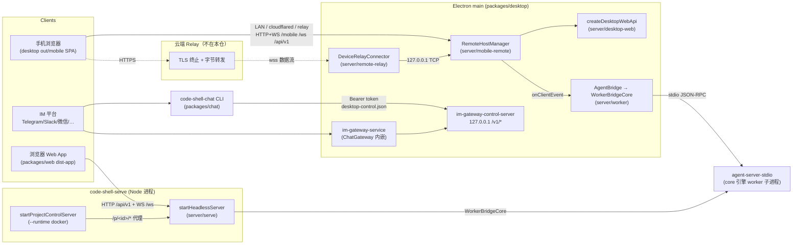
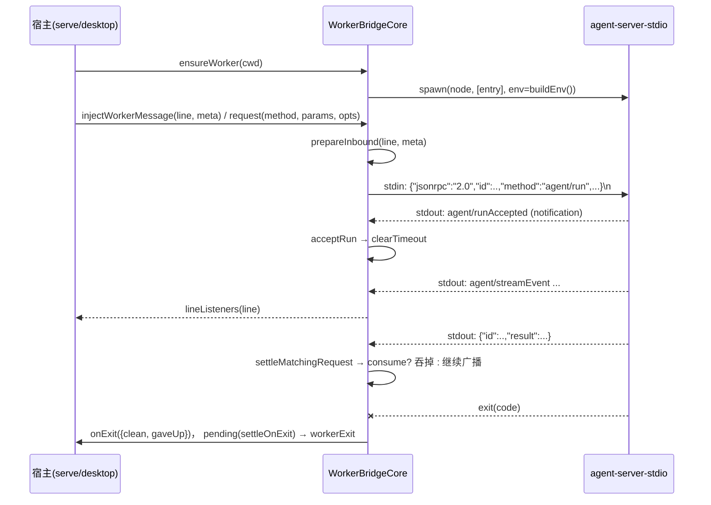
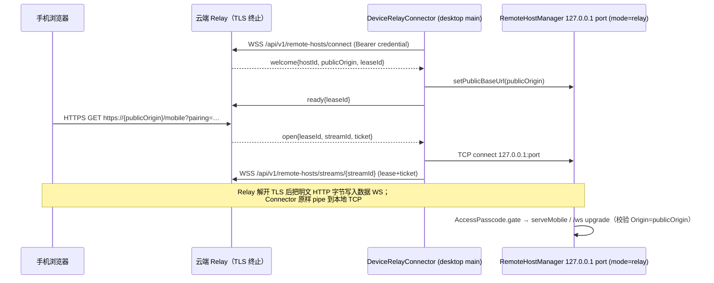
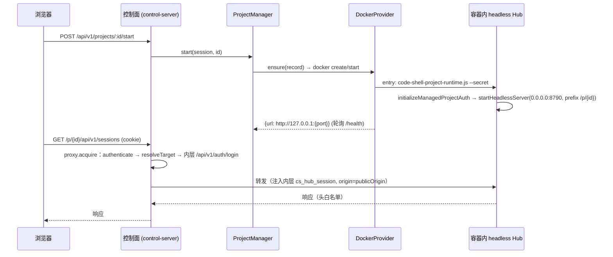
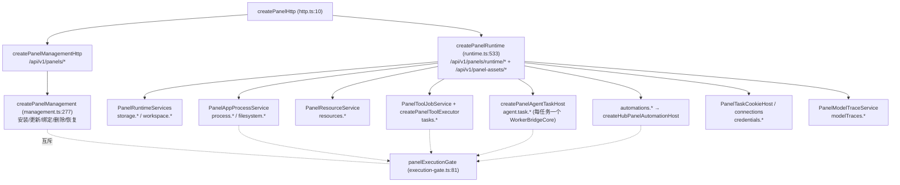
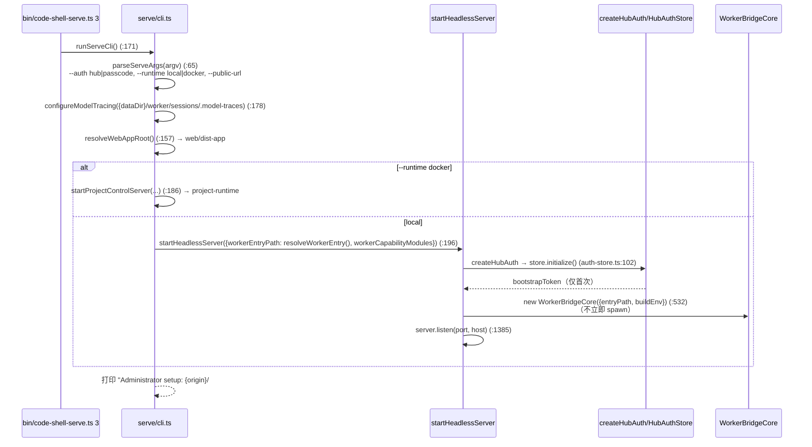
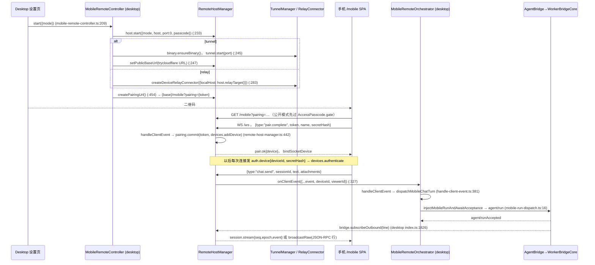
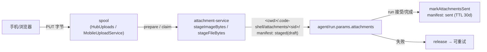
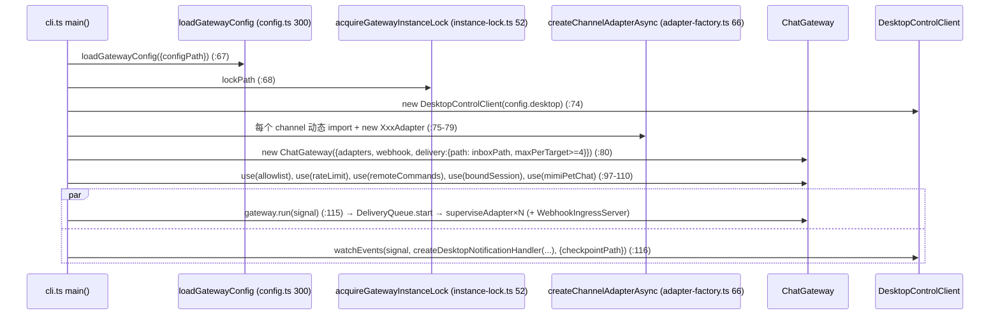
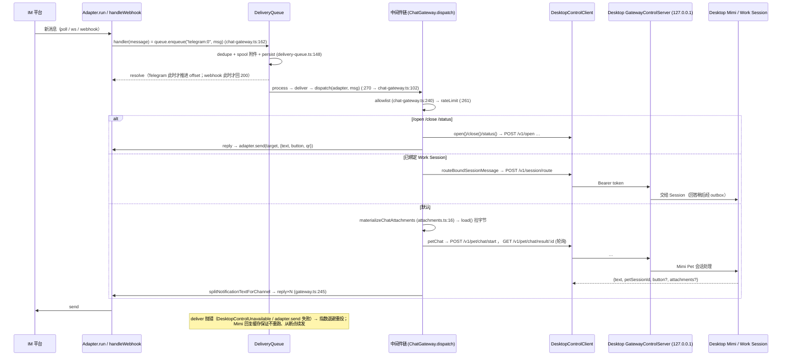

# 10 · packages/server 与 packages/chat 架构（函数级）

> 基线：`main@df2ca0bda`（2026-10-20）。所有 `file:line` 均以该提交为准，用 `grep -n` 校验过；
> 路径前缀省略时，server 指 `packages/server/src/`，chat 指 `packages/chat/src/`。
> 旧文档（CODESHELL.md 等）仅作线索，本文以源码为准。

**目录**

- Part I — packages/server：§1 定位与依赖 · §2 文件清单 · §3 关键类/函数（3.1 WorkerBridgeCore · 3.2 headless serve · 3.3 Hub 认证 · 3.4 Hub 运行期辅助 · 3.5 sessions-service · 3.6 attachment-service · 3.7 desktop-web · 3.8 mobile-remote · 3.9 remote-relay · 3.10 links · 3.11 project-runtime · 3.12 panels）· §4 核心调用链 · §5 接缝 · §6 设计要点/坑
- Part II — packages/chat：§7 定位 · §8 文件清单 · §9 关键抽象 · §10 调用链 · §11 接缝 · §12 设计要点/坑
- 附录 A 端口与磁盘布局 · 附录 B Cookie/Token 一览

---

## 0. 一页总览



两个包的本质：

| 包                         | 一句话                                                                                                                                                                                                 | 进程形态                                                                           |
| -------------------------- | ------------------------------------------------------------------------------------------------------------------------------------------------------------------------------------------------------ | ---------------------------------------------------------------------------------- |
| `@cjhyy/code-shell-server` | 纯 Node（零 Electron）的**远程传输层**：HTTP+WS 宿主、配对/口令/Hub 账户、cloudflared 隧道、设备 Relay、上传、Panel 运行时、Link 授权、Docker 项目沙箱、以及驱动 engine worker 的 `WorkerBridgeCore`。 | 既作为库被 Desktop main 内嵌，也通过 `code-shell-serve` 独立运行                   |
| `@cjhyy/code-shell-chat`   | **传输无关的多 IM 网关**：12 个渠道 adapter + 中间件链 + 持久化 inbox；可选 `./codeshell` 子入口通过 loopback HTTP 控制面把消息交给 Desktop 的 Mimi（Pet）或绑定的 Work Session。                      | 被 Desktop main 内嵌（`im-gateway-service.ts`），或 `code-shell-chat` CLI 独立运行 |

---

# Part I — packages/server

## 1. 定位与依赖

### 1.1 package.json

- 名称 `@cjhyy/code-shell-server`，`version 0.9.45`，`type: module`，`engines.node >=20.10`。
- 依赖：`@cjhyy/code-shell-core`、`-capability-coding`、`-web`、`-link`、`-host`（均 `workspace:*`），`ws ^8.21`、`@modelcontextprotocol/sdk ^1.31`（Hub 的 MCP 探测用）。
- **不依赖 electron**——这是包的硬约束；`index.exports.test.ts:157-185` 还要求 storage/worker/mobile-remote 模块**不得**导入 `-capability-coding` 与 `-web`（组合只允许出现在 `serve/cli.ts`）。

### 1.2 子路径出口（exports）

| 子路径            | 源入口                   | 内容                                                                                                                                                     | 主要消费者                                                          |
| ----------------- | ------------------------ | -------------------------------------------------------------------------------------------------------------------------------------------------------- | ------------------------------------------------------------------- |
| `.`               | `index.ts`               | 下列 storage/worker/mobile-remote/serve/desktop-web/links/panels 的并集（**不含** auth、remote-relay）                                                   | 兼容用                                                              |
| `./storage`       | `index.storage.ts`       | `attachment-service`、`client-message-id`、`image-byte-probe`、`sessions-service`、`session-titles-store`、`model-trace-history`、`panels/storage-store` | desktop main（20 处 import）                                        |
| `./worker`        | `index.worker.ts`        | 仅 `WorkerBridgeCore`、`previewLine`（测试锁定 key 集合）                                                                                                | desktop `agent-bridge.ts:161` 等 8 处                               |
| `./mobile-remote` | `index.mobile-remote.ts` | 口令、cloudflared、codex 房间、附件、chat turn、静态、上传、配对、待审批、`RemoteHostManager`、房间、可信设备、隧道                                      | desktop `index.ts:374`、`mobile-remote-*`（17 处）                  |
| `./serve`         | `index.serve.ts`         | `startHeadlessServer`、`runServeCli` 等 CLI 组合、`startProjectControlServer`、cloud account adoption、backup/restore、seccomp                           | `bin/code-shell-serve`                                              |
| `./desktop-web`   | `index.desktop-web.ts`   | `createDesktopWebApi`、`createModelTraceHttp`                                                                                                            | desktop `desktop-web-service.ts:14`                                 |
| `./links`         | `index.links.ts`         | Link 服务、device OAuth、HTTP、远程目录、默认 provider                                                                                                   | desktop（18 处）、tui `cli/main.ts:255`、worker 能力模块            |
| `./panels`        | `index.panels.ts`        | Panel HTTP/管理/运行时/进程/agent task/资源库/工具作业等                                                                                                 | desktop（22 处）                                                    |
| `./remote-relay`  | `index.remote-relay.ts`  | relay 协议常量与校验、`createRelayByteStream`、`createDeviceRelayConnector`、`environmentIdentity`                                                       | desktop `mobile-remote-controller.ts:11`、`device-relay-*`（10 处） |
| `./auth`          | `index.auth.ts`          | 仅 `createHubAuth`、`HUB_SESSION_COOKIE`（单 owner HTTP 认证，不启动 worker）                                                                            | 可信服务组合                                                        |

`index.exports.test.ts:20-48` 用断言锁定：根入口 key 集合 = 各聚焦入口之并；`./worker` 只能导出两个符号；`./remote-relay` 精确 17 个符号且不含 `RemoteHostManager`/`createHubAuth`/`WorkerBridgeCore`。

### 1.3 bins

| bin                                                           | 源                                                                                                  | 作用                                                                                                                                                                                         |
| ------------------------------------------------------------- | --------------------------------------------------------------------------------------------------- | -------------------------------------------------------------------------------------------------------------------------------------------------------------------------------------------- |
| `code-shell-serve`                                            | `bin/code-shell-serve.ts:3-8` → `serve/cli.ts:171 runServeCli`                                      | 无账户/单工作区 Hub Web 宿主；`--runtime docker` 时改起项目控制面                                                                                                                            |
| `code-shell-settings-recovery`                                | `bin/code-shell-settings-recovery.ts` → `serve/settings-recovery-cli.ts:110 runSettingsRecoveryCli` | 离线 `inspect/repair/restore` 停机项目的 settings（只报哈希不报值）                                                                                                                          |
| `code-shell-cloud-account`                                    | `bin/code-shell-cloud-account.ts`                                                                   | 云账户采纳/检查（project-runtime/account-adoption）                                                                                                                                          |
| `code-shell-link-cleanup`                                     | `bin/code-shell-link-cleanup.ts` → `links/legacy-cleanup-cli.ts`                                    | 清理旧版 Link 凭据                                                                                                                                                                           |
| （未在 package.json 声明）`bin/code-shell-project-runtime.ts` | → `project-runtime/managed-entry.ts`                                                                | Docker 项目容器内的托管入口；容器按路径 `/opt/codeshell/packages/server/dist/bin/code-shell-project-runtime.js` 调用（`project-runtime/docker-provider.ts:440`），失败只打印固定文案避免泄密 |

## 2. 文件清单（非测试源文件，按目录）

> 规模：非测试 `.ts` 约 43k 行（含 fixtures 约 53.5k）。`__fixtures__/` 为测试夹具，单列一行。

### 2.1 根目录（存储 / worker / 杂项）

| 文件                        | 行数 | 职责                                                                                                                                                                                             |
| --------------------------- | ---: | ------------------------------------------------------------------------------------------------------------------------------------------------------------------------------------------------ | ------- | --------------------- |
| `index.ts` / `index.*.ts`   |    — | 10 个出口 barrel，见 §1.2                                                                                                                                                                        |
| `worker-bridge-core.ts`     |  503 | `WorkerBridgeCore`：按需 spawn `agent-server-stdio` 子进程，stdout 行分帧、id 关联请求/响应、崩溃计数与“放弃”、SIGTERM 关停；零 Electron                                                         |
| `sessions-service.ts`       |  486 | 直接读写 core 会话目录：`listSessions`/`listDiskSessions`(游标分页)/`deleteSessionDir`/`cleanupStaleQuickChatSessions`/`archiveDiskSession`（委托 `SessionManager.setSessionArchived` 取锁 CAS） |
| `attachment-service.ts`     |  895 | 工作区内 `.code-shell/attachments/<sessionId>/` 的附件暂存：图片净化（`sanitizeImageBytes`）、sha256 去重、`manifest.jsonl` 事件日志、TTL 清理、符号链接/越界防护                                |
| `image-byte-probe.ts`       |  326 | PNG/JPEG/GIF/WebP 字节级探测与净化（CRC、尺寸、尾随字节），`probeImageBytes`/`sanitizeImageBytes`                                                                                                |
| `client-message-id.ts`      |    8 | `stablePromptHash`：FNV-1a 风格稳定哈希，用于构造幂等 `clientMessageId`                                                                                                                          |
| `session-titles-store.ts`   |  189 | `createSessionTitlesStore(file)`：用户改名标题的 JSON 映射，串行化写入，`SessionTitleConflictError` 乐观并发                                                                                     |
| `session-http-responses.ts` |   39 | `createSessionHttpResponses()`：把进行中的 `ServerResponse` 归属到登录 session，吊销时 `cancelOwner` 直接 `destroy()`                                                                            |
| `model-trace-history.ts`    |  242 | 模型调用轨迹（core `ModelTraceStore`）只读查询的参数校验与分页封装                                                                                                                               |
| `model-trace-http.ts`       |  112 | `GET /api/v1/model-traces[/sessions                                                                                                                                                              | /config | /:id]` 只读 HTTP 适配 |
| `environment-identity.ts`   |   69 | `<dataDir>/environment.json` 一次性原子发布（`link()`）环境 UUID；`describeEnvironment(id, kind)`                                                                                                |
| `static-files.ts`           |   27 | MIME 表 `contentTypeFor`                                                                                                                                                                         |

### 2.2 `serve/`（headless Hub 宿主）

| 文件                             | 行数 | 职责                                                                                                                                                                                                                                |
| -------------------------------- | ---: | ----------------------------------------------------------------------------------------------------------------------------------------------------------------------------------------------------------------------------------- |
| `serve/cli.ts`                   |  241 | `parseServeArgs`、`resolveWorkerEntry`（`require.resolve("@cjhyy/code-shell-core/bin/agent-server-stdio")`）、`resolveWorkerCapabilityModules`（coding + links 模块 spec）、`resolveWebAppRoot`（web 的 `dist-app`）、`runServeCli` |
| `serve/headless-server.ts`       | 1690 | `startHeadlessServer`：单工作区 HTTP+WS 宿主，Hub 认证/legacy 口令两模式，浏览器 tab ↔ worker 的 JSON-RPC 路由、审批租约、运行回放、上传、配置热重载                                                                                |
| `serve/automation-worker.ts`     |  150 | `createHubAutomationWorker`：借用同一个 worker 执行 Panel 定时自动化（无人值守审批走 `approvalBackend`，页面能力 `__*` 一律拒绝）                                                                                                   |
| `serve/settings-recovery-cli.ts` |  141 | 离线 settings 恢复 CLI                                                                                                                                                                                                              |
| `serve/host-requests.ts`         |    8 | **@deprecated** 转出 `@cjhyy/code-shell-host` 的 host 请求拦截                                                                                                                                                                      |

### 2.3 `hub/`（Hub 账户与工作区 REST 服务；`serve` 与 `desktop-web` 共用）

| 文件                        | 行数 | 职责                                                                                                                                                                          |
| --------------------------- | ---: | ----------------------------------------------------------------------------------------------------------------------------------------------------------------------------- |
| `hub/auth-store.ts`         |  415 | `HubAuthStore`：`<dataDir>/hub/auth.json`（0600，跨进程 `acquireFileLock`），单管理员 scrypt 口令、bootstrap 一次性 token、最多 64 个设备 session（只存 token 的 sha256）     |
| `hub/auth-http.ts`          |  290 | `createHubAuth`：`/api/v1/auth/*` 路由、登录限流、`isOriginAllowed`、`readHubSessionToken`（Bearer 优先于 Cookie）                                                            |
| `hub/approval-lease.ts`     |  120 | `ApprovalLeases`：多 tab 审批卡的“认领—提交—ACK”租约，防止两台设备重复决策                                                                                                    |
| `hub/run-replay.ts`         |  206 | `HubRunReplay`：每会话运行期流事件内存回放（带 epoch/sequence 游标），配合 core `SessionOutputCoverageStore` 刷新时补齐未落盘输出                                             |
| `hub/outbound-transport.ts` |  154 | `HubOutboundTransport`：WS 写队列背压上限（单帧 64MiB / 单 socket 8MiB / 总 128MiB），超限丢弃该 tab                                                                          |
| `hub/uploads.ts`            |  267 | `HubUploads`：`PUT /api/v1/uploads/:id` 两段式上传（接收→`prepare` 时 stage 为附件→run 成功 `commit`/失败 `release`）；`hubJson`                                              |
| `hub/configuration.ts`      |  625 | `createHubConfiguration`：模型连接/默认值/技能开关的读改写与连接探测 `/api/v1/configuration/*`                                                                                |
| `hub/model-probe.ts`        |  221 | `probeConfiguredModel`：经 core `createLLMClient` 的无工具连通性探测                                                                                                          |
| `hub/mcp-configuration.ts`  |  646 | `createHubMcpConfiguration`：`/api/v1/mcp/*` MCP server 增删改、启停、继承、探测                                                                                              |
| `hub/mcp-probe.ts`          |  434 | `probeHubMcp`：用 MCP SDK（stdio/streamable HTTP）列工具，帧 512KiB / 总 2MiB / 最多 8 页 100 工具                                                                            |
| `hub/skills-management.ts`  |  565 | `createHubSkills`：`/api/v1/skills/*` 本地技能（`.code-shell/skills`、`.agents/skills`）CRUD + GitHub 预览/安装/更新（15min review 票据）                                     |
| `hub/session-management.ts` |  443 | `createHubSessions`：`/api/v1/sessions` 列表/详情/导出/改名/归档；`readHubTranscript`、`readHubSessionState`、`transcriptMarkdown`                                            |
| `hub/files.ts`              |  298 | `createHubFiles`：`/api/v1/files` 与 `/files/content` 只读文件浏览（屏蔽 `.git`/`.env*`/`.ssh`/`.aws`/`.npmrc`/`.netrc`/`node_modules`，`.code-shell` 仅允许 `attachments/`） |

### 2.4 `desktop-web/`

| 文件                      | 行数 | 职责                                                                                                                                                                                                                                  |
| ------------------------- | ---: | ------------------------------------------------------------------------------------------------------------------------------------------------------------------------------------------------------------------------------------- |
| `desktop-web/http-api.ts` |  488 | `createDesktopWebApi`：挂在 Desktop `RemoteHostManager` 上的 `/api/v1/*` 门面：配对设备换 `cs_desktop_session` cookie，按“Desktop 已知工作区”为每个 cwd 惰性创建 hub 服务集合（configuration/skills/mcp/files/sessions/model-traces） |

### 2.5 `mobile-remote/`（Desktop 手机遥控传输层）

| 文件                               | 行数 | 职责                                                                                                                                             |
| ---------------------------------- | ---: | ------------------------------------------------------------------------------------------------------------------------------------------------ |
| `remote-host-manager.ts`           |  649 | `RemoteHostManager`：HTTP+WS 服务（lan/tunnel/relay 三模式）、配对与设备认证、socket→device/viewer 绑定、按设备/viewer 定向发送、`relayTarget()` |
| `pairing.ts`                       |   70 | `PairingTokenManager`：一次性 32B 配对 token（10min，最多 256 个待用），`commit()` 只在动作成功后消费                                            |
| `access-passcode.ts`               |  542 | `AccessPasscode`：tunnel/relay 模式前置口令门（scrypt 哈希+HMAC 记住 cookie `cs_access`、全局失败锁定、HTML 输入页）                             |
| `trusted-device-store.ts`          |  293 | `TrustedDeviceStore`：`devices.json` 可信设备（跨进程文件锁 + reload-in-lock），`secretHash` 常量时间比较                                        |
| `tunnel-manager.ts`                |  409 | `TunnelManager`：spawn `cloudflared tunnel --url http://127.0.0.1:<port>`，从输出抓 `*.trycloudflare.com`，轮询 `/ready`，健康监测，不自动重启   |
| `cloudflared-binary.ts`            |  292 | `CloudflaredBinary`：固定版本 `2026.6.1` 下载，**内嵌 SHA-256 表**校验后再解包/授权执行                                                          |
| `mobile-static.ts`                 |  202 | `serveMobile`/`resolveSafe`：`/mobile` 静态 SPA（双重 realpath 包含校验、SPA 回退、dev 代理到 vite、hashed assets 永久缓存/HTML no-store）       |
| `mobile-client-event-validator.ts` |  290 | `parseMobileClientEvent`：31 种客户端事件的白名单结构校验                                                                                        |
| `mobile-upload-service.ts`         |  490 | `MobileUploadService`：`begin` 发一次性 PUT 票据→`acceptPut` 落盘→`claim/release/finalize` 租约，设备吊销即清                                    |
| `mobile-attachments.ts`            |  152 | `materializeMobileAttachments`：inline base64 / upload 票据两种图片 → stage 为 `InputAttachmentMeta`                                             |
| `mobile-chat-turn.ts`              |  136 | `dispatchMobileChatTurn`：手机一次发言的“事务边界”：解析工作区→附件 stage→注入 `agent/run` 等 ACK→标记已发送/释放                                |
| `mobile-run-dispatch.ts`           |   82 | `injectMobileRunAndAwaitAcceptance`：注入 `agent/run` 并等待 `agent/runAccepted` 或错误响应（5s）                                                |
| `mobile-history.ts`                |   41 | `buildSessionHistory`：把 Desktop 注入的 transcript reader 投影为 reducer 事件                                                                   |
| `mobile-limits.ts`                 |    6 | 附件个数（4）/字节上限常量                                                                                                                       |
| `pending-approvals.ts`             |   69 | `PendingMobileApprovals`：观察出站行，记住未决 `agent/approvalRequest`，手机绑定会话时重放                                                       |
| `room-manager.ts`                  | 1416 | `RoomManager`：“房间”=常驻外部 CLI agent（Claude Code / Codex）+ 持久 `messages.jsonl`；审批/AskUser、transcript 跟随、seq 增量同步              |
| `room-history.ts`                  |  378 | 房间消息日志的有界快照分页读取                                                                                                                   |
| `room-model-tracing.ts`            |  208 | 外部 CLI 房间的模型轨迹记录（批次保序）                                                                                                          |
| `resident-agent.ts`                |  261 | `ResidentAgentProcess`：`claude` stream-json 常驻进程；`parseStreamJsonLine`；`buildControlResponse`                                             |
| `codex-room-agent.ts`              |  231 | `CodexRoomAgent`：每轮 `codex exec --json … -`，按房间权限模式选 sandbox 等级                                                                    |
| `codex-parse.ts`                   |  137 | codex JSONL → `ResidentAgentEvent`                                                                                                               |
| `path-bins.ts`                     |   15 | 给 GUI 启动的 Electron 补 PATH（homebrew 等）                                                                                                    |
| `types.ts`                         |   23 | 从 core 协议转出 Mobile DTO 类型（`MobileClientEvent`/`MobileServerEvent` 定义在 `core/src/protocol/mobile-remote-types.ts`）                    |
| `viewer-identity.ts`               |    9 | `MobileViewerIdentity`、`mobileTranscriptSubscriberId`                                                                                           |

### 2.6 `remote-relay/`（设备出站 Relay）

| 文件              | 行数 | 职责                                                                                                                                      |
| ----------------- | ---: | ----------------------------------------------------------------------------------------------------------------------------------------- |
| `protocol.ts`     |   70 | 协议 v1 常量与校验：`welcome/ready/open/failed` 控制消息，token/hostId/origin 格式                                                        |
| `connector.ts`    |  280 | `createDeviceRelayConnector`：出站 `wss://<relay>/api/v1/remote-hosts/connect` 控制连接，指数退避重连、心跳、401/403 即“unauthorized”停止 |
| `local-stream.ts` |  125 | `openRelayStream`：每个 `open` 打开一条到 **固定** `127.0.0.1:<port>` 的 TCP + 一条 `wss://…/streams/<id>` 数据 WS，双向 pipe             |
| `byte-stream.ts`  |   65 | `createRelayByteStream`：把 WS 二进制帧包装成 Duplex（32KiB 分片、64KiB 上限、EOF 语义）                                                  |

### 2.7 `links/`、`project-runtime/`、`bin/`

（详述见 §3.10、§3.11；这里只列一行职责）

| 文件                                                                                                              | 职责                                                                                                                                                           |
| ----------------------------------------------------------------------------------------------------------------- | -------------------------------------------------------------------------------------------------------------------------------------------------------------- |
| `links/service.ts` (2232)                                                                                         | `createLinkService`：Link 领域服务（快照、token/CLI/device/remote/host-OAuth/交互式授权、改名/断开、远程授权回收）                                             |
| `links/http.ts` (281)                                                                                             | `createLinkHttp`：`/api/v1/links/*` REST + `/link/*` 浏览器接力公共路由                                                                                        |
| `links/device-oauth.ts` (341)                                                                                     | `LinkDeviceOAuthBroker`：RFC 8628 设备码（GitHub/GitLab）                                                                                                      |
| `links/browser-handoff.ts` (171)                                                                                  | `createLinkBrowserHandoff`：一次性 ticket 让外部浏览器完成 OAuth                                                                                               |
| `links/catalog.ts` / `remote-catalog.ts` / `remote-configuration.ts`                                              | 本地/远程 provider 目录合成与严格校验；可信 `RemoteLinkConfiguration`                                                                                          |
| `links/diagnostics.ts` / `runtime/operation.ts` / `legacy-cleanup-cli.ts`                                         | 脱敏授权诊断 trace；单次 provider 动作的契约包裹；旧凭据清理 CLI                                                                                               |
| `links/providers/defaults.ts` (1199) / `index.ts`                                                                 | 10 个内置 provider（github/gitlab/figma/notion/linear/slack/sentry/airtable/todoist/vercel），38 个 action；`createLinkProviderModule` 作为 worker AgentModule |
| `links/types.ts`                                                                                                  | 从 `@cjhyy/code-shell-link` 转出 DTO；`LinkOperationContext`、`HostLinkOAuthAdapter`                                                                           |
| `project-runtime/control-server.ts` (410)                                                                         | `startProjectControlServer`：Cloud 控制面 HTTP（项目 CRUD/启停/打开 + `/p/<id>/*` 代理 + SPA）                                                                 |
| `project-runtime/manager.ts` (387)                                                                                | `ProjectManager`：项目生命周期、配额、generation、撤销回退                                                                                                     |
| `project-runtime/registry.ts` (643)                                                                               | `ProjectRegistry`：`project-control/registry.json`（锁+摘要校验），v1/v2/v3 三种归属模式                                                                       |
| `project-runtime/lock.ts` (207)                                                                                   | `acquireProjectControllerLock`：单控制器心跳租约 + owner marker                                                                                                |
| `project-runtime/docker-provider.ts` (586)                                                                        | Docker CLI 客户端：加固容器/网络/卷/secret，健康检查，label 归属校验                                                                                           |
| `project-runtime/proxy.ts` (880)                                                                                  | `/p/<id>/…` 认证反向代理（HTTP+WS），内层 Hub 登录、租约、Panel 资源授权                                                                                       |
| `project-runtime/cloud-account-auth.ts` / `cloud-browser-auth.ts` / `control-authority.ts` / `account-binding.ts` | v2 单账户 bearer / v3 多账户浏览器 cookie / legacy Hub 适配；绑定校验                                                                                          |
| `project-runtime/account-adoption.ts` / `backup.ts` / `seccomp.ts` / `managed-entry.ts` / `types.ts`              | 离线 v1→v2 采纳；离线备份/恢复；seccomp 物化；容器内托管入口；契约类型                                                                                         |
| `project-runtime/fixtures/*`、`__fixtures__/*`                                                                    | 旧版 registry 字节快照；测试夹具（网络/子进程封禁、锁冒烟、rmdir 竞态、恢复耐久性）                                                                            |
| `bin/*.ts`                                                                                                        | 见 §1.3                                                                                                                                                        |

### 2.8 `panels/`（约 40 个文件，~15k 行）

逐文件职责表见 **§3.12.2**（与其架构说明放在一起更易读）。入口 `index.panels.ts` 只转出公共部分；`management-http`、`process-files/entry/state`、`storage-store`（经 `./storage` 出口）、`tool-jobs-storage`、`browser-capture`、`model-trace-channel`、`resources/{http,clone,directories,uploads,references}` 为内部模块。

## 3. 关键类 / 函数（函数级）

### 3.1 `WorkerBridgeCore`（`worker-bridge-core.ts:128`）—— 与 engine worker 的唯一管道

**定位**：原 Desktop `AgentBridge` 中与 Electron 无关的一半。一个实例同时最多一个子进程；协议是**行分隔 JSON-RPC over stdio**。Desktop `agent-bridge.ts:398`、`serve/headless-server.ts:532`、`panels/agent-task-host.ts`（每个 Panel AI 任务一个）各自 new。

| 成员                                              | 位置       | 行为 / 调用                                                                                                                                                                                                                                                                                                                      |
| ------------------------------------------------- | ---------- | -------------------------------------------------------------------------------------------------------------------------------------------------------------------------------------------------------------------------------------------------------------------------------------------------------------------------------- | ----- | ------- | ---------- | ------------------------------------------------------------------------------------------------------------------------------------------------------------------------------------------------------------------------------------------------------------------------- |
| `constructor(opts)`                               | `:140`     | 选项：`entryPath`（`agent-server-stdio`）、`execPath`（默认 `process.execPath`）、`buildEnv()`（每次 spawn 调）、`fallbackCwd()`、`prepareInbound(line, meta)`（宿主改写钩子）、`onWorkerStarted/onSpawnFailed/onSpawnError/onExit/onStderr`、`restartWindowMs`=60s、`restartLimit`=3                                            |
| `ensureWorker(cwd?)`                              | `:171`     | 已有 child 则幂等返回；否则 `spawn(execPath, [entryPath], {cwd, env, stdio:pipe×3})`（`:181`）；同步异常→`onSpawnFailed`；`generation += 1`（`:203`）；`readline` 逐行：先 `settleMatchingRequest`，未被 consume 的行再广播给所有 `lineListeners`（`:206-220`）；挂 `error`（无 exit 的 spawn 失败）与 `exit` 处理（`:228-261`） |
| `shouldDeclareGaveUp()`                           | `:270`     | 滚动窗口内崩溃次数 `> restartLimit` ⇒ `gaveUp=true`。**不主动重启**，下一次请求触发 spawn                                                                                                                                                                                                                                        |
| `settleMatchingRequest(line)`                     | `:284`     | 解析 JSON；`agent/runAccepted` 触发等待中的 `acceptRun`（取消 admission 超时，`:299-305`）；按 `id` 结算 pending；返回 `pending.consume`                                                                                                                                                                                         |
| `settlePendingOnExit()`                           | `:315`     | 子进程退出时把 `settleOnExit` 请求结算为 `{status:"workerExit"}`                                                                                                                                                                                                                                                                 |
| `subscribeLines(fn)`                              | `:326`     | 订阅未被 consume 的 stdout 行；返回退订                                                                                                                                                                                                                                                                                          |
| `sendLine(line)`                                  | `:336`     | 直接写 stdin（追加 `\n`）；无 child 返回 false                                                                                                                                                                                                                                                                                   |
| `injectWorkerMessage(raw, meta)`                  | `:350`     | 先过 `prepareInbound`，`canSend()` 否则**丢弃并记日志**（不排队）；`meta.origin ∈ renderer/mobile/host/serve` 只用于日志/审计，**不是授权输入**                                                                                                                                                                                  |
| `request(method, params, opts)`                   | `:378`     | 关联 RPC，**永不 reject**，返回 `WorkerRpcOutcome = result                                                                                                                                                                                                                                                                       | error | timeout | sendFailed | workerExit`；`timer.unref()`；`waitForRunCompletion`要求`agent/run+failFast+settleOnExit`，runAccepted 后清超时；同样经 `prepareInbound`；`ensureWorker:true` 时先 spawn；`failFast` 写失败立即结算；`prepareInbound`抛出带数字`code`的错误会直接映射为`{status:"error"}` |
| `stopAndWait()`                                   | `:480`     | SIGTERM 并等待**这一个** child 真正 exit（不因发出信号就返回）                                                                                                                                                                                                                                                                   |
| `kill()`                                          | `:499`     | SIGTERM                                                                                                                                                                                                                                                                                                                          |
| `hasChild/canSend/hasLiveWorker/workerGeneration` | `:150-165` | 状态查询                                                                                                                                                                                                                                                                                                                         |

> 坑：`outbox` 字段在 `ensureWorker` 里会被 flush（`:263-266`），但全文件**没有任何 `outbox.push`**——实际语义是“无 worker 时直接丢弃”，所以调用方必须先 `ensureWorker()` 再 inject（headless 在 `:1266` 正是这么做的）。



### 3.2 `startHeadlessServer`（`serve/headless-server.ts:125`）—— code-shell-serve 的本体

**一句话**：单工作区 Node 宿主，一个 `WorkerBridgeCore` 承担全部执行；浏览器只拿到 CORE 协议的**极小投影**——会话列表/详情由宿主自己读盘回答，只有 `agent/run|approve|cancel` 被转发进 worker；每个 tab 的请求 id 被重写成 `serve-<tabId>-<n>`，响应只回到发起 tab，通知广播所有 tab。

#### 3.2.1 启动阶段（按代码顺序）

| 步骤                   | 行               | 说明                                                                                                                                                                                                                                                                                            |
| ---------------------- | ---------------- | ----------------------------------------------------------------------------------------------------------------------------------------------------------------------------------------------------------------------------------------------------------------------------------------------- |
| remote link 校验       | `:126-128`       | `remoteLinkHostConfiguration`；Remote Link 只能在 hub 模式                                                                                                                                                                                                                                      |
| 日志脱敏               | `:130-136`       | 默认去掉 `raw`/`text` 字段，`--debug-logs` 才保留                                                                                                                                                                                                                                               |
| 环境身份               | `:137-140`       | hub 模式 `describeEnvironment(await environmentIdentity(dataDir), "hub")`                                                                                                                                                                                                                       |
| Panel 绑定             | `:142`           | `createHubPanelBinding(workspaceCwd)`                                                                                                                                                                                                                                                           |
| worker 数据根          | `:143-152`       | 默认 `<dataDir>/worker`；强制 `sessionRootDir === <workerDataRoot>/sessions`，保证宿主与 worker 授权同一个 session 库                                                                                                                                                                           |
| 口令（legacy）         | `:166-173`       | `AccessPasscode(<dataDir>/access.json)`；未设置时随机 6B base64url 并返回 `generatedPasscode`                                                                                                                                                                                                   |
| Hub 认证               | `:192`           | `createHubAuth({dataDir, publicOrigin, onRevoke})`；`onRevoke` 级联取消该 session 的 HTTP 响应、mcp/config/links/panels 的 owner 作业，并以 4401 关闭其 WS                                                                                                                                      |
| 上传                   | `:207`           | `HubUploads(<dataDir>/uploads, cwd)`                                                                                                                                                                                                                                                            |
| 运行回放               | `:224`           | `HubRunReplay(…, new SessionOutputCoverageStore(…))`                                                                                                                                                                                                                                            |
| 出站背压               | `:244`           | `HubOutboundTransport`                                                                                                                                                                                                                                                                          |
| `notify/publishStream` | `:256-273`       | `agent/streamEvent` 带上 `hubSequence/hubEpoch`                                                                                                                                                                                                                                                 |
| 审批租约               | `:275`           | `ApprovalLeases(lease ⇒ notify("serve/approvalLease"))`                                                                                                                                                                                                                                         |
| auth 复核              | `:276-290`       | 每 `authRecheckMs`(5s)：sweep 租约与上传，**逐 tab 重新 authenticate**，失效即 4401                                                                                                                                                                                                             |
| 响应超时回收           | `:323`           | 非 run/非审批 RPC 超 60s 回 `-32000 timed out`                                                                                                                                                                                                                                                  |
| HostRuntime            | `:339`           | `@cjhyy/code-shell-host` 的 `HostRuntime({kind:"headless"})`，`interceptHostRequest` 处理 worker 发往宿主的能力请求（`:343`）                                                                                                                                                                   |
| `routeWorkerLine`      | `:365`           | worker→浏览器分流（见 3.2.3）                                                                                                                                                                                                                                                                   |
| `WorkerBridgeCore`     | `:532`           | `buildEnv` 清空 Desktop 专用开关（`CODE_SHELL_OPERATION_BATCH_ACCESS`、`CODE_SHELL_MODEL_REQUEST_SIGNING`、`CODE_SHELL_HOST_MCP_SERVERS`、`CODE_SHELL_WORKSPACE_ACCESS`、remote link secret），设 `CODE_SHELL_DATA_ROOT`、`CODE_SHELL_CREDENTIAL_ACCESS=local`、`CODE_SHELL_CAPABILITY_MODULES` |
| 配置变更互斥           | `:572`           | `withConfigurationMutation`：有运行/准备/面板任务/自动化/挂起 RPC 时 409；写盘后向 worker 发 `agent/configure {reloadModels, reloadSettings}` 热重载，失败置 `configurationReloadFailed`（之后拒绝新 run）                                                                                      |
| 各 hub 服务            | `:624-712`       | configuration / links / panels / skills / mcp / sessions / files / modelTraces（仅 hub 模式）                                                                                                                                                                                                   |
| 自动化                 | `:1315`, `:1351` | `createHubAutomationWorker` + `createHubPanelAutomationHost`                                                                                                                                                                                                                                    |
| listen                 | `:1385`          | 默认 `127.0.0.1:8790`                                                                                                                                                                                                                                                                           |

#### 3.2.2 HTTP 路由（`handleHttp` `:759`）

分派顺序：`/health` → cloud-browser 探测 → **(hub)** `links.handlePublic` → `panels.handleAssets` → `hubAuth.handle` → `/api/*`（先 authenticate→401，再 `isOriginAllowed`→403，再 `responses.track`）→ 各服务 → 非 GET/HEAD 405 → 静态 SPA；**(passcode)** `passcode.gate` → 静态。

| 方法            | 路径                                                                     | 处理                                                                            | 认证                                                                       |
| --------------- | ------------------------------------------------------------------------ | ------------------------------------------------------------------------------- | -------------------------------------------------------------------------- | -------------------------------------------- | ---- |
| GET             | `/health`                                                                | `:763` → `{status, mode, contracts: CONTRACTS}`                                 | 无                                                                         |
| GET             | `/api/v1/cloud-browser/capabilities`                                     | `:769` 固定 404（告诉公共壳“这里没有 Cloud 浏览器授权”）                        | 无                                                                         |
| GET             | `/link/authorize`、`/link/callback`、`/link/authorization-result`        | `links.handlePublic` → `browser-handoff.ts:94`（仅 `!publicPathPrefix` 时启用） | ticket/state 即能力                                                        |
| GET/HEAD        | `/api/v1/panel-assets/…`                                                 | `panels.handleAssets`（见 §3.12）                                               | 随机 grant                                                                 |
| GET             | `/api/v1/auth/status`                                                    | `auth-http.ts:121`                                                              | 无                                                                         |
| POST            | `/api/v1/auth/setup` `{token,username,password,deviceName}`              | `auth-http.ts:130` → `HubAuthStore.setup`                                       | bootstrap token；限流                                                      |
| POST            | `/api/v1/auth/login`                                                     | `auth-http.ts:130` → `HubAuthStore.login`                                       | 口令；限流                                                                 |
| GET             | `/api/v1/auth/sessions`                                                  | `auth-http.ts:148`                                                              | session                                                                    |
| POST            | `/api/v1/auth/logout`                                                    | `auth-http.ts:154`                                                              | session                                                                    |
| DELETE          | `/api/v1/auth/sessions/:uuid`                                            | `auth-http.ts:162`                                                              | session                                                                    |
| GET             | `/api/v1/environment`                                                    | `:798`                                                                          | session+origin                                                             |
| GET             | `/api/v1/configuration`                                                  | `hub/configuration.ts:376` snapshot                                             | session+origin                                                             |
| GET             | `/api/v1/configuration/skill?name=`                                      | `:378`                                                                          | 同上                                                                       |
| POST            | `/api/v1/configuration/connections/probe` `{id,requestId?}`              | `:394`，全局同时仅 1 个探测                                                     | 同上                                                                       |
| POST            | `/api/v1/configuration/connections/probe/cancel` `{requestId}`           | `:380`                                                                          | 同上                                                                       |
| PUT             | `/api/v1/configuration/defaults` / `connections` / `skills`              | `:451-476` 经 `withMutation`                                                    | 同上                                                                       |
| DELETE          | `/api/v1/configuration/connections`                                      | 同上                                                                            | 同上                                                                       |
| \*              | `/api/v1/links/*`                                                        | `links/http.ts`（见 §3.10）                                                     | 同上                                                                       |
| \*              | `/api/v1/panels/*`                                                       | `panels/http.ts`（见 §3.12）                                                    | 同上                                                                       |
| GET             | `/api/v1/skills` / `/skills/detail`                                      | `hub/skills-management.ts:276/280`                                              | 同上                                                                       |
| POST/PUT/DELETE | `/api/v1/skills/local`                                                   | `:297-340`                                                                      | 同上                                                                       |
| POST            | `/api/v1/skills/github/{preview,install,update-preview,update}`          | `:341/362/412/473`                                                              | 同上                                                                       |
| GET             | `/api/v1/mcp`                                                            | `hub/mcp-configuration.ts:517`                                                  | 同上                                                                       |
| POST            | `/api/v1/mcp/servers`                                                    | `:522-575` 新增                                                                 | 同上                                                                       |
| PUT/DELETE      | `/api/v1/mcp/servers/:name`                                              | 同上                                                                            | 同上                                                                       |
| PUT             | `/api/v1/mcp/servers/:name/enabled`                                      | 同上                                                                            | 同上                                                                       |
| POST            | `/api/v1/mcp/servers/:name/{probe,cancel-probe,inherit}`                 | 同上                                                                            | 同上                                                                       |
| GET             | `/api/v1/sessions`                                                       | `hub/session-management.ts:260`                                                 | 同上                                                                       |
| GET             | `/api/v1/sessions/:id`                                                   | `:275`                                                                          | 同上                                                                       |
| GET             | `/api/v1/sessions/:id/export?format=markdown                             | json`                                                                           | `:279`（运行中 409，同时最多 2 个导出，≤32MiB）                            | 同上                                         |
| PATCH           | `/api/v1/sessions/:id` `{title,expectedTitle?}` 或 `{archived}`          | `:309-337`                                                                      | 同上                                                                       |
| GET             | `/api/v1/files?path=` / `/api/v1/files/content?path=`                    | `hub/files.ts:140`                                                              | 同上                                                                       |
| GET             | `/api/v1/model-traces[/sessions                                          | /config                                                                         | /:id]`                                                                     | `model-trace-http.ts:62`（只读，非 GET 405） | 同上 |
| PUT             | `/api/v1/uploads/:id`（`x-file-name`、`content-type`、`content-length`） | `:812` → `HubUploads.accept`                                                    | 同上                                                                       |
| GET/HEAD        | 其它                                                                     | `serveStatic` `:715`（`resolveSafe` + HTML 导航回退 `index.html`）              | 无（公共壳）                                                               |
| Upgrade         | `/ws`                                                                    | `upgrade` `:840`                                                                | hub：session + `isOriginAllowed`；passcode：`passcode.allows`；最多 64 tab |

所有响应加 `x-content-type-options: nosniff`、`referrer-policy: no-referrer`（`:761-762`）。

#### 3.2.3 WS 协议（JSON-RPC 2.0，单帧 ≤1MiB，每 tab 串行队列 ≤64）

**浏览器 → 宿主**（`handleMessage` `:878`，每帧先重新 `authenticate`）：

| method                                                            | 处理位置                                       | 是否进 worker | 说明                                                                                                                                                                                                                                            |
| ----------------------------------------------------------------- | ---------------------------------------------- | ------------- | ----------------------------------------------------------------------------------------------------------------------------------------------------------------------------------------------------------------------------------------------- | ------------------------------------------------------- |
| `serve/approval.snapshot`                                         | `:914`                                         | 否            | 返回 `{approvals, leases}`                                                                                                                                                                                                                      |
| `serve/approval.claim` / `serve/approval.release` `{requestId}`   | `:952`                                         | 否            | `ApprovalLeases.claim/release(requestId, holderId=tabId)`                                                                                                                                                                                       |
| `agent/query {type:"sessions"}`                                   | `replyToHostSessionQuery` `:1473`              | 否            | `SessionManager.list(100,{cwd, archived:false, rootsOnly:true})`                                                                                                                                                                                |
| `agent/query {type:"session_detail", sessionId, outputRecovery?}` | 同上                                           | 否            | 读 `state.json`+transcript，cwd 必须等于工作区；叠加 `runReplay.snapshot`                                                                                                                                                                       |
| `agent/query {type:"output_journal"                               | "output_coverage"}`                            | 同上          | 否                                                                                                                                                                                                                                              | core `readOutputJournal` 分页；coverage 与 RAM 回放合并 |
| `agent/run`                                                       | `authorizeServeRequest` `:1634` → `:1013-1271` | **是**        | 禁止客户端传 `sandboxMode`/`allowBackgroundShells`；补 `sessionId`/`clientMessageId`；`uploads.prepare(uploadIds)`→`attachments`；未指定 model 时读 `defaults.text`；**强制 `cwd = workspaceCwd`**；同会话被另一设备占用→`-32009`；≤64 并发 run |
| `agent/approve`                                                   | `:1013-1060`                                   | 是            | 必须对应租约中的待审批；`leases.submit`；`connectionId/generation` 用 worker 原值覆盖（不信任浏览器）                                                                                                                                           |
| `agent/cancel`                                                    | `authorizeServeRequest`                        | 是            | 运行中的会话直接放行                                                                                                                                                                                                                            |
| 其它任何 method                                                   | `authorizeServeRequest`                        | 否            | `-32601 Method is not available in Web serve mode`                                                                                                                                                                                              |

**宿主 → 浏览器**：

| 帧                                                                              | 来源                                         | 说明                                                                                                                                                    |
| ------------------------------------------------------------------------------- | -------------------------------------------- | ------------------------------------------------------------------------------------------------------------------------------------------------------- |
| `serve/hello {tabId}`                                                           | `:864`                                       | 连接即发                                                                                                                                                |
| `serve/approvalSnapshot {approvals}`                                            | 连接时 / 重试 / worker 退出                  |                                                                                                                                                         |
| `serve/approvalLease {requestId, holderId, expiresAt}`                          | `ApprovalLeases.onChange`                    |                                                                                                                                                         |
| `agent/streamEvent {sessionId, event, hubSequence, hubEpoch}`                   | `publishStream` `:259`                       | `session_user_message` 用宿主保存的原始输入替换并去重（`:381-407`）                                                                                     |
| `agent/runAccepted`                                                             | `:409`                                       | 只回发起 tab，`requestId` 还原为原 id                                                                                                                   |
| `agent/approvalRequest` / `agent/approvalResolved`                              | `:428-482`                                   | `__panel_action__` 审批被宿主拦截，转 `panels.panelAction` 并自动 `agent/approve`（`:439-470`）；自动化会话的审批先交 `automationWorker.handleApproval` |
| `serve/sessionStatus {sessionId, running}`                                      | run 开始/结束                                |                                                                                                                                                         |
| `serve/sessionsChanged`、`serve/configurationChanged`、`serve/automationStatus` | hub 服务回调                                 |                                                                                                                                                         |
| `serve/workerExit {clean, gaveUp}`                                              | `onExit` `:564` / `workerUnavailable` `:530` |                                                                                                                                                         |
| JSON-RPC 响应                                                                   | `:487-523`                                   | 按 `pendingWorkerResponses` 路由回原 tab，`id` 还原；同时 commit/release 上传、`runReplay.finish`                                                       |

#### 3.2.4 返回值 `HeadlessServer`（`:109`）

`{url, host, port, generatedPasscode?, bootstrapToken?, passcode, bridge, tabCount(), pendingResponseCount(), close()}`；`close()`（`:1424`）依序关闭自动化、上传、skills/mcp/config/links/panels/files、终止 tab、`bridge.stopAndWait()`、`closeAllConnections()`。

### 3.3 Hub 认证（`hub/auth-http.ts` + `hub/auth-store.ts`）

**`createHubAuth(options)`**（`auth-http.ts:34`）→ `{bootstrapToken, store, handle, authenticate, isOriginAllowed}`

| 函数                       | 行     | 行为                                                                                                                                                                                                                         |
| -------------------------- | ------ | ---------------------------------------------------------------------------------------------------------------------------------------------------------------------------------------------------------------------------- |
| `isOriginAllowed(req)`     | `:48`  | `Sec-Fetch-Site: cross-site` 一律拒；期望 origin = `publicOrigin` 或由 `Host` 推导（socket 是否加密决定 http/https，**不信任 X-Forwarded-\***）；无 `Origin` 时只放行 same-origin 或“地址栏顶层 GET 导航”；`Origin: null` 拒 |
| `takeAttempt(req)`         | `:70`  | 每 IP（`socket.remoteAddress`）每分钟 10 次，全局 100 次/分，并发登录 ≤4；来源 bucket ≤1024                                                                                                                                  |
| `setSessionCookie`         | `:94`  | `cs_hub_session=<43字符>; Path=/; HttpOnly; SameSite=Strict; Max-Age=30d[; Secure]`（publicOrigin 为 https 时 Secure）                                                                                                       |
| `handle(req,res)`          | `:111` | `/api/v1/auth/*`；非 GET/HEAD 先校验 origin；JSON body ≤8KiB、10s 超时                                                                                                                                                       |
| `readHubSessionToken(req)` | `:185` | `Authorization: Bearer <43>` **优先**；畸形 bearer 直接失败（不回退 cookie）；cookie 必须恰好一个                                                                                                                            |

**`HubAuthStore`**（`auth-store.ts:73`），文件 `<dataDir>/hub/auth.json`：

| 方法                                    | 行               | 行为                                                                                                                    |
| --------------------------------------- | ---------------- | ----------------------------------------------------------------------------------------------------------------------- |
| `initialize()`                          | `:102`           | 取 `acquireFileLock`；不存在则写入 `bootstrapTokenHash`，**只有创建者进程拿到明文 token**（CLI 打印 `/#setup=<token>`） |
| `setup(input)`                          | `:123`           | 校验 bootstrap token（`safeHashEqual`）→ scrypt(N=32768,r=8,p=1) 口令 → 置 `bootstrapTokenHash=null` → `grant`          |
| `login(input, replaceToken?)`           | `:142`           | 先在锁外 scrypt，再锁内二次核对 hash；`replaceToken` 用于同一浏览器重新登录替换旧 session                               |
| `authenticate(token)`                   | `:161`           | sha256(token) 常量时间比对；每次都读盘；`lastSeenAt` 每分钟最多落盘一次                                                 |
| `listSessions/revoke/revokeAllSessions` | `:177/:194/:187` |                                                                                                                         |
| `grant()`                               | `:214`           | 清理过期与被替换 session，超过 64 个淘汰最久未用者（被淘汰 id 回传触发 `onRevoke`）                                     |
| `write()`                               | `:299`           | tmp(`wx`,0600)+rename，≤128KiB                                                                                          |

### 3.4 Hub 的运行期辅助

- **`ApprovalLeases`**（`hub/approval-lease.ts:14`）：`add`(≤256) / `claim(requestId, holder)`（30s TTL，别人持有则抛“另一台设备处理中”）/ `submit`（claim + 标记 submitted，直到 worker ACK）/ `release` / `releaseHolder`（tab 关闭）/ `resolved` / `retry`（worker 回错误时重新开放）/ `sweep`。
- **`HubRunReplay`**（`hub/run-replay.ts:24`）：`begin(sessionId, requestId, baselineEvents)` / `append(sessionId, event) → {epoch, sequence}` / `snapshot(sessionId, transcript)` / `finish` / `outputCoverage` / `forget` / `clear`；上限每会话 8MiB/16000 事件，总 64MiB。目的：浏览器刷新时 worker 可能还没把当前助手文本写盘，回放补齐且不重复。
- **`HubOutboundTransport.send(tab, line)`**（`hub/outbound-transport.ts:55`）：超限即 `drop()` 并把该 tab 标记为 dropped（客户端需走 snapshot 协议恢复）。
- **`HubUploads`**（`hub/uploads.ts:53`）：

| 方法                                           | 行          | 行为                                                                                                                                                      |
| ---------------------------------------------- | ----------- | --------------------------------------------------------------------------------------------------------------------------------------------------------- | ----------------------------------------------------------- |
| `ready()`                                      | `:63`       | 建 0700 目录，删除上次遗留 `.upload`                                                                                                                      |
| `accept(id, owner, req, res, stillAuthorized)` | `:74`       | id `^[a-zA-Z0-9_-]{8,80}$`；并发 ≤4、总 ≤32、每 owner ≤16；单个 ≤20MiB、总 ≤128MiB；必须 `content-length`；`x-file-name` 解码+过滤控制字符；`O_EXCL       | O_NOFOLLOW`写 0600；30s 超时；完成后再次`stillAuthorized()` |
| `prepare(ids, owner, sessionId)`               | `:174`      | ≤16 个、归属/状态/15min TTL 校验 → 读字节 → 图片走 `stageImageBytes`、其它走 `stageFileBytes`（`origin:"mobile"`）→ 返回 `{attachments, commit, release}` |
| `sweep()` / `close()`                          | `:252/:261` |                                                                                                                                                           |

- **其它 hub 工厂**（皆返回 `{handle(req,res): Promise<boolean>, cancelOwner?, close}` 形状）：`createHubConfiguration`（`hub/configuration.ts:50`，每次 `new SettingsManager(cwd,"full")`，探测经 `withModelTraceContext` 记录）、`createHubMcpConfiguration`（`hub/mcp-configuration.ts:201`）、`createHubSkills`（`hub/skills-management.ts:87`）、`createHubSessions`（`hub/session-management.ts:146`，标题存 `<dataDir>/session-titles.json`）、`createHubFiles`（`hub/files.ts:28`，≤16 并发，目录列表 ≤500 项、下载 ≤100MiB、预览 ≤512KiB）。

### 3.5 `sessions-service.ts` —— 直接读写 core 会话盘

| 函数                                                                                    | 行     | 行为                                                                                                                                             |
| --------------------------------------------------------------------------------------- | ------ | ------------------------------------------------------------------------------------------------------------------------------------------------ |
| `listSessions(baseDir)`                                                                 | `:35`  | 32 一批并发读 `<id>/state.json`（或旧版 flat `.jsonl`），过滤 `qchat-`/`panel-task-` 内部会话、不安全 id、符号链接，按 `updatedAt` 倒序          |
| `deleteSessionDir(id, baseDir)`                                                         | `:124` | 安全 id 才 `rm -rf <id>`，并删旧版 `<id>.jsonl/.json`                                                                                            |
| `cleanupStaleQuickChatSessions(baseDir)`                                                | `:151` | 清理上次异常退出遗留的 `qchat-*` 与 `.pending-fork-*`（只有 state 证明 `ephemeral` 才删）                                                        |
| `listDiskSessions({limit, cursor, includeArchived, includeSubagents, parentSessionId})` | `:263` | 全异步（避免冻结 Electron 主线程）；游标 `v1:<mtime>:<id>`（兼容旧数字 offset）；`parentSessionId` 缺失=legacy 跳过、空=顶层、非空=子 agent      |
| `archiveDiskSession(id, archivedAt)`                                                    | `:464` | 改为 `new SessionManager(baseDir).setSessionArchived(...)`——取会话锁 + `stateRevision` CAS，修复了旧版整文件覆盖与 worker 并发写互相吞字段的问题 |

### 3.6 `attachment-service.ts` —— 附件暂存（被 serve、mobile、chat 网关、desktop 共用）

布局：`<cwd>/.code-shell/attachments/<sessionId>/<sha16>-<slug><ext>` + `manifest.jsonl`；`.code-shell/.gitignore` 内容 `*\n!.gitignore`。`InputAttachmentOrigin` 枚举含 `paste/os-drop/file-panel/picker/mention/generated/mobile/im-gateway/tool`。

| 函数                                                         | 行               | 行为                                                                                                                                                                                                |
| ------------------------------------------------------------ | ---------------- | --------------------------------------------------------------------------------------------------------------------------------------------------------------------------------------------------- |
| `stageImageDataUrl(input)`                                   | `:175`           | 解析 data URL，MIME 白名单且与声明一致 → `stageImageBuffer`                                                                                                                                         |
| `stageImageBytes(input)`                                     | `:189`           | `bytes` 与 `sourceFile` 二选一；`sourceFile` 用 `O_NOFOLLOW` 打开、必须普通文件、≤10MiB                                                                                                             |
| `stageImageBuffer` (内部)                                    | `:228`           | `sanitizeImageBytes` → 同 sha 复用文件 → tmp `wx` + rename → `appendManifest({event:"staged", status:"draft"})`；返回 `InputAttachmentMeta`（`id=att_<sha16>_<uuid>`, `vision.include=true`, 宽高） |
| `stageFileBytes(input)`                                      | `:297`           | 非图片 ≤20MiB，扩展名仅保留 `^\.[A-Za-z0-9]{1,15}$`                                                                                                                                                 |
| `markAttachmentsSent(cwd, sessionId, metas)`                 | `:352`           | 追加 `sent` 事件（TTL 从 24h 草稿变为 30d）                                                                                                                                                         |
| `listRecentAttachments`                                      | `:383`           |                                                                                                                                                                                                     |
| `cleanupAttachments({cwd, sessionId?, now?})`                | `:416`           | 指定会话则整目录删除；否则按 TTL 回收，同一路径被多个 id 引用时全部过期才删文件                                                                                                                     |
| `assertSafeSessionId`                                        | `:539`           |                                                                                                                                                                                                     |
| `ensureAttachmentsRoot` / `safeJoin` / `realDirectoryInside` | `:557/:601/:642` | 每层 lstat 拒符号链接 + realpath 包含校验                                                                                                                                                           |

### 3.7 `createDesktopWebApi`（`desktop-web/http-api.ts:191`）—— Desktop 远程的 Web 业务 API

Desktop 把它作为 `RemoteHostManager.opts.webApi` 传入（`desktop/src/main/index.ts:1010` → `desktop-web-service.ts:55`）。

| 函数                                                                  | 行                       | 行为                                                                                                                                                                                                                                                                                                                                                                          |
| --------------------------------------------------------------------- | ------------------------ | ----------------------------------------------------------------------------------------------------------------------------------------------------------------------------------------------------------------------------------------------------------------------------------------------------------------------------------------------------------------------------- |
| `sameOrigin(req, baseUrl)`                                            | `:121`                   | `Host` 必须等于 manager 给的 bound/public URL 的 host（以 manager 为准，不从 Host/转发头推导信任）；有 `Origin` 必须相等；写请求必须带 `Origin`；`cross-site` 拒                                                                                                                                                                                                              |
| `cookieToken`                                                         | `:139`                   | `cs_desktop_session`，43 字符                                                                                                                                                                                                                                                                                                                                                 |
| `credentials(req)`                                                    | `:148`                   | `{deviceId, secretHash}` JSON ≤16KiB                                                                                                                                                                                                                                                                                                                                          |
| `POST /api/v1/desktop/session`                                        | `:392`                   | `devices.authenticate(deviceId, secretHash)` → 新 32B token（30min TTL，每设备 ≤8、全局 ≤512），同设备同 cookie 则续期                                                                                                                                                                                                                                                        |
| `GET /api/v1/auth/status`、`/api/v1/auth`、`POST /api/v1/auth/logout` | `:424-436`               |                                                                                                                                                                                                                                                                                                                                                                               |
| `GET /api/v1/environment`                                             | `:438`                   | `describeEnvironment(id, "desktop")`（`entryPath:"/mobile"`）                                                                                                                                                                                                                                                                                                                 |
| 其余 `/api/v1/*`                                                      | `:448-472`               | 工作区来自 `x-codeshell-workspace` 头或 `?workspace=`（二者需一致），交给 `options.resolveWorkspace(input, deviceId)`——**只能返回 Desktop 已知工作区**；`servicesFor(cwd)` 惰性建 `createHubConfiguration/Skills/Mcp/Files/Sessions/ModelTraceHttp`（`createServices` `:266`、`servicesFor` `:331`，≤32 个工作区）；未命中再走 `handleExtra`（Desktop 注入的 Link/Panel API） |
| `start()` / `revokeDevice(deviceId)` / `close()`                      | `:366` / `:369` / `:373` | 吊销即丢该设备全部 cookie；`stop` 后 `start` 不复活旧 cookie（generation 递增）                                                                                                                                                                                                                                                                                               |
| `setCookie`                                                           | `:358`                   | `cs_desktop_session; HttpOnly; SameSite=Strict; Max-Age=1800[; Secure]`                                                                                                                                                                                                                                                                                                       |

### 3.8 `mobile-remote/` —— 手机遥控

#### 3.8.1 `RemoteHostManager`（`remote-host-manager.ts:85`，extends `EventEmitter`）

构造参数 `RemoteHostManagerOptions`（`:65`）：`devices: TrustedDeviceStore`、`onClientEvent(event, ws)`（**宿主必须提供的分发器**）、`mobileRootDir`、`mobileDevUrl`、`uploads`、`webApi`、`outputJournal`。
事件：`online-change(ids)`、`device-offline(id)`、`viewer-offline({deviceId, viewerId})`、`host-error`。

| 方法                                                | 行          | 行为                                                                                                                                                                                                                          |
| --------------------------------------------------- | ----------- | ----------------------------------------------------------------------------------------------------------------------------------------------------------------------------------------------------------------------------- |
| `start({host, port, mode, passcode})`               | `:147`      | 串行化（等 stopping/starting）→ `startOnce`                                                                                                                                                                                   |
| `startOnce`                                         | `:162`      | relay 模式要求口令已设置；`tunnel/relay` 视为 publicAccess，**绑定 127.0.0.1**，所有 HTTP 与 WS upgrade 前置 `AccessPasscode.gate/allows`；`lan` 模式绑定 `resolveLanHost()`（真实私网 IPv4，**不绑 0.0.0.0**）且**无口令门** |
| `resolveLanHost()`                                  | `:27`       | 排除 127./169.254./198.18.，优先 192.168/10/172.16-31                                                                                                                                                                         |
| `setPublicBaseUrl(url)`                             | `:396`      | relay 模式必须是规范 HTTPS origin（`isRelayOrigin`）                                                                                                                                                                          |
| `relayTarget()`                                     | `:404`      | 返回冻结的 `{port, signal, setPublicBaseUrl}`；`stop()` 时 `relayLifetime.abort()` 同步吊销                                                                                                                                   |
| `createPairingUrl()`                                | `:421`      | `PairingTokenManager.createToken()` → `${publicBaseUrl ?? url}/mobile?pairing=<token>`                                                                                                                                        |
| `handleClientEvent(input)`                          | `:442`      | 只处理 `pair.complete`（`pairing.commit(token, () => devices.addDevice({name, secretHash}))`）与 `auth.device`（`devices.authenticate`），返回 `pair.ok/pair.failed/auth.ok/auth.failed`；其余返回 undefined                  |
| `broadcast(event)` / `broadcastRaw(line)`           | `:484/:546` | 只发给**已认证** socket                                                                                                                                                                                                       |
| `sendToDevice(deviceId, event)` / `sendRawToDevice` | `:492/:535` | 按设备定向（防止一部手机的会话状态泄到另一部）                                                                                                                                                                                |
| `sendToViewer(viewerId, event)`                     | `:514`      | 按 tab 定向；`bufferedAmount` 超 4MiB 直接断开                                                                                                                                                                                |
| `hasAuthenticatedViewer`                            | `:503`      |                                                                                                                                                                                                                               |
| `bindSocketDevice` / `releaseSocket`                | `:566/:554` | 同一 socket 换身份时先退旧 viewer、发新 viewerId                                                                                                                                                                              |
| `markOnline/markOffline/onlineDeviceIds`            | `:127-145`  | 多 socket 计数                                                                                                                                                                                                                |
| `revokeDevice(deviceId)`                            | `:580`      | 级联 uploads、webApi、并 terminate 该设备所有 socket                                                                                                                                                                          |
| `stop()` / `stopOnce()`                             | `:592/:604` | 先 abort relay 租期 → terminate 所有 WS → webApi.close + uploads.cancelActiveTransfers → `closeAllConnections`                                                                                                                |

**HTTP 路由**（`createServer` 回调 `:172`）：

| 方法    | 路径                            | 处理                                                                                                                                         | 认证                                                         |
| ------- | ------------------------------- | -------------------------------------------------------------------------------------------------------------------------------------------- | ------------------------------------------------------------ |
| \*      | 任意                            | tunnel/relay 模式先 `gate.gate(req,res)`                                                                                                     | 口令 cookie `cs_access` / `x-access-passcode` / `?passcode=` |
| GET     | `/health`                       | `:176` `{ok:true}`                                                                                                                           | （公开模式下也在口令门之后）                                 |
| \*      | `/api/v1/*`                     | `:181` → `webApi.handle(req,res,{baseUrl})`（§3.7）                                                                                          | `cs_desktop_session` + sameOrigin                            |
| PUT     | `/api/mobile/uploads/:uploadId` | `:199-209` → `MobileUploadService.acceptPut`                                                                                                 | uploadId（24B 随机）即能力                                   |
| GET     | `/mobile`、`/mobile/…`          | `:216` → `serveMobile`（公开模式禁用 dev 代理）                                                                                              | 无（静态）                                                   |
| Upgrade | `/ws`                           | lan：`WebSocketServer({server, path:"/ws"})`；公开：`upgrade` `:239`，relay 额外要求 `Origin === publicBaseUrl` 且 `Host` 相符（`:249-257`） | 口令门；WS 内再做设备认证                                    |

**WS 消息**（`MobileClientEvent`/`MobileServerEvent` 定义于 `core/src/protocol/mobile-remote-types.ts`，校验于 `mobile-client-event-validator.ts:18`）：

| 方向                         | 类型                                                                                                                                                                                                                                                                                                                 |
| ---------------------------- | -------------------------------------------------------------------------------------------------------------------------------------------------------------------------------------------------------------------------------------------------------------------------------------------------------------------- |
| C→S 认证（manager 内联处理） | `auth.device {deviceId, secretHash}`、`pair.complete {token, name, secretHash}`                                                                                                                                                                                                                                      |
| C→S 会话                     | `chat.send`、`attachment.upload.begin`、`session.select`、`session.recovery.cancel`、`session.outputJournal`、`session.history`、`session.create`、`session.list`、`session.sync`、`run.stop`、`approval.respond`、`permission.setMode`、`model.set`、`goal.extend`、`goal.clear`                                    |
| C→S 房间                     | `room.list`、`room.projects`、`room.create`、`room.open`、`room.close`、`room.send`、`room.history`                                                                                                                                                                                                                  |
| C→S 外部 CLI 房间            | `ccRoom.probe`、`ccRoom.listSessions`、`ccRoom.openSession`、`ccRoom.subscribeTranscript`、`ccRoom.unsubscribeTranscript`、`ccRoom.readHistory`、`ccRoom.respondApproval`                                                                                                                                            |
| S→C 认证                     | `auth.ok {device, capabilities?:{outputJournal:1}}`、`auth.failed`、`pair.ok`、`pair.failed`、`error`                                                                                                                                                                                                                |
| S→C 会话                     | `chat.accepted`、`attachment.upload.ready/failed`、`approval.request/resolved`、`session.recovery.ready`、`session.outputJournal`、`session.list.ok`、`session.history.ok`、`session.snapshot`、`session.stream {sessionId, seq, epoch, event}`、`permission.mode`、`model.current`、`goal.extended`、`goal.cleared` |
| S→C 房间                     | `room.accepted`、`room.list.ok`、`room.projects.ok`、`room.opened`、`room.message`、`room.history.ok`、`room.closed`、`room.recovery`、`room.error`、`ccRoom.*.ok`、`ccRoom.opened`、`ccRoom.transcriptSubscribed`、`ccRoom.approvalRequest/approvalResolved`                                                        |
| S→C 原始                     | worker 的 JSON-RPC 行（`broadcastRaw`/`sendRawToDevice`），由 Desktop 镜像                                                                                                                                                                                                                                           |

未认证 socket 发非认证事件 → `auth.failed "Not authenticated"`（`:316-319`）；已认证事件被附加 `{deviceId, viewerId}` 后交给 `onClientEvent`（`:327`）。具体分发在 Desktop：`mobile-remote-orchestrator.ts:384 handleMobileClientEvent` → `mobile-remote/handle-client-event.ts:236 handleClientEvent`（会话类）/ `handle-room-event.ts` / `handle-cc-room-event.ts`。

#### 3.8.2 认证三件套

- **`PairingTokenManager`**（`pairing.ts:6`）：`createToken(ttl=10min)` / `consume` / `commit(value, action)`（只采样一次时钟，动作成功才删除 token）/ `pendingCount`。
- **`TrustedDeviceStore`**（`trusted-device-store.ts:40`）：`addDevice({name, secretHash})`（按 secretHash get-or-create，被吊销的需先 remove）/ `authenticate(id, secretHash)`（排除 `revokedAt`，`timingSafeEqual`）/ `revoke` / `remove` / `rename` / `listDevices`；`mutate()` 在 `acquireFileLock` 内重新读盘（`:132-146`）。`secretHash` 由手机端从 `localStorage cs.deviceSecret` 派生，服务器**原样存储并比较**——它本质上是 bearer 凭据。
- **`AccessPasscode`**（`access-passcode.ts:75`）：`set(passcode)`（4–256 字符，scrypt+16B salt，轮换 32B `secret` 使所有记住 token 失效）/ `verify(passcode)`（锁定期内即使正确也返回 null；畸形输入走单独的 20× 预算，防止“5 次 `?passcode=1` 锁死主人”）/ `verifyToken(token)`（HMAC-SHA256 over `rand.issuedAt`，30 天）/ `gate(req,res)`（cookie→参数；成功设 `cs_access; HttpOnly; Secure; SameSite=Lax`（`:202`），HTML 请求 303 到去掉 passcode 的干净 URL；否则 401 HTML 输入页）/ `allows(req)`（WS 用）。

#### 3.8.3 隧道

- **`CloudflaredBinary`**（`cloudflared-binary.ts:134`）：`binaryPath()` / `isInstalled()` / `ensureBinary(onProgress)`（`:171`：下载→`verifyAssetDigest` 对照内嵌 `CLOUDFLARED_SHA256`（`:40`）→ macOS 先校验 tgz 再 `tar` 解包 → chmod 755 → 原子 rename）。
- **`TunnelManager`**（`tunnel-manager.ts:73`）：`start(port)`（`:115`）spawn `cloudflared tunnel --no-autoupdate --protocol http2 --metrics 127.0.0.1:20741 --url http://127.0.0.1:<port>`，正则 `https://[a-z0-9-]+\.trycloudflare\.com` 抓地址，`waitForReady()` 轮询 metrics `/ready`（20s），之后 5s 健康检测、连续 3 次失败报 `disconnected`；**不自动重启**（地址变化而 QR 不刷新比可见断线更糟）；`stop()` SIGTERM→2s→SIGKILL。

#### 3.8.4 上传与一次发言

- **`MobileUploadService`**（`mobile-upload-service.ts:75`）：`begin(deviceId, meta)`（`:102`，仅图片、≤10MiB、每设备 ≤16 票据，返回 `putUrl:/api/mobile/uploads/<24B>` 5min）→ `acceptPut(uploadId, req, res)`（`:152`）→ `claim(deviceId, uploadId)`（`:314`，最多 3 次）→ `release`（`:344`）/`finalize`（`:359`）→ `revokeDevice`（`:377`）/`cancelActiveTransfers`/`dispose`。
- **`materializeMobileAttachments`**（`mobile-attachments.ts:71`）：inline（≤256KiB 单张/512KiB 总）解码或 upload 票据 claim → `stageImageBytes`。
- **`dispatchMobileChatTurn(input)`**（`mobile-chat-turn.ts:59`）：`resolveWorkspace` → 附件 materialize → 空消息拒绝 → `clientMessageId = mobile:<sid>:<runId>:<stablePromptHash(text\0attHash)>` → `agent/run {task, cwd, sessionId, projectId?, rootId?, clientMessageId, attachments, permissionMode?, modelTraceSource?(仅 panel:xxx)}` → `injectMobileRunAndAwaitAcceptance` 或宿主 `submit` → 失败 `release` / 成功 `markAttachmentsSent` + `finalize`。

#### 3.8.5 房间（外部 CLI agent）

- **`RoomManager`**（`room-manager.ts:403`）：`createRoom`（`:582`）/`listRooms`/`getRoom`/`open(id)`（`:1111`，用 `opts.createAgent(room, onEvent)` 启动 agent，或对已链接会话 `observing`）/`send(id, text, attachments)`（`:1257`，先 defer 事件以保证用户消息在前）/`close`/`closeAll`/`getMessages(id, sinceSeq)`/`getHistoryPage`/`ingestTranscriptMessages`/`pruneStaleRooms`；回调 `onMessage`、`onApprovalRequest`（含 AskUserQuestion 选项）、`onRoomEnded`。审批响应**只能 allow/deny，不能替换服务器看到的原始工具输入**（`pendingApprovalInputs`）。
- **`ResidentAgentProcess`**（`resident-agent.ts:162`）：`start()` spawn `claude --print --verbose --input-format stream-json --output-format stream-json --permission-prompt-tool stdio [--append-system-prompt] [--resume] --permission-mode <m>`（`detached:true`）/ `send(text)` 写 `{"type":"user",...}` / `respondControl(requestId, decision)` / `stop()`。
- **`CodexRoomAgent`**（`codex-room-agent.ts:104`）：每轮 `codex exec --json --color never --skip-git-repo-check [--sandbox read-only|workspace-write | --dangerously-bypass-approvals-and-sandbox] [resume <threadId>] -`；codex 无逐工具审批，sandbox 等级即护栏。

#### 3.8.6 `PendingMobileApprovals`（`pending-approvals.ts:8`）

`setWorkerState(generation, alive)`（换代即清空）/ `observeOutboundLine(line)`（记录 `agent/approvalRequest`，`approvalResolved` 删除）/ `replayLines(sessionId)` / `replayAllLines()` / `forgetSession`。Desktop 在 `bridge.subscribeOutbound` 里调用（`desktop/src/main/index.ts:1831`）。

### 3.9 `remote-relay/` —— 设备出站 Relay

**`createDeviceRelayConnector(options)`**（`connector.ts:46`）→ `{start(), close()}`

| 步骤                     | 行         | 说明                                                                                                                                                                 |
| ------------------------ | ---------- | -------------------------------------------------------------------------------------------------------------------------------------------------------------------- |
| 参数校验                 | `:49-61`   | `relayOrigin`/`publicOrigin` 必须规范 HTTPS；`hostId` UUID；`credential`（43 字符）或 `getCredential(signal)`；`localHost.port` 合法；之后配置被拷贝冻结（`:63-70`） |
| `connect(attempt)`       | `:96`      | 取凭据（可轮换）；401/403 → `unauthorized` 且停止，其它错误 → 退避重试（`retry` `:91`：`min(30s, 500ms·2^n)`±25%）                                                   |
| 控制 WS                  | `:138-147` | `wss://<relay>/api/v1/remote-hosts/connect`，`Authorization: Bearer`，`followRedirects:false`，无压缩，≤16KiB，10s 握手                                              |
| `welcome`                | `:204-219` | `hostId`、`publicOrigin` 必须与配置一致 → `localHost.setPublicBaseUrl(publicOrigin)` → 回 `ready{leaseId}` → 状态 `ready`                                            |
| `open{streamId, ticket}` | `:221-241` | lease 必须匹配、stream 不重复、总流 ≤32，否则回 `failed` → `openRelayStream`                                                                                         |
| 心跳                     | `:155-158` | 20s ping，60s 无 pong 终止                                                                                                                                           |
| `close()`                | `:254`     | 立即 fence，terminate 控制与全部数据流，等待 pending 完成                                                                                                            |

**`openRelayStream(config, message, failed)`**（`local-stream.ts:21`）：`net.connect({host:"127.0.0.1", port: localHost.port})`——**目标永远是固定 loopback 端口，绝不接受控制消息给的目标**；连上后开 `wss://<relay>/api/v1/remote-hosts/streams/<streamId>`（头 `Authorization`、`X-CodeShell-Relay-Lease`、`X-CodeShell-Relay-Ticket`），`socket.pipe(bytes).pipe(socket)`；本地 EOF 时先 drain 响应字节再关（`drainResponse` `:55`）。

**`createRelayByteStream(ws)`**（`byte-stream.ts:11`）：非二进制或 >64KiB 帧即 destroy；写时 32KiB 分片；依赖原生背压，无多路复用。



> **核实结论（对应用户记忆“中继在云端解开 TLS 能看明文”）**：成立。`protocol.ts:1` 注释原文 _“The relay terminates TLS and is a trusted transport.”_；`index.remote-relay.ts:1` _“Authenticated outbound device transport. Does not replace phone authorization.”_。数据面只是把 relay 写来的字节 pipe 到 `127.0.0.1` 上的**纯 HTTP** 监听（`local-stream.ts:26`, `:121`），没有任何端到端加密层；手机侧真正的授权仍是 `AccessPasscode` + 设备配对。

### 3.10 `links/` —— Link（外部 SaaS 账号连接）

**什么是 Link**：用户级外部账号连接，持久化为 core `CredentialStore` 的一条 `Credential`（user 或 project 层）。判定 `isLink`（`links/service.ts:400`）：remote-link 凭据（服务端托管 OAuth grant）｜`type:"link"` 本地 provider（token / cli-session / 设备码 secret）｜`type:"oauth"` 且 MCP 后端（宿主 OAuth 适配器，如 Figma MCP）。浏览器只拿到 `MaskedLinkConnection`（`masked` `:412`）；写操作带 `expectedRevision`（凭据 SHA 绑定的 UUID，`revision` `:373`）做乐观并发；project 层连接只读。

**`createLinkService(options)`**（`service.ts:236`，公共 API 汇总于 `:2208-2229`）

| 方法                                                              | 行                                    | 说明                                                                                                                                          |
| ----------------------------------------------------------------- | ------------------------------------- | --------------------------------------------------------------------------------------------------------------------------------------------- |
| `snapshot()`                                                      | `:489`                                | provider 列表 + 计算出的 `authModes`（host-OAuth、device-code、cli-session、token、remote-link）、脱敏连接、`remoteCatalog` 健康度、revision  |
| `assertAuthorized`                                                | `:320`                                | 关闭/owner 已吊销即拒，再调 `context.authorize()`                                                                                             |
| `persistValidatedConnection`                                      | `:915`                                | 可信宿主路径（不经 HTTP）持久化已校验凭据                                                                                                     |
| `connectToken(ctx, input)`                                        | `:950`                                | core `validateLocalLinkToken` → `commit`（`authSource: manual-token`）                                                                        |
| `connectCli` / `cliStatus`                                        | `:974` / `:1011`                      | core `connectCliLink(loginIfNeeded:false)`；存随机 `cli-binding:` secret                                                                      |
| `rename` / `disconnect`                                           | `:1034` / `:1051`                     | CAS；remote 先 `revokeRemoteLinkAuthorization` 再删                                                                                           |
| `startAuthorization(ctx, input, authModeId)`                      | `:1401`                               | 统一入口（`withLinkAuthorizationTrace`）：host-OAuth（`startHostOAuth` `:1192`）/ remote 跳转 / 设备码 / 交互式作业                           |
| `openHostAuthorization`                                           | `:1355`                               | 打开宿主适配器跳转 URL（仅 https）                                                                                                            |
| `startDeviceAuth`                                                 | `:1767`                               | `LinkDeviceOAuthBroker.start` + 后台 `completeDevice`（`:1712`）                                                                              |
| `respondAuthorization`                                            | `:1542`                               | 交互步骤：`submit` token、`detect/login/bind-session`                                                                                         |
| `startRemoteAuth` / `completeRemoteAuth`                          | `:1851` / `:1959`                     | core `begin/completeRemoteLinkAuthorization`；`onTokens` 在本地提交**之前**把新 grant 放入回收托管（`stageRemoteLinkRetirement`），失败即撤销 |
| `refreshRemoteCatalog`                                            | `:724`                                | 按 issuer 共享；成功 TTL 60s，失败 15s，保留上次好结果标为 stale                                                                              |
| `retryRemoteCleanup`                                              | `:288`                                | 每 30s 回收待撤销远程 grant（每轮 ≤8）                                                                                                        |
| `authorization` / `cancelAuthorization` / `cancelOwner` / `close` | `:2109` / `:2140` / `:2164` / `:2190` |                                                                                                                                               |

并发上限：操作总 8 / 每 owner 2（`begin` `:357`）；device/interactive/host 作业各 32；remote 作业 32 且每 owner 待定 ≤2。持久化经 `change`（`:808`，可选 `withMutation`）→ `swap`（`:824`，`store.compareAndSwap("user", …)`）。

**`createLinkHttp(options)`**（`links/http.ts:75`）→ `{service, close, cancelOwner, handlePublic, handle}`；`context()`（`:78`）构造的 `authorize` 会重查 `isAuthorized`、同一 `ownerId`、请求未被放弃；body 仅 JSON ≤32KiB，按路由白名单字段（`fields` `:69`）。挂载点：Hub `headless-server.ts:625`（`browserHandoff: !publicPathPrefix`，容器内关闭、由网关代理负责）、Desktop `desktop-web-service.ts:176`。

| 方法           | 路径（ROOT=`/api/v1/links`）                                                                 | 行                      | 调用                                                                     |
| -------------- | -------------------------------------------------------------------------------------------- | ----------------------- | ------------------------------------------------------------------------ |
| GET            | `/api/v1/links`                                                                              | `:120`                  | `refreshRemoteCatalog`+`snapshot`（handoff 可用时加 `browserHandoff:1`） |
| POST           | `/authorizations`                                                                            | `:148`                  | `startAuthorization`（`X-Request-ID` 进 trace）                          |
| POST           | `/authorizations/:id/browser`                                                                | `:165`                  | `browser.create` → `{launchUrl}`                                         |
| POST           | `/authorizations/:id/responses`                                                              | `:186`                  | `respondAuthorization`                                                   |
| POST           | `/authorizations/:id/complete` `{callbackUrl}`                                               | `:194`                  | `completeRemoteAuth`                                                     |
| GET            | `/providers/:id/cli`                                                                         | `:202`                  | `cliStatus`                                                              |
| GET / DELETE   | `/authorizations/:id`                                                                        | `:204` / `:206`         | `authorization` / `cancelAuthorization`                                  |
| POST           | `/connections/token`、`/connections/cli`、`/authorizations/remote`、`/authorizations/device` | `:209-235`              | 对应 connect/start                                                       |
| PATCH / DELETE | `/connections/:id`                                                                           | `:243` / `:250`         | `rename` / `disconnect`                                                  |
| GET            | `/link/authorize`、`/link/callback`、`/link/authorization-result`                            | `browser-handoff.ts:94` | `handlePublic`（ticket/state 即能力）                                    |

**其它**：

- `LinkDeviceOAuthBroker`（`device-oauth.ts:165`）：`start(providerId)`（`:192`）/ `complete(attemptId)`（`:257`，轮询处理 `authorization_pending`/`slow_down`）/ `cancel`（`:327`）；GitHub `github.com/login/device/code`（无 scope），GitLab `gitlab.com/oauth/authorize_device`（`read_api`）；client id 来自 `CODESHELL_GITHUB_APP_CLIENT_ID`/`CODESHELL_GITLAB_OAUTH_CLIENT_ID`；校验 verification URI 必须 https 且在允许主机（`:146`）；使用 core `createHardenedOAuthFetch`。
- `createLinkBrowserHandoff`（`browser-handoff.ts:22`）：`create(job, binding, origin)` 校验 authorize URL（https、`/oauth/authorize`、唯一 `state`、`redirect_uri === <origin>/link/callback`，TTL ≤10min，并发 ≤128）→ `launchUrl=<origin>/link/authorize?ticket=<32B>`；`/link/authorize` 一次性消费 ticket 303 到 provider；`/link/callback` 按 state 找作业，`binding.complete(callbackUrl)` 后 303 到 `/link/authorization-result`（CSP `default-src 'none'`）；未知 state 返回 false 让同浏览器流程处理。
- `readRemoteProviderCapabilities`（`remote-catalog.ts:67`）：`GET <issuer>/api/v1/links/providers`（`redirect:"error"`、5s、≤32KiB），只接受编译期 `REMOTE_LINK_ADAPTERS`（`:47`）子集，否则 `RemoteLinkCatalogError`。
- `remoteLinkHostConfiguration` / `remoteLinkFromEnvironment`（`remote-configuration.ts:4/24`）：可信配置，回调必须是精确 `${publicOrigin}/link/callback`。
- `composeLinkProviderCatalog`（`catalog.ts:17`，manifest 与 core executor 的 provider/action id 必须完全一致）/ `listDesktopLinkProviders`（`:54`）。
- `createDefaultLinkProviders`（`providers/defaults.ts:95`）10 个 provider、38 个 action（`action(id,title,desc,execute,risk)` `:137`，写操作如 GitHub `create_issue`），全部包在 `executeLinkOperation`（`runtime/operation.ts:9`：契约查找→输入快照→授权→执行→授权→结果断言）里；`installDefaultLinkProviders`（`providers/index.ts:14`，WeakSet 幂等）；`createLinkProviderModule()`（`:31`）是 worker 的 AgentModule，经 `CODE_SHELL_CAPABILITY_MODULES=…/links#createLinkProviderModule` 注入（`serve/cli.ts:153`、`headless-server.ts:548`）。
- `diagnostics.ts`：`AsyncLocalStorage` 绑定的脱敏授权 trace（`createLinkAuthorizationTrace` `:238`、`withLinkAuthorizationTrace` `:243`），默认以 JSON 行写 stderr，不含 URL/secret/异常文本。
- `runLegacyLinkCleanupCli`（`legacy-cleanup-cli.ts:18`）：`inspect|remove` 旧凭据记录。

### 3.11 `project-runtime/` —— Docker 多项目 Cloud 控制面

**定位**：`code-shell-serve --runtime docker` → `serve/cli.ts:186` → `startProjectControlServer`。控制面**自己不跑 worker、不挂宿主 cwd**；每个项目是一个独立 Docker 容器，容器里运行完整的 headless Hub（`managed-entry.ts`）。控制面负责用户认证、registry 与 secret、并把 `/p/<id>/*` 代理到容器的 loopback 端口。

三种归属模式（由 registry 版本决定）：v1 legacy（Hub 账户口令，`legacyProjectAuthority` `control-authority.ts:51`）｜v2 bound（离线采纳的单 Account，`createCloudAccountAuth`）｜v3 multi-account（全新安装，`createCloudBrowserAuth`，每个 Account 一个 owner UUID）。

| 组件                                                | 入口                                                                                          | 关键方法                                                                                                                                                                                                                                                                                                                                                                                                                                                                                                               |
| --------------------------------------------------- | --------------------------------------------------------------------------------------------- | ---------------------------------------------------------------------------------------------------------------------------------------------------------------------------------------------------------------------------------------------------------------------------------------------------------------------------------------------------------------------------------------------------------------------------------------------------------------------------------------------------------------------- |
| `startProjectControlServer(options)`                | `control-server.ts:100`                                                                       | 校验多账户参数（`:102-109`）、`restore-in-progress` 标记存在则拒启动（`:113-118`）、`new ProjectRegistry`（`:119`，取控制器锁）、`onRevoke` → `proxy.revokeOwner` 失败则 `manager.stopOwner/stopAll`（`:130-144`）、选择 auth（`:155-178`）、`createDockerProjectProvider`（`:181`）、`new ProjectManager`（`:191`）、`createProjectRuntimeProxy`（`:210`）、`reconcile()`（`:226`）、`handle`（`:228`，`requestTimeout 180s`/`headersTimeout 10s`）、WS upgrade（`:345`）；返回 `{url, port, bootstrapToken, close}`  |
| `ProjectManager`                                    | `manager.ts:30`                                                                               | `reconcile()` `:80`（停掉上个控制器遗留容器，不接管）/ `list` `:97` / `create` `:109` / `start` `:128`（配额→`registry.update(starting, gen+1)` `:185`→`revokeProject`→`provider.ensure` `:196`→再授权→`targets.set`→running；stop 会以 409 取消在途 start）/ `stop` `:233` / `resolveTarget` `:278`（要求 running+代际一致+Docker 实况，缓存 2s）/ `stopAfterRevocationFailure` `:342` / `stopAll` `:349` / `stopOwner` `:361` / `close` `:375`；默认 `maxRunning=4`、每 owner 运行 2、每 owner 项目 16               |
| `ProjectRegistry`                                   | `registry.ts:114`                                                                             | `project-control/registry.json`（0600、摘要钉住，外部改动即 fail-closed `assertStorage` `:423`）；`createForOwner` `:535` 生成 43 字符 `runtimePassword`；`update` `:606`（generation 单调）；`ensureAccountOwner` `:248`；`bindAccount` `:288`；`renewInstallationForRestore` `:216`；`projectView` `:632`（剥离凭据）                                                                                                                                                                                                |
| `acquireProjectControllerLock(dir)`                 | `lock.ts:12`                                                                                  | `<dataDir>/project-control.lock`；core `lockSync`（stale 30s / 心跳 10s / retries 0）+ `.owner-<uuid>` marker；heartbeat 用 `O_NOFOLLOW` fd 的 `futimesSync`；`assertOwned` 校验目录 inode/mtime/marker；`assertHeld()` `:192` 被 registry 每次读写调用；`release()` 丢失所有权时为 no-op                                                                                                                                                                                                                              |
| `createDockerProjectProvider`                       | `docker-provider.ts:168`                                                                      | `availability` `:502` / `ensure` `:523` → `start` `:321` / `stop` `:551`（`docker container stop --time 5`，**不删容器和卷**）/ `status` `:567` / `close` `:581`；`execFile("docker", args)` 无 shell                                                                                                                                                                                                                                                                                                                  |
| `createProjectRuntimeProxy`                         | `proxy.ts:100`                                                                                | `handle` `:489`（`parseRoute` `:801` 白名单 `/api/v1/{configuration,mcp,skills,links,panels,panel-assets,files,sessions,uploads}`，去掉 `workspace` 查询）→ `acquire` `:184`（origin→auth→`resolveTarget`→内层 Hub `POST /api/v1/auth/login` 拿 `cs_hub_session`，租约 ≤1024）→ `forwardHttp` `:358`（请求/响应头白名单、拒 3xx、`no-store`，≤32MiB/120s）；`handleUpgrade` `:557`（`/p/<id>/ws`，**每一帧** `validate(lease)`，帧 64MiB/队列 128MiB）；`revokeOwner` `:679` / `revokeProject` `:687`；2s sweep `:695` |
| `createCloudAccountAuth` / `createCloudBrowserAuth` | `cloud-account-auth.ts:48` / `cloud-browser-auth.ts:46`                                       | v2：`POST /api/v1/cloud-management/session {ticket}` 只接受**无 Origin/Cookie/Authorization/Sec-Fetch-Site** 的原生客户端（`:198-204`），返回 bearer；v3：`POST /api/v1/cloud-browser/session` 同源浏览器换 `cs_cloud_browser` cookie；会话仅内存（重启全部登出），10min 内由 `authority.validate` 持续复核                                                                                                                                                                                                            |
| 离线工具                                            | `account-adoption.ts:98/119`、`backup.ts:318/503`、`seccomp.ts:12/51`、`managed-entry.ts:112` | v1→v2 采纳（证据+回执+pending barrier）；备份/恢复（helper 容器 tar 卷，恢复换新 installationId）；seccomp 必须 `SCMP_ACT_ERRNO` 默认拒绝，内容哈希命名物化；容器入口读 secret（不可写、`O_NOFOLLOW`）→ 初始化/校验内层 Hub 账户并吊销所有 session → `startHeadlessServer({host:"0.0.0.0", port:8790, cwd:"/workspace", dataDir:"/data", publicPathPrefix:"/p/<id>"})`                                                                                                                                                 |

**控制面 HTTP 路由**（`control-server.ts:228`，顺序：`/health`→`auth.handle`→`transport.handle`→environment→projects→404→SPA）：

| 方法       | 路径                                                                                                                            | 行                                                   | 认证                                 |
| ---------- | ------------------------------------------------------------------------------------------------------------------------------- | ---------------------------------------------------- | ------------------------------------ |
| GET        | `/health`                                                                                                                       | `:234`                                               | 无                                   |
| GET        | `/api/v1/environment`、`/api/v1/cloud-browser/environment`(v3)                                                                  | `:240-251`                                           | origin+session                       |
| GET / POST | `/api/v1/projects`                                                                                                              | `:257` / `:267`                                      | origin+session+revalidate            |
| GET        | `/api/v1/projects/:uuid`                                                                                                        | `:278`                                               | 同上                                 |
| POST       | `/api/v1/projects/:uuid/{start,stop}`                                                                                           | `:294-298`                                           | 同上                                 |
| POST       | `/api/v1/projects/:uuid/open`                                                                                                   | `:286-292` → `{project, url:<origin>/?project=<id>}` | 同上                                 |
| v2         | `GET /api/v1/cloud-management/capabilities`、`POST …/session`、`GET /api/v1/auth/status`、`POST …/logout`                       | `cloud-account-auth.ts:186/196/259/269`              | 见上                                 |
| v3         | `GET /api/v1/cloud-browser/capabilities`、`POST …/session`、`GET …/status`、`POST …/logout`                                     | `cloud-browser-auth.ts:248/258/349/362`              | 见上                                 |
| \*         | `/p/:uuid/api/v1/<白名单>/…`、`/p/:uuid/api/v1/panel-assets/<grant>/…`、`POST /p/:uuid/api/v1/links/authorizations/:id/browser` | `proxy.ts:489/251/499`                               | 租约 / 随机 grant                    |
| GET        | `/link/authorize`、`/link/callback`、`/link/authorization-result`                                                               | `proxy.ts:490` → `browser-handoff.ts:94`             | ticket/state                         |
| Upgrade    | `/p/:uuid/ws`                                                                                                                   | `control-server.ts:345` → `proxy.ts:557`             | origin+session+lease                 |
| GET/HEAD   | 其它 → SPA                                                                                                                      | `:306-327`                                           | 无（v3 加 `frame-ancestors 'none'`） |

**容器加固**（`docker-provider.ts:371-443`）：`--init --user 1000:1000 --read-only --cap-drop ALL --security-opt no-new-privileges:true`、内存/CPU/pids（默认 2048MB/2CPU/256）、`nofile=4096`、tmpfs `/tmp`、每项目 bridge 网络 `enable_icc=false`、`--publish 127.0.0.1::8790`（provider 复核只有一个 loopback 绑定）、secret 文件 0444 于 0700 目录只读挂载、可选 seccomp、label 归属校验。**注意**：容器无出网限制。



### 3.12 `panels/` —— Panel App 宿主（Hub 与 Desktop Web 共用）

**一句话**：把已审查安装的 Panel 包（Core 负责目录/安装格式）在浏览器里以**沙箱 iframe + capability URL** 方式打开，经 `codeshellPanel.call()` 桥调用受控宿主能力：存储、工作区读写、进程执行、资源库、后台工具作业、AI 子任务、自动化、凭据（cookie/模型连接）等。

#### 3.12.1 组合关系



#### 3.12.2 文件清单

| 文件                                                                                     | 职责                                                                                                                                                                                                                   |
| ---------------------------------------------------------------------------------------- | ---------------------------------------------------------------------------------------------------------------------------------------------------------------------------------------------------------------------- |
| `http.ts`                                                                                | `createPanelHttp`：组合 management + runtime，`onChanged` 先 `runtime.invalidate(id)`；`handle` 先 runtime 后 management                                                                                               |
| `management-http.ts`                                                                     | `/api/v1/panels[/…]` 路由，JSON ≤16KiB 严格键白名单，`ownerId`/`authorize` 上下文                                                                                                                                      |
| `management.ts`                                                                          | 安装/更新/绑定/删除/恢复生命周期：GitHub 发现、review token（8min，≤8 个）、revision（`sha256{app,digest,pin,bound,disabled}`）、项目绑定写 settings（`panelAppBindings`/`panelAppPins`）、全局 `catalogMutation` 串行 |
| `runtime.ts`                                                                             | 运行时核心：每次打开的 grant、静态资源（CSP+桥注入）、桥 `call` 分发、events/confirm/tool-results、工具作业传输、`__panel_action__` 回调                                                                               |
| `bridge-contract.ts`                                                                     | 桥方法清单、限额、错误码、`PanelBridgeError`、`panelRuntimeCapabilities`                                                                                                                                               |
| `runtime-services.ts`                                                                    | `storage.*`（跨进程 `acquireLockOnPath`）与 `workspace.*`（路径禁锢、`acquireWorkspaceWriteLock` 原子写、revision 条件写）                                                                                             |
| `storage-store.ts`                                                                       | Panel KV 文件布局（`panel-app-storage/<sha>.json`，配额 256KiB，CAS）                                                                                                                                                  |
| `process-service.ts`                                                                     | 句柄式进程能力（find/entry/directory/sealed file args/spawn/stdin/output/cancel/revoke），环境变量白名单、`shell:false`                                                                                                |
| `process-state.ts` / `process-entry.ts` / `process-files.ts`                             | 进程限额与回执；入口文件 sha256+nlink=1 校验；授权目录的只读列表/下载                                                                                                                                                  |
| `tool-jobs.ts` / `tool-jobs-storage.ts` / `tool-executor.ts` / `shared-tool-jobs.ts`     | 持久后台作业队列（幂等键、调度、取消、重试、恢复、包版本钉住）；pid 锁存储；以 `node <已审查入口>` 执行并走 JSON 行协议；Desktop Web 共享协调器适配                                                                    |
| `agent-task-host.ts` / `agent-task-service.ts` / `agent-task-models.ts`                  | Panel AI 子任务：每任务一个 `WorkerBridgeCore`，工具白名单 `TASK_TOOLS`，审批经 `confirm()`；不含凭据的模型目录                                                                                                        |
| `automations.ts` / `hub-automations.ts`                                                  | 自动化方法与 revision；Hub 端 cron（`CronStore`+`CronScheduler`，租约锁，回执）                                                                                                                                        |
| `hub-binding.ts` / `project-scope.ts`                                                    | 冻结 Git 主仓/worktree 拓扑（任何变化 403 `panel_binding_unavailable`，git 用清洗过的环境）；冻结 environment/project/root 身份并 `assertCurrent()`                                                                    |
| `execution-gate.ts` / `package-mutation.ts`                                              | 进程内执行 vs 包变更互斥；判定某次安装/绑定/删除与哪些执行冲突                                                                                                                                                         |
| `directory-bookmarks.ts`                                                                 | 每 app/项目目录书签（dev/ino 身份）                                                                                                                                                                                    |
| `connections.ts` / `task-cookies.ts` / `task-cookie-host.ts`                             | 无 secret 列出模型连接 / 选中连接物化为 0600 临时文件；HMAC 版本化 cookie 账户与 Netscape cookie 文件                                                                                                                  |
| `model-traces.ts` / `model-trace-channel.ts` / `browser-capture.ts` / `types.ts`         | 只写模型轨迹（含子进程 fd3 帧解码）；录屏参数校验；DTO                                                                                                                                                                 |
| `resources/{service,library,references,uploads,clone,directories,storage,http,types}.ts` | 资源库：内容寻址 `asset-<sha256>`、外部引用 `external-<hash>`、断点续传分片上传、reflink/clonefile 快速物化、祖先持有式目录遍历、Range 流式读取                                                                        |
| `__fixtures__/project-scope-http.ts`、`project-scope-network.ts`                         | 测试夹具                                                                                                                                                                                                               |

#### 3.12.3 HTTP 路由

| 方法             | 路径                                                                                             | 处理                                                            | 认证                                                                                                                                                         |
| ---------------- | ------------------------------------------------------------------------------------------------ | --------------------------------------------------------------- | ------------------------------------------------------------------------------------------------------------------------------------------------------------ | ----------------------------------- |
| GET              | `/api/v1/panels`                                                                                 | `management-http.ts:93` → `snapshot` `management.ts:392`        | 宿主 session + owner，前后各 `assertAuthorized`                                                                                                              |
| POST             | `/api/v1/panels/github/discover`                                                                 | `:94` → `discover` `:865`                                       | 同上                                                                                                                                                         |
| POST             | `/api/v1/panels/preview`                                                                         | `:96` → `issue` `:537`                                          | 同上                                                                                                                                                         |
| POST             | `/api/v1/panels/install` `{reviewToken, bind}`                                                   | `:98` → `install` `:930`（core `installReviewedLocalPanelApp`） | 同上 + review 归属                                                                                                                                           |
| POST / DELETE    | `/api/v1/panels/restore` / `/restore/review`                                                     | `:105` / `:110`                                                 | 同上                                                                                                                                                         |
| POST             | `/api/v1/panels/:id/{versions,restore-preview,update-preview}`                                   | `:122/:128/:139`                                                | 同上                                                                                                                                                         |
| PATCH            | `/api/v1/panels/:id/binding` `{bound, expectedRevision}`                                         | `:136` → `binding` `:1017`                                      | 同上                                                                                                                                                         |
| DELETE           | `/api/v1/panels/:id`                                                                             | `:145` → `remove` `:1048`                                       | 同上                                                                                                                                                         |
| POST             | `/api/v1/panels/runtime/prepare` `{appId, revision, sessionId, theme, locale}`                   | `runtime.ts:2022` → `prepare` `:1225`                           | 同上；每 owner 并发 ≤2，grant 总 ≤64/每 owner ≤16                                                                                                            |
| POST             | `/api/v1/panels/runtime/:grantId/call` `{method, params}`                                        | `:2133` → `call` `:1493`                                        | session + grant 归属 + `authorized(grant)`；速率 240/min（传输类 2048/min）                                                                                  |
| POST             | `…/:grantId/renew`、`…/confirm`、`…/tool-results`                                                | `:2085/:2102/:2115`                                             | 同上                                                                                                                                                         |
| GET              | `…/:grantId/events?after=N`                                                                      | `:2091`（≤128 条，ack 后裁剪）                                  | 同上                                                                                                                                                         |
| DELETE           | `…/:grantId`                                                                                     | `:2082`                                                         | 同上                                                                                                                                                         |
| GET/HEAD         | `…/:grantId/resources/(asset                                                                     | external)-<64hex>`                                              | `:2043` → `servePanelResource`                                                                                                                               | 同上 + `resources` 权限，250ms 复核 |
| GET/HEAD         | `…/:grantId/directory/<uuid>[?file=]`                                                            | `:2063` → `handlePanelProcessDirectory`                         | 同上 + `process` 权限                                                                                                                                        |
| GET/HEAD/OPTIONS | `/api/v1/panel-assets/:assetToken/<path>`（含 `_codeshell_bridge.js`、`_codeshell_resources/…`） | `handleAssets` `:2174`                                          | **capability URL**（32B token）+ `authorized(grant)`；在 Hub 登录/origin 检查**之前**处理（`headless-server.ts:781`），因为 opaque-origin iframe 不带 cookie |

#### 3.12.4 桥（iframe ↔ 宿主）

- 注入脚本 `bridgeScript(id, origin)`（`runtime.ts:401`）定义冻结的 `window.codeshellPanel = {getContext, call, callResult, on, registerTool}`；`parent.postMessage({type:"codeshell-panel:call", instanceId, requestId, method, params}, origin)`；只接收 `event.source===parent && event.origin===origin && instanceId===id` 的回复；允许订阅事件 `context.changed / process.output / process.exit / agent.task.changed / tasks.changed / media.job.changed`；挂起 ≤64，超时 60s（长任务 30min）。
- 父页面（Web SPA / Desktop renderer，**不在本包**）把 postMessage 转为 `POST …/call`、轮询 `…/events`、呈现 `host.confirm`、回传 `tool-results`、执行 “effect” 类结果（`external.open`、`agent.submitPrompt`、`notifications.send`、`filesystem.openDirectory`、录音录像）。
- `callAdmitted`（`:1499`）分发表（权限由 `methodPermission` `:261` 推导）：`context.get`｜`modelTraces.*`｜`tasks.*`（`dispatchToolJobs` `:757`）｜`tools.register/unregister`（须在 `app.agent.tools` 声明）｜`automations.*`（需 `automations.manage+context.workspace+context.session`）｜`resources.*`｜`credentials.cookies.*`/`credentials.connections.*`（`authorizeProcess` 先 `confirm()` 再物化为 sealed `--cookies`/连接文件参数）｜`agent.task.*`（`start` 先 `confirm()`）｜`process.*`｜`filesystem.*`｜`external.open`（仅 https）｜`agent.submitPrompt`｜`notifications.send`｜`storage.*`/`workspace.*`（`PanelRuntimeServices.call` `runtime-services.ts:152`）。
- **`authorized(grant)`**（`:1181`）是总闸：grant 存在未过期、**原始 prepare 请求**仍 `isAuthorized` 且 owner 不变、`projectScope.assertCurrent()`、快照仍 enabled 且 revision 相同、安装根 dev:ino 不变、（有 process 权限时）`authorizePanelDirectory`；任一失败 `remove(grant)` 级联撤销进程/轨迹/子任务/确认框。60s reaper 也会跑它（`:751`）。
- HTML 资产 CSP（`:2239-2259`）：`default-src 'none'; script-src <asset base> 'wasm-unsafe-eval'; …; connect-src <asset base>; object-src/frame-src 'none'; base-uri 'none'; form-action 'none'; sandbox allow-scripts allow-downloads; frame-ancestors <origin>`（**无 `allow-same-origin`** ⇒ opaque origin）+ `Permissions-Policy` 禁摄像头/麦克风/定位/录屏；每个下发字节都按 prepare 时的 sha256 快照复核，不符 409 并撤销。

#### 3.12.5 进程与作业

- **`PanelAppProcessService.start`**（`process-service.ts:549`）：句柄校验 → argv=`[entry?] + [--arg sealedPath]… + args` → 每 guest ≤3 并发、先取执行闸 → 审批（Desktop 免提示授权 / 内存已批 / 持久批准 / `confirmExecution`）→ 审批后复核可执行文件指纹与入口 sha → `spawn(path, args, {shell:false, detached, env: safeProcessEnv, stdio:[stdin,pipe,pipe,(fd3 模型轨迹)]})`（`:725`）→ 输出 16K 切片、4MiB 上限、24h 寿命、sealed 输入每秒复核 → close 时杀进程组、写回执、释放闸。
- **工具作业**：`tasks.start` → `dispatchToolJobs`（`runtime.ts:787`，`installedToolApp` 要求 `nativeEntries[entry]`、`confirm()`）→ `PanelToolJobService.start`（`tool-jobs.ts:560`：幂等 requestKey、每 scope ≤128 排队、全局并发 2、钉住 packageDigest、`prepareInput` 把资源物化进 workDir）→ `schedule/pump/run`（`:724/:744/:777`）→ `tool-executor.execute`（`tool-executor.ts:284`：解析 `node` + 已审查入口 → 授权目录/连接/cookie 为 sealed 参数 → `processes.start(stdin:"pipe")`，工具 owner 无弹窗 → stdin 写请求 JSON → 解析 stdout `{type:"progress"|"result"|"error"}` → 产物必须 `assetId==="asset-"+sha256` 并 `resources.capture` 入库）。重启后非终态作业标记 `interrupted`。Hub/共享协调器下作业归属项目（登出不取消），否则归属登录 owner。
- **AI 子任务**：`agent.task.start` → `createPanelAgentTaskHost.call`（`agent-task-host.ts:507`）→ 新 `WorkerBridgeCore`（入口 `@cjhyy/code-shell-core/bin/agent-server-stdio` `:349`），`agent/run {behaviorMode:"isolatedTask", ephemeral, permissionMode:"default", toolAllowlist, skillAllowlist, maxTurns≤20, maxContextTokens≤65536, modelTraceSource:"panel:<appId>"}`；`__ask_user__` 自动拒绝，`__panel_action__` 回调 `runtime.onPanelAction`（`runtime.ts:1090`），其它审批经 `confirm()` 后 `agent/approve {scope:"once"}`。
- **资源上传/物化**：`resources.upload.begin/write/finish`（`resources/uploads.ts:304/374/479`，严格 `sequence/offset`、32KiB base64 分片、增量 SHA-256、崩溃后截断未确认尾部、完成后 `library.importFile` → `asset-<sha256>`）；`resources.materialize`（`resources/service.ts:203`：同设备优先 `stageResourceClone`（macOS `cp -c -n` clonefile / Linux `COPYFILE_FICLONE_FORCE`），否则流式复制，最终 `link()` 原子发布且永不覆盖，EXDEV 时退回非克隆）。

## 4. 核心调用链（server）

### 4.1 `code-shell-serve` 启动



关键点：worker **懒启动**——第一条需要转发的 WS 帧才 `bridge.ensureWorker(opts.cwd)`（`headless-server.ts:1266`）。`parseServeArgs` 约束：`--runtime docker` 必须 `--auth hub`；`--public-url` 必须是 HTTPS origin（loopback 允许 HTTP）；Remote Link 环境变量只在 hub 模式生效（`serve/cli.ts:88-121`）。

### 4.2 Hub 浏览器：登录 → WS → 发消息 → worker → 事件回流

| #   | 步骤                                                                                                                                      | 位置                                                          |
| --- | ----------------------------------------------------------------------------------------------------------------------------------------- | ------------------------------------------------------------- |
| 1   | 首次：浏览器打开 `/#setup=<token>`，`POST /api/v1/auth/setup`                                                                             | `auth-http.ts:130` → `HubAuthStore.setup` `auth-store.ts:123` |
| 2   | 之后：`POST /api/v1/auth/login {username,password,deviceName}`（限流 `takeAttempt` `:70`）→ `Set-Cookie: cs_hub_session`                  | `auth-http.ts:130/94`                                         |
| 3   | WS `GET /ws`（Upgrade）：`hubAuth.authenticate` + `isOriginAllowed`，≤64 tab                                                              | `headless-server.ts:840-855`                                  |
| 4   | 宿主推 `serve/hello {tabId}` 与 `serve/approvalSnapshot`                                                                                  | `:862-876`                                                    |
| 5   | 浏览器 `agent/query {type:"sessions"}` → 宿主自答（读盘）                                                                                 | `replyToHostSessionQuery` `:1473`                             |
| 6   | （可选）`PUT /api/v1/uploads/<id>` 上传附件                                                                                               | `:812` → `HubUploads.accept` `uploads.ts:74`                  |
| 7   | 浏览器 `agent/run {sessionId?, task, uploadIds?, …}`                                                                                      | `handleMessage` `:878`                                        |
| 8   | `authorizeServeRequest`：方法白名单、禁止执行策略参数、会话属于本工作区                                                                   | `:1634`                                                       |
| 9   | 补 `sessionId/clientMessageId`；`uploads.prepare` → `attachments`；默认模型                                                               | `:1077-1140`                                                  |
| 10  | 记录 `pendingWorkerResponses[serve-<tab>-<n>]`、`runReplay.begin`、`runInputs`、`runOwners`；`notify serve/sessionStatus running`         | `:1220-1262`                                                  |
| 11  | `bridge.ensureWorker(cwd)` → `bridge.injectWorkerMessage(line, {origin:"serve"})`                                                         | `:1266-1271` → `worker-bridge-core.ts:171/350`                |
| 12  | worker stdout → `routeWorkerLine`                                                                                                         | `:365`                                                        |
| 12a | `agent/runAccepted` → 发出用户消息回显并只回发起 tab                                                                                      | `:409-426`                                                    |
| 12b | `agent/streamEvent` → `runReplay.append` → 广播（带 `hubSequence/hubEpoch`）                                                              | `:381-407`、`publishStream` `:259`                            |
| 12c | `agent/approvalRequest` → `leases.add` → 广播；tab `serve/approval.claim` → `agent/approve`（`leases.submit`，参数用 worker 原值）        | `:428-482`、`:952`、`:1013`                                   |
| 12d | 最终 JSON-RPC 响应 → `receipt.commit()`（附件标记 sent）、`runReplay.finish`、`serve/sessionStatus running:false`，响应按原 id 回发起 tab | `:487-523`                                                    |
| 13  | 刷新/重连：`agent/query session_detail` 返回 `state + transcript + runReplay.snapshot`，按 `hubSequence` 去重                             | `:1560-1610`                                                  |

### 4.3 Desktop 手机遥控：配对 → 认证 → WS → 发消息 → worker → 回流



- 模式差异：lan 直接 `host.start({host:"lan", port:0})`；tunnel/relay 必须先设口令（`mobile-remote-controller.ts:226-227`），relay 还要求已登记（`:232`）。
- 审批：worker `agent/approvalRequest` 行被 `PendingMobileApprovals.observeOutboundLine` 记住（`desktop/src/main/index.ts:1831`），手机 `approval.respond` → Desktop `injectAndAwaitResult("agent/approve")`（`handle-client-event.ts:468`）。
- 手机端 HTTP API（模型配置、MCP、技能、会话列表/导出、文件浏览、Link、Panel）走 `POST /api/v1/desktop/session` 换 cookie → `createDesktopWebApi.handle`（§3.7）。
- IM 网关的 `/open` 命令最终也走 `MobileRemoteController.start({mode:"tunnel"})` 并把 `pairingUrl` 发回聊天（见 §10.2）。

### 4.4 上传链路

**Hub（浏览器）**：`PUT /api/v1/uploads/<clientId>`（`headless-server.ts:812`）→ `HubUploads.accept`（`uploads.ts:74`，写 `<dataDir>/uploads/<uuid>.upload`）→ 201 `{id}` → `agent/run {uploadIds:[id]}` → `HubUploads.prepare`（`:174`）→ `stageImageBytes`/`stageFileBytes`（`attachment-service.ts:189/297`，写 `<cwd>/.code-shell/attachments/<sid>/`）→ worker 收到 `attachments: InputAttachmentMeta[]` → 运行结束响应到达：成功 `commit()`（`markAttachmentsSent` + 删除 spool）/失败 `release()`（`headless-server.ts:487-492`）。

**Desktop 手机**：WS `attachment.upload.begin` → `MobileUploadService.begin`（`mobile-upload-service.ts:102`）→ `attachment.upload.ready{putUrl}`（`handle-client-event.ts:255-261`）→ `PUT /api/mobile/uploads/<id>`（`remote-host-manager.ts:199` → `acceptPut` `:152`）→ `chat.send {attachments:[{transport:"upload", uploadId}]}` → `dispatchMobileChatTurn` → `materializeMobileAttachments`（`claim` → `stageImageBytes`）→ `agent/run` 被接受 → `markAttachmentsSent` + `finalize`；被拒 → `release`（最多 3 次 claim）。



### 4.5 Relay 链路

见 §3.9 时序图。补充 Desktop 侧：`MobileRemoteController.connectRelay`（`mobile-remote-controller.ts:258`）用登记信息（`device-relay-store.ts`/`device-relay-enrollment.ts`）创建 connector，`getCredential` 可从云账户换取轮换凭据；状态 `unauthorized` 时忘记登记并停止 Host。

### 4.6 Docker Cloud 项目链路

`POST /api/v1/projects/:id/start` → `ProjectManager.start`（`manager.ts:128`）→ `provider.ensure`（`docker-provider.ts:523`）→ 容器入口 `bin/code-shell-project-runtime.ts` → `managed-entry.ts:112` → 容器内 `startHeadlessServer`；浏览器访问 `/p/<id>/api/v1/...`、`/p/<id>/ws` → `proxy.ts:489/557` 以内层 runtime 凭据登录并逐请求/逐帧复核租约（见 §3.11 时序图）。

---

## 5. 与其他包的接缝（server）

| 对端                                  | 接缝                                                                                                             | 说明                                                                                                                                                                                                                                                                                                                                                                                                                                                                                                                                                                                                    |
| ------------------------------------- | ---------------------------------------------------------------------------------------------------------------- | ------------------------------------------------------------------------------------------------------------------------------------------------------------------------------------------------------------------------------------------------------------------------------------------------------------------------------------------------------------------------------------------------------------------------------------------------------------------------------------------------------------------------------------------------------------------------------------------------------- | ------- | ------ | ----- | ------------------------------ | ----------- | --------------- | ------------------- |
| `@cjhyy/code-shell-core`              | 进程边界：`@cjhyy/code-shell-core/bin/agent-server-stdio`（`serve/cli.ts:144`、`agent-task-host.ts:349`）        | 引擎永远在**子进程**，server 只讲 JSON-RPC（`agent/run                                                                                                                                                                                                                                                                                                                                                                                                                                                                                                                                                  | approve | cancel | query | configure`、`agent/streamEvent | runAccepted | approvalRequest | approvalResolved`） |
|                                       | 库调用                                                                                                           | `SessionManager`、`SettingsManager`、`CONTRACTS`、`CredentialStore`、`createLLMClient`、协议 DTO（`MobileClientEvent` 等在 `core/src/protocol/mobile-remote-types.ts`）、Panel 安装/目录 API；`/internal`：`acquireFileLock`、`lockSync`、`readOutputJournal`、`SessionOutputCoverageStore`、`configureModelTracing`、`CronStore/CronScheduler` 等；`/extension`：`killProcessGroup`、Link provider 注册                                                                                                                                                                                                |
|                                       | 环境变量契约                                                                                                     | worker env 中 `CODE_SHELL_DATA_ROOT`、`CODE_SHELL_CREDENTIAL_ACCESS=local`、`CODE_SHELL_CAPABILITY_MODULES=<url>#<factory>,…`；serve 显式**清空** Desktop-only 的 `CODE_SHELL_OPERATION_BATCH_ACCESS`/`MODEL_REQUEST_SIGNING`/`HOST_MCP_SERVERS`/`WORKSPACE_ACCESS`（这些在 worker 内会打开指向 Desktop main 的 IPC 客户端）                                                                                                                                                                                                                                                                            |
| `@cjhyy/code-shell-host`              | `HostRuntime` + `interceptHostRequest`（`headless-server.ts:339-363`，`agent-task-host.ts`）                     | worker 发往宿主的能力请求（host authority）统一拦截/拒绝；`serve/host-requests.ts` 仅为 deprecated 转出                                                                                                                                                                                                                                                                                                                                                                                                                                                                                                 |
| `@cjhyy/code-shell-web`               | `OutputCoverage`（`hub/run-replay.ts:1`）、`EnvironmentDescriptor` 类型、`dist-app` 静态包（`serve/cli.ts:157`） | Hub 的前端就是 web 包的 app 构建；server 只托管静态文件                                                                                                                                                                                                                                                                                                                                                                                                                                                                                                                                                 |
| `@cjhyy/code-shell-capability-coding` | 仅在 `serve/cli.ts:153` 以模块 spec 字符串出现                                                                   | 测试强制其它模块不得 import                                                                                                                                                                                                                                                                                                                                                                                                                                                                                                                                                                             |
| `@cjhyy/code-shell-link`              | Link DTO、`LINK_PROVIDER_MANIFESTS`、操作契约                                                                    |                                                                                                                                                                                                                                                                                                                                                                                                                                                                                                                                                                                                         |
| `packages/desktop`（main）            | 内嵌                                                                                                             | `AgentBridge`（`agent-bridge.ts:398` new `WorkerBridgeCore`，加上 renderer 扇出、Pet 投影等宿主语义）；`index.ts:1000-1080` 构造 `TrustedDeviceStore`/`MobileUploadService`/`RemoteHostManager`（`webApi: createDesktopWebService(...)`、`onClientEvent → mobileOrchestrator`）/`CloudflaredBinary`/`TunnelManager`/`AccessPasscode`，`index.ts:1207` `RoomManager`；`mobile-remote-controller.ts` 编排 lan/tunnel/relay；`desktop-web-service.ts` 组合 `createDesktopWebApi` + `createLinkHttp` + `createPanelHttp(host:"desktop")`；大量 `/storage` 函数（会话列表/归档/附件）被 IPC handler 直接调用 |
| `packages/tui`                        | `tui/src/cli/main.ts:255` 动态 import `/links` 的 `installDefaultLinkProviders`                                  |                                                                                                                                                                                                                                                                                                                                                                                                                                                                                                                                                                                                         |
| 手机前端                              | `desktop/out/mobile`（vite base `/mobile/`），通过 `mobileRootDir` 传入（`desktop/src/main/index.ts:1053`）      | server 不打包手机 UI                                                                                                                                                                                                                                                                                                                                                                                                                                                                                                                                                                                    |
| `packages/chat`                       | **无直接依赖**                                                                                                   | 仅经 Desktop `MobileRemoteController` 间接相连                                                                                                                                                                                                                                                                                                                                                                                                                                                                                                                                                          |

---

## 6. 设计要点与坑（server）

### 6.1 安全模型总表

| 宿主                      | 传输                                                            | 身份                                                                                                                        | Origin/CSRF                                                                                                            | 限流/上限                                                                                      |
| ------------------------- | --------------------------------------------------------------- | --------------------------------------------------------------------------------------------------------------------------- | ---------------------------------------------------------------------------------------------------------------------- | ---------------------------------------------------------------------------------------------- |
| serve（hub）              | HTTP+WS，默认绑 `127.0.0.1:8790`；对外须反代并给 `--public-url` | 单管理员 scrypt + 每设备 session（`cs_hub_session` HttpOnly SameSite=Strict，30d；或 `Authorization: Bearer`），只存 sha256 | `isOriginAllowed`：拒 `cross-site`，Origin 必须等于 publicOrigin（或由 Host+socket 推导），**从不信任 X-Forwarded-\*** | 登录每 IP 10/min、全局 100/min；WS 帧 1MiB、tab 64、每 tab 挂起 64、run 64；每 5s 复核所有 tab |
| serve（passcode, legacy） | 同上                                                            | `AccessPasscode` 门                                                                                                         | 无额外 origin 校验                                                                                                     | 口令全局锁定                                                                                   |
| Desktop LAN               | 绑真实私网 IP（非 0.0.0.0），**明文 HTTP**                      | 配对 token（10min 一次性）→ 设备 `secretHash`                                                                               | WS 本身不校验 Origin；`/api/v1` 走 `sameOrigin`                                                                        | 无口令门                                                                                       |
| Desktop tunnel            | cloudflared → 127.0.0.1                                         | 口令门 + 设备认证                                                                                                           | 同上                                                                                                                   | 口令 5 次失败锁 60s                                                                            |
| Desktop relay             | 云端 relay → 出站 WSS → 127.0.0.1                               | 口令门（**必须已设置**）+ 设备认证                                                                                          | WS upgrade 要求 `Origin === publicBaseUrl` 且 Host 匹配                                                                | relay 流 ≤32                                                                                   |
| Cloud 控制面              | HTTP，127.0.0.1 发布的容器                                      | v1/v2/v3 三种 authority                                                                                                     | v3 不安全方法要求 Origin 相等**且** `Sec-Fetch-Site: same-origin`                                                      | ticket 兑换 60/min                                                                             |

### 6.2 值得注意的坑

1. **Relay 不是端到端加密**：`remote-relay/protocol.ts:1` 明确“relay terminates TLS and is a trusted transport”，本地监听是纯 HTTP，云端 relay 能看到全部 HTTP 明文（包括口令 cookie、设备 `secretHash`、会话内容）。与用户记忆 _relay-e2e-deferred_ 一致：已知且接受。
2. **LAN 模式无口令门、明文 HTTP**：`RemoteHostManager.startOnce` 只有 `tunnel/relay` 才装 `AccessPasscode`（`remote-host-manager.ts:163-170`）。同一 Wi-Fi 的嗅探者可截获 `auth.device` 帧里的 `secretHash` 并重放；配对 token 也在 URL 里。
3. **`secretHash` 是 bearer**：`TrustedDeviceStore` 原样存储客户端给的 `secretHash` 并做常量时间比较——它不是服务端加盐哈希，泄露 `devices.json` 即可冒充设备（文件在 `userData/mobile-remote/`，父目录私有化 `ensurePrivateParent` `:235`）。
4. **`AccessPasscode` 锁定是全局的**：`failures/lockedUntil` 是实例字段而非按来源；任何人 5 次猜错即可让主人 60s 内无法登录（作者已为“畸形输入”单独设 20× 预算，但合法长度的错误口令仍计入同一预算，`access-passcode.ts:123-152`）。另外非浏览器调用者走 `?passcode=` 时口令会出现在反代访问日志里（注释 `:224-229` 已承认）。
5. **`WorkerBridgeCore.outbox` 是死代码**：没有 push 点，无 worker 时 `injectWorkerMessage` 直接丢帧（`worker-bridge-core.ts:354-361`）。调用方必须先 `ensureWorker`，或用 `request({ensureWorker:true})`。
6. **崩溃后不自动重启**：`onExit` 只报告 `gaveUp`，下一次请求才 respawn（`:254-260`）；serve 此时会 `failPendingWorkerResponses` 并广播 `serve/workerExit`，所有挂起 RPC 以 `-32000 agent worker stopped` 失败。
7. **会话授权依赖 cwd 等值**：serve 只允许 `state.cwd === workspaceCwd` 的会话（`authorizeServeRequest` `:1667-1677`），并强制 run 的 `cwd` 为工作区；`sessionRootDir` 必须等于 `<workerDataRoot>/sessions`（`:146-151`），否则宿主读的会话库与 worker 写的不是同一个。
8. **审批的 connectionId/generation 不信任浏览器**：`agent/approve` 参数在 `:1040-1049` 被替换为租约中 worker 原始值；租约 `submit` 后直到 worker ACK 才释放，防重复决策。
9. **配置热重载是全局闸**：`withConfigurationMutation`（`:572`）在任何运行/准备/挂起 RPC 时 409；若 `agent/configure` 失败，`configurationReloadFailed=true` 会**拒绝所有新 run** 直到再次保存或重启（`:1062-1076`）。
10. **Panel 资产在认证之前处理**：`/api/v1/panel-assets/<token>/…` 依赖 32B capability token + grant 活性，不看本次请求 cookie（`headless-server.ts:781`）；这是为 sandbox opaque-origin iframe 设计的，token 泄露（如被日志记录）等同授权，直到 grant 过期/撤销。
11. **Panel 执行闸只在进程内**：`panelExecutionGate` 注释明确“not a cross-process catalog lock”（`execution-gate.ts:79-80`），跨进程依赖 `withMutation` 与 core 文件锁。
12. **Docker 项目无出网限制**：容器网络只禁 ICC，未限制外网；Cloud auth 会话只存内存，控制面重启即全员登出。
13. **`archiveDiskSession` 历史坑已修**：旧实现整文件覆盖 `state.json` 与 worker 并发保存互相吞字段，现委托 `SessionManager.setSessionArchived` 取锁 CAS（`sessions-service.ts:464-486`）。与用户记忆“跨进程写共享文件必须走锁”一致。
14. **`listDiskSessions` 必须异步**：注释记录了曾在 Electron 主线程同步遍历导致 UI 冻结（`sessions-service.ts:285-287`）。
15. **TunnelManager 不自动重启**：cloudflared 掉线只发 `disconnected`，地址会变，需重新生成 QR（`tunnel-manager.ts:65-72` 注释）。
16. **cloudflared 供应链**：版本与 SHA-256 内嵌（`cloudflared-binary.ts:27/40`），先验摘要后解包，未知平台/摘要不匹配即失败。
17. **Panel 的 `resources.open`/`filesystem.openDirectory` URL 不带 `publicPathPrefix`**（`panels/runtime.ts:1650/1789`），而 `resources.preview` 带（`:1644`）——在 `/p/<id>` 代理下是否由客户端补前缀未在本包内确认（未验证项）。
18. **`panelWebCompatibility` 总是 `supported:true`**（`panels/runtime.ts:171-175`），不支持的权限只作为 limitations 提示，真正的拦截在逐方法的 `methodPermission`。

---

# Part II — packages/chat

## 7. 定位与依赖

### 7.1 package.json

- `@cjhyy/code-shell-chat` `0.9.45`，`type: module`，`engines.node >=20.10`，描述：_A standalone, transport-agnostic multi-channel chat gateway for Node.js and Bun._
- **不依赖任何 `@cjhyy/*` 包**——与 CodeShell 的唯一耦合是 loopback HTTP 控制协议（`protocol.ts`）。
- 第三方 SDK（精确版本钉死）：`@larksuiteoapi/node-sdk 1.71.0`、`@slack/socket-mode 2.0.7`、`@slack/web-api 7.19.0`、`@wecom/aibot-node-sdk 1.0.7`、`botbuilder 4.23.3`（Teams）、`dingtalk-stream 2.1.6-beta.1`、`discord.js 14.26.5`、`qrcode 1.5.4`、`qrcode-terminal 0.12.0`、`ws 8.21.0`（Mattermost）。
- 脚本：`build`、`typecheck`、`test: bun test src`、`dev: bun run src/cli.ts`。

### 7.2 exports

| 子路径                   | 入口                 | 内容                                                                                                                                                                                                                                        |
| ------------------------ | -------------------- | ------------------------------------------------------------------------------------------------------------------------------------------------------------------------------------------------------------------------------------------- |
| `.`                      | `index.ts`           | `chat-gateway`、`channel`、`attachments`、`media`、`lifecycle`、`webhook`、`delivery-queue`、`instance-lock`、`notification-relay`、`notification-progress`、`service-manager`、`ingress`、`platform-canary`——**纯网关，无 CodeShell 语义** |
| `./codeshell`            | `codeshell.ts`       | `config`、`desktop-control-client`、`gateway`（Mimi/远程命令中间件）、`bound-session-chat`、`protocol`、`wechat-login`、`hasWechatStoredContextToken`——**CodeShell 集成**                                                                   |
| `./factory`              | `adapter-factory.ts` | `createChannelAdapterAsync`/`createChannelAdapter`（按需 import 单个 adapter 模块）                                                                                                                                                         |
| `./telegram` … `./teams` | 各 adapter           | 12 个渠道各自独立入口，避免一次加载全部 SDK                                                                                                                                                                                                 |

### 7.3 bin

`code-shell-chat` → `cli.ts`：

```
code-shell-chat [--config /path/config.json]                 # 运行网关
code-shell-chat wechat login [--config …] [--credentials-dir …]  # 个人微信扫码登录
code-shell-chat service install|uninstall|status [--config …]   # launchd / systemd --user / schtasks
code-shell-chat ingress print --host chat.example.com [--format caddy|nginx]  # 生成 webhook 反代配置
code-shell-chat canary [--config …] [--timeout-ms …]           # 各平台连通性冒烟
```

## 8. 文件清单（chat/src，非测试）

| 文件                        |   行数 | 职责                                                                                                                                                                                                                                                               |
| --------------------------- | -----: | ------------------------------------------------------------------------------------------------------------------------------------------------------------------------------------------------------------------------------------------------------------------ |
| `channel.ts`                |    193 | **核心契约**：`ChannelAdapter{channel, capabilities?, run(handler, signal), send(target, msg)}`、`WebhookChannelAdapter{webhookPath, handleWebhook}`、`ChannelMessage`、`OutgoingMessage`、懒加载 `ChatAttachment.load()`、`BUILTIN_CHANNEL_CAPABILITIES` 能力矩阵 |
| `chat-gateway.ts`           |    301 | `ChatGateway`：中间件链、adapter 监督重启、持久 inbox（`DeliveryQueue`）、按需 webhook 监听；`createAllowlistMiddleware`、`createRateLimitMiddleware`                                                                                                              |
| `gateway.ts`                |    347 | **CodeShell 中间件**：`createCodeShellRemoteCommands`（`/open` `/close` `/status`）、`createMimiPetChat`（终端中间件，交给 Desktop Mimi）、`parseGatewayCommand`                                                                                                   |
| `bound-session-chat.ts`     |     99 | `createBoundSessionChat`：会话已“进入 Work Session”时绕过 Mimi 直送该 Session                                                                                                                                                                                      |
| `desktop-control-client.ts` |    446 | `DesktopControlClient`：读 `desktop-control.json` descriptor，Bearer 调 Desktop `127.0.0.1` 控制面；自动唤起 Desktop；`watchEvents` 长轮询 outbox + 磁盘游标                                                                                                       |
| `protocol.ts`               |    122 | 控制协议 DTO：`DesktopControlDescriptor`、`DesktopControlEvent(Page)`、`PetChatRequest/Result`、`MobileRemoteOpenResult/Status`                                                                                                                                    |
| `delivery-queue.ts`         |    769 | `DeliveryQueue`：**入站** inbox（不是出站发送队列）：持久化、附件 spool、dedupe、每 target 有序、指数退避重试                                                                                                                                                      |
| `notification-relay.ts`     |    359 | `createDesktopNotificationHandler`（Desktop 事件 → IM 推送，分片+断点续发）、`splitNotificationText(ForChannel)`、`materializeOutgoingAttachments`                                                                                                                 |
| `notification-progress.ts`  |    367 | `NotificationDeliveryProgress` + `FileNotificationDeliveryProgressStore`：每事件×每目标已发 chunk/附件索引的持久进度                                                                                                                                               |
| `config.ts`                 |    870 | `loadGatewayConfig`：`~/.code-shell/im-gateway/config.json`（**必须 0600**）+ `CODE_SHELL_*` 环境变量覆盖；12 渠道配置、desktop/webhook/runtime/notifications                                                                                                      |
| `adapter-factory.ts`        |    313 | 按渠道动态 import；`LazyChannelAdapter`/`LazyWebhookChannelAdapter` 代理                                                                                                                                                                                           |
| `instance-lock.ts`          |    159 | `acquireGatewayInstanceLock`：`gateway.lock` 独占（`wx`），pid 活性判 stale                                                                                                                                                                                        |
| `service-manager.ts`        |    300 | `GatewayServiceManager`：安装/卸载/状态（macOS launchd、Linux systemd --user、Windows Task Scheduler），`renderLaunchdService`/`renderSystemdService`                                                                                                              |
| `webhook.ts`                |    124 | `WebhookIngressServer`：单 HTTP 监听，按 `webhookPath` 路由，`/healthz` `/readyz`，`readRequestBody` 上限                                                                                                                                                          |
| `ingress.ts`                |     73 | **不是消息入口**：`renderWebhookIngress` 生成 Caddy/Nginx 反代配置（只放行 `/webhooks/{line,whatsapp,teams}`）                                                                                                                                                     |
| `media.ts`                  |    272 | `remoteAttachment`/`downloadRemoteAttachment`（HTTPS、私网拒绝、跨源重定向剥离凭据头、≤10MiB）、`mediaKind`、`outgoingAttachments`、`OutgoingDeliveryTracker`                                                                                                      |
| `attachments.ts`            |     93 | `materializeChatAttachments`：allowlist 之后才真正 `load()` 字节（≤4 个、单个 10MiB、总 20MiB）→ base64                                                                                                                                                            |
| `lifecycle.ts`              |     28 | `waitForAbort`、`formatOutgoingMarkdown`、`dispatchSafely`                                                                                                                                                                                                         |
| `platform-canary.ts`        |     86 | `runPlatformCanary`：每渠道等用户发 `/canary <nonce>` 并回复                                                                                                                                                                                                       |
| `cli.ts`                    |    320 | CLI 组合根（见 §10.1）                                                                                                                                                                                                                                             |
| `codeshell.ts` / `index.ts` | 7 / 13 | barrel                                                                                                                                                                                                                                                             |
| `telegram.ts`               |    362 | Bot API long polling `getUpdates`                                                                                                                                                                                                                                  |
| `discord.ts`                |    182 | discord.js Gateway；斜杠命令                                                                                                                                                                                                                                       |
| `slack.ts`                  |    165 | Socket Mode + Web API                                                                                                                                                                                                                                              |
| `lark.ts`                   |    220 | 飞书 `WSClient` 长连接 + `im.v1` API                                                                                                                                                                                                                               |
| `dingtalk.ts`               |    114 | `dingtalk-stream` `DWClient`；回复走消息自带 `sessionWebhook`                                                                                                                                                                                                      |
| `wecom.ts`                  |    187 | 企业微信 aibot `WSClient`                                                                                                                                                                                                                                          |
| `wechat.ts`                 |   1445 | 个人微信 iLink（`ilinkai.weixin.qq.com`）long polling `ilink/bot/getupdates`、`sendmessage`、CDN 上传、`context_token`                                                                                                                                             |
| `wechat-login.ts`           |    210 | `loginCodeShellWechat`：`get_bot_qrcode` → 轮询 `get_qrcode_status` → 保存凭据                                                                                                                                                                                     |
| `wechat-storage.ts`         |    292 | `FileWechatCredentialStore`、`FileWechatStateStore`（游标、contextTokens）、`hasWechatStoredContextToken`                                                                                                                                                          |
| `matrix.ts`                 |    278 | Client-Server API `/_matrix/client/v3/sync` long polling                                                                                                                                                                                                           |
| `mattermost.ts`             |    213 | REST v4 + `/api/v4/websocket`                                                                                                                                                                                                                                      |
| `line.ts`                   |    152 | Webhook `/webhooks/line`（`x-line-signature` HMAC-SHA256），Push API                                                                                                                                                                                               |
| `whatsapp.ts`               |    314 | Webhook `/webhooks/whatsapp`（`x-hub-signature-256`、`hub.verify_token` 握手），Graph API                                                                                                                                                                          |
| `teams.ts`                  |    314 | Webhook `/webhooks/teams`，botbuilder `CloudAdapter` + `ConfigurationBotFrameworkAuthentication`（JWT）                                                                                                                                                            |
| `vendor.d.ts`               |      6 | 第三方类型补丁                                                                                                                                                                                                                                                     |

## 9. 关键抽象与函数

### 9.1 渠道契约（`channel.ts`）

```ts
interface ChannelAdapter {
  readonly channel: string;
  readonly capabilities?: ChannelCapabilities; // inbound/outbound 能力声明
  readonly combinesTextAndAttachmentsAtomically?: boolean; // 一次平台请求同时发文本+全部附件
  run(handler: ChannelMessageHandler, signal: AbortSignal): Promise<void>; // 长驻，直到 abort
  send(target: string, message: OutgoingMessage): Promise<void>;
}
interface WebhookChannelAdapter extends ChannelAdapter {
  readonly webhookPath: string;
  handleWebhook(req, res, handler, maxBodyBytes): Promise<void>;
}
```

- `ChannelMessage{channel, target, senderId, isDirectMessage?, text, attachments?, messageId?, threadId?, metadata?}`（`:108`）——`isDirectMessage` 缺失表示**未知，绝不当作私聊**。
- `ChatAttachment.load(signal)`（`:99-106`）**懒加载**：adapter 先给元数据，allowlist 放行后才拉字节。
- `BUILTIN_CHANNEL_CAPABILITIES`（`:69`）+ `channelCapabilities(adapter)`（`:156`，兼容旧 `supportsOutgoingAttachments` 布尔）+ `supportsOutgoingAttachment(adapter, kind)`（`:166`）。

### 9.2 `ChatGateway`（`chat-gateway.ts:67`）

| 成员                                             | 行     | 行为                                                                                                                                                                                                                                                                                                           |
| ------------------------------------------------ | ------ | -------------------------------------------------------------------------------------------------------------------------------------------------------------------------------------------------------------------------------------------------------------------------------------------------------------- | ------------------------------------------- |
| `constructor(options)`                           | `:79`  | 默认 webhook `127.0.0.1:8787`、body 1MiB、`/healthz` `/readyz`；默认 delivery `maxPending 1000 / maxConcurrent 4 / maxPerTarget 1 / retry 1s→30s / completedTtl 7d`；adapter 重启退避 1s→30s                                                                                                                   |
| `use(mw)`                                        | `:97`  | Koa 式中间件 `(ctx, next) => Promise<void>`；`ctx = {message, adapter, reply(outgoing) => adapter.send(message.target, outgoing)}`                                                                                                                                                                             |
| `dispatch(adapter, message)`                     | `:102` | 校验 `message.channel === adapter.channel`，执行中间件链（`next()` 调两次即抛错）                                                                                                                                                                                                                              |
| `run(signal)`                                    | `:123` | 为每个 adapter 生成**按渠道序号**的稳定 id `channel:N`（`:138-143`，防止删配置后持久记录错路由）→ `new DeliveryQueue(…, deliver = dispatch)` → `queue.start()` → 每 adapter `superviseAdapter`；adapter 的 handler 就是 `queue.enqueue(adapterId, message)`；**只有存在 webhook adapter 才监听端口**（`:171`） |
| `healthSnapshot()`                               | `:189` | `{status: ready                                                                                                                                                                                                                                                                                                | degraded, adapters, inbox: queue.status()}` |
| `superviseAdapter(id, adapter, handler, signal)` | `:199` | 循环 `adapter.run`；正常返回也视为异常；指数退避 `base·2^(n-1)` 封顶 `maxMs`；状态 `starting/running/backoff/stopped` 回调 `onAdapterState`                                                                                                                                                                    |
| `createAllowlistMiddleware(rules)`               | `:240` | **默认拒绝**：渠道无规则或 target 不在 `targetIds` 即静默丢弃；`userIds` 非空时还要求 sender 命中                                                                                                                                                                                                              |
| `createRateLimitMiddleware(max, windowMs=60s)`   | `:261` | 按 `channel\0senderId` 固定窗口                                                                                                                                                                                                                                                                                |

### 9.3 `DeliveryQueue`（`delivery-queue.ts:96`）—— 持久入站 inbox

> 命名易误解：它保证的是**“入站消息 → 中间件链”至少一次交付**，不是出站发送队列。出站重试靠“入站消息整体重投 + Mimi 回复缓存”。

| 方法                          | 行              | 行为                                                                                                                                                                                                                                                                                                                                                           |
| ----------------------------- | --------------- | -------------------------------------------------------------------------------------------------------------------------------------------------------------------------------------------------------------------------------------------------------------------------------------------------------------------------------------------------------------- | ------------ |
| `start()`                     | `:121`          | 有 `path` 则 `load()` 持久记录、`sweepOrphanedSpool()`，然后 `pump()`                                                                                                                                                                                                                                                                                          |
| `enqueue(adapterId, message)` | `:148`          | dedupeKey=`channel\0target\0senderId\0messageId`（`:595`）；在 mutation 锁内检查 completed/pending/preparing 去重与 `maxPending` 背压（抛 `DeliveryBackpressureError`）→ 锁外 `spoolAttachments`（把 `load()` 的字节写到 `<inbox>.attachments/<uuid>.<n>`）→ 等同 target 前一条准备完毕（保序）→ 入 `pending`，可持久则 `persist()` → `pump()`；返回 `"queued" | "duplicate"` |
| `pump()`                      | `:241`          | `inFlight < maxConcurrent` 且同 target `< maxPerTarget` 才取下一条；为最早的延迟记录设定时器                                                                                                                                                                                                                                                                   |
| `process(entry)`              | `:270`          | `deliver(adapterId, message)`；成功或 `UnroutableDeliveryError` 为终态（记录 completed dedupe、先持久化**再**删 spool）；否则 `attempts++`、`nextAttemptAt = now + min(retryMaxMs, base·2^(n-1))`                                                                                                                                                              |
| `persist()` / `load()`        | `:537` / `:482` | 单 JSON 文件 `{version:1, pending, completed}`，≤64MiB，completed ≤100000，`O_NOFOLLOW`/真实目录校验                                                                                                                                                                                                                                                           |
| `status()`                    | `:139`          | `{pending, inFlight, delayed}`                                                                                                                                                                                                                                                                                                                                 |

### 9.4 CodeShell 中间件（`gateway.ts`）

CLI/Desktop 装配顺序（`cli.ts:97-110`、`desktop/src/main/im-gateway-service.ts:473-544`）：

```
allowlist → rateLimit → createCodeShellRemoteCommands → createBoundSessionChat → createMimiPetChat
```

| 函数                                          | 行     | 行为                                                                                                                                                                                                                                                                                                                                                                                                                                                                                                                                                                                             |
| --------------------------------------------- | ------ | ------------------------------------------------------------------------------------------------------------------------------------------------------------------------------------------------------------------------------------------------------------------------------------------------------------------------------------------------------------------------------------------------------------------------------------------------------------------------------------------------------------------------------------------------------------------------------------------------ |
| `parseGatewayCommand(text)`                   | `:109` | 只认首词 `/open` `/close` `/status`（去掉 `@botname`）；**自然语言一律交给 Mimi**（`parseGatewayIntent` 注释说明故意移除了正则别名）                                                                                                                                                                                                                                                                                                                                                                                                                                                             |
| `createCodeShellRemoteCommands({desktop})`    | `:54`  | `/open` → `desktop.open()`（`POST /v1/open`）→ 回复公网 URL + 按钮 + （支持图片时）配对二维码 PNG；`/close`；`/status` → `formatStatus`；`DesktopControlUnavailableError` → “桌面端未在线”                                                                                                                                                                                                                                                                                                                                                                                                       |
| `createMimiPetChat({desktop, channels})`      | `:129` | 终端中间件：`materializeChatAttachments` → `desktop.petChat({message, attachments, origin:{channel, target, senderId, isDirectMessage, messageId, capabilities, channels}})` → `splitNotificationTextForChannel` 分片 → 最后一片挂按钮/附件 → 逐片 `reply`。**回复缓存**（key=`channel\0target\0sender\0messageId`，≤2048）：DeliveryQueue 因 `adapter.send` 失败重投同一消息时，不会重新跑 Mimi，并从 `nextSendIndex` 续发；共享 `sendTask` 防止并发重投重复发送（`:196-221`）。`DesktopControlUnavailableError` 被**重新抛出**以触发 inbox 重试；`DesktopControlOperationError` 则回复错误文本 |
| `MIMI_MIN_CONCURRENT_MESSAGES_PER_TARGET = 4` | `:39`  | CLI 把 `maxPerTarget` 至少设为 4，让同会话后续消息能被宿主以 steer 并入正在进行的 Mimi 回合（`result.suppressReply`）                                                                                                                                                                                                                                                                                                                                                                                                                                                                            |

### 9.5 `createBoundSessionChat`（`bound-session-chat.ts:65`）

- 前置：有文字或附件、`target` 与 `senderId` 都非空（不可寻址的消息交给 Mimi）。
- 调 `desktop.routeBoundSessionMessage({channel, target, senderId, messageId?, text, isDirectMessage})`（`POST /v1/session/route`，20s）。
- `BoundSessionDisposition`：`not-bound` → `next()`（Mimi）；`accepted` → 立即结束（Session 的真正回答之后经 Desktop outbox 推送，仅可能先发 stale-binding 提醒）；`left/status/suspended` → 回复文本。**离开 Session（`/mimi`）由宿主而非模型决定**，保证 worker 卡死时用户也能退出。

### 9.6 `DesktopControlClient`（`desktop-control-client.ts:67`）

| 方法                                                  | 行     | HTTP                                                                                                                                                                                                                                                                                               | 超时      |
| ----------------------------------------------------- | ------ | -------------------------------------------------------------------------------------------------------------------------------------------------------------------------------------------------------------------------------------------------------------------------------------------------- | --------- |
| `open()`                                              | `:84`  | `ensureDesktopAvailable()` + `POST /v1/open`                                                                                                                                                                                                                                                       | 120s      |
| `close()`                                             | `:89`  | `POST /v1/close`                                                                                                                                                                                                                                                                                   | 15s       |
| `status()`                                            | `:93`  | `GET /v1/status`                                                                                                                                                                                                                                                                                   | 5s        |
| `pairingUrl()`                                        | `:97`  | `POST /v1/pairing-url`                                                                                                                                                                                                                                                                             | 10s       |
| `petChat(input)`                                      | `:101` | `POST /v1/pet/chat/start` → 若 `{pending, requestId}` 则循环 `GET /v1/pet/chat/result/<uuid>?waitMs=25000`                                                                                                                                                                                         | 30s / 35s |
| `routeBoundSessionMessage(input)`                     | `:139` | `POST /v1/session/route`                                                                                                                                                                                                                                                                           | 20s       |
| `events(after, waitMs, signal)`                       | `:151` | `GET /v1/events?after=&waitMs=`                                                                                                                                                                                                                                                                    |           |
| `watchEvents(signal, handle, {checkpointPath})`       | `:164` | 长轮询循环；`streamId` 变化或 `resetCursor` 时游标归零；**每个事件 handle 成功并写盘 checkpoint 之后才推进游标**（`:187-201`）；失败指数退避 1s→30s                                                                                                                                                |
| `ensureDesktopAvailable()`                            | `:221` | status 失败且 `autoLaunch` → `spawn(command, args, {detached, stdio:"ignore"})` 唤起 Desktop，每 500ms 探测直到 `startupTimeoutMs`                                                                                                                                                                 |
| `request(method, path, timeoutMs, payload?, signal?)` | `:258` | 每次重新读 descriptor（`parseDescriptor` `:331`：`version===1`、`token` 为 64 hex、`baseUrl` 必须 `http://127.0.0.1:<port>/`）→ `fetch` 带 `authorization: Bearer <token>` → 502/503/504 与网络错误映射为 `DesktopControlUnavailableError`（可重试），其它非 2xx 为 `DesktopControlOperationError` |

descriptor 默认 `~/.code-shell/im-gateway/desktop-control.json`（`config.ts:196`），由 Desktop `GatewayControlServer` 写入（`desktop/src/main/im-gateway-control-server.ts:217`，`randomBytes(32).hex` token `:305`、`listen(0, "127.0.0.1")` `:314`、文件 0600、`timingSafeEqual` 校验 `:1464-1468`）。读取时 `readOwnerOnlyFile` 校验仅 owner 可读（`:419`）。

**Desktop 控制面路由**（服务端在 desktop 包，这里列出以说明契约）：`GET /v1/status`、`GET /v1/events`、`POST /v1/open`、`POST /v1/close`、`POST /v1/pairing-url`、`POST /v1/session/route`、`POST /v1/pet/chat/start`、`GET /v1/pet/chat/result/:id`、`POST /v1/pet/chat`（旧同步版）——`im-gateway-control-server.ts:463-542`。

### 9.7 通知中继（`notification-relay.ts:87`）

`createDesktopNotificationHandler(adapters, targets, {progressStore, authorizeTarget})` 返回 `watchEvents` 的 handler：

1. `validateDesktopNotificationEvent(event)`。
2. 目标：`event.target`（来源会话，如 `session.reply`）优先，否则配置的 `notifications` 目标；**每次发送前** `authorizeTarget` 重新读取配置确认仍在 allowlist（CLI 中 `cli.ts:122-128` 每次 `loadGatewayConfig`）；全部被撤销视为已处理（不阻塞后续事件）。
3. `eventKey = deliveryKey 前 32 位 + ":0"`（跨 Desktop 重启稳定）或 `streamId:id`；`progress.begin(eventKey)`。
4. 每目标：`splitNotificationTextForChannel` 分片，从 `progress.chunkIndex` 续发；仅 `combinesTextAndAttachmentsAtomically` 的 adapter（discord/slack/mattermost/teams）把附件并入最后一片，其余逐个附件单独发送并单独记进度——保证媒体失败不会重复已被接受的文本。
5. 任一目标失败 → `AggregateError` → `watchEvents` 不推进游标、退避重试；进度文件保证重试不重复。

`materializeOutgoingAttachments(descriptors)`（`:310`）：从 Desktop 给的**同机本地路径**读取字节（Desktop 已校验路径）。

### 9.8 实例锁（`instance-lock.ts:52`）

`acquireGatewayInstanceLock(path, owner)`：父目录必须真实目录（拒符号链接）；`openSync(path, "wx", 0o600)` 写入 `{version, pid, owner, token, startedAt}`；EEXIST 时读取现有记录，`process.kill(pid, 0)` 存活则抛 `GatewayAlreadyRunningError`（含持有者 pid/owner），否则删除 stale 锁重试（最多 3 次）；`release()` 只在 token 仍是自己时删除。**CLI 与 Desktop 内嵌网关使用同一个 `~/.code-shell/im-gateway/gateway.lock`**（`desktop/src/main/im-gateway-service.ts:456`），二者互斥。

### 9.9 配置（`config.ts`）

- 路径：`--config` > `CODE_SHELL_IM_GATEWAY_CONFIG` > `~/.code-shell/im-gateway/config.json`（`:192`）；非 Windows 下权限必须无 group/other 位（`:308-313`）；≤4MiB。
- 结构 `GatewayConfig`（`:136`）：`channels[]`（每渠道 `allowedTargetIds`/`allowedUserIds` + 凭据，凭据可由 `CODE_SHELL_<CHANNEL>_*` 环境变量覆盖，如 `CODE_SHELL_TELEGRAM_BOT_TOKEN` `:413`）、`desktop{descriptorPath, autoLaunch(默认 true), command, args, startupTimeoutMs}`、`webhook{host 127.0.0.1, port 8787, maxBodyBytes}`、`runtime{lockPath, inboxPath, eventCursorPath, maxPending 1000, maxConcurrent 4, maxPerTarget 1, maxMessagesPerUserPerMinute 20, adapterRestart*}`、`notifications[{channel, target}]`。
- 至少一个渠道，否则抛错（`:316-320`）。

### 9.10 Adapter 对照

| 渠道       | 类 / 行                                | 传输                                                   | 入站                                                                                         | 出站                                                                    | DM 判定                                              | 特殊点                                                                                                                                                                       |
| ---------- | -------------------------------------- | ------------------------------------------------------ | -------------------------------------------------------------------------------------------- | ----------------------------------------------------------------------- | ---------------------------------------------------- | ---------------------------------------------------------------------------------------------------------------------------------------------------------------------------- |
| Telegram   | `TelegramAdapter` `telegram.ts:67`     | Bot API long polling `getUpdates`（30s） `run` `:91`   | `message` 更新；文件经 `getFile` 懒下载                                                      | `sendMessage` / `sendPhoto` / `sendDocument` `send` `:150`              | `chat.type==="private"` `:276`                       | handler 成功才推进 offset；失败保留 offset 退避重投；过旧消息（`maxMessageAgeMs`）跳过；日志脱敏 token                                                                       |
| Discord    | `DiscordAdapter` `discord.ts:34`       | discord.js Gateway WebSocket `run` `:63`               | `messageCreate` + 斜杠命令交互                                                               | 频道 send，文本+附件原子 `send` `:105`                                  | `ChannelType.DM`                                     | 注册 `/open /close /status` 斜杠命令（`discordCommands`）                                                                                                                    |
| Slack      | `SlackAdapter` `slack.ts:13`           | Socket Mode（`appToken`）`run` `:29`                   | `message` 事件                                                                               | `chat.postMessage` / `filesUploadV2` `send` `:119`                      | `channel_type==="im"`，必要时查 `conversations.info` | 原子组合                                                                                                                                                                     |
| 飞书 Lark  | `LarkAdapter` `lark.ts:13`             | `lark.WSClient` 长连接 `run` `:30`                     | `im.message.receive_v1`                                                                      | `im.v1.message.create` `send` `:63`；资源 `messageResource.get`         | `chat_type==="p2p"`                                  | 支持自定义 `domain`（国际版）                                                                                                                                                |
| 钉钉       | `DingTalkAdapter` `dingtalk.ts:56`     | `dingtalk-stream` `DWClient` `TOPIC_ROBOT` `run` `:71` | 仅文本                                                                                       | POST 入站消息携带的 `sessionWebhook`（`text`/`actionCard`）`send` `:92` | `conversationType==="1"`                             | `sessionWebhook` 只存内存 ⇒ **无入站就无法主动推送**；handler 失败也回 `SUCCESS` ack                                                                                         |
| 企业微信   | `WeComAdapter` `wecom.ts:27`           | `@wecom/aibot-node-sdk` `WSClient` `run` `:42`         | 文本/图片/文件/视频                                                                          | `send` `:82`                                                            | `chattype==="single"`                                | 按钮降级为链接                                                                                                                                                               |
| 个人微信   | `WechatAdapter` `wechat.ts:181`        | iLink long polling `ilink/bot/getupdates` `run` `:256` | 文本+全媒体（CDN 解密下载）                                                                  | `ilink/bot/sendmessage`、`getuploadurl` 上传 `send` `:347`              | `!raw.group_id`                                      | 需 `code-shell-chat wechat login` 扫码；持久 `contextTokens[target]` 才能主动推送；同账号单 poller（`liveWechatAdapters`）；批次未全部接收则保留游标重投；`-14` 提示重新登录 |
| Matrix     | `MatrixAdapter` `matrix.ts:49`         | `/_matrix/client/v3/sync` long polling `run` `:59`     | `m.room.message`                                                                             | `send` `:88`                                                            | 未设置（视为非私聊）                                 | `since` 游标仅内存                                                                                                                                                           |
| Mattermost | `MattermostAdapter` `mattermost.ts:38` | REST v4 + `/api/v4/websocket` `run` `:48`              | `posted` 事件                                                                                | 先上传文件再发 post `send` `:62`                                        | `channel_type==="D"`                                 | 原子组合                                                                                                                                                                     |
| LINE       | `LineAdapter` `line.ts:22`             | **Webhook** `/webhooks/line` `handleWebhook` `:36`     | `x-line-signature` HMAC-SHA256（`timingSafeEqual` `:144-151`）；内容 `api-data.line.me`      | Push API `api.line.me/v2/bot/message/push` `send` `:112`                | `source.type==="user"`                               | 仅文本出站                                                                                                                                                                   |
| WhatsApp   | `WhatsAppAdapter` `whatsapp.ts:54`     | **Webhook** `/webhooks/whatsapp` `handleWebhook` `:72` | GET `hub.verify_token` 握手（`:289-295`）；POST `x-hub-signature-256`（`:87`、`:305-313`）   | Graph API `/<phoneNumberId>/messages`、`/media` `send` `:123`           | `!message.group_id`                                  |                                                                                                                                                                              |
| Teams      | `TeamsAdapter` `teams.ts:41`           | **Webhook** `/webhooks/teams` `handleWebhook` `:72`    | botbuilder `CloudAdapter` + `ConfigurationBotFrameworkAuthentication` 校验 Bot Framework JWT | `send` `:159`（只支持 inline data-URI 图片 ≤1MiB）                      | `conversationType==="personal"`                      | 原子组合                                                                                                                                                                     |

## 10. 核心调用链（chat）

### 10.1 CLI 启动（`cli.ts:44`）



### 10.2 入站 IM 消息 → CodeShell → 回复



### 10.3 Desktop 事件 → IM（通知中继 / Session 异步回答）

`DesktopControlClient.watchEvents`（`desktop-control-client.ts:164`）→ `GET /v1/events?after=<cursor>&waitMs=25000` → 对每个 `DesktopControlEvent{type: tunnel.*|pet.task.*|session.reply|automation.*, text, title?, button?, attachments?, target?}` 调 `createDesktopNotificationHandler`（`notification-relay.ts:87`）→ `authorizeTarget`（重读配置）→ 分片发送 + `NotificationDeliveryProgress.mark`（`notification-progress.ts:143`）→ 写 checkpoint `<eventCursorPath>`（`writeEventCheckpoint` `:393`）→ 推进 `cursor`，Desktop 据此裁剪 outbox。

## 11. 与其他包的接缝（chat）

| 对端                    | 方式                                                                                                                                                                                                                                                        | 说明                                                                                                                                                                       |
| ----------------------- | ----------------------------------------------------------------------------------------------------------------------------------------------------------------------------------------------------------------------------------------------------------- | -------------------------------------------------------------------------------------------------------------------------------------------------------------------------- |
| `packages/desktop` main | **内嵌**：`im-gateway-service.ts` 从 `@cjhyy/code-shell-chat` / `/codeshell` / `/factory` / `/dingtalk` 导入，自己 `new ChatGateway`（`:473`）、同样的中间件链（`:530-544`）、`watchEvents`（`:565`）；`index.ts:234` 复用 `materializeOutgoingAttachments` | 即使在 Desktop 进程内，网关也通过 `DesktopControlClient` 走 **loopback HTTP** 访问 `GatewayControlServer`（与独立 CLI 同一协议），宿主侧实现 `petChat/routeSession/events` |
| `packages/pet`          | `pet/src/gateway.ts` 注释镜像 `ChannelCapabilities.outbound.proactive`                                                                                                                                                                                      | Pet 用渠道能力决定能否主动推送（类型级耦合，无 import）                                                                                                                    |
| `packages/server`       | **无直接依赖**；`/open` 间接触发 Desktop 的 `MobileRemoteController.start({mode:"tunnel"})` → `RemoteHostManager` + `TunnelManager`，返回 `pairingUrl`                                                                                                      | server 包内没有任何对 chat 的引用                                                                                                                                          |
| `packages/core`         | 无                                                                                                                                                                                                                                                          | chat 包完全独立，可作为通用 IM 网关库使用                                                                                                                                  |

## 12. 设计要点与坑（chat）

1. **默认拒绝**：未配置 allowlist 的渠道/target 的消息被静默丢弃（`chat-gateway.ts:254`）；附件字节在 allowlist 之后才下载（`ChatAttachment.load` 懒加载 + `materializeChatAttachments` 位于中间件末端）。
2. **至少一次 + 幂等**：inbox 持久化后才向平台确认（Telegram offset、webhook 200、微信游标）；dedupe 依赖 `messageId`，**没有 messageId 的消息无法去重**也不会命中 Mimi 回复缓存（`gateway.ts:315-318`）。
3. **无限重试**：`DeliveryQueue.process` 除 `UnroutableDeliveryError` 外永远重试（指数退避封顶 30s，`delivery-queue.ts:279-301`），没有最大次数或死信；Desktop 长期离线时 inbox 会积压到 `maxPending` 后对新消息抛 `DeliveryBackpressureError`。
4. **DingTalk 丢消息窗口**：`dispatchSafely` 吞掉 handler 异常后仍回 `SUCCESS`（`dingtalk.ts:77-81`），inbox 满/停止时消息丢失；回复依赖内存中的 `sessionWebhook`，重启后无法主动推送（尽管能力矩阵默认 `proactive: true`）。
5. **附件 spool 边界**：超过 `maxSpooledAttachmentBytes` 的附件只在内存（`persistent=false`），进程崩溃会丢（注释 `delivery-queue.ts:16-24` 说明了该权衡）。
6. **媒体下载 SSRF 防护是字面量级**：`assertSafeMediaUrl`（`media.ts:141`）拒绝非 HTTPS、`localhost/.local/.internal`、私网 IP 字面量，跨源重定向剥离 `authorization/cookie`；但**不做 DNS 解析后的地址校验**，解析到私网的公网域名不会被拦截。
7. **控制面信任根**：descriptor 文件（0600，owner-only 读取校验）里的 64-hex token + `127.0.0.1` 限定；同机任意能读该文件的进程即拥有 Desktop 控制权（打开公网隧道、与 Mimi 对话）。
8. **CLI 与 Desktop 内嵌网关互斥**：共享 `gateway.lock`；锁的 stale 判断基于 `process.kill(pid,0)`，pid 复用时可能误判为仍在运行（需手动删除锁）。
9. **Webhook 安全**：LINE/WhatsApp 用 HMAC + `timingSafeEqual`，WhatsApp GET 握手比对 `verifyToken`，Teams 交给 botbuilder JWT 校验；`WebhookIngressServer` 默认只绑 `127.0.0.1:8787`，对外需 `code-shell-chat ingress print` 生成的 Caddy/Nginx 只转发三个 webhook 路径。
10. **自然语言不做正则意图**：只有显式 `/open /close /status` 被短路，其它全部交给 Mimi（与用户记忆“不要用正则匹配散文”一致，`gateway.ts:118-126`）。
11. **“离开 Session”由宿主决定**：`bound-session-chat.ts` 头注释强调 `/mimi` 退出不能依赖模型，保证 Session 卡死时可脱身；超时视为“可能已接受”，交给 inbox 重试而**不**同时转给 Mimi，避免双重处理。
12. **配置文件权限硬校验**：非 0600 直接拒绝启动（`config.ts:308-313`）；Windows 跳过该检查。

---

## 附录 A：端口与磁盘布局速查

| 组件                | 默认地址                                          | 磁盘                                                                                                                                                                                                    |
| ------------------- | ------------------------------------------------- | ------------------------------------------------------------------------------------------------------------------------------------------------------------------------------------------------------- |
| `code-shell-serve`  | `127.0.0.1:8790`                                  | `~/.code-shell/serve/{hub/auth.json, access.json, uploads/, environment.json, worker/sessions/, worker/sessions/.model-traces, session-titles.json, panel-*/…}`                                         |
| Docker 控制面       | `--host/--port`                                   | `<dataDir>/{project-control/registry.json, project-control.lock, project-runtime-secrets/<id>/runtime.json, project-runtime-security/<sha>.json, restore-in-progress}`；容器内 `/data`、`/workspace` 卷 |
| Desktop 手机遥控    | lan：私网 IP:随机；tunnel/relay：`127.0.0.1:随机` | `userData/mobile-remote/{devices.json, uploads/, access.json, bin/cloudflared, rooms/}`                                                                                                                 |
| cloudflared metrics | `127.0.0.1:20741`                                 |                                                                                                                                                                                                         |
| Desktop IM 控制面   | `127.0.0.1:随机`                                  | `~/.code-shell/im-gateway/desktop-control.json`                                                                                                                                                         |
| chat webhook        | `127.0.0.1:8787`                                  | `~/.code-shell/im-gateway/{config.json(0600), gateway.lock, inbox.json, inbox.json.attachments/, desktop-events.json, <progress>}`；微信凭据目录 `defaultWechatDataDirectory()`                         |
| 工作区附件          | —                                                 | `<cwd>/.code-shell/attachments/<sessionId>/{<sha16>-<name>, manifest.jsonl}`                                                                                                                            |

## 附录 B：Cookie / Token 一览

| 名称                                       | 颁发者                                              | 属性                                           | 用途                            |
| ------------------------------------------ | --------------------------------------------------- | ---------------------------------------------- | ------------------------------- |
| `cs_hub_session`                           | `hub/auth-http.ts:94`                               | HttpOnly, SameSite=Strict, 30d, Secure(https)  | Hub 设备 session（亦可 Bearer） |
| `cs_access`                                | `mobile-remote/access-passcode.ts:202`              | HttpOnly, Secure, SameSite=Lax, 30d，HMAC 签名 | tunnel/relay 口令记住           |
| `cs_desktop_session`                       | `desktop-web/http-api.ts:358`                       | HttpOnly, SameSite=Strict, 30min               | 手机访问 Desktop `/api/v1/*`    |
| `cs_cloud_management` / `cs_cloud_browser` | `project-runtime/cloud-*-auth.ts`                   | HttpOnly, SameSite=Strict                      | Cloud 控制面 v2 / v3            |
| 配对 token                                 | `pairing.ts:11`                                     | 32B，10min，一次性                             | `?pairing=`                     |
| Hub bootstrap token                        | `auth-store.ts:102`                                 | 43 字符，一次性                                | `/#setup=`                      |
| Panel asset token / grant id               | `panels/runtime.ts`                                 | 32B / 24B，30min 可续                          | iframe capability URL / 桥调用  |
| 上传 id                                    | `mobile-upload-service.ts:102` / `hub/uploads.ts`   | 24B / 客户端 8–80 字符                         | 一次性 PUT                      |
| Relay credential / lease / ticket          | `remote-relay/protocol.ts`                          | 43 字符 base64url                              | 出站 relay                      |
| IM 控制 token                              | `desktop/src/main/im-gateway-control-server.ts:305` | 32B hex，descriptor 0600                       | chat → Desktop                  |
