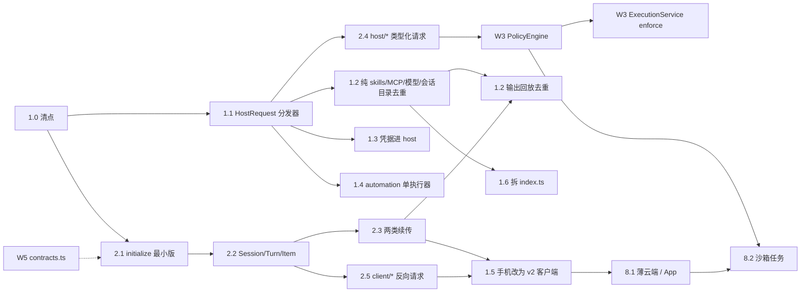

# 16 · 平台层收敛技术方案

> 状态：v1.2（2026-10-15，S1 第 3–7 项地基实现，待主控 review）；变更记录见文末
> 基线：codeshell `main @ 08eaa4369`（0.9.41 源码已合入、尚未正式发布；v0.9.40 之后 97 个提交）；codeshell-services `main @ a5958f0`（锁定 `@cjhyy/code-shell-server` 0.9.38）
> 对照：Codex（本机 ChatGPT.app 26.1002.52244 安装包、本仓库第 15 章）、Claude Code（公开设计）
> 上游文档：[15 · Codex 对比与路线](15-codex-harness-comparison-and-roadmap.md)（Protocol v2 契约与术语以该章为准）
> 并行文档：[统一工作台规划](../todo/unified-desktop-web-mobile-workbench-plan.md)（产品模型）、[项目本地与云端运行 V2](../todo/project-cloud-runtime-v2-plan.md)（运行位置）、[Browser Panel Runtime 设计](../todo/browser-panel-runtime-design.md)
> 示意图：[目标架构交互图](archify/platform-consolidation-target.architecture.html)

## 0. 摘要

引擎层（Engine、TurnLoop、ToolExecutor、多模型、上下文压缩）保持不变。本方案只处理**平台层**的四个结构问题：

1. **宿主分散。** Desktop main（约 85k 行，其中 `index.ts` 7,254 行）、`server` 包、services 仓库各自实现了一部分 Host 能力。一部分重复实现，另一部分只在 Desktop 里有。
2. **协议没有版本，也没有握手。** AgentServer 有 30 个 `agent/*` 方法与通知名、29 种 StreamEvent，没有 `initialize`，也没有协议版本号。宿主侧动作伪装成审批请求（`toolName: "__browser_action__"` 等）回传。手机 WS 协议完全没有版本号。
3. **策略和执行入口分散。** 审批和策略分散在 10 多处。沙箱只覆盖 Bash、后台 shell 和 worktree，桌面端默认关闭。REPL 继承完整环境变量（S0 已处理：改用沙箱 Bash 的环境变量白名单，见 5.2）。
4. **扩展形态多、发版耦合重。** 扩展有四种形态，各自安装和审核；契约版本号分散，`PANEL_APP_API_VERSION` 和 `DESKTOP_CONTROL_PROTOCOL_VERSION` 各在两处重复定义。services 锁定 0.9.38，生产 Hub 仍是 0.9.23（2026-10-12 SSH 核实）。

对应六条工作线：

| 编号 | 工作线            | 一句话目标                                                                                                    |
| ---- | ----------------- | ------------------------------------------------------------------------------------------------------------- |
| W1   | Host Runtime 统一 | 一个纯 Node 的 HostRuntime；Desktop 和 serve 只是两种部署方式                                                 |
| W2   | Protocol v2       | 有握手、有版本、Session/Turn/Item 对象模型、可续传，从 Schema 生成多语言客户端                                |
| W3   | 统一策略与执行    | 一个 PolicyEngine 加一个 ApprovalStore；所有子进程走同一个 ExecutionService                                   |
| W4   | 扩展收敛          | 一份包清单，组成部分按需声明，一次审核                                                                        |
| W5   | 契约与发布        | 契约版本集中管理、兼容矩阵、发版节奏、验收自动化                                                              |
| W6   | 远程、手机与沙箱  | 薄云端（中继、推送、配对、Link OAuth）加一任务一容器的沙箱 runner；都建立在 W1 和 W2 之上，不做常驻云端工作台 |

W1 和 W2 是交织的，不是先后关系。步骤级依赖见第 9.1 节。阶段划分见第 9 节；阶段编号用 S0–S3，避免和 `TODO.md` 里的产品交付 P0/P1 混淆。

### 0.1 与第 15 章的关系

- 第 15 章 §6.3 的十条 v2 契约是本方案 W2 的**完整范围**，本章只补宿主侧细节，不另立一套更窄的契约。
- 术语沿用第 15 章 §6.2：持久对话对象叫 **Session**，一次运行叫 **Turn**，`Thread` 只出现在外部 Runtime 适配器。本章不再提"改名为 Thread"。
- 第 15 章 P0 的 "Responses 原生 Provider" 是引擎层工作，与本方案并行推进，本章**不改变它的优先级**。
- 第 15 章 §6.3 第 10 条要求先清点 coding / Arena / Pet 的 query、RunParams 兼容字段和 projection 方法，这是本方案 S0 的第一项。

### 0.2 与两份并行计划的分工

| 文档                  | 负责                                                           | 本章依赖它的结论                                                                                                                                     |
| --------------------- | -------------------------------------------------------------- | ---------------------------------------------------------------------------------------------------------------------------------------------------- |
| 统一工作台规划        | 产品模型：共享范围、运行位置、云端委派电脑子任务               | W6 的用户流程不在本章重复定义                                                                                                                        |
| 项目本地与云端运行 V2 | 运行位置在"新建 / 打开项目"时选择，会话固定执行位置            | 第 3.3 节 Desktop 是否连本机守护进程，以该文档的"会话目标"模型为前提。该文档里的持久云端工作区、云端 Panel 组合按第 8 节收窄为沙箱任务，相关章节冻结 |
| 本章                  | HostRuntime、Protocol v2 宿主侧、策略 / 执行、扩展包、契约版本 | 上两份文档的实现都跑在本章定义的宿主和协议上                                                                                                         |

---

## 1. 现状事实（2026-10-14 据源码核对）

### 1.1 宿主

- `packages/desktop/src/main` 非测试代码约 85.1k 行，其中直接 import `electron` 的只有 46 个文件。
  - **纯 Node、理论上可以搬走的约 43.5k 行**：pet 12.9k、各类 service 约 10k、会话 / transcript / runs 4.2k、mobile 和 cc-room 3.9k、panels 3.4k、云账号与云环境 3k、凭据加 MCP OAuth 1.7k、links 1.3k、automation 1.3k。
  - **强依赖 Electron 的约 19k 行**：`index.ts`、browser-driver、窗口、协议处理、safeStorage、通知、updater、18 个 `*-ipc.ts`。
  - **混合的约 21k 行**：`agent-bridge.ts` 2,521 行、`panel-app-bridge.ts` 3,791 行、external-runtime、im-gateway、pty 等。
- `index.ts` 有 189 个 import、276 个 `ipcMain` handler（main 里一共 418 个），模块级单例超过 15 个。
- 已经和 server 共享的：panels 运行时（desktop 对 `@cjhyy/code-shell-server/panels` 有 18 处 import）、mobile-remote 传输、remote-relay、links、`WorkerBridgeCore`、desktop-web HTTP。
- **重复实现的**：skills 管理；MCP 探测；模型探测；会话目录与 transcript 读取（对应 hub 侧的 session-management 和 run-replay）；快照与输出回放（`SessionSnapshotStore` 的 seq + epoch 对应 `HubRunReplay` 的 `HubStreamCursor { epoch, sequence }`）；automation 执行（main 里的 `automation-host` 对应 `serve/automation-worker`）。
- **只有 Desktop 有的**：凭据服务、MCP OAuth、云账号客户端、pet、task-inbox、im-gateway、external-runtime、cc-room、profiles、marketplace / plugins、项目与信任、memory / dream、operation batch authority。
- **两个宿主用的是同一个 worker**（`agent-server-stdio`，经 `WorkerBridgeCore`），但处理回环请求的能力不一样：

| 回环 / 请求                                                                                                                                                                                                                                                  | Desktop                      | serve                                                                                               |
| ------------------------------------------------------------------------------------------------------------------------------------------------------------------------------------------------------------------------------------------------------------ | ---------------------------- | --------------------------------------------------------------------------------------------------- |
| `__browser_action__`                                                                                                                                                                                                                                         | main 执行                    | **未处理**，当作普通审批广播出去，挂起直到超时                                                      |
| `__credential_action__`                                                                                                                                                                                                                                      | Electron session 注入 cookie | **未处理**                                                                                          |
| `__workspace_action__`                                                                                                                                                                                                                                       | 切换会话工作区               | **未处理**                                                                                          |
| `__panel_action__`                                                                                                                                                                                                                                           | 渲染进程的面板注册表         | 已处理（`headless-server.ts` 的 approval 拦截分支）                                                 |
| `__ask_user__`                                                                                                                                                                                                                                               | 渲染进程                     | 租给 Web 标签页处理                                                                                 |
| `desktop/*` 请求共 10 个：`credentialResolve`、`credentialSnapshot`、`credentialMaterializeCookie`、`oauthAccessResolve`、`localOAuthLinkAction`、`localOAuthLinkActionCancel`、`remoteLinkAction`、`modelRequestSign`、`automationCreate`、`operationBatch` | `agent-bridge.ts` 处理       | 凭据类靠 `CODE_SHELL_CREDENTIAL_ACCESS=local` 绕开；`automationCreate` 和 `operationBatch` 无人应答 |

- S0 已处理（serve）：`desktop/*` 请求立即返回 JSON-RPC `-32601`（`failure: "unsupported"`），不再广播给 Web 标签页；`__browser_action__`、`__credential_action__`、`__workspace_action__`（passcode 模式下还有 `__panel_action__`）立即应答 `{ ok: false, failure: "unsupported", capability }`。逐项清单见 [S0 协议清点](../todo/platform-s0-protocol-inventory.md)，遗留见 9.2。

- 手机端走的是 Desktop 自己那套 mobile WS 协议（`MobileRemoteOrchestrator` 调用 `AgentBridge.injectWorkerMessage`），没有协议版本号，和 serve 的协议投影（`serve/hello`、审批租约）不是一回事。
- Desktop 在生产环境里从不在本地拉起 `code-shell-serve`。它只会以客户端身份连远程 serve，或者在进程内嵌入 `RemoteHostManager`。但用户可以手动在同一台机器上同时跑 Desktop 和 `code-shell serve`，两者会读写同一份 `~/.code-shell`。

### 1.2 协议

- `packages/core/src/protocol/types.ts` 定义 30 个 `agent/*` 名字（含请求与通知），`agent/query` 下另有子类型。未知方法转给 CapabilityModule 注册的扩展查询。
- StreamEvent 有 29 种。信封里带 `runId`、`clientMessageId`、`outputCursor`、`outputOriginCursor`、`outputRecovery`。
- **没有握手，也没有协议版本**（S0 已加最小版 `initialize` 和 `CONTRACTS`，见 4.1、7.1）。其他协议是有版本的：`RELAY_PROTOCOL_VERSION=1`、`CLOUD_MANAGEMENT_AUTHORITY_VERSION=2`、`CLOUD_BROWSER_AUTHORITY_VERSION=1`、`PANEL_APP_API_VERSION=14`（desktop/shared 和 server/panels 各定义一次）、`DESKTOP_CONTROL_PROTOCOL_VERSION=1`（chat 和 desktop/main 各定义一次）、output journal storage `version: 1`。
- **output journal 已经实现，而且质量不错**：`core/src/session/output-journal.ts`，JSONL 分段存储，cursor 不透明、按哈希链接、绑定日志身份，并支持修复。Desktop、serve、Web、手机都在用。但另外还有两套内存里的回放 cursor。

### 1.3 策略、审批与沙箱

审批和策略分布在这些地方：

- 工具权限：6 种模式，"总是允许"写进 `<cwd>/.code-shell/settings.local.json`；allow 和 deny 分开跟踪，一次性 deny 不阻塞无关操作
- 浏览器域名白名单，加上每次动作的审批和 TabControl 租约
- Panel 进程审批存储 `panel-app-process-approval-store.ts`：原先只有测试引用、生产代码未使用。**S0 已处理**：连同测试删除；其设计（可执行路径 + sha256 指纹作用域、绑定 revision 与应用生命周期两类授权、容量上限、拒绝符号链接）可在 main 的 `40a71d9ca` 读取（文件 `packages/desktop/src/main/panel-app-process-approval-store.ts`），供 S1 的 `process.native` 规则参考
- Panel 进程执行：Desktop 是 `confirmExecution: async () => true`（`panel-app-bridge.ts`），serve 是按 guest grant 弹确认（`panels/runtime.ts`）
- 工作区信任 `trust.json`、Panel 项目绑定
- 凭据和工作区回环
- Link 授权、MCP allow/deny、插件 MCP / hook 的摘要审批
- external runtime 和 cc-room 审批
- Hub 审批租约、手机待审批、自动化写入分级和 authority、operation batch authority

沙箱：`seatbelt`、`bwrap`、`off`、`auto` 四种模式，网络可设 allow / deny。`sandbox-config.ts` 的默认值是 headless 为 `auto`，Desktop 和 REPL 为 `off`。只有 Bash、后台 shell 和 worktree 走沙箱。PowerShell 恒为 `off`。REPL 工具原先 `env: { ...process.env }` 继承完整环境（S0 已处理：改为 `mergeShellEnv(buildSandboxEnv(), ctx.shellEnv)`，仍不进沙箱，见 5.2）。Panel 原生工具走 `panels/process-service.ts` 自己的 `safeProcessEnv`（模块私有函数，未导出），不进沙箱。工具结果里已经带 `sandbox {backend, network}`，UI 有对应的徽标。

### 1.4 扩展与发布

- **Agent Plugin**：兼容 `.codex-plugin` 和 `.claude-plugin`，外加 `.codeshell-plugin` 覆盖层（目前只有 automation 模板摘要）。安装到 `~/.code-shell/plugins`，hook 和 MCP 做摘要审批，没有签名。
- **Panel App**：`.codeshell-panel/panel.json`，schema v1 / v2，带审核 token 和摘要绑定，安装到 `~/.code-shell/panel-apps`，注册表 `installed.json`。
- **Link**：静态 TS 目录加远端能力协商（`links/catalog.ts`、`remote-catalog.ts`），用户不能自己安装 provider。
- **能力模块**：通过 `CODE_SHELL_CAPABILITY_MODULES` 动态 import，没有校验，只有受信宿主的环境变量能设置。
- **发布**：所有包统一版本（0.9.41 待发）。Desktop 用 electron-updater，手动下载。CLI 用 npm 自动更新。Hub 不会自更新，靠 Docker 或 systemd 部署。services 锁定 0.9.38；候选镜像只在 `candidate.yml` 里构建，不作为 package 依赖。
- services 最近 60 个提交里约 25% 是证据 / 回执类提交。

---

## 2. 目标架构

```
   Desktop UI        Web / Hub SPA       iOS / Android        TUI / SDK / 外部 Agent
       │                  │                   │                        │
       └────── Protocol v2（initialize · Session/Turn/Item · cursor 续传 · client/* 反向请求）──────┘
                                   │
   ┌───────────────────────────────▼──────────────────────────────────────┐
   │ HostRuntime（纯 Node，packages/host）                                 │
   │  HostServices: sessions · credentials · panels · links · automation  │
   │                browser-backends · devices · push · operations        │
   │  PolicyEngine + ApprovalStore（唯一审批入口）                          │
   │  ExecutionService（唯一子进程入口，默认沙箱）                          │
   │  HostRequest 分发器（worker → host 类型化请求，取代 __*__ 回环）        │
   │  Capability 声明 · CONTRACTS · Trace                                  │
   │  HostAdapter ← 平台相关实现注入（Electron / Headless / Container）     │
   └──────┬──────────────────────────────┬────────────────────────────────┘
          │ WorkerBridgeCore（stdio）      │ 薄后端协议 / 进程
    Agent worker（Engine）           浏览器后端 · Panel services · exec kernel

   部署形态：Desktop = Electron main 内嵌 HostRuntime + ElectronAdapter（常驻）
             serve   = 独立进程 HostRuntime + HeadlessAdapter（常驻）
             沙箱    = 容器内 serve + ContainerAdapter（一任务一容器，跑完销毁）
   薄云端：配对 / Account · Link OAuth 回调 · 设备中继 · 推送网关（独立进程）· 对象存储（journal 与附件）
```

原则：

- **沙箱只是另一台电脑。** 手机或 Web 看沙箱里的 Session 和 Panel，与看电脑上的走同一条路：连到那台宿主的 HostRuntime。不单独做"云端 Panel 运行时"或"云端工作台"。
- **云端不跑常驻状态。** 薄云端只做转发、推送、配对和 OAuth 回调；任务状态在宿主里，产出进 git 和对象存储。

- **HostRuntime 是唯一的宿主实现。** Electron main 只负责窗口、webContents、系统集成，再加上一个 HostAdapter。
- **所有客户端都是平等的 Protocol v2 客户端。** Desktop 渲染进程也不例外：它通过 IPC 承载 v2 消息，不再走 276 个零散的 IPC handler。
- **不支持的能力要明确声明。** serve 没有浏览器能力，就在 capabilities 里说明，并对相应请求立即返回 `host_unsupported`（S0 线上为 `failure: "unsupported"`，`host_unsupported` 是 v2 错误码名），不能让请求挂起。
- **一台机器一个 Host 写入者。** 同机并存的 Desktop 和 serve 对共享文件（automation、session 目录、settings）必须经过同一把跨进程锁，或者由 capabilities 协商出单一 owner。

### 2.1 能力协商与降级

宿主之间（Desktop、serve、沙箱）和 Runtime 之间（原生 Engine、Codex、Claude Code）的能力都不一致，本方案不追求一致，只定三条规则：

1. **声明。** 每个宿主在 `initialize` 里声明能力，每个 RuntimeProvider 声明自己的能力；一个 Session 的实际能力是两者的交集。Pet 现有的 `hostActionKinds` 闭合列表就是这个机制的雏形，1.7 时升级为公共机制。
2. **拒绝而非挂起。** 请求不在声明里，立即返回 `host_unsupported` 并带能力名；UI 置灰，Mimi 不暴露对应工具。
3. **委派。** 缺能力时可以把那一步交给有能力的宿主：云端或沙箱任务委派电脑子任务，电脑把无人值守的步骤丢进沙箱。委派走 Protocol v2 和 W6 的设备注册。

能力矩阵（行是能力，列是 宿主 × Runtime，格子写 有 / 无 / 可委派）作为附录维护，同时是 `initialize` 响应和第 7.2 节兼容矩阵的事实来源。

---

## 3. W1 · HostRuntime 统一

### 3.1 新包与接口

新增 `packages/host`（`@cjhyy/code-shell-host`），纯 Node，只依赖 core。serve 和 desktop 都依赖它。单独成包的原因：`server` 包依赖 `web`、`capability-coding`、`link`，把 Host 放进 server 会让 Desktop 被这些包拖进来。

```ts
interface HostService {
  id: string; // "credentials", "sessions", "panels", ...
  version: number;
  capabilities(): HostCapability[]; // 写进 initialize 响应
  methods?: Record<string, HostMethod>; // Protocol v2 的 host/* 方法
  hostRequests?: Record<string, HostRequestHandler>; // worker → host 请求（取代回环）
  start(ctx: HostContext): Promise<void>;
  stop(): Promise<void>;
}

interface HostAdapter {
  // 平台相关能力，由部署形态注入
  kind: "electron" | "headless" | "container"; // container：一任务一容器，无 iab / 对话框 / 本机凭据，只有 chromium 和注入的作用域 token
  secretCipher: SecretCipher; // safeStorage / OS keychain / 文件密钥
  notifier?: Notifier; // 桌面通知；headless 为空，走 push
  dialogs?: DialogProvider; // 选择目录等；headless 为空，HostRuntime 改发 client/dialog 请求
  browserBackends?: BrowserBackendHost; // Electron 提供 iab；headless 提供 chromium
  openExternal?(url: string): Promise<void>;
  paths: HostPaths;
  sharedLock: CrossProcessLock; // 复用现有 CronStore 目录锁，所有共享文件写入经过它
}

class HostRuntime {
  constructor(opts: {
    adapter: HostAdapter;
    services: HostService[];
    workerFactory: WorkerFactory;
  });
  connect(transport: ClientTransport, client: ClientInfo): ClientSession; // Protocol v2 入口
}
```

### 3.2 迁移顺序（每一步都可以单独发布）

| 步骤 | 内容                                                                                                                                       | 涉及                                                            | 验收                                                                                                                                                     |
| ---- | ------------------------------------------------------------------------------------------------------------------------------------------ | --------------------------------------------------------------- | -------------------------------------------------------------------------------------------------------------------------------------------------------- |
| 1.0  | 清点现有 query、RunParams 兼容字段、projection 方法和全部 `__*__` / `desktop/*` 请求，形成 v2 命名空间与废弃表                             | protocol/types.ts、agent-bridge、headless-server、capability 包 | 一份清单，S0 内完成，是 1.1 和 4.4 的输入                                                                                                                |
| 1.1  | 建立 `packages/host` 骨架、`HostService` 注册表、`HostRequest` 分发器；把 `agent-bridge.ts` 和 `headless-server.ts` 里的回环拦截搬到分发器 | agent-bridge、headless-server、browser-driver/intercept         | serve 收到未支持的 `__*__` 或 `desktop/*` 请求立即返回 `host_unsupported`，带能力名；不再挂起                                                            |
| 1.2  | 合并重复实现：skills、MCP 探测、模型探测、会话目录 / transcript、输出回放                                                                  | desktop/main/_-service 和 server/hub/_                          | Desktop 和 Hub 调用同一份实现；`SessionSnapshotStore` 和 `HubStreamCursor` 改为 output journal cursor 的内存缓存；session 目录的测试隔离守卫随代码一起搬 |
| 1.3  | 凭据服务和 MCP OAuth 搬进 host，cipher 由 adapter 注入                                                                                     | credentials-service、credential-cipher、mcp-oauth-service       | serve 也能用 `credentialResolve` 同等能力，去掉 `CODE_SHELL_CREDENTIAL_ACCESS=local` 特例                                                                |
| 1.4  | automation 只保留一个执行器，调度经过 `sharedLock`                                                                                         | automation-host、serve/automation-worker                        | Desktop 和 serve 共用调度；同机并存时只有一个实例实际触发；`automationCreate` 在 serve 下可用                                                            |
| 1.5  | 手机远程编排改为 HostRuntime 的一个客户端，不再调用 `injectWorkerMessage`                                                                  | mobile-remote-orchestrator                                      | 手机直接走 Protocol v2（依赖 2.3 续传和 2.5 反向请求）                                                                                                   |
| 1.6  | 拆分 `index.ts`：每个领域一个 `register(app, host)` 模块；IPC 改为一条 v2 通道加少量 Electron 专属 IPC                                     | index.ts、\*-ipc.ts                                             | 现有 `tests/architecture-budgets.test.ts` 已锁定 `index.ts` 7,277 行和主进程路由总数；拆分后把 `index.ts` 上限下调到 1,500 行，并按领域模块分别计数路由  |
| 1.7  | pet、task-inbox、im-gateway、cc-room、external-runtime、operation batch 逐个改成 HostService                                               | 对应目录                                                        | 各自能在 serve 里启用，或在 capabilities 里声明不可用                                                                                                    |

1.1 首版已接生产：`packages/host` 只依赖 core，提供同步 adapter/service 生命周期、能力注册、legacy HostRequest 分类/分发及 `interceptHostRequest`。serve 与 Panel agent-task 在客户端路由前调用；Desktop 的 Electron adapter 把既有 browser/credential/workspace/panel/automation/operation handler 注册给同一分发器。旧 `server/serve/host-requests.ts` 仅转导出，不再重复实现。此步不提供 v2 transport，也未迁移 1.2–1.4 大服务。

### 3.3 可选的后续：Desktop 连本机守护进程

迁完以后，Desktop 可以不再内嵌 HostRuntime，改为连接本机常驻的 `code-shell-serve --local`。好处是关掉窗口后任务继续跑，手机还能连上。这一步与《项目本地与云端运行 V2》的"会话固定执行位置"模型一致：本机守护进程只是"此计算机"这个执行位置的另一种承载。轻量版（有手机连接时阻止睡眠、关窗口不杀 HostRuntime）在 S2 随 8.1 做；完整守护进程的决定留到 S3，到时需要评估 node-pty、playwright-core 这类原生模块的打包，以及开机自启的权限。

### 3.4 风险

- `panel-app-bridge.ts` 和 `agent-bridge.ts` 很大，迁移时要保持行为不变。先补协议层的录制回放测试，再搬代码。
- 迁移期间两套实现会并存，用 feature flag 按服务切换，每个服务只维持一个版本周期的双轨。
- 会话目录相关代码搬动时，测试写真实 `~/.code-shell` 的守卫必须放在 sessionsRoot 层而不是 home 层，否则子目录会绕过。

---

## 4. W2 · Protocol v2

范围以第 15 章 §6.3 的十条为准。本节只定宿主侧细节和与第 15 章的差异补充。

### 4.1 握手

```jsonc
// → initialize
{ "protocolVersions": ["2.0"], "client": { "name": "codeshell-ios", "version": "1.0.0", "kind": "mobile" },
  "capabilities": { "streaming": true, "approvals": ["tool","exec","browser","credential"],
                    "clientRequests": ["dialog","askUser"], "media": ["image/png"] },
  "resume": { "sessionId": "…", "cursor": "…" } }
// ← result
{ "protocolVersion": "2.0", "contracts": { /* 见 7.1 */ }, "host": { "kind": "electron", "id": "…" },
  "capabilities": { "browser": { "backends": ["iab","extension"] }, "panels": { "api": 14 }, "sandbox": { "backends": ["seatbelt"] } },
  "methods": ["session/start", "…"], "unsupported": [{ "capability": "browser", "reason": "headless host" }] }
```

- 客户端声明自己**能应答**哪些 `client/*` 反向请求；宿主声明自己**提供**哪些能力和方法。
- 没发 `initialize` 的连接按 v1 处理。
- **S0 已实现的子集**：`initialize` 返回 `{ protocolVersion: "1", contracts }`（`packages/core/src/protocol/initialize.ts` 的 `InitializeResult`），在 `moduleReady` 之后分发，暂不读取客户端参数、不做版本协商。`contracts` 永久留在顶层，S1 在它旁边增加 `host`、`capabilities`、`methods`、`unsupported`。serve 的 `/health` 同样返回 `{ status, mode, contracts }`（no-store）。

### 4.2 对象模型

`Host → Project → Session → Turn → Item`，另有 `Approval`、`BackgroundRun`（goal、cron、后台任务）、`Device`。Approval 既是独立对象（有自己的生命周期和投影），也以 `approval` Item 出现在 Turn 里，两者共用 `approvalId`，这与第 15 章一致。

| Item 类型      | 来自哪些 StreamEvent                                                     |
| -------------- | ------------------------------------------------------------------------ |
| `userMessage`  | session_user_message                                                     |
| `agentMessage` | text_delta、assistant_message                                            |
| `reasoning`    | thinking_delta（以后承载 Responses 原生 reasoning item）                 |
| `toolCall`     | tool_use_start、tool_use_args_delta、tool_result、tool_summary           |
| `approval`     | approvalRequest / approvalResolved                                       |
| `subAgent`     | agent_start / backgrounded / end / heartbeat、background_agent_completed |
| `contextEvent` | context_compact、context_transfer、memory_recalled                       |
| `goal`         | goal_set / goal_updated / goal_progress / goal_cleared                   |
| `notice`       | error、tombstone、steer_injected、task_update                            |

通知统一为 `item/started`、`item/delta`、`item/completed`、`turn/started`、`turn/completed`、`approval/requested`、`approval/resolved`、`session/updated`、`backgroundRun/updated`、`device/updated`。每条带 `{ sessionId, turnId?, itemId?, seq, cursor? }`。

外部 Runtime（Codex app-server、Claude Code）由各自的 `RuntimeProvider` 适配层投影成同一套 Item：Codex 的 thread / turn / item 直接映射，`thread.sessionId` 是 fork 树根，不等于我们的 Session；Claude Code 的 hooks 和 stream-json 由适配层合成 Item 边界。两者的审批映射为 `Approval`，其自身的 permission mode / approval policy 作为 PolicyEngine 的 `mode` 策略源，宿主策略只能更严。`item/delta` 必须沿用现有 text_delta 合并策略，不逐 token 发送。

### 4.3 续传：两类状态、两种机制

| 状态类别  | 内容                                               | 机制                                                                                                      |
| --------- | -------------------------------------------------- | --------------------------------------------------------------------------------------------------------- |
| Turn 输出 | 所有 Item 生命周期与 delta                         | output journal cursor，`session/resume { cursor }` 补齐；cursor 失效返回 `cursor_invalid`，客户端改拉快照 |
| 宿主状态  | Session 列表、Approval 待办、BackgroundRun、Device | 每个对象带 `stateVersion`；`session/subscribe` 返回当前快照加版本，断线后用 `since: stateVersion` 拉差分  |

Approval 事件同时出现在两处：作为 Item 进 journal（可续传），作为独立对象进状态快照（可查询）。`SessionSnapshotStore` 和 `HubStreamCursor` 各自的 seq / epoch 删除，或改成 journal cursor 的内存缓存。

### 4.4 宿主请求类型化（worker → host）

回环不再伪装成审批，改成 worker → host 的类型化请求：

```
host/browser.act   host/credential.materialize   host/credential.resolve   host/workspace.switch
host/panel.call    host/user.ask                 host/automation.create    host/model.sign
host/link.action   host/operation.batch
```

需要用户确认时，由 HostRuntime 生成一个 `Approval` 对象（见 W3）。"执行请求"和"征求同意"分开。

### 4.5 客户端反向请求（host → client）

headless 宿主没有对话框和渲染进程，这类事情要向客户端要：

```
client/dialog.pickDirectory   client/askUser   client/approval.prompt
```

- 宿主只向在 `initialize` 里声明了该能力的客户端发；多个客户端时按租约（沿用现有 `__ask_user__` 租约逻辑）选一个，其余收到 `approval/requested` 通知。
- 请求带超时；超时或客户端断线返回 `client_unavailable`，worker 侧按策略降级（比如改为 deny）。

### 4.6 Schema、错误与代码生成

- 唯一定义：`packages/core/src/protocol/v2/schema.ts`（zod）。
- 产出：JSON Schema 快照（`protocol/v2/schema.json`，CI 里比对快照），TS 客户端，Swift / Kotlin 模型（用 quicktype 或自写生成器）。
- 错误沿用第 15 章 §6.3 第 6 条的类型列表，统一形状 `{ code, source, retryable, httpStatus? }`。
- 版本规则：只增加字段算小版本；删除或改语义算大版本。实验字段一律放在 `x-` 前缀下，不进稳定契约。

### 4.7 兼容

- AgentServer 同时支持 v1 和 v2。没发 `initialize` 的连接按 v1 处理。
- 提供 v1 适配层，把 Item 降级回 StreamEvent，保留两个小版本。
- TUI 用进程内传输，最先切换，作为第一个验证点。

### 4.8 验收

- 同一段录制好的会话，经 v1 和 v2 回放后，UI 渲染结果一致。
- 手机断网 5 分钟后恢复，用 cursor 补齐 Turn 输出，用 stateVersion 补齐待审批，没有丢失，也没有重复。
- headless 宿主上，Bash 工具触发的 askUser 由 Web 标签页应答；标签页关闭后 worker 收到 `client_unavailable`。
- 生成的 Swift 和 Kotlin 模型能解码 CI 里的录制样本。

---

## 5. W3 · 统一策略与执行

### 5.1 PolicyEngine

```ts
type ActionKind =
  | "tool"
  | "exec"
  | "fs.write"
  | "network"
  | "browser.read"
  | "browser.write"
  | "process.native"
  | "credential.use"
  | "link.action"
  | "workspace.switch"
  | "mcp.call"
  | "panel.call";

interface ActionRequest {
  actor: {
    sessionId: string;
    turnId?: string;
    clientKind: string;
    deviceId?: string;
    callerToken?: string;
  };
  kind: ActionKind;
  resource: string;
  risk: "low" | "medium" | "high" | "handoff";
  detail?: unknown;
}
interface Decision {
  outcome: "allow" | "ask" | "deny";
  source:
    | "rule"
    | "mode"
    | "user"
    | "user_persisted"
    | "auto_review"
    | "site"
    | "enterprise"
    | "host_unsupported";
  scope?: "once" | "turn" | "session" | "project" | "user";
  retryable: boolean;
  reason?: string;
}
```

**策略源**（现有各处来源都改成策略源）：工具权限规则和模式、浏览器域名白名单、工作区信任、Panel 绑定、MCP allow/deny、插件摘要审批、Link 授权、自动化写入分级、operation batch authority。

**合成规则**（全部策略源都求值，不是先匹配先赢）：

1. 任一来源 `deny` 即 `deny`，来源记为最先给出 deny 的那个。
2. 否则按 企业 → 项目 → 用户 → 模式 → 站点 → 会话授权 的顺序，取第一个给出 `allow` 的来源。
3. 都没有明确结论则 `ask`。
4. allow 和 deny 分开存储；一次性 deny 只对本次生效，沿用现有"不持久化拒绝"的原则。

**ApprovalStore 只有一个**：`~/.code-shell/approvals.json` 加项目级 `.code-shell/approvals.local.json`。现有 `settings.local.json` 里的 permissions 规则在首次启动时迁入，旧文件保留只读一个版本周期。Hub 租约、手机待审批、cc-room 审批都只作为它的投影。

- 没人引用的 `panel-app-process-approval-store.ts` 连同两个测试一起删除，由 `process.native` 的规则表达。Desktop 的 `confirmExecution: async () => true` 改为显式策略：项目已绑定且受信任时允许，并写入审计。
- **自动审查（可选，默认关闭）**：只能把 `ask` 降为 `allow`，且仅限 `risk: "low"`；`medium` 以上和任何 `deny` 不经过模型。来源记为 `auto_review`，判断不了回到 `ask`。模型在本机跑，不把审批内容发到 Account 侧。每次判断写审计。
- 审计：每个 Decision 写一条 trace 事件，设置页可以查询。

### 5.2 ExecutionService

所有子进程都从这里派生：Bash、后台 shell、REPL、PowerShell、Panel 原生工具、以后的 exec kernel。

```ts
interface ExecSpec { argv: string[]; cwd: string; env: EnvPolicy; stdin?: …; timeoutMs?: number;
  sandbox: SandboxProfile; network: "deny" | "allow" | { allowHosts: string[] }; owner: ActionRequest["actor"] }
```

- 所有子进程统一走环境变量白名单。S0 已先处理 REPL：改用沙箱 Bash 的白名单 `mergeShellEnv(buildSandboxEnv(), ctx.shellEnv)`（`core/src/runtime/spawn-common.ts`），而不是 server 的 `safeProcessEnv`；bun 以 `--no-env-file` 启动。`buildSandboxEnv` 同时补了 win32 必需变量（`SystemRoot`、`PATHEXT`、`USERPROFILE`、`TEMP` 等）和 CA 路径变量（`SSL_CERT_FILE`、`SSL_CERT_DIR`、`NODE_EXTRA_CA_CERTS`、`REQUESTS_CA_BUNDLE`）；代理变量刻意不放行。Panel 原生工具的 `safeProcessEnv` 仍在 server 内，随 ExecutionService 统一。
- 这只是纵深防御，**不是沙箱**：REPL 仍不进沙箱，同用户的子进程照样能读父进程环境（`ps eww $PPID`、`/proc/$PPID/environ`）和文件。REPL 改走沙箱后端在 S1 做。
- **默认沙箱分两步切换**，避免打断现有依赖非沙箱的 Panel 工具和插件脚本：
  1. **report-only**（S1，需先做技术验证）：Desktop 默认仍 `off`，但 ExecutionService 用 `auto` 后端做一次"假如在沙箱里会不会被拒"的评估，把结果写进 trace 和工具结果徽标，不改变实际行为。维持一个小版本。
  2. **enforce**：Desktop 默认改为 `auto`。report-only 阶段记录到的高频被拒路径转成默认 `writableRoots` 建议，由用户在设置页确认。
- 没有可用后端（Windows、无 bwrap 的 Linux）时，明确报告实际状态，并按策略决定拒绝执行还是降级提示。
- 网络默认对 REPL 和原生工具关闭；Bash 按项目信任级别区分：受信任项目 `allow`，未信任项目 `deny`。
- 实际的沙箱状态写进 Item（`toolCall.sandbox`）和 `initialize` 返回的能力，UI 继续显示现有的徽标。

### 5.3 验收

- 用同一套策略测试表，覆盖原先所有审批场景，并比对迁移前后的决策（录制回放）。
- 在 REPL 里读 `~/.ssh` 或访问外网，默认被拒，错误来源写明。
- report-only 一个版本后，Desktop 上被沙箱拒绝的操作数量和路径有统计，enforce 切换后用户可见的中断数为零。
- 手机端在启用自动审查时，低风险操作不推送审批；中高风险操作一律推送。

---

## 6. W4 · 扩展收敛

### 6.1 统一包清单

新增 `.codeshell/package.json`（schema v1），作为 CodeShell 原生格式。`.codex-plugin` 和 `.claude-plugin` 继续兼容，安装时转成同一个内部模型。

```jsonc
{
  "schemaVersion": 1,
  "id": "browser",
  "version": "1.0.0",
  "publisher": "cjhyy",
  "facets": {
    "skills": ["skills/browser/SKILL.md"],
    "agents": [],
    "commands": [],
    "hooks": "hooks/hooks.json",
    "mcp": ".mcp.json",
    "panel": {
      "entry": "app/index.html",
      "permissions": ["process", "workspace.read"],
      "placement": "right-dock",
    },
    "services": { "browser-service": { "entry": "app/tools/browser-service.mjs", "sha256": "…" } },
    "cli": { "codeshell-browser": { "entry": "app/cli/main.mjs", "sha256": "…" } },
    "automations": [],
    "connectors": [],
  },
  "hostCapabilities": ["browser.backends", "approval", "lifecycle.turn"],
}
```

- 一个安装器，一个注册表（`installed.json`），一次审核。审核页按组成部分逐项展示权限（复用 `panel-capability-visibility` 的界面），每个部分单独做摘要绑定。
- Panel App 清单 v1 / v2 读进来后，就是 `facets.panel` 加上 `agent.tools` 和 `skills`。旧包不用改。现有审核 token 与摘要绑定继续作为"本地审核"记录，签名是在它之上的"发布者证明"，两者并存。
- **签名**：ed25519，对清单的规范化 JSON 摘要签名。发布者公钥登记在市场索引里，市场索引本身由 Account 服务签发；本地开发不要求签名；吊销通过市场索引的 revoked 列表下发，安装器每次安装和升级时核对。市场来源默认要求签名。
- Link 继续用静态目录，`connectors` 只引用目录 ID，用户不能自定义上游。
- 能力模块（`CODE_SHELL_CAPABILITY_MODULES`）仍是仓内组合单元，不对外开放。

### 6.2 验收

- 一个包同时带 skills、panel、services、cli，安装一次，在一个审核页面里看到全部权限。
- 已安装的 Panel v2 和 Codex / CC 插件升级后行为不变。
- 吊销列表里的包在升级时被阻止，并给出发布者和吊销原因。

---

## 7. W5 · 契约与发布

### 7.1 集中管理契约版本

新增 `packages/core/src/contracts.ts`，所有对外契约版本只在这里定义，其他地方引用：

```ts
export const CONTRACTS = {
  agentProtocol: { supported: ["1", "2.0"], preferred: "2.0" },
  panelApi: 14,
  cloudManagementAuthority: 2,
  cloudBrowserAuthority: 1,
  relayProtocol: 1,
  desktopControl: 1,
  mobileRemote: 1,
  outputJournal: 1,
  packageManifest: 1,
} as const;
```

上面是目标形态。S0 已落地的版本：

- `CONTRACTS` 从 core 公共入口导出，整张表深度冻结，源文件里用仅类型的断言锁住每个字面量类型。当前 `agentProtocol` 为 `{ supported: ["1"], preferred: "1" }`，v2 时加 `"2.0"`；`packageManifest` 等 W4 落地再加。
- 其他定义改为从 `CONTRACTS` 派生：server 的 `panelRuntimeApiVersion`、`CLOUD_MANAGEMENT_AUTHORITY_VERSION`、`CLOUD_BROWSER_AUTHORITY_VERSION`，Desktop main 的 `DESKTOP_CONTROL_PROTOCOL_VERSION`。
- 三处必须保留字面量，由 `packages/desktop/src/main/contract-versions.test.ts` 守卫与 `CONTRACTS` 一致：renderer-shared 的 `PANEL_APP_API_VERSION`（渲染进程只能在运行时引入浏览器安全的入口）、chat 包的 `DESKTOP_CONTROL_PROTOCOL_VERSION`（chat 不依赖 core）、`RELAY_PROTOCOL_VERSION`（remote-relay 入口只依赖 Node 内置模块）。改成直接引用的前提见 9.2。
- `mobileRemote: 1` 已在表里声明；手机 WS hello 随 1.5 开始携带，这是它下线前能做兼容判断的前提。
- `initialize` 的响应和 `/health` 都返回 `CONTRACTS`（S0 已实现）。

### 7.2 兼容矩阵与契约测试

- `docs/compatibility.md` 列出：Host 包版本 × services × Desktop × 手机 App，各自支持的契约版本范围。
- services 只依赖**已发布**的包，版本范围写成 `~0.10`。CI 里跑契约测试，按 `CONTRACTS` 和能力探测判断。候选镜像只在 `candidate.yml` 里使用。
- Account-v2 这类跨仓库能力，先在 codeshell 里发布（可以先藏在 feature flag 后面），再让 services 升级。

### 7.3 发版节奏

- 每两周一个小版本，紧急修复走补丁版本。
- 生产 Hub 和 Cloud 镜像使用带摘要的镜像标签加滚动升级脚本，先把 0.9.23 升到当前版本。
- Desktop 保持 electron-updater；macOS 签名问题处理完后，打开自动下载。

### 7.4 验收自动化

- 把 services 里的 `test:device-relay`、candidate 冒烟测试、部署回执变成 CI job。证据作为 artifact 保存 90 天。
- 文档只写契约、设计和部署说明。按日期记录的部署回执迁到 `evidence/` 或 Release notes 里。
- 目标：services 里证据 / 回执类提交占比从约 25%（最近 60 个提交抽样）降到 10% 以下。

### 7.5 可观测性

- 统一 trace：`traceId = sessionId`、`spanId = turnId / itemId`，从客户端经 HostRuntime 和 worker 一直到服务端。日志按 OpenTelemetry 格式输出，可以选择导出。
- 错误统一使用 `{ code, source, retryable }`（与 W3 的 Decision 对齐）。

---

## 8. W6 · 远程、手机与沙箱

依赖 1.5、2.3 和 2.5。产品流程（共享范围、运行位置、委派）以《统一工作台规划》为准，本节只定基础设施。前提是**电脑在线是正常状态**：遥控场景不依赖云端执行。

### 8.1 薄云端（遥控必需）

| 组件       | 方案                                                                                                                                                                                         |
| ---------- | -------------------------------------------------------------------------------------------------------------------------------------------------------------------------------------------- |
| 配对与身份 | 手机首次连某台电脑时扫码配对并本机确认（保留现在的配对机制）。Account 先只做设备表和一次性票据，多用户后置；设备中继去掉内嵌账号库                                                           |
| 连接       | 手机 → 中继 → 电脑的 HostRuntime，直接走 Protocol v2；中继是无状态转发。手机端那套私有 WS 协议先补版本号，再逐步下线                                                                         |
| 推送网关   | services 里**独立进程**，权限隔离，可单独扩容。iOS 用 APNs；Android 用 FCM，大陆走厂商通道或聚合推送。触发事件：待审批、Turn 完成、需要人工接管、电脑离线                                    |
| Link OAuth | 第三方授权的公网回调和密钥托管留在云端，和现在一样                                                                                                                                           |
| 保持在线   | Desktop 有手机连接时阻止系统睡眠；关窗口不杀 HostRuntime（第 3.3 节守护进程的轻量版，提前到 S2）                                                                                             |
| App        | 第一版用 Capacitor 包装 `packages/web`。前提是 `packages/web` 先切到 v2 并能脱离 Hub 直连 HostRuntime（S2 的工作量要计入）。推送、生物识别、后台恢复用原生插件；数据模型用 W2 生成的 TS 类型 |
| 基础设施   | 域名、wildcard DNS / TLS（大陆需备案，可先用香港节点）、Apple 开发者账号与 APNs 证书、各厂商推送账号、App 备案                                                                               |

验收：在手机上给家里的电脑派一个任务；锁屏状态收到审批推送，Face ID 批准；断网后再恢复，结果完整无缺；在手机上打开电脑上的一个 Panel 并完成一次操作。

### 8.2 沙箱任务（无人值守，S3）

云端执行只做一种形态：**一任务一容器**，对标 Codex Cloud 和 Claude Code 云端会话。

| 环节           | 方案                                                                                                                                                         |
| -------------- | ------------------------------------------------------------------------------------------------------------------------------------------------------------ |
| 触发           | GitHub 事件（Issue / PR 提及、push）、定时器、手机或桌面上的"丢到沙箱"                                                                                       |
| 启动           | 起容器，克隆仓库到指定分支，注入本次任务的最少凭据（例如只能推该分支的 token）；每个项目可缓存一个基础镜像减少冷启动                                         |
| 运行           | 容器里跑 headless serve + ContainerAdapter，一个 Session 跑完即退出；PolicyEngine 使用 `sandbox-host` 模式：文件和命令默认 allow，网络出口和凭据使用保留审批 |
| 产出           | 三样：分支或 PR、输出 journal、附件。journal 和附件推到对象存储，手机和桌面从那里回放                                                                        |
| 观察与审批     | 运行中沙箱就是一台临时宿主，手机连它和连电脑一样；Panel 的 headless 部分可以作为沙箱任务跑，界面仍在桌面和 Web                                               |
| 本地到沙箱交接 | "fork 到沙箱"：推当前分支，用 `context_transfer` 带上下文摘要，在容器里起新 Session。两家竞品都没有这个方向                                                  |
| 不做           | 持久云端工作区、云端 Panel 运行时、备份恢复、跨版本回滚、手机 × 云端 Panel 业务组合                                                                          |

验收：在 Issue 里提及后，沙箱产出一个 PR，手机上收到通知并能看 journal；从桌面把一个会话 fork 到沙箱，关掉电脑后任务跑完。

---

## 9. 阶段与时间（单人主力估算，可以并行的标了 ∥）

阶段编号 S0–S3 与 `TODO.md` 的产品交付 P0 / P1 无关。S0 不占用 P0.1 发版和 P0.2 Panel 正式发布的人力窗口，按两周为单位错开排期。

| 阶段              | 周期   | 内容                                                                                                                                                                                                                                                                                                                                                                                                 | 出口标准                                                                                     |
| ----------------- | ------ | ---------------------------------------------------------------------------------------------------------------------------------------------------------------------------------------------------------------------------------------------------------------------------------------------------------------------------------------------------------------------------------------------------- | -------------------------------------------------------------------------------------------- |
| **S0 快速修复**   | 1–2 周 | 1.0 清点；1.1 回环分发器加 `host_unsupported`（S0 线上为 `failure: "unsupported"`，`host_unsupported` 是 v2 错误码名）（分发逻辑先放在 `server/serve/host-requests.ts`，S1 随 `packages/host` 迁移）；`contracts.ts`（含手机协议版本号）；删除没人用的进程审批存储；REPL 改环境变量白名单；最小版 `initialize`（只返回协议版本和 `CONTRACTS`，先不改对象模型）；∥ 域名 / DNS / 备案；∥ 生产 Hub 升级 | serve 不再挂起；serve `/health` 与 AgentServer `initialize` 能报告契约版本；1.0 清单评审通过 |
| **S1 地基**       | 4–6 周 | `packages/host` 和步骤 1.2–1.4；W2 v2.0（Session/Turn/Item 模型、两类续传、`client/*`、Schema 生成、TUI 先切）；W3 的 PolicyEngine 和 ApprovalStore（先接工具、浏览器、进程三类）；ExecutionService 沙箱 report-only（需先做技术验证）；∥ W5 兼容矩阵、契约测试、验收进 CI                                                                                                                           | Desktop 和 serve 共用会话、凭据、automation；TUI 跑在 v2 上                                  |
| **S2 多端**       | 4–6 周 | 1.5、1.6（拆分 `index.ts`）；Desktop 渲染进程和 Web 切到 v2；ExecutionService 沙箱 enforce；8.1 薄云端：中继改用票据、配对与设备表、推送网关、保持在线、Capacitor App 内测                                                                                                                                                                                                                           | 手机遥控整条链路跑通，含在手机上用电脑的 Panel                                               |
| **S3 生态与沙箱** | 持续   | W4 统一包清单和签名；Browser Panel 运行时；1.7 其余服务；8.2 沙箱任务 runner；评估 Desktop 是否改连本机守护进程                                                                                                                                                                                                                                                                                      | 能按工作线分别验收                                                                           |

### 9.1 步骤级依赖

W2 的步骤编号：2.1 `initialize` 最小版（4.1）、2.2 Session/Turn/Item 对象模型（4.2）、2.3 两类续传（4.3）、2.4 `host/*` 类型化请求（4.4）、2.5 `client/*` 反向请求（4.5）。



### 9.2 S0 遗留与 S1 待办

本批跟踪与完整后续批次见[首版实施清单](../todo/platform-first-version-plan.md)。以下“已实现”只表示本仓代码事实，不表示后续 S1/S2/S3 或真实环境验收完成。

- **已实现：内部回环标识兼容方案。** 保留既有 `__*__` wire 名字；core 工具注册、内置目录与 capability composition 全部拒绝第三方以 `__` 开头的工具名，防止伪装成内部回环。typed `host/*` 仍待 v2 批次。
- **已实现：Panel agent-task。** `desktop/*` JSON-RPC worker 请求在 session 过滤前立即 -32601 / `data.failure: unsupported`；内部回环用 `approved: true` 携带 typed unsupported answer，不能误报用户拒绝；内部请求和 resolved ID 不向 client 暴露。普通审批、AskUser 和已安装 Panel callback 保留。最终 worker env 构造清 `CODE_SHELL_REMOTE_LINK_CLIENT_SECRET`，自定义 builder 也不能遗留。
- **已实现：拦截收口及 1.1。** S0 纯逻辑迁 `packages/host`，错误文案由 adapter 注入宿主标签；`interceptHostRequest` 在 serve、Panel、Desktop 的生产链路共用，旧入口仅转导出。HostRuntime 注册能力并管理基本生命周期，仅依赖 core。1.2–1.4 留下一批。
- **已实现：worker 环境开关。** serve 的交互与 automation worker 清 `CODE_SHELL_HOST_MCP_SERVERS`；Panel worker（含 Desktop Web 自定义 agent-task env）清 operation batch、model signing、workspace IPC 与 host MCP switches。Desktop 主 worker 明确安装自己的 bridge。
- **已实现：协议预算。** 请求分发与 Run/Goal 输入校验抽到 `protocol/dispatch.ts`，旧 wire 保持；server.ts 预算由 5174 下调到 4949，dispatch.ts 单独预算 246。
- **已实现：Windows shell env。** `mergeShellEnv` 在 win32 对变量名大小写不敏感归一，PATH/Path 不重复，显式项目覆盖仍优先。
- **已实现：REPL。** 设置 `CODESHELL_WORKSPACE_WRITE_PROTOCOL=1`；Bun 宿主优先 `process.execPath`，Node 宿主使用已可用的 PATH Bun，均 `--no-env-file`。环境白名单不继承代理、`NODE_PATH`、`PYTHONPATH`、`VIRTUAL_ENV`、`CONDA_*`；credential env exposures 会进入 REPL；沙箱关闭的 Bash 仍完整继承。这不是防同用户文件/环境窃取的安全边界，REPL 仍未进入 OS 沙箱；已写发版说明。
- **已实现：workspace bridge 选择。** worker 仅在宿主明确设 `CODE_SHELL_WORKSPACE_ACCESS=host` 时安装。Desktop 主 worker 启用；serve/Panel 清除，跨会话 `send_message`、`resolve_session_run` 的异步 AskUser 与邮箱唤醒走 Core 既有磁盘回退，而不因 `workspace.switch` unsupported 失败或挂起。
- **待办：`process.native` 规则。** 已删除的审批存储可在 main 的 `40a71d9ca` 读取；PolicyEngine/ApprovalStore 要实际接入工具、浏览器、process.native。ExecutionService report-only 先做技术验证：后端无完整 dry-run，区分静态预检、单次执行观测和 unknown，不得双执行任意命令模拟。
- **待办：浏览器安全 contracts 子路径与契约上报。** 考虑 `@cjhyy/code-shell-core/contracts`；project-runtime/control-server 与 mobile-remote/remote-host-manager 的 health 上报、客户端实际 initialize/serve Web 协商随 v2 批次解决。
- **待办：后续服务与协议。** 1.1 后可先做纯 skills/MCP/模型/会话目录去重、凭据 1.3、单 automation 1.4；输出回放去重必须等 journal cursor 与 stateVersion 两类续传完成。v2 包含 Schema 生成、Session/Turn/Item、typed host/*、两类续传、client/* 与 TUI 真切换；兼容矩阵/契约进入 CI。S2 继续拆 index、Desktop/Web 真 v2、保持在线、薄云端与 Capacitor；S3 继续统一清单签名、Browser Panel runtime、其余服务与一任务一容器 runner。
- **真实环境出口。** 跨仓 services/panel 业务、推送证书、签名 App、真机、Linux 与云容器目标必须把代码 fixture 和真实环境验收分开记录，本批未声称完成这些部署验收。

## 10. 决策（已定）

| #   | 问题                                        | 决定                                                                                          | 依据                                                                                                      |
| --- | ------------------------------------------- | --------------------------------------------------------------------------------------------- | --------------------------------------------------------------------------------------------------------- |
| 1   | `packages/host` 单独成包还是放进 `server`   | **单独成包**                                                                                  | server 依赖 web、capability-coding、link，Desktop 不应被拖进来                                            |
| 2   | Desktop 内嵌 HostRuntime 还是连本机守护进程 | **S1、S2 内嵌；S3 再评估守护进程**                                                            | 与《项目本地与云端运行 V2》的会话固定执行位置模型兼容                                                     |
| 3   | v2 命名                                     | **沿用 Session / Turn / Item**，Thread 只在外部 Runtime 适配器                                | 第 15 章 §6.2 已定，不重开                                                                                |
| 4   | Bash 是否默认关闭网络                       | **按项目信任级别**：受信任 allow，未信任 deny                                                 | 编码场景要装依赖                                                                                          |
| 5   | 自动审查的模型和位置                        | **本机、默认关闭、只处理 low 风险的 ask→allow**                                               | 隐私和安全边界                                                                                            |
| 6   | 推送网关和 Account 是否同进程               | **独立进程**                                                                                  | 权限隔离，可单独扩容                                                                                      |
| 7   | 云端做成常驻工作台还是沙箱                  | **薄云端 + 一任务一容器的沙箱**，不做常驻云端工作台和云端 Panel 运行时                        | 电脑在线是常态；Codex 与 Claude Code 的云端也是这个形态；云端 Panel 没有外部参照且多数 Panel 依赖本机资源 |
| 8   | Mimi 与底座的关系                           | **Mimi 是底座之上的一层**：pet 改为 HostService，host-action 信封升级为公共 capabilities 机制 | 产品迭代留在 pet 包，不再新增零散 IPC                                                                     |

## 11. 不做

- 不重写 Engine、TurnLoop、上下文压缩。
- 不引入 Rust 监管进程，也不复用 Codex 的代码（许可证为 Proprietary）。
- v2 稳定契约不兼容 Codex 的实验字段（第 15 章已经说明）。
- 不把审批决策权交给模型：自动审查只能放宽 low 风险的 ask，不能触碰 deny 和 high。
- 不做常驻云端工作台、持久云端工作区和云端 Panel 运行时；Panel 不出单独的云端版本，沙箱里的 Panel 和电脑上的走同一条查看路径。
- 不把外部 Runtime（Codex、Claude Code）塞进原生 Engine；它们作为 RuntimeProvider 接入，宿主策略只能比其自身策略更严。
- 迁移期间不同时维护三套以上实现：每个服务在每个时间点最多两套（新的加旧的），而且有明确的下线版本。

## 12. 变更记录

| 版本 | 日期       | 内容                                                                                                                                                                                                                                                                                               |
| ---- | ---------- | -------------------------------------------------------------------------------------------------------------------------------------------------------------------------------------------------------------------------------------------------------------------------------------------------- |
| 草案 | 2026-10-13 | 初稿，基线 012cab6 / 0.9.40                                                                                                                                                                                                                                                                        |
| v1.0 | 2026-10-14 | 评审修订：基线刷新到 08eaa4369 / 0.9.41 与 services a5958f0；术语与范围对齐第 15 章；新增 2.1 能力协商、4.3 两类续传、4.5 客户端反向请求、5.1 策略合成规则、5.2 沙箱两步切换；W6 收窄为薄云端加沙箱任务，不做常驻云端工作台和云端 Panel 运行时；阶段改为 S0–S3；八项决策全部定稿；附目标架构交互图 |
| v1.1 | 2026-10-14 | S0 实施后对齐：4.1 标注已实现的 `initialize` 子集（`contracts` 永久在顶层）；5.2 写明 REPL 改用沙箱 Bash 白名单且不是沙箱；7.1 写明派生方式与三处受守卫的字面量；沙箱 report-only 移到 S1；1.3 标注已删除的进程审批存储；新增 9.2 S0 遗留与 S1 待办                                                |
| v1.2 | 2026-10-15 | S1 第 3–7 项：协议分发与预算下调、显式 workspace bridge、Panel typed unsupported、env/REPL/保留工具名与 Core-only host 1.1 生产接线；后续依赖及真实环境出口分开跟踪。 |
