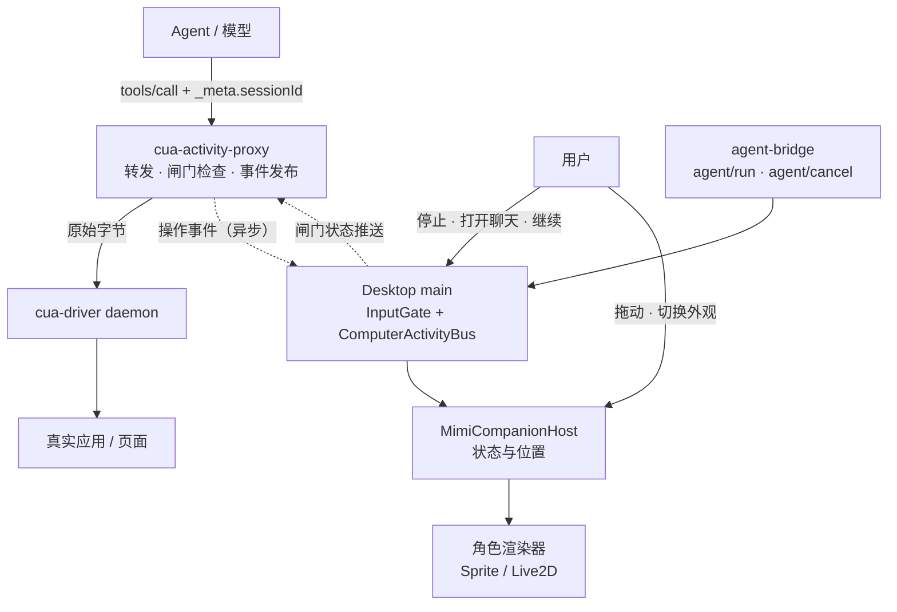

# Mimi × CUA：执行与表现的边界（第一版技术方案）

状态：已实施，核心路径已真机验收（2026-10-29），余项见 §11。基线：分支 `codex/desktop/mimi-cua-animation`，
HEAD `54163c935`；实现在分支 `claude/mimi-cua-input-gate`。§11 记录与原方案的差异。

## 0. 结论与假设

**结论**：独立桌面宠物、订阅真实操作事件、图片动画与 Live2D 可替换，这个方向保留。
第一版收敛到三条边界：

1. 只接 CodeShell 自己的 CUA（`host:cua-driver` 这条 MCP stdio 连接）。
2. 目标不可靠时宠物原位陪伴，不猜、不追。
3. 用户接管前台后，执行侧必须暂停，不自动争抢控制权。

**假设（需拍板）**：第一版输入投递策略为 **后台 AX 优先，`delivery_mode:"foreground"` 只作显式降级**。
这是 cmux-cua 的设计前提（后台投递不抢焦点、不动真实指针）。选这条路线后，
"人接管"的问题从"监听前台 App 切换并归还焦点"缩小为"foreground 派发前检查一次用户是否正在操作"。
若改为默认 foreground，§5 的接管机制要整体加大，本文不覆盖。

## 1. 现状核对（对照 review）

| review 判断                                 | 代码事实                                                                                                                                                                                                                                          | 对方案的影响                                          |
| ------------------------------------------- | ------------------------------------------------------------------------------------------------------------------------------------------------------------------------------------------------------------------------------------------------- | ----------------------------------------------------- |
| 观察器会等动画确认/坐标查询，不是独立显示层 | 成立，且更重：`cua-activity-proxy.ts:275-284` 在转发请求字节前串行等上一轮响应、动画 ACK（≤180ms）、原生光标基线读取（首次含 bootstrap，各 ≤250ms）；`:315-316` 在写回响应前再等一次光标读取和 ACK。单个带位置动作最坏加约 1s，落在真实输入路径上 | §3 改成"先转发、后发事件"，只保留截图前隐藏的同步点   |
| 统一停止未完成                              | 一半成立。core 已把 run 的 abort signal 透传给 MCP 调用（`core/src/tool-system/builtin/mcp-tools.ts:42-49`），点 Stop 后 agent 循环不再派发。缺的是：与 agent 循环无关的闸门，保证取消后已排队/迟到的调用也进不了驱动；在途动作无法取消           | §4 的输入闸门                                         |
| 人接管后暂停不完整                          | 完全不存在。`mimi-companion-host.ts` 的 `humanActive`/`chatting` 只影响可见性和跟随                                                                                                                                                               | §5                                                    |
| 试填的 stop 只在隔离实验验证                | `scripts/mimi-native-trial.ts` 对私有 daemon 直接 SIGKILL，不能搬到共享驱动                                                                                                                                                                       | 闸门在 proxy 层拒绝，不杀驱动                         |
| 需要"执行控制器"                            | `docs/todo/computer-runtime-cua-design.md`（2026-10-12）已定义 Computer Runtime（授权、队列、停止、轨迹），未实现；模型现在直接调驱动原始工具                                                                                                     | 第一版建薄闸门，作为 Computer Runtime 的停止/队列雏形 |
| Codex 的 CUA 没接入                         | 另一条 MCP 连接，驱动由 cmux 自己起                                                                                                                                                                                                               | 不在第一版；§9 给接入路径                             |

一个重要事实：core 的 MCP stdio 连接按"服务器名 + 工作区根集合"复用（`mcp-workspace.ts`），
**不是一个会话一个 proxy**。同一工作区里两个会话共用一个 proxy 进程。所以按任务停止不能靠杀 proxy，
必须在请求上带会话标识（§4.2）。

## 2. 总体结构



核心约束不变：**驱动是唯一输入权威；执行器干活，Mimi 表现。** 关闭、卡住或更换 Mimi，
都不改变输入内容和执行速度。新增的是：**闸门是执行侧的，由 Desktop main 持有，
不依赖动画窗口存活。**

## 3. proxy 变成真正的旁路观察器

文件：`packages/desktop/src/main/computer-use/cua-activity-proxy.ts`、`cua-native-cursor.ts`。

请求路径新顺序：

1. 读入一行 → 解析（现有 `cuaWireParts`）。
2. `await turnDone`：保留。驱动本身串行派发，这里排队不增加端到端延迟，
   而且让闸门检查发生在"真正派发前"的那一刻。
3. **闸门检查**（§4）：本地同步读缓存，零 I/O。拒绝则直接写回 MCP 错误结果，不转发。
4. **立即写字节给驱动**。
5. 之后异步：`tracker.begin` → `channel.send(start)`（不等待）；光标采样 `cursor.start`。

响应路径：先写回 stdout，再异步做 `cursor.finish` 的末次采样和 `channel.send(end)`。

保留的唯一同步点：**capture 类动作**（截图、`get_desktop_state` 等）转发前等宿主 ACK，
上限 180ms，宿主侧 50ms 合成器 barrier 不变。宿主在宠物不可见时立即 ACK，成本为一次本地 socket 往返。
原因：宠物出现在模型看到的截图里会污染判断，这是执行正确性问题，不是动画问题。

光标桥：bootstrap（`get_agent_cursor_state` 握手 + 传输会话识别）移到 proxy 启动后、
看到 `initialize` 响应时做一次；每个动作的基线读取改为与转发同 tick 并发发起，结果仍只用作 advisory。

预算（可测）：非 capture 动作 proxy 附加延迟 p95 ≤ 5ms；capture 动作 ≤ 230ms。

## 4. 输入闸门（InputGate）

### 4.1 模型

Desktop main 新增 `computer-use/input-gate.ts`：

```ts
interface GateState {
  version: number; // 单调递增，proxy 用于丢弃过期推送
  hold: { background: boolean; foreground: boolean; reason?: HoldReason };
  cancelledSessions: string[]; // 本轮 run 已被取消的会话
  userActiveUntil?: number; // §5：用户正在操作的时间窗（epoch ms）
}
type HoldReason = "user-stop" | "chat-open" | "host-unavailable";
```

两条 lane：

- `background`：AX 投递的输入（`set_value`、不带 `delivery_mode:"foreground"` 的 `click/type_text/press_key/scroll`）。
- `foreground`：显式 `delivery_mode:"foreground"` 的调用，以及 `launch_app`、`bring_to_front`、`kill_app`、
  `perform_actions`、`replay_trajectory`、`hotkey`。

只读工具（`get_window_state`、`list_*`、`get_*`、`check_permissions`）不受闸门约束，模型随时可观察。

### 4.2 会话标识

core `MCPManager.callToolResult` 对 `host:` 前缀服务器的调用在 `tools/call` 的 `params._meta`
里带 `codeshell/sessionId`（来自 `ToolContext.sessionId`）。MCP 规范允许请求携带 `_meta`。
proxy 读取后**原样转发**；实施时验证 cua-driver 0.34.1 是否接受 `_meta`，若拒绝，
proxy 只对这一类请求重序列化并剥离 `_meta`，其余字节仍原样透传。

无标识的调用（旧 core、将来的 Codex）只受全局 hold 约束。

### 4.3 推送与缓存

闸门状态由宿主通过现有私有 socket（`cua-activity-server.ts`）推给 proxy：连接建立时推全量，
之后每次变化推一行 `{"gate": GateState}`。proxy 内存缓存，检查为同步读。
**socket 断开 → proxy 进入 `host-unavailable`：输入类调用全部拒绝，只读调用放行。**
失败关闭是刻意的：宿主不在，就没人代表用户。

### 4.4 拒绝的形式

不转发，直接写回：

```json
{"jsonrpc":"2.0","id":<原id>,"result":{"isError":true,"content":[{"type":"text",
 "text":"computer_input_refused: <reason>. Do not retry this action. <指引>"}],
 "structuredContent":{"code":"computer_input_refused","reason":"user-stop","lane":"foreground"}}}
```

指引按原因区分：`user-stop` → 停止并向用户汇报；`chat-open` → 等待用户关闭聊天或改用后台投递；
`user-active` → 等待用户空闲后重试或改用后台投递；`session-cancelled` → 立即结束。
`turnId` 逻辑同步处理这条本地响应，保持串行语义。

### 4.5 触发源与清除

| 触发                                                                                       | 动作                                                                                                                 | 清除                                          |
| ------------------------------------------------------------------------------------------ | -------------------------------------------------------------------------------------------------------------------- | --------------------------------------------- |
| 会话 Stop（agent-bridge 看到 `agent/cancel`，与 `cancelBrowserActionsForStoppedRun` 并列） | `cancelledSessions += sessionId`；core 的 abort 同时生效                                                             | 该会话下一个 `agent/run`                      |
| 全局停止（宠物菜单"停止操作"、Pet 小组件按钮、全局快捷键 ⌘⇧Esc）                           | `hold.background = hold.foreground = true, reason user-stop`；对闸门记录过本轮有 CUA 调用的活跃会话发 `agent/cancel` | 用户显式点"继续"                              |
| 点击 Mimi 打开聊天                                                                         | `hold.foreground = true, reason chat-open`                                                                           | 用户点"继续"，或聊天页失焦且 10s 内无再次聚焦 |
| 关闭 Mimi 显示                                                                             | 不触发。关闭角色与停止任务是两个入口                                                                                 | —                                             |
| 拖动 Mimi                                                                                  | 不触发。只停止跟随                                                                                                   | —                                             |

快捷键只在 `CuaDriverHost` 状态为 running 时注册，避免长期占用组合键。

### 4.6 在途动作与强制停止

驱动没有单次调用取消。闸门保证的是"取消确认后零新输入"；已提交的一次整段输入会执行完。
这在"整段文本投递"策略下可接受（一次 `set_value` 毫秒级）。逐字符循环已删除，禁止回潮。
另设独立入口"强制停止输入驱动"：调用 `CuaDriverHost.stop()`，影响同机所有任务，
UI 上与普通停止分开并写明后果。

## 5. 人的交互优先

| 用户行为       | 执行侧                                                    | 表现侧                         |
| -------------- | --------------------------------------------------------- | ------------------------------ |
| 拖动 Mimi      | 无                                                        | 停止跟随，保留放置位置（现有） |
| 点击 Mimi 聊天 | foreground lane hold                                      | 打开聊天（现有）               |
| 用户正在用键鼠 | foreground 调用拒绝（`user-active`），background 不受影响 | 无                             |
| 停止           | §4.5                                                      | 回到待机                       |
| 关闭 Mimi      | 无                                                        | 仅关闭角色                     |

"用户正在用键鼠"的判定：宿主用 Electron `powerMonitor.getSystemIdleTime()` 轮询（200ms），
系统空闲 < 2s 视为用户活跃，写入 `userActiveUntil`。
已知风险：驱动的 foreground 投递会合成 HID 事件，可能重置系统空闲计时，造成自我节流。
处理：宿主记录每次 foreground 动作的结束时刻，若"最后一次输入事件"落在该时刻 ±100ms 内，不算用户活跃。
这条必须在真机验证（§8 第 2 项）。

恢复：所有 hold 都要用户显式恢复，执行侧不自动把焦点抢回来。
驱动 foreground 投递自带"短暂前置→投递→恢复前一个 App"，不改。

## 6. 输入策略（执行可靠性）

写进 `host:cua-driver` 的服务器说明（`HostMcpServerDeclaration` 新增 `instructions`，
core 把它作为该服务器工具说明的前言交给模型；实施时确认 core 现有 MCP `instructions` 的呈现位置）：

1. 文本字段优先 `set_value`（整段、保留 Unicode 和缩进）。
2. `set_value` 不支持时用 `type_text`，一次整串，`delay_ms: 0`。禁止逐字符循环。
3. 快捷键、方向键才用 `press_key`/`hotkey`。
4. 输入后必须重新 `get_window_state` 回读字段值；不一致时不得盲目重试，报告差异。
5. 只在收到 `background_occluded` / `background_unavailable` 后才用 `delivery_mode:"foreground"`，并告知用户。
6. 收到 `computer_input_refused` 时按其指引行事，不得重试同一动作。

"效果已验证"不是 proxy 的事件阶段，它由第 4 条在 agent 层完成。宠物不根据工具返回成功播庆祝。

## 7. 事件与表现

### 7.1 事件

`CuaActivityEvent` 增加字段：`source: "codeshell"`、`sessionId?`、`lane`。
输入正文、脚本、图片仍不进入事件（现有边界）。

Desktop main 新增 `ComputerActivityBus`：有界队列（每会话 64 条），
`update` 按操作 ID 合并只留最新，`end`/取消必须投递，`start` 过期（对应 `end` 已到）直接丢弃。
`MimiCompanionHost.receive` 改为订阅 bus，不再被 socket 队列串行 await。

新增 run 级事件：agent-bridge 在 run 结束时向 bus 发 `{ kind: "run", sessionId, outcome: "completed" | "failed" | "cancelled" }`。
宠物的"完成"和"异常"只在这里播。

### 7.2 位置与避让

目标可靠度三档，沿用 review：

- 元素帧可靠（AX frame ≥ 8×8）：靠近并避开整个区域。
- 仅有可靠点（原生光标位置）：指向/视线，谨慎移动。
- 不可靠：原位停靠。

CodeMirror 式 2px textarea 的父容器推断保留在执行侧 tracker（`cua-activity.ts`），
`avoidRect` 增加 `source: "frame" | "enclosing"`。两者宠物都避让（多避无害），
但 `enclosing` 不用于"手指向"的落点。

截图期间隐藏宠物的协调只在 capture 类动作发生（§3），不扩散到点击和输入。

### 7.3 动作语义与效果集合

统一动作集：`idle, observe, move, click, type, scroll, wait, complete, error`
（现有 `MimiCompanionAction` 增加 `move/wait/complete`，`key` 并入 `type`，`working` 并入 `wait`）。

`CharacterRenderer` 增加声明：

```ts
interface EffectSet {
  kind: "sprite" | "live2d";
  supports: ReadonlySet<MimiCompanionAction>;
  fallback: Partial<Record<MimiCompanionAction, MimiCompanionAction>>;
  size: { width: number; height: number };
  hitArea: Rect;
  anchor: Point;
  loop: ReadonlySet<MimiCompanionAction>; // 其余为一次性，带结束过渡
}
```

动作缺失走 `fallback`，再缺走 `idle`。换 Live2D 不碰 CUA 任何代码；Live2D 不自动解决动作少的问题。

## 8. 验收顺序与标准

按顺序，前一项不过不做后一项。图片版和 Live2D 用同一套。

1. **整段输入正确且速度正常**：selenium web-form 两个字段 `set_value`，回读一致；
   proxy 附加延迟 p95 ≤ 5ms（fake-driver 夹具测量）。
2. **接管不抢焦点**：用户在另一 App 打字时，foreground 调用被拒绝、无 App 前置；
   background 调用照常；自我节流不发生（真机）。
3. **停止后零输入**：Stop 后压入一个 pipelined `type_text`，驱动 stdin 无该字节，
   模型收到 `computer_input_refused`；全局停止同样；socket 断开时输入类全部拒绝。
4. **全屏、多屏、避让**：现有 Chrome 全屏可见性 + 元素帧避让夹具。
5. **动作观感**：最后。

## 9. 不在第一版

- Codex 的 CUA：接入路径是把 Codex 的 MCP 配置指向同一个 proxy 命令；无会话标识，只受全局 hold。
- 完整 Computer Runtime（`computer_observe/act`、授权、轨迹）：闸门与 bus 是它的停止/队列雏形。
- 手精确触控任意控件、身体跨屏、Live2D 骨骼接触。
- 单次调用取消：驱动不支持。

## 10. 实施拆分

1. proxy 旁路化 + 延迟测试（§3）。
2. InputGate + 推送协议 + 拒绝响应 + 会话 `_meta`（§4）。
3. 停止入口：`agent/cancel` 钩子、全局快捷键、宠物菜单、强制停止（§4.5–4.6）。
4. 用户活跃检测与 foreground lane（§5）。
5. 输入策略说明（§6）。
6. ActivityBus、run 事件、避让来源、效果集合声明（§7）。
7. 真机验收（§8）。

涉及文件：`cua-activity-proxy.ts`、`cua-native-cursor.ts`、`cua-activity-server.ts`、
新 `input-gate.ts`、新 `computer-activity-bus.ts`、`mimi-companion-host.ts`、
`agent-bridge.ts`（cancel/run 钩子）、`core/src/tool-system/mcp-manager.ts`（`_meta`）、
`core/src/tool-system/host-mcp-servers.ts`（`instructions`）、`shared/mimi-companion.ts`、
`renderer/pet/live2d/*`。

## 11. 实施记录（2026-10-28）

已落地（单元/集成测试覆盖，见各 `*.test.ts`）：

| 方案条目      | 实现位置                                                                                                                                                               |
| ------------- | ---------------------------------------------------------------------------------------------------------------------------------------------------------------------- |
| §3 旁路化     | `cua-activity-proxy.ts`：先写驱动再发事件；仅截图类动作等 ACK；光标采样经同一有序队列，`finish` 的末次读与 end 直接发出，保证 A.end 先于 B.start；ACK 超时不再断开连接 |
| §4 闸门       | `input-gate-policy.ts`（纯策略，proxy 与 main 共用）、`input-gate.ts`（main 持有）、`cua-activity-server.ts`（hello 后推送 gate，变化即推）                            |
| §4.2 会话标识 | core `hostSessionMeta()`：仅 `host:` 服务器，带 Session 及父链（≤8）；proxy 转发前剥离该键                                                                             |
| §4.4 拒绝     | 本地 `isError` 结果，`structuredContent.code = computer_input_refused`                                                                                                 |
| §4.5 触发源   | `agent/cancel` 与 `agent/run` 钩在 `cancelBrowserActionsForStoppedRun` 旁；新顶层 `session_started` 也清除（Stop 可只取消一条输入，排队轮次继续）                      |
| §5 用户活跃   | `UserActivityMonitor`：`powerMonitor.getSystemIdleTime()` < 2s 视为活跃；自身 foreground 动作进行中及结束后 2.5s 内不改判                                              |
| §6 输入策略   | proxy 改写 `tools/list` 描述追加策略与拒绝说明（core 不转发 MCP `instructions`）                                                                                       |
| §7 表现       | `computer-activity-bus.ts`；run 结果只来自顶层 `turn_complete/error`；`EffectSet` + `effectAction()` 回退                                                              |
| 停止入口      | 宠物菜单、⌘⇧Esc（有 proxy 连接时注册）、设置页"停止/继续/强制停止驱动"，停止时发系统通知                                                                               |
| 失败关闭      | macOS 上 control 创建失败则不提供驱动（`control_unavailable`）；proxy 连不上 host 时输入类全部拒绝                                                                     |

与原方案的差异：

- 设置页三项控制合并为一个 IPC 路由 `computerUse:input` 和一个 preload 方法 `controlInput(action)`，压低 IPC 预算增量。
- 全局停止不主动向各会话发 `agent/cancel`；改为 `holdAll` 全局拒绝，拒绝说明要求模型停止并汇报。
- 未做：`avoidRect.source` 字段（当前无"手指向"消费者）；动作集合并 `key→type`、`working→wait` 与新增 `move/wait`（改由 `EffectSet.fallback` 表达）；Pet 小组件上的停止按钮。
- native 试填夹具改为后台投递（去掉 `delivery_mode:"foreground"` 与"窗口失焦即停"检查），写入改用 `set_value`；`--native-smoke` 无人值守跑"填写→停止被拒→恢复再填"。
- `set_value` 无指针，原生光标永远不会描述它；tracker 为它标 `targetSource:"element"`（取自变更后的新快照），companion 仅在 start 接受该来源，update 仍只认原生光标。
- 同分支既有的 +2 IPC 路由 / +3 preload invoke（companion 设置、预览、聊天焦点）此前未计入预算，本次一并登记。

真机结果（2026-10-29，cua-driver 0.34.1，Electron 33 自建表单窗口，全程无焦点）：

- 后台 `type_text`（element_token）写 Electron 网页内容被驱动拒绝：`background_unavailable`（"ancestry is web content"），建议改像素坐标或 foreground。工具描述已写明网页内改用 `set_value`。
- 后台 `set_value` 可写入网页字段，DOM 回读一致；Mimi 落点与驱动虚拟光标对齐、未遮挡输入框。
- 停止后首个输入（click）在 proxy 被拒为 `computer_input_refused (user-stop)`，未到驱动；恢复后再次填写成功。
- 新开网页的 AX 树在驱动首次请求后才建立，夹具需短暂重试快照。
- 驱动的 TCC 权限归属"负责进程"：从终端直接 spawn Electron 时归终端，须经 LaunchServices（`open -a Electron.app`）启动，开发版 Electron 才能用自己的辅助功能授权。

仍待真机验收：foreground 自身输入是否触发自我节流；⌘⇧Esc 在全屏 Space 下是否可用；真实 Chrome（非 Electron）中的后台 `set_value`。
