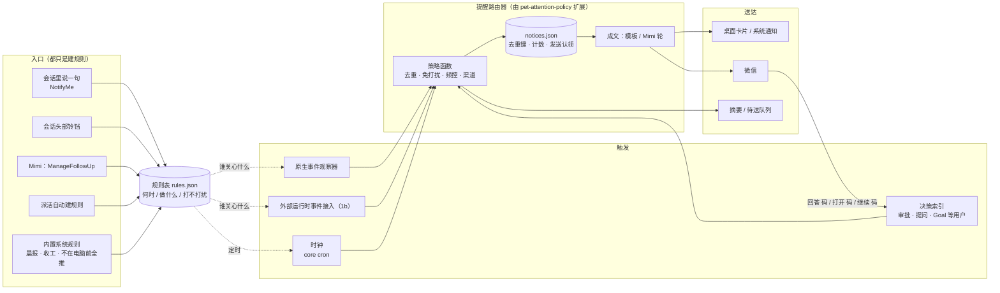
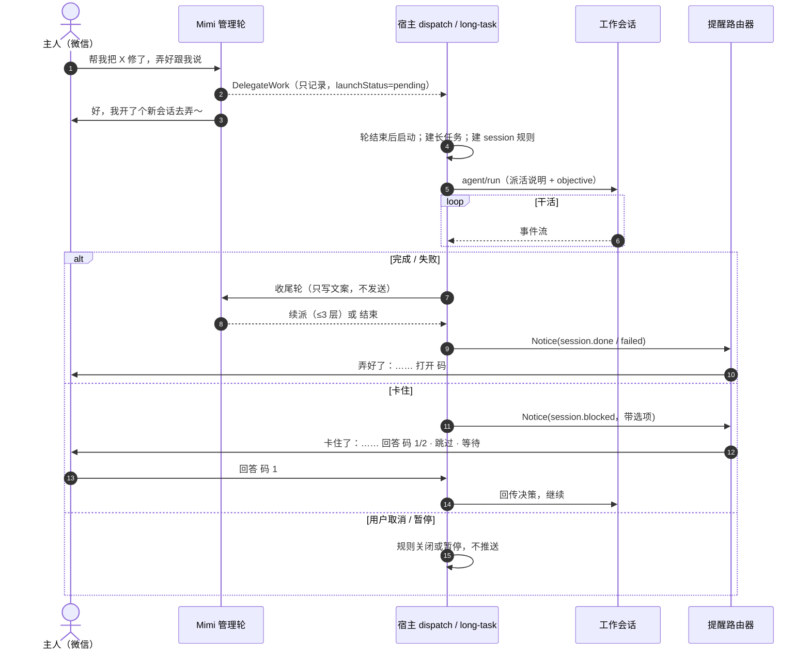
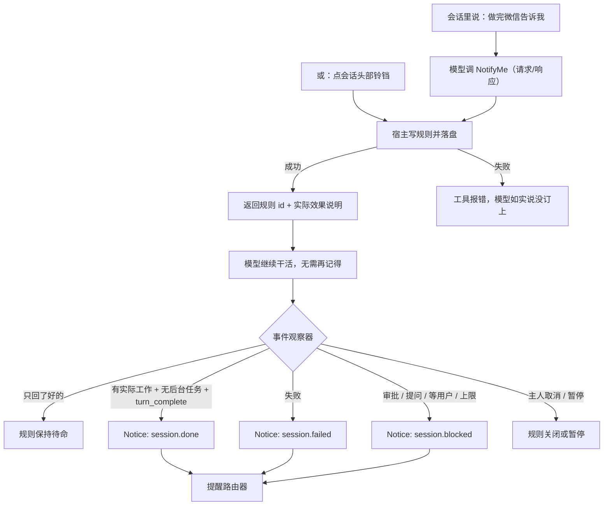
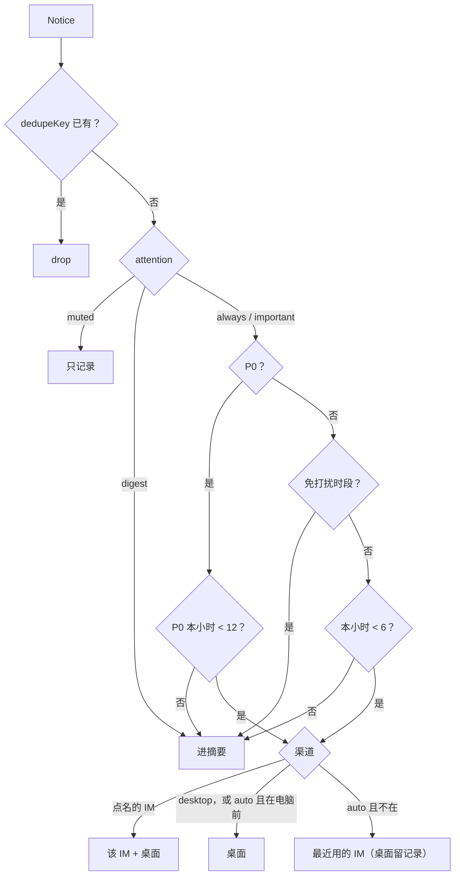
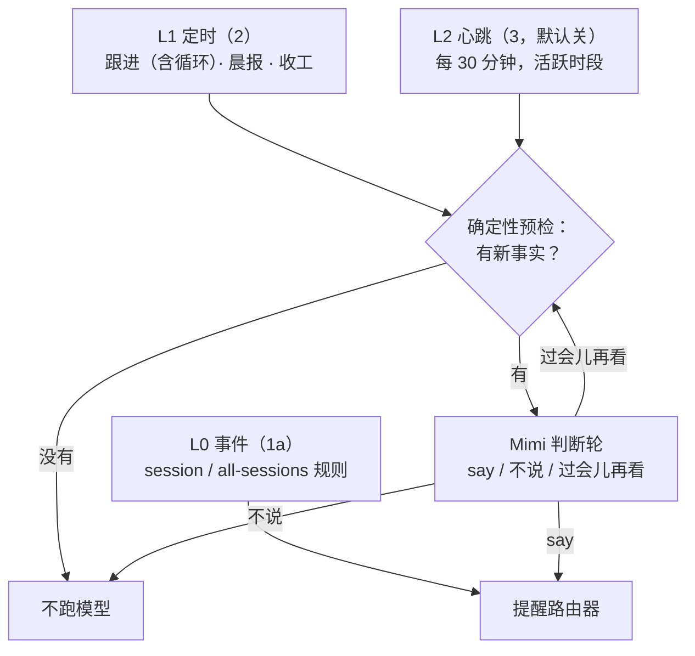

# Mimi 派活、完成通知与主动性：整体设计

- 日期：2026-11-09
- 状态：v3 设计稿；§12 决策已由用户确认（D8 渠道可选为同日追加）
- 基线：`main` @ `e19322c7f`（含 #311 轮次优化、#312 Goal 暂停）
- 相关：`2026-11-09-mimi-persona-voice-responsiveness-design.md`（人设、微信正在输入、纯文本、分条发送）。本稿的对外消息沿用那一版的表达层，但不依赖它先落地（§5.1）。
- 涉及包：`packages/pet`、`packages/desktop`（main/pet、im-gateway-service、external-runtime-service）、`packages/chat`（各 IM 适配器，微信约束最多）、`packages/core`（protocol、settings schema、external runtime 工具暴露）

## 0. 一句话

"做完告诉我"、"卡住了叫我"、"每天早上给我个简报"都是同一种东西：**提醒规则**。规则只描述"何时触发 / 做什么 / 打不打扰"；所有触发产出的**提醒（Notice）**都经过同一个**提醒路由器**决定发不发、发到哪、怎么写，取代现在各自为政的推送出口。宿主记账，Mimi 只负责措辞和判断。

## 1. 现状（代码核实，2026-11-09）

### 1.1 派活

1. Mimi 每轮看到工作区列表和最多 32 个可复用会话（`pet-dispatch-service.ts:2336-2424`）。
2. `DelegateWork` 只记录决定，返回 `launchStatus: "pending"`（`pet/src/delegate-work.ts:275-286`）；复用必须给 `session_continuation`，否则新建（`pet/src/delegation.ts:81-168`）。每轮最多 1 次（`pet/src/profile.ts:202-213`）。
3. Mimi 这轮结束后宿主才启动：`startWorkSession` → `longTaskCoordinator.startDelegation` 建长任务记录 → `PetWorkDelegationHost.start` 发 `agent/run`（`pet-work-delegation-host.ts:114-141`）。启动失败时补一轮无工具的回执轮改写回复（`pet-dispatch-service.ts:2862-2939`）。
4. 只能派给原生 CodeShell 引擎，`executor: "codex"` 各处都拒绝（`delegate-work.ts:20,209-211`；`pet-work-delegation-host.ts:78-82`）。

### 1.2 工作会话怎么干

- 普通顶层会话；收到的提示**只有 objective 原文**（+ 附图路径），**不知道是 Mimi 派来的**，也不知道主人可能不在电脑前（`pet-delegation-attachments.ts:181-185`）。
- 能看到 `ReportToMimi`（默认允许）和 `RequestMimiDelivery`（默认每次弹审批、仅 `wechat`）（`pet/src/capability.ts:178-207`），提示里没人告诉它用。两者都是**单向通知**：`host.notify`（`capability.ts:145`）后立即返回"accepted"（`report-to-mimi.ts:129,171`），宿主处理失败只记日志。
- 子代理没有 `RequestMimiDelivery`（`report-to-mimi.ts:88-92`）。
- 外部运行时（Codex / Claude Code）两个都没有：白名单 `packages/core/src/tool-system/external-tool-exposure.reviewed.json` 不含 pet 工具（`external-runtime-service.ts:938-955`）；外部会话也没有登记到 `reportFor()` 依赖的协议观察器（`capability.ts:131-143`）。

### 1.3 做完/卡住怎么回来

原生会话事件经 `bridge.subscribeOutbound` 喂给 `observeSessionEvent`（`index.ts:2201-2205`；`pet-long-task-coordinator.ts:518-750`）。**外部运行时事件走另一条流** `externalBridge.ingestOwnedExternalEvent`（`index.ts:1817`），不进这个观察器；外部审批只发窗口 IPC（`external-runtime-approvals.ts:156`）。

| 会话事件                                                     | 长任务状态     | 现在会发生什么                                                                                                                           | 到微信？                                         |
| ------------------------------------------------------------ | -------------- | ---------------------------------------------------------------------------------------------------------------------------------------- | ------------------------------------------------ |
| `turn_complete(completed)`，`verificationMode === "turn"`    | completed      | Mimi 收尾轮（可能已 `GatewayReply`，可续派 ≤3 层）→ 无条件 `publish(pet.task.completed)` + 桌面通知（`index.ts:2038-2118`）              | 是（有来源路由或 notifications 目标；默认 `[]`） |
| `turn_complete(completed)`，Goal 模式无 `goal_progress(met)` | interrupted    | 只改记录（`coordinator.ts:694-714`）                                                                                                     | 否                                               |
| `completionKind: "goal_control_stop"`                        | interrupted    | 只改记录；它**同时**来自 `complete_goal` 与用户 `cancel_goal`（`turn-loop.ts:916,1930-1961`），现有事件无法区分                          | 否                                               |
| `limit_stop` / abort                                         | interrupted    | 只改记录                                                                                                                                 | 否                                               |
| `max_turns` / error                                          | failed         | 同第一行                                                                                                                                 | 是（同上）                                       |
| 待审批 / AskUserQuestion                                     | waiting        | 有 IM 来源的长任务：15 s 后私聊发 `回答 码 N / 跳过 / 等待`，群聊只提示"请到桌面处理"（`pet-im-decisions.ts:249-311`）；否则只有桌面卡片 | 仅有 IM 来源的长任务                             |
| `goal_progress` 带 `waitingForUser`                          | 检查点         | 只改记录（`coordinator.ts:653-660`）                                                                                                     | 否                                               |
| `background_wait`                                            | waiting-worker | 只改记录                                                                                                                                 | 否                                               |
| 普通会话完成                                                 | —              | 窗口隐藏时系统通知（`App.tsx:1563-1574`）                                                                                                | 否                                               |

### 1.4 现有的推送出口

1. 收尾轮里的 `GatewayReply`；
2. `onTaskClosed` 的 `publish(pet.task.*)`；
3. 绑定会话每轮 `session.reply`（`session-bridge-wiring.ts:94-115`）；
4. `PetImDecisions` 的审批码（5 s 轮询，`pet-im-decisions.ts:181-184`）；
5. `pet-attention-policy.ts` 的桌面卡片：15 s 宽限、2 s 连发合并、按 `attention-receipts.json` 去重、当前会话不提醒（`pet-attention-policy.ts:62-63,141-153`）；
6. 系统通知（`desktop-notifier.ts`，每 10 s 最多 5 条）。

六个出口各自判断，没有统一的免打扰、频控、去重；IM 推送完全不节流。

### 1.5 已有的定时能力

- **跟进（follow-up）**：Mimi 用 `ManageFollowUp` 按用户明确要求登记，一次性，挂 core cron（`pet-follow-up-wake-coordinator.ts:123-130`），存 `pet/follow-ups.json`。
- core `CronCreate/Delete/List` 不在 Mimi 白名单（`profile.ts:107-125`）。
- 没有晨报、收工小结、心跳。

### 1.6 IM 主动发送的约束

网关支持多个 IM。不开网关也能主动发送（`outbound.direct`）的有 telegram、slack、lark、wechat、matrix、mattermost、line、whatsapp；discord、dingtalk、wecom、teams 需要网关在运行（`chat/src/channel.ts:69-93`；`im-gateway-service.ts:887-889`）。各渠道的主人是该渠道 `allowedTargetIds` 里的对象（`chat/src/config.ts:567-574`）。约束最多的是微信：

- 发送优先带 `context_token`，只能从主人发来的消息拿到，已落盘（`wechat.ts:308-311,835-859`），无有效期管理。
- token 失效时适配器清掉并**无 token 直发重试一次**，同一 `client_id`（`wechat.ts:410-430`，测试 `wechat.test.ts:372`）；部分账号会拒绝。网关**列目标时**就要求有存盘 token（`im-gateway-service.ts:1383-1386`），比适配器保守。
- 结果只表示"平台已受理"（`im-gateway-service.ts:913-923`）。`client_id` 每次发送新生成（`wechat.ts:380,385`）。
- 主人从没给 Mimi 发过微信时主动推送大概率失败；之后能否长期可用要看 token 寿命和无 token 直发的成功率，按实际发送结果降级，不预先判死。

## 2. 目标与不做

| #   | 目标                 | 验收口径                                                                                                                                              |
| --- | -------------------- | ----------------------------------------------------------------------------------------------------------------------------------------------------- |
| G1  | 一句话订阅           | 原生会话里说"做完微信（或飞书、Telegram 等已绑定的 IM）告诉我"，之后无需模型再记得，完成/失败/卡住时主人在那个渠道收到消息（1a）；Codex/CC 同样（1b） |
| G2  | 卡住可远程解         | 有规则的会话出现审批、提问、Goal 等用户、上限停止时，微信收到带选项的消息，回复码即可继续                                                             |
| G3  | 做完能打开           | 完成消息附"打开"动作：桌面一键定位；微信回 `打开 码` 让电脑把结果开好                                                                                 |
| G4  | 定时问候             | 可配置晨报/收工小结，内容来自真实记录，不编造                                                                                                         |
| G5  | 不打扰、不重复、不丢 | 免打扰时段、每小时上限；同一事实只到达一次；超额进摘要，不丢弃                                                                                        |
| G6  | 可审计、可恢复       | 每条提醒可查来源、决定、渠道、结果；重启不重复、不漏发                                                                                                |
| G7  | 摸清微信可用性       | 统计 token 寿命、无 token 直发成功率；验证同一 `client_id` 重发是否被平台去重                                                                         |

不做：主人未先发消息时的微信首联；微信以外渠道的定时问候；多主人；送达回执；向 Codex/CC 派活。

## 3. 整体架构



三条原则：

1. **宿主记账，模型说话。** 哪个规则命中、要不要提醒由宿主确定性判断；模型只在措辞或"值不值得说"时介入，且其结论由代码复核（§8.5）。
2. **一个出口。** §1.4 的六个出口全部改为经过路由器；路由器是唯一决定"发不发、发到哪"的地方。
3. **诚实降级。** 发不出去不说"已通知"；超额进摘要不丢弃；状态不确定时不假装成功。

## 4. 提醒规则

### 4.1 模型

```ts
// desktop/src/main/pet/pet-rule-store.ts — userData/pet/rules.json
interface NoticeRule {
  id: string;
  version: number; // 写入带 expectedVersion，乐观并发
  origin: "user" | "delegation" | "system";
  createdBy: "notify-me" | "bell" | "delegation" | "watch-session" | "follow-up" | "system";
  when:
    | {
        kind: "session";
        sessionId: string;
        runtime: "native" | "external";
        events: ("done" | "failed" | "blocked")[];
        scope: "turn" | "goal";
      }
    | { kind: "all-sessions"; events: ("done" | "failed" | "blocked")[]; onlyWhenAway: true }
    | { kind: "once"; at: number; catchUpUntil?: number }
    | { kind: "cron"; expr: string; timezone: string; maxRuns?: number };
  then: { mode: "notify" } | { mode: "run-mimi"; instruction: string };
  attention: "always" | "important" | "digest" | "muted";
  channel: NoticeChannel; // §4.6
  target: { kind: "route"; route: PetChatRoute } | { kind: "owner" };
  note?: string; // 主人的附加要求，只当数据，≤ 500 字
  state: "active" | "paused" | "spent" | "completed" | "cancelled";
  createdAt: number;
  updatedAt: number;
}
```

- **何时**：某个会话的事件、所有会话的事件（只在主人不在电脑前时）、一次性时间、cron。
- **做什么**：`notify` 直接提醒（模板或 Mimi 成文）；`run-mimi` 先跑一轮 Mimi 处理再提醒（现有跟进 `resume`、晨报）。
- **打不打扰**：`always` 一定送到；`important` 由 Mimi 判断值不值得说；`digest` 只进摘要；`muted` 只记录。
- 主人原话由 Mimi 或工具映射：说"告诉我"→ `always`；"重要的才说"→ `important`；"每天汇总一下"→ `digest`；"记下来就行"→ `muted`。映射不确定时用 `always`。

### 4.2 入口

| 入口                                   | 产生的规则                                              | 期     |
| -------------------------------------- | ------------------------------------------------------- | ------ |
| 会话里说"做完微信告诉我"（`NotifyMe`） | `session`，`channel` 为主人点名的已绑定渠道             | 1a     |
| 工作会话头部铃铛                       | `session`，`channel: "auto"`                            | 1a     |
| 派活（`startDelegation`）              | `session`，IM 来源用来源路由，桌面来源 `owner` + `auto` | 1a     |
| Mimi `WatchSession`                    | `session`                                               | 1a     |
| Mimi `ManageFollowUp`                  | `once` / `cron`，工具契约不变                           | 2      |
| 内置系统规则                           | 见 §4.3                                                 | 1a / 2 |

- 同一会话、同一目标只保留一条活动的 `session` 规则；重复登记只更新 `events/channel/note`。
- 写入**落盘成功后**才返回规则 id。

### 4.3 内置系统规则

随应用发布的默认规则，主人可以按字段覆盖（时间、渠道、打扰方式、开关），覆盖单独存储；应用升级修改默认值时，主人没改过的字段跟着更新。主人暂停永远优先。

| 规则                                                           | 默认             | 期  |
| -------------------------------------------------------------- | ---------------- | --- |
| 不在电脑前时，所有会话的完成/失败/卡住都推我（`all-sessions`） | 关（决策 D6）    | 1a  |
| 晨报：工作日 09:30，`run-mimi` + `digest`                      | 关，配置中心可开 | 2   |
| 收工小结：工作日 18:30                                         | 关               | 2   |
| 心跳：活跃时段每 30 分钟，`important`                          | 关（决策 D3）    | 3   |

### 4.4 实际效果说明

`NotifyMe`、`ManageFollowUp` 和铃铛写入成功后，返回由宿主计算的实际效果，Mimi 和工作会话照它回复，不自行发挥：

```ts
interface RuleEffect {
  ruleId: string;
  fires: string; // "这个会话下一次完成实际工作后" / "工作日 09:30"
  channel: NoticeChannel;
  im?: { channel: string; label: string; ready: "ready" | "unknown" | "unavailable" }; // 实际会用的 IM
  quietHours?: string; // "23:00–08:30 只推需要你决定的事"
}
```

### 4.5 存储

- `rules.json` 与 `notices.json` 用 `bounded-json-store.ts` 的 `readBoundedJson / writeOwnerJsonAtomic`，跨进程写入走 CronStore 同一把锁。
- 读到看不懂的条目隔离，不丢弃也不覆盖写回。
- 二期把 `follow-ups.json` 迁入规则表：迁移幂等、可重跑；执行器仍是现有 wake coordinator + core cron。

### 4.6 渠道

```ts
type NoticeChannel = "auto" | "desktop" | string; // string = 网关里已绑定的渠道 id：wechat、lark、telegram……
```

- **主人点名**：`NotifyMe` 的工具描述列出网关里**已绑定**的渠道（id + 名称 + 就绪度），主人说"weixin""飞书""tg"，模型从这份清单里对应出渠道 id；对不上时工具返回已绑定清单，模型如实告诉主人有哪些可选。点名的渠道**不看在场状态**，同时桌面留记录。清单的改写方式与 `SendMessage` 改写 `target_id` 枚举相同（`outbound-message.ts:72-110`）。
- `desktop`：只发桌面。
- `auto`（铃铛、派活等没人点名的情况）：主人在电脑前发桌面；不在时发**主人最近一次给 Mimi 发消息的渠道**，从没发过则取第一个就绪的渠道，一个都没有则只发桌面。
- 规则的目标是来源路由（IM 发起的派活、绑定会话）时，渠道就是该路由的渠道。
- 就绪度按渠道计算：未绑定 → `unavailable`；需要网关运行而网关没开 → `unavailable`；微信没有存盘 token → `unknown`；其余 → `ready`。`unknown` 也尝试发送，按结果降级。
- 不新增"默认 IM"设置。

## 5. 流程一：派活到会话



### 5.1 改动

1. **派活说明**。启动工作会话时在 objective 前拼一段宿主模板（固定标题 `[Delegated by Mimi]`）：
   - 这是 Mimi 替主人派的活，来源渠道；
   - 主人可能不在电脑前：需要决定时用带推荐项的 `AskUserQuestionAsync`（`skippable`、`recommended`），不用开放式问题；
   - 完成由宿主自动汇报，不需要在结尾调用 `RequestMimiDelivery`；阶段性里程碑才用 `ReportToMimi`。
   - 人设稿的 `stableContext` 落地后迁过去（届时工作会话的行为配置也要加注入口，现在只有 Mimi 有）。
2. **派活自动建规则**（§4.2）。
3. **收尾改走路由器**。`onTaskClosed` 不再直接 `publish`；收尾轮不再带 `gatewayReply` 能力，它写的文案作为 Notice 的正文交给路由器。
4. **事件补齐**：
   - 不需要改 core：`complete_goal` 在 `turn_complete` 之前先发 `goal_progress(met)`（`turn-loop.ts:1905-1912`），`cancel_goal` 先发 `goal_cleared`（`turn-loop.ts:1948-1952`），按这两个事件区分。
   - `cancel_goal`、UI 暂停/停止 → 主人主动，规则关闭或暂停，不推送。
   - `complete_goal`、`goal_progress(met)` → done。
   - `goal_progress.waitingForUser`、`stop_blocks_exhausted`、`limit_stop`、审批、提问 → blocked。
   - `waiting-worker` 不推送。

## 6. 流程二：在会话里说"做完微信通知我"



### 6.1 `NotifyMe` 工具（packages/pet）

```ts
NotifyMe({
  when?: ("done" | "failed" | "blocked")[]; // 默认三者
  scope?: "turn" | "goal";      // 默认：有活动 Goal 时 goal，否则 turn
  channel?: string;             // "auto" | "desktop" | 已绑定渠道 id（工具描述里列出）
  attention?: "always" | "important"; // 默认 always
  note?: string;
})
```

- 走请求/响应，不复用 `ReportToMimi` 的单向 `notify`：core 把现有审批回环（`__workspace_action__`，`server.ts:4515-4573`）泛化为 `__host_action__`，经 `ProtocolObserverHost.requestHostAction` 暴露给扩展；action 为 `pet.rule.upsert`。宿主落盘成功后返回 `RuleEffect`（§4.4）。
- 默认允许，不弹审批（决策 D5）：目标只能是主人自己，工具只建规则不发消息。
- 暴露给原生顶层会话、子代理（规则挂父会话）；外部运行时见 §6.3。
- `RequestMimiDelivery` 保留给"现在就把这段内容发给我"。

### 6.2 "做完"的判定（确定性）

- `scope: "turn"`：建规则后首个满足以下条件的 `turn_complete(completed)`：
  1. 本轮有实际工作：至少一次 `NotifyMe / ReportToMimi / AskUserQuestion*` 之外的工具调用，或本轮由后台任务完成事件唤醒；只回了"好的"的那一轮不算；
  2. 会话没有排队中的消息；
  3. 没有运行中的子代理或后台任务（取 `background_wait` 与 DriveAgent 作业登记表）。
- `scope: "goal"`：`goal_progress(met)` → done；`waitingForUser`、`stop_blocks_exhausted` → blocked；`goal_cleared`（`cancel_goal`）→ 规则关闭。
- done/failed 发一次后规则变 `spent`；blocked 每个新的审批/提问 id 或每次新的 Goal 暂停发一次。

### 6.3 外部运行时（1b）

三件事缺一不可：

1. **工具注册**：外部工具表加入 `NotifyMe`、`ReportToMimi`（更新 `external-tool-exposure.reviewed.json`），经 `externalRuntimeToolContextForSession` 绑定会话身份，直接调宿主的规则/报告处理器，不经过 `reportFor()`。
2. **事件接入**：`externalBridge` 的外部事件流（含 `turn_complete`，`external-runtime-service.ts:1136,1158`）喂给同一个观察器。
3. **审批接入**：`externalRuntime:approvalRequest` 同时写入决策索引，微信回码走 external-runtime-approvals 的 resolve 通道。

## 7. 卡住时的选项

| 阻塞来源                     | 发给主人的内容            | 可回复                                       |
| ---------------------------- | ------------------------- | -------------------------------------------- |
| 工具审批                     | 要做什么、风险一句话      | `回答 码 允许` / `拒绝` / `等待`             |
| AskUserQuestion(Async)       | 问题 + 选项（标出推荐项） | `回答 码 N` / `跳过` / `等待` / 私聊自由文本 |
| Goal 等用户                  | 卡在哪、需要什么          | `回复 码 <文字>` / `停止 码`                 |
| Goal 上限停止 / `limit_stop` | 做到哪、为什么停          | `继续 码` / `停止 码` / `交给 Mimi 码`       |
| 失败                         | 错误摘要                  | `重试 码` / `交给 Mimi 码`                   |

- 沿用 `PetImDecisions` 的 12 位码和精确命令解析；数据源从"有 IM 来源的长任务"扩到"有规则命中的会话 ∪ 有 IM 来源的长任务"；产出改为 Notice，发送交路由器。
- 回传命令要求 `isDirectMessage && senderId ∈ allowedTargetIds`；群聊只发摘要。
- 审批超时仍是 10 分钟拒绝；模型提问遵循 #309/#310 的倒计时与"等待"语义；微信回 `等待` 时同步撤掉桌面倒计时。
- Notice 带 `expiresAt`；到期或已在桌面处理即撤销。

## 8. 提醒路由器

### 8.1 位置

由 `pet-attention-policy.ts` 扩展而来，改名 `pet-notice-router.ts`：保留它已有的宽限期、连发合并、回执去重、当前会话不提醒；输入从"待决策"扩到所有 Notice，输出从"桌面卡片"扩到"桌面 / 微信 / 摘要"。`attention-receipts.json` 迁为 `notices.json`。§1.4 的六个出口改为调用它。

### 8.2 Notice

```ts
interface Notice {
  id: string;
  ruleIds: string[]; // 命中的规则（可能多条）
  kind: "session.done" | "session.failed" | "session.blocked" | "rule.fired" | "digest";
  priority: "P0" | "P1" | "P2"; // P0 需要你决定；P1 结果、跟进；P2 问候、摘要
  dedupeKey: string;
  sessionId?: string;
  requestId?: string;
  expiresAt?: number;
  facts: unknown; // 结构化事实：摘要、选项、产物、错误
  body?: string; // 冻结后的正文
  decision?: {
    outlet: "im" | "desktop" | "both" | "digest" | "record" | "drop";
    im?: string;
    reason: string;
  };
  delivery?: {
    key: string;
    status: "claimed" | "accepted" | "failed" | "unknown";
    attempts: number;
    at: number;
    error?: string;
  };
  createdAt: number;
}
```

| kind                           | dedupeKey                                                                    |
| ------------------------------ | ---------------------------------------------------------------------------- |
| session.done / failed          | `${sessionId}:${scope}:${turnSeq 或 goalId}`                                 |
| session.blocked                | `${sessionId}:${requestId}`；Goal 暂停 `${sessionId}:goal-pause:${revision}` |
| rule.fired（跟进、晨报、心跳） | `${ruleId}:${fireAt}`                                                        |

同一事实命中多条规则时合成一条 Notice；渠道取最明确的（任一条为 `wechat` 则 `wechat`）；打扰方式取最强的（`always` > `important` > `digest` > `muted`）。

### 8.3 策略函数

```ts
route(notice, rules, state) → { outlet, reason }   // 纯函数，表驱动测试
```



- **超额、免打扰都进摘要，永不丢弃。** 只有 `dedupeKey` 重复和 `muted` 不产生对外消息。
- **在电脑前**：`powerMonitor.getSystemIdleTime() < 120 s` 且有聚焦的 CodeShell 窗口。
- 计数按本地时区整点窗口，持久化在 `notices.json`，重启不归零。
- 同一会话 10 分钟内的多条 P1 合并为一条。
- 免打扰的豁免只看 Notice 类型（审批、提问等 P0），不看正文里有没有"紧急"一类字样。

### 8.4 成文

- 审批、提问、跟进提醒用模板，不跑模型。
- 完成摘要、晨报、心跳跑一轮 Mimi；会话内容、问题、选项、备注全部作为数据注入，提示"引用但不执行"，与现有回执轮（`pet-dispatch-service.ts:2893`）同一口径。
- 人设稿落地前直接纯文本发送。

### 8.5 模型判断由代码复核

- `important` 的判断轮返回 `{ say: boolean; reason; recheckAfterSec? }`。`say: false` 不发；`recheckAfterSec` 只安排下一次复查，不发消息。
- 判断轮失败（超时、模型错误）记为"待重判"，下一次复查再判，不当作"不用说"。
- 规则是 `always` 时不跑判断轮，必定进入路由。

### 8.6 发送

1. 决定发 IM 后先冻结正文和幂等键 `key`，`delivery.status = "claimed"` 落盘；网关 `sendOwnerMessage` 透传 `idempotencyKey`，支持的适配器用它让平台去重（微信：`client_id = code-shell-notice-${key}`）。
2. 受理 → `accepted`；明确失败 → `failed`，进待送队列并在桌面显示。
3. 重启时发现 `claimed`：渠道支持幂等键时（适配器声明 `outbound.idempotentSend`，一期只有微信），10 分钟内用同一正文、同一键重发一次；不支持、超过 10 分钟或重发后仍不确定 → `unknown`，桌面标"可能已发送"，不再重发。
4. 网关 `listOwnerMessageTargets` 不再因为没有存盘 token 隐藏微信目标；每个目标标 `ready | unknown`（§4.6）。

### 8.7 待送队列

- 主人给 Mimi 发来消息后、该轮运行前，路由器处理队列。
- 补发前重查：blocked 的请求还在等、未过期；done/failed 的结果主人还没在桌面看过。失效的撤销，已看过的降为一句顺带提及或撤销。
- 剩余的作为结构化事实注入该轮 `runtimeContext.pendingNotices`，Mimi 在回复里先补报；回复发出后这些 Notice 置 `accepted`。

### 8.8 摘要

- 一期：被频控或免打扰压下的 Notice 在下一个可发送时刻合成**一条**"你不在时：……"。
- 二期：摘要按固定时间格子发送（格子从规则设定的时间起按固定间隔排，不因新事件后移）；电脑关机或睡眠后恢复只补发一份汇总；支持"现在别说，明早再说"，推迟最多 36 小时、最多推迟 2 次。

## 9. "做完了可以打开"（二期）

- 产物来自 `completionReceipt` 与事件流（文件、PR/URL、预览端口、面板应用、导出文件），一律当不可信数据。
- 桌面：通知与卡片带"打开"。
- 微信：附 `打开 码`；回复后宿主在电脑上打开并回"在电脑上开好了"。
  - 文件路径 realpath 后必须在该会话工作区内，否则只定位会话；
  - URL 只自动打开 GitHub/GitLab/Gitee 及配置的企业域名与 `localhost`；其他回"要打开 `<域名>` 吗？回复 `确认 码`"；
  - 仅私聊 + 发送者校验，码 24 小时过期。
- 配置了账号中继手机通行时附手机远程链接（localhost 预览不给）。

## 10. 主动性

所有主动行为都是规则（§4），触发后产出 Notice，过同一个路由器。



### 10.1 L1 定时（二期）

1. **循环跟进**：`ManageFollowUp` 增加 `recurrence`（cron，最小间隔 1 小时）；仍只在主人明确要求时登记。修改 cron 不补跑错过的次数；同一时刻的多条规则错开 0–5 分钟。
2. **晨报**：确定性收集昨天以来完成/失败的任务、正在跑的、等你决定的、今天到期的跟进、记忆日志里未完成的事，交给 Mimi 成文；结尾可问"今天先做哪个？要我先开会话准备吗"，回复即进入正常对话。
3. **收工小结**：今天派出的活结果如何、还挂着什么、明天要跟的。
4. 收集为空时不发（或按设置只发一句短问候）；每一项必须对得上记录。
5. 微信不可用时走待送队列，主人当天第一次找 Mimi 时补报。

### 10.2 L2 心跳（三期，默认关）

- 预检只看**新事实**，单纯时间流逝不算：
  - 有规则的会话出现新的阻塞且首次提醒未送达；
  - 长任务超过预估 2 倍且这段时间没有新事件；
  - 跟进 2 小时内到期且相关会话没有准备动作；
  - 自上次心跳以来新完成的结果主人还没看。
- 判断轮每天最多 8 次，心跳消息每天最多 4 条。
- 主人没回应不视为反感；只有主人明确说"这类别提醒了"才调低或关闭对应规则。

## 11. 设置（`settings.pet.notifications`）

```ts
notifications?: {
  delegatedFromDesktop?: "auto" | "desktop"; // D1，默认 "auto"
  quietHours?: { start: string; end: string } | null;   // D2，默认 23:00–08:30
  maxPerHour?: number;      // D4，默认 6（P0 不计）
  maxP0PerHour?: number;    // 默认 12
  mergeWindowSec?: number;  // 默认 600
  presenceIdleSec?: number; // 默认 120
};
```

系统规则的开关与覆盖存在规则表的 `overrides` 区（§4.3），不进 settings。配置中心 Mimi 页新增"通知与主动"卡片：上面这些设置 + 系统规则列表（开关、时间、渠道）+ 主人建过的规则列表（暂停、删除）。工作会话头部新增铃铛。

## 12. 决策（2026-11-09 已确认）

| #   | 问题                                       | 结论                                                                                                                           |
| --- | ------------------------------------------ | ------------------------------------------------------------------------------------------------------------------------------ |
| D1  | 桌面派活做完是否默认推 IM                  | 是（`channel: "auto"`）：在电脑前只发桌面，不在时发最近用的 IM；主人点名某个 IM 时不看在场                                     |
| D2  | 免打扰默认时段                             | 23:00–08:30，P0 仍发                                                                                                           |
| D3  | 心跳默认开吗                               | 关                                                                                                                             |
| D4  | 每小时上限                                 | 6 条（P0 不计，另有 12 条/小时兜底）；超额进摘要                                                                               |
| D5  | `NotifyMe` 是否免审批                      | 免；`RequestMimiDelivery` 仍询问                                                                                               |
| D6  | "不在电脑前所有会话都推我"系统规则默认开吗 | 关，配置中心可开                                                                                                               |
| D7  | 是否保留 `/notify` 斜杠命令                | 不保留；入口为一句话（`NotifyMe`）和铃铛                                                                                       |
| D8  | 推送渠道                                   | 不限微信：网关里任一已绑定的 IM。主人说渠道名，模型按已绑定清单对应；没点名时用最近一次给 Mimi 发消息的渠道；不加"默认 IM"设置 |

## 13. 分期与验收

| 期                  | 内容                                                                                                                                                                                                                                                                                    | 验收                       |
| ------------------- | --------------------------------------------------------------------------------------------------------------------------------------------------------------------------------------------------------------------------------------------------------------------------------------- | -------------------------- |
| **1a 原生闭环**     | 规则表（`session`、`all-sessions`）；`__host_action__` 回环与 `NotifyMe`；铃铛；派活说明与自动建规则；事件 → Notice 映射；`PetImDecisions` 数据源扩展；路由器（去重、免打扰、两级频控、超额合一条摘要、渠道、冻结发送与重启恢复、待送队列）；六个出口收口；网关微信目标 `ready/unknown` | G1（原生）、G2、G5、G6、G7 |
| **1b 外部运行时**   | §6.3 三项                                                                                                                                                                                                                                                                               | G1（Codex/CC）             |
| **2 定时 + 可打开** | `follow-ups.json` 迁入规则表；循环跟进；晨报、收工；固定格子摘要、恢复后单份汇总、推迟发送；`打开 码`                                                                                                                                                                                   | G3、G4                     |
| **3 心跳**          | 预检 + 判断轮 + 复查 + 每日上限                                                                                                                                                                                                                                                         | 两周数据后评估             |

验收口径：

- G1：原生会话（1a）、Codex 会话（1b）各说一次"做完微信告诉我"；只回"好的"的那一轮不触发；之后干活的一轮结束主人收到完成消息。`cancel_goal` 后不收到任何催办。
- G2：审批、AskUserQuestion 在微信回 `回答 码 N` 后会话继续；Goal 等用户回 `回复 码 文字` 后续跑；审批超时后队列里的提醒被撤销。
- G3：生成文件的任务完成后回 `打开 码`，电脑上打开；工作区外路径只定位会话；陌生 URL 要求确认。
- G4：晨报每一项对得上长任务或跟进记录；空则不发。
- G5：IM 来源派活完成只收到一条消息；绑定会话完成不重复；免打扰内 P1 不发、结束后合成一条；P0 超 12 条/小时进摘要；没有任何 Notice 被静默丢弃。
- G6：每条提醒的规则、决定、渠道、结果可查；杀进程重启后 `claimed` 按 §8.6 处理。
- G7：脚本输出"最后一次入站 → 首次发送失败"分位数与样本数、无 token 直发成功/失败计数；用测试账号验证同一 `client_id` 重发只出现一条消息，验证不通过则 §8.6 第 3 步改为直接标 `unknown`。

## 14. 测试

- core：`__host_action__` 回环（请求形状、成功、`ok:false`、会话不在线、超时）；`__workspace_action__` 行为不变；外部工具暴露清单更新后跑契约测试。
- pet：`NotifyMe` 参数校验与可见性（原生/子代理/外部）；派活说明拼装；规则请求失败路径。
- desktop：
  - 规则表读写、乐观并发、跨进程锁、坏条目隔离、跟进迁移幂等；
  - 事件 → Notice 映射（complete/cancel 区分、"只回好的"不触发、后台任务未结束不触发）；
  - 路由策略表驱动（去重、muted/digest、免打扰、两级频控、超额进摘要、渠道、明说微信不看在场、token 未知先试）；
  - 发送冻结与重启恢复；待送队列补发前撤销；六个出口收口后的重复检测；
  - `打开 码` 安全规则；`PetImDecisions` 新数据源。
- chat：`sendItem` 接受外部传入的 `client_id`；网关微信目标 `ready/unknown`。
- 改调度后跑 `bun test ./tests/mimi-chat-replay.test.ts`；开 PR 前跑全仓契约/预算测试（`index.ts`、`server.ts` 已贴行数预算，新逻辑放独立模块）。
