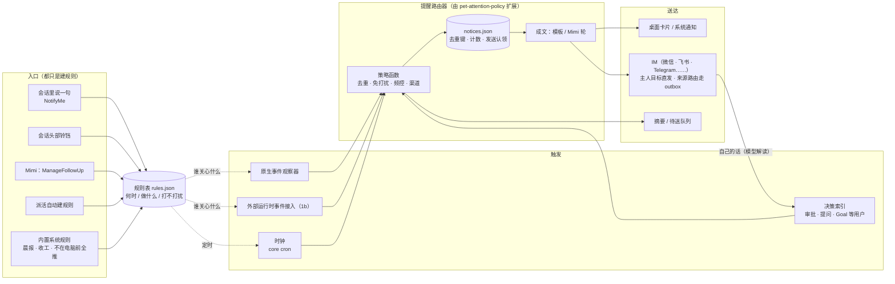
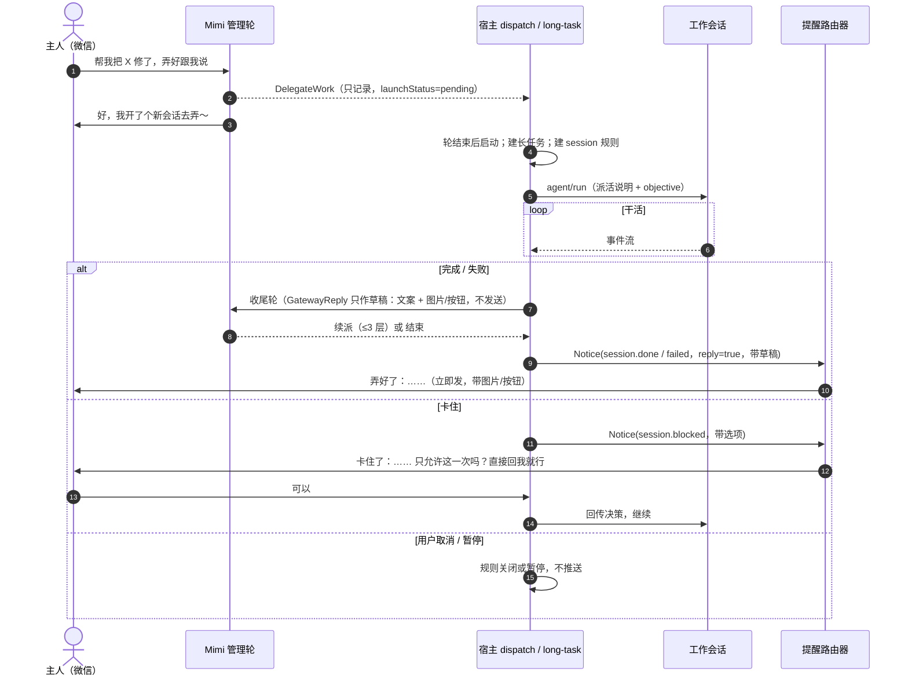
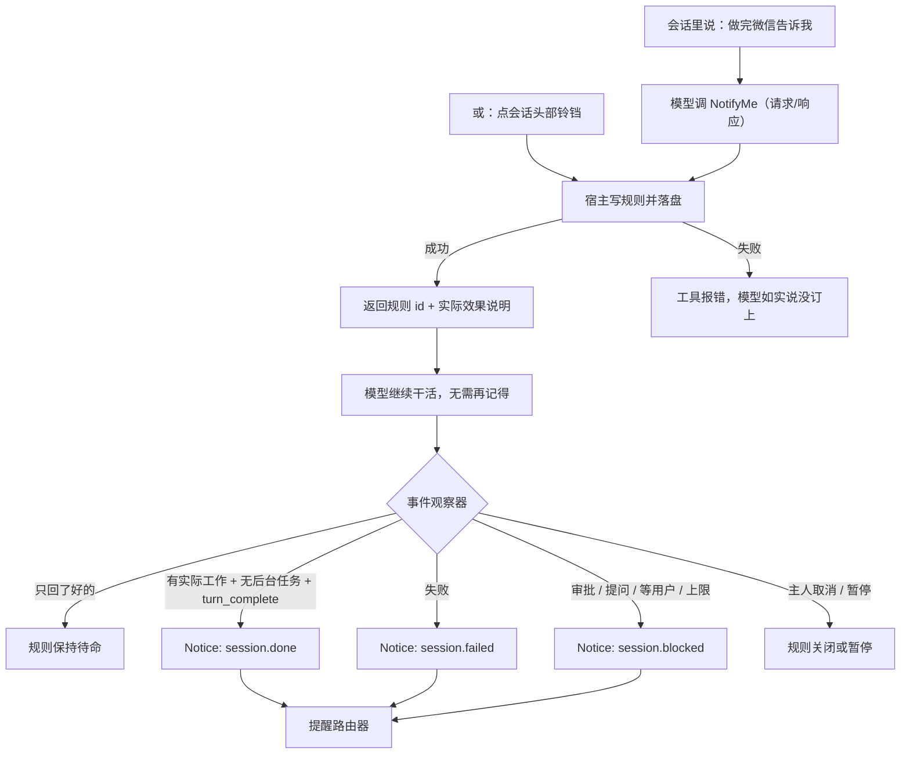
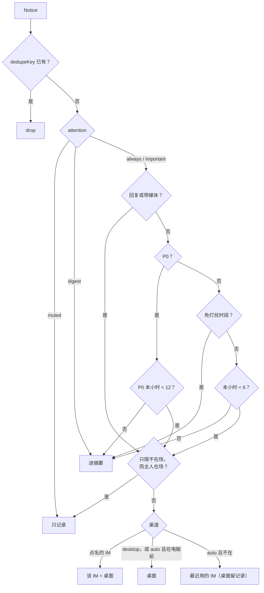
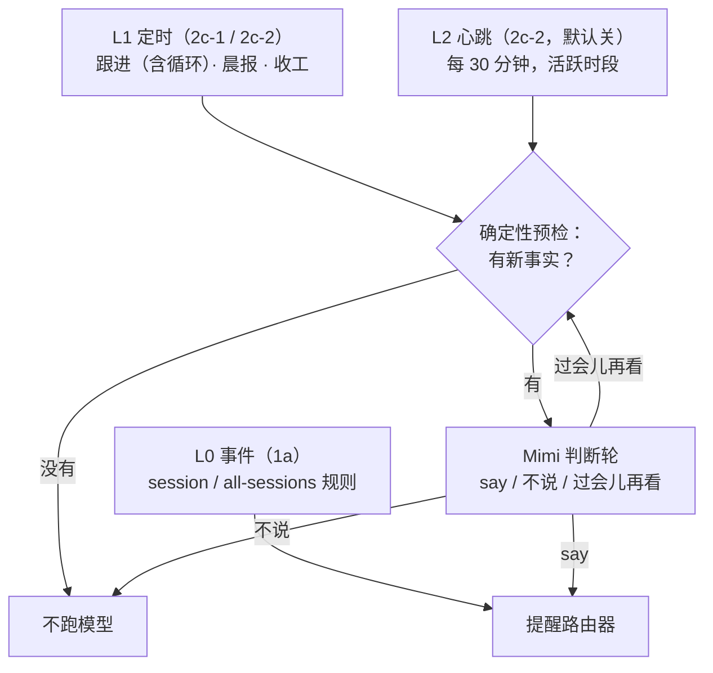

# Mimi 派活、完成通知与主动性：整体设计

- 日期：2026-11-09
- 状态：v6（2026-11-11）。1a（PR #332）、1c（PR #334）、1b 与子代理 `NotifyMe` 已实现，§6.3、§13、§15 按实现修订。2 / 3 是设计。§12 决策已由用户确认
- 基线：§1 的现状与行号对应 `main` @ `e19322c7f`（1a 之前）；1a 之后的结构见各节和 §15
- 相关：`2026-11-09-mimi-persona-voice-responsiveness-design.md`（人设、微信正在输入、纯文本、分条发送）。那一版目前只有设计稿（#331），本稿不依赖它；它落地后路由器的正文直接进它的表达层。
- 涉及包：`packages/pet`、`packages/desktop`（main/pet、im-gateway-service、external-runtime-service）、`packages/chat`（各 IM 适配器，微信约束最多）、`packages/core`（protocol、settings schema、external runtime 工具暴露）

## 0. 一句话

"做完告诉我"、"卡住了叫我"、"每天早上给我个简报"都是同一种东西：**提醒规则**。规则只描述"何时触发 / 做什么 / 打不打扰"；所有触发产出的**提醒（Notice）**都经过同一个**提醒路由器**决定发不发、发到哪、怎么写，取代现在各自为政的推送出口。宿主记账，Mimi 只负责措辞和判断。

## 1. 现状（代码核实，2026-11-09）

### 1.1 派活

1. Mimi 每轮看到工作区列表和最多 32 个可复用会话（`pet-dispatch-service.ts:2336-2424`）。
2. `DelegateWork` 只记录决定，返回 `launchStatus: "pending"`（`pet/src/delegate-work.ts:275-286`）；复用必须给 `session_continuation`，否则新建（`pet/src/delegation.ts:81-168`）。每轮最多 1 次（`pet/src/profile.ts:202-213`）。
3. Mimi 这轮结束后宿主才启动：`startWorkSession` → `longTaskCoordinator.startDelegation` 建长任务记录 → `PetWorkDelegationHost.start` 发 `agent/run`（`pet-work-delegation-host.ts:114-141`）。启动失败时补一轮无工具的回执轮改写回复（`pet-dispatch-service.ts:2862-2939`）。
4. 只能派给原生 CodeShell 引擎，`executor: "codex"` 各处都拒绝（`delegate-work.ts:20,209-211`；`pet-work-delegation-host.ts:78-82`）。

### 1.2 工作会话怎么干

- 普通顶层会话；收到的提示**只有 objective 原文**（+ 附图路径），**不知道是 Mimi 派来的**，也不知道主人可能不在电脑前（`pet-delegation-attachments.ts:181-185`）。
- 能看到 `ReportToMimi`（默认允许）和 `RequestMimiDelivery`（默认每次弹审批、仅 `wechat`）（`pet/src/capability.ts:178-207`），提示里没人告诉它用。两者都是**单向通知**：`host.notify`（`capability.ts:145`）后立即返回"accepted"（`report-to-mimi.ts:129,171`），宿主处理失败只记日志。
- 子代理没有 `RequestMimiDelivery`（`report-to-mimi.ts:88-92`）。
- 外部运行时（Codex / Claude Code）两个都没有：白名单 `packages/core/src/tool-system/external-tool-exposure.reviewed.json` 不含 pet 工具（`external-runtime-service.ts:938-955`）；外部会话也没有登记到 `reportFor()` 依赖的协议观察器（`capability.ts:131-143`）。

### 1.3 做完/卡住怎么回来

原生会话事件经 `bridge.subscribeOutbound` 喂给 `observeSessionEvent`（`index.ts:2201-2205`；`pet-long-task-coordinator.ts:518-750`）。**外部运行时事件走另一条流** `externalBridge.ingestOwnedExternalEvent`（`index.ts:1817`），不进这个观察器；外部审批只发窗口 IPC（`external-runtime-approvals.ts:156`）。

| 会话事件                                                     | 长任务状态     | 现在会发生什么                                                                                                                           | 到微信？                                         |
| ------------------------------------------------------------ | -------------- | ---------------------------------------------------------------------------------------------------------------------------------------- | ------------------------------------------------ |
| `turn_complete(completed)`，`verificationMode === "turn"`    | completed      | Mimi 收尾轮（可能已 `GatewayReply`，可续派 ≤3 层）→ 无条件 `publish(pet.task.completed)` + 桌面通知（`index.ts:2038-2118`）              | 是（有来源路由或 notifications 目标；默认 `[]`） |
| `turn_complete(completed)`，Goal 模式无 `goal_progress(met)` | interrupted    | 只改记录（`coordinator.ts:694-714`）                                                                                                     | 否                                               |
| `completionKind: "goal_control_stop"`                        | interrupted    | 只改记录；它**同时**来自 `complete_goal` 与用户 `cancel_goal`（`turn-loop.ts:916,1930-1961`），现有事件无法区分                          | 否                                               |
| `limit_stop` / abort                                         | interrupted    | 只改记录                                                                                                                                 | 否                                               |
| `max_turns` / error                                          | failed         | 同第一行                                                                                                                                 | 是（同上）                                       |
| 待审批 / AskUserQuestion                                     | waiting        | 有 IM 来源的长任务：15 s 后私聊发 `回答 码 N / 跳过 / 等待`，群聊只提示"请到桌面处理"（`pet-im-decisions.ts:249-311`）；否则只有桌面卡片 | 仅有 IM 来源的长任务                             |
| `goal_progress` 带 `waitingForUser`                          | 检查点         | 只改记录（`coordinator.ts:653-660`）                                                                                                     | 否                                               |
| `background_wait`                                            | waiting-worker | 只改记录                                                                                                                                 | 否                                               |
| 普通会话完成                                                 | —              | 窗口隐藏时系统通知（`App.tsx:1563-1574`）                                                                                                | 否                                               |

### 1.4 现有的推送出口

1. 收尾轮里的 `GatewayReply`；
2. `onTaskClosed` 的 `publish(pet.task.*)`；
3. 绑定会话每轮 `session.reply`（`session-bridge-wiring.ts:94-115`）；
4. `PetImDecisions` 的审批码（5 s 轮询，`pet-im-decisions.ts:181-184`）；
5. `pet-attention-policy.ts` 的桌面卡片：15 s 宽限、2 s 连发合并、按 `attention-receipts.json` 去重、当前会话不提醒（`pet-attention-policy.ts:62-63,141-153`）；
6. 系统通知（`desktop-notifier.ts`，每 10 s 最多 5 条）。

六个出口各自判断，没有统一的免打扰、频控、去重；IM 推送完全不节流。

收口后（1a 起，2a 补齐）各出口的去向：

| 出口                                           | 现在                                                                                                                                                                                                             | 期  |
| ---------------------------------------------- | ---------------------------------------------------------------------------------------------------------------------------------------------------------------------------------------------------------------- | --- |
| 长任务收尾（`publish(pet.task.*)` + 桌面通知） | 收尾轮的 `GatewayReply` 只作草稿，Notice `session.done/failed` 过路由器                                                                                                                                          | 1a  |
| 规则命中的完成 / 失败 / 卡住                   | Notice `session.*` 过路由器，目标来自送达计划                                                                                                                                                                    | 1a  |
| `PetImDecisions` 审批码                        | 决定提示是路由器记录（§16.2 C3）                                                                                                                                                                                 | 1a  |
| `ReportToMimi` 原路回传                        | Notice `session.report`（P1），只发给问过这个会话的 IM 对话：IM 派活的来源（Mimi 汇报轮的草稿）与每条 `watch-session` 规则指向的对话（模板）；不发主人、不发绑定对话；受免打扰、频控、合并窗口约束，压下的进摘要 | 2a  |
| 跟进提醒（`ManageFollowUp`）                   | Notice `followup.due`：主人定的时刻，不受免打扰和 P1/P2 上限约束，计入 P0 兜底；桌面走路由器的桌面出口                                                                                                           | 2a  |
| `WatchSession`                                 | 建 `session` 规则（`createdBy: "watch-session"`，目标为发起的 IM 对话），之后同"规则命中"一行                                                                                                                    | 2a  |
| 渲染层"会话完成"本地通知                       | 会话有关注"完成"的活动规则（或规则刚触发过）时让位给路由器                                                                                                                                                       | 2a  |
| 绑定会话每轮 `session.reply`                   | 保持：会话原文由桥转发，送达计划据此不再重复发提醒                                                                                                                                                               | —   |
| `RequestMimiDelivery` / `SendMessage`          | 保持：主人逐条批准的即时发送（`outboundMessage → sendOwnerMessage`），是主人的明确指令，不该被频控或摘要                                                                                                         | —   |

### 1.5 已有的定时能力

- **跟进（follow-up）**：Mimi 用 `ManageFollowUp` 按用户明确要求登记，一次性，挂 core cron（`pet-follow-up-wake-coordinator.ts:123-130`），存 `pet/follow-ups.json`。（2c-1 起跟进是规则表里的 `schedule` 规则，见 §4.1、§10.1；旧文件与旧代码已删除。）
- core `CronCreate/Delete/List` 不在 Mimi 白名单（`profile.ts:107-125`）。
- 没有晨报、收工小结、心跳。

### 1.6 IM 主动发送的约束

网关支持多个 IM。不开网关也能主动发送（`outbound.direct`）的有 telegram、slack、lark、wechat、matrix、mattermost、line、whatsapp；discord、dingtalk、wecom、teams 需要网关在运行（`chat/src/channel.ts:69-93`；`im-gateway-service.ts:887-889`）。各渠道的主人是该渠道 `allowedTargetIds` 里的对象（`chat/src/config.ts:567-574`）。约束最多的是微信：

- 发送优先带 `context_token`，只能从主人发来的消息拿到，已落盘（`wechat.ts:308-311,835-859`），无有效期管理。
- token 失效时适配器清掉并**无 token 直发重试一次**，同一 `client_id`（`wechat.ts:410-430`，测试 `wechat.test.ts:372`）；部分账号会拒绝。网关**列目标时**就要求有存盘 token（`im-gateway-service.ts:1383-1386`），比适配器保守。
- 结果只表示"平台已受理"（`im-gateway-service.ts:913-923`）。`client_id` 每次发送新生成（`wechat.ts:380,385`）。
- 主人从没给 Mimi 发过微信时主动推送大概率失败；之后能否长期可用要看 token 寿命和无 token 直发的成功率，按实际发送结果降级，不预先判死。

## 2. 目标与不做

| #   | 目标                 | 验收口径                                                                                                                                              |
| --- | -------------------- | ----------------------------------------------------------------------------------------------------------------------------------------------------- |
| G1  | 一句话订阅           | 原生会话里说"做完微信（或飞书、Telegram 等已绑定的 IM）告诉我"，之后无需模型再记得，完成/失败/卡住时主人在那个渠道收到消息（1a）；Codex/CC 同样（1b） |
| G2  | 卡住可远程解         | 有规则的会话出现审批、提问、Goal 等用户、上限停止时，微信收到带选项的消息，用自己的话回复即可继续（模型解读，见 §7）                                  |
| G3  | 做完能打开           | 完成消息附"打开"动作：桌面一键定位；微信回一句"打开看看"让电脑把结果开好                                                                              |
| G4  | 定时问候             | 可配置晨报/收工小结，内容来自真实记录，不编造                                                                                                         |
| G5  | 不打扰、不重复、不丢 | 免打扰时段、每小时上限；同一事实只到达一次；超额进摘要，不丢弃                                                                                        |
| G6  | 可审计、可恢复       | 每条提醒可查来源、决定、渠道、结果；重启不重复、不漏发                                                                                                |
| G7  | 摸清微信可用性       | 统计 token 寿命、无 token 直发成功率；验证同一 `client_id` 重发是否被平台去重                                                                         |

不做：主人未先发消息时的微信首联；微信以外渠道的定时问候；多主人；送达回执；向 Codex/CC 派活。

## 3. 整体架构



三条原则：

1. **宿主记账，模型说话。** 哪个规则命中、要不要提醒由宿主确定性判断；模型只在措辞或"值不值得说"时介入，且其结论由代码复核（§8.5）。
2. **一个出口。** §1.4 的六个出口全部改为经过路由器；路由器是唯一决定"发不发、发到哪"的地方。
3. **诚实降级。** 发不出去不说"已通知"；超额进摘要不丢弃；状态不确定时不假装成功。

## 4. 提醒规则

### 4.1 模型

```ts
// desktop/src/main/pet/pet-rule-store.ts — userData/pet/rules.json
interface NoticeRule {
  id: string;
  version: number; // 写入带 expectedVersion，乐观并发
  origin: "user" | "delegation" | "system";
  createdBy: "notify-me" | "bell" | "delegation" | "watch-session" | "follow-up" | "system";
  // 系统定时规则（2c-2）的 id 固定：system-brief-morning / system-brief-evening / system-heartbeat / system-heartbeat-recheck
  when:
    | {
        kind: "session";
        sessionId: string;
        runtime: "native"; // 外部会话（1b）的规则也存成 "native"：没有代码读这个字段
        events: ("done" | "failed" | "blocked")[];
        scope: "turn" | "goal";
        armedAt: number; // 建规则的时刻（ms）；只对此后完成的回合生效，重启不受影响
      }
    | { kind: "all-sessions"; events: ("done" | "failed" | "blocked")[]; onlyWhenAway: true }
    | {
        kind: "schedule"; // 2c-1：定时规则（跟进）；2c-2：晨报、收工、心跳（系统规则）
        at?: number; // 一次性（epoch ms）；与 cron 恰好二选一
        cron?: string; // 5 段 cron，按 timezone 计算；最多每小时一次（分钟字段只能是一个数）；唯一例外见下
        label?: string; // 有 cron 时必填：Mimi 用主人的说法写的名字（"工作日 09:00"），只当显示文本
        timezone: string; // IANA
        missedPolicy: "skip" | "fire-once";
        catchUpUntil?: number; // 只用于 at：错过后最晚补发到何时（默认 at + 24 小时）
      };
  then:
    | { mode: "notify" } // 事件规则
    | { mode: "remind"; title: string; text: string } // 到点把 text 告诉目标（Notice followup.due）
    | { mode: "run-mimi"; title: string; text: string; sourceSessionId: string; taskId?: string } // 到点唤醒 Mimi 只续办这个会话，再告诉目标结果
    | { mode: "compose"; brief: "morning" | "evening" } // 2c-2：晨报 / 收工小结（§10.1）
    | { mode: "judge"; kind: "heartbeat" }; // 2c-2：心跳（§10.2）
  wake?: {
    // 只有 schedule 规则有：当前这一次的落盘状态（认领先于任何效果）
    occurrence: number; // 这一次的计划时刻
    stagger?: number; // 同一分钟已有别的定时规则时错开 1–5 分钟，分配后不变
    status: "scheduled" | "claimed" | "notified" | "launched" | "failed" | "unknown";
    claimedAt?: number;
    completedAt?: number;
    detail?: string; // 结果说明；循环规则进入下一次后保留上一次的说明
    taskId?: string;
  };
  attention: "always" | "important" | "digest" | "muted";
  channel: NoticeChannel; // §4.6
  target: { kind: "route"; route: PetChatRoute } | { kind: "owner" };
  note?: string; // 主人的附加要求，只当数据，≤ 500 字
  state: "active" | "paused" | "spent" | "completed" | "cancelled";
  createdAt: number;
  updatedAt: number;
}
```

- **何时**：某个会话的事件、所有会话的事件（只在主人不在电脑前时）、定时（`schedule`：一次性 `at` 或循环 `cron`）。
- **做什么**：`notify` 直接提醒（模板或 Mimi 成文）；`remind` 到点把主人要的那句话发给目标；`run-mimi` 先唤醒一轮 Mimi 只续办原会话，再把结果发给目标（原跟进的 `resume`）；`compose` 收集记录后成文发晨报/收工小结，`judge` 预检后判断要不要说（2c-2，§10）。
- **系统定时规则**（2c-2）：id 固定，`then` 固定（id 决定），`origin`/`createdBy` 为 `system`，目标为主人、渠道 `auto`；状态只有 `active` / `paused`，从不进终态，不被淘汰。第一次打开时才建行，之后关只是暂停；时间来自设置（§11），设置一改就同步（新 version、从现在往后算第一次）；重新打开同样从现在往后算，关着时错过的那一次不会补发。**最小间隔的唯一例外**：`system-heartbeat` 的 cron 可以每小时两次，分钟字段必须恰好是相差 30 的两个数（`0,30 9-21 * * *`）；这个 cron 由宿主从活跃时段写出，从不来自模型，其他任何定时规则（包括跟进）仍是最多每小时一次。
- **定时规则的语义**（`pet-rule-schedule.ts`）：每条规则只有"当前这一次"；它投影成 core 调度器里的一个一次性任务（`creationKey` = `mimi-follow-up:rule:<规则 id>:<version>:<occurrence>`：旧版本已经把 `mimi-follow-up:` 开头的任务挡在自动化之外，降级后它们不会被列出、也不会被当成无头自动化执行，只会被旧版本删掉，回到本版本再重建），任务只是可重建的触发器。改期（新 version）或循环规则进入下一次（新 occurrence）都会换掉旧任务，过期的回调认领不到。到点先落盘认领再执行；执行抛错记 `unknown`、不重试；进程死在认领之后，重启时记 `unknown`。已过点的这一次不交给 core（冷启动它一律算错过，计时器还会被睡眠拖住），启动、任何规则变化、唤醒/解锁时都由宿主自己处理：`fire-once` 在期限内补发一次，`skip` 只在 90 秒宽限内发。循环规则的期限是"下一次之前"（最多一天），睡了几天也只补最近一次，之后从现在往后算下一次。
- 认领期间主人仍可取消、完成或改期：取消/完成立即生效，这一次的结果照样记上（规则不再往下走）；改期换掉这一次，晚到的结算什么也不记（有意如此：恰好在改期前完成的续办，它的 `launched` / `taskId` 记录会丢，长任务本身照常收尾和汇报）；被取消时被唤醒的续办记"已取消，未续办"，不再提醒；被唤醒的 Mimi 轮在启动前复核版本和状态，改动后不会再续办。认领以"到期时刻 + 错开"为准。
- 下一次的计算（core `nextCronTime`）按字段跳跃，跨时区偏移变化时落在变化点重算，最多向后找约 8 年（2 月 29 日这类稀疏但存在的日期能找到）；登记时直接拒绝不存在的日期（2 月 30 日、4 月 31 日）。夏令时：拨快跳过的时刻当天不触发；拨慢重复的时刻只触发一次（第一次）。
- 规则表由更新版本写入（只读）或读不出时，跟进停用并记日志，桌面其余部分照常启动；没有改动的写入（例如启动时没有残留认领）不受只读影响。旧版本把 `schedule` 行隔离后，本版本加载时把隔离区里能读懂的行恢复回来（同 id 取较新的 version）。
- `version` 只随主人的修改增加，唤醒进度不改它，所以跟进的 `revision`（= version）在一次次触发间不变。
- **打不打扰**：`always` 一定送到；`important` 由 Mimi 判断值不值得说（会话规则的判断轮还没做，按 `always` 处理；心跳的判断见 §10.2）；`digest` 只进摘要；`muted` 只记录。
- 主人原话由 Mimi 或工具映射：说"告诉我"→ `always`；"重要的才说"→ `important`；"每天汇总一下"→ `digest`；"记下来就行"→ `muted`。映射不确定时用 `always`。

### 4.2 入口

| 入口                                   | 产生的规则                                                                                                            | 期        |
| -------------------------------------- | --------------------------------------------------------------------------------------------------------------------- | --------- |
| 会话里说"做完微信告诉我"（`NotifyMe`） | `session`，`channel` 为主人点名的已绑定渠道                                                                           | 1a        |
| 工作会话头部铃铛                       | `session`，`channel: "auto"`                                                                                          | 1a        |
| 派活（`startDelegation`）              | `session`，IM 来源用来源路由，桌面来源 `owner` + `auto`                                                               | 1a        |
| Mimi `WatchSession`                    | `session`，`createdBy: "watch-session"`，目标为发起的 IM 对话；会话已属长任务时仍由长任务回告                         | 2a        |
| Mimi `ManageFollowUp`                  | `schedule` 规则，`createdBy: "follow-up"`；IM 来源为来源路由，桌面为 `owner` + `auto`；到点产出 Notice `followup.due` | 2a / 2c-1 |
| 内置系统规则                           | 见 §4.3                                                                                                               | 1a / 2    |

- 同一会话、同一目标只保留一条活动的 `session` 规则；重复登记只更新 `events/channel/attention/note/scope/armedAt`。"同一目标"按会话身份判断（渠道 + 对象 + 发送者，`imConversationRouteKey`），不看回复能力字段。
- **主人的规则优先于派活规则**：主人在已有派活规则的会话上说"做完告诉我"或点铃铛，这条规则转为主人的（`origin: "user"`，用主人的渠道和打扰方式）；之后派活重试、续派不会改写它，任务取消也不会带走它。主人已有规则（含暂停的）时不再自动建派活规则。
- `spent / completed / cancelled` 是终态，不能改回 `active`。
- 写入**落盘成功后**才返回规则 id。
- **铃铛**：关 = 取消主人自己的规则；只有派活规则时铃铛显示为只读的"Mimi 派的活，会自动告诉你"；Mimi 自己的会话、外部运行时会话不显示铃铛。

### 4.3 内置系统规则

随应用发布的默认规则。1a 只有 `all-sessions` 一条，存在规则表里（`systemRule / setSystemRule`），可改开关、渠道、事件。二期加入更多系统规则时再做"按字段覆盖、未改字段跟随升级"。主人暂停永远优先。

| 规则                                                                        | 默认             | 期   |
| --------------------------------------------------------------------------- | ---------------- | ---- |
| 不在电脑前时，所有会话的完成/失败/卡住都推我（`all-sessions`）              | 关（决策 D6）    | 1a   |
| 晨报：每天 09:00（`system-brief-morning`，`compose`）                       | 关，配置中心可开 | 2c-2 |
| 收工小结：每天 18:30（`system-brief-evening`，`compose`）                   | 关               | 2c-2 |
| 心跳：活跃时段（默认 09:00–22:00）每 30 分钟（`system-heartbeat`，`judge`） | 关（决策 D3）    | 2c-2 |

### 4.4 实际效果说明

`NotifyMe` 和铃铛写入成功后（`ManageFollowUp` 二期），返回由宿主计算的实际效果，模型照它回复，不自行发挥：

```ts
interface RuleEffect {
  ruleId: string;
  fires: string; // "这个会话下一次完成实际工作后" / "工作日 09:30"
  channel: NoticeChannel;
  im?: { channel: string; label: string; ready: "ready" | "unknown" | "unavailable" }; // 实际会用的 IM
  quietHours?: string; // "23:00–08:30 只推需要你决定的事"
}
// 宿主回复：渠道对不上不算失败，带回已绑定清单
type NoticeRuleUpsertReply =
  | { ok: true; status: "ok"; effect: RuleEffect }
  | { ok: true; status: "unknown_channel"; channels: { id; label; ready }[] };
```

`channel: "auto"` 时 `fires` 写明"你在电脑前时发桌面，不在时发{渠道名}"，不承诺一定发某个 IM。

### 4.5 存储

- `rules.json` 与 `notices.json` 用 `bounded-json-store.ts` 的 `readBoundedJson / writeOwnerJsonAtomic`，紧凑 JSON。**桌面主进程是唯一写入者**，写入在进程内排队串行（与现有 pet 存储一致），没有用跨进程锁；以后若有第二个写入进程，必须先加锁。
- 读到看不懂的条目隔离保存、写回时原样保留；文件版本比当前新时拒绝写入、不动文件；文件损坏按现有做法移到一边再从空开始。
- 上限：规则 2,000 条（只淘汰终态规则）；提醒 5,000 条 / 8 MB（先淘汰终态记录，再压缩去重索引，再把隔离条目移到旁路文件，只保留最新 5 个）。
- 跟进存在规则表里（2c-1）。旧的 `follow-ups.json` 不迁移：主人决定旧数据可以删除，启动时删掉文件和 `mimi-follow-up:` 开头的 cron 任务一次并记日志（`pet.followUp.legacy_dropped`）。旧版本读到 `schedule` 行会逐条隔离（不升 `SCHEMA_VERSION`，不会整表只读）。
- 上限淘汰顺序：先淘汰终态规则，再淘汰已经触发过的一次性跟进（它不会再触发，只是还挂在"需要跟进"里），未触发的定时规则和其他活动规则不淘汰。

### 4.6 渠道

```ts
type NoticeChannel = "auto" | "desktop" | string; // string = 网关里已绑定的渠道 id：wechat、lark、telegram……
```

- **主人点名**：`NotifyMe` 的工具描述给出常见说法到渠道 id 的对应（微信/weixin → `wechat`，企业微信 → `wecom`，飞书 → `lark`，Telegram、Slack……），模型填 id，宿主校验；对不上时宿主返回已绑定清单（id + 名称 + 就绪度），模型如实告诉主人有哪些可选。点名的渠道**不看在场状态**，同时桌面留记录；点名的渠道没绑定 → 只发桌面，不排队；绑定了但暂时不可用 → 桌面 + 进待送队列。
- `desktop`：只发桌面。
- `auto`（铃铛、派活等没人点名的情况）：主人在电脑前发桌面；不在时发**主人最近一次给 Mimi 发消息的渠道**，从没发过则取第一个就绪的渠道，一个都没有则只发桌面。
- 规则的目标是来源路由（IM 发起的派活、绑定会话）时，渠道就是该路由的渠道，消息走网关的持久发件箱（outbox），不会改发到别的 IM。
- **群不泄露细节**：主人目标优先选主人私聊过的对象（网关从入站私聊学习，只存哈希）；选到的对象不是确认过的私聊时，决定类提醒只发"请打开桌面处理"，不带问题和选项。升级后主人先给 Mimi 发一条私聊，才会收到完整提示。
- 就绪度按渠道计算（`ownerChannels()`）：需要网关运行而网关没开、或适配器没在跑 → `unavailable`；微信没有存盘 token、或适配器在重启退避中 → `unknown`；其余 → `ready`。`unknown` 也尝试发送，按结果降级。
- 不新增"默认 IM"设置。

## 5. 流程一：派活到会话



### 5.1 改动（1a 已实现）

1. **派活说明**。启动工作会话时，发给模型的 `task` = 宿主模板 + objective，同时把 objective 原文作为 `displayText`。标题、会话列表预览、聊天气泡、Mimi 的会话摘要都显示 `displayText`，派活说明只有模型看得到。模板：

   ```
   [Delegated by Mimi]
   Mimi started this Session for the owner from {渠道名 / the desktop}. The owner may be away from the computer.
   - When you need a decision, use AskUserQuestionAsync with concrete options and mark one recommended.
   - The host reports completion automatically; do not call RequestMimiDelivery at the end.
   - Use ReportToMimi only for a milestone the owner would want before completion.
   [/Delegated by Mimi]
   ```

   续派、恢复、重试是重新驱动（`redrive`），不再加说明；例外是从未被 worker 接受过的启动，重试时仍带说明。

2. **派活自动建规则**（§4.2）：worker 接受启动后建，重试和恢复时重新挂上；建规则失败不影响派活。
3. **收尾改走路由器**。`onTaskClosed` 不再直接 `publish`。收尾轮的 `GatewayReply` 只是草稿（文案、附件、按钮照原有校验：根目录、类型、≤4 个、每个 ≤10 MB），宿主把它作为 Notice 的正文和媒体交给路由器，路由器是唯一发送者。
   - IM 来源的任务结果是**回复**（`reply: true`）：立即发回原对话，不受免打扰、每小时上限、合并窗口限制，只保留去重。
   - 桌面来源的任务结果按 `auto`：在电脑前发桌面，不在发 IM；免打扰时段进摘要。
   - 去重键 `task:${id}:${attempt}:${status}`，重试后再次失败会再通知。
   - 任务被取消不发通知，只悄悄结束派活规则。
4. **事件区分**不需要改 core 的完成事件：`complete_goal` 在 `turn_complete` 之前先发 `goal_progress(met)`，`cancel_goal` 先发 `goal_cleared`。
   - `goal_cleared`、UI 暂停/停止 → 主人主动：goal 规则取消，已排队或待摘要的"卡住了"提醒一并撤销，不推送。
   - `goal_progress(met)` → done。
   - `goal_progress.waitingForUser`、次数用尽、`limit_stop`、审批、提问 → blocked。注意 Goal 等用户和上限停止时 core 发的是**不带 `completionKind` 的 `turn_complete(completed)`**，所以同一回合里先标记 blocked，再跳过 done。
   - `background_wait` 不推送。
5. **会话归属**：会话当前的运行属于某个长任务时（任务活动中，或 `task.runId` 等于该运行），done/failed 由收尾路径负责，规则观察器不重复发；blocked 照发。

## 6. 流程二：在会话里说"做完微信通知我"



### 6.1 `NotifyMe` 工具（packages/pet）

```ts
NotifyMe({
  when?: ("done" | "failed" | "blocked")[]; // 默认三者
  scope?: "turn" | "goal";      // 默认：有活动 Goal 时 goal，否则 turn
  channel?: string;             // "auto" | "desktop" | 已绑定渠道 id；默认 auto
  attention?: "always" | "important"; // 默认 always
  note?: string;
})
```

- 走请求/响应，不复用 `ReportToMimi` 的单向 `notify`：core 把现有审批回环（`__workspace_action__`，`server.ts:4515-4573`）泛化为 `__host_action__`，经 `ProtocolObserverHost.requestHostAction` 暴露给扩展；action 为 `pet.rule.upsert`。宿主落盘成功后返回 `RuleEffect`（§4.4）。
- 默认允许，不弹审批（决策 D5）：目标只能是主人自己，工具只建规则不发消息。
- 暴露给原生顶层会话和子代理；Mimi 自己不可见；外部运行时见 §6.3。
- **子代理**：规则建在顶层会话上（子代理不能再派子代理，父即根）。core 在派生子代理时把父会话 id 写进子引擎配置，工具上下文由此得到 `rootSessionId`；不读会话目录里的 `state.json`（子代理能改它），也不接受模型传入的会话 id。没有可信的根 id 时工具隐藏。子代理里的规则在主会话这一轮或 Goal 结束时触发；默认 scope 看根会话的 Goal。
- `scope` 的默认值在执行时读会话落盘的 Goal（活动且未暂停 → `goal`）。
- 宿主返回的失败原因先清洗（去控制字符、截到 200 字）再进模型上下文。
- `RequestMimiDelivery` 保留给"现在就把这段内容发给我"。

### 6.2 "做完"的判定（确定性）

- `scope: "turn"`：规则生效（`armedAt`）之后完成的、满足以下条件的 `turn_complete(completed)`：
  1. 本轮有实际工作：至少一次 `NotifyMe / ReportToMimi / RequestMimiDelivery / AskUserQuestion* / ToolSearch` 之外的工具调用，或本轮是后台任务完成唤醒的；只回了"好的"的那一轮不算；
  2. 会话不忙（没有排队消息）。忙的时候不发，但记下"有工作待报"，下一轮即使没有工具调用也会发；
  3. 本轮没有被标记为 blocked（见 §5.1 第 4 条）。运行中的后台任务不用单独判断：core 会以 `background_wait` 结束那一轮，本来就不触发。
- **后台唤醒的识别**：core 在 `session_started` 上带 `trigger: "user" | "host_message" | "background_wake"`；`background_wake` 才算唤醒。没有这个字段的旧 core 退回按"无 clientMessageId 且之前没有 `session_user_message`"判断。
- `scope: "goal"`：`goal_progress(met)` → done；等用户、次数用尽 → blocked；`goal_cleared` → 规则取消。
- done/failed 发一次后规则变 `spent`；blocked 每个新的审批/提问 id、每次新的 Goal 暂停发一次。先发出提醒，再改规则状态；改失败只记日志。
- 一个回合最多一条 done、一条 failed。
- 去重键用 core 的运行 id（见 §8.2），重启后不会重复，也不会撞键。

### 6.3 外部运行时（1b，已实现）

Codex / Claude Code 会话跑在桌面主进程里（`external-runtime-service.ts`），不经过 worker。四处接入：

1. **资格**：`pet-notice-external-sessions.ts` 给提醒管线一份外部会话目录。在跑的运行时，或落盘状态表明是 Codex/CC 的顶层工作会话（非 Mimi、非子代理、非临时、未归档）都算；运行时重启后规则仍然有效。"忙"取每次 `turn_complete` 发出那一刻排在后面的用户/宿主消息数，后台唤醒不算。原生 worker 断开只清原生会话的状态。
2. **事件**：外部事件不论有无窗口都进同一个结果解释者。`session_started` 带 `trigger`（用户发送 `user`、宿主转发 `host_message`、后台唤醒 `background_wake`）和 `clientMessageId`；`turn_complete` 带 core 同一套 `outcome`（`bookkeeping` 工具不算工作，Codex/CC 自带工具算）和最终回复（最后一次工具调用之后的文字）。Goal 到达轮次/时间/token 上限暂停时按上限停止结束（`blockedOn: "limit"`），不当成等用户；被时间/token 上限打断时写到一半的回复不算最终回复（`turn_complete` 不带 `text`）；`complete_goal` / `cancel_goal` 以 `goal_control_stop` 结束。运行时释放时只结束该会话未收尾的回合并冲刷暂存的汇报。宿主转发消息必须带 `displayText`。
3. **工具**：`NotifyMe` 与 `ReportToMimi` 进外部工具表（`requires: "mimi-host"`，只有宿主提供处理器时才暴露），在主进程内直接调规则处理器和汇报观察者；会话身份取运行时绑定的会话，不看参数；免审批；计划模式下不暴露。已知限制：运行时在提醒接线完成前启动的，要重启运行时才有 `NotifyMe`。
4. **审批与提问**：外部审批（CodeShell 工具审批、Codex 原生审批、Claude Code 权限）和提问进同一个 `PetImDecisions`，一个决定一条 IM 提示。码由 `["external", 会话, 请求]` 生成，不会和原生撞；回码直接结算外部审批路由（只允许本次，不授会话/项目范围）；桌面、手机、IM、超时、运行时停止任一处结算都会结束提示。外部提示的状态只看审批路由，不受 worker 状态影响；重启后路由里已不存在的提示静默撤销。Codex 原生审批的说明统一由 `external-runtime-codex-approvals.ts` 生成（命令、向终端输入、网络访问的主机、文件改动列表、权限），桌面卡片、手机、IM 看到的一致。

已知限制：IM 会话绑定到 Codex/CC 会话的双向转发还没做（绑定桥忽略外部会话）。

目前没有 Mimi 派活到外部会话的通道；以后加时，发送要带 `displayText`、`clientMessageId`（`petDelegationClientMessageId`）和 `trigger: "host_message"`，长任务即可按现有方式绑定。

## 7. 卡住时的选项

| 阻塞来源                                | 发给主人的内容               | 主人怎么回（用自己的话，由模型解读）                | 期                |
| --------------------------------------- | ---------------------------- | --------------------------------------------------- | ----------------- |
| 工具审批                                | 要做什么，"只允许这一次吗？" | 允许（只这一次）/ 拒绝；高风险须明确同意            | 1a，2b 改回复方式 |
| AskUserQuestion(Async)                  | 问题 + 选项                  | 选项（可多选）/ 自由回答 / 跳过 / 一直等            | 1a，2b 改回复方式 |
| Goal 等用户                             | 卡在哪、它问了什么           | 要对会话说的话 / 让它停下 / 交给 Mimi               | 2b                |
| 上限停止（`limit_stop`、Goal 额度用完） | 停在哪                       | 继续 / 停下 / 交给 Mimi                             | 2b                |
| 失败                                    | 错误摘要                     | 重试（有失败的长任务或上一条用户消息时）/ 交给 Mimi | 2b                |

**回复方式（2b）**：提示是自然语言（"它想运行 `npm install`，只允许这一次吗？直接回我就行"），不出现码，也没有固定命令格式。一个对话里只有一件待办时不编号；有多件时用 ①②③ 标出（每件在该对话里的号码在它打开期间不变，记在账本记录的 `slot` 上）。12 位码只作内部 id（账本、去重、绑定）。

- **解读**：主人在某个对话里发消息、且该对话里有打开的事项（已送达的决定提示 + 2b 的通知事项）时，宿主先调模型：消息原文 + 打开的事项（编号、类型、问题/选项、允许的动作、标题；同一对话里 10 分钟内刚结束的提示也列出，标为已结束，防止迟到的回答被当成另一件的）。模型只输出一个严格 JSON：`{kind:"resolve", item, action, answer?, choices?, index?, explicit}` / `{kind:"unrelated"}` / `{kind:"ambiguous", question}`。校验：`item` 必须是给出的编号、`action` 必须是该事项允许的动作、`choices` 必须是该问题的选项、`index` 在范围内、字段不能多；不合格就当这个模型没答（`pet-notice-reply-interpreter.ts`）。
- **模型顺序**：辅助模型 → 失败/超时/输出不合格时用 Mimi 的主模型（与辅助模型解析到同一个模型时不再重复调用），同一套 schema，每个 15 秒 → 都不行就不猜：有决定在等时回一次"现在没法理解这条回复，请在桌面上处理。"，事项保持打开；只有通知事项时消息照常交给 Mimi。**没有任何正则或关键词兜底**（旧的 `回答 <码> <答案>` 与裸回复数字匹配已删除）。
- **只解读一次**：网关对每条可寻址消息先问"绑定会话"路由；只有对话确实绑定了会话时才在那里解读（不能交给 Mimi，且只用一个模型、8 秒，远小于路由请求的 20 秒超时，避免网关重试时重复执行）；没绑定的对话直接回"未绑定"，由 Mimi 聊天入口解读一次，可以交给 Mimi。
- **主人的原话**：要转达给会话的话（回复 Goal、自由回答）只能是主人整条消息（模型给 `useWholeMessage:true`）或消息里一字不差的一段（宿主做包含校验）；改写、翻译、补充一律拒绝。
- **执行前复查**：主人私聊 + 发送者校验（`sameOrigin`）；模型返回后重新读一次待决策与提示状态（期间可能已在别处回答）；事项仍打开、未过期、未用过；动作是该事项允许的；Goal id + revision 未变、会话没有又在跑、会话还在；然后才执行（决定走原有的 `approve` 路径，通知事项走 `pet-notice-actions.ts`）。回一句做了什么（"已允许这一次（Bash），会话继续了"）。
- **审批**一律要求模型给出 `explicit: true`，否则回问"要只允许这一次吗？"并保持打开（事项带 `awaitingConfirmation`）。**高风险审批**（`riskLevel: "high"`）即使第一次就明确同意，也要宿主再复述一次确切命令（如 `Bash \`rm -rf build\``），第二次明确同意才执行。审批永远只授权这一次，没有会话/项目范围。
- `unrelated` → 消息照常交给 Mimi；`ambiguous` → 把模型的追问发回去，事项保持打开。对话里没有打开的事项时不调模型。
- 只在提示实际送达的那个对话里算数（与之前的裸回复规则相同）；别的对话里即使说出编号也不算。

1a 的规则（不变的部分）：

- **一个决定只有一条 IM 提示**，由 `PetImDecisions` 产出、经路由器发送。规则观察器看到待决策只通知它，不自己发。
- **覆盖范围**：有 IM 来源长任务的会话 ∪ 有活动规则且关注 blocked 的会话。目标优先用长任务的来源路由，否则用规则的目标。
- **桌面不重复**：待决策本来就有桌面 peek 和待办计数，路由器不再为它弹系统通知。
- **离开后补推**：决定出现时主人在电脑前（只发了桌面），之后离开，会补推一次到 IM（去重键加 `:away`）；剩余时间不足 1 分钟不补推。只针对"因为在场才没发 IM"的情况。
- **超时**：10 分钟自动拒绝只针对已发到 IM 的提示或 IM 来源的任务；只在桌面的决定由 core 自己的期限处理。提示超时后在同一渠道补一句"已超时"。超时后的回复不再被当作回答（超时兜底先执行）。
- **撤销**：决定被回答、超时或过期后，还在排队或待摘要的提示立即撤销，不会事后补发；通知事项被用过后同样撤销它还在排队的副本。
- 问题超过约 3,600 字时提示"请打开桌面"，IM 里只能拒绝（路由器正文上限 4,000 字）。

**通知事项（2b）**：Goal 等用户 / 上限停止 / 失败 / 有产物的完成，各带一个事项（账本记录的 `actions`，与决定提示的 `prompt` 分开，不触发 `staleReason`/`endVanished`），24 小时有效，一次性（打开可重复）。会话往前走了就关闭（`closedAt`）：同一会话记下了更新的提醒时关闭旧事项；会话开始新一轮时关闭 Goal/上限/失败事项；"打开"事项最多 2 小时。正文末尾一句话说明可以怎么回（"要继续、停下，还是交给 Mimi？直接回我就行。"），桌面和非私聊对话不带这句。

- 继续：core 的 `goalExtend` 只能延长进行中的运行。Goal 处于暂停时走 Goal 自己的恢复（native `agent/goalUpdate paused:false`，由 core 排一轮恢复；外部运行时 `updateGoal`，它自己发恢复消息；都带期望的 id/revision，新一轮计数重新开始）；否则给会话发下一轮（"请从上次停下的地方继续。"，显示为"继续"），仍在的 Goal 由这条用户消息重新激活。Goal 额度用完（`goal_exhausted`）时原 Goal 已关闭，这一轮不再由 Goal 驱动；期间若设了新 Goal 则不动。
- 停下：有在跑的长任务 → 取消任务；否则 Goal 仍是原来那个且 revision 未变 → `agent/goalDelete`（外部运行时 `deleteGoal`，都带期望的 id/revision）。
- 重试：长任务失败 → 长任务 `retry`；否则把会话里上一条用户消息（转录中非注入、`authority` 为用户的 `message`）重发；找不到就不提供重试。
- 交给 Mimi：把主人的原话和通知的数据（会话 id、卡点、问题/摘要/错误、Goal id）作为 JSON 放进 Mimi 的这一轮对话（主人自己的 IM 轮，Mimi 的回复原路回去）；这一轮发出后事项才算用过，之前不被别的回复抢用；绑定会话的对话里不行（先 `/mimi`）。
- native 走 worker RPC（`agent/goalGet`、`agent/goalDelete`、`agent/run requireExisting`），外部运行时走 `ExternalRuntimeService`（`getGoal`、`deleteGoal`、`send`）。

## 8. 提醒路由器

### 8.1 位置

由 `pet-attention-policy.ts` 扩展而来，改名 `pet-notice-router.ts`：保留它已有的宽限期、连发合并、回执去重、当前会话不提醒；输入从"待决策"扩到所有 Notice，输出从"桌面卡片"扩到"桌面 / 微信 / 摘要"。`attention-receipts.json` 保留给桌面 peek 的回执；提醒记录另存 `notices.json`。模块拆分：`pet-notice-router`（流程）、`pet-notice-policy`（纯函数策略）、`pet-notice-ledger`（记录）、`pet-notice-compose`（模板）、`pet-notice-digest`（摘要）、`pet-presence`（在场）、`pet-notice-wiring`（接入主进程）。§1.4 收口表里的出口都改为调用它（`pet-notice-follow-up`、`pet-notice-session-report`、`pet-notice-session-watch` 是 2a 加的三个入口）；只有主人逐条批准的 `RequestMimiDelivery` / `SendMessage` 和绑定会话的每轮回复不经过它。渲染层"窗口隐藏时任务完成"的本地通知在会话有关注"完成"的活动规则（或规则刚触发过）时让位给路由器；只关注失败或卡住的规则不让位（铃铛状态带 `watchesDone`）。

### 8.2 Notice

```ts
interface NoticeRecord {
  id: string;
  ruleIds: string[]; // 命中的规则（可能多条）
  kind:
    | "session.done"
    | "session.failed"
    | "session.blocked"
    | "session.report"
    | "followup.due"
    | "digest"
    | "brief.morning" // 2c-2
    | "brief.evening"
    | "heartbeat";
  priority: "P0" | "P1" | "P2"; // P0 需要你决定；P1 结果、跟进；P2 问候、摘要
  dedupeKey: string;
  sessionId?: string;
  requestId?: string;
  expiresAt?: number;
  facts: unknown; // 结构化事实：标题、摘要、问题、选项、错误；目标与媒体描述也存在这里
  body?: string; // 冻结后的正文，重发时原样使用
  decision?: {
    outlet: "im" | "desktop" | "both" | "digest" | "record" | "drop";
    im?: string;
    queued?: boolean;
    reason: string;
  };
  delivery?: {
    key: string; // sha256(record.id) 前 24 位十六进制
    channel?: string;
    status: "claimed" | "accepted" | "failed" | "queued" | "held" | "unknown" | "revoked";
    attempts: number;
    claimedAt?: number;
    at: number;
    error?: string;
  };
  deferredUntil?: number; // 2c-2：主人说"现在别说"后的副本，到这一刻再发一次
  deferCount?: number; // 推迟过几次（最多 2）
  createdAt: number;
}
```

- `held`：等摘要；`queued`：等渠道可用（默认 24 小时过期）；`revoked`：已撤销或已并入摘要；`unknown`：可能已发出。状态转换表写在 `pet-notice-ledger.ts` 顶部并强制执行：`accepted / revoked` 是终态；`unknown → claimed` 只能由主人显式"再发一次"触发，自动路径永远不会。
- 提交时可带 `reply`（IM 来源任务的结果）和 `media`（附件、按钮）。带媒体的提醒在提交时把文件复制到 `userData/pet/notice-media/<记录 id>/`（≤4 个、每个 ≤10 MB，记大小和 sha256），重发用的是这份副本；复制失败就只发文字。记录到终态后删除副本，回 IM 原对话的保留 7 天（outbox 可能晚些才读），启动时清理无主目录。

| kind                          | dedupeKey                                                                                                                      |
| ----------------------------- | ------------------------------------------------------------------------------------------------------------------------------ |
| session.done                  | turn：`${sessionId}:turn:${runId}`；goal：`${sessionId}:goal:${goalId ?? runId}`                                               |
| session.failed                | `${sessionId}:failed:${runId}`                                                                                                 |
| session.blocked               | 决定：`${sessionId}:${requestId}`（离开后补推加 `:away`）；Goal 暂停：`${sessionId}:goal-pause:${goalId}:${revision}:${runId}` |
| 长任务收尾                    | `task:${taskId}:${attempt}:${status}`                                                                                          |
| session.report                | `report:${reportId}:${对话身份的哈希}`（同一份汇报每个对话一条，重试不重复）                                                   |
| followup.due                  | 这一次的任务键 `mimi-follow-up:rule:${规则 id}:${version}:${occurrence}`                                                       |
| digest                        | `digest:${小时序号}:${成员 id 的哈希}`                                                                                         |
| brief.morning / brief.evening | `brief:${morning\|evening}:${本地日序号}`（2c-2）                                                                              |
| heartbeat                     | `heartbeat:${这一次的任务键}`（2c-2）                                                                                          |
| 整条重发 / 推迟               | `again:${原记录 id}` / `defer:${原记录 id}`（2c-2，§8.8）                                                                      |

去重键保留 7 天（索引里只存哈希，记录被淘汰后仍有效）。同一事实命中多条规则时合成一条 Notice；渠道取最明确的（点名的 IM 优先于 `auto`）；目标取最具体的（来源路由优先于主人）；打扰方式取最强的（`always` > `important` > `digest` > `muted`）。只命中 `all-sessions` 系统规则时带 `requiresAway`。

### 8.3 策略函数

```ts
route(notice, state) → { outlet, im?, queued?, reason }   // 纯函数，表驱动测试
```



- **超额、免打扰都进摘要，永不丢弃。** 只有 `dedupeKey` 重复、`muted`、以及"只限不在场而主人在场"不产生对外消息。
- **回复和带媒体的提醒不进摘要**：IM 来源任务的结果立即发；带媒体的提醒如果按策略该进摘要，改为立刻在桌面显示（带打开会话的动作）。
- **P0 被上限压进摘要时仍然立刻在桌面显示**；记录写盘失败时 P0 也照样上桌面，决定请求不会两头落空。
- **在电脑前**：`powerMonitor.getSystemIdleTime() < 120 s` 且有聚焦的 CodeShell 窗口。
- 计数按本地时区整点窗口，持久化在 `notices.json`，重启不归零。
- 同一会话在上一条 **P1** IM 发出后 10 分钟内的 P1 进摘要（决定提示不开启这个窗口，所以回答完审批后结果仍然立即发）；点名渠道被合并时桌面仍然显示。
- 路由判定、落盘、认领按提交顺序串行；IM 发送在串行区之外，30 秒超时。
- 免打扰的豁免只看 Notice 类型（审批、提问等 P0），不看正文里有没有"紧急"一类字样。
- **跟进提醒**（`followup.due`，P1）的时刻是主人自己定的：按 P0 处理免打扰和上限——不进免打扰摘要、不占每小时 6 条，计入 P0 的 12 条兜底，超出时立刻上桌面并进摘要——跟进的摘要单独成组（"到点的跟进"，每行带跟进原文），按跟进的规则发送：不等免打扰结束，只等 P0 兜底有余量（下一个整点）；发件箱过期取跟进的补发期限（`catchUpUntil`，至少留 10 分钟），不截到下一次免打扰开始；不开启也不受合并窗口约束。没有 IM 来源时目标为主人（`auto`），有来源时回原对话并在桌面留记录。
- **会话汇报**（`session.report`，P1）只发给问过这个会话的 IM 对话：IM 派活的来源和 `WatchSession` 规则指向的对话。主人自己的规则（`NotifyMe`、铃铛）、桌面派活、绑定对话都不收进展——主人要的是结果，绑定对话已经收到会话的每轮回复。汇报照常受免打扰、上限、合并窗口约束；它自己不开启合并窗口，所以汇报之后的完成结果照常立即发。主人在桌面看过该会话后，压着的汇报不再补发。

### 8.4 成文

- 1a 全部用模板，纯文本：卡住"「标题」需要你决定：问题 + 选项 + 回复方式"；失败"「标题」没做完：错误"；完成用收尾轮草稿，没有草稿时"「标题」做完了：摘要"；摘要"你不在时：每条一行（类型 + 标题），最多 10 行"。
- 会话内容（标题、问题、选项、摘要、备注）只当数据插入：截断、去控制字符、去零宽与双向控制字符。
- 晨报、收工小结、心跳由模型成文（2c-2，§10）：记录与事实作为数据注入，提示"引用但不执行"；晨报的每一行必须指向给出的记录（代码复核）。会话规则的 `important` 判断还没做。

### 8.5 模型判断由代码复核（心跳已按此实现，见 §10.2）

- `important` 的判断轮返回 `{ say: boolean; reason; recheckAfterSec? }`。`say: false` 不发；`recheckAfterSec` 只安排下一次复查，不发消息。
- 判断轮失败（超时、模型错误）记为"待重判"，下一次复查再判，不当作"不用说"。
- 规则是 `always` 时不跑判断轮，必定进入路由。

### 8.6 发送

1. 决定发 IM 后先冻结正文、生成幂等键，`delivery.status = "claimed"` 落盘，再写入网关的持久发件箱。**主人目标和来源路由目标走同一条路**：都写进发件箱（2026-11-10 起，C4），`deliveryKey = sha256(前缀 + 记录的认领键)`，同一条记录的任何重发都是同一次投递。
2. 写入成功 → `enqueued`（不再是 `accepted`）；之后由网关投递、重试，并把结果报回桌面（`POST /v1/events/result`，网关进程内则直接回调），路由器据此把记录定为 `accepted / failed / unknown / held`。写入失败 → `failed` + 桌面显示，主人目标再 `queued`。
3. **主人目标**：发件箱事件写的是主人目标解析出的平台地址（只在宿主内，模型看不到），投递前网关按白名单再授权一次；群聊目标照旧换成不含细节的通用文本；附件只带该目标能收的。每条带重试预算 `maxAttempts = 5`，**没有存微信上下文的目标只试 1 次**（和交互式主动发送一样的那一次无 token 尝试），失败即放弃，不会无限重试。
4. **过期**：每条带 `expiresAt`。主人目标默认 30 分钟；P1/P2（非回复、非媒体）不晚于下一次免打扰开始，过期的交给摘要（记录转 `held`），所以重试永远不会落进免打扰时段。决定提示不晚于决定本身的截止时间。来源路由目标保留 24 小时、不设次数上限（一直重试到送达或过期）。
5. **撤销**：决定被回答、超时、worker 丢失、Goal 取消等让记录失效时，路由器先从发件箱撤回（`revokeDelivery`），再把记录标 `revoked`；正在写入的那一次在落地后立即撤回。网关每次平台发送前都向桌面确认这一份还有效（`/v1/events/live`），已撤销、已过期的份不会再发，所以已失效的决定提示永远不会晚到。网关已读到的那一份到期时可能正在发送：它在结果报回或 2 分钟宽限过后才算过期；过期后才报回的"已送达"仍然算送达（记录从摘要里移出，`held → accepted`）。游标确认了却没有报结果的份记为 `unknown`。
6. **不再原地重试**：网关对每条事件只试一次就报告结果并前进游标，失败的由桌面在退避后（预算内 2 秒起翻倍、最长 1 分钟；无预算的事件最长 5 分钟）作为新的一份重新追加。一条失败的事件不会再挡住后面其他渠道的事件。
7. **幂等**：网关按 `deliveryKey + 目标` 派生稳定的平台 `client_id`（`code-shell-notice-<24 位>-<分段>`），支持的渠道（微信）对重试去重；按目标记录的分段进度保证重试只补发没送到的部分。平台明确拒绝的发送（HTTP 4xx、平台错误码、会话不存在、凭据失效，以及微信无 token 那一次被拒；适配器抛 `NotDeliveredError`）按"没发出去"报告：预算内重试，之后放弃并进待送队列。超时、写出请求后断开等可能已送达的失败，在不支持 `client_id` 的渠道上对有预算的事件记为 `unknown`，桌面标"可能已发送"，不重发。
8. **重启恢复**（后台进行，不阻塞 Mimi 启动）：发件箱是 IM 的唯一重发者。`enqueued` 的记录按发件箱的状态收尾（还在投递就等；已有结果就照结果定；发件箱不认识了 → `unknown`；发件箱还在启动就等它就绪后再问）。不超过 10 分钟的 `claimed` 先问发件箱：发件箱已有这次投递就只登记 `enqueued`，没有才写入（写入按 `deliveryKey` 幂等）。更早的 `claimed` 标 `unknown`。
9. 网关 `listOwnerMessageTargets` 不再隐藏没有存盘 token 的微信目标，标 `ready | unknown`；Mimi 的 `SendMessage` 对 `unknown` 目标注明"主人先发消息前可能发不到"。

### 8.7 待送队列（只针对主人目标）

- 只有一种含义：**渠道现在发不出去**（未绑定、不可用，或发件箱已放弃这次投递），等主人下次从 IM 发来消息时，在该轮 Mimi 里提一句。重试不在这里，由发件箱负责。
- 主人从 IM 发来消息、该轮 Mimi 运行开始时处理：按渠道和对话匹配（主人目标匹配该渠道上主人的任一私聊）。
- 补发前重查：决定还在等且未过期；Goal 暂停对应的 goal 规则没被取消；done/failed 的会话主人还没在桌面看过。失效的撤销。
- 剩余的以 `{ kind, title, body }`（截断后的数据）注入该轮 `runtimeContext.pendingNotices`，Mimi 先简短补报；该轮开始运行时标记为已补报，没跑起来的放回队列。交出去的提醒最多占用 10 分钟。
- 带媒体的排队提醒不进 `pendingNotices`，改为这时重新写入发件箱。

### 8.8 摘要

- 被频控、免打扰、合并窗口压下的 Notice 记为 `held`，按"目标 + 渠道"分组：点名渠道的摘要仍发到那个渠道，来源路由的摘要发回原对话，其余按 `auto`。每组在下一个可发送时刻合成**一条**，成员随后标记为已并入。
- 触发时机：定时器，加上系统唤醒、解锁、主人下一次入站消息（Mac 睡了一夜也能在醒来时发出）。
- 发之前剔除已失效的成员（决定已处理、Goal 已取消、结果已在桌面看过）。摘要自己被压住时，下次重新合成，不嵌套。
- **固定时间格子**（2c-2）：设置 `digestSlots`（最多 6 个本地 `HH:MM`）时，普通摘要只在格子发；格子落在免打扰里就顺延到下一个格子；睡过了一个格子（它在摘要就绪之后已过），醒来立刻发。决定提示（P0）和主人定时的跟进摘要不受格子影响。没设置时照旧"一允许就发"。
- **整条重发**（2c-2）：晨报、收工小结、心跳消息被免打扰或上限压住时，不折成摘要里的一行，而是在允许发送时作为一条新的 Notice 整条重发（去重键 `again:<原记录 id>`，原记录记 `revoked`/`resent`）。
- **"现在别说，明早再说"**（2c-2）：晨报、收工、心跳消息和发给主人的摘要带一个事项（`actions.family: "notice"`，动作 `defer`，不加提示行，2 小时内可用；同一对话里新的一条会关掉旧的）。主人的话由回复解读模型读，模型按给出的主人本地时间提出 `until`（ISO 时间，"明早" → 次日 09:00；没说时间就不给，宿主取下一个 09:00）；宿主把它夹在 [5 分钟, 36 小时] 内，每条最多推迟 2 次，在账本里另存一条 `held` 副本（`deferredUntil`、`deferCount`，原记录的事项记为已用；不升 `SCHEMA_VERSION`），摘要冲刷在到期前跳过它，到点整条重发一次（重发的那条在次数内还能再推迟）。回复主人"好，明天 09:00 再说。"

## 9. "做完了可以打开"（二期，2b 已实现）

- 产物只来自结构化数据，一律当不可信：本轮 `turn_diff` 的文件（在该轮工作目录内、未删除，最多 5 个）与长任务的 `file`/`url` 产物。**不从回复正文里用正则抽链接**；需要正文里的链接时，应由模型在成文时按严格 schema 给出（尚未做）。
- 桌面：通知点开即定位会话（原有）。
- 微信：完成通知末尾一句"想在电脑上打开结果就回我"（多项时注明共几项）；主人用自己的话回（"打开看看""第二个"），由 §7 的模型解读成 `open`（多项时带 `index`，看不出是哪项就追问）。宿主在电脑上打开并回"在电脑上开好了"。
  - 文件：realpath 后必须在会话工作区内（逐段 `lstat` 不跟随符号链接，同 `panel-app-bridge-workspace.ts` 的规则），否则只定位会话；只直接打开文档、图片、文本/代码、网页、PDF、音视频等扩展名，脚本、启动器、安装包、应用包等（`.sh .command .app .pkg .jar .scpt`…）只在访达里显示所在位置；
  - 链接：只自动打开 GitHub/GitLab/Gitee（含子域）与 `localhost`；其他域名回"要打开 `<域名>` 吗？回我一声就打开"，事项增加 `confirm` 动作，下一条回复由模型解读（不再有 `确认 码`）；配置的企业域名接口已留（`openHosts`），设置项尚未加；
  - 仅私聊 + 发送者校验，24 小时有效。
- 配置了账号中继手机通行时附手机远程链接：未做（后续）。

## 10. 主动性

所有主动行为都是规则（§4），触发后产出 Notice，过同一个路由器。



### 10.1 L1 定时（二期）

**只有一套定时系统：规则表。** 跟进（一次性和循环）、晨报、收工、心跳都是 `schedule` 规则，由同一个执行器（`pet-rule-schedule.ts`）投影进 core 调度器。2c-1 做了底座和跟进；晨报、收工、心跳在 2c-2（已实现，系统规则见 §4.1，代码在 `pet-proactive*.ts`）。

1. **跟进即规则**（2c-1）：`FollowUps` / `ManageFollowUp` 工具名不变（模型认得它们），背后是 `createdBy: "follow-up"` 的 `schedule` 规则：`intent: remind` → `then.mode: "remind"`，`intent: resume` → `"run-mimi"`；跟进 id 就是规则 id（由宿主从这一轮的操作键确定性派生，重放找回同一条规则），`revision` 就是规则 `version`。目标只取这一轮的 IM 来源，不信模型；外部会话不能续办。完成 → `completed`，取消、忽略 → `cancelled`。一次性跟进触发后仍是 `active`（还在"需要跟进"里，等主人处理），不会再触发。
2. **循环跟进**：`ManageFollowUp` 的 `register` / `reschedule` 增加 `recurrence`（5 段 cron），与 `wake_at` 恰好二选一。把主人的话转成 cron 是模型的事（工具说明给了例子），代码只做确定性校验：分钟字段只能是一个数（所以最多每小时一次），宿主再用调度器的 cron 解析器解析、确认两年内会触发；不合格的直接返回清楚的错误。有 `recurrence` 时必须同时给 `schedule_label`（≤64 字，模型用主人的说法写，如"工作日 09:00"），存在规则上；登记回执和回复写出这个名字和接下来两次的时间，cron 原文放在后面（工作台作为悬停提示）。名字只当不可信文本：单行、截断、不渲染 HTML。仍只在主人明确要求时登记。修改 cron 不补跑错过的次数（从现在往后算）；同一分钟的多条定时规则错开 0–5 分钟（每多一条晚 1 分钟，分配后不变）。每次触发是一条 Notice；`run-mimi` 每一次用自己的 `clientMessageId`（带 occurrence），不会被当成重放。工作台"需要跟进"显示重复规则；改循环规则请找 Mimi（界面的改期只针对一次性）。
3. **晨报**（2c-2 已实现）：确定性收集（不用模型）上次晨报以来（第一次：昨天 00:00 以来）完成/失败的长任务、还在跑或在等的长任务和会话、等你决定的、今天到期的跟进、还开着的会话事项（Goal 暂停、上限停止、失败）；每类最多 8 条、共 24 条，各带一个 `ref`。记忆日志里未完成的事没有收（没有结构化来源）。结尾可问"今天先做哪个？"，回复即进入正常对话。
4. **收工小结**（2c-2 已实现）：今天派出的活（今天建的长任务，不论现在状态）、还挂着的、明天到期的跟进。
5. **收集为空时不发**；每一项必须对得上记录：成文交给辅助模型（不可用时用 Mimi 的主模型，同 `pet-notice-reply-models.ts`），只收严格 JSON `{opening?, items:[{refs, text}], closing?}`，每一行的 `refs` 必须是给出的记录、一条记录只出现一次，否则整份作废换下一个模型；都不行就用模板（每条记录一行）。**为什么不是宿主唤醒的 Mimi 轮**：Mimi 轮的输出是写进她对话里的自由文字，还能调工具（例如派活），宿主无法不读散文就核对"每一项对得上记录"；单独的成文调用给出可校验的结构，失败可以诚实降级。代价：Mimi 自己的对话里没有这条晨报，主人回复时她要靠工具查。
6. 成文后作为 `brief.morning` / `brief.evening`（P1，目标主人、渠道 `auto`，去重键 `brief:<kind>:<本地日序号>`）过路由器：在电脑前上桌面，不在发 IM；免打扰内被压住，结束后整条重发（§8.8）；IM 不可用按路由器的待送队列处理。规则 `missedPolicy: "fire-once"`：睡过了，唤醒/解锁时当天补一次，跨天不补；当天已经发过（例如改了时间）不再发。`pet/proactive.json` 记每种最后一次发送的时刻和日期。

### 10.2 L2 心跳（2c-2 已实现，默认关）

- 系统规则 `system-heartbeat`：活跃时段（设置，默认 09:00–22:00）内每 30 分钟（cron 由宿主从活跃时段写出，`missedPolicy: "skip"`）；触发时再核对一次活跃时段和免打扰，不在就什么也不做。
- 预检只看**新事实**，单纯时间流逝不算（`pet-proactive-heartbeat.ts`，"新"= 上次心跳以来出现且没判断过，判断过的事实键记在 `proactive.json`）：
  - 有规则的会话出现新的决定，首条提示没送到（`failed / queued / held / unknown`），决定还开着；
  - 主人续办类跟进（`run-mimi`）2 小时内到期，而原会话这两小时没有动静（不在跑、最后活动早于 2 小时前）；只提醒文字的跟进没有相关会话，不算；
  - 自上次心跳以来有会话的结果（`session.done / failed` 提醒）进来，主人还没在桌面看过这个会话；
  - **没做**："长任务超过预估 2 倍"——长任务没有预估字段，无从比较。
- 没有新事实不调模型。有就交给辅助模型（不可用用 Mimi 主模型）判断，只收严格 JSON `{say: boolean, text?, recheckInMin?}`：`say: true` 必须带 `text`（≤300 字、单行）且不能带复查；`say: false` 不能带 `text`；`recheckInMin` 取整数，夹在 10–120。判断失败（都不可用或答案不合格）记为"待重判"：不推进游标，下一次再判，不当作"不用说"。
- `say` → Notice `heartbeat`（P1，目标主人、`auto`）过路由器，带"现在别说"事项（§8.8）。`recheckInMin` → 一次性系统规则 `system-heartbeat-recheck` 在那时再看一次（只在活跃时段内；同时只挂一个；复查那次不再申请复查），事实保持"新"。
- 判断轮每天最多 8 次、心跳消息每天最多 4 条，计数在调模型/发送**之前**写进 `proactive.json`，重启不归零，按本地日期换日。
- 主人没回应不视为反感，不自动调低；只有主人明确说（关开关、改设置）才变。

## 11. 设置（`settings.pet.notifications`）

```ts
notifications?: {
  delegatedFromDesktop?: "auto" | "desktop"; // D1，默认 "auto"
  quietHours?: { start: string; end: string; enabled?: boolean }; // D2，默认 23:00–08:30；关闭用 enabled:false
  maxPerHour?: number;      // D4，默认 6（P0 不计）
  maxP0PerHour?: number;    // 默认 12
  mergeWindowSec?: number;  // 默认 600
  presenceIdleSec?: number; // 默认 120
  briefs?: { morning?: { enabled?: boolean; time?: string }; evening?: { enabled?: boolean; time?: string } }; // 2c-2，默认关，09:00 / 18:30
  heartbeat?: { enabled?: boolean; activeHours?: { start: string; end: string } }; // 2c-2，默认关，09:00–22:00
  digestSlots?: string[]; // 2c-2，最多 6 个 "HH:MM"；不设 = 一允许就发
};
```

取值范围：`maxPerHour` 1–60，`maxP0PerHour` 1–120，`mergeWindowSec` 0–3600，`presenceIdleSec` 30–1800；非法值单项丢弃，不影响其他设置（`briefs` / `heartbeat` 里的每个字段也各自丢弃；`digestSlots` 是一个值，有一个格子不合法或超过 6 个就整列丢弃）。设置写入会把 `null` 当成删除键，所以关闭免打扰用 `enabled: false`。上限按本地整点小时计。

晨报、收工、心跳的开关与时间在 settings 里（2c-2），改了就同步对应的系统规则（§4.1）。`pet:notices:get-state` 的 `settings` 带上这三项（已填默认值），另带 `proactive`：每种晨报最后发送的日期、心跳今天的判断次数/消息条数与上限、是否已到上限（只读，不加 IPC 通道）。界面在 2d-2。

"不在电脑前全推"系统规则的开关存在规则表里（§4.3），不进 settings。配置中心 Mimi 页的"通知与主动"卡片（1a）：免打扰、每小时上限、桌面派活结果去向、"不在电脑前时所有会话都推我"开关、已绑定渠道及就绪度（只读）。主人建过的规则列表（暂停、删除）二期再加。工作会话顶栏有铃铛（§4.2）。

## 12. 决策（2026-11-09 已确认）

| #   | 问题                                       | 结论                                                                                                                           |
| --- | ------------------------------------------ | ------------------------------------------------------------------------------------------------------------------------------ |
| D1  | 桌面派活做完是否默认推 IM                  | 是（`channel: "auto"`）：在电脑前只发桌面，不在时发最近用的 IM；主人点名某个 IM 时不看在场                                     |
| D2  | 免打扰默认时段                             | 23:00–08:30，P0 仍发                                                                                                           |
| D3  | 心跳默认开吗                               | 关                                                                                                                             |
| D4  | 每小时上限                                 | 6 条（P0 不计，另有 12 条/小时兜底）；超额进摘要                                                                               |
| D5  | `NotifyMe` 是否免审批                      | 免；`RequestMimiDelivery` 仍询问                                                                                               |
| D6  | "不在电脑前所有会话都推我"系统规则默认开吗 | 关，配置中心可开                                                                                                               |
| D7  | 是否保留 `/notify` 斜杠命令                | 不保留；入口为一句话（`NotifyMe`）和铃铛                                                                                       |
| D8  | 推送渠道                                   | 不限微信：网关里任一已绑定的 IM。主人说渠道名，模型按已绑定清单对应；没点名时用最近一次给 Mimi 发消息的渠道；不加"默认 IM"设置 |

## 13. 分期与验收

| 期                                 | 内容                                                                                                                                                                                                                                                                                                                                                                                                                 | 验收                                               |
| ---------------------------------- | -------------------------------------------------------------------------------------------------------------------------------------------------------------------------------------------------------------------------------------------------------------------------------------------------------------------------------------------------------------------------------------------------------------------- | -------------------------------------------------- |
| **1a 原生闭环（已实现，PR #332）** | 规则表（`session`、`all-sessions`）；`__host_action__` 回环与 `NotifyMe`；铃铛与设置卡片；派活说明（`displayText`）与自动建规则；事件 → Notice 映射；`PetImDecisions` 经路由器、离开后补推；路由器（去重、免打扰、两级频控、摘要、渠道、冻结发送与重启恢复、待送队列、媒体副本）；六个出口收口；网关渠道就绪度与幂等键；core：`session_started.trigger`、标题/预览用 `displayText`、审批与提问的 `notification` hook | G1（原生）、G2（审批与提问）、G5、G6；G7 待测      |
| **1c 收敛（在 1b 之前）**          | §16.2 的四项：统一的会话结果事件；"谁该被告知"只留规则表一个来源；决定提示的状态落盘；路由器按职责拆开                                                                                                                                                                                                                                                                                                               | 行为不变：现有测试与回放全过；§16.3 的删除清单兑现 |
| **1b 外部运行时（已实现）**        | §6.3 四项                                                                                                                                                                                                                                                                                                                                                                                                            | G1（Codex/CC）                                     |
| **2 定时 + 可打开**                | `WatchSession` 改建规则；`ReportToMimi` 与跟进提醒改走路由器（2a，已实现）；Goal 暂停、上限停止与失败可在 IM 里回复，完成后可"打开"，回复一律由模型解读（2b，已实现，见 §7、§9）；定时规则底座、跟进改成规则、循环跟进（2c-1，已实现）；晨报、收工、心跳规则，固定格子摘要、推迟发送（2c-2，已实现；三期的心跳并入这里）；规则列表界面（2d）。旧的跟进表已删除，见下                                                 | G2（其余）、G3、G4                                 |
| **3 心跳（并入 2c-2）**            | 预检 + 判断轮 + 复查 + 每日上限，已随 2c-2 实现（§10.2）                                                                                                                                                                                                                                                                                                                                                             | 两周数据后评估                                     |

**跟进表（已撤销的收窄）**：2a 时曾决定跟进表继续独立存在，理由是整表迁移风险高。2026-11-11 主人决定只要一套定时系统、旧数据可以删除，于是 2c-1 不迁移而是直接替换：规则表加上 `schedule` 规则和每条规则的唤醒子状态（`wake`），跟进 id 换成规则 id，cron 任务键换成 `mimi-follow-up:rule:`，旧的跟进存储、执行器、运行时和 `follow-ups.json` 一并删除。`WatchSession` 改为建 `session` 规则（`createdBy: "watch-session"`，目标为来源路由），不再新建长任务；之前落盘的 watch 长任务照旧由长任务路径收尾。

验收口径：

- G1：原生会话（1a）、Codex 会话（1b）各说一次"做完微信告诉我"；只回"好的"的那一轮不触发；之后干活的一轮结束主人收到完成消息。`cancel_goal` 后不收到任何催办。
- G2：审批、AskUserQuestion 在微信用自己的话回答后会话继续；审批超时后队列里的提醒被撤销（1a）。Goal 等用户时直接回要说的话，会话续跑（2b）。
- G3：生成文件的任务完成后回"打开看看"，电脑上打开；工作区外路径只定位会话；陌生域名先问一次。
- G4：晨报每一项对得上长任务或跟进记录；空则不发。
- G5：IM 来源派活完成只收到一条消息；绑定会话完成不重复；免打扰内 P1 不发、结束后合成一条；P0 超 12 条/小时进摘要；没有任何 Notice 被静默丢弃。
- G6：每条提醒的规则、决定、渠道、结果可查；杀进程重启后 `claimed` 按 §8.6 处理。
- G7：脚本输出"最后一次入站 → 首次发送失败"分位数与样本数、无 token 直发成功/失败计数；用测试账号验证同一 `client_id` 重发只出现一条消息，验证不通过则 §8.6 第 3 步改为直接标 `unknown`。

## 14. 测试

- core：`__host_action__` 回环（请求形状、成功、`ok:false`、会话不在线、超时）；`__workspace_action__` 行为不变；外部工具暴露清单更新后跑契约测试。
- pet：`NotifyMe` 参数校验与可见性（原生与子代理可见，Mimi 不可见；子代理指向根会话）；派活说明拼装；规则请求失败路径。
- desktop：
  - 规则表读写、乐观并发、写入串行、坏条目隔离、主人规则接管派活规则；定时规则的解析与隔离、认领/结算/恢复、错开、错过与补发、旧跟进文件与任务只删一次（2c-1）；
  - 事件 → Notice 映射（complete/cancel 区分、"只回好的"不触发、后台任务未结束不触发）；
  - 路由策略表驱动（去重、muted/digest、免打扰、两级频控、超额进摘要、渠道、明说微信不看在场、token 未知先试）；
  - 发送冻结与重启恢复；待送队列补发前撤销；六个出口收口后的重复检测；
  - `PetImDecisions` 新数据源、群目标不带细节、离开后补推；回复解读（模型为假：resolve / unrelated / ambiguous、给出未提供的事项被拒、高风险要明确同意、模型不可用不猜、两件以上编号、别的对话不算）与"打开"安全规则（2b）。
- chat：`sendItem` 接受外部传入的 `client_id`；网关微信目标 `ready/unknown`。
- 改调度后跑 `bun test ./tests/mimi-chat-replay.test.ts`；开 PR 前跑全仓契约/预算测试（`index.ts`、`server.ts` 已贴行数预算，新逻辑放独立模块）。
- CI：desktop 通用分片已到文件数上限，`pet-notice-*`、`pet-rule-store`、`pet-session-rule-watcher`、`pet-presence` 的测试单独一个 Bun 进程跑（`ci.yml`）；新增同类测试加到那一步。

## 15. 1a 的已知限制与后续

**1a 没做、留给后续的**

- `important` 按 `always` 处理。
- 摘要每条只有类型和标题。

**需要实测确认的**

- 真机验收尚未做：铃铛与设置卡片的界面、微信实际收发、睡眠唤醒后的摘要。
- G7：微信对同一 `client_id` 的重发是否去重未验证；token 寿命未统计。验证不通过时，重启后的自动重发改为直接标 `unknown`。

**设计上的取舍**

- 回 IM 原对话和发给主人的提醒，"已入队"（`enqueued`）表示进了网关发件箱，送达与否由发件箱报回；渠道解绑后，回原对话的消息最多重试 24 小时，过期后桌面显示。
- 单主人假设：排队的主人提醒会补报到任一允许的私聊；某渠道唯一的主人对象是群时，结果和摘要会发到群里，只有决定类提醒去掉细节。
- "在电脑前"= CodeShell 窗口聚焦且 120 秒内有输入；在别的应用里工作算"不在"。
- `turn` 规则在触发前一直有效，没有过期时间。
- 给 IM 能力描述加的未知布尔字段会被旧版本忽略，所以只适合"缺省即保守"的开关；限制性的新字段不能依赖这一点。

**顺带给 core 加的通用能力**

- `ProtocolObserverHost.requestHostAction`（`__host_action__` 回环）：扩展可以向宿主发请求并等回复。
- `session_started.trigger`：区分用户发起、宿主转发的消息、后台唤醒。
- 首轮标题和会话列表预览优先用 `displayText`（面板、自动化的提示同样受益）。
- `notification` hook 现在会在审批和提问发出、解决时触发（`approval_requested / approval_resolved / ask_user_requested / ask_user_resolved`，带 requestId，不含回答内容，内部回环不触发），Claude Code 插件的 `Notification` hook 因此能收到。

## 16. 架构评估（2026-11-10）

1a 的行为是对的，也有测试守着。但它是在原有结构上加出来的，下面四处结构问题现在不处理，1b 和二期每加一个功能都要再绕一次。结论：**方向不用改，先收敛再扩展**。

### 16.1 问题

**P1 同一条事件流有两个解释者，结论还不一致。**
长任务协调器（`pet-long-task-coordinator.ts`，1,300 行）和规则观察器（`pet-session-rule-watcher.ts`，533 行）各自从原始事件推导"做完 / 失败 / 卡住"。两边规则已经不同：Goal 次数用尽，协调器记为失败（`:659`），观察器记为卡住（`:391`）。"本轮有没有实际工作"靠观察器里一张工具名单（`NON_WORK_TOOLS`）猜，新增一个不算工作的工具就要记得改名单。Goal 暂停时 core 发的是不带标记的 `turn_complete(completed)`，两边都要各自记住这个坑。1b 接 Codex/CC 时，这套推导还要再写第三遍。

**P2 "这个会话的结果该告诉谁"有四个来源，靠时序补丁对齐。**
长任务的 `completionTarget`、规则的 `target`、绑定会话的路由、跟进的来源路由，各存各的。为了不重复发送，现在的做法是：观察器问"这次运行是不是归长任务管"；done 提醒等绑定回复最多 10 秒（`BOUND_REPLY_WAIT_MS`）；依赖主进程监听器的注册顺序（已有测试钉住，但仍是隐式约定）；core 不给运行 id 时放弃去重。这些都是症状，根因是没有一个地方回答"这次运行的结果由谁负责送达"。

**P3 决定提示的状态在内存里，和路由器各管一半。**
`PetImDecisions` 用 5 秒轮询，哪些提示发过、发到哪个渠道存在内存表里；路由器的记录是另一份。重启后只能靠 `priorDecision` 反查去补。离开后补推、超时通知、撤销，逻辑分散在两个模块。

**P4 路由器和接线模块偏大，职责混在一起。**
`pet-notice-wiring.ts` 1,193 行，同时做了设置解析、目标解析、发送出口、绑定回复配对、长任务收尾、入站补报。`pet-dispatch-service.ts` 3,233 行，Mimi 的对话轮、收尾轮、汇报轮、派活都在里面。回原对话走网关发件箱、发给主人走路由器队列，两套持久队列语义不同（前者自动重试，后者等主人下次发消息）。

次要问题（记录，不单独立项）：

- 每条提醒重写整个 `notices.json` 三次；量大时该换成追加日志或 SQLite。
- "在电脑前"只认 CodeShell 窗口聚焦，在别的应用里工作会被当成不在。
- 每个任务收尾都跑一轮 Mimi 写文案，成本和延迟都在这一轮上；模板能说清的结果可以不跑。
- `userData/pet/` 下已有十几个各自为政的 JSON 存储，没有统一的迁移和版本约定。

### 16.2 收敛方案（1c）

**C1 core 给出明确的回合结果，宿主不再猜。**
core 在 `turn_complete` 上增加可选的结果摘要（字段只增不改，旧读者忽略）：

```ts
outcome?: {
  didWork: boolean;                 // 本轮是否有实际工作（core 自己知道哪些工具是内部的）
  blockedOn?: "user" | "limit" | "goal_exhausted";
  goal?: "met" | "cleared" | "paused";
  backgroundPending: boolean;
  trigger: SessionRunTrigger;
};
```

宿主新增一个 `SessionOutcomeDeriver`：输入事件流，输出规范化的 `SessionOutcome { sessionId, runId, kind: done | failed | blocked | cancelled | waiting, ... }`。长任务协调器和规则观察器都只消费它，不再读原始事件。有 `outcome` 用它，没有（旧 core、外部运行时）退回现在的推导，推导代码只留这一份。1b 接外部运行时就是给它加一个适配器。

**C2 规则表是"谁该被告知"的唯一来源。**
长任务不再自己带送达目标：派活时建的规则就是它的送达声明，`completionTarget` 只作为建规则的输入。`WatchSession`、跟进、绑定会话都表达成规则（绑定 = 一条"每轮回复都发到这个对话"的规则）。于是：

- 每次运行结束只问一次规则表，得到一组"目标 + 渠道"，按目标去重后交给路由器；
- 绑定回复和 done 提醒是同一条规则的同一次送达，不需要等待和配对；
- 不再依赖监听器顺序，也不需要"归长任务管"的判断：收尾轮只是"这条规则的正文由 Mimi 来写"。

> **实现状态（2026-11-10）**：C2 第一步已落地为 `pet-delivery-plan.ts`。规则表、长任务的 `completionTarget`、绑定会话的路由仍各自存储，但"这次结果告诉谁"只由这个模块读它们，产出送达计划（每条消息一个条目：`template` / `mimi-closure` / `session-reply`）；观察器、任务收尾、决定提示、绑定回复转发都从计划取目标。绑定回复的等待与配对、`hasActiveLongTask`、按运行 id 配对已删除。尚未做：把绑定本身存成规则行。
>
> **实现状态（2a）**：`WatchSession` 存成规则行（`createdBy: "watch-session"`，目标为发起的 IM 对话；它的结果对那个对话算"回复"，和 IM 派活的结果一样不被免打扰压住）。跟进的提醒经路由器发送；2c-1 起跟进本身也是规则行（`schedule`）。`ReportToMimi` 的目标由送达计划的 `planReport` 给出：IM 派活的来源（用 Mimi 汇报轮写的草稿）与每条 `watch-session` 规则指向的 IM 对话（模板），每个对话一条（来源记录缺发送者时按渠道 + 对象认作同一对话）；主人的规则、桌面派活、绑定对话不收进展。
>
> 两处有意保留的旧行为：同一次结果命中的多条规则仍合并成一条提醒（路由目标优先于主人），不按目标拆成多条；长任务收尾和绑定会话的回复即使落在同一个对话也各发一条（Mimi 的总结和会话原文是两条不同的消息）。
>
> 绑定回复是否算送达，看这一轮是否真的有文字转发：转发规则只有一份（`forwardedReplyText`），转发方和结果解释器共用，收尾结果带 `reply`。没有可转发文字时（空回复，或非 `model_error` 的失败且没有助手文字），提醒照常发到该对话。运行中途产生的结果（Goal 达成、`error`）先挂起，等这一轮收尾时再决定，不靠计时。

**C3 决定提示成为路由器里的一等记录。**
提示的生命周期（已提交 → 已发 IM / 只在桌面 → 已补推 → 已回答 / 已超时 → 已撤销）落在 `notices.json` 的记录上，`PetImDecisions` 只剩两件事：把待决策变成提交、把 IM 回复解析成决定。轮询改为由待决策投影的事件驱动，离开后补推由在场状态变化触发。重启后状态直接从记录恢复。

> **实现状态（2026-11-10）**：C3 已落地。首条提示的 `session.blocked` 记录带 `prompt`（码、阶段 `desktop → escalated → im → answered / expired / revoked`、截止时间、实际送达的渠道、补推时间、欠下的超时通知），阶段只能前进，经账本写队列持久化；读不懂的 `prompt` 加载时丢弃、记录照常保留。宽限期不落盘：没有记录就按待决策自己的 `createdAt` 计算。`PetImDecisions` 的内存表和 `priorDecision` 已删除，状态（包括重启后）直接读记录（`decisionRecord` / `decisionRecords` / `updateDecision`）。触发源：待决策投影事件、规则新建（nudge）、在场变化（窗口失焦/锁屏/空闲到点，只在有提示等主人离开时监听）、每个提示一个定时器（宽限结束、截止时间）；另有 60 秒兜底扫描，只为补漏掉的事件。提示正文移到 `pet-im-decision-text.ts`。

**C4 按职责拆模块，统一出站队列。**

- `pet-notice-wiring.ts` 拆为：目标解析、发送出口、长任务收尾适配、入站补报；每个文件 300 行以内。
- 主人目标也写进网关发件箱（由网关重试），路由器的"待送队列"只保留"渠道不可用时等主人下次来消息补报"这一种语义。两套队列各自只有一个职责。
- `pet-dispatch-service.ts` 把收尾轮和汇报轮移出，本期只搬不改行为。

> **实现状态（2026-11-10）**：C4 已落地（拆分和统一出站队列）。
>
> - 接线拆成：`pet-notice-settings`（设置解析与 5 秒缓存）、`pet-notice-outlets`（桌面出口、发件箱写入、主人渠道/目标的 1 秒查表缓存）、`pet-notice-projection`（投影视图、worker 丢失判断）、`pet-notice-decision-hooks`（决定提示要问的：去向、在场监听）、`pet-notice-task-closure`（收尾提醒、委派规则、规则核销）、`pet-notice-replay`（入站补报、摘要触发）、`pet-notice-host-action`（NotifyMe）、`pet-notice-attention`（铃铛与看过的会话）；`pet-notice-wiring.ts` 只剩组装（约 300 行），对外导出不变。测试按同样的边界拆开，共用 `test-utils/notice-wiring-harness.ts`。
> - 收尾轮移到 `pet-closure-turn.ts`、汇报轮移到 `pet-report-turn.ts`，两边共用的纯函数移到 `pet-dispatch-helpers.ts`；服务只做委托，代码原样搬（`this` → `host`）。`pet-dispatch-service.ts` 从 3,233 行降到约 2,400 行。
> - **主人目标也走网关发件箱**（§8.6）。最初核对时不安全的四点，在不需要兼容旧网关后逐条处理：
>   1. 队头阻塞：网关不再原地重试，每条试一次就报结果、前进游标；重试由桌面作为新的一份追加（`im-gateway-outbox-deliveries.ts` 的策略），失败的事件不再挡后面的。
>   2. 撤销和新鲜度：桌面可撤回未送达的投递，发件箱不再下发已撤销、已过期的份，网关每次发送前再问一次；决定提示结束（回答、超时、撤销）时路由器撤回它的发件箱副本。
>   3. `client_id`：网关按 `deliveryKey` 和目标派生稳定的 `client_id`，重试在微信侧去重；不支持的渠道上可能已送达的失败记 `unknown`，不重发。
>   4. 重启：发件箱是唯一重发者，路由器重启后先问发件箱的状态，不再自己重发已入队的投递。
>
>   协议改动：`DESKTOP_CONTROL_PROTOCOL_VERSION` 1 → 2（`CONTRACTS.desktopControl`），旧版网关会拒绝新的描述文件，不会消费它不认识撤销和过期的事件。事件新增 `expiresAt`、`maxAttempts`、`attempt`；新增 `POST /v1/events/result`（网关报结果）和 `POST /v1/events/live`（发送前确认）；发件箱文件版本 2 → 3（新增 `retries`、`settled`，旧文件照常读入）。
>
>   行为变化：主人目标在不支持 `client_id` 的渠道（飞书、Telegram 等）上，只有可能已送达的失败（超时、断开）记 `unknown`（桌面"可能已发送"）；平台明确拒绝的仍按失败重试、排队（微信、Telegram、飞书、Slack 的适配器已区分，其余渠道的错误一律按可能已送达处理）；按钮由渠道适配器渲染（和回原对话一致），不再拼进正文。无预算的事件（会话回复、自动化、隧道状态）仍然一直重试到送达，只是不再原地阻塞。

### 16.3 做完 1c 应该能删掉的东西

- [x] 观察器里的工具名单和"是否后台唤醒"的计数回退（有 `outcome` 时不采用）。已移出观察器（C1）：`NON_WORK_TOOLS` 和排队消息计数只留在 `SessionOutcomeDeriver` 里，供旧 core 和外部运行时用。推导本身仍随事件流运行（`turn_complete` 到来前无法知道它带不带 `outcome`），但 core 报了 `outcome` 时它的结果不被采用。
- [x] `hasActiveLongTask` / 按运行 id 判断归属的逻辑（C2）。
- [x] 绑定回复的 10 秒等待、`boundReplyRun` 配对（C2）。监听器顺序的约定也去掉了：测试改为两种订阅顺序都只发一条。
- [x] `PetImDecisions` 的内存表和 `priorDecision` 反查（C3）。
- [x] 协调器与观察器各一份的事件解释代码，合成 `session-outcome.ts` 一份（C1）。

还剩下的：

- 把绑定本身存成规则行（C2 尚未做）；规则表、`completionTarget`、绑定路由仍各自存储，只由 `pet-delivery-plan.ts` 统一读取。`WatchSession` 已是规则（2a）；跟进已是 `schedule` 规则（2c-1）。
- **只有一套定时系统**（2c-1）：跟进（含循环）走规则表 + `pet-rule-schedule.ts`，旧的跟进存储/执行器与 `follow-ups.json` 已删除，旧数据不迁移（主人决定）。晨报、收工、心跳已作为系统 `schedule` 规则加进来（2c-2），没有另起调度。
- `pet-notice-router.ts`（约 1,200 行，接了发件箱结果后变大）和 `pet-notice-ledger.ts`（约 1,190 行）这次没拆；`pet-dispatch-service.ts` 仍有约 2,400 行（对话轮、派活）；`im-gateway-control-server.ts` 接近它的 2,000 行上限。
- 真机验收：微信对同一 `client_id` 的去重（G7）、无 token 的那一次尝试、发件箱重试与网关重启交错，都还没在真机上跑过。
- `PetImDecisions` 的 60 秒兜底扫描（C3 有意保留）。
- 每条提醒重写 `notices.json` 三次（§16.1 次要问题）。

### 16.4 不建议现在做的

- 换存储引擎（SQLite）：等提醒量真的上来再说，先把写入次数从三次降到一次。
- 把 Mimi 拆成快慢两个模型：人设稿已经定了启动门槛，没有新数据。
- 重写派活或对话调度：这次只动"结果怎么送达"这条线。
