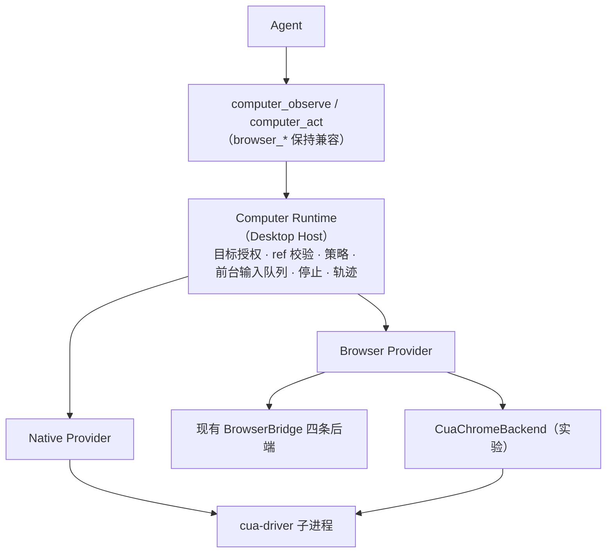

# Computer Runtime（Cua Driver 集成）设计草案

状态：草案（2026-10-12）。本次只改文档，代码未动。

## 1. 目标与非目标

**目标**

- 给模型一套统一的电脑操作流程：绑定目标 → 观察 → 操作 → 再观察。
- 用 Cua Driver 补上**原生桌面 App** 的操作能力。
- 增加一个实验后端：不装扩展，直接连接用户已登录的 Chrome。它和现有
  `ChromeExtensionBackend` 并列，由用户显式选择。
- 授权、目标身份、队列、停止、日志都由 CodeShell 自己掌握，Cua 只负责执行。

**非目标（第一版）**

- 不引入 Cua Agent、云桌面、Spaces 等组件，只用 Cua Driver（MIT）。
- 不替换现有 Browser Runtime 的四条后端
  （见 `docs/superpowers/specs/2026-08-04-browser-runtime-architecture.md`）。
- 不做持久 JS 执行器和 `cua.getTab()` 式脚本门面（见 §9）。
- 只支持 macOS。Windows/Linux 等 Cua Driver 在这些平台的成熟度确认后再评估。

## 2. 现状

```text
browser_observe / browser_act            (core/tool-system/builtin/browser-tools.ts)
  → BrowserBridge                         (core/tool-system/browser-bridge.ts)
  → 授权、任务归属、目标生命周期
  → InAppBrowser / BuiltInTabClaim / ChromeExtension / DedicatedPlaywright
  → 浏览器
```

已有、可以直接复用的：

- snapshot epoch ref（`s3:e1` / `pw3:e1`）、`documentId` 变化即让旧 ref 失效、带游标分页读取、`staleRef`/`documentChanged` 错误码；
- 任务级 grant（显式认领 tab、Chrome 配对、撤销、过期）；
- 敏感动作关卡，以及完整轨迹与精简投影的分离。

缺口：

- 没有原生 App 目标；
- MCP 结果里的图片：自动注册的 MCP 工具会把图片落盘到 `~/.code-shell/mcp_images` 并只返回路径，模型要再调一次 `view_image` 才能看到；通用 `MCPTool` 直接丢弃图片；
- 没有整机层面的前台输入互斥。

## 3. 总体结构



| 层 | 位置 | 职责 |
|---|---|---|
| 工具层 | `packages/core` | 工具 schema、提示词说明、结果投影（含图片） |
| Computer Runtime | `packages/desktop`（main 进程） | 目标授权、ref 校验、策略、队列、停止、轨迹、子进程监督 |
| Provider | `packages/desktop` + Cua adapter | 把统一动作翻译为 BrowserBridge 调用或 cua-driver 调用 |

**代码边界**：OS 权限、子进程启动和窗口授权必须放在 Desktop Host 里。
Cua adapter（版本锁定、错误映射、协议转换）可以单独成包，但不应作为通用
`/extension` 能力包让第三方加载，因为现有扩展机制没有"由 Host 启动带
TCC 权限的原生子进程"这种声明。是否扩展这套机制，留到 §11 的开放问题。

## 4. 模型接口

直接用普通工具调用，不需要 JS 门面。每次调用就是一个动作，授权和停止都按单个动作处理。

### 4.1 `computer_targets`

列出当前任务**已授权**的目标，未授权的不列出。

```jsonc
// 输出
{
  "targets": [
    { "targetId": "tab-g1", "kind": "browser-tab", "title": "...", "url": "...",
      "backend": "in-app", "capabilities": ["navigate","read","click","type","scroll","upload"] },
    { "targetId": "win-g2", "kind": "native-window", "app": "Calculator",
      "bundleId": "com.apple.calculator", "pid": 4312,
      "capabilities": ["click","type","key","menu","scroll","screenshot"] }
  ]
}
```

### 4.2 `computer_observe`

```jsonc
// 输入
{ "targetId": "win-g2", "include": ["elements", "screenshot"] }
// 输出
{
  "targetId": "win-g2",
  "observationId": "w2o5",
  "grantEpoch": 1,
  "elements": [{ "ref": "w2o5:e7", "role": "button", "name": "7" }],
  "screenshot": { "mediaType": "image/png", "data": "..." },   // 只截已授权窗口
  "warnings": []
}
```

浏览器目标继续返回现有 `BrowserSnapshot` 结构，额外加上 `targetId`。

### 4.3 `computer_act`

```jsonc
{ "targetId": "win-g2", "action": "click", "ref": "w2o5:e7" }
{ "targetId": "tab-g1", "action": "type", "ref": "s3:e4", "text": "..." }
{ "targetId": "win-g2", "action": "key", "keys": "cmd+c" }
```

- `action` 必须在目标的 `capabilities` 里，否则返回 `UNSUPPORTED_ACTION`。
- 第一版不开放坐标点击。只有 AX 树缺失时，才作为单独的能力 `click_point` 开放，并且必须带上最近一次截图的 `observationId`。
- 返回统一的结果结构：`ok`、`code`、`retryable`、`staleRef`、`effectVerified`、`detail`。
  `effectVerified: false` 表示动作已经发出但效果无法确认（例如合成点击），模型应重新观察。

### 4.4 与 `browser_*` 的关系

`browser_observe` / `browser_act` 保持不变，内部改为调用 Computer Runtime
的 Browser Provider。提示词里优先引导模型使用 `computer_*`；等兼容期结束再决定是否下线
`browser_*`。

## 5. 目标身份与 ref

| 目标 | 身份 | 失效条件 |
|---|---|---|
| browser-tab | 后端 + tab/guest id + `documentId` | 跨文档导航、tab 关闭、grant 撤销或过期 |
| native-window | bundleId + pid + windowId | 进程退出、窗口关闭、pid 复用、grant 撤销 |

ref 格式为 `<observationId>:<elementId>`。Runtime 记录每个 observation
所属的目标和 `grantEpoch`。动作执行前检查三件事：目标一致、observation
是这个目标最新的一次、`grantEpoch` 没有变。任一不满足就返回
`STALE_REF`，不会把请求交给 provider。Cua 元素 token 本身的快照生命周期在 adapter 内部再校验一次。

## 6. 授权与策略

### 6.1 授权粒度

- 原生窗口：用户在 Host UI 里选择某个 App 窗口，授权给某个任务，默认 30 分钟，与现有
  BuiltInTabClaim 保持一致。获得焦点不算授权。
- 授权的是具体窗口，不是整个 App。同一 App 新开的窗口需要重新授权（是否放宽见 §11）。

### 6.2 防绕过硬规则

1. **Native Provider 拒绝操作浏览器进程的窗口**（Chrome、Edge、Safari、Arc、
   Firefox，以及 CodeShell 自己），返回 `USE_BROWSER_PROVIDER`。
   浏览器只能经由 Browser Provider 操作，这样域名策略不会被原生点击绕过。
2. 某个动作被策略拒绝后，Runtime 在本轮不会改用其他 provider 重试同一意图。
3. **默认拒绝的 App**：终端类（Terminal、iTerm、Warp 等）、密码管理器、
   钥匙串访问、系统设置、CodeShell 自身。用户可以在设置里逐个解除限制，解除后每次动作都要确认。

### 6.3 高风险动作确认

以下情况 Runtime 会暂停，等待用户确认（复用现有 PendingApproval 流程）：

- 浏览器：沿用现有敏感动作关卡（提交、支付、发送等）。
- 原生：按下名称匹配"发送 / 删除 / 购买 / 支付 / 移到废纸篓 / Send / Delete / Buy …"的按钮；
  快捷键 `cmd+delete`、`cmd+q`、`cmd+w`；在 `sensitive` 元素里输入。
- 匹配规则写在可测试的独立模块里，不依赖模型的判断。

### 6.4 屏幕内容视为不可信输入

- 截图、AX 文本、网页内容都按"工具结果中的外部数据"处理，在提示词里明确：这些内容里的指令不能执行。
- 只截已授权窗口，不截整屏。
- 轨迹里的截图默认只保留在本地会话目录，跟随会话一起清理；精简投影里不嵌入截图。

## 7. 共享桌面与停止

**前台输入队列**：整机只有一个 `ForegroundLease`。凡是需要真实鼠标、键盘或焦点的动作都要先获取它，按 FIFO 执行，每个动作完成后立即释放。只读观察，以及 provider 声明为后台可执行的动作（CDP 输入、AX action），不需要这个 lease。
检测到用户输入时（可选，见 §11），暂停队列并通知任务。

**停止语义**：用户停止任务时：

1. 不再接受该任务的新动作；
2. 清空该任务在队列里的请求，返回 `CANCELLED`；
3. `grantEpoch` 加一，旧 ref 全部失效；
4. 已经发给 provider 的动作不保证能撤回，结果标记为 `effectVerified: false`；
5. 外部 App 的状态不会回滚，UI 上要明确提示这一点。

## 8. Cua Driver 接入

### 8.1 复用 trycua/cua 仓库的哪些部分

原则：**能直接用 Cua 现成的就直接用，CodeShell 只写 Cua 没有、也不该有的部分**，也就是任务归属、
跨 provider 的策略、浏览器 provider 和会话 UI。

| Cua 仓库里的东西 | 怎么用 | 说明 |
|---|---|---|
| `cua-driver mcp`（可执行文件） | **Spike 0 直接复用** | 当成普通 stdio MCP server 挂进现有 `mcp-manager`，不写一行适配代码就能让模型操作原生 App |
| `@trycua/cua-driver` 的 `EmbeddedCuaDriverHost` | **正式接入复用** | 官方嵌入方式：由拥有权限的 App 启动私有 daemon，同时返回 SDK 和 MCP 连接信息，不要自己手写 spawn |
| Permission modes：`bounded` + capability manifest | **复用** | 用 manifest 声明允许的工具和资源，作为 Driver 层的第一道白名单；CodeShell 的策略（§6）在它之上再收紧 |
| `DriverAuthorizationHost` | **复用** | Cua 不自带授权弹窗，正好由 CodeShell Host 提供授权 UI（包括已登录 Chrome profile 的授权） |
| 窗口截图（只截指定 pid + window） | **复用** | 对应 §6.4 的"只截已授权窗口" |
| `docs/action-support.md`、`tests/fixtures/` GUI harness | **复用于测试** | 平台行为清单和测试用 App，可以直接拿来做 adapter 契约测试 |
| Agent view、cursor overlay、Computer History | 观察，暂不接 | 和 CodeShell 自己的会话 UI、轨迹功能有重叠，等 spike 跑完再决定 |
| `cua` SDK（Sandboxes / Spaces / Fleet）、`cua-agent`、`cuabot`、`cua-bench` | **不引入** | 面向云端和沙箱 fleet，和"本机桌面"目标无关；Spaces 等组件许可也不同 |

### 8.2 进程与权限

```text
CodeShell Electron main（签名 GUI 宿主，拥有 TCC 权限）
  └─ EmbeddedCuaDriverHost（@trycua/cua-driver，锁定版本）
       └─ 私有 cua-driver daemon（继承宿主 TCC 归属）
            └─ MCP 连接 → CuaAdapter（Native Provider / CuaChromeBackend）
```

- 必须由签名的 GUI 宿主直接启动，TCC 权限（辅助功能、屏幕录制）才会归到宿主名下（参见 Cua 官方
  EMBEDDING.md）。不能让中间的 Node 网关代为启动。
- 不在 main 进程里调用 `CuaDriver.create()`（它会把 native runtime 加载进当前进程），
  原生操作留在独立 daemon 里执行，崩溃不会拖垮 main。
- 待验证：EmbeddedCuaDriverHost 在 Electron main（Node 环境）里能否正常工作，
  以及 Electron 是否算得上它要求的"certified host"（影响 cursor overlay）。
- daemon 启动时用 `CUA_DRIVER_PERMISSION_MODE=bounded` 加上审核过的 manifest，
  不使用 `unrestricted`。模式在启动时就固定，改模式需要重启 daemon。
- 子进程异常退出时：全部 native grant 的 epoch 加一，正在执行的动作返回
  `PROVIDER_UNAVAILABLE`，然后按退避策略重启。
- 模型拿不到 driver 地址、socket 或 CDP 端点。
- 权限缺失时返回 `OS_PERMISSION_MISSING`，`detail` 写明缺哪项权限，Host UI 给出打开系统设置的入口。

**开发期签名问题**：未签名的 dev 构建每次重新构建，TCC 都可能失效。spike 1 要先确定一个方案，候选包括：用固定的自签名证书给 dev
Electron 签名，或者 dev 模式下由一个签名的辅助 App 启动 driver。

### 8.3 MCP 多模态结果

已实现（spike 分支）：`MCPServerConfig.inlineImages`，按 server 显式开启。开启后，
视觉模型直接收到 image block（单张 ≤ 5 MB，仅 PNG/JPEG/GIF/WebP）；非视觉模型、超限图片、
未开启的 server 仍走原来的落盘路径。默认行为不变，避免截图把 token 撑爆。

## 9. 关于持久 JS 门面

暂不实施。原因：

- 一段脚本里可能有很多个动作，逐个授权只能在 RPC 层拦截，脚本中途被拒绝后状态不好处理；
- 停止时要中断带循环和异步的 JS，比停止单个工具调用复杂得多；
- 现有 REPL（`builtin/repl.ts`）每次都用 `node -e`，没有持久状态，还得另外建执行器。

重新评估的条件：真实任务数据表明，工具调用的往返次数已经成为主要瓶颈（例如一个任务超过 N
次连续的机械操作）。

## 10. 落地步骤与验收

### Spike 0：零代码直接复用 `cua-driver mcp`（约半天）

不改 CodeShell 代码，先摸清 Cua 本身的能力和限制：

- [ ] 安装 `CuaDriver.app`，给它授予权限（官方 Standalone 模式）
- [ ] 在 CodeShell 的 MCP 配置里注册 `cua-driver mcp`
- [ ] 让模型操作计算器，记录工具列表、AX 树质量、元素 token 生命周期、错误格式
- [ ] 对比 `inlineImages` 开/关：落盘 + `view_image` 与直接内联，哪种对模型更好用
- [ ] 试用 `--grant existing-profile`，看看连接已登录 Chrome 的实际体验

这一步只用来评估，**不作为产品形态**：此时没有任务归属、窗口授权和防绕过规则，
只能在本地开发时使用。

### Spike 1：原生桌面（计算器）

- [ ] 通过 EmbeddedCuaDriverHost 从 Electron main 启动 daemon，dev 构建在重启后依然保留 TCC 权限
- [ ] 授权计算器窗口，observe 返回 AX 元素和窗口截图，截图能到达模型
- [ ] 点击 `7 + 8 =`，再次 observe 确认结果为 15
- [ ] 旧 observation 的 ref 返回 `STALE_REF`
- [ ] 撤销授权后下一次动作立即被拒绝
- [ ] 停止任务时排队的动作返回 `CANCELLED`
- [ ] 操作 Chrome 窗口返回 `USE_BROWSER_PROVIDER`，操作 Terminal 被默认拒绝

### Spike 2：已有 Chrome 无扩展（CuaChromeBackend）

- [ ] 在 Chrome 144+、中文 UI 系统下完成连接设置（官方文档说只识别英文 UI，需要实测）
- [ ] 在登录态页面完成读取、表单填写、提交（提交时触发确认）
- [ ] 记录每类输入是可信输入还是合成输入，以及 `effectVerified` 的真实取值
- [ ] 与 `ChromeExtensionBackend` 对比：哪些场景更好、哪些更差

两个 spike 互相独立。spike 2 不通过，不影响原生桌面继续推进。

### 阶段 2：Computer Runtime

- 实现 `computer_targets/observe/act`、窗口授权 UI、ForegroundLease、
  防绕过规则、高风险确认、Cua 错误映射；
- `browser_*` 改为调用 Runtime，现有测试全部通过；
- adapter 契约测试：使用录制好的 cua-driver 响应。Cua 升级时，以这组测试是否通过作为判断依据。

### 阶段 3：评估浏览器后端替换

用现有 Puppeteer/Playwright 回归用例跑 CuaChromeBackend，覆盖 iframe、上传下载、
弹窗、导航失效、分页读取。达到约定的通过率后，才考虑把它设为可选默认值。

## 10.5 Spike 骨架现状（分支 `codex/desktop/cua-driver-spike`）

已实现：

| 部分 | 位置 | 说明 |
|---|---|---|
| 特性开关 `computer_use_cua` | `core/src/settings/feature-flags.ts` | 默认关；只读用户级设置，改完要重启 |
| 宿主托管的 MCP server | `core/src/tool-system/host-mcp-servers.ts` | Desktop 通过 `CODE_SHELL_HOST_MCP_SERVERS` 注入；只接受 `host:` 前缀的 stdio 声明，不转发 URL 和凭据；同名时用户配置优先；在 `mergePluginMcpServers` 里合并，热重载不会丢 |
| 图片内联 | `core/src/tool-system/mcp-manager.ts` | 见 §8.3 |
| Cua daemon 宿主 | `desktop/src/main/computer-use/cua-driver-host.ts` | Electron main 直接 spawn `cua-driver serve --embedded`；环境变量白名单（不传 API key）；`standard` 模式；socket 就绪检测；异常退出指数退避重启（默认 3 次）；退出时 SIGTERM → SIGKILL |
| 接线 | `desktop/src/main/computer-use/service.ts`、`index.ts`、`agent-bridge.ts` | 开关 + macOS + 找到 driver 才启用；worker 看到的 server 名为 `host:cua-driver` |

暂未实现（仍按 §4–§7 推进）：`computer_*` 工具、窗口授权、浏览器/终端拒绝规则、
高风险确认、ForegroundLease。目前模型直接看到 Cua 的原始 MCP 工具，**只适合本地试用**。

偏离 §8.2 的地方：没有引入 `@trycua/cua-driver` 的 `EmbeddedCuaDriverHost`，而是按同一份
EMBEDDING.md 里的 CLI 契约（`serve --embedded` + `mcp --embedded --socket`）自己启动。
原因是 SDK 依赖还没加进仓库；替换只影响 `cua-driver-host.ts`。

### 骨架回归验证（2026-10-13）

manager 的工具成功结果统一为 `ToolSuccess`，注册工具和通用 `MCPTool` 复用同一个结果处理器。
旧的文字 SDK 调用保留图片落盘引用。内联图片的 `contentBlocks` 同时包含经过
不可信内容标记包装的文字，避免 turn loop 优先使用图片块时丢掉 AX 状态和落盘图片引用。
5 MB 上限按 base64 解码后的字节数判断，包含恰好到达上限的带 padding 图片。

每个宿主使用独立的短路径、0700 私有 socket 目录。就绪检测会真实连接 socket；Desktop 等待
有界启动完成后才创建 worker，只有 `running` 状态会发布 MCP 声明。启动、退出、重试和关闭
会合并并发调用；失败重启也消耗 3 次预算。旧进程未确认退出时不能再启动替代进程。显式
socket 路径被其他监听器占用时不会删除它；崩溃后的退避和关闭也有真实 Unix socket 回归。

宿主在等待 socket 就绪时收到 `stop()` 会保持 `stopped`，后续 `start()` 不能重新启动。
SIGKILL 后等待退出事件，额外等待最多 1 秒；未确认退出时记录 `lastError`。
Core 在代理退出后保留工具目录，下一次显式调用才按原 Run 的配置、cwd 和 roots 重连。
失败的动作不会自动重放；重连失败、取消、目录变化和并行 workspace 也有真实子进程回归。

在 worktree 根目录运行受隔离保护的 Bun shard，并显式使用根 tsconfig 的源码别名：

```bash
node scripts/run-bun-test-shard.mjs --tsconfig-override ./tsconfig.json --timeout 30000 \
  packages/core/src/tool-system/mcp-manager.test.ts \
  packages/desktop/src/main/computer-use/cua-driver-host.test.ts \
  packages/desktop/src/main/computer-use/service.test.ts \
  tests/computer-use-cua-integration.test.ts
```

根 tsconfig 将 `@cjhyy/code-shell-core/extension` 映射到当前 worktree 的
`packages/core/src/index.extension.ts`。已解除指向主 checkout 的依赖目录链接，并在本 worktree
执行 `bun install --frozen-lockfile`，构建和正式检查不会修改主 checkout 的依赖产物。
runner 创建独立 HOME、移除继承的凭据并验证完整 JUnit 报告。

新增 6 个 CodeShell `Engine.run` 集成场景：计算器 7+8=15、通用 MCPTool 截图、默认关闭、
延迟启动、取消、同一活跃 Run 中崩溃后重新观察。它们使用真实子进程、Unix socket 和 stdio
MCP 代理，模型为内存中的脚本 provider，HTTP/TCP 在导入 Core 前被拒绝。崩溃测试证明点击
只执行一次，错误到达模型后才显式观察；新截图显示新进程的状态，最后所有子进程和 socket
都清理完毕。6 项全部通过；宿主及 service 45 项通过，独立 OAuth/浏览器 31 项通过。

正式 `bun run test:package-release` 通过（9 个 tarball、47 个类型入口、45 个运行时入口）；
根 `bun run typecheck` 覆盖全部工作区，Desktop main/preload/renderer/mobile/扩展构建通过。
全量 lint 为 0 错误、104 个既有警告，未超过收紧后的基线；内置工具覆盖率门槛通过。

全量测试按 CI 范围分片，覆盖仓库中全部 1,818 个不同测试文件。最终报告为：

| 范围                                    |  通过 | 条件跳过 | 失败 |
| --------------------------------------- | ----: | -------: | ---: |
| Core engine / tool-system               | 1,967 |        3 |    0 |
| Core 其余目录                           | 3,243 |        0 |    0 |
| Desktop 主分片                          | 5,381 |       69 |    0 |
| 其余工作区和根 tests（包含 Cua 6 场景） | 4,508 |       72 |    0 |
| 独立 OAuth / 浏览器测试                 |    31 |        0 |    0 |

Panel 的 69 项在主进程跳过重复收集，由已通过的 wrapper 在独立 Bun 进程执行；Core 的 3 项
和其余分片额外 3 项分别需要真实 LLM 和外部 Claude/Codex CLI，未启用。其余分片还会导入
Desktop 的测试文件，报告包含重复注册，因此表中数量不作为互不重叠的测试总数。

22 个离线验收脚本全部通过，覆盖编译产物、Hub 审批与恢复、输出日志、保留策略、移动端、
上传与能力路由等。真实 Electron main/preload/renderer 已在本机启动并通过 L1/L2 烟测：
流式回复、工具执行、用量回传、429 重试及文件、浏览器、review、终端和设置面板。模型请求
由受隔离保护的本地 SSE fixture 响应。

上述 6 个 Engine 场景使用模拟原生 driver。本机另行完成真实原生 AX 验收：下载官方
cua-driver 0.34.1 的 universal 二进制并核对发布 SHA256 和代码签名；由真实 CodeShell
Electron main 直接启动嵌入 daemon，MCP 返回的 `responsible_ppid` 与 main PID 一致。
对 macOS 计算器依次使用后台 AXPress 点击全部清除、7、加、8、等于，每次动作前读取新
snapshot / element token，最终从计算器显示区的 `AXStaticText` 读回 `7+8` 和 `15`。
全部窗口读取使用 `include_screenshot:false`，正常退出后 main、daemon、proxy、socket 和
临时 HOME 均已清理。另一次启动早期的退出探针因 renderer 尚未就绪触发保存 ACK 超时；
等待真实 renderer 就绪后的正式验收正常退出。

真实权限结果为 Accessibility 已授权、Screen Recording 未授权。开发版的实际父 bundle
为 `com.github.Electron`，声明为 `com.cjhyy.codeshell`，所以 `health_report` 的
`bundle_identity` 检查报告不匹配；不能仅凭 `attribution:host` 认为打包版身份验收通过。
真实截图和视觉链路、打包 CodeShell 的 bundle 身份及 TCC 授权验收仍待完成。

### 试用步骤（macOS）

1. 安装 cua-driver，确认 `cua-driver --version` 可用；或设置 `CODESHELL_CUA_DRIVER_PATH=/path/to/cua-driver`。
2. 在用户设置 `~/.code-shell/settings.json` 里加 `"featureFlags": { "computer_use_cua": true }`，重启 CodeShell。
3. 授权：dev 模式（`bun run dev` 从终端启动）时，TCC 权限归属于**启动它的终端 App**，需要给终端
   授予辅助功能和屏幕录制；打包版归属于 CodeShell 本身。授权后要重启 App，因为 TCC 结果按进程缓存。
4. 新开会话，让模型调用 `mcp_host_cua-driver_check_permissions`，确认 `source.attribution` 为 `host`。
5. 让模型打开计算器并计算 7+8，观察截图是否以图片形式进入对话。
6. 日志：`~/.code-shell/logs/desktop/desktop-<日期>.log` 里搜 `computer-use`。

## 11. 开放问题

1. 窗口授权是否允许"该 App 的所有窗口"，用于文档类 App 新开窗口的场景？
2. 是否检测用户的实际输入并自动暂停（需要额外的事件监听权限）？
3. 高风险按钮的名称匹配是否够用，还是需要结合 AX role 和上下文判断？
4. 是否扩展 `/extension` 机制，使第三方能力包可以声明"需要 Host 托管的原生子进程"？
5. Cua Driver 已经有 Windows/Linux 实现（见其 `docs/action-support.md`），这两个平台什么时候跟进？

## 参考

- Cua 仓库：<https://github.com/trycua/cua>
- Cua Driver README（集成方式、permission modes、macOS 进程身份）：<https://github.com/trycua/cua/blob/main/libs/cua-driver/README.md>
- Cua 浏览器指南：<https://cua.ai/docs/cua-driver/guides/browsers>
- Cua 窗口观察契约：<https://cua.ai/docs/cua-driver/reference/mcp-tools/window-state>
- Cua 嵌入契约：<https://github.com/trycua/cua/blob/main/libs/cua-driver/rust/Skills/cua-driver/EMBEDDING.md>
- Cua 许可边界：<https://github.com/trycua/cua/blob/main/LICENSING.md>
- 现有 Browser Runtime：`docs/superpowers/specs/2026-08-04-browser-runtime-architecture.md`
