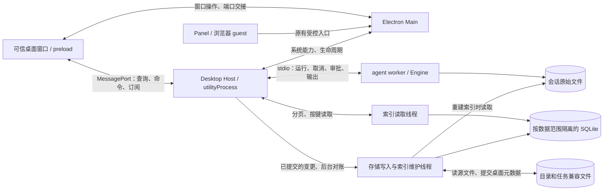

# CodeShell 0.12 桌面性能与 Host 迁移方案

评审稿 · 2026-11-20 · 代码基线 `64d9474d1`

**建议先发布包含滚动止血修复的 0.11，再在 0.12 引入独立 Host。** 窗口直接向 Host 取数、订阅输出和提交命令。Main 掌管窗口和系统权限，Host 管会话、任务和执行者，agent worker 运行 Engine。把索引和慢磁盘操作放到单独线程后，一个进程在等文件锁时，其他窗口仍有机会收到输出、提交取消。SQLite 先服务会话列表与任务中心，用户已经保存的内容继续使用 0.11 可读的文件格式。

交付按用户动作拆分。先让一次输出只做必要的持久化与定向推送，让打开任务中心只读取可见页。再把整条输出链移出 Main，最后用 SQLite 消除重复目录扫描。0.12 的发布条件集中在这三条主线上。低频服务按依赖逐个迁，剩余 IPC 数量不作为发布门槛。

## 从生产入口追出的四条关键路径

| 用户动作 | 生产代码的实际行为 | 由此得到的设计决定 |
| --- | --- | --- |
| 等待原生 agent 输出，或观看外部 CLI 会话 | 原生 worker 的普通流式帧经协议拦截、journal 绑定、快照后发给已注册窗口，部分控制消息提前被拦截。外部 CLI 的文本已经短批提交，常用的有归属输出只发到准确的 owner 窗口，再通知有资格的观察者。带 cursor 的普通帧仍要做当前输出身份核验。 | 优先迁 **worker 接收 → journal 校验 → 快照 → 合法订阅者** 整条链。保留原生与外部两种不同的路由语义。按已提交批次优化校验时保留会话换代、缺口和游标拒绝规则。已持久化的事件保留各自的可恢复位置。 |
| 在多个窗口打开任务中心 | 外部输出回调每次调用刷新入口。250 ms 定时器合并了后续工作，但启用状态先于定时器检查。一次全量核对读取八种来源。任务列表 IPC 的第一页还会再核对，后续页绑定窗口与快照。Renderer 收到版本变更后每页读 200 条，一直取到末页才展示，当前页面再分组过滤。 | 拆开来源更新、查询和 UI 渲染。只在任务状态或元数据变化时标脏。第一页读已提交快照。首屏返回分组计数和可见记录，更多记录按需加载。保持不可变分页及过期刷新，给旧调用方保留原接口。 |
| 打开会话侧边栏，或按一个 ID 查会话 | `listDiskSessions` 先枚举根目录，再按 ID 筛选、按目录 mtime 排序。任务中心每取 500 条就重新进入这个入口。状态文件内容异步、按需读取，付出的重复成本主要是目录枚举、stat 和排序。桌面历史、侧边栏与 Hub 对旧格式、排序和可见性的约定又各不相同。 | 先加按 ID 的直接读取和单次枚举的批量遍历，保持原有文件身份检查。之后用每根索引服务高频读取，为各端保留自己的查询规则。数据库命中不能替代原件授权。 |
| 输出期间在前台输入、回看历史，或后台运行自动化 | 聊天渲染在截取可见页前会构建消息视图，活跃窗口还要处理其他会话 bucket 的变更。后台方面，首次窗口建立桥接，外部会话和审批绑定窗口，Desktop 自动化又依赖恢复完成的服务。TUI 与 Core TCP 入口也能启动 cron 定时器。 | 分别度量 Main 和 Renderer。长会话输入若仍掉帧，缩小前台订阅范围并缓存已完成回合。后台作业按真实执行者和 cron 文件归属迁移。窗口关闭、离线、应用退出分别处理。 |

**发送命令还有一条前置依赖。** 无论下一步走原生还是外部运行时，`useRunController` 都先等待全局持久化刷新。刷新会先排空各会话的事件合并器，再遍历已加载或正在运行的会话，最后等待目录和转录写队列。未变化的对象已有短路，但 B 会话有待写数据时仍可能拖慢 A 的发送。建议为正常发送增加“本会话已持久化”的屏障，保证首次绑定、用户输入和必要目录补丁已提交。其他会话的可恢复缓存独立排队，退出、显式迁移继续全局排空。外部运行时仅在需要新建或恢复上下文时才构造有界的历史交接数据。验收同时测按键到绘制、点击发送到执行者接单两段时间。[发送入口](../../packages/desktop/src/renderer/app/useRunController.ts#L671) · [全局刷新](../../packages/desktop/src/renderer/sessionPersistence.ts#L579) · [目录遍历](../../packages/desktop/src/renderer/app/useTranscriptBuckets.ts#L250)

**基线上的两个计数实验。** 在临时数据根直接调用生产 `listDiskSessions`，生成 128 个有效会话，按 ID 查一个，返回 1 行，对 128 个不同的会话目录均调用了 `lstat`。另在同一事件循环连续调用生产 `scheduleRefresh` 1000 次，用计数回调代替配置读取，得到 1000 次开关检查。后者测的是调用次数。在该基线上这条回调实际会构造 `SettingsManager`。这些数字说明该改哪一层，端到端延迟仍需同机实包测量。[目录枚举](../../packages/host/src/services/session-files.ts#L239) · [刷新调度](../../packages/desktop/src/main/task-inbox/task-inbox-service.ts#L45) · [Desktop 接线](../../packages/desktop/src/main/index.ts#L4697)

核对这些路径的主要入口如下。

- 原生流式入口、输出身份与外部 owner 路由。[AgentBridge](../../packages/desktop/src/main/agent-bridge.ts#L577) · [输出发布器](../../packages/core/src/session/output-publisher.ts#L113) · [外部短批](../../packages/desktop/src/main/external-runtime-delta-buffer.ts#L17) · [外部输出投递](../../packages/desktop/src/main/owned-external-stream.ts#L27)
- 任务刷新、首屏与不可变游标。[刷新调度](../../packages/desktop/src/main/task-inbox/task-inbox-service.ts#L45) · [全来源核对](../../packages/desktop/src/main/task-inbox/task-inbox-projector.ts#L69) · [公开 IPC](../../packages/desktop/src/main/task-inbox/task-inbox-ipc.ts#L78) · [页面取数](../../packages/desktop/src/renderer/task-inbox/useTaskInboxSnapshot.ts#L45)
- 列表、渲染和调度入口。[会话文件服务](../../packages/server/src/sessions-service.ts) · [Hub 兼容测试](../../packages/server/src/hub/session-files.integration.test.ts) · [消息视图](../../packages/desktop/src/renderer/MessageStream.tsx) · [bucket 持久化](../../packages/desktop/src/renderer/app/useTranscriptBuckets.ts) · [TUI 调度](../../packages/tui/src/cli/commands/repl.ts#L290) · [Core TCP 调度](../../packages/core/src/cli/agent-server-tcp.ts#L180)

### 为什么选独立 Host

仅做事件过滤、缓存和后台线程，可以马上减少无用工作，仓库已有两套可打包、可排空退出的读写线程可供复用。但只要窗口的查询和原生输出分发仍经 Main，窗口系统操作占住 Main 时，这两条链仍会一起等待。把所有服务一次性迁到新进程，又会同时改动窗口授权、控制命令、历史数据和打包。选择渐进路径：先消除无效工作，再给一条完整且可度量的业务链独立进程，随后复用该基础设施。采用原生 SQLite 的交付批次依赖 Electron 升级，刷新修复和拆执行者接口可以提前开发。[已有线程生命周期](../../packages/desktop/src/main/session-transcript-cache.ts) · [真实打包入口](../../packages/desktop/scripts/build-main.ts)

## 1 进程分工与调用路径

| 所有者 | 生产职责与边界 |
| --- | --- |
| Main | 创建和监控 Host，确认当前文档后交接端口。拥有窗口、浏览器与分区、协议、更新、对话框、剪贴板、通知和系统钥匙串。对反向请求核对能力、目标窗口及生命周期。 |
| Host | 运行 `packages/host` 的纯 Node 服务，由 Desktop 入口注入 Electron 适配器。维护会话执行者、审批、订阅、任务来源及 worker 生命周期。流式分发只路由给有权限的订阅者。 |
| Agent worker | 执行交互会话、自动化和记忆整理。Host 负责准入、调度、取消与结果归档。定时作业保留自己的 cwd、工具权限及浏览器租约，记忆任务保留原上下文与预算。外部 CLI 继续由其 adapter 管理，两者各自接入统一的执行状态查询。 |
| 读线程与写线程 | 查询线程持只读连接并分页返回。写线程执行短事务、兼容文件的锁内更新、索引重建与检查点。读写队列独立，索引积压不会占住 Host 的事件循环。需读源文件的扫描也在后台执行。 |

Renderer 继续使用 `window.codeshell.*`。preload 按方法注册查询、命令和订阅所用的通道，保留调用签名、取消订阅及错误语义。域内可先迁读、后迁控制。Panel、云端工作台和浏览器 guest 沿用受限桥接。Panel 的业务规则仍由独立 Panel 包负责。CLI/TUI/serve 保留各自部署方式，公共协议和纯 Node 服务可复用。[现有平台分工](../architecture/16-platform-consolidation.md) · [Host 接入批次](platform-first-version-plan.md)

**一批输出如何抵达窗口。** 对有持久 journal 的可恢复事件，原生 worker 先按现有协议提交输出，再上报各帧的 cursor。外部 adapter 的 recorder 在其 I/O 线程上完成同样的提交。Host 给每个会话维护有界的有序队列，把需要读盘的绑定或覆盖检查交给 I/O 线程。校验完成后按序更新快照，向有权接收的窗口发送一批事件。会话目录被替换、journal 身份改变、cursor 缺口或历史覆盖不完整时，沿用现有拒绝或标记缺口的规则。第一版可保留原有逐帧校验并移出调度线程。在同批验证能通过身份、替换、乱序和回放用例之后再合并物理读。取消请求走控制队列，最终状态仍按原事件顺序展示。[原生批量提交](../../packages/core/src/engine/run-stream.ts) · [外部批量提交测试](../../packages/desktop/src/main/external-runtime-delta-buffer.test.ts) · [现有快照](../../packages/desktop/src/main/SessionSnapshotStore.ts)

## 2 窗口授权与断线恢复

**端口代表一个窗口文档，会话权限随运行状态变化。** Main 建立端口时，用专用控制通道交付窗口类型、当前主文档标识及本次 Host 实例标识。重载、导航和关窗使旧连接失效。Host 根据当前会话归属和版本检查每次查询、订阅和命令。会话转移或删除时撤销原订阅和在途授权。对涉及窗口或系统能力的操作，Main 在执行时再核对目标。这样也覆盖会话从 A 转到 B、又转回 A 时仍悬着的旧请求。[窗口归属版本](../../packages/desktop/src/main/panel-host-routing.ts) · [现有异步授权检查](../../packages/desktop/src/main/renderer-browser-session-ipc-authority.ts)

| 掉线时的操作 | 重连后的行为 |
| --- | --- |
| 列表和读取 | 丢弃过期响应。连接新 Host 后按原筛选条件重查。设置总超时，允许用户取消等待。 |
| 运行、批准、取消等命令 | 尚未投递就明确返回“未发送”。已投递但未收到回执时显示“正在核对结果”，按 runId、操作回执或来源状态核对。仅当执行者持久保存了去重键且能核对参数时，才允许重发同一命令。 |
| 输出、任务和审批订阅 | 同一实例短时断线优先使用现有快照序号。Host 换代时，已持久化输出按 journal cursor 补齐。临时会话继续只在内存里留存，可恢复的控制状态取快照，随旧实例消失的内容明确提示历史有缺口。任务与待审批按各自状态版本取快照，再接后续变更。快照和订阅之间以同一版本为界。发现缺口即重新同步。 |

Host 为每个连接设有界发送队列。文本增量可以同批运输，每个事件保留原有序号和已经存在的 cursor。批次在工具、审批、终态和生命周期边界先清空。慢窗口溢出时携带最后可恢复的游标或状态版本发起重同步。审批和终态从可恢复的权威状态补齐。取消、审批回执与索引查询使用独立的调度队列。普通 JSON-RPC 请求 ID 仅关联一次调用。原生流的回应、私有回调和公开事件分别路由，手机端继续执行已有提交回执核验，外部会话保留准确 owner 投递。[现有输出快照](../../packages/desktop/src/main/SessionSnapshotStore.ts) · [持久输出](../../packages/core/src/session/output-journal.ts) · [手机提交回执](../../packages/desktop/src/main/mobile-remote/native-submissions.ts)

Main 在应用就绪后启动 Host，窗口可以先显示外壳。握手完成后端口才接收业务调用。Host 意外退出时，Main 有界退避重启，旧端口和授权失效。超过重试预算时显示可手动重试的恢复状态。worker 继续使用父管道 EOF 清理机制。新 Host 在确认旧执行者退出、或可靠核对既有 run 后才允许接手。不确定的 run 保留待核对状态。0.12 默认维持现有关窗行为：macOS 可在末窗关闭后继续运行，Windows/Linux 默认随应用退出。显式退出走统一的停止接单、清理子进程、确认退出流程。跨平台常驻是后续独立的产品决定。[worker 清理](../../packages/core/src/cli/agent-server-stdio.ts) · [桌面退出行为](../../packages/desktop/src/main/desktop-shutdown.ts)

## 3 数据归属与数据库位置

| 数据 | 0.12 的权威来源 | SQLite 保存的内容 |
| --- | --- | --- |
| 会话、运行与输出 | 原有 `state.json`、transcript、output journal。执行中的实时状态由当前执行者提供 | 磁盘会话元数据、文件版本及列表位置。重启后由执行者复核进行中状态。 |
| 桌面会话目录 | 原有 `desktop/session-catalog.json`。保留 UI ID、首跑前草稿、手动标题、置顶、当前选中项和永久删除标记 | 按需以 engineSessionId 关联磁盘元数据。未绑定的草稿独立列出，手动标题和删除规则照旧。 |
| 任务中心 | 执行者决定当前状态和可做的操作。原 `userData/task-inbox/v1.json` 持久保存已展示的任务变化、来源错误及来源消失后仍可打开的历史 | 任务筛选、冷热集合、排序与分页。控制前重新检查执行者、attempt 与 expectedRevision。 |
| 凭据、设置、项目、插件和 Panel 资产 | 各自已有的授权、文件和持久化服务 | 这一轮只为会话及任务建立索引。 |

**数据库跟随已有数据根。** 对形如 `<root>/sessions` 的授权库，默认索引位于 `<root>/state.sqlite`，后续重建代使用同目录的独立文件名。默认 Desktop/TUI 指向同一根时可共享索引。serve 默认使用 `<dataDir>/worker/sessions`，身份派生的 manager 使用各自的 `identities/<identity>/sessions`。自定义 sessions 路径由调用方明确提供对应的私有索引位置，无明确映射时继续文件读取。任务中心只汇入这一 Desktop 实例原本可见的本地来源，默认配对的 userData 及会话根使用 `<userData>/task-inbox/index.sqlite`。现有 taskKey 只含来源、ID 和可选 attempt。首次迁移在私有元数据中绑定本地授权范围，此后不同身份或切换数据根须同时隔离 v1 与任务索引，无法确认归属的旧行不接入新范围。保留旧根的 v1 供原配置降级读取。用两个根中同 ID 的任务验收列表、导航和取消。Host 按已授权的根批量取本页所需会话，再与任务合成视图，避免跨身份或逐行查库。[serve 数据根](../../packages/server/src/serve/headless-server.ts) · [身份派生目录](../../packages/core/src/protocol/chat-session-manager.ts) · [桌面目录字段](../../packages/desktop/src/shared/session-catalog.ts)

0.12 先由 Desktop Host 维护其打开的数据根的索引。每个根只允许一个索引维护者。其他实例可读取已验证的索引，也可直接读源文件。维护权使用跨进程互斥，覆盖 schema 迁移、重建和发布，进程退出后可回收。CLI、TUI、serve 和旧版均可按原格式写原始数据。Node 20.10 没有内置 SQLite，驱动在启用索引时按能力加载，Core 的模块导入、建会话和持久化都能独立完成。首版无需让所有写会话的进程打开 SQLite。Bun 需要直接消费索引时再接入相同的查询契约。[Core 运行时要求](../../packages/core/package.json) · [Node SQLite 版本记录](https://nodejs.org/api/sqlite.html#sqlite)

## 4 会话索引与后台对账

`sessions` 在一个授权根内以会话 ID 为键，存储现有 `DiskSessionMeta` 所需字段、父会话字段是否存在、目录 mtime、state 文件指纹和可用的 `stateRevision`。为列表排序、父会话以及项目筛选建索引。桌面列表沿用原有的目录 mtime 降序及 ID 并列顺序，保留原游标。旧数字 offset、无法直接等价执行的旧排序或过滤先走已有扫描适配器。[列表实现](../../packages/server/src/sessions-service.ts) · [目录时间来源](../../packages/host/src/services/session-files.ts)

1. **写后通知。** 原始文件原子提交后，上报根、会话 ID 与可用版本，由维护线程合并同一 ID 并重新读当前文件。一次批次事务同时提交索引变化和进度。源文件写成功即保留成功语义。要求立即读到本次修改的查询，先按 ID 读源文件或等待相应版本。
2. **发现旧端修改和删除。** 文件监听用于缩短延迟。启动、监听溢出和周期性对账都分批枚举目录，核对每一项的文件指纹。完成一轮枚举后重新核实缺失 ID，再清退已删除的行。并发写入用当前文件身份及版本复核。对同 ID 重建、还原备份及版本回退按当前文件重新读取，后台完整内容核验补偿保留时间戳的恢复文件。
3. **建设中和损坏时仍能读。** 首建或大修复期间使用已有文件读取器。保留当前完整代直到新代校验完成。重建使用新代专属文件名，库及其 WAL/SHM 同属一代，私有清单原子指向已完成校验的新代。读者固定到当前代直至请求结束，新请求打开清单指定的一代。旧代在无读者时再回收，Windows 文件占用时延后清理。发现损坏的读者立即改读源文件。分页快照有期限，避免长读阻止检查点。文件根不可读与确已删除分开处理，前者保留上一版并报告重试。迁移与重建状态有版本，识别到更新版本的 schema 时退回文件路径。
4. **保持现有列表语义。** 归档、子会话、隐藏来源、缺失父字段、工作目录已删与空 cwd 等条件沿用现有规则，cwd 路径需按平台归一和验证。分页和按 ID 查遵循同一可见性规则。用相同数据分别运行 SQL 和扫描，逐页比较顺序、游标与完整返回字段。[现有磁盘列表测试](../../packages/server/src/sessions-service.disk.test.ts)

SQLite 使用 WAL。交互读与维护写使用独立线程和连接。写事务保持短小，遇到 busy 退回队列、有限退避。达到队列上限时按根合并成一次后台对账，避免无限堆积。做重建、检查点或持续写冲突时，仍可分页读上一份完整快照。Host、Main 和执行 Engine 的线程都无需同步等待 SQLite 获取写锁。[SQLite WAL 并发语义](https://www.sqlite.org/wal.html) · [busy timeout 的行为](https://www.sqlite.org/c3ref/busy_timeout.html)

## 5 任务增量更新与直接降级

首版选择保留现有 `v1.json` 作为任务历史的兼容提交点。代价是有实际任务变化时，后台仍需整写兼容文件。收益是 0.12 被强杀后，用户可立即用原版 0.11 打开已经确认的记录。常态查询和推送使用增量索引，输出 token 不触发任务历史写入。[投影提交与合并](../../packages/desktop/src/main/task-inbox/task-inbox-store.ts) · [外部来源消失后的历史导航](../../packages/desktop/src/main/task-inbox/task-inbox-store.test.ts)

八种来源分三组。`session/subagent/external-runtime` 合并磁盘事实与活执行者。失去外部观察者时保留导航，只有真实控制器才能取消。`automation/mimi-delegation` 分别区分“计划和本次执行”、“任务和 attempt”。`legacy-run/background-shell/background-job` 区分只读历史与当前进程可控制的实例，shell ID 还需绑定所有者、启动时间或运行代次。[来源映射](../../packages/desktop/src/main/task-inbox/task-inbox-sources.ts) · [动作校验](../../packages/desktop/src/main/task-inbox/task-inbox-actions.ts)

1. 各来源上报 `source + id` 的状态变化，同键短批合并，按来源读取单项。只支持全量的小型注册表按来源读取。分别定义单条 upsert、明确删除、来源不可用和完整快照。现有 `reconcile` 会把同源快照里缺席的活任务降为中断，单条更新必须使用单独的合并入口。全量核对开始前先订阅，核对期间进入的新变化在下一批应用。纯文本 delta 走输出通道，开始、终态和 attempt 边界按顺序保留。
2. 存储线程沿用原锁及 `shouldReplaceTaskRecord`，在锁内读取最后提交的 v1，合并变化，执行现有保留策略，原子替换后才确认历史已落盘。来源即将注销时，先确认仅存于投影的历史已提交。无实际变化跳过写入。有变化时同一批只提升一次快照版本。随后在独立 SQLite 事务里逐行 upsert 或删除，并保存来源错误及已应用的 v1 版本。控件的“执行成功”取决于执行者的回执。
3. 查询和通知只发布已提交版本。若 v1 成功而 SQL 失败，从已经提交的 v1 提供结果并异步修复。进程重启、再次升级、数据库落后或旧端更新 v1 时，在对外提供索引结果前按源文件的版本和指纹核对，包括删除、裁剪与错误清除。v1 格式保持原样。启用前用 0.12 写一条独有外部历史、强杀、直接启动 0.11 验证导航，再经 0.11 修改后升回 0.12。
4. `tasks` 保留 taskKey、source、sourceId、attempt、projectId、status、tier、sourceRevision、updatedAt、terminalAt、stale 以及完整兼容记录，先做全局 attempt／执行身份去重，再应用来源、项目等筛选、计数与分页。固定窗口和查询的旧游标继续指向同一快照，过期则要求重查。热区 `queued/running/waiting` 由事件更新，约 60 秒向执行者核对一次。执行者断线先标记不可确认。冷区由来源事件或全量对账更新。`paused/interrupted` 可留在冷区等待恢复，**2000 条上限仅用于 done、failed、cancelled**。[现有任务契约](../../packages/desktop/src/main/task-inbox/task-inbox-types.ts)

## 6 执行者切换与凭据迁移

从第一批就拆开“读取来源、订阅变化、提交控制”，覆盖现有 worker、自动化调度器、Mimi 和外部运行时。新旧前端入口都查询同一份执行者映射。独立运行的 Desktop 定时任务和手动记忆整理派给受限 worker。自动 Dream 保留其与原会话记忆流水线的关联。共享同一物理 cron 文件的入口按文件归属选择唯一活调度器，并持久记录每次定时触发的标识。Desktop、TUI REPL、Core TCP、serve 都要核对实际启动方式。现行文件锁只保护任务定义，进程内 running 集合只防止本实例重入。混跑不识别新协议的旧调度器时必须使用隔离数据路径或显式停用其一，才能承诺只执行一次。回执未知时先查已登记的 run。[Desktop 自动化](../../packages/desktop/src/main/automation-host.ts) · [记忆流水线](../../packages/core/src/engine/auxiliary-pipeline.ts) · [cron 文件锁](../../packages/core/src/automation/store.ts) · [调度防重](../../packages/core/src/automation/scheduler.ts)

0.12 的执行者切换以**应用重启**为边界。先停止接收新动作，已有任务可在原执行者完成。需要中断时走正常取消并记录结果。确认旧执行者退出或释放相应资源后，下一次启动按配置启用唯一的新执行者。不能确认时暂停接单并显示待恢复状态。回退按相同步骤逆向交接，条件是旧实现仍打包且能读取现有文件。只有只读查询可以直接切换 preload 路由。P6 清理旧实现后，回退路径是安装上一兼容版本。

凭据采用独立迁移批次。保留公开的同步 `EncryptionCipher` 契约，为 Desktop 添加异步适配器。Host 获取加密材料快照和版本，释放锁后请求 Main 的系统钥匙串。提交时重取原锁、核对记录版本并保留其他写者的更新，冲突则有界重试。锁内只进行短小的同步比较与提交。验证两版本交叉读写密文、钥匙串不可用和同一作用域并发修改。若新写密文尚未通过 0.11 读取验证，继续用已验证的旧格式适配器。敏感值仅在获准操作范围内传递。[公开 SDK](../../packages/core/src/index.ts) · [现有凭据锁边界](../../packages/core/src/credentials/store.ts)

## 7 实施批次与发布顺序

下表使用 P 编号。P1 和 P2 的实现可并行，涉及同一组合入口的接线串行合入。每批打开独立 PR、跑全量 CI，再在最终候选上做跨平台实包验收。

| 批次 | 可独立交付的改动 | 出口与回退 |
| --- | --- | --- |
| P0　0.11 止血 | 以现有止血分支为起点，保留设置和外部绑定缓存、任务刷新节流及无变化时跳过写入。用同一场景复录 trace。 | 单独发布稳定 0.11，从包含 P0 的 main 开 0.12 集成分支。 |
| P1　消除无效工作 | 外部纯文本不标脏任务。按已提交版本构建可共享的不可变内存视图和分组计数，冷启动只建一次。第一页和游标从该视图分页，无需重跑八源或逐次整读 v1。定点查 ID 不遍历其他目录。任务页先取可见页与计数。发送前拆出本会话持久化屏障。每项单独落地。 | 旧调用方的完整列表、窗口绑定游标、显式刷新、首发会话和退出全局落盘仍可用。记录性能收益。改动按项撤回。 |
| P2　升级和进程准备 | 一次 PR 单升 Electron 45 和打包工具。下一次 PR 加 Host 入口、端口授权、重连和单个只读调用。复用既有纯 Node Host 分发，并补异步 ready、drain、stop。 | macOS arm64/x64、Windows、Linux 真正运行包内 Host、worker 与 PTY，验证干净安装和增量升级。测试通知、捕获、导航撤权、末窗关闭、显式退出。只读接口可回原路。 |
| P3　优先迁流式和执行控制 | 迁 worker 接收、输出发布、快照、手机与桌面分发、交互 worker 管理。外部运行时将生产流式数据和持久化的 adapter 一起迁入，Main 保留窗口与系统能力。先用只读影子比较事件，不影子执行命令。 | 依赖输出游标、状态恢复、准确 owner 和命令回执。验证有界排队、漏帧恢复、同一终态一次、手机审批、Panel、Mimi。在此批复录滚动 trace。按重启边界交接或退回执行者。 |
| P4　会话索引 | 按数据根建库和分线程读写，保留原始存储与目录。先做 SQL/扫描差分，后切默认查询。 | 覆盖 Node 20、旧写者删除、还原备份、数据库损坏、双进程跨代长读、独立身份和 cwd 消失。可按根退回文件扫描。 |
| P5　任务索引与后台作业 | 已提交的任务事实由 v1 保留，SQL 只投影变化行。来源仍归实际执行者控制。独立 cron、手动 Dream 在各自权限下迁可取消的 worker。 | 可分别回退任务读入口与作业执行者。验证旧端历史、跨窗口取消，以及多入口共享同一调度定义时的一次派发。 |
| P6　发布与后续迁移 | 移除确已通过验收的重复通道，更新架构、协议和预算。对 0.12 候选跑性能、降级和三平台验收。凭据、IM、插件等低频域按依赖单独迁，可在之后的小版本交付。 | 高流量链路、数据兼容和授权达到门槛后发布。已清理旧实现的域可安装上一兼容版本回退。 |

第 16 章的内嵌决定随 P2 更新。平台计划第 11 项的连接约定进入 P2，输出与宿主状态两类续传先于 P3 切流。第 8b 项输出回放复用 P3，第 10 项单调度执行者复用 P5。第 9 项凭据异步化按第 6 节单独验收。最低 macOS 版本选 13，检验 macOS 12 的 0.11 更新器不会推荐不可运行的版本，13+ 可正常更新。两种 macOS 架构均要实际启动包内 worker 并完成 PTY 读写。[平台批次](platform-first-version-plan.md) · [CI](../../.github/workflows/ci.yml) · [原生打包](../../.github/workflows/release.yml) · [Electron 系统要求](https://www.electronjs.org/docs/latest/breaking-changes#removed-macos-12-support)

## 8 发布验收

在同一平台、设备、会话库和固定输入回放上保留 P0、P2 升级后、P3 切流后及最终候选版的对照。记录样本数、延迟分位数及最大值，随结果保留可复跑的 fixture 和脱敏 trace。

| 场景 | 建议发布门槛 |
| --- | --- |
| 连续滚动并输出 20 秒 | Main 中由数据或流式处理引起的 ≥16 ms 长任务为 0。固定连续输入回放中最大输入间隔 <50 ms。 |
| 长会话输入及跨会话发送 | 固定 A 的草稿和活动尾部，令 B 持续输出并增加历史长度。分别测按键到 paint、发送到执行者接受的 p95，以及 A 发送时替 B 序列化的字节数，最后一项应为 0。验证上翻锚点、IME、附带文件、首次绑定、队列补发和显式退出保存。 |
| 任务中心和单会话读取 | 纯文本流连续 1000 帧导致的任务投影重建为 0，独立定时巡检单列。P1 按单次首屏传输的记录数验收，首屏轮数固定、行数受页大小约束，并单列冷启动整读成本。P5 分别统计热查询的 SQL 执行计划、访问行数和字节数。按 ID 查一个会话时其他会话目录的 stat 计数为 0。并发变化期间翻页保持同一快照或明确过期。 |
| 小型热查询及拥塞 | 固定页大小、至少 5000 条合成记录，分别测试空载、Main 人为阻塞 1.5 秒和索引写锁占用 5 秒并持续输出。记录每窗 RPC p50/p95/p99，热查询目标 p99 <2 ms。锁等待期间查询和取消控制仍能响应。取消单独记录提交至执行者应答的延迟。 |
| 冷启动与首建 | 普通启动首屏 p95 不慢于 P2 升级后同机基线。首建、损坏重建期间能显示已有数据并进行查询。单独记录首屏时间、首次完整结果时间及索引追平时间。 |
| 生命周期和安全 | 覆盖导航、所有权转交、拒绝旧审批、Host 与 worker 分别强杀、末窗关闭和显式退出。核对无重复作业、无新增越权订阅，输出缺口能恢复或明确提示。 |
| 数据恢复和降级 | 对“只写完源文件”“只写完 v1”“索引事务中途”“开始重建”分别注入退出。验证原版 0.11 读取、再升回 0.12。比较草稿、置顶、删除标记、任务历史、分页与凭据可读性。 |

若锁竞争时热查询没有达到目标，保留同一场景的队列等待、SQL 执行和端口往返三段耗时，定位后重测。若 v1 兼容写在真实任务状态变化频率下成为瓶颈，继续使用已通过验收的任务路径，单独评估跨版本历史格式。决定切换默认路径的依据是上述用户可见行为和实包数据。

## 9 与现有第 17 章的对照

对照对象是 `docs/host-process-proposal` 工作树中尚未提交的第 17 章（2026-11-20）。该章实测 Main 阻塞 1.5 秒期间，Renderer 经已建立的端口完成 300 次查询，往返 p50 为 0.2 ms。这项证据支持独立 Host。前述源码检查和计数实验沿用了同一产品，却指出了还要一起改变的调用方式。

| 决策 | 第 17 章 | 本方案的选择与代价 |
| --- | --- | --- |
| Host 与系统升级 | utilityProcess、直连 MessagePort、Electron 45，0.11 先止血。 | **保留。** 将升级和 Host 接线分别提交。同一设备对比升级与迁移的收益。 |
| 先迁什么 | L3 会话索引、L4 任务中心先行，L5 才迁流，L6 搬其余服务。 | **提前迁流，缩小发布范围。** 第一个完整跨进程链路覆盖用户实际等待的输出和取消。索引之前即可上线去掉无效扫描的改动。低频服务另行交付。 |
| Renderer 改动 | 主要改 preload，原则上无需动业务代码。 | **修改任务页与发送链。** 首屏按需加载、筛选计数交给查询端，发送仅等待本会话。代价是要覆盖分页交互、IME、第一次发送、跨会话持久化和退出行为。 |
| 输出与后台执行 | 流式路径整体下沉，cron 和记忆整理 Engine 放 Host。 | **保留已有批次、私有帧拦截、外部 owner 投递及 cursor。** Host 编排，把耗时 Engine 放可取消 worker。需逐类适配 cron、手动 Dream 和原会话自动 Dream。 |
| 数据根与四份投影 | 一个共享 `~/.code-shell/state.sqlite`，按 watermark 补，四方读同一会话表。 | **共享同一授权数据根的可重建索引。** 桌面 UI 草稿、手动元数据、删除标记及任务历史独立保留。各端共用底层元数据，各自保持排序与可见性。代价是多一份桌面投影和后台对账。 |
| 写并发与降级 | 多进程短事务、5 秒 busy timeout。保留旧 v1，降级后由旧版刷新。 | **写线程可等待，Host 调度线程保持可用。** 按语义批次写回 0.11 可读历史，强杀后也能打开已确认的 0.12 新记录。代价是每次有实际任务变化仍有兼容文件写放大，需实测。 |
| 权限与回退 | 交接时绑定会话身份，按域改路由回退。 | **窗口身份绑端口，会话控制权动态撤销。** 查询可切路由，控制权在重启后交接。对已提交但未收到回执的命令，先核对结果再决定是否重发。 |
| 验收范围 | Main 长任务、滚动、单次数据往返、启动与实包。 | **保留并增加三个用户动作。** B 输出时 A 的发送、任务中心第一页、旧端新写或删会话。另测慢窗口、并发写锁及实际降级。 |

**与止血分支的关系。** `fix/main-process-scroll-jank` 的未提交改动已经缓存功能开关及外部绑定，将后台投影最低间隔拉到 2 秒，并在投影无变化时跳过部分工作。上面的“1000 次检查”来自 main 基线，不能据此推断止血分支仍会读盘 1000 次。建议先合经过独立验证的 P0，重复同组计数和 trace。P1 重点修复仍存在的读取放大和发送等待。

**验证范围。** 基线根构建通过。隔离 HOME 下运行 13 个已有测试文件，181 项通过，覆盖任务来源与历史、桌面和 Hub 列表、窗口归属、输出批次、快照、持久化与退出。另运行两项临时计数实验。上述测试验证的是现状契约。第 17 章的 Electron 原型指标沿用作者测量，0.12 的实包端到端性能、最低系统更新和强杀降级属于实施验收。

## 10 Focus 按事项汇总多个会话

任务中心增加一个 **Focus 视图**，回答“我在推进哪些事、各自交付了什么、还差什么”。“后台工作”保留每次执行与来源详情。Focus 首页每件事一行，展示目标、完成依据、待办或阻塞、最近变化和关联会话数。点开后按贡献展示各会话及产物，可以回原会话核对。例如“发布 0.12”关联开发、测试和发布三个会话，可以显示“改动已合入，Windows 测试通过，macOS 签名待验证”，每一项都能回到对应来源。

**事项与会话的关联。** 有明确委派、父子执行或可定位到同一运行的记录，可按已知关系展开。attempt 与来源类型、来源 ID 一起匹配。几个独立会话共同推进一件事时，允许用户选中会话并“归入同一事项”，也可以移出。Focus 打开时可根据相近目标和交付物建议一组独立会话，用户一键确认或拆分。只凭同一项目或相似标题，不自动保存关联。一次会话涉及多件事时，优先关联具体运行或消息片段。归属关系按已授权的数据范围保存。当前任务列表主要展示后台工作，所以 Focus 还需要读取同范围的普通会话元数据。[当前后台工作筛选](../../packages/desktop/src/renderer/task-inbox/taskInboxViewModel.ts#L81) · [任务来源与运行字段](../../packages/desktop/src/main/task-inbox/task-inbox-types.ts#L28)

**进度以可核对的结果为准。** 有明确清单时显示“已完成 2/3 个验收项”。没有清单时，用已交付、进行中、待确认三类事实说明现状。某个会话结束仅更新这次运行的状态。整件事的完成由匹配的验收结果或用户确认。TodoWrite 的快照属于自己的会话或子 Agent，能说明局部进度。Mimi 委派的目标、结果摘要和产物可以直接作为来源。[会话内的 TodoWrite](../../packages/core/src/tool-system/builtin/task.ts#L4) · [Mimi 长任务](../../packages/pet/src/long-task.ts#L97)

**只有 Focus 打开并可见时才能为它调用模型。**

- 平时沿用各来源已经写入的事实。应用启动、打开普通任务列表、后台会话流式输出均不触发 Focus 模型请求。打开 Focus 先显示本地关联、状态和缓存摘要。
- 每次主动打开，至多自动发起一次有输入和输出预算的批量摘要。仅处理当前页可见、缺少缓存或材料发生实质变化的事项和未归组候选会话。需要模型辅助归组时共用同次请求和预算。输入优先使用目标、状态变化、结果或阻塞摘要、产物和必要的短摘录。未变化时模型调用数为零。页面持续打开期间，新的变化先更新事实并提示“进展有更新”，用户可点“更新摘要”再生成。
- 切走、最小化、关闭视图或窗口中断时，撤销该视图的生成请求和排队工作。同一用户范围内的多个可见窗口复用同一版本的请求。最后一个可见窗口离开时中止在途请求。已经送达模型的部分仍可能计费。缓存按事项关联和材料版本失效。再次打开只补变化。

首版先交付确定性关联、手工归组、按事项浏览和回到来源，再接入按需摘要。验收用模型调用数和输入量：Focus 从未打开时产生 1000 次后台事件，新增调用为 0。同一批材料重复打开，缓存命中新增调用为 0。只改变一个事项，下一次摘要只发送该事项的增量材料及必要上下文。生成中离开后不再派发下一批。

### 事项用量与 Focus 开销

每件事在进度旁显示关联会话数、已记录的总 token 和预估费用。展开后可按会话、供应商、模型和日期查看输入、输出、已上报的缓存读写，以及原生 API 请求数和外部 CLI 提交轮次。缓存读写属于输入明细。页面另列“Focus 分析用量”，显示本次刷新和所选期间的消耗，方便用户判断生成摘要花了多少。查看统计、筛选和切换日期都只查本地账本。关闭 Focus 后，任务照常执行和记账，Focus 停止生成。[账本字段与汇总维度](../../packages/core/src/cost-ledger/types.ts#L20) · [现有用量页](../../packages/desktop/src/renderer/activity/UsagePage.tsx#L50)

**归属与对账。** Host 在当前授权范围内，按数据根、`namespace` 和 `requestId` 识别一条用量回执。复用现有账本，为它增加按事项批量查询的本地索引。用各次执行自己的 `runId` 和已知的子执行关系找到回执。父会话、子会话和委派记录都指向同一次消耗时计一次。一个会话做多件事时，能确认归属的运行分别计入对应事项，其余列“共享或未归属”。切换归组只改关联。以同一授权范围和时间段核对，各事项执行用量、共享或未归属用量、Focus 分析用量三项相加等于账本的已知总量。[现有会话、子会话与运行筛选](../../packages/core/src/cost-ledger/store.ts#L473)

**Focus 自己也记账。** 给授权范围内的 Focus 分析建立独立的记账身份和 `focus_summary` 用途。一次刷新对应一个批次，归组和摘要涉及多个事项时整批只计一次。每次实际发出的模型请求都关联该批次，重试单列。离开时取消后保留已返回的用量，已发送但未收到用量的请求标“用量未知”。缓存命中可直接显示“本次新增 0 次请求”。[当前用途定义](../../packages/core/src/cost-ledger/types.ts#L3) · [账本对中断与未发送请求的处理](../../packages/core/src/cost-ledger/store.ts#L305)

**数字的覆盖范围。** 外部 CLI 有时只给整轮合计，一轮可能包含多个模型调用，详情按 CLI 轮次展示。缺价格时显示“费用未知”，有价格时按记录时的价格快照显示预估金额。存在旧会话缺账、流中断缺用量时，同时显示已知小计和覆盖缺口。耗时可从有起止时间的运行显示经过时间，多个会话并行时，事项历时取首次开始到最近结束的时间跨度，仍在执行的事项截至当前。[外部 CLI 整轮回执](../../packages/desktop/src/main/external-runtime-usage.ts#L5) · [费用估算](../../packages/core/src/cost-ledger/pricing.ts#L6) · [旧会话覆盖检查](../../packages/desktop/src/main/usage-history-service.ts#L21)

接入时顺带统一用量页和 Focus 的来源分类。Claude CLI 后台记忆回执有 `source=external-cli-memory`，当前用量页只按 `providerKind` 区分 API 和 CLI，会把这类回执计入 API。Host 可在读历史回执时识别这个来源，两处展示沿用同一分类。[后台记忆回执](../../packages/desktop/src/main/external-runtime-memory.ts#L315) · [用量页的 CLI 判定](../../packages/desktop/src/renderer/activity/usageOverview.ts#L125)

用以下场景验收：

- 同一子执行经父、子两个入口展开，执行用量只计一次。
- 一批分析三个事项，Focus 只记一个批次，该批发出的全部请求都可对账。
- 已发送的请求在关页后缺少用量，详情标为未知。
- 缓存命中后反复查看统计，新增模型请求为零。

Focus 的数据归属、可见窗口生命周期、分期交付和验收场景详见[桌面任务中心 Focus 技术方案](task-center-focus-design.md)。实施状态在[根 TODO](../../TODO.md) 跟踪。
