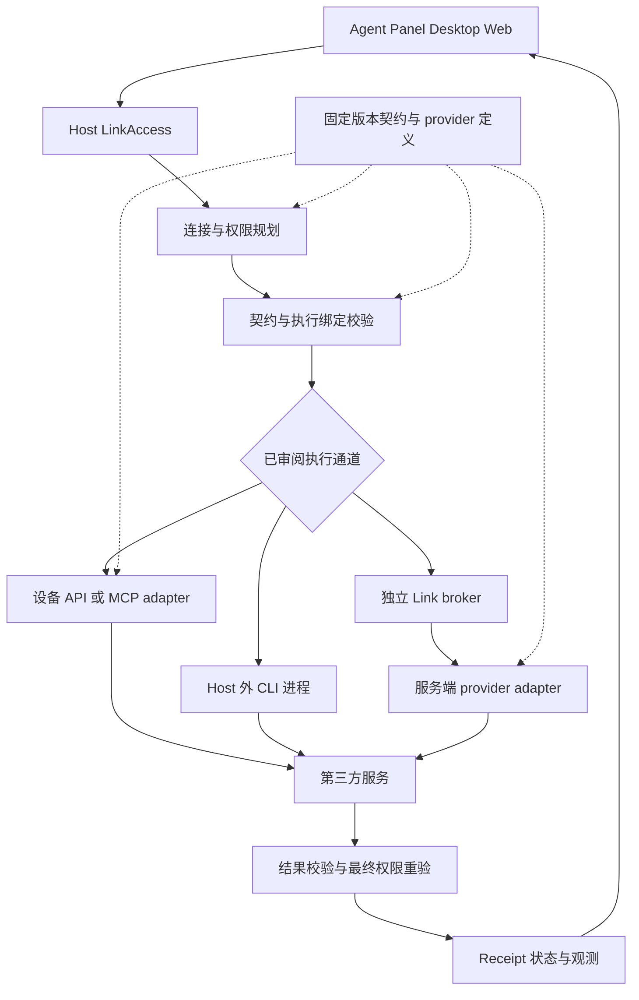

# Link 连接器契约与运行时重构方案

日期：2026-10-16。状态：设计稿，尚未实施。

Link 的目标是为 Agent、Panel 和各端客户端提供有明确账号、权限、资源范围和版本的连接能力。建议采用组合式连接器：业务能力分为资源、操作、事件，授权方式与执行通道分别建模；通过 Host 统一执行入口、版本化动作契约和连接状态管理，把第三方差异收进连接器包。

旧版 Link 连接记录允许清理并重新连接。首版采用新记录模型，不承担旧 meta 的自动迁移、旧连接 ID 保留或双读兼容；客户端与服务的协议协商仍为长期要求。此次交付为方案修订，尚未清理真实连接或凭据。

本轮先完成按需读取与操作的可靠性、契约协商和 provider 抽离。同步、Webhook 和浏览器会话提供扩展位置，在有具体消费者时实现。继续遵守薄云端范围，不新增常驻云端工作台、通用云端脚本执行平台或独立同步调度系统。

## 目标与设计决定

1. 同一 provider 支持多个账号和多种连接方式；每次执行绑定用户明确选择的连接与 grant。
2. 连接器的参数、结果语义和错误都有稳定契约；客户端与服务可独立升级，无共同契约时明确拒绝。
3. 身份授权、技术兼容性、最近可用性分别表示。参数错误与服务故障不破坏有效授权。
4. Core 保持领域无关，Host 提供通用托管与执行机制，provider 包持有第三方 API 规则。
5. 保留现有凭据加密、CAS 更新、精确资源授权、写操作账本、撤销重验和未知刷新结果保护。
6. 第一版保留 `LinkAction` 的调用外观，清理旧版连接后按新模型重新授权；新连接获得独立稳定 ID，不把旧摘要冒充完整内容。

## 业界参考与采用范围

以下来源核查于 2026-10-16。表中的设计取舍是本方案对 CodeShell 的建议。

| 项目 | 值得借鉴的模式 | CodeShell 的采用方式 |
| --- | --- | --- |
| Nango | Auth、Connection 与执行函数分层；函数区分按需操作、同步、Webhook 和连接生命周期。 | 分开 provider 定义、部署配置和用户连接，复用公共授权与执行设施。[Auth](https://nango.dev/docs/guides/auth/auth-guide)、[Functions](https://nango.dev/docs/guides/functions/functions-guide) |
| Activepieces | Piece 组合 auth、actions、triggers；连接器是 npm 包，使用语义化版本；输入、输出或既有行为改变均可能构成破坏性变更。 | 采用连接器 SDK、声明式定义和版本规则，由相同定义生成校验器、目录及工具参数。[认证定义](https://www.activepieces.com/docs/build-pieces/piece-reference/authentication)、[版本规则](https://www.activepieces.com/docs/build-pieces/piece-reference/piece-versioning) |
| Composio | Auth Config 是鉴权蓝图，Connected Account 是具体用户建立的连接。 | 区分部署级 AuthProfile 与用户级 Connection；账户、权限和凭据引用不混入 provider 展示清单。[术语定义](https://docs.composio.dev/reference/glossary) |
| Pipedream | App 共享认证和公共方法；Action 按需调用；Source 有启停、订阅和事件去重生命周期。 | 事件订阅采用独立接口，不塞进一次性的 `execute()`。[Component API](https://pipedream.com/docs/components/contributing/api) |
| Airbyte | `spec/check/discover/read` 分开，读取流带独立状态与 checkpoint。 | 资源适配器拆分配置、验证、发现和读取；未来增量同步单独管理 checkpoint，不在连接时默认同步。[协议](https://docs.airbyte.com/platform/understanding-airbyte/airbyte-protocol) |
| MCP | 工具有输入 Schema、可选输出 Schema，以及工具列表变化机制；远端 annotations 不能天然当作可信权限依据。 | MCP 是一种执行协议；发现的 schema 经过审阅、固定和校验后才进入工具表面，不替代 CodeShell grant。[Tools 规范](https://modelcontextprotocol.io/specification/2026-07-28/server/tools) |

采用上述模式，自有运行时继续负责权限和结果交付。Nango 当前托管目录允许动作自动更新，并明确建议对稳定契约有要求的应用拉取并部署自有实现；因此 CodeShell 使用固定版本的已审阅连接器，运行中的远端目录不能自动替换实现。[稳定性说明](https://nango.dev/docs/guides/functions/functions-guide)

源码公开与宽松开源许可需要区分。Nango 当前为 ELv2；Activepieces 企业目录单独许可，其余适用 MIT；Composio 的 MIT 仓库是 SDK monorepo，不能据此认为托管后端也开源；Pipedream 当前使用 Source Available License。本方案先采用模型，直接引入代码或平台时再核验具体版本、路径及许可。[Nango 许可](https://raw.githubusercontent.com/NangoHQ/nango/master/LICENSE)、[Activepieces 许可](https://raw.githubusercontent.com/activepieces/activepieces/main/LICENSE)、[Composio 仓库](https://github.com/ComposioHQ/composio)、[Pipedream 许可](https://github.com/PipedreamHQ/pipedream/blob/master/LICENSE)

## 现状与本次故障暴露的问题

源码审计参考 CodeShell `8ca4d2c86` 与 Services `acb55b1`。设计工作树从 `origin/main` 的 `6d835c35d` 建立；这几个源码版本不代表生产实际部署版本。

| 问题 | 现有依据 | 设计要求 |
| --- | --- | --- |
| 能力协商只覆盖动作名称与 scope | `packages/server/src/links/remote-catalog.ts` 发送 `{version:1,scopes}`；Services `catalog.mjs` 按 scope 求交。 | 增加动作契约协商，覆盖输入、输出、默认行为与限制。 |
| 同名 `get_file` 发生语义变化 | 新 Core 自动补 `depth:2`，要求设计 `document`；已记录旧 Services 只收文件 key，返回 `pages` 摘要。 | 摘要与设计内容使用不同契约；旧服务不能满足新内容要求时明确报不兼容。 |
| 参数错误污染授权 | `packages/core/src/links/remote.ts` 把数据接口 HTTP 400 和 401 都映射为 reconnect。 | 结合阶段和固定机器错误码判定，不能只看 HTTP 状态。 |
| Host 与 Agent 状态不一致 | Main 执行读取最新 CredentialStore，Worker 查询缓存 snapshot；remote action 后缺少对应状态同步。 | 执行结果与权威状态 revision 一起传递。 |
| 类型把不同维度混在一起 | `http-token`、`remote`、`mcp-oauth` 分别混合协议、位置和授权方式。 | 改为正交字段，UI 用受支持的组合呈现。 |
| provider 逻辑跨多处重复 | `core/links`、Host 管理层与独立 Services 均持有参数和 provider 分支。 | 领域契约由 provider 包定义，通用机制由 runtime/Host 持有。 |

本次已经用旧 provider 与完整执行器、合成凭据复现：带 `depth:2` 返回 `400 invalid_request`，第三方数据请求数为零。历史真实请求没有原始 HTTP 状态，不能据此排除当时同时存在上游凭据问题。设计需要分别修复这两类故障，不能把二者继续折叠成重连提示。

## 连接器的分类

### 按业务能力分为三类

三类能力可以组合，一个 GitHub 连接器可以同时提供全部三类。

| 能力 | 职责 | 例子 | 生命周期 |
| --- | --- | --- | --- |
| Resource | 浏览、搜索、读取和导出资源，明确内容范围、格式、分页和来源。 | Figma 节点、GitHub 文件、Notion 页面。 | discover/search/read/export，支持有界分页和取消。 |
| Action | 执行有输入输出契约的查询或变更，描述副作用与重复执行规则。 | 查询部署、创建 Issue、关闭 Issue。 | plan/authorize/execute/receipt；写操作复用现有账本。 |
| Event | 接收经过授权的外部事件，描述启停、去重与游标。 | GitHub Issue 更新、Slack 新消息。 | subscribe/pause/resume/unsubscribe；投递默认按至少一次处理。 |

Resource 的读取也经过公共执行管线，避免两套权限引擎；它额外提供稳定资源引用和内容完整度。Action 可以是只读查询，不能把 Action 一律等同写入。Event 的订阅与事件投递使用独立生命周期。

Sync 是由资源读取构成的持久任务，后续复用已有任务/自动化宿主。它持有自己的 checkpoint、删除语义和恢复策略，不是第四种授权方式，也不在本轮创建新同步引擎。

### 按执行通道分为四类

| 通道 | 协议与适用场景 | 首版范围 |
| --- | --- | --- |
| API | REST/GraphQL 等已审阅 HTTP API，既可设备直连，也可由独立 Link 服务执行。 | 现有十家 provider 的固定动作。 |
| MCP | MCP tools/resources，HTTP 与 stdio 是其传输方式。 | 现有官方 Figma MCP 和已审阅的 MCP 能力映射。 |
| CLI | 调用已审阅命令及参数，复用外部 CLI 登录；进程在 Host 外执行。 | 已有 CLI 绑定与动作。 |
| Browser session | 复用明确选择且授权的浏览器会话，执行经审阅的网站流程。 | 仅保留扩展位置；依赖现有浏览器权限与任务机制，不开放任意点击/脚本代理。 |

上述通道不决定数据权限。MCP 服务可达、CLI 已登录或 HTTP 返回成功，都不意味着它能替代同一 provider 的其他连接；账号与数据语义必须明确匹配。

### 授权 位置与路由作为独立维度

| 维度 | 建议模型 | 说明 |
| --- | --- | --- |
| Auth strategy | `none / static-secret / oauth2 / external-session` | static-secret 细分 API key、PAT、Bearer、Basic；OAuth2 grant 细分 authorization-code、device-code、client-credentials，另设 PKCE 策略；未来类型按实际 adapter 接入。 |
| Credential custody | `device-host / link-service / external-session-owner` | 只公开不透明 credentialRef；CLI 或浏览器会话不因绑定而导出 token/cookie。 |
| Executor location | `device / service` | 指执行器的位置，不能用它判断第三方 endpoint 在本机还是远端。 |
| Executor kind | `api / mcp / cli / browser` | 表示执行协议/驱动；真实 transport 由 adapter 配置，例如 MCP streamable-http/stdio、API HTTP、CLI process。MCP OAuth 组合 OAuth2 与 MCP。 |
| Route | `direct / brokered` | 独立 Link 中转包含两层授权，不能把下游 Link token 作为上游 token。 |
| Grant | owner、account、operations、resources、有效期和 authority revision | provider scopes、CodeShell grant 与项目/Profile 权限分别求交。 |

UI 不展示这些字段的笛卡尔积。由 `ConnectionRecipe` 给出真实可用的组合，例如“GitHub CLI”“Figma API 网页授权”“Figma 官方 MCP”。未安装、未配置或未实现的组合不显示为可用。

### 现有连接如何映射

| 现有方式 | 授权 | 托管与执行 | 通道与路由 |
| --- | --- | --- | --- |
| 手动 PAT/API token | static-secret | device-host / device | HTTP API / direct |
| GitHub、GitLab 设备授权 | oauth2 device-code | device-host / device | HTTP API / direct |
| 已有 provider CLI 登录 | external-session | external-session-owner / device | CLI / direct |
| Remote Link | 上游 provider OAuth + 下游 CodeShell OAuth | 上游由 link-service 托管；设备只持下游受限凭据；service 执行 | HTTP API / brokered |
| Figma 官方 MCP | oauth2 authorization-code + PKCE | device-host / device | MCP / direct，连接的是远端官方服务 |

## 核心对象与模块边界

### 核心对象

| 对象 | 持有的信息 | 不承担的职责 |
| --- | --- | --- |
| ConnectorDefinition | provider 标识、连接方式、能力、契约引用、展示信息。 | 用户账户、token、远端任意执行规则。 |
| AuthProfile | 某个部署使用的 OAuth app、issuer/instance、请求 scopes、回调策略及私有配置引用。 | 某个用户已授权的账号与实际权限。 |
| Connection | 稳定 ID、owner、provider/instance/account 身份、recipe、AuthProfile 引用、凭据引用。 | 使用显示名称推导身份或权限。 |
| Grant | 连接、账号、操作允许集、精确资源范围、有效期及 authority revision。 | 因目录增加新能力而自动扩权。 |
| OperationContract | 输入/输出 Schema、语义版本、effect、资源选择规则、内容保证、预算、重复执行规则。 | provider 用户凭据或任意 URL/命令模板。 |
| ExecutionBinding | 审阅过的 connector 包版本、executor、路由、端点身份、支持契约及部署 revision。 | 将远端发现结果直接变成执行权限。 |
| ConnectionObservation | 最近检查的时间、动作、资源、成功/失败与有效期。 | 改变 grant 或账号 authority。 |

现有 AuthorizationJob 继续作为短期连接任务，绑定 owner、connection、目标 revision、当前 step 和过期时间；不把它当成已建立的 Connection。

Connection ID、Credential ID、上游 remote connection ID 和 Grant ID 分别建模。重新连接时按各自职责创建 ID，不依赖它们相等。私有配置与凭据只以 Host 内部引用连接，不出现在 Agent/Renderer DTO。

### 建议的代码归属

| 模块 | 目标职责与迁移来源 |
| --- | --- |
| `packages/link` | 保持依赖轻量、浏览器安全；承载公共 DTO、契约类型、错误码、连接步骤和通用消息 Schema。provider 动作 Schema 归 provider 包；纯数据入口与 Node 运行时代码严格分开。 |
| `packages/link-runtime`，拟新增 | 通用连接协调、授权驱动接口、操作规划、兼容性校验、状态与结果收口；通过注入接口使用凭据库、policy、HTTP、进程与任务能力，不反向依赖 Core。 |
| `packages/link-providers`，拟新增且按 provider 导出 | provider 清单、recipes、精确资源规范化、参数/结果规则及已审阅执行实现；初期一个包内分目录，实际发布需求出现后再独立分包。 |
| `packages/core` | 保留通用 CredentialStore/CAS/cipher 与权限原语；`LinkAction` 消费 provider-neutral LinkAccess。逐步移出 `links/figma*`、`github*`、`providers.ts`、`remote-adapters.ts` 等领域分支。 |
| `packages/host` | 通过既有通用 adapter/service 机制承载注册、能力发现、审批、取消、进程/任务生命周期；保持 Core-only 依赖，不导入 link-runtime/provider 实现。 |
| `packages/server/src/links` | Host 的连接管理 API、授权 job coordinator 和会话归属；继续复用已有 OAuth adapter seam，逐步组合 link-runtime。 |
| `packages/desktop` | OS 安全存储、系统浏览器/回调、原生会话和 IPC adapter；provider 逻辑通过审阅入口组合。Renderer 消费 Host DTO，不引入 Node executor。 |
| `codeshell-services/apps/link-server` | 独立 OAuth broker、上游凭据托管、下游 grant 与受限执行；消费已发布的 contracts/provider 包，保留自己的数据库与服务部署。 |
| Panel 与资料集 | 通过 LinkAccess 消费授权后的资源/动作；文档编辑、数据加工、业务同步策略继续由 Panel 或资料集能力持有。 |

依赖方向固定为：Core 只消费依赖轻量的 `packages/link` 公共契约；`packages/host` 继续只依赖 Core；link-runtime 和 link-providers 依赖 Link 契约，均不依赖 Core/Host。Desktop、serve/Server、TUI 的组合入口负责实例化 runtime/provider，并向 Core 的 LinkAccess 和 Host 通用服务注册机制注入实现。不能让 Core/Host 反向 import 这些实现。

现有 CredentialStore 暂留 Core，通过 `CredentialRepository`/`CredentialCustodian` 接口注入；provider 包不能获得整个 Core。Services 使用版本化公开包，不引用兄弟仓库源码或临时 worktree。



执行路径经过统一机制，provider 只提供其领域映射。该图表达目标职责，不表示所有包或通道已经实现。

## 动作契约与版本协商

### 分开管理五种版本

| 字段 | 含义 |
| --- | --- |
| `protocolVersion` | Host/broker 消息及目录格式。 |
| `connectorVersion` | 连接器实现包版本，按 SemVer 发布并固定依赖。 |
| `contractVersion` 与 `contractDigest` | 某个动作的输入、输出、默认行为、内容保证和限制；digest 来自规范化契约，不能代替语义评审。 |
| `deploymentRevision` | 实际部署 build，关联可观测性和配置变化。 |
| `authorityRevision / credentialRevision / observationRevision` | 分别记录授权变化、凭据轮换和运行观测。数据库 schema 另行管理。 |

删除/重命名参数或输出、修改类型/默认行为、改变内容范围都需要新动作契约。新增可选参数也必须先确认服务支持该参数，不能因为 npm 次版本兼容就对旧服务发送新字段。新增动作不自动加入已有 grant。

以 Figma 为例，旧摘要契约与设计内容契约分别标记：

```json
{
  "operationId": "figma.get_file",
  "contractVersion": 2,
  "contractDigest": "<canonical-contract-digest>",
  "inputSchemaRef": "figma.get_file.v2.input",
  "outputSchemaRef": "figma.get_file.v2.output",
  "effect": "read",
  "semantics": {
    "contentKind": "figma-document",
    "defaultDepth": 2,
    "coverage": "requested-subtree"
  },
  "limits": {
    "maxResponseBytes": 8388608,
    "maxSelectedNodes": 50
  }
}
```

这是目标契约示例，保留当前 Figma 的响应和节点预算。完整度以本次请求范围为基准：默认 depth=2 的结果不能声称整个文件完整；所有返回必须标明 appliedSelector、覆盖范围、截断和后续读取方式。缺少 `document` 的旧摘要不满足 v2。

### 协商与执行流程

1. Host 加载固定且已审阅的本地契约/实现集合；远端目录只提供候选能力。
2. 新增 `/api/v2/links/capabilities`，明确协议范围、provider/operation 契约与预算。保留 v1 的旧格式与严格 header 解析，不在原 header 里塞未知字段。
3. 选择双方共同实现的精确契约，再与 grant、项目/Profile、当前调用权限求交。对 broker 动作，grant 仍在服务端逐次验证。
4. Run 的工具定义固定所选契约、参数 schema、执行 binding 和 authority revision。执行器升级导致契约不可用时返回 `contract_changed`，当前调用不自动重解释参数。
5. 新动作请求使用 v2 envelope，显式携带 contractVersion/digest 和 bindingRevision；旧 v1 路由保持旧参数/结果含义。
6. 服务只执行自己实际支持的版本；不认识的契约在第三方调用前拒绝，返回 `unsupported_contract`。
7. schema 与 endpoint/config 变化需要重新发现和复核；观测数据与短期 token 轮换不改变业务契约。

旧服务对 v2 目录返回明确 404/501 时，可以使用受约束的旧契约映射；网络错误、403、5xx、坏响应不能被当成旧版本。如果任务需要完整设计而旧服务只有摘要，报告服务需升级。现行 Figma 方案已明确不新增摘要冒充设计内容的兼容路径。

不要把兼容性协商结果永久绑定在 OAuth token scope 中。Connection 保留权限与身份；ExecutionBinding 保存可执行契约。版本升级通常不需要重新连接，新增权限或资源范围仍需单独同意。

## 执行结果 错误与状态

### 统一执行管线

`resolve connection → verify owner/account/grant → select contract/binding → validate input/resource → approve if required → obtain scoped credential access → execute once → validate result → recheck authority/revocation → persist receipt and observation → publish`

纯参数、契约和资源校验尽量在凭据刷新与第三方请求之前完成。刷新前仍需重新确认授权；执行和返回前分别检查撤销及账号替换。写操作使用现有 operation ledger 的 intent、审批与 unknown outcome 规则，不另建账本。

提供三个独立接口族：`ConnectionManager` 管理连接/授权/撤销，`OperationExecutor` 管理按需资源与动作，`SubscriptionManager` 管理未来事件订阅。provider adapter 接收受限执行上下文，不获得 Host 全局凭据库或任意 Shell/HTTP 权限。

公共 outcome 包含 operation/request ID、所选 contract、脱敏状态、authority revision、结果完整度及固定错误；敏感 token、授权码、原始上游异常和请求头不进入 DTO。内部可关联日志保留固定阶段及安全错误分类。

### 错误与状态变化规则

| 固定错误 | 处理 | 是否改变授权状态 |
| --- | --- | --- |
| `invalid_input / unsupported_contract / contract_changed` | 修正参数或更新/重新发现执行绑定。 | 否。 |
| `resource_not_granted / permission_denied` | 指明当前资源/动作缺授权；按需发起显式增权流程。 | 不自动撤销整个连接。 |
| `reauthorization_required / grant_revoked` | 对匹配的连接与 grant 标记需重连或撤销。 | 是，以确证原因处理。 |
| `refresh_outcome_unknown` | 停止使用旧刷新令牌，保留持久状态，要求重连。 | 是；单独呈现不确定原因。 |
| `rate_limited / upstream_unavailable / timeout` | 返回有界恢复建议；仅按动作重复执行规则决定重试。 | 否。 |
| `invalid_result / response_too_large / content_unavailable` | 返回契约/内容错误，保留有效授权。 | 否。 |
| `write_outcome_unknown` | 保留既有 intent 阻断，执行独立只读核查或人工处理。 | 不依据未知业务结果判定 token 失效。 |

Token endpoint 的 `400 invalid_grant` 与业务接口的 `400 invalid_request` 必须区别。错误正文有大小上限，只解析固定字段、白名单 code/stage/requestId；不把上游 HTML 或任意异常文本透传给 Agent。

未知刷新结果继续采用单次发送与持久防重放。HTTP 方法是 POST 不代表写业务，动作标注只读也不证明刷新可重试；凭据轮换、业务副作用和传输失败分别处理。

### 连接状态分层

建议公开状态为三个对象：

- `authorization`：未连接、待授权、已授权、需重新授权、撤销中、已撤销。
- `compatibility`：当前操作的契约可用、需升级、需重新发现或无对应能力。
- `observation`：未检查、某次检查成功或失败，以及 checkedAt、操作、资源和 freshness。

成功重连表示授权与连接记录安装成功，不能宣称所有动作都实时可用。用户可以看到“已连接；设计内容读取需更新服务”，参数不兼容不会再次诱导其授权。

Host 为状态权威。执行响应携带与该操作同一 authority 的状态变化和 revision，随后广播去重后的 snapshot。接收方不得应用旧 revision。必须覆盖 snapshot 先到导致当前 IPC 被取消的竞态：调用者仍需收到本次固定错误，其他已失效调用则及时取消。不能仅在 `finally` 广播就认为同步完成。

`linkLastVerifiedAt` 目前参与 authority 比较，迁移时不能把它复用为健康检查时间。可变观测记录存入独立字段/记录；token 轮换只变 credentialRevision；账号、资源或 grant 的替换才改变 authorityRevision。

## 资源与权限抽象

资源引用包含 provider/instance、account、connection、资源类型与 provider 规范化 ID。内容有来源、取得时间、格式和版本；资源 ID 由 provider adapter 解释，不强迫 Figma 节点、GitHub 仓库、Slack channel 共用一个字符串规则。

授权按明确 selector 表达：资源发现权限、选定文件/仓库、子节点/路径和操作允许集分别建模。范围种类区分 `selected-resources` 与 `upstream-scoped`，未验证的范围不可执行，避免把不同连接的空值解释成同一种权限。Figma 显式 `selected-resources: []` 继续表示无文件权限；PAT/CLI 的原生权限模型不能据此推导。

发现到的资源、展示标签和最近列出的资源都不是 grant。尤其旧 `linkResourceLabels` 可能只是有数量上限的预览，不复用于新授权。所有新连接重新核验账号、实际 scopes 和资源范围；broker 的 `resourceGroups` 必须来自本次已验证 grant，PAT/CLI 则明确记录原生权限与 Host 约束来源。

重新连接时明确展示将授予的操作与范围；添加精确 selector 或扩大范围需要明确同意，不能把清理重建当作自动增权。

CLI 或 MCP 无法施加与 REST 相同的上游细粒度范围时，Host 仍须在已审阅动作映射处限制并如实呈现约束，不伪造“上游已按文件授权”的保证。

已有资料集、上传文件和本地文件授权继续使用现有资源句柄，不再造第二套文件库。Panel 接收授权后的引用与内容回执；索引、OCR、文档转换和领域工作流由其原有拥有者实现。

可执行权限为 Host 审阅能力、实际 executor 支持、账号/凭据权限、CodeShell grant、项目/Profile 和本次审批的交集。目录、schema、工具描述及第三方返回内容均不能自行扩大此集合。没有共同权限时拒绝，不自动换账号、通道或连接。

## 渐进实施与工作包

所有工作包均为待办。当前计划只定义改造，不启动第三方接入、授权、部署或正式发布。

| 阶段 | 工作包与主要位置 | 完成条件 |
| --- | --- | --- |
| P0 故障路径 | 修 `core/links/remote.ts` 的分阶段错误分类；补 Main/Worker typed outcome 和状态同步；增加 safe diagnostics。 | 400 不污染授权；确证失效与未知刷新分别处理；同一请求的错误不会被 snapshot 吞掉。 |
| P1 契约底座 | `packages/link` 增加公共 contract/error/outcome 类型；Services 与 Host 增加 v2 发现/执行 envelope；建立旧 v1 识别与拒绝规则。 | 新客户端连接旧服务时，在业务请求前判断能否满足目标；已有 grant 与资源不变。 |
| P2 运行时接口 | 引入小型 link-runtime；注入凭据、policy、任务和传输；现有执行实现通过 adapter 接入；采用新记录模型与分层状态，清理旧版 Link 记录。 | LinkAction 外观保持，新连接按新模型建立；旧引用明确失效，只有一个执行/结果交付管线。 |
| P3 代表性迁移 | Figma + GitHub 先进入 link-providers，覆盖 PAT、设备 OAuth、CLI、broker、MCP，以及读取/导出/写操作。 | Core 不再持有这两家领域参数与结果规则；直接与中转契约一致且权限不扩大。 |
| P4 收口 | 其余 provider 迁移；CLI/HTTP/MCP adapter 使用同一 registry；删除已替代分支，升级公共包/兼容矩阵与管理 UI。 | 所有既有 provider 通过同一契约工具链，Desktop/TUI/serve/Web 按实际宿主能力呈现。 |
| P5 按需扩展 | 有消费者后实现 Event subscriptions、Sync checkpoints、浏览器会话 recipes。 | 每项有独立生命周期、消费方和可验证恢复语义；不反向拖延 P0–P4。 |

依赖顺序是 P0 → P1 → P2 → P3 → P4；P1 的纯契约定义与 P0 可并行。P3 的两个 provider 可在 P2 接口固定后并行。P5 单独评审。优先用纵向迁移证明抽象，再扩展其余 provider；不先一次性重写全部文件。

### 旧记录清理与发布切换

1. 生成待清理清单，只包含明确由旧版 Link 拥有的连接记录、绑定、缓存和其独占凭据。普通模型/MCP 凭据、聊天、项目文件、资料集内容与其他应用记录不在清理范围；不能整体删除 `credentials.json` 或清空 Keychain。
2. 先使旧连接停止接受新调用，处理在途请求，并按旧 connection/grant 精确撤销下游授权；本地 OAuth 按 provider 已公布能力处理吊销。共享上游账号与其他 grant 不能连带删除。CLI/浏览器只删除 Link 绑定，不默认退出外部登录。
3. 撤销结果不明时保留 Host 私有的最小清理票据，并将旧连接禁用；票据不作为可用连接，也不参与旧记录兼容。不能先丢弃唯一凭据再声称远端已撤销。完成清理后删除旧记录，失效项目/Profile/资料集中的连接引用并提示重新选择。
4. 新版只写明确 `recordSchemaVersion` 的连接模型，不双读旧 meta。用户重新连接时创建新的连接/凭据/grant ID，重新验证账号、权限和资源范围；不从旧 labels、scopes 预览或旧工具缓存推导授权。
5. 业务 operation ledger 及未知写结果不随连接记录删除。重连后仍按账号、资源和操作意图关联未知结果阻断，不能靠更换 connection ID 绕过防重放。未知刷新票据按既有安全规则处理，不能恢复旧 token。
6. 发布 contracts/provider 包，Services 固定精确依赖并部署新契约，再发布使用 v2 的 Host。清理旧数据不意味着客户端和服务永远同步升级：目录协商、版本不兼容错误与跨版本验收仍保留；不保留的旧契约明确拒绝。
7. 部署后记录准确 build、支持契约和已授权的只读验证结果。回滚保留最新凭据/账本/数据库，不恢复已删除连接或被消费的旧 token；旧客户端无法理解新记录时清楚拒绝。数据库兼容性单独验证。

清理票据固定旧 connection/grant、credential generation 与待撤销目标，执行前重验归属，通过 CAS/tombstone 防止旧清理任务影响新连接。provider 吊销若会影响共享账号或新凭据，不自动执行该吊销，只禁用旧 Link 并记录尚未完成的远端清理。

`packages/server` 的 Host 管理 API 与 Services 的 OAuth broker 是两个边界；对应修改在各自仓库、独立 task branch/worktree 中实施。与平台 HostRuntime/PolicyEngine 收敛复用同一套机制，避免产生第二个审批器或任务宿主。

## 验收要求

### 跨版本与协议

| 组合/场景 | 必须验证的结果 |
| --- | --- |
| 旧 Host × 旧 Services | 既有固定动作按原契约工作。 |
| 旧 Host × 新 Services | 旧契约仍明确支持时语义保持；退出支持时清楚拒绝，不返回伪兼容结果。 |
| 新 Host × 旧 Services | 识别 legacy；完整设计要求明确需升级；不发送旧服务不支持的参数、不改变授权。 |
| 新 Host × 新 Services | 协商精确动作契约，输入/输出及内容范围都通过验证。 |
| 运行中部署变化 | 旧 binding 请求清楚失败或继续由固定实现完成，不在同一 Run 中静默换 schema。 |

Fixture 必须执行旧版本真实参数解析器和实际 HTTP 边界。不能只用宽松 mock 返回一个旧响应形状：本次 `depth` 不兼容正是这种测试漏项。保留 Core、Host、broker 和 provider 的边界测试，schema 生成一致性检查在 CI 阻止未声明的契约漂移。

### 权限 状态与故障

- 参数错误、契约不兼容、429/5xx/网络失败不改变授权；Token endpoint invalid_grant、明确撤销与未知刷新按各自规则处理。
- Main/Worker/Renderer 状态 revision 一致；覆盖状态事件与错误响应两种到达顺序，以及旧响应不能覆盖新连接。
- 账号替换、项目同 ID 覆盖、资源撤销、刷新中移除连接和返回前撤销均不能交付越权结果。
- CLI session 不导出 token；MCP 配置/endpoint/schema 变化与旧 Run 正确隔离；未知工具不能因发现而自动授权。
- 资源分页、大小限制、depth、摘要/全文与截断语义可验证；查询成功但无实际内容不能报告任务完成。
- 写操作超时保留 unknown，不能重复执行；独立只读检查只能报告当前观测，不能伪造原写操作成功回执。
- 包安装、服务启动与恢复采用隔离 HOME、合成凭据和精确 origin guards；真实账号、正式包与生产部署分别验收，不由 fixture 代替。

### 首轮结束标准

首轮 P0–P4 的结束标准是：同名动作的技术契约明确；新旧组合要么按已声明契约执行，要么在副作用前清楚拒绝；普通请求失败不损坏授权；所有现有连接通道都由统一权限与结果管线管理；Core 不再随 provider 参数变化而修改领域分支。

Event、Sync 和浏览器会话不作为首轮完成条件。通用 OAuth、加密托管、精确 grants、写操作账本和取消机制在每个阶段保持可用；已清理的旧连接需要重新建立。

## 与现有计划的关系

本方案补齐 [Link 目录能力协商](link-catalog-compatibility-delivery.md) 未覆盖的同名动作契约演进，沿用 [授权 UI 通用化](link-authorization-ui-unification.md) 的步骤模型和两段授权边界。Figma 任务按 [Figma MCP 与 REST 规划](figma-link-mcp-plan.md) 提供实际消费者；资源绑定延续 [Workspace 数据源 ADR](workspace-datasource-binding-adr.md)。宿主注册与执行遵守 [平台收敛方案](../architecture/16-platform-consolidation.md)。

路线图入口位于根目录 `TODO.md`。实施时先更新对应工作包的准确源码、验证与部署状态，再关闭待办，避免用设计稿代替交付记录。
