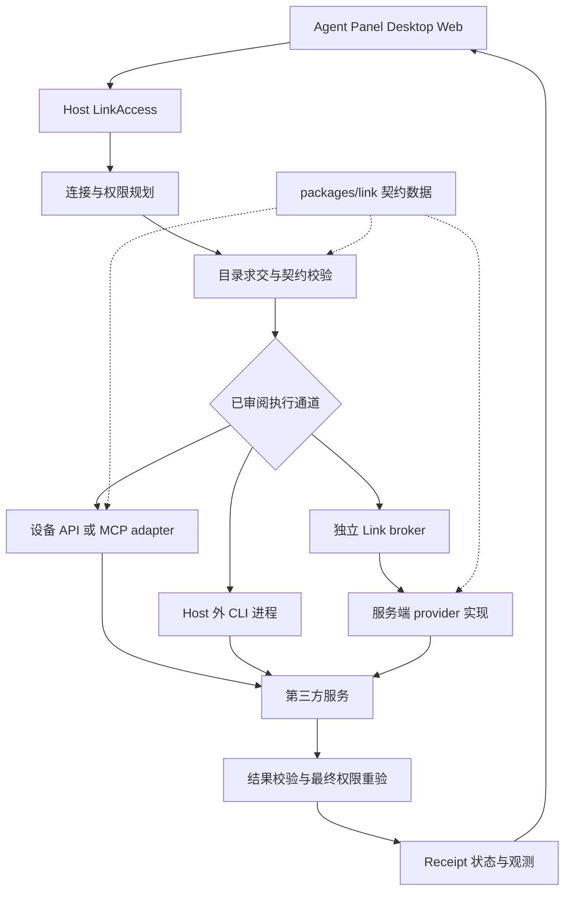

# Link 连接器契约与运行时重构方案

日期：2026-10-16。状态：设计稿（评审修订版），尚未实施。修订内容见文末“修订记录”。

Link 的目标是为 Agent、Panel 和各端客户端提供有明确账号、权限、资源范围和版本的连接能力。建议采用组合式连接器：首轮统一为带契约的 Operation，资源语义作为 Operation 的可选维度，事件订阅单独留接口；连接方式由 `ConnectionRecipe` 枚举，授权、托管、执行位置等字段从 recipe 推导；通过 Host 统一执行入口、动作命名规则和连接状态管理，把第三方差异收进 provider 目录。

旧版 Link 连接记录允许清理并重新连接。首版采用新记录模型，不承担旧 meta 的自动迁移、旧连接 ID 保留或双读兼容；唯一例外是带未决写意图的旧连接，见“旧记录清理与发布切换”。客户端与服务的目录协商仍为长期要求。此次交付为方案修订，尚未清理真实连接或凭据。

本轮先完成按需读取与操作的可靠性、动作契约规则和 provider 抽离。同步、Webhook 和浏览器会话提供扩展位置，在有具体消费者时实现。继续遵守薄云端范围，不新增常驻云端工作台、通用云端脚本执行平台或独立同步调度系统。

## 目标与设计决定

1. 同一 provider 支持多个账号和多种连接方式；每次执行绑定用户明确选择的连接与 grant。
2. 动作的参数、结果语义和错误有稳定契约；破坏性变化以新动作名发布，现有目录按动作名求交即可协商，客户端与服务可独立升级，无共同动作时明确拒绝。
3. 身份授权、技术兼容性、最近可用性分别表示。参数错误与服务故障不破坏有效授权。
4. Core 保持领域无关，Host 提供通用托管与执行机制，provider 目录持有第三方 API 规则。
5. 保留现有凭据加密、CAS 更新、精确资源授权、写操作账本、撤销重验和未知刷新结果保护。
6. 第一版保留 `LinkAction` 的调用外观，清理旧版连接后按新模型重新授权；新连接获得独立稳定 ID，不把旧摘要冒充完整内容。
7. 只为已有消费者建模。没有消费者的维度、版本号和接口只写触发条件，不提前实现。

## 业界参考与采用范围

以下来源核查于 2026-10-16。表中的设计取舍是本方案对 CodeShell 的建议。

| 项目         | 值得借鉴的模式                                                                                                      | CodeShell 的采用方式                                                                                                                                                                                                                                                                             |
| ------------ | ------------------------------------------------------------------------------------------------------------------- | ------------------------------------------------------------------------------------------------------------------------------------------------------------------------------------------------------------------------------------------------------------------------------------------------ |
| Nango        | Auth、Connection 与执行函数分层；函数区分按需操作、同步、Webhook 和连接生命周期。                                   | 分开 provider 定义、部署配置和用户连接，复用公共授权与执行设施。[Auth](https://nango.dev/docs/guides/auth/auth-guide)、[Functions](https://nango.dev/docs/guides/functions/functions-guide)                                                                                                      |
| Activepieces | Piece 组合 auth、actions、triggers；连接器是 npm 包，使用语义化版本；输入、输出或既有行为改变均可能构成破坏性变更。 | 采用声明式定义和破坏性变更判定规则，由相同定义生成校验器、目录及工具参数；首轮不把 provider 实现单独发包。[认证定义](https://www.activepieces.com/docs/build-pieces/piece-reference/authentication)、[版本规则](https://www.activepieces.com/docs/build-pieces/piece-reference/piece-versioning) |
| Composio     | Auth Config 是鉴权蓝图，Connected Account 是具体用户建立的连接。                                                    | 区分部署级 AuthProfile 与用户级 Connection；账户、权限和凭据引用不混入 provider 展示清单。[术语定义](https://docs.composio.dev/reference/glossary)                                                                                                                                               |
| Pipedream    | App 共享认证和公共方法；Action 按需调用；Source 有启停、订阅和事件去重生命周期。                                    | 事件订阅采用独立接口，不塞进一次性的 `execute()`。[Component API](https://pipedream.com/docs/components/contributing/api)                                                                                                                                                                        |
| Airbyte      | `spec/check/discover/read` 分开，读取流带独立状态与 checkpoint。                                                    | 资源读取拆分发现与读取；未来增量同步单独管理 checkpoint，不在连接时默认同步。[协议](https://docs.airbyte.com/platform/understanding-airbyte/airbyte-protocol)                                                                                                                                    |
| MCP          | 工具有输入 Schema、可选输出 Schema，以及工具列表变化机制；远端 annotations 不能天然当作可信权限依据。               | MCP 是一种执行协议；发现的 schema 经过审阅、固定和校验后才进入工具表面，不替代 CodeShell grant。[Tools 规范](https://modelcontextprotocol.io/specification/2026-07-28/server/tools)                                                                                                              |

采用上述模式，自有运行时继续负责权限和结果交付。Nango 当前托管目录允许动作自动更新，并明确建议对稳定契约有要求的应用拉取并部署自有实现；因此 CodeShell 使用固定版本的已审阅实现，运行中的远端目录不能自动替换实现。[稳定性说明](https://nango.dev/docs/guides/functions/functions-guide)

源码公开与宽松开源许可需要区分。Nango 当前为 ELv2；Activepieces 企业目录单独许可，其余适用 MIT；Composio 的 MIT 仓库是 SDK monorepo，不能据此认为托管后端也开源；Pipedream 当前使用 Source Available License。本方案先采用模型，直接引入代码或平台时再核验具体版本、路径及许可。[Nango 许可](https://raw.githubusercontent.com/NangoHQ/nango/master/LICENSE)、[Activepieces 许可](https://raw.githubusercontent.com/activepieces/activepieces/main/LICENSE)、[Composio 仓库](https://github.com/ComposioHQ/composio)、[Pipedream 许可](https://github.com/PipedreamHQ/pipedream/blob/master/LICENSE)

## 现状与本次故障暴露的问题

CodeShell 源码现状以 main `8c872e4bd`（2026-10-16）为准；Services 仍引用 `acb55b1`，本次修订未复核。初稿审计的 `8ca4d2c86` 是 `codex/link/rebuild` 分支上的提交，不在设计工作树基线 `6d835c35d` 的历史中；main 在其后又合入了 `b5464ab7d`、`127746969`、`b31d1d0f3` 三个 Link 修复。设计工作树实施前须 rebase 到 main，并在各工作包开工时重核下表。

| 问题                           | main 现状                                                                                                                                                                                                                              | 剩余设计要求                                                                          |
| ------------------------------ | -------------------------------------------------------------------------------------------------------------------------------------------------------------------------------------------------------------------------------------- | ------------------------------------------------------------------------------------- |
| 能力协商只覆盖动作名称与 scope | `packages/server/src/links/remote-catalog.ts` 仍发送 `{version:1,scopes}`；Services `catalog.mjs` 按 scope 求交。                                                                                                                      | 不扩展协议；改为“破坏性变化必须换动作名”，让名称求交覆盖语义差异。                    |
| 同名 `get_file` 发生语义变化   | `packages/core/src/links/figma.ts:151` 仍对非 `full` 的 `get_file` 自动补 `depth:2`；已记录旧 Services 只收文件 key，返回 `pages` 摘要。                                                                                               | `get_file` 恢复旧契约或退役，设计内容读取以新动作名发布；旧服务不提供新名时报需升级。 |
| 参数错误污染授权               | **已部分修复**（`b5464ab7d`）：`remote.ts` 在 `action` 阶段把 400 归为 `invalid_request`；`token_refresh` 阶段的 400 仍一律归为 `reconnect`，未按已解析的 `brokerErrorCode` 区分 `invalid_grant` 与 `invalid_request/invalid_client`。 | token 阶段按 broker 错误码细分；补齐固定错误表。                                      |
| Host 与 Agent 状态不一致       | **已修复主体**（`127746969`、`b31d1d0f3`）：`credentials/access.ts` 的 IPC snapshot 带 `revision`，拒绝旧 revision；`RemoteLinkActionReply` 携带状态，取消的远程动作保留状态回执。                                                     | 复核本地（非 remote）动作与 MCP 路径是否同样携带 revision；纳入统一管线时不回退。     |
| 类型把不同维度混在一起         | `http-token`、`remote`、`mcp-oauth` 分别混合协议、位置和授权方式。                                                                                                                                                                     | 以 recipe 为主枚举，其余字段推导（见下文）。                                          |
| provider 逻辑跨多处重复        | `core/links`、Host 管理层与独立 Services 均持有参数和 provider 分支。                                                                                                                                                                  | 契约数据集中在 `packages/link`，实现集中在 provider 目录。                            |

初稿已用旧 provider 与完整执行器、合成凭据复现：带 `depth:2` 返回 `400 invalid_request`，第三方数据请求数为零。历史真实请求没有原始 HTTP 状态，不能据此排除当时同时存在上游凭据问题。设计需要分别修复这两类故障，不能把二者继续折叠成重连提示。

## 连接器的分类

### 业务能力：首轮统一为 Operation

首轮只有一个执行入口 `OperationExecutor`，所有按需读取与操作都是 Operation。“资源”不是另一类执行对象，而是 Operation 上的可选维度：

| 维度       | 何时声明                                                                                           | 额外义务                                                                                                 |
| ---------- | -------------------------------------------------------------------------------------------------- | -------------------------------------------------------------------------------------------------------- |
| 无资源维度 | 查询或变更不针对一个可引用的资源，例如查询部署状态、创建 Issue。                                   | 声明 effect 与重复执行规则；写操作复用现有账本。                                                         |
| `resource` | 读取或导出一个可被稳定引用、可被 grant 精确圈定的资源，例如 Figma 节点、GitHub 文件、Notion 页面。 | 输入含 resource selector；结果标明 appliedSelector、内容完整度、截断与后续读取方式；支持有界分页和取消。 |

判别规则：输入里是否有一个会被 grant 的 `selected-resources` 校验的资源引用。有则声明 `resource` 维度，否则不声明。`figma.get_file` 一类读取因此是带 `resource` 维度的 Operation，而不是与 Action 并列的第二套概念。

Event 的订阅与投递生命周期（subscribe/pause/resume/unsubscribe、至少一次投递、去重与游标）与一次性执行不同，保留独立的 `SubscriptionManager` 接口位置，P5 有消费者时实现。

Sync 是由资源读取构成的持久任务，后续复用已有任务/自动化宿主。它持有自己的 checkpoint、删除语义和恢复策略，不是第四种授权方式，也不在本轮创建新同步引擎。

### 执行通道

| 通道            | 协议与适用场景                                                           | 首版范围                                                                |
| --------------- | ------------------------------------------------------------------------ | ----------------------------------------------------------------------- |
| API             | REST/GraphQL 等已审阅 HTTP API，既可设备直连，也可由独立 Link 服务执行。 | 现有十家 provider 的固定动作。                                          |
| MCP             | MCP tools/resources，HTTP 与 stdio 是其传输方式。                        | 现有官方 Figma MCP 和已审阅的 MCP 能力映射。                            |
| CLI             | 调用已审阅命令及参数，复用外部 CLI 登录；进程在 Host 外执行。            | 已有 CLI 绑定与动作。                                                   |
| Browser session | 复用明确选择且授权的浏览器会话，执行经审阅的网站流程。                   | 仅保留扩展位置；依赖现有浏览器权限与任务机制，不开放任意点击/脚本代理。 |

上述通道不决定数据权限。MCP 服务可达、CLI 已登录或 HTTP 返回成功，都不意味着它能替代同一 provider 的其他连接；账号与数据语义必须明确匹配。

### ConnectionRecipe 为主，其余字段推导

现有组合中，凭据托管位置、执行位置与路由都由“授权方式 + 是否经 broker”唯一决定。把它们作为独立字段存储会让非法组合可表示，再需要额外过滤。因此 `ConnectionRecipe` 是连接方式的主枚举，记录中只存 recipe ID，其余字段由 recipe 定义推导，不单独持久化。

| Recipe 自身声明 | 取值                                               | 说明                                                                                                                                                                 |
| --------------- | -------------------------------------------------- | -------------------------------------------------------------------------------------------------------------------------------------------------------------------- |
| Auth strategy   | `none / static-secret / oauth2 / external-session` | static-secret 细分 API key、PAT、Bearer、Basic；OAuth2 grant 细分 authorization-code、device-code、client-credentials，另设 PKCE 策略；未来类型按实际 adapter 接入。 |
| Executor kind   | `api / mcp / cli / browser`                        | 表示执行协议/驱动；真实 transport 由 adapter 配置，例如 MCP streamable-http/stdio、API HTTP、CLI process。MCP OAuth 组合 OAuth2 与 MCP。                             |
| Brokered        | 是/否                                              | 是否经独立 Link 服务中转。中转包含两层授权，不能把下游 Link token 作为上游 token。                                                                                   |

| 推导字段           | 推导规则                                                                                                                                                                                        |
| ------------------ | ----------------------------------------------------------------------------------------------------------------------------------------------------------------------------------------------- |
| Credential custody | brokered → `link-service`（设备只持下游受限凭据）；external-session → `external-session-owner`；其余 → `device-host`。只公开不透明 credentialRef；CLI 或浏览器会话不因绑定而导出 token/cookie。 |
| Executor location  | brokered → `service`；其余 → `device`。不能用它判断第三方 endpoint 在本机还是远端。                                                                                                             |
| Route              | brokered → `brokered`；其余 → `direct`。                                                                                                                                                        |

出现推导规则的反例（例如设备托管凭据但由服务执行）时，再把对应字段升格为 recipe 的显式声明，并为新组合补审阅。

Grant 不属于 recipe：owner、account、operations、resources、有效期和 authority revision 是连接建立后的授权结果；provider scopes、CodeShell grant 与项目/Profile 权限分别求交。

UI 只展示 recipe，例如“GitHub CLI”“Figma API 网页授权”“Figma 官方 MCP”。未安装、未配置或未实现的 recipe 不显示为可用。

### 现有连接如何映射

| 现有方式                | Recipe 声明（授权 / 通道 / brokered）                 | 推导结果（托管 / 执行位置 / 路由）                  |
| ----------------------- | ----------------------------------------------------- | --------------------------------------------------- |
| 手动 PAT/API token      | static-secret / api / 否                              | device-host / device / direct                       |
| GitHub、GitLab 设备授权 | oauth2 device-code / api / 否                         | device-host / device / direct                       |
| 已有 provider CLI 登录  | external-session / cli / 否                           | external-session-owner / device / direct            |
| Remote Link             | 上游 provider OAuth + 下游 CodeShell OAuth / api / 是 | link-service / service / brokered                   |
| Figma 官方 MCP          | oauth2 authorization-code + PKCE / mcp / 否           | device-host / device / direct，连接的是远端官方服务 |

## 核心对象与模块边界

### 核心对象

| 对象                  | 持有的信息                                                                              | 不承担的职责                                             |
| --------------------- | --------------------------------------------------------------------------------------- | -------------------------------------------------------- |
| ConnectorDefinition   | provider 标识、recipes、Operation 列表、契约引用、展示信息。                            | 用户账户、token、远端任意执行规则。                      |
| AuthProfile           | 某个部署使用的 OAuth app、issuer/instance、请求 scopes、回调策略及私有配置引用。        | 某个用户已授权的账号与实际权限。                         |
| Connection            | 稳定 ID、owner、provider/instance/account 身份、recipe ID、AuthProfile 引用、凭据引用。 | 使用显示名称推导身份或权限；存储可由 recipe 推导的字段。 |
| Grant                 | 连接、账号、操作允许集、精确资源范围、有效期及 authority revision。                     | 因目录增加新能力而自动扩权。                             |
| OperationContract     | 动作名、输入/输出 Schema、effect、可选 resource 维度、内容保证、预算、重复执行规则。    | provider 用户凭据或任意 URL/命令模板。                   |
| ConnectionObservation | 最近检查的时间、动作、资源、成功/失败与有效期。                                         | 改变 grant 或账号 authority。                            |

初稿中的 ExecutionBinding（固定 connector 版本、端点身份与部署 revision）推迟：首轮由“动作名 + 固定依赖版本 + Run 内工具表固定”达到同样目的，见“动作契约规则”。出现同一动作名需多实现并存时再引入。

现有 AuthorizationJob 继续作为短期连接任务，绑定 owner、connection、目标 revision、当前 step 和过期时间；不把它当成已建立的 Connection。

Connection ID、Credential ID、上游 remote connection ID 和 Grant ID 分别建模。重新连接时按各自职责创建 ID，不依赖它们相等。私有配置与凭据只以 Host 内部引用连接，不出现在 Agent/Renderer DTO。

### 建议的代码归属

首轮不新增对外发布的 npm 包。每增加一个发布包都会扩大版本 bump 文件集与 `bun.lock` 重生成范围，并把 provider 小修变成“发包 → Services 改依赖并部署 → 发 Host”的串行链路，provider 实现代码也会公开到 npm。

| 模块                                                         | 目标职责与迁移来源                                                                                                                                                                                          |
| ------------------------------------------------------------ | ----------------------------------------------------------------------------------------------------------------------------------------------------------------------------------------------------------- |
| `packages/link`（已发布为 `@cjhyy/code-shell-link`）         | 保持依赖轻量、浏览器安全；承载公共 DTO、错误码、连接步骤，以及各 provider 的 OperationContract 数据（输入/输出 Schema、effect、预算），按 provider 子路径导出。这是 Host 与 Services 之间唯一共享的发布物。 |
| `packages/server/src/links/runtime`，拟新增目录              | 通用连接协调、授权驱动接口、操作规划、契约校验、状态与结果收口；通过注入接口使用凭据库、policy、HTTP、进程与任务能力，不反向依赖 Core。                                                                     |
| `packages/server/src/links/providers/<provider>`，拟新增目录 | recipes、精确资源规范化、参数/结果规则及已审阅执行实现。Desktop 主进程与 TUI 通过 server 的组合入口取用，不另建发布包。                                                                                     |
| `packages/core`                                              | 保留通用 CredentialStore/CAS/cipher 与权限原语；`LinkAction` 消费 provider-neutral LinkAccess。逐步移出 `links/figma*`、`github*`、`providers.ts`、`remote-adapters.ts` 等领域分支。                        |
| `packages/host`                                              | 通过既有通用 adapter/service 机制承载注册、能力发现、审批、取消、进程/任务生命周期；保持 Core-only 依赖，不导入 runtime/provider 实现。                                                                     |
| `packages/server/src/links`（现有）                          | Host 的连接管理 API、授权 job coordinator 和会话归属；继续复用已有 OAuth adapter seam，逐步组合 runtime 目录。                                                                                              |
| `packages/desktop`                                           | OS 安全存储、系统浏览器/回调、原生会话和 IPC adapter；provider 逻辑通过审阅入口组合。Renderer 消费 Host DTO，不引入 Node executor。                                                                         |
| `codeshell-services/apps/link-server`                        | 独立 OAuth broker、上游凭据托管、下游 grant 与受限执行；固定精确版本消费 `@cjhyy/code-shell-link` 的契约数据并以其校验自身实现，执行实现留在 Services 仓库，保留自己的数据库与服务部署。                    |
| Panel 与资料集                                               | 通过 LinkAccess 消费授权后的资源/动作；文档编辑、数据加工、业务同步策略继续由 Panel 或资料集能力持有。                                                                                                      |

依赖方向：`packages/host` 继续只依赖 Core；runtime 与 provider 目录依赖 `packages/link`，不 import Core/Host 的实现。**Core 依赖 `packages/link` 是新增的依赖边**（main 上只有 server 与 desktop 依赖它），在 P2 引入 LinkAccess 契约类型时建立，须保持 `packages/link` 无 Node 运行时依赖。Desktop、serve/Server、TUI 的组合入口负责实例化 runtime/provider，并向 Core 的 LinkAccess 和 Host 通用服务注册机制注入实现。

现有 CredentialStore 暂留 Core，通过 `CredentialRepository`/`CredentialCustodian` 接口注入；provider 实现不能获得整个 Core。Services 只使用版本化公开包，不引用兄弟仓库源码或临时 worktree。

升格为独立发布包的触发条件：第三方或 Services 需要直接复用 provider 执行实现，而不只是契约数据。



执行路径经过统一机制，provider 只提供其领域映射。该图表达目标职责，不表示所有目录或通道已经实现。

## 动作契约规则

### 破坏性变化必须换动作名

动作名就是契约身份。以下任一变化都发布新的动作名，旧名保持原语义直至明确退役：

- 删除、重命名或改变类型的输入参数；
- Host 会发送的新增输入参数，包括可选参数（不能因为 npm 次版本兼容就对旧服务发送新字段）；
- 删除、重命名或改变类型的输出字段；
- 默认行为、内容范围或完整度保证的改变。

只新增输出字段、且旧消费者忽略它不改变语义时，可沿用原名。新增动作不自动加入已有 grant。

命名建议为 `<provider>.<语义名>`，语义名直接表达内容差异（例如摘要与设计内容使用不同名称）；只有语义名无法区分时才用 `@2` 等后缀。具体名称由实现工作包确定。

### 协商沿用 v1 目录

1. Host 加载固定且已审阅的本地契约/实现集合；远端目录只提供候选动作名。
2. 现有 v1 目录（`{version:1,scopes}` 与 Services 按 scope 求交）不改格式，旧服务不提供的动作名自然不在交集中。
3. 选择双方共同提供的动作名，再与 grant、项目/Profile、当前调用权限求交。对 broker 动作，grant 仍在服务端逐次验证。`LinkAction` 的可用动作参数由求交结果生成。
4. Run 的工具定义固定所选动作与参数 schema。执行端在 Run 中途不再提供该动作时返回 `contract_changed`，当前调用不自动改用其他动作或重解释参数。
5. 服务不认识的动作名在第三方调用前拒绝，返回 `unsupported_contract`。
6. 任务需要的动作不在交集中时，向用户报告“服务需升级”，不回退到语义不同的旧动作。现行 Figma 方案已明确不新增摘要冒充设计内容的兼容路径。

CI 门禁：`packages/link` 中每个动作的规范化 Schema 生成快照并入库；快照变化若不属于“允许沿用原名”的情况，CI 失败并要求换名。这把“契约漂移”从运行时 digest 校验前移到合并前。

不要把兼容性协商结果永久绑定在 OAuth token scope 中。Connection 保留权限与身份；动作可用性每次从目录求交得出。版本升级通常不需要重新连接，新增权限或资源范围仍需单独同意。

### 保留的版本号

| 字段                                     | 含义                                                                                    |
| ---------------------------------------- | --------------------------------------------------------------------------------------- |
| `protocolVersion`                        | Host/broker 消息及目录格式，即现有 v1。                                                 |
| `@cjhyy/code-shell-link` 包版本          | 契约数据版本，按 SemVer 发布，Services 固定精确依赖。                                   |
| `deploymentRevision`                     | 实际部署 build，关联可观测性和配置变化。                                                |
| `authorityRevision / credentialRevision` | 分别记录授权变化与凭据轮换；运行观测存独立记录，不占 revision。数据库 schema 另行管理。 |

### 推迟项：v2 契约协商

初稿中的 `/api/v2/links/capabilities`、v2 envelope、`contractVersion/contractDigest`、`bindingRevision` 推迟。触发条件任一满足时单独评审：

- 同一动作名需要多个契约版本在同一部署中并存；
- 需要按动作协商预算/限制等目录无法表达的参数；
- 第三方开发者发布 provider，无法依赖仓库内 CI 快照约束命名。

届时保留 v1 的旧格式与严格 header 解析，不在原 header 里塞未知字段；旧服务对 v2 返回明确 404/501 才可回落 v1，网络错误、403、5xx、坏响应不能被当成旧版本。

### Figma 示例

`get_file` 恢复为不自动补 `depth` 的旧契约（或在 Services 侧明确退役），设计内容读取以新动作名发布，其契约数据示例：

```json
{
  "operationId": "figma.<设计内容读取动作名>",
  "inputSchemaRef": "figma.<设计内容读取动作名>.input",
  "outputSchemaRef": "figma.<设计内容读取动作名>.output",
  "effect": "read",
  "resource": {
    "kind": "figma-node",
    "contentKind": "figma-document",
    "defaultDepth": 2,
    "coverage": "requested-subtree"
  },
  "limits": {
    "maxResponseBytes": 8388608,
    "maxSelectedNodes": 50
  }
}
```

保留当前 Figma 的响应和节点预算。完整度以本次请求范围为基准：默认 depth=2 的结果不能声称整个文件完整；所有返回必须标明 appliedSelector、覆盖范围、截断和后续读取方式。缺少 `document` 的旧摘要不满足该动作。

## 执行结果 错误与状态

### 统一执行管线

`resolve connection → verify owner/account/grant → select operation → validate input/resource → approve if required → obtain scoped credential access → execute once → validate result → recheck authority/revocation → persist receipt and observation → publish`

纯参数、契约和资源校验尽量在凭据刷新与第三方请求之前完成。刷新前仍需重新确认授权；执行和返回前分别检查撤销及账号替换。写操作使用现有 operation ledger 的 intent、审批与 unknown outcome 规则，不另建账本。

接口族：`ConnectionManager` 管理连接/授权/撤销，`OperationExecutor` 管理全部按需 Operation；`SubscriptionManager` 只保留接口位置。provider adapter 接收受限执行上下文，不获得 Host 全局凭据库或任意 Shell/HTTP 权限。

公共 outcome 包含 operation/request ID、所选动作、脱敏状态、authority revision、结果完整度及固定错误；敏感 token、授权码、原始上游异常和请求头不进入 DTO。内部可关联日志保留固定阶段及安全错误分类，复用 main 已有的 `RemoteLinkExecutionDiagnostic`（`preflight / token_refresh / action / state_write`）。

### 错误与状态变化规则

| 固定错误                                                    | 处理                                               | 是否改变授权状态                    |
| ----------------------------------------------------------- | -------------------------------------------------- | ----------------------------------- |
| `invalid_input / unsupported_contract / contract_changed`   | 修正参数或升级服务/重新发现目录。                  | 否。                                |
| `resource_not_granted / permission_denied`                  | 指明当前资源/动作缺授权；按需发起显式增权流程。    | 不自动撤销整个连接。                |
| `reauthorization_required / grant_revoked`                  | 对匹配的连接与 grant 标记需重连或撤销。            | 是，以确证原因处理。                |
| `refresh_outcome_unknown`                                   | 停止使用旧刷新令牌，保留持久状态，要求重连。       | 是；单独呈现不确定原因。            |
| `rate_limited / upstream_unavailable / timeout`             | 返回有界恢复建议；仅按动作重复执行规则决定重试。   | 否。                                |
| `invalid_result / response_too_large / content_unavailable` | 返回契约/内容错误，保留有效授权。                  | 否。                                |
| `write_outcome_unknown`                                     | 保留既有 intent 阻断，执行独立只读核查或人工处理。 | 不依据未知业务结果判定 token 失效。 |

Token endpoint 的 `400 invalid_grant` 与业务接口的 `400 invalid_request` 必须区别。main 已在 action 阶段做到；token_refresh 阶段仍需按已解析的 `brokerErrorCode` 细分：只有 `invalid_grant`、`grant_revoked` 等确证失效码进入 `reauthorization_required`，`invalid_request/invalid_client/unsupported_grant_type` 属于实现或配置错误，不诱导用户重连。错误正文有大小上限，只解析固定字段、白名单 code/stage/requestId；不把上游 HTML 或任意异常文本透传给 Agent。

未知刷新结果继续采用单次发送与持久防重放。HTTP 方法是 POST 不代表写业务，动作标注只读也不证明刷新可重试；凭据轮换、业务副作用和传输失败分别处理。

### 连接状态分层

建议公开状态为三个对象：

- `authorization`：未连接、待授权、已授权、需重新授权、撤销中、已撤销。
- `compatibility`：当前任务所需动作在目录交集中可用、需升级服务或无对应能力。
- `observation`：未检查、某次检查成功或失败，以及 checkedAt、操作、资源和 freshness。

成功重连表示授权与连接记录安装成功，不能宣称所有动作都实时可用。用户可以看到“已连接；设计内容读取需更新服务”，参数不兼容不会再次诱导其授权。

Host 为状态权威。main 已实现 snapshot revision 单调递增与 remote 动作回复携带状态（`credentials/access.ts`）；统一管线须把同一机制推广到本地 API、CLI 与 MCP 动作，并保持以下性质：执行响应携带与该操作同一 authority 的状态变化和 revision；接收方不得应用旧 revision；snapshot 先到导致当前 IPC 被取消时，调用者仍需收到本次固定错误，其他已失效调用则及时取消。

`linkLastVerifiedAt` 目前参与 authority 比较（例如 `figma-mcp.ts` 与 `operation-recovery.ts` 的 authority 快照），迁移时不能把它复用为健康检查时间。可变观测记录存入独立记录；token 轮换只变 credentialRevision；账号、资源或 grant 的替换才改变 authorityRevision。

## 资源与权限抽象

资源引用包含 provider/instance、account、connection、资源类型与 provider 规范化 ID。内容有来源、取得时间、格式和版本；资源 ID 由 provider adapter 解释，不强迫 Figma 节点、GitHub 仓库、Slack channel 共用一个字符串规则。

授权按明确 selector 表达：资源发现权限、选定文件/仓库、子节点/路径和操作允许集分别建模。范围种类区分 `selected-resources` 与 `upstream-scoped`，未验证的范围不可执行，避免把不同连接的空值解释成同一种权限。Figma 显式 `selected-resources: []` 继续表示无文件权限；PAT/CLI 的原生权限模型不能据此推导。

发现到的资源、展示标签和最近列出的资源都不是 grant。尤其旧 `linkResourceLabels` 可能只是有数量上限的预览，不复用于新授权。所有新连接重新核验账号、实际 scopes 和资源范围；broker 的 `resourceGroups` 必须来自本次已验证 grant，PAT/CLI 则明确记录原生权限与 Host 约束来源。

重新连接时明确展示将授予的操作与范围；添加精确 selector 或扩大范围需要明确同意，不能把清理重建当作自动增权。

CLI 或 MCP 无法施加与 REST 相同的上游细粒度范围时，Host 仍须在已审阅动作映射处限制并如实呈现约束，不伪造“上游已按文件授权”的保证。

已有资料集、上传文件和本地文件授权继续使用现有资源句柄，不再造第二套文件库。Panel 接收授权后的引用与内容回执；索引、OCR、文档转换和领域工作流由其原有拥有者实现。

可执行权限为 Host 审阅能力、实际 executor 支持、账号/凭据权限、CodeShell grant、项目/Profile 和本次审批的交集。目录、schema、工具描述及第三方返回内容均不能自行扩大此集合。没有共同权限时拒绝，不自动换账号、通道或连接。

## 渐进实施与工作包

所有工作包均为待办。当前计划只定义改造，不启动第三方接入、授权、部署或正式发布。每个工作包开工前先在 rebase 后的 main 上重核“现状”表对应行。

| 阶段                | 工作包与主要位置                                                                                                                                                                                                             | 完成条件                                                                                                      |
| ------------------- | ---------------------------------------------------------------------------------------------------------------------------------------------------------------------------------------------------------------------------- | ------------------------------------------------------------------------------------------------------------- |
| P0 故障路径（剩余） | `core/links/remote.ts` 的 token_refresh 阶段按 `brokerErrorCode` 细分；核对本地 API/CLI/MCP 动作是否同样携带状态 revision，缺失则补齐。                                                                                      | token 阶段非 `invalid_grant` 的 400 不诱导重连；所有动作类型的错误都不会被 snapshot 吞掉。                    |
| P1 契约规则         | `packages/link` 增加 OperationContract 数据、固定错误与 outcome 类型；Figma 设计内容读取以新动作名发布，`get_file` 恢复旧契约或退役；CI Schema 快照门禁。不改目录协议。                                                      | 新 Host 连接旧服务时，在业务请求前由目录交集判断能否满足任务；已有 grant 与资源不变；契约漂移在合并前被拦截。 |
| P2 运行时接口       | 在 `packages/server/src/links/runtime` 引入小型运行时；建立 Core → `packages/link` 依赖；注入凭据、policy、任务和传输；现有执行实现通过 adapter 接入；采用 recipe 为主的新记录模型与分层状态；按下文规则清理旧版 Link 记录。 | LinkAction 外观保持，新连接按新模型建立；旧引用明确失效，只有一个执行/结果交付管线。                          |
| P3 代表性迁移       | Figma + GitHub 进入 `links/providers/`，覆盖 PAT、设备 OAuth、CLI、broker、MCP，以及读取/导出/写操作。                                                                                                                       | Core 不再持有这两家领域参数与结果规则；直接与中转契约一致且权限不扩大。                                       |
| P4 收口             | 其余 provider 迁移；CLI/HTTP/MCP adapter 使用同一 registry；删除已替代分支，升级管理 UI。                                                                                                                                    | 所有既有 provider 通过同一契约工具链，Desktop/TUI/serve/Web 按实际宿主能力呈现。                              |
| P5 按需扩展         | 有消费者后实现 Event subscriptions、Sync checkpoints、浏览器会话 recipes；满足触发条件时评审 v2 契约协商与独立发包。                                                                                                         | 每项有独立生命周期、消费方和可验证恢复语义；不反向拖延 P0–P4。                                                |

依赖顺序是 P0 → P1 → P2 → P3 → P4；P0 剩余项与 P1 可并行。P3 的两个 provider 可在 P2 接口固定后并行。P5 单独评审。优先用纵向迁移证明抽象，再扩展其余 provider；不先一次性重写全部文件。

### 旧记录清理与发布切换

清理流程按“禁用 → 收口未决写 → 尽力撤销 → 删除”执行，不引入独立的清理票据状态机。

1. **清单**：只包含明确由旧版 Link 拥有的连接记录、绑定、缓存和其独占凭据。普通模型/MCP 凭据、聊天、项目文件、资料集内容与其他应用记录不在清理范围；不能整体删除 `credentials.json` 或清空 Keychain。
2. **禁用**：旧连接停止接受新调用，等待或取消在途请求。禁用状态写入旧记录本身（CAS 更新），新版只读取这个禁用标记与下一步所需的账本关联，不双读其他旧 meta。
3. **收口未决写意图**：现有账本以 `account.id = meta.linkAccountId ?? null` 加 `connectionId` 标识执行身份（`operation-recovery.ts`）。新连接换了 ID，因此：
   - 旧连接名下存在 `write_outcome_unknown` 等未决写意图时，该旧连接保持禁用、不删除，在管理 UI 显示“有未决写操作”，先完成只读核查或人工处理；
   - 未决期间，新连接对同一 provider 的写操作按以下规则阻断：未决项 `account.id` 非空时按 provider + account + target 阻断；为空时按 provider + target 保守阻断，不依赖账号匹配；
   - 只读操作不受影响。业务 operation ledger 不随连接记录删除，不能靠更换 connection ID 绕过防重放。
4. **尽力撤销**：没有未决写意图的旧连接，按旧 connection/grant 精确撤销下游授权；本地 OAuth 按 provider 已公布能力处理吊销。共享上游账号与其他 grant 不能连带删除；可能影响共享账号或新凭据的吊销不自动执行。CLI/浏览器只删除 Link 绑定，不默认退出外部登录。
5. **删除**：撤销成功后删除旧记录与其独占凭据，失效项目/Profile/资料集中的连接引用并提示重新选择。撤销失败或结果不明时，保留禁用的旧记录与凭据，在 UI 显示“远端授权未撤销”并允许用户重试或手动处理；不能先丢弃唯一凭据再声称远端已撤销。
6. **新记录**：新版只写带 `recordSchemaVersion` 的连接模型。用户重新连接时创建新的连接/凭据/grant ID，重新验证账号、权限和资源范围；不从旧 labels、scopes 预览或旧工具缓存推导授权。未知刷新票据按既有安全规则处理，不能恢复旧 token。
7. **发布顺序**：发布 `@cjhyy/code-shell-link` 契约数据，Services 固定精确依赖并部署新动作，再发布 Host。清理旧数据不意味着客户端和服务永远同步升级：目录求交、`unsupported_contract` 与跨版本验收仍保留。
8. **部署与回滚**：部署后记录准确 build、提供的动作名和已授权的只读验证结果。回滚保留最新凭据/账本/数据库，不恢复已删除连接或被消费的旧 token；旧客户端无法理解新记录时清楚拒绝。数据库兼容性单独验证。

如需比第 5 步更强的保证（例如进程崩溃后自动续做撤销），再引入持久清理票据与 tombstone，作为单独评审项。

`packages/server` 的 Host 管理 API 与 Services 的 OAuth broker 是两个边界；对应修改在各自仓库、独立 task branch/worktree 中实施。与平台 HostRuntime/PolicyEngine 收敛复用同一套机制，避免产生第二个审批器或任务宿主。

## 验收要求

### 跨版本与协议

| 组合/场景             | 必须验证的结果                                                                        |
| --------------------- | ------------------------------------------------------------------------------------- |
| 旧 Host × 旧 Services | 既有固定动作按原契约工作。                                                            |
| 旧 Host × 新 Services | 旧动作名仍提供时语义保持；退役时清楚拒绝，不返回伪兼容结果。                          |
| 新 Host × 旧 Services | 新动作名不在交集中；完整设计要求明确需升级；不发送旧服务不支持的参数、不改变授权。    |
| 新 Host × 新 Services | 交集包含新动作，输入/输出及内容范围都通过验证。                                       |
| 运行中部署变化        | 动作在 Run 中途消失时返回 `contract_changed`，不在同一 Run 中静默换 schema 或换动作。 |

Fixture 必须执行旧版本真实参数解析器和实际 HTTP 边界。不能只用宽松 mock 返回一个旧响应形状：本次 `depth` 不兼容正是这种测试漏项。保留 Core、Host、broker 和 provider 的边界测试；Schema 快照门禁在 CI 阻止未声明的契约漂移。

### 权限 状态与故障

- 参数错误、契约不兼容、429/5xx/网络失败不改变授权；token endpoint 的 invalid_grant、明确撤销与未知刷新按各自规则处理；token 阶段其他 400 不诱导重连。
- Main/Worker/Renderer 状态 revision 一致；覆盖状态事件与错误响应两种到达顺序，以及旧响应不能覆盖新连接；本地 API、CLI、MCP 与 remote 动作均覆盖。
- 账号替换、项目同 ID 覆盖、资源撤销、刷新中移除连接和返回前撤销均不能交付越权结果。
- CLI session 不导出 token；MCP 配置/endpoint/schema 变化与旧 Run 正确隔离；未知工具不能因发现而自动授权。
- 资源分页、大小限制、depth、摘要/全文与截断语义可验证；查询成功但无实际内容不能报告任务完成。
- 写操作超时保留 unknown，不能重复执行；独立只读检查只能报告当前观测，不能伪造原写操作成功回执。
- 旧连接带未决写意图时不被删除；新连接（含 `account.id` 为空的场景）对同一 target 的写操作被阻断，直至未决项收口。
- 远端撤销失败时旧凭据保留且 UI 显示未撤销，不报告清理完成。
- 包安装、服务启动与恢复采用隔离 HOME、合成凭据和精确 origin guards；真实账号、正式包与生产部署分别验收，不由 fixture 代替。

### 首轮结束标准

首轮 P0–P4 的结束标准是：破坏性变化都以新动作名发布且有 CI 门禁；新旧组合要么按目录交集执行，要么在副作用前清楚拒绝；普通请求失败不损坏授权；所有现有连接通道都由统一权限与结果管线管理；Core 不再随 provider 参数变化而修改领域分支。

Event、Sync、浏览器会话、v2 契约协商与独立发包不作为首轮完成条件。通用 OAuth、加密托管、精确 grants、写操作账本和取消机制在每个阶段保持可用；已清理的旧连接需要重新建立，带未决写意图的旧连接在收口前保留。

## 与现有计划的关系

本方案补齐 [Link 目录能力协商](link-catalog-compatibility-delivery.md) 未覆盖的同名动作契约演进，沿用 [授权 UI 通用化](link-authorization-ui-unification.md) 的步骤模型和两段授权边界。Figma 任务按 [Figma MCP 与 REST 规划](figma-link-mcp-plan.md) 提供实际消费者；资源绑定延续 [Workspace 数据源 ADR](workspace-datasource-binding-adr.md)。宿主注册与执行遵守 [平台收敛方案](../architecture/16-platform-consolidation.md)。

路线图入口位于根目录 `TODO.md`。实施时先更新对应工作包的准确源码、验证与部署状态，再关闭待办，避免用设计稿代替交付记录。

## 修订记录

2026-10-16 评审修订，相对初稿（`39c2d1a6e`）：

| 变更                                                                                                                                                    | 原因                                                                                                                                                                           |
| ------------------------------------------------------------------------------------------------------------------------------------------------------- | ------------------------------------------------------------------------------------------------------------------------------------------------------------------------------ |
| 源码基线改为 main `8c872e4bd`，现状表标注已修复项，P0 收窄为剩余项。                                                                                    | 初稿审计提交 `8ca4d2c86` 不在工作树基线历史中；main 已合入 `b5464ab7d`（action 阶段 400 分类）、`127746969`（snapshot 原子同步与 revision）、`b31d1d0f3`（取消动作保留回执）。 |
| 版本协商改为“破坏性变化必须换动作名 + CI Schema 快照”，v2 capabilities/envelope/contractDigest/bindingRevision 与 ExecutionBinding 推迟并写明触发条件。 | 初稿自身规定破坏性变化需新契约；若新契约即新动作名，现有 v1 按名求交已能覆盖 `get_file` 故障，无需新协议面。                                                                   |
| Resource/Action/Event 三分类改为统一 Operation + 可选 resource 维度，Event 留接口。                                                                     | 初稿中 Resource 读取与只读 Action 走同一执行管线，且无判别规则；首轮只有一个执行器。                                                                                           |
| 六个维度改为 recipe 主枚举，托管位置/执行位置/路由由 recipe 推导、不持久化。                                                                            | 现有全部组合中这三项由“授权方式 + 是否 brokered”唯一决定，独立存储会让非法组合可表示。                                                                                         |
| 补充未决写意图的清理规则与 `account.id` 为空时的保守阻断。                                                                                              | 账本以 `linkAccountId ?? null` 加 connectionId 标识身份；不双读旧 meta 时，新连接无法关联 `account.id` 为空的旧未决项，初稿“不能靠换 ID 绕过防重放”的要求无法成立。            |
| 清理流程简化为“禁用 → 收口未决写 → 尽力撤销 → 删除”，撤销失败时保留禁用记录，去掉清理票据/tombstone 状态机。                                            | 允许清理旧连接的初衷是简化；初稿的清理流程复杂度接近一次迁移。更强保证列为单独评审项。                                                                                         |
| 首轮不新增发布包：契约数据并入已发布的 `packages/link`，runtime/provider 实现放在 `packages/server/src/links/` 下的目录。                               | 新发布包会扩大版本 bump 与 lockfile 范围，并把 provider 小修串成跨仓库发包部署链，provider 实现也会公开发布到 npm。                                                            |
| 标明 Core → `packages/link` 为新增依赖边。                                                                                                              | main 上只有 server 与 desktop 依赖 `@cjhyy/code-shell-link`。                                                                                                                  |
